# Analisi Matematica 1A

**Appunti del corso · a.a. 2026/27 · Mobius**

Appunti personali e non ufficiali, rivisti e confrontati con il programma ufficiale del corso. Non sostituiscono le lezioni né i testi consigliati.

## Indice

1. Numeri reali e funzioni
2. Successioni e limiti
3. Continuità e confronto locale
4. Derivate e teoremi del valor medio
5. Monotonia, convessità, studio di funzione e Taylor

## 1 · Numeri reali e funzioni

**In questo modulo.** Non servono prerequisiti oltre all'algebra delle superiori. Si costruisce il linguaggio su cui poggia tutto il corso: gli insiemi numerici e le proprietà che distinguono $\mathbb{R}$ da $\mathbb{Q}$, in particolare la completezza; il valore assoluto e gli intervalli; estremo superiore e inferiore. Poi si passa alle funzioni: dominio, immagine, grafico, iniettività, inversa, composizione e monotonia, e alle funzioni elementari con i loro grafici. Alla fine del modulo si sanno leggere e scrivere con precisione definizioni ed enunciati, si riconoscono le proprietà di una funzione dal suo grafico e si determinano dominio e immagine delle funzioni elementari e delle loro composizioni.

### 1.1 Insiemi numerici

I **numeri naturali** sono $\mathbb{N} = \{0, 1, 2, 3, \dots\}$; con $\mathbb{N}_0 = \mathbb{N} \setminus \{0\}$ si indicano i naturali positivi. In $\mathbb{N}$ la somma e il prodotto di due elementi restano in $\mathbb{N}$, la differenza no: $2 - 5$ non è un numero naturale. Per poter sempre sottrarre si passa ai **numeri interi** $\mathbb{Z} = \{\dots, -2, -1, 0, 1, 2, \dots\}$, nei quali però non si può sempre dividere.

I **numeri razionali** sono le frazioni $\frac{n}{m}$ con $n \in \mathbb{Z}$ e $m \in \mathbb{N}_0$, dove due frazioni rappresentano lo stesso numero quando $\frac{n}{m} = \frac{n'}{m'} \iff n m' = n' m$. In $\mathbb{Q}$ si può dividere per ogni numero diverso da zero.

Ogni razionale ha una scrittura decimale

$$q = c_k c_{k-1} \dots c_1 c_0 , d_1 d_2 d_3 \dots = c_k \cdot 10^k + \dots + c_1 \cdot 10 + c_0 + \frac{d_1}{10} + \frac{d_2}{10^2} + \dots$$

e si presentano solo due casi: la sequenza delle cifre decimali termina, come in $0{,}15 = \frac{15}{100} = \frac{3}{20}$, oppure non termina ma da un certo punto in poi si ripete con un periodo, come in $0{,}\overline{3} = \frac{1}{3}$. Viceversa, ogni scrittura decimale finita o periodica rappresenta un razionale.

> [!nota]
> La scrittura decimale non è sempre unica: $0{,}\overline{9} = 1$. Infatti, posto $x = 0{,}\overline{9}$, si ha $10x - x = 9{,}\overline{9} - 0{,}\overline{9} = 9$, quindi $x = 1$.

Le scritture decimali infinite e non periodiche corrispondono ai **numeri irrazionali**, come $\sqrt{2}$ o $\pi$ (il rapporto fra la lunghezza di una circonferenza e il suo diametro). Razionali e irrazionali insieme formano i **numeri reali** $\mathbb{R}$. In $\mathbb{R}$ un'equazione come $x^2 = 2$ ha esattamente due soluzioni, $x = \sqrt{2}$ e $x = -\sqrt{2}$, mentre in $\mathbb{Q}$ non ne ha nessuna.

> [!aggiunta] Aggiunta in revisione · fonte: Canuto-Tabacco, *Analisi Matematica 1*, cap. 1 (AM1A-01)
> **$\sqrt{2}$ non è razionale.** Se fosse $\sqrt{2} = \frac{n}{m}$ con la frazione ridotta ai minimi termini, si avrebbe $n^2 = 2m^2$: allora $n^2$ è pari, quindi anche $n$ è pari, $n = 2h$. Sostituendo, $4h^2 = 2m^2$, cioè $m^2 = 2h^2$, e anche $m$ è pari. Ma $n$ e $m$ non possono essere entrambi pari in una frazione ridotta: l'ipotesi è assurda.
>
> **La retta orientata.** Fissati su una retta un punto $O$, un verso di percorrenza e un'unità di misura, a ogni numero reale $x$ corrisponde uno e un solo punto, a distanza $|x|$ da $O$, dalla parte positiva se $x > 0$ e da quella negativa se $x < 0$; e viceversa ogni punto corrisponde a un reale. Per questo si parla indifferentemente di "numeri" e di "punti" della retta reale. I razionali non bastano a riempirla: il punto a distanza $\sqrt{2}$ da $O$ non corrisponde a nessun razionale. Eppure i razionali sono **densi**: fra due reali distinti $a < b$ c'è sempre un razionale, e quindi infiniti.

I numeri reali hanno tre gruppi di proprietà. Le **proprietà algebriche** sono quelle di somma e prodotto, con sottrazione e divisione per numeri non nulli. L'**ordinamento** è **totale**: dati due reali $x$ e $y$ vale sempre $x \le y$ oppure $y \le x$, e l'ordine è compatibile con le operazioni (se $x \le y$ allora $x + z \le y + z$ e, per $z > 0$, $xz \le yz$). La terza è la **completezza**, che distingue $\mathbb{R}$ da $\mathbb{Q}$ e si vede nel paragrafo 1.3.

### 1.2 Valore assoluto e intervalli

> [!definizione] Valore assoluto
> Dato $x \in \mathbb{R}$, il suo **valore assoluto** (o modulo) è
> $$|x| = \begin{cases} x & \text{se } x \ge 0 \\ -x & \text{se } x < 0. \end{cases}$$

Sulla retta orientata $|x|$ è la distanza di $x$ dall'origine, e $|x - y|$ la distanza fra $x$ e $y$. Per ogni $x, y \in \mathbb{R}$ valgono $|xy| = |x|\,|y|$ e la **disuguaglianza triangolare**

$$|x + y| \le |x| + |y|.$$

Da questa segue una disuguaglianza che si usa spesso nelle stime:

$$\big|\, |x| - |y| \,\big| \le |x - y|.$$

Per dimostrarla si scrive $x = (x - y) + y$ e si applica la disuguaglianza triangolare: $|x| \le |x - y| + |y|$, cioè $|x| - |y| \le |x - y|$. Scambiando i ruoli, $|y| = |(y - x) + x| \le |y - x| + |x|$; poiché $|y - x| = |x - y|$, si ottiene $|y| - |x| \le |x - y|$, ossia $-|x - y| \le |x| - |y|$. Le due stime insieme dicono che $|x| - |y|$ sta fra $-|x - y|$ e $|x - y|$, che è la tesi.

> [!definizione] Intervalli
> Dati $a, b \in \mathbb{R}$ con $a < b$:
>
> - intervallo **chiuso** $[a, b] := \{x \in \mathbb{R} : a \le x \le b\}$;
> - intervallo **aperto** $(a, b) := \{x \in \mathbb{R} : a < x < b\}$;
> - intervalli **semiaperti** $[a, b) := \{x : a \le x < b\}$ e $(a, b] := \{x : a < x \le b\}$;
> - intervalli **illimitati** $[a, +\infty) := \{x : x \ge a\}$, $(a, +\infty)$, $(-\infty, b]$, $(-\infty, b)$, e $(-\infty, +\infty) = \mathbb{R}$.

I simboli $+\infty$ e $-\infty$ non sono numeri reali: servono solo a scrivere in breve gli intervalli illimitati, e per questo dalla loro parte la parentesi è sempre tonda.

### 1.3 Estremo superiore e inferiore

> [!definizione] Maggioranti, minoranti, insiemi limitati
> Sia $A \subseteq \mathbb{R}$ non vuoto. Un numero $b \in \mathbb{R}$ è un **maggiorante** di $A$ se $x \le b$ per ogni $x \in A$; un numero $a \in \mathbb{R}$ è un **minorante** di $A$ se $a \le x$ per ogni $x \in A$. L'insieme $A$ è **limitato superiormente** se ha almeno un maggiorante, **limitato inferiormente** se ha almeno un minorante, **limitato** se è entrambe le cose.

> [!definizione] Massimo e minimo
> Un numero $x_0$ è il **massimo** di $A$, e si scrive $x_0 = \max A$, se $x_0 \in A$ e $x \le x_0$ per ogni $x \in A$: è un maggiorante che appartiene ad $A$. Analogamente il **minimo** $\min A$ è un minorante che appartiene ad $A$.

Un insieme limitato può non avere massimo: $A = [0, 1)$ ha come maggioranti tutti i numeri $\ge 1$, ma nessuno di essi sta in $A$. Il numero 1 resta comunque speciale: è il più piccolo dei maggioranti.

> [!definizione] Estremo superiore e inferiore
> Sia $A \subseteq \mathbb{R}$ non vuoto e limitato superiormente. L'**estremo superiore** di $A$ è il più piccolo dei suoi maggioranti:
> $$\sup A := \min\{b \in \mathbb{R} : b \text{ è maggiorante di } A\}.$$
> Se $A$ è limitato inferiormente, l'**estremo inferiore** è il più grande dei minoranti: $\inf A := \max\{a \in \mathbb{R} : a \text{ è minorante di } A\}$. Se $A$ non è limitato superiormente (inferiormente) si pone $\sup A = +\infty$ ($\inf A = -\infty$).

Quando il massimo esiste coincide con l'estremo superiore. Nella pratica si usa quasi sempre la caratterizzazione seguente.

> [!teorema] Caratterizzazione dell'estremo superiore
> Sia $A \subseteq \mathbb{R}$ non vuoto e limitato superiormente. Un numero $S \in \mathbb{R}$ è l'estremo superiore di $A$ se e solo se
>
> 1. $x \le S$ per ogni $x \in A$, cioè $S$ è un maggiorante;
> 2. per ogni $\varepsilon > 0$ esiste $x \in A$ con $x > S - \varepsilon$, cioè nessun numero più piccolo di $S$ è un maggiorante.

La seconda condizione è la traduzione di "è il più piccolo dei maggioranti": se $z < S$, allora $z$ non è un maggiorante, quindi esiste $x \in A$ con $x > z$. Basta prendere $z = S - \varepsilon$.

L'esistenza dell'estremo superiore non è un fatto ovvio, ed è proprio ciò che rende $\mathbb{R}$ diverso da $\mathbb{Q}$.

> [!teorema] Assioma di completezza
> Ogni sottoinsieme di $\mathbb{R}$ non vuoto e limitato superiormente ammette estremo superiore in $\mathbb{R}$. (Allo stesso modo, ogni sottoinsieme non vuoto e limitato inferiormente ammette estremo inferiore.)

> [!esempio] La completezza e $\sqrt{2}$
> L'insieme $A = \{q \in \mathbb{Q} : q > 0,\ q^2 < 2\}$ è non vuoto (contiene 1) e limitato superiormente (2 è un maggiorante, perché se $q \ge 2$ allora $q^2 \ge 4$). In $\mathbb{R}$ il suo estremo superiore esiste e vale $\sqrt{2}$. In $\mathbb{Q}$, invece, $A$ non ha estremo superiore: per ogni razionale positivo $r$ con $r^2 < 2$ si trova un razionale di $A$ più grande, e per ogni $r$ con $r^2 > 2$ si trova un maggiorante razionale più piccolo, mentre $r^2 = 2$ è impossibile. È così che la completezza "riempie i buchi" della retta razionale.

> [!esempio]
> Per $A = \left\{1 - \frac{1}{n} : n \in \mathbb{N}_0\right\} = \left\{0, \frac{1}{2}, \frac{2}{3}, \dots\right\}$ si ha $\min A = \inf A = 0$ e $\sup A = 1$, ma 1 non è un massimo, perché $1 - \frac{1}{n} < 1$ per ogni $n$. La condizione 2 della caratterizzazione si verifica così: dato $\varepsilon > 0$, basta scegliere $n > \frac{1}{\varepsilon}$ per avere $1 - \frac{1}{n} > 1 - \varepsilon$.

### 1.4 Induzione e coefficienti binomiali

> [!aggiunta] Aggiunta in revisione · fonte: Canuto-Tabacco, *Analisi Matematica 1*, cap. 1 (AM1A-18)
> **Principio di induzione.** Sia $P(n)$ un'affermazione che dipende da $n \in \mathbb{N}$. Se $P(n_0)$ è vera (*passo base*) e, per ogni $n \ge n_0$, dalla verità di $P(n)$ segue quella di $P(n + 1)$ (*passo induttivo*), allora $P(n)$ è vera per ogni $n \ge n_0$.
>
> Ad esempio, la **disuguaglianza di Bernoulli** $(1 + x)^n \ge 1 + nx$, per $x \ge -1$ e $n \in \mathbb{N}$, si dimostra così. Per $n = 0$ si ha $1 \ge 1$. Se vale per $n$, moltiplicando per $1 + x \ge 0$ si ottiene $(1 + x)^{n+1} \ge (1 + nx)(1 + x) = 1 + (n + 1)x + nx^2 \ge 1 + (n + 1)x$, che è la tesi per $n + 1$. La disuguaglianza servirà nel modulo 2 per il numero $e$.

Il **fattoriale** di $n \in \mathbb{N}$ è $n! = 1 \cdot 2 \cdots n$, con la convenzione $0! = 1$. Per $0 \le k \le n$ il **coefficiente binomiale** è

$$\binom{n}{k} = \frac{n!}{k!\,(n - k)!}$$

e conta i modi di scegliere $k$ oggetti fra $n$. Dalla definizione segue subito la simmetria $\binom{n}{k} = \binom{n}{n - k}$, perché scambiare $k$ e $n - k$ lascia invariato il denominatore.

> [!teorema] Formula di Stifel
> Per $1 \le k \le n - 1$ vale $\displaystyle \binom{n}{k} = \binom{n-1}{k-1} + \binom{n-1}{k}$.

*Dimostrazione.* Si sommano le due frazioni mettendo in evidenza il fattore comune $\frac{(n-1)!}{(k-1)!\,(n-k-1)!}$:

$$\frac{(n-1)!}{(k-1)!\,(n-k)!} + \frac{(n-1)!}{k!\,(n-k-1)!} = \frac{(n-1)!}{(k-1)!\,(n-k-1)!} \left(\frac{1}{n-k} + \frac{1}{k}\right) = \frac{(n-1)!}{(k-1)!\,(n-k-1)!} \cdot \frac{n}{k\,(n-k)} = \frac{n!}{k!\,(n-k)!}.$$

La formula è la regola con cui si costruisce il triangolo di Tartaglia, e con essa si dimostra per induzione lo **sviluppo del binomio**

$$(a + b)^n = \sum_{k=0}^{n} \binom{n}{k} a^{n-k} b^k.$$

### 1.5 Funzioni

> [!definizione] Funzione
> Dati due insiemi $X$ e $Y$, una **funzione** $f : X \to Y$ è una legge che associa a ogni elemento $x \in X$ uno e un solo elemento $f(x) \in Y$. L'insieme $X$ è il **dominio**, $Y$ il **codominio**; si scrive anche $x \mapsto f(x)$.

In analisi capita spesso di assegnare solo un'espressione, come $f(x) = \sqrt{x - 1}$, senza dire su quali $x$ ha senso. Si parla allora di funzione **definita in** $X$: una legge che a ogni $x \in X$ associa *al più* un elemento di $Y$. L'insieme degli $x$ a cui associa effettivamente un valore è il suo dominio, $\operatorname{dom}(f) \subseteq X$, e si scrive $f : \operatorname{dom}(f) \subseteq X \to Y$. Determinare il dominio significa trovare il più grande insieme su cui l'espressione ha senso.

> [!definizione] Immagine, controimmagine, grafico
> Sia $f : X \to Y$.
>
> - L'**immagine** di $f$ è $\operatorname{im}(f) := \{y \in Y : \exists\, x \in X \text{ con } f(x) = y\}$; più in generale, per $A \subseteq X$, l'immagine di $A$ è $f(A) := \{f(x) : x \in A\}$.
> - Per $B \subseteq Y$, la **controimmagine** di $B$ è $f^{-1}(B) := \{x \in X : f(x) \in B\}$; per un solo punto si scrive $f^{-1}(y)$ invece di $f^{-1}(\{y\})$.
> - Il **grafico** di $f$ è $\Gamma(f) := \{(x, f(x)) : x \in X\} \subseteq X \times Y$.

> [!attenzione]
> Il simbolo $f^{-1}(B)$ indica la controimmagine e ha senso per ogni funzione. La funzione inversa $f^{-1}$ del paragrafo 1.6 esiste solo per le funzioni iniettive. Quando l'inversa esiste, i due significati sono compatibili.

Dalla definizione seguono due relazioni utili: $A \subseteq f^{-1}(f(A))$, con l'uguaglianza se $f$ è iniettiva, e $f(f^{-1}(B)) = B \cap \operatorname{im}(f)$.

> [!esempio] Una funzione fra insiemi finiti
> Sia $f : \{1, 2, 3, 5\} \to \{a, b, c, d, \dots\}$ definita da $1 \mapsto b$, $2 \mapsto c$, $3 \mapsto d$, $5 \mapsto b$. Allora $\operatorname{im}(f) = \{b, c, d\}$ e $\Gamma(f) = \{(1, b), (2, c), (3, d), (5, b)\}$. La controimmagine di $b$ è $f^{-1}(b) = \{1, 5\}$, quella di $a$ è vuota.

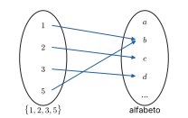

*Figura 1.1. Diagramma a frecce fra $\{1, 2, 3, 5\}$ e l'alfabeto per l'esempio precedente.*

> [!esempio] Il valore assoluto e il quadrato
> Per $f : \mathbb{R} \to \mathbb{R}$, $f(x) = |x|$, si ha $\operatorname{im}(f) = [0, +\infty)$ e $\Gamma(f) = \{(x, |x|) : x \in \mathbb{R}\}$: il grafico è formato dalle bisettrici del primo e del secondo quadrante.
>
> Per $g(x) = x^2$ si calcolano immagini e controimmagini di alcuni intervalli. Poiché $x^2$ è crescente per $x \ge 0$: $g((0, 1)) = (0, 1)$, $g([0, 1)) = [0, 1)$, $g([0, 1]) = [0, 1]$. Per le controimmagini bisogna considerare anche le $x$ negative: $g^{-1}((0, 1)) = (-1, 0) \cup (0, 1)$, $g^{-1}([0, 1)) = (-1, 1)$, $g^{-1}([0, 1]) = [-1, 1]$, e $g^{-1}((1, +\infty)) = (-\infty, -1) \cup (1, +\infty)$.

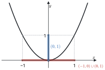

*Figura 1.2. Parabola $y = x^2$ con evidenziati l'intervallo $(0, 1)$ sull'asse $y$ e la sua controimmagine $(-1, 0) \cup (0, 1)$ sull'asse $x$.*

### 1.6 Iniettività, inversa, restrizione e composizione

> [!definizione] Iniettiva, suriettiva, biettiva
> Una funzione $f : X \to Y$ è
>
> - **iniettiva** se ogni $y \in Y$ ha al più una controimmagine, cioè se $x_1 \ne x_2 \Rightarrow f(x_1) \ne f(x_2)$ (equivalentemente, $f(x_1) = f(x_2) \Rightarrow x_1 = x_2$);
> - **suriettiva** se ogni $y \in Y$ ha almeno una controimmagine, cioè se $\operatorname{im}(f) = Y$;
> - **biettiva** se è iniettiva e suriettiva.

Sul grafico, l'iniettività si riconosce perché ogni retta orizzontale lo interseca al più una volta, la suriettività perché ogni retta orizzontale di quota $y \in Y$ lo interseca almeno una volta.

> [!definizione] Funzione inversa
> Sia $f : X \to Y$ iniettiva. La sua **inversa** è la funzione $f^{-1} : \operatorname{im}(f) \to X$ che a ogni $y \in \operatorname{im}(f)$ associa l'unico $x \in X$ tale che $f(x) = y$. Se $f$ è biettiva, $f^{-1}$ è definita su tutto $Y$.

Per costruzione $f(f^{-1}(y)) = y$ per ogni $y \in \operatorname{im}(f)$ e $f^{-1}(f(x)) = x$ per ogni $x \in X$. Il grafico di $f^{-1}$ si ottiene da quello di $f$ per simmetria rispetto alla bisettrice $y = x$, perché $(x, y) \in \Gamma(f)$ se e solo se $(y, x) \in \Gamma(f^{-1})$.

> [!definizione] Restrizione
> Data $f : X \to Y$ e $A \subseteq X$, la **restrizione** di $f$ ad $A$ è la funzione $f|_A : A \to Y$ definita da $f|_A(x) := f(x)$.

Restringere il dominio è il modo standard per rendere invertibile una funzione che non è iniettiva.

> [!esempio] Quando $x^2$ è invertibile
> $f : \mathbb{R} \to \mathbb{R}$, $f(x) = x^2$, non è iniettiva ($f(-1) = f(1)$) né suriettiva (i negativi non sono immagini). Le restrizioni $f|_{(-\infty, 0]}$ e $f|_{[0, +\infty)}$ sono iniettive ma, con codominio $\mathbb{R}$, ancora non suriettive. La funzione $g : [0, +\infty) \to [0, +\infty)$, $g(x) = x^2$, è biettiva, e la sua inversa è la radice quadrata $g^{-1}(y) = \sqrt{y}$.

> [!definizione] Composizione
> Date $f : X \to Y$ e $g : Y \to Z$, la **composizione** $g \circ f : X \to Z$ è $(g \circ f)(x) := g(f(x))$. Se $f$ e $g$ sono definite solo su parte dei rispettivi insiemi, il dominio della composta è
> $$\operatorname{dom}(g \circ f) = \{x \in \operatorname{dom}(f) : f(x) \in \operatorname{dom}(g)\} = f^{-1}(\operatorname{dom}(g)).$$

Ad esempio, per $h(x) = \sqrt{x - 1}$ si ha $h = g \circ f$ con $f(x) = x - 1$ e $g(y) = \sqrt{y}$: il dominio è $\{x : x - 1 \ge 0\} = [1, +\infty)$. In generale $g \circ f \ne f \circ g$: con le stesse funzioni, $(f \circ g)(y) = \sqrt{y} - 1$.

### 1.7 Funzioni monotone

> [!definizione] Funzioni monotone
> Sia $f : \operatorname{dom}(f) \subseteq \mathbb{R} \to \mathbb{R}$. La funzione è
>
> - **crescente** se $x_1 < x_2 \Rightarrow f(x_1) \le f(x_2)$ per ogni $x_1, x_2 \in \operatorname{dom}(f)$;
> - **strettamente crescente** se $x_1 < x_2 \Rightarrow f(x_1) < f(x_2)$;
> - **decrescente** e **strettamente decrescente** se valgono le disuguaglianze opposte, $f(x_1) \ge f(x_2)$ e $f(x_1) > f(x_2)$.
>
> Si dice **monotona** una funzione crescente o decrescente.

"Crescente" qui significa "non decrescente": una funzione costante è contemporaneamente crescente e decrescente. Altri testi dicono "crescente" solo per il caso stretto; in questi appunti si usa sempre "strettamente" quando la disuguaglianza è stretta.

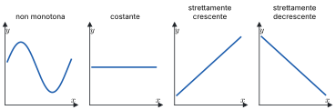

*Figura 1.3. Quattro grafici: una funzione non monotona, una costante (crescente e decrescente), una strettamente crescente, una strettamente decrescente.*

> [!teorema] Monotonia stretta e iniettività
> Una funzione strettamente monotona è iniettiva.

Infatti, se $x_1 \ne x_2$, ad esempio $x_1 < x_2$, la monotonia stretta dà $f(x_1) < f(x_2)$ oppure $f(x_1) > f(x_2)$, comunque $f(x_1) \ne f(x_2)$. Il viceversa è falso.

> [!esempio] Iniettiva ma non monotona
> Sia $f(x) = \frac{1}{x}$ per $x \ne 0$ e $f(0) = 0$. Su $(-\infty, 0)$ e su $(0, +\infty)$ la funzione è strettamente decrescente, ma globalmente non è monotona: $-1 < 1$ e $f(-1) = -1 < 1 = f(1)$, mentre $1 < 2$ e $f(1) > f(2)$. Eppure è iniettiva: valori diversi da 0 vengono da un solo punto, e il valore 0 solo da $x = 0$.

### 1.8 Funzioni elementari

#### Potenze

La funzione potenza $x \mapsto x^\alpha$ si definisce per gradi, ampliando l'esponente.

- **Esponente nullo.** Per convenzione $x^0 = 1$ per ogni $x$.
- **Esponente $n \in \mathbb{N}_0$.** $x^n = x \cdot x \cdots x$ ($n$ fattori), definita su $\mathbb{R}$. Se $n$ è pari la funzione è pari ($(-x)^n = x^n$), strettamente decrescente su $(-\infty, 0]$ e strettamente crescente su $[0, +\infty)$; se $n$ è dispari è dispari ($(-x)^n = -x^n$) e strettamente crescente su $\mathbb{R}$.
- **Esponente $\frac{1}{n}$, $n \in \mathbb{N}_0$.** La radice $n$-esima $\sqrt[n]{x} = x^{1/n}$ è l'inversa della potenza $n$-esima: per $n$ pari l'inversa di $x^n|_{[0, +\infty)}$, quindi definita su $[0, +\infty)$; per $n$ dispari l'inversa di $x^n$ su tutto $\mathbb{R}$.
- **Esponente razionale $\frac{m}{n}$**, con $m, n \in \mathbb{N}_0$ senza fattori comuni: $x^{m/n} = \sqrt[n]{x^m}$, composizione di potenza e radice. Per semplicità la si considera su $[0, +\infty)$.
- **Esponente reale $\alpha > 0$ irrazionale.** Si usa la completezza. Per $x \ge 1$ la potenza $x^q$ cresce con l'esponente razionale $q$, e si pone $x^\alpha := \sup\{x^q : q \in \mathbb{Q},\ 0 < q \le \alpha\}$; per $0 \le x < 1$ la potenza decresce con l'esponente, e si pone $x^\alpha := \inf\{x^q : q \in \mathbb{Q},\ 0 < q \le \alpha\}$.
- **Esponente negativo.** $x^{\alpha} := \frac{1}{x^{-\alpha}}$ per $\alpha < 0$, definita dove è definita $x^{-\alpha}$ tolto lo zero; in altre parole è la composta di $x^{-\alpha}$ con $y \mapsto \frac{1}{y}$.

Su $(0, +\infty)$, per $\alpha > 0$ la potenza è strettamente crescente, per $\alpha < 0$ strettamente decrescente. Tutte le potenze passano per $(1, 1)$. Per $\alpha > 1$ il grafico sta sotto la bisettrice in $(0, 1)$ e sopra per $x > 1$; per $0 < \alpha < 1$ vale il contrario.

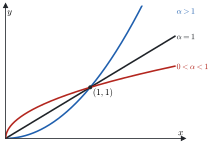

*Figura 1.4. Grafici di $x^\alpha$ su $[0, +\infty)$ per $\alpha > 1$, $\alpha = 1$ e $0 < \alpha < 1$, con il punto $(1, 1)$ in comune.*

#### Esponenziali e logaritmi

> [!aggiunta] Aggiunta in revisione · fonte: Canuto-Tabacco, *Analisi Matematica 1*, cap. 2 (AM1A-02, AM1A-06)
> Fissata una base $a > 0$, $a \ne 1$, la funzione **esponenziale** $x \mapsto a^x$ è definita su tutto $\mathbb{R}$, con lo stesso procedimento delle potenze (prima per $x$ razionale, poi con sup e inf), ed è sempre positiva. Valgono le proprietà
> $$a^{x + y} = a^x a^y, \qquad (a^x)^y = a^{xy}, \qquad a^{-x} = \frac{1}{a^x}.$$
> Per $a > 1$ è strettamente crescente, per $0 < a < 1$ strettamente decrescente; in entrambi i casi l'immagine è $(0, +\infty)$ e il grafico passa per $(0, 1)$.
>
> Essendo strettamente monotona, l'esponenziale è iniettiva, e la sua inversa è il **logaritmo** in base $a$: $\log_a : (0, +\infty) \to \mathbb{R}$, con
> $$y = \log_a x \iff a^y = x.$$
> Dalle proprietà dell'esponenziale seguono quelle del logaritmo: $\log_a(xy) = \log_a x + \log_a y$, $\log_a(x^b) = b \log_a x$, $\log_a 1 = 0$, e il cambiamento di base $\log_a x = \frac{\log_b x}{\log_b a}$. Il logaritmo è strettamente crescente se $a > 1$ e strettamente decrescente se $0 < a < 1$.
>
> La base più usata è il numero $e \approx 2{,}718$, che si definisce nel modulo 2 come limite di $(1 + 1/n)^n$. Si scrive $\ln x = \log_e x$ per il **logaritmo naturale**.

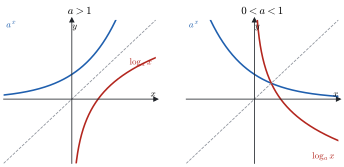

*Figura 1.5. Grafici di $a^x$ e $\log_a x$ per $a > 1$ e per $0 < a < 1$, simmetrici rispetto alla bisettrice.*

#### Funzioni trigonometriche

> [!aggiunta] Aggiunta in revisione · fonte: Canuto-Tabacco, *Analisi Matematica 1*, cap. 2 (AM1A-02)
> Sulla circonferenza di centro l'origine e raggio 1, a ogni $x \in \mathbb{R}$ corrisponde il punto $P$ che si raggiunge percorrendo un arco di lunghezza $|x|$ a partire da $(1, 0)$, in verso antiorario se $x > 0$ e orario se $x < 0$ (angolo in radianti). Le coordinate di $P$ sono $(\cos x, \sin x)$. Seno e coseno sono definiti su $\mathbb{R}$, hanno immagine $[-1, 1]$ e sono periodiche di periodo $2\pi$; il seno è dispari, il coseno pari. La **tangente** $\tan x = \frac{\sin x}{\cos x}$ è definita per $x \ne \frac{\pi}{2} + k\pi$, $k \in \mathbb{Z}$, ha periodo $\pi$ e immagine $\mathbb{R}$.

Le identità fondamentali, da sapere a memoria, sono:

$$\cos^2 x + \sin^2 x = 1,$$

$$\sin(\alpha \pm \beta) = \sin\alpha\cos\beta \pm \cos\alpha\sin\beta, \qquad \cos(\alpha \pm \beta) = \cos\alpha\cos\beta \mp \sin\alpha\sin\beta,$$

$$\sin 2x = 2\sin x\cos x, \qquad \cos 2x = 2\cos^2 x - 1 = 1 - 2\sin^2 x,$$

$$\sin x - \sin y = 2\sin\frac{x - y}{2}\cos\frac{x + y}{2}, \qquad \cos x - \cos y = -2\sin\frac{x - y}{2}\sin\frac{x + y}{2},$$

$$\sin(x + \pi) = -\sin x, \quad \cos(x + \pi) = -\cos x, \quad \sin\left(x + \tfrac{\pi}{2}\right) = \cos x, \quad \cos\left(x + \tfrac{\pi}{2}\right) = -\sin x.$$

> [!aggiunta] Aggiunta in revisione · fonte: Canuto-Tabacco, *Analisi Matematica 1*, cap. 2 (AM1A-05, AM1A-06)
> Le funzioni trigonometriche non sono iniettive, ma lo diventano su intervalli opportuni, e lì si invertono:
>
> - $\arcsin : [-1, 1] \to \left[-\frac{\pi}{2}, \frac{\pi}{2}\right]$ è l'inversa di $\sin$ ristretto a $\left[-\frac{\pi}{2}, \frac{\pi}{2}\right]$, strettamente crescente;
> - $\arccos : [-1, 1] \to [0, \pi]$ è l'inversa di $\cos$ ristretto a $[0, \pi]$, strettamente decrescente;
> - $\arctan : \mathbb{R} \to \left(-\frac{\pi}{2}, \frac{\pi}{2}\right)$ è l'inversa di $\tan$ ristretta a $\left(-\frac{\pi}{2}, \frac{\pi}{2}\right)$, strettamente crescente.
>
> Attenzione: $\arcsin(\sin x) = x$ solo per $x \in \left[-\frac{\pi}{2}, \frac{\pi}{2}\right]$; ad esempio $\arcsin(\sin \pi) = 0$.

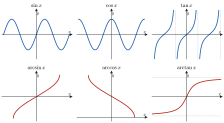

*Figura 1.6. Grafici di $\sin$, $\cos$, $\tan$ e delle loro inverse $\arcsin$, $\arccos$, $\arctan$.*

### 1.9 Grafici e operazioni sulle funzioni

> [!aggiunta] Aggiunta in revisione · fonte: Canuto-Tabacco, *Analisi Matematica 1*, cap. 2 (AM1A-03)
> Dal grafico di $y = f(x)$ si ottengono quelli di molte funzioni collegate, senza rifare i conti. Con $c > 0$:
>
> - $f(x) + c$ e $f(x) - c$: traslazione verticale, verso l'alto o verso il basso, di $c$;
> - $f(x + c)$ e $f(x - c)$: traslazione orizzontale, verso sinistra o verso destra, di $c$;
> - $c\,f(x)$: dilatazione verticale (contrazione se $c < 1$); $f(cx)$: contrazione orizzontale (dilatazione se $c < 1$);
> - $-f(x)$: simmetria rispetto all'asse $x$; $f(-x)$: simmetria rispetto all'asse $y$;
> - $|f(x)|$: le parti del grafico sotto l'asse $x$ si ribaltano sopra;
> - $f(|x|)$: si tiene la parte con $x \ge 0$ e la si ribalta a sinistra dell'asse $y$.
>
> Ad esempio, il grafico di $y = |x - 2| - 1$ è quello di $|x|$ traslato di 2 a destra e di 1 verso il basso: una "V" con vertice in $(2, -1)$.

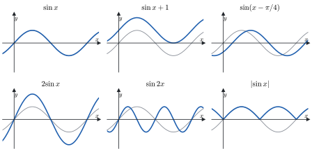

*Figura 1.7. Le trasformazioni del grafico di una stessa funzione, ad esempio $\sin x$: $\sin x + 1$, $\sin(x - \pi/4)$, $2\sin x$, $\sin 2x$, $|\sin x|$.*

### 1.10 Logica e tecniche di dimostrazione

> [!aggiunta] Aggiunta in revisione · fonte: Canuto-Tabacco, *Analisi Matematica 1*, cap. 1; fogli di esercizi del corso, "Connettivi logici. Principio di induzione" (AM1A-18)
> All'esame ogni affermazione va "adeguatamente motivata": serve sapere che cosa vuol dire dimostrare, e quali schemi di ragionamento sono corretti. Questo paragrafo raccoglie gli strumenti di logica che si usano in tutto il corso.
>
> **Proposizioni e connettivi.** Una **proposizione** è un'affermazione che è vera (V) o falsa (F). Da due proposizioni $p$ e $q$ se ne costruiscono altre con i **connettivi**: la negazione $\neg p$ ("non $p$"), la congiunzione $p \wedge q$ ("$p$ e $q$"), la disgiunzione $p \vee q$ ("$p$ o $q$", non esclusivo), l'implicazione $p \Rightarrow q$ ("se $p$ allora $q$") e l'equivalenza $p \Leftrightarrow q$ ("$p$ se e solo se $q$"). Il valore di verità di ognuna dipende solo da quelli di $p$ e $q$, ed è dato dalla **tavola di verità**:
>
> | $p$ | $q$ | $\neg p$ | $p \wedge q$ | $p \vee q$ | $p \Rightarrow q$ | $p \Leftrightarrow q$ |
> |---|---|---|---|---|---|---|
> | V | V | F | V | V | V | V |
> | V | F | F | F | V | F | F |
> | F | V | V | F | V | V | F |
> | F | F | V | F | F | V | V |
>
> L'implicazione è falsa in un solo caso, quando $p$ è vera e $q$ è falsa. Se $p$ è falsa, $p \Rightarrow q$ è vera qualunque sia $q$: "se $2 + 2 = 5$, allora la Luna è di formaggio" è un'implicazione vera. Nell'implicazione $p$ si chiama **ipotesi** (o condizione sufficiente per $q$) e $q$ **tesi** (o condizione necessaria per $p$).
>
> **Tautologie ed equivalenze utili.** Una **tautologia** è una proposizione composta che è vera per tutti i valori delle proposizioni che la compongono; si verifica con la tavola di verità, come l'induzione perfetta delle reti logiche. Le più usate sono:
>
> - $(p \Rightarrow q) \Leftrightarrow (\neg p \vee q)$: l'implicazione scritta con "o";
> - $\neg(p \Rightarrow q) \Leftrightarrow (p \wedge \neg q)$: per negare un'implicazione si mostra un caso in cui l'ipotesi è vera e la tesi falsa;
> - $(p \Rightarrow q) \Leftrightarrow (\neg q \Rightarrow \neg p)$: la **contronominale**, equivalente all'implicazione di partenza;
> - $\neg(p \wedge q) \Leftrightarrow (\neg p \vee \neg q)$ e $\neg(p \vee q) \Leftrightarrow (\neg p \wedge \neg q)$: le leggi di De Morgan;
> - $\big((p \Rightarrow q) \wedge (q \Rightarrow r)\big) \Rightarrow (p \Rightarrow r)$: la proprietà transitiva, su cui si costruiscono le catene di passaggi.
>
> L'**inversa** $q \Rightarrow p$, invece, non è equivalente a $p \Rightarrow q$: "se $x = 2$ allora $x^2 = 4$" è vera, "se $x^2 = 4$ allora $x = 2$" è falsa ($x = -2$).
>
> **Quantificatori.** Per le affermazioni che dipendono da una variabile si usano il **quantificatore universale** $\forall$ ("per ogni") e il **quantificatore esistenziale** $\exists$ ("esiste"). La negazione scambia i quantificatori e nega la proprietà:
> $$\neg\big(\forall x : P(x)\big) \Leftrightarrow \exists x : \neg P(x), \qquad \neg\big(\exists x : P(x)\big) \Leftrightarrow \forall x : \neg P(x).$$
> Ad esempio "$A$ è limitato superiormente" si scrive $\exists M \in \mathbb{R}\ \forall x \in A : x \le M$, e la sua negazione, "$A$ non è limitato superiormente", è $\forall M \in \mathbb{R}\ \exists x \in A : x > M$. L'ordine dei quantificatori conta: "$\forall x\ \exists y : y > x$" è vera nei reali (basta $y = x + 1$), "$\exists y\ \forall x : y > x$" è falsa (non c'è un numero più grande di tutti).
>
> **Schemi di dimostrazione.** Per dimostrare $p \Rightarrow q$ si può:
>
> 1. **dimostrazione diretta**: si parte da $p$ e si arriva a $q$ con una catena di implicazioni;
> 2. **per contronominale**: si suppone $\neg q$ e si arriva a $\neg p$;
> 3. **per assurdo**: si suppone $p$ vera e $q$ falsa e si arriva a una contraddizione, cioè a un'affermazione e alla sua negazione insieme;
> 4. **per induzione**, quando $q$ è un'affermazione su tutti i naturali da un certo $n_0$ in poi (paragrafo 1.4).
>
> Per dimostrare che un'affermazione del tipo "$\forall x : P(x)$" è **falsa** basta un **controesempio**, cioè un solo $x$ per cui $P(x)$ è falsa. Al contrario, nessun numero di esempi dimostra un'affermazione universale. Il caso classico è $n^2 + n + 41$, che è primo per $n = 0, 1, \dots, 39$, ma per $n = 40$ vale $1681 = 41^2$.
>
> **Un esempio per assurdo: $\sqrt{2}$ non è razionale.** Si supponga $\sqrt{2} = \frac{m}{n}$ con $m, n$ interi positivi e la frazione ridotta ai minimi termini. Allora $m^2 = 2n^2$, quindi $m^2$ è pari, e quindi $m$ è pari (se $m$ fosse dispari, anche $m^2$ lo sarebbe: è una contronominale). Scritto $m = 2k$, si ha $4k^2 = 2n^2$, cioè $n^2 = 2k^2$, e per lo stesso motivo anche $n$ è pari. Ma allora $m$ e $n$ hanno il fattore comune 2, contro l'ipotesi che la frazione fosse ridotta. La contraddizione mostra che l'ipotesi $\sqrt{2} \in \mathbb{Q}$ è falsa.
>
> **Un esempio per induzione: la somma dei primi $n$ naturali.** $P(n)$: $1 + 2 + \dots + n = \frac{n(n + 1)}{2}$. *Passo base*, $n = 1$: $1 = \frac{1 \cdot 2}{2}$. *Passo induttivo*: si suppone $P(n)$ e si aggiunge $n + 1$ a entrambi i membri,
> $$1 + 2 + \dots + n + (n + 1) = \frac{n(n + 1)}{2} + (n + 1) = \frac{(n + 1)(n + 2)}{2},$$
> che è $P(n + 1)$. Nel passo induttivo non si dimostra $P(n)$: la si usa come ipotesi (**ipotesi induttiva**) per ottenere $P(n + 1)$.

### Esempi ed esercizi svolti

> [!esempio] Domini
> **a)** $f(x) = \frac{\sqrt{x^2 - 3x - 4}}{x + 5}$. Serve il radicando non negativo, $x^2 - 3x - 4 = (x - 4)(x + 1) \ge 0$, cioè $x \le -1$ oppure $x \ge 4$, e il denominatore non nullo, $x \ne -5$. Il dominio è $(-\infty, -5) \cup (-5, -1] \cup [4, +\infty)$.
>
> **b)** $f(x) = \ln(x^2 - x)$. Serve l'argomento positivo: $x(x - 1) > 0$, cioè $x < 0$ oppure $x > 1$. Il dominio è $(-\infty, 0) \cup (1, +\infty)$.
>
> **c)** $f(x) = \sqrt{\cos x - 1}$. Serve $\cos x - 1 \ge 0$, cioè $\cos x \ge 1$; poiché $\cos x \le 1$ sempre, deve essere $\cos x = 1$, quindi $x = 2k\pi$ con $k \in \mathbb{Z}$. Il dominio è l'insieme di questi punti isolati e l'immagine è $\{0\}$.

> [!esempio] Immagini
> **a)** $f(x) = \frac{1}{x^2 + 1}$. Si cerca per quali $y$ l'equazione $y = \frac{1}{x^2 + 1}$ ha soluzione. Deve essere $y > 0$, e allora $x^2 = \frac{1}{y} - 1$, che ha soluzione se e solo se $\frac{1}{y} - 1 \ge 0$, cioè $y \le 1$. L'immagine è $(0, 1]$: il massimo 1 si raggiunge in $x = 0$, mentre lo 0 non si raggiunge mai.
>
> **b)** $f(x) = \sqrt{x + 2} - 1$. Il dominio è $[-2, +\infty)$; la radice assume tutti i valori di $[0, +\infty)$, quindi l'immagine è $[-1, +\infty)$. Sul grafico, è quello di $\sqrt{x}$ traslato di 2 a sinistra e di 1 verso il basso.

#### Altri esercizi svolti

> [!aggiunta] Aggiunta in revisione · fonte: esercizi nuovi sul modello dei fogli del corso e delle prove scritte 2025-2026; soluzioni controllate con `strumenti/verifica_ampliamento.py` (AM1A-01, AM1A-05, AM1A-07, AM1A-18)
> Gli esercizi seguono i tipi che compaiono nei fogli e nelle prove d'esame: logica, induzione, estremi di insiemi, domini, inverse e trasformazioni di grafici.

**Esercizio 1. Due ragionamenti, uno giusto e uno sbagliato.** Stabilire con la tavola di verità se sono tautologie (a) $\big(p \wedge (p \Rightarrow q)\big) \Rightarrow q$ e (b) $\big(q \wedge (p \Rightarrow q)\big) \Rightarrow p$.

| $p$ | $q$ | $p \Rightarrow q$ | $p \wedge (p \Rightarrow q)$ | (a) | $q \wedge (p \Rightarrow q)$ | (b) |
|---|---|---|---|---|---|---|
| V | V | V | V | V | V | V |
| V | F | F | F | V | F | V |
| F | V | V | F | V | V | **F** |
| F | F | V | F | V | F | V |

(a) è sempre vera: è il *modus ponens*, lo schema "se vale $p$ e se $p$ implica $q$, allora vale $q$" che si usa in ogni dimostrazione diretta. (b) è falsa per $p$ falsa e $q$ vera: dal fatto che la tesi è vera non si può risalire all'ipotesi. È l'errore di confondere un'implicazione con la sua inversa.

**Esercizio 2. Somma dei dispari.** Dimostrare per induzione che $1 + 3 + 5 + \dots + (2n - 1) = n^2$ per ogni $n \ge 1$.

*Base*: per $n = 1$ il primo membro è 1 e il secondo $1^2 = 1$. *Passo*: se $1 + 3 + \dots + (2n - 1) = n^2$, aggiungendo il dispari successivo, $2(n + 1) - 1 = 2n + 1$, si ottiene $n^2 + 2n + 1 = (n + 1)^2$. Geometricamente: un quadrato $n \times n$ di puntini diventa un quadrato $(n + 1) \times (n + 1)$ aggiungendo una "cornice a L" di $2n + 1$ puntini.

**Esercizio 3. Una divisibilità.** Dimostrare che $7^n - 1$ è divisibile per 6 per ogni $n \in \mathbb{N}$.

*Base*: $7^0 - 1 = 0$, divisibile per 6. *Passo*: si suppone $7^n - 1 = 6h$ con $h$ intero. Allora
$$7^{n+1} - 1 = 7 \cdot 7^n - 1 = 7(7^n - 1) + 7 - 1 = 7 \cdot 6h + 6 = 6(7h + 1),$$
che è divisibile per 6. Il trucco è far comparire nell'espressione di $n + 1$ quella di $n$, per poter usare l'ipotesi induttiva.

**Esercizio 4. Estremi di insiemi.** Determinare estremo superiore e inferiore, dicendo se sono massimo o minimo:
(a) $A = \left\{\frac{n - 1}{n + 1} : n \in \mathbb{N}, n \ge 1\right\}$; (b) $B = \left\{(-1)^n\left(\frac{3}{n} + \frac{1}{n^2}\right) : n \ge 1\right\}$; (c) $C = \{x \in \mathbb{R} : x^2 - 5x + 4 < 0\}$; (d) $D = \left\{n - \frac{1}{n} : n \ge 1\right\}$.

(a) $\frac{n - 1}{n + 1} = 1 - \frac{2}{n + 1}$: al crescere di $n$ la frazione sottratta diminuisce, quindi la successione cresce. Il primo termine, per $n = 1$, è 0, ed è il minimo. Tutti i termini sono minori di 1, e si avvicinano a 1 quanto si vuole: dato $\varepsilon > 0$, $1 - \frac{2}{n + 1} > 1 - \varepsilon$ appena $n + 1 > \frac{2}{\varepsilon}$. Quindi $\sup A = 1$, che non è un massimo perché nessun termine vale 1.

(b) Si separano gli indici pari e dispari. Per $n$ pari i termini sono positivi, $\frac{3}{n} + \frac{1}{n^2}$, e decrescono con $n$: il più grande è quello con $n = 2$, $\frac{3}{2} + \frac{1}{4} = \frac{7}{4}$. Per $n$ dispari sono negativi, $-\left(\frac{3}{n} + \frac{1}{n^2}\right)$, e crescono verso 0: il più piccolo è quello con $n = 1$, $-4$. Quindi $\max B = \frac{7}{4}$ e $\min B = -4$. (Lo 0 non serve: è il limite dei termini, ma sta in mezzo fra il massimo e il minimo.)

(c) $x^2 - 5x + 4 = (x - 1)(x - 4) < 0$ per $1 < x < 4$, quindi $C = (1, 4)$: $\inf C = 1$ e $\sup C = 4$, né minimo né massimo perché gli estremi dell'intervallo sono esclusi.

(d) $n - \frac{1}{n}$ cresce con $n$ (cresce $n$ e diminuisce $\frac{1}{n}$): il minimo è il primo termine, $1 - 1 = 0$. L'insieme non è limitato superiormente, perché $n - \frac{1}{n} \ge n - 1$ supera qualsiasi $M$: $\sup D = +\infty$.

**Esercizio 5. Dominio.** Determinare il dominio di $f(x) = \sqrt{\ln(3 - x)} + \frac{1}{x^2 - 1}$.

Le condizioni vanno messe a sistema. Il logaritmo vuole $3 - x > 0$, cioè $x < 3$. La radice vuole $\ln(3 - x) \ge 0$, cioè $3 - x \ge 1$, quindi $x \le 2$. La frazione vuole $x^2 \ne 1$, cioè $x \ne \pm 1$. La condizione $x \le 2$ contiene già $x < 3$, e il dominio è
$$(-\infty, -1) \cup (-1, 1) \cup (1, 2].$$

**Esercizio 6. Composizioni e loro domini.** Siano $f(x) = x^2$ e $g(x) = \sqrt{x - 1}$. Scrivere $f \circ g$ e $g \circ f$ con i loro domini.

$(f \circ g)(x) = f(g(x)) = \left(\sqrt{x - 1}\right)^2 = x - 1$, ma solo dove $g$ è definita: il dominio è $[1, +\infty)$, e il grafico è una semiretta, non tutta la retta $y = x - 1$. $(g \circ f)(x) = g(x^2) = \sqrt{x^2 - 1}$, definita per $x^2 \ge 1$, cioè $x \le -1$ oppure $x \ge 1$. Le due composte sono diverse: la composizione non è commutativa.

**Esercizio 7. Un'inversa con le radici.** Sia $f(x) = x + \sqrt{x^2 + 4}$. Trovare dominio e immagine, mostrare che $f$ è invertibile e scrivere l'inversa.

*Dominio*: $x^2 + 4 > 0$ sempre, quindi $\mathbb{R}$. *Segno*: $\sqrt{x^2 + 4} > \sqrt{x^2} = |x| \ge -x$, quindi $f(x) > 0$ per ogni $x$. *Invertibilità*: per $y > 0$ si risolve $y = x + \sqrt{x^2 + 4}$. Isolata la radice, $\sqrt{x^2 + 4} = y - x$; elevando al quadrato, $x^2 + 4 = y^2 - 2xy + x^2$, cioè
$$x = \frac{y^2 - 4}{2y}.$$
L'elevamento al quadrato può introdurre soluzioni false, quindi si controlla la condizione $y - x \ge 0$: $y - \frac{y^2 - 4}{2y} = \frac{y^2 + 4}{2y} > 0$ per $y > 0$. Per ogni $y > 0$ c'è quindi una e una sola soluzione: $f$ è iniettiva, la sua immagine è $(0, +\infty)$ e
$$f^{-1} : (0, +\infty) \to \mathbb{R}, \qquad f^{-1}(y) = \frac{y^2 - 4}{2y}.$$
Prova: $f(0) = 2$ e $f^{-1}(2) = \frac{4 - 4}{4} = 0$.

**Esercizio 8. La restrizione invertibile più grande.** Sia $f(x) = x^2 - 4x + 3$. Trovare il più grande intervallo contenente $x_0 = 3$ su cui $f$ è invertibile, e l'inversa.

Completando il quadrato, $f(x) = (x - 2)^2 - 1$: è una parabola con vertice in $(2, -1)$, decrescente su $(-\infty, 2]$ e crescente su $[2, +\infty)$. Il punto 3 sta nel secondo tratto, e nessun intervallo che contiene 3 e un punto a sinistra di 2 può andare bene, perché conterrebbe due punti simmetrici rispetto al vertice con la stessa immagine. L'intervallo è $[2, +\infty)$, l'immagine $[-1, +\infty)$. Da $y = (x - 2)^2 - 1$ con $x \ge 2$: $x - 2 = +\sqrt{y + 1}$, quindi $f^{-1}(y) = 2 + \sqrt{y + 1}$ per $y \ge -1$. Il segno davanti alla radice è quello giusto perché $x \ge 2$.

**Esercizio 9. Un grafico per trasformazioni.** Disegnare $y = |\ln(x - 1)| - 1$ e trovarne gli zeri.

Si parte da $\ln x$; $\ln(x - 1)$ è traslato di 1 a destra (asintoto verticale $x = 1$, zero in $x = 2$); il valore assoluto ribalta sopra l'asse la parte con $1 < x < 2$, dove il logaritmo è negativo; infine si trasla tutto di 1 verso il basso. Il grafico ha un punto angoloso in $(2, -1)$, il minimo. Gli zeri: $|\ln(x - 1)| = 1$, cioè $\ln(x - 1) = 1$ oppure $\ln(x - 1) = -1$, quindi $x = 1 + e$ e $x = 1 + \frac{1}{e}$.

### Esercizi guidati

> [!aggiunta] Aggiunta in revisione · fonte: esercizi nuovi; soluzioni controllate con `strumenti/verifica_ampliamento.py` (AM1A-07, AM1A-18)
> Ogni esercizio è diviso in passi: si prova un passo alla volta, coprendo il resto, e si confronta solo dopo.

**Guidato 1. Somma dei quadrati per induzione.** Dimostrare che per ogni $n \ge 1$
$$\sum_{k=1}^{n} k^2 = \frac{n(n + 1)(2n + 1)}{6}.$$

*Passo 1: scrivere $P(n)$ e controllare la base.* Per $n = 1$: primo membro $1$, secondo $\frac{1 \cdot 2 \cdot 3}{6} = 1$. Vale. Conviene controllare anche $n = 2$: $1 + 4 = 5$ e $\frac{2 \cdot 3 \cdot 5}{6} = 5$. Questo controllo non fa parte della dimostrazione, ma scopre subito un errore nella formula (con 2 al denominatore invece di 6, ad esempio, la base darebbe già $3 \ne 1$).

*Passo 2: scrivere l'obiettivo.* Bisogna arrivare a $\sum_{k=1}^{n+1} k^2 = \frac{(n + 1)(n + 2)(2n + 3)}{6}$.

*Passo 3: usare l'ipotesi induttiva.* $\sum_{k=1}^{n+1} k^2 = \sum_{k=1}^{n} k^2 + (n + 1)^2 = \frac{n(n + 1)(2n + 1)}{6} + (n + 1)^2$.

*Passo 4: raccogliere.* Si mette in evidenza $\frac{n + 1}{6}$:
$$\frac{n + 1}{6}\big(n(2n + 1) + 6(n + 1)\big) = \frac{n + 1}{6}(2n^2 + 7n + 6) = \frac{(n + 1)(n + 2)(2n + 3)}{6},$$
perché $2n^2 + 7n + 6 = (n + 2)(2n + 3)$. È l'obiettivo del passo 2.

**Guidato 2. Estremi di un insieme con il segno alterno.** Sia $A = \left\{(-1)^n + \frac{1}{n} : n \ge 1\right\}$. Trovare $\sup A$ e $\inf A$.

*Passo 1: calcolare i primi termini.* $n = 1$: $-1 + 1 = 0$; $n = 2$: $1 + \frac{1}{2} = \frac{3}{2}$; $n = 3$: $-1 + \frac{1}{3} = -\frac{2}{3}$; $n = 4$: $\frac{5}{4}$; $n = 5$: $-\frac{4}{5}$.

*Passo 2: separare pari e dispari.* Per $n$ pari i termini sono $1 + \frac{1}{n}$, decrescenti, con il più grande in $n = 2$. Per $n$ dispari sono $-1 + \frac{1}{n}$, decrescenti verso $-1$ senza raggiungerlo.

*Passo 3: il massimo.* Ogni termine dispari è $\le 0$, ogni termine pari è $\le \frac{3}{2}$: quindi $\max A = \frac{3}{2}$.

*Passo 4: l'estremo inferiore con la caratterizzazione.* Tutti i termini sono $> -1$, quindi $-1$ è un minorante. Per vedere che è il più grande dei minoranti, dato $\varepsilon > 0$ si cerca un elemento minore di $-1 + \varepsilon$: basta un $n$ dispari con $\frac{1}{n} < \varepsilon$. Quindi $\inf A = -1$, che non è un minimo.

**Guidato 3. $\sqrt{3}$ non è razionale.**

*Passo 1: l'ipotesi per assurdo.* Si suppone $\sqrt{3} = \frac{m}{n}$ con $m, n$ interi positivi primi fra loro.

*Passo 2: togliere la radice.* $m^2 = 3n^2$, quindi 3 divide $m^2$.

*Passo 3: da $m^2$ a $m$.* Se 3 non dividesse $m$, il resto della divisione di $m$ per 3 sarebbe 1 o 2, e quello di $m^2$ sarebbe 1 (perché $1^2 = 1$ e $2^2 = 4 = 3 + 1$): quindi 3 non dividerebbe $m^2$. Per contronominale, 3 divide $m$: $m = 3k$.

*Passo 4: la contraddizione.* $9k^2 = 3n^2$ dà $n^2 = 3k^2$, e per il passo 3 anche $n$ è multiplo di 3. Allora $m$ e $n$ hanno il fattore comune 3, contro il passo 1.

### Riepilogo

I numeri reali estendono i razionali e sono caratterizzati dalle proprietà algebriche, dall'ordinamento totale e dalla completezza: ogni insieme non vuoto e limitato superiormente ha un estremo superiore, cioè un più piccolo maggiorante, che si riconosce dalle due condizioni "$x \le S$ per ogni $x \in A$" e "per ogni $\varepsilon > 0$ c'è un $x \in A$ con $x > S - \varepsilon$". Il valore assoluto misura le distanze e soddisfa $|x + y| \le |x| + |y|$ e $\big||x| - |y|\big| \le |x - y|$.

Una funzione associa a ogni punto del dominio un solo valore; immagine, controimmagine e grafico la descrivono. Una funzione iniettiva ha un'inversa, definita sull'immagine, il cui grafico è il simmetrico rispetto a $y = x$. Restringere il dominio rende invertibili funzioni come $x^2$, seno, coseno e tangente, da cui nascono radici e funzioni trigonometriche inverse. La monotonia stretta implica l'iniettività, non il contrario. Potenze, esponenziali e logaritmi sono strettamente monotone sui loro domini naturali, e $\log_a$ è l'inversa di $a^x$. Infine, traslazioni, dilatazioni, simmetrie e valori assoluti permettono di disegnare molti grafici partendo da quelli elementari.

### Formulario

> [!aggiunta] Aggiunta in revisione · fonte: sintesi del modulo (AM1A-01 … AM1A-07, AM1A-18)
> Le formule, le proprietà e i termini del modulo, con il paragrafo in cui sono spiegati.

#### Disuguaglianze e valore assoluto

$$|x| \le a \iff -a \le x \le a, \qquad |x| \ge a \iff x \le -a \ \vee\ x \ge a, \qquad |x + y| \le |x| + |y|, \qquad \big||x| - |y|\big| \le |x - y|.$$

#### Estremo superiore

$\lambda = \sup A$ se e solo se (i) $x \le \lambda$ per ogni $x \in A$ e (ii) per ogni $\varepsilon > 0$ esiste $x \in A$ con $x > \lambda - \varepsilon$. Per l'estremo inferiore: $x \ge \mu$ per ogni $x$ e, per ogni $\varepsilon > 0$, esiste $x < \mu + \varepsilon$. Un estremo è massimo (minimo) solo se appartiene all'insieme. Assioma di completezza: ogni insieme non vuoto limitato superiormente ha estremo superiore in $\mathbb{R}$.

#### Induzione e binomio

$$\sum_{k=1}^{n} k = \frac{n(n + 1)}{2}, \quad \sum_{k=1}^{n} k^2 = \frac{n(n + 1)(2n + 1)}{6}, \quad \sum_{k=0}^{n} q^k = \frac{1 - q^{n+1}}{1 - q}\ (q \ne 1), \quad (1 + x)^n \ge 1 + nx\ (x \ge -1).$$

$$\binom{n}{k} = \frac{n!}{k!\,(n - k)!}, \qquad \binom{n}{k} = \binom{n-1}{k-1} + \binom{n-1}{k}, \qquad (a + b)^n = \sum_{k=0}^{n} \binom{n}{k} a^{n-k} b^k.$$

#### Esponenziali, logaritmi, trigonometria

$$a^{x+y} = a^x a^y, \quad (a^x)^y = a^{xy}, \quad \log_a(xy) = \log_a x + \log_a y, \quad \log_a x^y = y \log_a x, \quad \log_a x = \frac{\ln x}{\ln a}.$$

$$\sin^2 x + \cos^2 x = 1, \quad \sin(2x) = 2 \sin x \cos x, \quad \cos(2x) = \cos^2 x - \sin^2 x = 1 - 2\sin^2 x.$$

| Funzione | Dominio | Immagine |
|---|---|---|
| $\arcsin x$ | $[-1, 1]$ | $[-\pi/2, \pi/2]$ |
| $\arccos x$ | $[-1, 1]$ | $[0, \pi]$ |
| $\arctan x$ | $\mathbb{R}$ | $(-\pi/2, \pi/2)$ |
| $\ln x$ | $(0, +\infty)$ | $\mathbb{R}$ |
| $e^x$ | $\mathbb{R}$ | $(0, +\infty)$ |

#### Logica

$$(p \Rightarrow q) \equiv (\neg p \vee q) \equiv (\neg q \Rightarrow \neg p), \qquad \neg(p \Rightarrow q) \equiv p \wedge \neg q, \qquad \neg \forall x\, P(x) \equiv \exists x\, \neg P(x).$$

#### Termini per l'orale

| Termine | In una riga |
|---|---|
| Maggiorante, minorante | numero maggiore (minore) o uguale di tutti gli elementi dell'insieme |
| Estremo superiore | il più piccolo dei maggioranti |
| Massimo | estremo superiore che appartiene all'insieme |
| Completezza | proprietà dei reali: ogni insieme limitato superiormente ha sup |
| Densità di $\mathbb{Q}$ | fra due reali distinti c'è sempre un razionale |
| Funzione | legge che associa a ogni punto del dominio un solo valore |
| Iniettiva, suriettiva, biiettiva | punti diversi hanno immagini diverse; ogni valore è raggiunto; entrambe |
| Funzione inversa | definita sull'immagine, ha il grafico simmetrico rispetto a $y = x$ |
| Restrizione | la stessa legge su un sottoinsieme del dominio |
| Monotona | crescente o decrescente; strettamente monotona implica iniettiva |
| Funzione pari, dispari | $f(-x) = f(x)$; $f(-x) = -f(x)$ |
| Tautologia | proposizione composta sempre vera |
| Contronominale | $\neg q \Rightarrow \neg p$, equivalente a $p \Rightarrow q$ |
| Controesempio | un caso che rende falsa un'affermazione universale |
| Ipotesi induttiva | $P(n)$, supposta vera per dimostrare $P(n + 1)$ |

#### Domande che tornano spesso

- Definire estremo superiore e massimo; enunciare la caratterizzazione con $\varepsilon$; un esempio di insieme con sup e senza massimo.
- Enunciare l'assioma di completezza e spiegare perché in $\mathbb{Q}$ non vale (l'insieme dei razionali con $x^2 < 2$).
- Il principio di induzione; dimostrare la disuguaglianza di Bernoulli.
- Quando una funzione è invertibile? Che relazione c'è fra il grafico di $f$ e quello di $f^{-1}$?
- Perché una funzione strettamente monotona è iniettiva? Vale il viceversa?
- Domini e immagini delle funzioni trigonometriche inverse.
- Dimostrare per assurdo che $\sqrt{2}$ non è razionale.

## 2 · Successioni e limiti

**In questo modulo.** Prerequisiti: il modulo 1 (Numeri reali e funzioni), in particolare valore assoluto, estremo superiore e funzioni elementari. Il limite è il concetto su cui si costruiscono continuità, derivate e sviluppi di Taylor. Qui lo si definisce prima per le successioni, poi per le funzioni, si dimostrano i teoremi che permettono di calcolarlo senza tornare ogni volta alla definizione e si raccolgono i limiti notevoli. Alla fine del modulo si sa verificare un limite con la definizione, calcolarlo con l'algebra dei limiti e la sostituzione, riconoscere le forme indeterminate e scioglierle nei casi standard.

### 2.1 Intorni

Le definizioni di limite parlano tutte di "vicinanza", che si esprime con gli intorni.

> [!definizione] Intorni
> Siano $x_0, a, b, r \in \mathbb{R}$ con $r > 0$.
>
> - L'**intorno** di $x_0$ di raggio $r$ è $I_r(x_0) := (x_0 - r, x_0 + r) = \{x \in \mathbb{R} : |x - x_0| < r\}$.
> - Un intorno di $+\infty$ è una semiretta $I_a(+\infty) := (a, +\infty)$.
> - Un intorno di $-\infty$ è una semiretta $I_b(-\infty) := (-\infty, b)$.

L'idea è che un intorno di $+\infty$ contenga "i numeri molto grandi": più grande è $a$, più piccolo è l'intorno.

### 2.2 Limiti di successioni

Una **successione** è una funzione definita su $\mathbb{N}$ (o su $\{n \in \mathbb{N} : n \ge n_0\}$) a valori in $\mathbb{R}$. Invece di $a(n)$ si scrive $a_n$, e la successione si indica con $(a_n)_{n \ge n_0}$. Ad esempio $\left(\frac{1}{n}\right)_{n \ge 1} = \left(1, \frac{1}{2}, \frac{1}{3}, \dots\right)$.

> [!definizione] Successione convergente
> La successione $(a_n)$ **converge** (o tende) a $l \in \mathbb{R}$, e si scrive $\lim_{n \to +\infty} a_n = l$ oppure $a_n \to l$, se
> $$\forall \varepsilon > 0\ \ \exists\, n_\varepsilon \in \mathbb{N} : \ \forall n \ge n_\varepsilon \quad |a_n - l| < \varepsilon.$$

In parole: comunque si scelga il raggio $\varepsilon$, da un certo indice in poi tutti i termini stanno nell'intorno $I_\varepsilon(l)$. L'indice $n_\varepsilon$ dipende da $\varepsilon$: più piccolo è $\varepsilon$, più avanti bisogna andare.

> [!definizione] Successione divergente
> La successione $(a_n)$ **diverge** a $+\infty$, e si scrive $\lim_{n \to +\infty} a_n = +\infty$, se
> $$\forall K > 0\ \ \exists\, n_K \in \mathbb{N} : \ \forall n \ge n_K \quad a_n > K,$$
> cioè se da un certo indice in poi i termini stanno nell'intorno $I_K(+\infty)$. Diverge a $-\infty$ se per ogni $K > 0$ da un certo indice in poi $a_n < -K$, cioè $a_n \in I_{-K}(-\infty)$.

Una successione che non è né convergente né divergente si dice **indeterminata** (o oscillante): ad esempio $((-1)^n)$, che vale alternativamente $1$ e $-1$.

> [!esempio] Verificare un limite con la definizione
> **$\frac{1}{n} \to 0$.** Fissato $\varepsilon > 0$, si cerca $n_\varepsilon$ tale che, per $n \ge n_\varepsilon$, $\left|\frac{1}{n} - 0\right| = \frac{1}{n} < \varepsilon$. La disuguaglianza equivale a $n > \frac{1}{\varepsilon}$, quindi basta scegliere $n_\varepsilon$ intero maggiore di $\frac{1}{\varepsilon}$: per $n \ge n_\varepsilon$ si ha $n > \frac{1}{\varepsilon}$.
>
> **$n^2 \to +\infty$.** Fissato $K > 0$ (la "quota" da superare), si cerca $n_K$ tale che $n^2 > K$ per $n \ge n_K$. Basta $n_K > \sqrt{K}$, perché allora $n \ge n_K > \sqrt{K}$ implica $n^2 > K$.

Uno dei primi teoremi del paragrafo 2.6 dice che il limite, se esiste, è **unico**: per questo si può parlare de *il* limite.

### 2.3 Successioni monotone e numero $e$

> [!definizione] Successioni monotone
> La successione $(a_n)$ è **crescente** se $a_n \le a_{n+1}$ per ogni $n$, **decrescente** se $a_n \ge a_{n+1}$ per ogni $n$; **strettamente** crescente o decrescente con le disuguaglianze strette.

Le successioni monotone non possono oscillare: hanno sempre un limite, finito o infinito.

> [!teorema] Limite delle successioni monotone
> Sia $(a_n)$ crescente. Se è limitata superiormente converge, e $\lim_{n \to +\infty} a_n = \sup_n a_n$; altrimenti diverge a $+\infty$.
>
> Sia $(a_n)$ decrescente. Se è limitata inferiormente converge, e $\lim_{n \to +\infty} a_n = \inf_n a_n$; altrimenti diverge a $-\infty$.

*Dimostrazione (caso crescente e limitato).* Per la completezza esiste $l = \sup_n a_n \in \mathbb{R}$. Fissato $\varepsilon > 0$, bisogna trovare $n_\varepsilon$ tale che $l - \varepsilon < a_n < l + \varepsilon$ per $n \ge n_\varepsilon$. La disuguaglianza destra vale per ogni $n$, perché $l$ è un maggiorante: $a_n \le l < l + \varepsilon$. Per la sinistra si usa che $l$ è il *più piccolo* dei maggioranti: $l - \varepsilon$ non è un maggiorante, quindi esiste un indice $n_\varepsilon$ con $a_{n_\varepsilon} > l - \varepsilon$. Per $n \ge n_\varepsilon$, la crescenza dà $a_n \ge a_{n_\varepsilon} > l - \varepsilon$. Messe insieme, per $n \ge n_\varepsilon$ si ha $|a_n - l| < \varepsilon$.

Se invece $(a_n)$ non è limitata superiormente, per ogni $K > 0$ esiste $n_K$ con $a_{n_K} > K$, e per la crescenza $a_n > K$ per ogni $n \ge n_K$: la successione diverge a $+\infty$. Il caso decrescente è analogo.

> [!esempio]
> $\left(\frac{1}{n}\right)$ è decrescente e limitata inferiormente da 0, e converge a $\inf = 0$. $(n^2)$ è crescente e non limitata, e diverge. $\left(\frac{n - 1}{n}\right) = \left(1 - \frac{1}{n}\right)$ è crescente e limitata, e converge al suo estremo superiore 1.

La successione più importante di questo tipo definisce il numero di Nepero.

> [!teorema] Il numero $e$
> La successione $a_n = \left(1 + \frac{1}{n}\right)^n$, $n \ge 1$, è crescente e limitata superiormente. Il suo limite si chiama **numero di Nepero**:
> $$e := \lim_{n \to +\infty} \left(1 + \frac{1}{n}\right)^n = \sup_n \left(1 + \frac{1}{n}\right)^n \approx 2{,}71828.$$

> [!aggiunta] Aggiunta in revisione · fonte: Canuto-Tabacco, *Analisi Matematica 1*, cap. 3 e appendice (AM1A-08)
> *Dimostrazione.* **Limitata.** Per lo sviluppo del binomio (modulo 1, paragrafo 1.4),
> $$\left(1 + \frac{1}{n}\right)^n = \sum_{k=0}^{n} \binom{n}{k} \frac{1}{n^k} = \sum_{k=0}^{n} \frac{1}{k!} \cdot \frac{n(n-1)\cdots(n-k+1)}{n^k} \le \sum_{k=0}^{n} \frac{1}{k!},$$
> perché ogni fattore $\frac{n - j}{n}$ è al più 1. Inoltre $k! \ge 2^{k-1}$ per $k \ge 1$, quindi la somma è al più $1 + 1 + \frac{1}{2} + \frac{1}{4} + \dots + \frac{1}{2^{n-1}} < 3$.
>
> **Crescente.** Il rapporto fra due termini consecutivi si riscrive come
> $$\frac{a_n}{a_{n-1}} = \left(\frac{n+1}{n}\right)^n \left(\frac{n-1}{n}\right)^{n-1} = \frac{n}{n-1} \left(1 - \frac{1}{n^2}\right)^n \ge \frac{n}{n-1}\left(1 - \frac{1}{n}\right) = 1,$$
> dove la disuguaglianza è quella di Bernoulli (modulo 1) con $x = -\frac{1}{n^2}$. Quindi $a_n \ge a_{n-1}$.

### 2.4 Sottosuccessioni

> [!definizione] Sottosuccessione
> Data una successione $(a_n)$ e una successione di indici naturali **strettamente crescente** $n_0 < n_1 < n_2 < \dots$, la successione $(a_{n_k})_{k \ge 0}$ si chiama **sottosuccessione** (o successione estratta) di $(a_n)$.

Si prendono cioè infiniti termini della successione, nell'ordine in cui compaiono. Poiché gli indici sono strettamente crescenti, $n_k \ge k$ e quindi $n_k \to +\infty$.

> [!esempio]
> Da $a_n = (-1)^n$ si estraggono la sottosuccessione dei termini pari, $n_k = 2k$, con $a_{2k} = 1$ per ogni $k$, e quella dei dispari, $n_k = 2k + 1$, con $a_{2k+1} = -1$.

> [!teorema] Limite delle sottosuccessioni
> Se $\lim_{n \to +\infty} a_n = l$ (finito o infinito), ogni sottosuccessione ha lo stesso limite: $\lim_{k \to +\infty} a_{n_k} = l$.

Il teorema segue dalla definizione: se da $n_\varepsilon$ in poi tutti i termini stanno vicino a $l$, ci stanno anche i termini estratti con $n_k \ge n_\varepsilon$. Si usa soprattutto al contrario, per mostrare che un limite **non** esiste: se due sottosuccessioni hanno limiti diversi, la successione non ha limite. È il caso di $(-1)^n$, le cui sottosuccessioni pari e dispari tendono a 1 e a $-1$.

### 2.5 Limiti di funzione

Le definizioni per le funzioni ricalcano quelle per le successioni; cambia solo il punto verso cui tende la variabile, che può essere $\pm\infty$ oppure un numero $x_0$.

> [!definizione] Limiti all'infinito
> Sia $f$ definita in un intorno di $+\infty$. Si dice che
>
> - $\lim_{x \to +\infty} f(x) = l \in \mathbb{R}$ se $\forall \varepsilon > 0\ \exists B > 0 : \forall x \in \operatorname{dom}(f),\ x > B \Rightarrow |f(x) - l| < \varepsilon$;
> - $\lim_{x \to +\infty} f(x) = +\infty$ se $\forall M > 0\ \exists B > 0 : \forall x \in \operatorname{dom}(f),\ x > B \Rightarrow f(x) > M$;
> - $\lim_{x \to +\infty} f(x) = -\infty$ se $\forall M > 0\ \exists B > 0 : \forall x \in \operatorname{dom}(f),\ x > B \Rightarrow f(x) < -M$.
>
> Per $x \to -\infty$ le definizioni sono le stesse con $x < -B$ al posto di $x > B$.

> [!definizione] Limiti al finito
> Sia $x_0 \in \mathbb{R}$ e sia $f$ definita in un intorno di $x_0$, eventualmente escluso $x_0$. Si dice che
>
> - $\lim_{x \to x_0} f(x) = l \in \mathbb{R}$ se $\forall \varepsilon > 0\ \exists \delta > 0 : \forall x \in \operatorname{dom}(f),\ 0 < |x - x_0| < \delta \Rightarrow |f(x) - l| < \varepsilon$;
> - $\lim_{x \to x_0} f(x) = +\infty$ se $\forall M > 0\ \exists \delta > 0 : \forall x \in \operatorname{dom}(f),\ 0 < |x - x_0| < \delta \Rightarrow f(x) > M$;
> - $\lim_{x \to x_0} f(x) = -\infty$ se $\forall M > 0\ \exists \delta > 0 : \forall x \in \operatorname{dom}(f),\ 0 < |x - x_0| < \delta \Rightarrow f(x) < -M$.

La condizione $0 < |x - x_0|$ esclude il punto $x_0$: il limite descrive cosa fa $f$ *vicino* a $x_0$, non *in* $x_0$, dove la funzione potrebbe non essere definita o avere un valore qualsiasi.

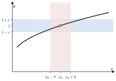

*Figura 2.1. Grafico di una funzione con la fascia orizzontale $(l - \varepsilon, l + \varepsilon)$ e l'intervallo $(x_0 - \delta, x_0 + \delta)$: per le $x$ dell'intervallo, escluso $x_0$, il grafico resta nella fascia.*

> [!aggiunta] Aggiunta in revisione · fonte: Canuto-Tabacco, *Analisi Matematica 1*, cap. 3 (AM1A-09)
> **Limite destro e sinistro.** Se nella definizione si considerano solo le $x > x_0$, cioè $0 < x - x_0 < \delta$, si ottiene il **limite destro** $\lim_{x \to x_0^+} f(x)$; con le sole $x < x_0$ il **limite sinistro** $\lim_{x \to x_0^-} f(x)$. Il limite esiste se e solo se esistono il destro e il sinistro e sono uguali. Ad esempio $\lim_{x \to 0^+} \frac{1}{x} = +\infty$ e $\lim_{x \to 0^-} \frac{1}{x} = -\infty$, quindi $\lim_{x \to 0} \frac{1}{x}$ non esiste.

> [!esempio] Verifica con la definizione
> Si verifica che $f(x) = \frac{x^2 + 3x + 2}{3x^2 + 1} \to \frac{1}{3}$ per $x \to +\infty$. Fissato $\varepsilon > 0$, si cerca $B > 0$ tale che $x > B$ implichi $\left|f(x) - \frac{1}{3}\right| < \varepsilon$. Per $x > 0$:
> $$\left|f(x) - \frac{1}{3}\right| = \left|\frac{3(x^2 + 3x + 2) - (3x^2 + 1)}{3(3x^2 + 1)}\right| = \frac{3x + \frac{5}{3}}{3x^2 + 1} < \frac{3x + \frac{5}{3}}{3x^2} = \frac{1}{x} + \frac{5}{9x^2}.$$
> Basta allora che ciascuno dei due addendi sia minore di $\frac{\varepsilon}{2}$: $\frac{1}{x} < \frac{\varepsilon}{2}$ per $x > \frac{2}{\varepsilon}$, e $\frac{5}{9x^2} < \frac{\varepsilon}{2}$ per $x > \sqrt{\frac{10}{9\varepsilon}}$. Si sceglie $B = \max\left\{\frac{2}{\varepsilon}, \sqrt{\frac{10}{9\varepsilon}}\right\}$.

### 2.6 Teoremi sui limiti

> [!aggiunta] Aggiunta in revisione · fonte: Canuto-Tabacco, *Analisi Matematica 1*, cap. 4 (AM1A-09)
> I teoremi seguenti valgono per le successioni e per le funzioni, per $x$ che tende a un numero o a $\pm\infty$. Si enunciano per le funzioni; per le successioni basta leggere $n \to +\infty$.
>
> **Unicità del limite.** Se il limite esiste, è unico. *Dimostrazione (caso finito).* Se $f(x) \to l_1$ e $f(x) \to l_2$ con $l_1 \ne l_2$, si prende $\varepsilon = \frac{|l_1 - l_2|}{2}$. Vicino al punto, $f(x)$ dovrebbe stare sia in $I_\varepsilon(l_1)$ sia in $I_\varepsilon(l_2)$, ma i due intorni sono disgiunti.
>
> **Permanenza del segno.** Se $\lim f(x) = l > 0$ (oppure $l = +\infty$), allora $f(x) > 0$ in un intorno del punto, escluso al più il punto stesso. *Dimostrazione.* Con $\varepsilon = l$ nella definizione si ha $f(x) > l - l = 0$ vicino al punto. Viceversa, se $f(x) \ge 0$ vicino al punto e il limite esiste, il limite è $\ge 0$: il segno si conserva, ma non la disuguaglianza stretta, come mostra $\frac{1}{n} > 0$ con limite 0.
>
> **Confronto (teorema dei carabinieri).** Se $g(x) \le f(x) \le h(x)$ vicino al punto e $g$ e $h$ hanno lo stesso limite finito $l$, anche $f$ tende a $l$. Se $f(x) \ge g(x)$ e $g \to +\infty$, anche $f \to +\infty$. *Dimostrazione.* Fissato $\varepsilon$, vicino al punto si ha $l - \varepsilon < g(x) \le f(x) \le h(x) < l + \varepsilon$.
>
> **Algebra dei limiti.** Se $f \to l$ e $g \to m$ con $l, m \in \mathbb{R}$, allora $f \pm g \to l \pm m$, $f g \to l m$ e, se $m \ne 0$, $\frac{f}{g} \to \frac{l}{m}$. Le regole si estendono ai limiti infiniti con le convenzioni, per $l \in \mathbb{R}$:
> $$l \pm \infty = \pm\infty, \quad +\infty + \infty = +\infty, \quad l \cdot (\pm\infty) = \pm\infty \text{ se } l > 0, \quad (\pm\infty)(\pm\infty) = +\infty, \quad \frac{l}{\pm\infty} = 0, \quad \frac{l}{0^+} = +\infty \text{ se } l > 0.$$
> Qui $0^+$ indica una funzione che tende a 0 restando positiva.

Restano fuori dalle regole alcuni casi, detti **forme indeterminate**: in questi casi il limite dipende dalle funzioni, non solo dai loro limiti.

$$+\infty - \infty, \qquad 0 \cdot \infty, \qquad \frac{0}{0}, \qquad \frac{\infty}{\infty}, \qquad 1^\infty, \qquad 0^0, \qquad \infty^0.$$

Ad esempio, per $x \to +\infty$ sia $x - x$ sia $(x + 1) - x$ sono della forma $+\infty - \infty$, ma tendono a 0 e a 1. Sciogliere una forma indeterminata significa riscrivere l'espressione in modo che le regole si possano applicare.

### 2.7 Polinomi e funzioni razionali all'infinito

Sia $P(x) = a_n x^n + a_{n-1} x^{n-1} + \dots + a_0$ un polinomio di grado $n \ge 1$, con $a_n \ne 0$. Per $x \to \pm\infty$ la somma è in generale una forma $+\infty - \infty$, che si scioglie raccogliendo la potenza di grado massimo:

$$P(x) = x^n \left(a_n + \frac{a_{n-1}}{x} + \dots + \frac{a_0}{x^n}\right).$$

La parentesi tende ad $a_n$, perché ogni termine $\frac{a_k}{x^{n-k}}$ tende a 0. Quindi $P(x)$ si comporta come $a_n x^n$:

$$\lim_{x \to +\infty} P(x) = \begin{cases} +\infty & a_n > 0 \\ -\infty & a_n < 0 \end{cases} \qquad \lim_{x \to -\infty} P(x) = \lim_{x \to -\infty} a_n x^n,$$

dove per $x \to -\infty$ il segno dipende anche dalla parità di $n$: $x^n \to +\infty$ se $n$ è pari e $x^n \to -\infty$ se $n$ è dispari.

Per una funzione razionale $\frac{P(x)}{Q(x)}$, con $Q(x) = b_m x^m + \dots + b_0$ e $b_m \ne 0$, si raccolgono le potenze massime di numeratore e denominatore:

$$\frac{P(x)}{Q(x)} = \frac{x^n \left(a_n + \frac{a_{n-1}}{x} + \dots\right)}{x^m \left(b_m + \frac{b_{m-1}}{x} + \dots\right)}, \qquad \text{quindi} \qquad \lim_{x \to \pm\infty} \frac{P(x)}{Q(x)} = \lim_{x \to \pm\infty} \frac{a_n}{b_m} x^{n-m}.$$

Il limite vale $\frac{a_n}{b_m}$ se $n = m$ e 0 se $n < m$. Se $n > m$ è infinito, con il segno di $\frac{a_n}{b_m}$ per $x \to +\infty$, mentre per $x \to -\infty$ va moltiplicato per $(-1)^{n-m}$.

> [!esempio]
> $\lim_{x \to -\infty} \frac{2x^3 - x}{x^2 + 5} = \lim_{x \to -\infty} 2x = -\infty$; $\quad \lim_{x \to +\infty} \frac{4x^2 + 1}{2x^2 - x} = \frac{4}{2} = 2$; $\quad \lim_{x \to +\infty} \frac{x + 7}{x^3} = 0$.

### 2.8 Limiti notevoli

Alcuni limiti in forma $\frac{0}{0}$ tornano così spesso che conviene saperli a memoria. Il primo è la base di tutti quelli trigonometrici.

> [!teorema] Limite fondamentale del seno
> $$\lim_{x \to 0} \frac{\sin x}{x} = 1.$$

> [!aggiunta] Aggiunta in revisione · fonte: Canuto-Tabacco, *Analisi Matematica 1*, cap. 4 (AM1A-09)
> *Dimostrazione.* Per $0 < x < \frac{\pi}{2}$, confrontando sulla circonferenza unitaria l'area del triangolo inscritto, del settore circolare e del triangolo circoscritto si ottiene $\sin x < x < \tan x$. Dividendo per $\sin x > 0$ e passando ai reciproci, $\cos x < \frac{\sin x}{x} < 1$. Per $x \to 0^+$ il coseno tende a 1, e il teorema del confronto dà il limite destro. Poiché $\frac{\sin x}{x}$ è pari, anche il limite sinistro vale 1.

Dal limite del seno si ricavano gli altri limiti trigonometrici:

$$\lim_{x \to 0} \frac{\tan x}{x} = \lim_{x \to 0} \frac{\sin x}{x} \cdot \frac{1}{\cos x} = 1,$$

$$\lim_{x \to 0} \frac{1 - \cos x}{x^2} = \lim_{x \to 0} \frac{(1 - \cos x)(1 + \cos x)}{x^2 (1 + \cos x)} = \lim_{x \to 0} \left(\frac{\sin x}{x}\right)^2 \frac{1}{1 + \cos x} = \frac{1}{2},$$

dove si è usato $1 - \cos^2 x = \sin^2 x$. Con la sostituzione $y = \arcsin x$ (rispettivamente $y = \arctan x$) si ottiene anche

$$\lim_{x \to 0} \frac{\arcsin x}{x} = \lim_{y \to 0} \frac{y}{\sin y} = 1, \qquad \lim_{x \to 0} \frac{\arctan x}{x} = 1.$$

Dal numero $e$ derivano i limiti con esponenziali e logaritmi. Il limite $\left(1 + \frac{1}{n}\right)^n \to e$ vale anche per una variabile reale, $\lim_{x \to \pm\infty} \left(1 + \frac{1}{x}\right)^x = e$, e da lì, con le sostituzioni del paragrafo 2.9:

$$\lim_{x \to \pm\infty} \left(1 + \frac{a}{x}\right)^x = e^a, \qquad \lim_{x \to 0} (1 + x)^{1/x} = e,$$

$$\lim_{x \to 0} \frac{\ln(1 + x)}{x} = 1, \qquad \lim_{x \to 0} \frac{\log_a(1 + x)}{x} = \frac{1}{\ln a}, \qquad \lim_{x \to 0} \frac{e^x - 1}{x} = 1, \qquad \lim_{x \to 0} \frac{(1 + x)^\alpha - 1}{x} = \alpha.$$

> [!nota]
> Ad esempio $\frac{\ln(1 + x)}{x} = \ln\left((1 + x)^{1/x}\right) \to \ln e = 1$, usando che il logaritmo è continuo (modulo 3). Posto poi $y = e^x - 1$, cioè $x = \ln(1 + y)$, si ha $\frac{e^x - 1}{x} = \frac{y}{\ln(1 + y)} \to 1$.

Servono infine i limiti delle funzioni elementari agli estremi del dominio, che si leggono sui grafici del modulo 1: per $\alpha > 0$, $x^\alpha \to +\infty$ per $x \to +\infty$ e $x^\alpha \to 0$ per $x \to 0^+$ (il contrario per $\alpha < 0$); per $a > 1$, $a^x \to +\infty$ per $x \to +\infty$ e $a^x \to 0$ per $x \to -\infty$, $\log_a x \to +\infty$ per $x \to +\infty$ e $\log_a x \to -\infty$ per $x \to 0^+$ (il contrario per $0 < a < 1$); $\tan x \to \pm\infty$ per $x \to \left(\frac{\pi}{2} + k\pi\right)^\mp$; $\arctan x \to \pm\frac{\pi}{2}$ per $x \to \pm\infty$. Seno e coseno non hanno limite per $x \to \pm\infty$, come si vede alla fine del prossimo paragrafo.

### 2.9 Sostituzione e forme esponenziali

> [!teorema] Teorema di sostituzione (limite della funzione composta)
> Sia $\lim_{x \to c} f(x) = l$, con $c$ e $l$ finiti o infiniti, e sia $g$ definita in un intorno di $l$, eventualmente escluso $l$. Si supponga che valga una delle condizioni seguenti:
>
> 1. $l$ è finito e $g$ è continua in $l$ (la continuità si studia nel modulo 3; tutte le funzioni elementari sono continue nel loro dominio);
> 2. $l$ è finito, esiste $\lim_{y \to l} g(y)$ e $f(x) \ne l$ in un intorno di $c$, escluso $c$;
> 3. $l = \pm\infty$ ed esiste $\lim_{y \to l} g(y)$.
>
> Allora $\lim_{x \to c} g(f(x)) = \lim_{y \to l} g(y)$.

In pratica si pone $y = f(x)$, si calcola dove va $y$ e si fa il limite in $y$.

> [!esempio]
> Per $x \to +\infty$, $\frac{1}{x} \to 0$, quindi $\sin\frac{1}{x} \to \sin 0 = 0$ e infine $e^{\sin(1/x)} \to e^0 = 1$.

Il teorema serve anche a dimostrare che un limite **non** esiste: basta trovare due modi di far tendere la variabile al punto che portano a limiti diversi.

> [!esempio] $\lim_{y \to +\infty} \sin y$ non esiste
> Si considerano le successioni $y_n = 2\pi n$ e $y'_n = \frac{\pi}{2} + 2\pi n$, che tendono entrambe a $+\infty$. Se esistesse $\lim_{y \to +\infty} \sin y = L$, per il teorema di sostituzione dovrebbe essere $\sin y_n \to L$ e $\sin y'_n \to L$. Ma $\sin(2\pi n) = 0$ e $\sin\left(\frac{\pi}{2} + 2\pi n\right) = 1$ per ogni $n$: i due limiti sono 0 e 1, diversi. Il limite non esiste.

> [!aggiunta] Aggiunta in revisione · fonte: Canuto-Tabacco, *Analisi Matematica 1*, cap. 4 (AM1A-09)
> **Forme esponenziali.** Per le potenze con base e esponente variabili, $f(x)^{g(x)}$ con $f(x) > 0$, si usa l'identità
> $$f(x)^{g(x)} = e^{g(x) \ln f(x)}.$$
> Per la sostituzione, basta calcolare il limite dell'esponente $g(x) \ln f(x)$. Le forme $1^\infty$, $0^0$ e $\infty^0$ diventano così forme $0 \cdot \infty$ nell'esponente. Ad esempio, per $x \to +\infty$
> $$\left(1 + \frac{2}{x}\right)^{3x} = e^{3x \ln\left(1 + \frac{2}{x}\right)}, \qquad 3x \ln\left(1 + \frac{2}{x}\right) = 6 \cdot \frac{\ln\left(1 + \frac{2}{x}\right)}{\frac{2}{x}} \to 6,$$
> usando $\frac{\ln(1 + t)}{t} \to 1$ con $t = \frac{2}{x} \to 0$. Il limite è $e^6$.

### Esempi ed esercizi svolti

> [!esempio] Razionalizzare
> $\lim_{x \to -\infty} \frac{x}{\sqrt{x^2 - 1}}$. Per $x < 0$ si ha $\sqrt{x^2} = |x| = -x$, quindi
> $$\frac{x}{\sqrt{x^2 - 1}} = \frac{x}{|x| \sqrt{1 - \frac{1}{x^2}}} = \frac{x}{-x \sqrt{1 - \frac{1}{x^2}}} = -\frac{1}{\sqrt{1 - \frac{1}{x^2}}} \to -1.$$
> L'errore tipico è scrivere $\sqrt{x^2} = x$, che per $x$ negativo porterebbe a $+1$.

> [!esempio] Una differenza $+\infty - \infty$
> $\lim_{x \to +\infty} \left(\sqrt{x^2 + x} - x\right)$. Si moltiplica e si divide per $\sqrt{x^2 + x} + x$:
> $$\sqrt{x^2 + x} - x = \frac{x^2 + x - x^2}{\sqrt{x^2 + x} + x} = \frac{x}{x\left(\sqrt{1 + \frac{1}{x}} + 1\right)} \to \frac{1}{2}.$$

> [!esempio] Con i limiti notevoli
> $\lim_{x \to 0} \frac{1 - \cos(3x)}{x \sin x} = \lim_{x \to 0} \frac{1 - \cos(3x)}{(3x)^2} \cdot \frac{9x^2}{x \sin x} = \frac{1}{2} \cdot 9 \cdot \lim_{x \to 0} \frac{x}{\sin x} = \frac{9}{2}$.

#### Altri esercizi svolti

> [!aggiunta] Aggiunta in revisione · fonte: esercizi nuovi sul modello dei fogli "Limiti", del tutorato e delle prove scritte; soluzioni controllate con `strumenti/verifica_ampliamento.py` (AM1A-08, AM1A-09)
> Prima di ogni calcolo conviene scrivere la forma del limite ($\frac{0}{0}$, $\frac{\infty}{\infty}$, $\infty - \infty$, $1^\infty$, …): è quella che dice quale strumento usare.

**Esercizio 1. Verificare un limite con la definizione.** Mostrare che $\lim_{n \to \infty} \frac{3n + 1}{n + 2} = 3$.

Dato $\varepsilon > 0$, si cerca $\bar{n}$ tale che $\left|\frac{3n + 1}{n + 2} - 3\right| < \varepsilon$ per ogni $n > \bar{n}$. Si semplifica la differenza:
$$\left|\frac{3n + 1 - 3n - 6}{n + 2}\right| = \frac{5}{n + 2} < \varepsilon \iff n + 2 > \frac{5}{\varepsilon} \iff n > \frac{5}{\varepsilon} - 2.$$
Basta prendere $\bar{n}$ uguale alla parte intera di $\frac{5}{\varepsilon}$. Per $\varepsilon = 0{,}01$, ad esempio, la distanza da 3 è minore di un centesimo da $n = 499$ in poi. Nella verifica non si calcola il limite: lo si conosce già e si controlla la definizione.

**Esercizio 2. Limiti di successioni.**
(a) $\displaystyle\lim_{n \to \infty} \frac{n^2 + n \sin n}{3n^2 + 1}$; (b) $\displaystyle\lim_{n \to \infty} \frac{2^n + n^3}{3^n - n}$; (c) $\displaystyle\lim_{n \to \infty} \left(\sqrt{n^2 + 3n} - n\right)$; (d) $\displaystyle\lim_{n \to \infty} \left(1 + \frac{2}{n}\right)^n$.

(a) Si divide per $n^2$: $\frac{1 + \frac{\sin n}{n}}{3 + \frac{1}{n^2}}$. Il termine $\frac{\sin n}{n}$ tende a 0 perché è il prodotto di una successione limitata, $\sin n$, per una infinitesima, $\frac{1}{n}$. Il limite è $\frac{1}{3}$. Non si può dire che $\sin n$ "tende a qualcosa": non ha limite, ma non serve.

(b) Si raccoglie l'infinito più forte, $3^n$: $\frac{3^n\left(\left(\frac{2}{3}\right)^n + \frac{n^3}{3^n}\right)}{3^n\left(1 - \frac{n}{3^n}\right)}$. Per la gerarchia degli infiniti $\frac{n^3}{3^n} \to 0$ e $\frac{n}{3^n} \to 0$; $\left(\frac{2}{3}\right)^n \to 0$ perché la base è minore di 1. Il limite è 0.

(c) Forma $\infty - \infty$: si razionalizza. $\sqrt{n^2 + 3n} - n = \frac{3n}{\sqrt{n^2 + 3n} + n} = \frac{3}{\sqrt{1 + \frac{3}{n}} + 1} \to \frac{3}{2}$.

(d) È il limite notevole $\left(1 + \frac{a}{n}\right)^n \to e^a$ con $a = 2$: il limite è $e^2$.

**Esercizio 3. Limiti notevoli con un cambio di scala.**
(a) $\displaystyle\lim_{x \to 0} \frac{e^{3x} - 1}{\sin(2x)}$; (b) $\displaystyle\lim_{x \to 0} \frac{\ln(1 + x^2)}{1 - \cos x}$; (c) $\displaystyle\lim_{x \to +\infty} x\big(\ln(x + 1) - \ln x\big)$.

(a) Si fa comparire in ogni pezzo il suo limite notevole, moltiplicando e dividendo:
$$\frac{e^{3x} - 1}{3x} \cdot \frac{2x}{\sin(2x)} \cdot \frac{3x}{2x} \to 1 \cdot 1 \cdot \frac{3}{2} = \frac{3}{2}.$$
(b) $\frac{\ln(1 + x^2)}{x^2} \cdot \frac{x^2}{1 - \cos x} \to 1 \cdot 2 = 2$, perché $\frac{1 - \cos x}{x^2} \to \frac{1}{2}$.
(c) Per le proprietà del logaritmo, $x \ln\left(1 + \frac{1}{x}\right)$. Con $y = \frac{1}{x} \to 0^+$ diventa $\frac{\ln(1 + y)}{y} \to 1$.

**Esercizio 4. Una forma $1^\infty$.** Calcolare $\lim_{x \to +\infty} \left(\frac{x + 2}{x - 1}\right)^x$.

La base tende a 1 e l'esponente a $+\infty$. Si scrive $f^g = e^{g \ln f}$ e si studia l'esponente:
$$x \ln\frac{x + 2}{x - 1} = x \ln\left(1 + \frac{3}{x - 1}\right) = \frac{3x}{x - 1} \cdot \frac{\ln\left(1 + \frac{3}{x - 1}\right)}{\frac{3}{x - 1}} \to 3 \cdot 1 = 3.$$
Il limite è $e^3$. L'errore tipico è "la base tende a 1, e 1 elevato a qualsiasi cosa fa 1": $1^\infty$ è una forma indeterminata.

**Esercizio 5. Una forma $0^0$.** Calcolare $\lim_{x \to 0^+} x^x$.

$x^x = e^{x \ln x}$, e $x \ln x \to 0$ per $x \to 0^+$ (il logaritmo va all'infinito più lentamente di qualsiasi potenza: è la gerarchia scritta con $y = \frac{1}{x}$, $x \ln x = -\frac{\ln y}{y} \to 0$). Il limite è $e^0 = 1$.

**Esercizio 6. Un limite con un parametro.** Calcolare $\lim_{x \to +\infty} \left(\sqrt{x^2 + ax} - x\right)$ al variare di $a \in \mathbb{R}$.

Razionalizzando, $\frac{ax}{\sqrt{x^2 + ax} + x} = \frac{a}{\sqrt{1 + \frac{a}{x}} + 1} \to \frac{a}{2}$ per ogni $a$. Per $a = 0$ il limite è 0, coerente con la formula. Lo stesso conto per $x \to -\infty$ va rifatto con $\sqrt{x^2} = -x$: la funzione tende a $+\infty$, perché è la somma di due quantità positive che crescono.

**Esercizio 7. Limiti che non esistono.** Mostrare che non esistono (a) $\lim_{x \to 0} \frac{|x|}{x}$ e (b) $\lim_{x \to 0} \sin\frac{1}{x}$.

(a) Per $x > 0$ la funzione vale 1, per $x < 0$ vale $-1$: il limite destro è 1, quello sinistro $-1$, e un limite che esiste deve averli uguali. (b) Lungo $x_n = \frac{1}{n\pi}$, che tende a 0, la funzione vale $\sin(n\pi) = 0$; lungo $x_n = \frac{1}{\frac{\pi}{2} + 2n\pi}$ vale 1. Due successioni che tendono a 0 danno due limiti diversi: per il teorema ponte il limite non esiste.

### Esercizi guidati

> [!aggiunta] Aggiunta in revisione · fonte: esercizi nuovi; soluzioni controllate con `strumenti/verifica_ampliamento.py` (AM1A-09)
> Ogni esercizio è diviso in passi: si prova un passo alla volta e si confronta solo dopo.

**Guidato 1. Limite di funzione con la definizione.** Verificare che $\lim_{x \to 2} (3x - 1) = 5$.

*Passo 1: scrivere che cosa si deve trovare.* Per ogni $\varepsilon > 0$ serve un $\delta > 0$ tale che $0 < |x - 2| < \delta$ implichi $|(3x - 1) - 5| < \varepsilon$.

*Passo 2: semplificare.* $|(3x - 1) - 5| = |3x - 6| = 3|x - 2|$.

*Passo 3: scegliere $\delta$.* $3|x - 2| < \varepsilon$ se $|x - 2| < \frac{\varepsilon}{3}$: basta $\delta = \frac{\varepsilon}{3}$.

*Passo 4: rileggere.* Più piccola è la tolleranza $\varepsilon$ sull'uscita, più stretto deve essere l'intorno di 2: qui la funzione "allarga" le distanze di un fattore 3, e $\delta$ è $\varepsilon$ diviso 3.

**Guidato 2. La forma $1^\infty$ con il coseno.** Calcolare $\lim_{x \to 0} (\cos x)^{1/x^2}$.

*Passo 1: la forma.* $\cos x \to 1$ e $\frac{1}{x^2} \to +\infty$: è $1^\infty$.

*Passo 2: passare all'esponenziale.* $(\cos x)^{1/x^2} = \exp\left(\frac{\ln(\cos x)}{x^2}\right)$.

*Passo 3: il limite dell'esponente.* Si scrive $\ln(\cos x) = \ln\big(1 + (\cos x - 1)\big)$ e si usa il limite notevole del logaritmo con $y = \cos x - 1 \to 0$:
$$\frac{\ln\big(1 + (\cos x - 1)\big)}{\cos x - 1} \cdot \frac{\cos x - 1}{x^2} \to 1 \cdot \left(-\frac{1}{2}\right) = -\frac{1}{2}.$$

*Passo 4: tornare alla funzione.* Il limite è $e^{-1/2} = \frac{1}{\sqrt{e}}$. Lo stesso risultato si ritrova nel modulo 5 con lo sviluppo $\ln(\cos x) = -\frac{x^2}{2} + o(x^2)$.

**Guidato 3. Una successione con la gerarchia degli infiniti.** Calcolare $\lim_{n \to \infty} \frac{n^2 \, 2^n + n!}{3^n + (n + 1)!}$.

*Passo 1: ordinare gli infiniti.* Fra potenze, esponenziali e fattoriali, il fattoriale vince: $n^2 \ll 2^n \ll 3^n \ll n!$. Al numeratore il termine dominante è $n!$, al denominatore $(n + 1)!$.

*Passo 2: raccogliere.* $\frac{n!\left(\frac{n^2 2^n}{n!} + 1\right)}{(n + 1)!\left(\frac{3^n}{(n + 1)!} + 1\right)} = \frac{1}{n + 1} \cdot \frac{\frac{n^2 2^n}{n!} + 1}{\frac{3^n}{(n + 1)!} + 1}$.

*Passo 3: i limiti dei pezzi.* Le due frazioni interne tendono a 0, quindi il secondo fattore tende a 1; il primo, $\frac{1}{n + 1}$, tende a 0. Il limite è 0.

*Passo 4: il controllo del rapporto.* Che $\frac{3^n}{n!} \to 0$ si vede anche così: il rapporto fra un termine e il precedente è $\frac{3}{n + 1}$, che da $n = 3$ in poi è minore di $\frac{3}{4}$, quindi i termini si riducono almeno di un quarto a ogni passo.

### Riepilogo

Una successione converge a $l$ se, per ogni $\varepsilon > 0$, da un certo indice in poi $|a_n - l| < \varepsilon$; diverge a $+\infty$ se da un certo indice in poi supera ogni quota $K$. Le successioni monotone hanno sempre limite, uguale al loro estremo superiore o inferiore: così si definisce $e = \lim \left(1 + \frac{1}{n}\right)^n$. Le sottosuccessioni hanno lo stesso limite della successione, e due sottosuccessioni con limiti diversi provano che il limite non esiste.

Per le funzioni il limite in $x_0$ descrive il comportamento vicino a $x_0$, escluso il punto; il limite esiste se e solo se esistono e coincidono il destro e il sinistro. Il limite è unico, conserva il segno e si confronta con i carabinieri; l'algebra dei limiti lo calcola su somme, prodotti e quozienti, tranne nelle forme indeterminate $+\infty - \infty$, $0 \cdot \infty$, $\frac{0}{0}$, $\frac{\infty}{\infty}$, $1^\infty$, $0^0$, $\infty^0$. Polinomi e funzioni razionali all'infinito si comportano come il rapporto dei termini di grado massimo. I limiti notevoli da ricordare sono
$$\frac{\sin x}{x} \to 1, \quad \frac{1 - \cos x}{x^2} \to \frac{1}{2}, \quad \frac{\ln(1 + x)}{x} \to 1, \quad \frac{e^x - 1}{x} \to 1, \quad \frac{(1 + x)^\alpha - 1}{x} \to \alpha \qquad (x \to 0),$$
e il teorema di sostituzione, insieme all'identità $f^g = e^{g \ln f}$, riduce a questi molti altri limiti.

### Formulario

> [!aggiunta] Aggiunta in revisione · fonte: sintesi del modulo (AM1A-08, AM1A-09)
> Le definizioni, i teoremi e i limiti da avere sotto mano, con il paragrafo in cui sono spiegati.

#### Definizioni di limite

| Caso | Definizione |
|---|---|
| $a_n \to l$ | $\forall \varepsilon > 0\ \exists \bar{n} : n > \bar{n} \Rightarrow \lvert a_n - l\rvert < \varepsilon$ |
| $a_n \to +\infty$ | $\forall M\ \exists \bar{n} : n > \bar{n} \Rightarrow a_n > M$ |
| $f(x) \to l$ per $x \to c$ | $\forall \varepsilon > 0\ \exists \delta > 0 : 0 < \lvert x - c\rvert < \delta \Rightarrow \lvert f(x) - l\rvert < \varepsilon$ |
| $f(x) \to l$ per $x \to +\infty$ | $\forall \varepsilon > 0\ \exists M : x > M \Rightarrow \lvert f(x) - l\rvert < \varepsilon$ |

#### Teoremi

- Unicità del limite; limite destro e sinistro uguali se e solo se esiste il limite.
- Permanenza del segno: se $l > 0$, la funzione è positiva in un intorno del punto (escluso il punto).
- Confronto (carabinieri): $f \le g \le h$ e $f, h \to l$ implicano $g \to l$.
- Limitata per infinitesima è infinitesima.
- Successioni monotone: hanno sempre limite, finito se e solo se sono limitate.
- Teorema ponte: $f(x) \to l$ per $x \to c$ se e solo se $f(x_n) \to l$ per ogni successione $x_n \to c$, $x_n \ne c$.

#### Algebra dei limiti e forme indeterminate

$l + \infty = \infty$, $l \cdot \infty = \infty$ per $l \ne 0$, $\frac{l}{\infty} = 0$, $\frac{l}{0^\pm} = \pm\infty$ per $l > 0$. Forme indeterminate: $\infty - \infty$, $0 \cdot \infty$, $\frac{0}{0}$, $\frac{\infty}{\infty}$, $1^\infty$, $0^0$, $\infty^0$; le ultime tre si trattano con $f^g = e^{g \ln f}$.

#### Limiti notevoli ($x \to 0$)

$$\frac{\sin x}{x} \to 1, \quad \frac{1 - \cos x}{x^2} \to \frac{1}{2}, \quad \frac{\tan x}{x} \to 1, \quad \frac{\arcsin x}{x} \to 1, \quad \frac{\arctan x}{x} \to 1,$$

$$\frac{e^x - 1}{x} \to 1, \quad \frac{\ln(1 + x)}{x} \to 1, \quad \frac{(1 + x)^\alpha - 1}{x} \to \alpha, \quad (1 + x)^{1/x} \to e, \quad \left(1 + \frac{a}{x}\right)^x \to e^a \ (x \to \pm\infty).$$

#### Gerarchia degli infiniti

Per $n \to \infty$: $\ln n \ll n^\alpha \ (\alpha > 0) \ll a^n \ (a > 1) \ll n! \ll n^n$. Per $x \to +\infty$: $\frac{(\ln x)^\beta}{x^\alpha} \to 0$ e $\frac{x^\alpha}{a^x} \to 0$; per $x \to 0^+$: $x^\alpha \ln x \to 0$.

Polinomi e razionali all'infinito: conta solo il termine di grado massimo; $\frac{P(x)}{Q(x)}$ tende a 0, al rapporto dei coefficienti direttivi o a $\pm\infty$ secondo che il grado di $P$ sia minore, uguale o maggiore di quello di $Q$.

#### Termini per l'orale

| Termine | In una riga |
|---|---|
| Intorno | intervallo aperto che contiene il punto; di $+\infty$: semiretta $(M, +\infty)$ |
| Punto di accumulazione | ogni suo intorno contiene punti del dominio diversi da lui |
| Successione convergente, divergente, irregolare | ha limite finito; ha limite infinito; non ha limite |
| Sottosuccessione | successione ottenuta prendendo infiniti termini in ordine |
| Forma indeterminata | combinazione di limiti il cui risultato dipende dalle funzioni, non solo dai limiti |
| Infinitesimo | funzione che tende a 0 |
| Numero $e$ | limite di $\left(1 + \frac{1}{n}\right)^n$, successione crescente e limitata |

#### Domande che tornano spesso

- Dare la definizione di limite di successione e di funzione nei vari casi, e verificarla su un esempio.
- Dimostrare l'unicità del limite.
- Enunciare e dimostrare il teorema del confronto.
- Perché una successione monotona e limitata converge? Applicarlo a $\left(1 + \frac{1}{n}\right)^n$.
- Dimostrare $\frac{\sin x}{x} \to 1$ e ricavarne $\frac{1 - \cos x}{x^2} \to \frac{1}{2}$.
- Come si mostra che un limite non esiste?
- Che cosa sono le forme indeterminate esponenziali e come si trattano?

## 3 · Continuità e confronto locale

**In questo modulo.** Prerequisiti: i moduli 1 (Numeri reali e funzioni) e 2 (Successioni e limiti). Una funzione continua è una funzione il cui grafico "non si spezza". Questa proprietà, scritta con i limiti, ha conseguenze globali molto forti: una funzione continua su un intervallo che cambia segno si annulla, assume tutti i valori intermedi e, su un intervallo chiuso e limitato, ha massimo e minimo. Nella seconda parte del modulo si confrontano le funzioni vicino a un punto, con gli asintoti e i simboli di Landau, strumenti che servono poi per lo studio di funzione e per Taylor.

### 3.1 Funzioni continue

> [!definizione] Continuità
> Sia $f : \operatorname{dom}(f) \subseteq \mathbb{R} \to \mathbb{R}$ e sia $x_0 \in \operatorname{dom}(f)$. La funzione è **continua** in $x_0$ se
> $$\forall \varepsilon > 0\ \ \exists \delta > 0 : \ \forall x \in \operatorname{dom}(f), \quad |x - x_0| < \delta \Rightarrow |f(x) - f(x_0)| < \varepsilon.$$
> È continua su un insieme $I \subseteq \operatorname{dom}(f)$ se è continua in ogni punto di $I$.

Rispetto alla definizione di limite, qui il punto $x_0$ deve appartenere al dominio e il valore di riferimento è proprio $f(x_0)$. Ne segue che, se $f$ è definita in un intorno di $x_0$, essere continua in $x_0$ equivale a

$$\lim_{x \to x_0} f(x) = f(x_0):$$

il limite esiste, è finito e coincide con il valore della funzione.

> [!teorema] Continuità della funzione composta
> Se $f$ è continua in $x_0$ e $g$ è continua in $f(x_0)$, allora $g \circ f$ è continua in $x_0$.

È un caso particolare del teorema di sostituzione (modulo 2, paragrafo 2.9).

> [!aggiunta] Aggiunta in revisione · fonte: Canuto-Tabacco, *Analisi Matematica 1*, cap. 3 (AM1A-11)
> **Le funzioni elementari sono continue** in tutti i punti del loro dominio: polinomi, potenze, esponenziali, logaritmi, funzioni trigonometriche e loro inverse. Per l'algebra dei limiti sono continue anche somme, prodotti e quozienti (dove il denominatore non si annulla) di funzioni continue, e per il teorema precedente le loro composte.
>
> **Tipi di discontinuità.** Sia $f$ definita in un intorno di $x_0$, escluso al più $x_0$. Il punto $x_0$ è
>
> - una discontinuità **eliminabile** se $\lim_{x \to x_0} f(x)$ esiste finito ma è diverso da $f(x_0)$, oppure $f$ non è definita in $x_0$: ridefinendo $f(x_0)$ uguale al limite si ottiene una funzione continua. Esempio: $\frac{\sin x}{x}$ in 0;
> - una discontinuità **di salto** se i limiti destro e sinistro esistono finiti ma sono diversi. Esempio: la funzione segno, $\operatorname{sgn} x = \frac{x}{|x|}$, in 0;
> - una discontinuità **di seconda specie** in tutti gli altri casi: almeno uno dei limiti unilaterali è infinito o non esiste. Esempi: $\frac{1}{x}$ e $\sin\frac{1}{x}$ in 0.

### 3.2 Permanenza del segno ed esistenza degli zeri

> [!teorema] Permanenza del segno
> Sia $f$ definita in un intorno di $x_0$ e continua in $x_0$. Se $f(x_0) > 0$, esiste un intorno $I$ di $x_0$ in cui $f(x) > 0$ per ogni $x \in I$. Lo stesso vale con $f(x_0) < 0$.

*Dimostrazione.* Si applica la permanenza del segno per i limiti (modulo 2, paragrafo 2.6) a $\lim_{x \to x_0} f(x) = f(x_0) > 0$; poiché anche in $x_0$ il valore è positivo, l'intorno può includere il punto.

> [!attenzione]
> L'ipotesi deve essere $f(x_0) > 0$, non $f(x_0) \ge 0$: la funzione $f(x) = -x^2$ vale 0 in 0, ma è negativa in ogni punto vicino.

> [!definizione] Zero di una funzione
> Uno **zero** di $f$ è un punto $x_0 \in \operatorname{dom}(f)$ tale che $f(x_0) = 0$.

> [!teorema] Teorema di esistenza degli zeri
> Sia $f$ continua sull'intervallo $[a, b]$. Se $f(a) \cdot f(b) < 0$, esiste $x_0 \in (a, b)$ tale che $f(x_0) = 0$. Se inoltre $f$ è iniettiva su $[a, b]$, lo zero è unico.

*Dimostrazione (metodo di bisezione).* Si supponga $f(a) < 0 < f(b)$; l'altro caso è simmetrico. Si costruisce una successione di intervalli incapsulati $[a_0, b_0] \supseteq [a_1, b_1] \supseteq [a_2, b_2] \supseteq \dots$ con

$$f(a_n) < 0 < f(b_n), \qquad b_n - a_n = \frac{b - a}{2^n}.$$

Si parte da $a_0 = a$ e $b_0 = b$. Costruito $[a_n, b_n]$, se ne prende il punto medio $c_n = \frac{a_n + b_n}{2}$. Se $f(c_n) = 0$, lo zero è trovato. Se $f(c_n) > 0$ si pone $[a_{n+1}, b_{n+1}] = [a_n, c_n]$, se $f(c_n) < 0$ si pone $[a_{n+1}, b_{n+1}] = [c_n, b_n]$: in entrambi i casi il nuovo intervallo è metà del precedente e la funzione ha segni opposti agli estremi.

> [!aggiunta] Aggiunta in revisione · fonte: Canuto-Tabacco, *Analisi Matematica 1*, cap. 4 (AM1A-11)
> Se il procedimento non si ferma mai, la successione $(a_n)$ è crescente e limitata da $b$, la $(b_n)$ è decrescente e limitata da $a$: per il teorema sulle successioni monotone (modulo 2) entrambe convergono. Poiché $b_n - a_n = \frac{b - a}{2^n} \to 0$, il limite è lo stesso: $a_n \to x_0$ e $b_n \to x_0$, con $x_0 \in [a, b]$. Per la continuità di $f$, $f(a_n) \to f(x_0)$ e $f(b_n) \to f(x_0)$. Ma $f(a_n) < 0$ per ogni $n$, quindi $f(x_0) \le 0$; e $f(b_n) > 0$, quindi $f(x_0) \ge 0$. Allora $f(x_0) = 0$, e $x_0 \ne a, b$ perché lì $f$ non si annulla.
>
> Se $f$ è iniettiva, assume il valore 0 al più una volta, quindi lo zero è unico.

La dimostrazione è anche un algoritmo: dopo $n$ passi lo zero è noto a meno di $\frac{b - a}{2^n}$, cioè ogni passo aggiunge circa un bit di precisione.

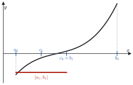

*Figura 3.1. Grafico di una funzione continua su $[a, b]$ con $f(a) < 0 < f(b)$ e i primi intervalli della bisezione.*

> [!esempio] Polinomi di grado dispari
> Ogni polinomio $P$ di grado dispari ha almeno uno zero reale. Infatti, se ad esempio $a_n > 0$, si ha $P(x) \to +\infty$ per $x \to +\infty$ e $P(x) \to -\infty$ per $x \to -\infty$ (modulo 2, paragrafo 2.7). Per la permanenza del segno dei limiti esistono $a < b$ con $P(a) < 0 < P(b)$, e $P$ è continuo su $[a, b]$: il teorema degli zeri dà $x_0 \in (a, b)$ con $P(x_0) = 0$.

> [!esempio] L'equazione $e^x + \sin x = 0$
> La funzione $f(x) = e^x + \sin x$ è continua, con $f(0) = 1 > 0$ e $f\left(-\frac{\pi}{2}\right) = e^{-\pi/2} - 1 < 0$. Per il teorema degli zeri esiste $x_0 \in \left(-\frac{\pi}{2}, 0\right)$ con $f(x_0) = 0$. Su $\left[-\frac{\pi}{2}, 0\right]$ sia $e^x$ sia $\sin x$ sono strettamente crescenti, quindi lo è la loro somma, che è dunque iniettiva: in questo intervallo lo zero è unico.
>
> Attenzione a non concludere troppo: in tutto $\mathbb{R}$ le soluzioni sono infinite. Per $x$ molto negativo $e^x$ è quasi nullo, e $f$ cambia segno vicino a ogni zero di $\sin x$, cioè vicino a $-\pi, -2\pi, -3\pi, \dots$

### 3.3 Teorema dei valori intermedi

> [!teorema] Teorema dei valori intermedi
> Sia $f$ continua sull'intervallo $[a, b]$. Allora $f$ assume tutti i valori compresi fra $f(a)$ e $f(b)$.

*Dimostrazione.* Sia $y$ strettamente compreso fra $f(a)$ e $f(b)$. La funzione $g(x) = f(x) - y$ è continua su $[a, b]$, e $g(a)$, $g(b)$ hanno segni opposti. Per il teorema degli zeri esiste $x_0$ con $g(x_0) = 0$, cioè $f(x_0) = y$.

> [!teorema] Corollario: immagine di un intervallo
> Se $f$ è continua su un intervallo $I$, l'immagine $f(I)$ è un intervallo, di estremi $\inf_I f$ e $\sup_I f$.

Gli estremi possono appartenere o no all'immagine: $f(x) = \frac{1}{x^2 + 1}$ ha immagine $(0, 1]$.

> [!esempio] Servono le ipotesi
> Senza la continuità il teorema è falso: la funzione $f(x) = \frac{1}{x}$ per $x \ne 0$, con $f(0) = 1$, è definita su $\mathbb{R}$, ma la sua immagine $\mathbb{R} \setminus \{0\}$ non è un intervallo. Anche il dominio deve essere un intervallo: $\frac{1}{x}$ è continua su $\mathbb{R} \setminus \{0\}$, che non è un intervallo, e non assume il valore 0 pur prendendo valori positivi e negativi.

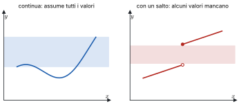

*Figura 3.2. Una funzione continua su $[a, b]$ che assume tutti i valori fra $f(a)$ e $f(b)$, e una funzione con un salto che ne salta qualcuno.*

### 3.4 Teoremi di Bolzano-Weierstrass e di Weierstrass

> [!teorema] Teorema di Bolzano-Weierstrass
> Da ogni successione limitata si può estrarre una sottosuccessione convergente.

*Idea della dimostrazione.* Se $a \le x_n \le b$ per ogni $n$, si divide $[a, b]$ a metà: almeno una delle due metà contiene $x_n$ per infiniti indici $n$, e si tiene quella. Ripetendo si ottengono intervalli incapsulati di ampiezza $\frac{b - a}{2^k}$, ciascuno con infiniti termini. Si sceglie un termine in ognuno, con indici crescenti: la sottosuccessione così estratta converge al punto comune agli intervalli, come nella dimostrazione del teorema degli zeri.

> [!teorema] Teorema di Weierstrass
> Sia $f$ continua sull'intervallo chiuso e limitato $[a, b]$. Allora $f$ è limitata e ammette massimo e minimo su $[a, b]$:
> $$M = \max_{x \in [a, b]} f(x), \qquad m = \min_{x \in [a, b]} f(x), \qquad f([a, b]) = [m, M].$$

*Dimostrazione (massimo).* Sia $M = \sup\{f(x) : x \in [a, b]\}$, finito oppure $+\infty$.

Se $M = +\infty$, per ogni $n$ esiste $x_n \in [a, b]$ con $f(x_n) > n$, quindi $f(x_n) \to +\infty$. La successione $(x_n)$ è limitata e per Bolzano-Weierstrass ha una sottosuccessione $x_{n_k} \to \bar{x}$; poiché $a \le x_{n_k} \le b$, anche $\bar{x} \in [a, b]$. Per la continuità di $f$ in $\bar{x}$, $f(x_{n_k}) \to f(\bar{x}) \in \mathbb{R}$; ma $f(x_{n_k})$ è una sottosuccessione di una successione che diverge, quindi tende a $+\infty$. È una contraddizione: $M$ è finito.

Se $M$ è finito, per la caratterizzazione dell'estremo superiore per ogni $n$ esiste $x_n \in [a, b]$ con $M - \frac{1}{n} < f(x_n) \le M$, e per il confronto $f(x_n) \to M$. Di nuovo si estrae $x_{n_k} \to \bar{x} \in [a, b]$, e per la continuità $f(x_{n_k}) \to f(\bar{x})$. Poiché anche $f(x_{n_k}) \to M$, per l'unicità del limite $f(\bar{x}) = M$: il valore $M$ è assunto, ed è il massimo.

Per il minimo si procede allo stesso modo, oppure si applica il risultato a $-f$. L'immagine è un intervallo per il corollario del paragrafo 3.3, quindi è $[m, M]$.

> [!attenzione]
> Tutte le ipotesi servono. $f(x) = x$ su $(0, 1)$ è continua ma non ha né massimo né minimo, perché l'intervallo non è chiuso. $f(x) = x$ su $[0, +\infty)$ non è limitata, perché l'intervallo non è limitato. Una funzione discontinua su $[0, 1]$, come $f(x) = \frac{1}{x}$ per $x > 0$ con $f(0) = 0$, non è limitata.

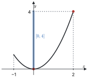

*Figura 3.3. La parabola $y = x^2$ su $[-1, 2]$ con minimo in 0 e massimo in 2, e l'immagine $[0, 4]$ sull'asse $y$.*

### 3.5 Continuità, monotonia e inversa

> [!teorema] Iniettività e monotonia sugli intervalli
> Sia $f$ continua su un intervallo $I$. Allora $f$ è iniettiva su $I$ se e solo se è strettamente monotona su $I$.

Nel modulo 1 si è visto che la monotonia stretta implica sempre l'iniettività. Il viceversa è falso in generale, ma diventa vero per le funzioni continue su un intervallo. Se $f$ fosse iniettiva ma non monotona, ci sarebbero tre punti $x_1 < x_2 < x_3$ con $f(x_2)$ maggiore (o minore) sia di $f(x_1)$ sia di $f(x_3)$. Per i valori intermedi, un valore compreso fra $\max\{f(x_1), f(x_3)\}$ e $f(x_2)$ verrebbe allora assunto sia in $(x_1, x_2)$ sia in $(x_2, x_3)$, contro l'iniettività.

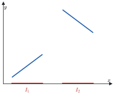

*Figura 3.4. Controesempio: una funzione iniettiva ma non monotona su $I = I_1 \cup I_2$, unione di due intervalli disgiunti.*

> [!teorema] Continuità dell'inversa
> Sia $f$ continua e invertibile su un intervallo $I$. Allora l'inversa $f^{-1}$ è continua sull'intervallo $J = f(I)$.

Per questo radici, logaritmi e funzioni trigonometriche inverse sono continue. Anche qui serve che il dominio sia un intervallo: se $f$ è definita su due intervalli disgiunti, l'inversa può avere un salto.

### 3.6 Asintoti

> [!definizione] Asintoti orizzontali e obliqui
> Siano $f$ e $g$ definite in un intorno di $+\infty$. La funzione $f$ è **asintotica** a $g$ per $x \to +\infty$ se $\lim_{x \to +\infty} (f(x) - g(x)) = 0$. Se $g(x) = mx + q$ è una retta, si dice che è un **asintoto** di $f$ per $x \to +\infty$: **orizzontale** se $m = 0$, **obliquo** se $m \ne 0$. Per $x \to -\infty$ la definizione è analoga.

> [!teorema] Come si trova l'asintoto
> La retta $y = mx + q$ è asintoto di $f$ per $x \to +\infty$ se e solo se
> $$m = \lim_{x \to +\infty} \frac{f(x)}{x} \in \mathbb{R} \qquad \text{e} \qquad q = \lim_{x \to +\infty} \big(f(x) - mx\big) \in \mathbb{R}.$$

In pratica: se $f(x) \to l \in \mathbb{R}$ c'è l'asintoto orizzontale $y = l$; se $f(x) \to \pm\infty$ si calcola $m$, e se è finito e non nullo si calcola $q$. Se uno dei due limiti non esiste o è infinito, l'asintoto non c'è.

> [!aggiunta] Aggiunta in revisione · fonte: Canuto-Tabacco, *Analisi Matematica 1*, cap. 5 (AM1A-15)
> **Asintoti verticali.** Se almeno uno dei limiti $\lim_{x \to x_0^+} f(x)$, $\lim_{x \to x_0^-} f(x)$ è $\pm\infty$, la retta $x = x_0$ è un **asintoto verticale** di $f$. Si cercano nei punti esclusi dal dominio e agli estremi finiti del dominio: ad esempio $x = 0$ per $\ln x$ (solo da destra) e $x = \frac{\pi}{2}$ per $\tan x$.

> [!esempio]
> $f(x) = \frac{x^2 + x^{1/3} + \sin x + 2x}{x}$ per $x \to +\infty$. Si ha $\frac{f(x)}{x} = 1 + \frac{x^{1/3} + \sin x + 2x}{x^2} \to 1$, quindi $m = 1$. Poi
> $$f(x) - x = \frac{x^{1/3} + \sin x + 2x}{x} = \frac{x^{1/3}}{x} + \frac{\sin x}{x} + 2 \to 2,$$
> perché $\frac{x^{1/3}}{x} = x^{-2/3} \to 0$ e $\left|\frac{\sin x}{x}\right| \le \frac{1}{x} \to 0$. L'asintoto è $y = x + 2$.

### 3.7 Infinitesimi, infiniti e simboli di Landau

Per calcolare limiti in forma indeterminata conviene confrontare le funzioni vicino al punto, guardando il loro rapporto.

> [!definizione] Simboli di Landau
> Siano $f$ e $g$ definite in un intorno di $c$ (un numero o $\pm\infty$), con $g(x) \ne 0$ vicino a $c$, e si supponga che esista $l := \lim_{x \to c} \frac{f(x)}{g(x)}$. Allora, per $x \to c$:
>
> - se $l \in \mathbb{R}$, si dice che $f$ è **controllata** da $g$ e si scrive $f = O(g)$;
> - se $l = 1$, si dice che $f$ è **equivalente** a $g$ e si scrive $f \sim g$;
> - se $l = 0$, si dice che $f$ è **trascurabile** rispetto a $g$ e si scrive $f = o(g)$ ("o piccolo di $g$").

> [!nota]
> Nella definizione usuale $f = O(g)$ chiede solo che $\frac{f}{g}$ sia limitato vicino a $c$, senza che il limite esista. Qui si segue la definizione data a lezione, che basta per gli esercizi del corso.

Ad esempio, per $x \to 0$, si ha $\sin x \sim x$ e $1 - \cos x \sim \frac{1}{2} x^2$: sono i limiti notevoli del modulo 2 riscritti con i simboli. Inoltre $x^2 = o(x)$ per $x \to 0$, ma $x = o(x^2)$ per $x \to +\infty$: il simbolo dipende sempre dal punto.

> [!aggiunta] Aggiunta in revisione · fonte: Canuto-Tabacco, *Analisi Matematica 1*, cap. 5 (AM1A-10)
> **Regole di calcolo con l'o piccolo** (tutte per $x \to c$): $o(g) + o(g) = o(g)$; $k \cdot o(g) = o(g)$ per ogni costante $k$; $f \cdot o(g) = o(fg)$; $o(o(g)) = o(g)$. Per $x \to 0$ e $0 < \alpha < \beta$ vale $x^\beta = o(x^\alpha)$. Servono per gli sviluppi di Taylor del modulo 5.
>
> **Gerarchia degli infiniti.** Per $x \to +\infty$, con $\alpha, \beta > 0$ e $a > 1$:
> $$(\ln x)^\beta = o(x^\alpha), \qquad x^\alpha = o(a^x).$$
> Ogni potenza del logaritmo cresce meno di ogni potenza di $x$, e ogni potenza cresce meno di ogni esponenziale con base maggiore di 1. Ad esempio $\frac{x^{100}}{2^x} \to 0$ e $\frac{\ln x}{\sqrt{x}} \to 0$.

> [!definizione] Infinitesimi e infiniti
> Una funzione $f$, definita in un intorno di $c$ escluso al più $c$, è un **infinitesimo** per $x \to c$ se $\lim_{x \to c} f(x) = 0$, un **infinito** se $\lim_{x \to c} f(x) = \pm\infty$.

Due infinitesimi $f$ e $g$ si confrontano con il limite del rapporto. Sono **dello stesso ordine** se $\lim \frac{f}{g} \in \mathbb{R} \setminus \{0\}$; $f$ è **di ordine superiore** se $f = o(g)$, cioè se tende a zero più in fretta; **di ordine inferiore** se $g = o(f)$. Se il limite del rapporto non esiste, $f$ e $g$ sono **non confrontabili**, come $x \sin\frac{1}{x}$ e $x$ per $x \to 0$. Per gli infiniti si ragiona allo stesso modo.

Per misurare l'ordine si sceglie un **campione**, cioè un infinitesimo o un infinito di riferimento.

| Punto $c$ | Infinitesimi campione | Infiniti campione |
|---|---|---|
| $x_0 \in \mathbb{R}$ | $x - x_0$, $\ \lvert x - x_0 \rvert$ | $\frac{1}{\lvert x - x_0 \rvert}$ |
| $x_0^+$ (da destra) | $x - x_0$ | $\frac{1}{x - x_0}$ |
| $x_0^-$ (da sinistra) | $x_0 - x$ | $\frac{1}{x_0 - x}$ |
| $\pm\infty$ | $\frac{1}{\lvert x \rvert}$ | $\lvert x \rvert$ |

> [!definizione] Ordine e parte principale
> Sia $f$ un infinitesimo (o un infinito) per $x \to c$ e $\varphi$ il campione corrispondente. Se esiste $\alpha > 0$ tale che $f$ e $\varphi^\alpha$ sono dello stesso ordine, cioè
> $$\lim_{x \to c} \frac{f(x)}{\varphi(x)^\alpha} = l \in \mathbb{R} \setminus \{0\},$$
> si dice che $f$ ha **ordine** $\alpha$ rispetto a $\varphi$, e la funzione $p(x) = l\,\varphi(x)^\alpha$ si chiama **parte principale** di $f$. In questo caso $f \sim p$, cioè $f = p + o(\varphi^\alpha)$.

> [!esempio] Una parte principale
> Si cerca la parte principale di $f(x) = x + x\left(5x - \sqrt{x} + \ln x\right)^{1/2}$ per $x \to +\infty$, rispetto al campione $\varphi(x) = x$. Si raccoglie la potenza dominante sotto radice:
> $$f(x) = x + x \cdot x^{1/2} \left(5 - x^{-1/2} + \frac{\ln x}{x}\right)^{1/2} = x + x^{3/2}\left(\sqrt{5} + o(1)\right),$$
> perché $x^{-1/2} \to 0$ e $\frac{\ln x}{x} \to 0$. Poiché $x = o(x^{3/2})$, si ottiene $f(x) = \sqrt{5}\, x^{3/2} + o(x^{3/2})$: l'ordine è $\alpha = \frac{3}{2}$ e la parte principale $p(x) = \sqrt{5}\, x^{3/2}$.

### Esempi ed esercizi svolti

> [!esempio] Continuità con un parametro
> Per quali $k \in \mathbb{R}$ la funzione $f(x) = \frac{\sin(2x)}{x}$ per $x \ne 0$, $f(0) = k$, è continua su $\mathbb{R}$? Fuori dall'origine è continua come quoziente di funzioni continue. In 0 serve $\lim_{x \to 0} \frac{\sin 2x}{x} = 2 \lim_{x \to 0} \frac{\sin 2x}{2x} = 2 = k$. Quindi $k = 2$; per ogni altro valore 0 è una discontinuità eliminabile.

> [!esempio] Ordine di infinitesimo
> Per $x \to 0$, $f(x) = \sin x - x \cos x$ è un infinitesimo. Si mostrerà con Taylor (modulo 5) che $f(x) \sim \frac{x^3}{3}$: ha ordine 3 rispetto a $x$. Con i soli limiti notevoli ci si ferma a dire che $\sin x \sim x$ e $x \cos x \sim x$, cioè che i due termini si cancellano al primo ordine: per conoscere l'ordine della differenza servono gli sviluppi.

#### Altri esercizi svolti

> [!aggiunta] Aggiunta in revisione · fonte: esercizi nuovi sul modello del tutorato e delle prove scritte 2025-2026; soluzioni controllate con `strumenti/verifica_ampliamento.py` (AM1A-10, AM1A-11, AM1A-15)
> Il primo punto di quasi tutte le prove scritte è la continuità di una funzione definita a tratti con dei parametri: conviene saperlo fare senza esitazioni.

**Esercizio 1. Continuità a tratti con un parametro.** Per quali $a \in \mathbb{R}$ è continua su $\mathbb{R}$ la funzione $f_a(x) = x^2 + ax$ per $x < 1$, $f_a(x) = a^2 x - 1$ per $x \ge 1$?

*Fuori dal punto di raccordo.* Su $(-\infty, 1)$ e su $(1, +\infty)$ la funzione coincide con un polinomio, quindi è continua per ogni $a$. Resta il punto $x = 1$.

*Nel punto di raccordo.* Serve che limite sinistro, limite destro e valore coincidano. Il valore e il limite destro sono $f_a(1) = a^2 - 1$; il limite sinistro è $\lim_{x \to 1^-} (x^2 + ax) = 1 + a$. La condizione è
$$1 + a = a^2 - 1 \iff a^2 - a - 2 = 0 \iff a = 2 \ \vee\ a = -1.$$
Per gli altri valori di $a$ il punto 1 è una discontinuità di salto, con salto $(a^2 - 1) - (1 + a) = (a + 1)(a - 2)$.

**Esercizio 2. Tre tratti e due parametri.** Trovare $a, b \in \mathbb{R}$ per cui è continua su $\mathbb{R}$
$$f(x) = \begin{cases} \dfrac{x^2 - 9}{x - 3} & x < 3, \\ ax + b & 3 \le x < 4, \\ \ln(x - 3) + b & x \ge 4. \end{cases}$$

Ogni tratto è continuo sul suo intervallo aperto (il primo perché il denominatore non si annulla per $x < 3$, il terzo perché $x - 3 \ge 1 > 0$). In $x = 3$: il limite sinistro è $\lim_{x \to 3^-} (x + 3) = 6$, il valore è $3a + b$. In $x = 4$: il limite sinistro è $4a + b$, il valore $\ln 1 + b = b$. Le due condizioni sono
$$3a + b = 6, \qquad 4a + b = b,$$
e la seconda dà $a = 0$, quindi $b = 6$: la funzione vale $x + 3$ per $x < 3$, è costante uguale a 6 su $[3, 4)$ e vale $\ln(x - 3) + 6$ da 4 in poi.

**Esercizio 3. Classificare le discontinuità.** Classificare in 0 le discontinuità di $f(x) = \frac{\sin x}{|x|}$ e di $h(x) = e^{1/x}$, e in 1 quella di $g(x) = \frac{x^2 - 1}{x - 1}$.

Per $f$: da destra $\frac{\sin x}{x} \to 1$, da sinistra $\frac{\sin x}{-x} \to -1$. I limiti laterali esistono finiti e sono diversi: **salto** di ampiezza 2. Per $g$: per $x \ne 1$ la funzione vale $x + 1$, che tende a 2: il limite esiste finito, la funzione non è definita in 1 (o vi è definita con un altro valore): discontinuità **eliminabile**, si toglie ponendo $g(1) = 2$. Per $h$: per $x \to 0^+$, $\frac{1}{x} \to +\infty$ e $h \to +\infty$; per $x \to 0^-$, $h \to 0$. Un limite laterale è infinito: discontinuità **di seconda specie**.

**Esercizio 4. Una soluzione e una sola.** Dimostrare che l'equazione $e^x = 3 - x$ ha esattamente una soluzione, e localizzarla in un intervallo di ampiezza $\frac{1}{2}$.

Si studia $f(x) = e^x + x - 3$, continua su $\mathbb{R}$. *Esistenza*: $f(0) = -2 < 0$ e $f(1) = e - 2 > 0$, quindi per il teorema degli zeri c'è una soluzione in $(0, 1)$. *Unicità*: $f$ è somma di due funzioni strettamente crescenti, quindi è strettamente crescente e si annulla una volta sola. *Localizzazione*: $f\left(\frac{1}{2}\right) = \sqrt{e} - 2{,}5 \approx -0{,}85 < 0$, quindi la soluzione sta in $\left(\frac{1}{2}, 1\right)$. Ripetendo il dimezzamento si stringe l'intervallo quanto si vuole: è il metodo di bisezione, cioè la dimostrazione del teorema degli zeri trasformata in un algoritmo.

**Esercizio 5. Asintoti obliqui diversi a $+\infty$ e $-\infty$.** Trovare gli asintoti di $f(x) = \frac{x^2}{|x| + 2}$.

Il dominio è $\mathbb{R}$, quindi niente asintoti verticali. Per $x \to +\infty$, $f(x) = \frac{x^2}{x + 2}$: $m = \lim \frac{f(x)}{x} = \lim \frac{x}{x + 2} = 1$ e $q = \lim (f(x) - x) = \lim \frac{x^2 - x^2 - 2x}{x + 2} = -2$, asintoto $y = x - 2$. Per $x \to -\infty$, $f(x) = \frac{x^2}{-x + 2}$: $m = \lim \frac{x}{-x + 2} = -1$ e $q = \lim (f(x) + x) = \lim \frac{x^2 - x^2 + 2x}{-x + 2} = -2$, asintoto $y = -x - 2$. La funzione è pari, e infatti i due asintoti sono simmetrici rispetto all'asse $y$.

**Esercizio 6. Weierstrass, con un controesempio.** (a) $f(x) = x e^{-x}$ ha massimo e minimo su $[0, 3]$? (b) E $g(x) = \frac{1}{x}$ su $(0, 1]$?

(a) Sì: è continua su un intervallo chiuso e limitato, e il teorema di Weierstrass garantisce massimo e minimo (dove siano lo dice il modulo 5). (b) No: $g$ è continua ma l'intervallo non è chiuso, e infatti $g$ non è limitata superiormente ($\frac{1}{x} \to +\infty$ per $x \to 0^+$). Il minimo c'è, $g(1) = 1$. Le ipotesi di Weierstrass sono sufficienti, non necessarie: quando mancano il teorema non dice niente.

**Esercizio 7. Ordini di infinitesimo e di infinito.** Determinare ordine e parte principale per $x \to 0$ di (a) $\sqrt{1 + x} - 1$, (b) $1 - \cos(2x)$, (c) $\ln(1 + x^3)$, (d) $\left(e^{x^2} - 1\right)\sin x$; e per $x \to +\infty$ di (e) $\sqrt{x^4 + x}$.

(a) $\frac{(1 + x)^{1/2} - 1}{x} \to \frac{1}{2}$: ordine 1, parte principale $\frac{x}{2}$. (b) $\frac{1 - \cos(2x)}{(2x)^2} \to \frac{1}{2}$, quindi $1 - \cos(2x) \sim 2x^2$: ordine 2. (c) $\ln(1 + x^3) \sim x^3$: ordine 3. (d) $e^{x^2} - 1 \sim x^2$ e $\sin x \sim x$, e le equivalenze si moltiplicano: $\sim x^3$, ordine 3. (e) $\sqrt{x^4 + x} = x^2\sqrt{1 + x^{-3}} \sim x^2$: infinito di ordine 2.

### Esercizi guidati

> [!aggiunta] Aggiunta in revisione · fonte: esercizi nuovi; soluzioni controllate con `strumenti/verifica_ampliamento.py` (AM1A-10, AM1A-11, AM1A-15)
> Ogni esercizio è diviso in passi: si prova un passo alla volta e si confronta solo dopo.

**Guidato 1. Continuità con due parametri.** Trovare $a, b$ per cui è continua su $\mathbb{R}$ la funzione $f(x) = 2x + a$ per $x \le 0$, $f(x) = x^2 + b$ per $0 < x \le 1$, $f(x) = e^{x - 1}$ per $x > 1$.

*Passo 1: dove possono esserci problemi.* I tre tratti sono continui sui loro intervalli; restano i raccordi $x = 0$ e $x = 1$.

*Passo 2: il raccordo in 0.* Valore e limite sinistro: $f(0) = a$. Limite destro: $\lim_{x \to 0^+} (x^2 + b) = b$. Condizione: $a = b$.

*Passo 3: il raccordo in 1.* Valore e limite sinistro: $f(1) = 1 + b$. Limite destro: $\lim_{x \to 1^+} e^{x - 1} = 1$. Condizione: $1 + b = 1$, cioè $b = 0$.

*Passo 4: mettere insieme.* $a = b = 0$. La funzione è $2x$, poi $x^2$, poi $e^{x - 1}$. Si controlla che non ci siano salti: in 0 tutti i tratti valgono 0, in 1 valgono 1.

**Guidato 2. Tutti gli asintoti di una funzione razionale.** Trovare gli asintoti di $f(x) = \frac{x^3}{x^2 - 4}$.

*Passo 1: dominio.* $x \ne \pm 2$.

*Passo 2: asintoti verticali.* Nei punti esclusi il numeratore vale $\pm 8 \ne 0$ e il denominatore tende a 0: la funzione tende all'infinito. Il segno si legge dai fattori. Per $x \to 2^+$, $x^2 - 4 \to 0^+$ e $f \to +\infty$; per $x \to 2^-$, $f \to -\infty$. La funzione è dispari, quindi per $x \to -2^+$, $f \to +\infty$ e per $x \to -2^-$, $f \to -\infty$. Asintoti $x = 2$ e $x = -2$.

*Passo 3: asintoti orizzontali.* Il grado del numeratore supera quello del denominatore: $f \to \pm\infty$, niente asintoti orizzontali.

*Passo 4: asintoti obliqui.* $m = \lim \frac{x^3}{x(x^2 - 4)} = 1$; $q = \lim \left(\frac{x^3}{x^2 - 4} - x\right) = \lim \frac{4x}{x^2 - 4} = 0$. L'asintoto è $y = x$, sia a $+\infty$ sia a $-\infty$. Per i polinomi si arriva allo stesso risultato con la divisione: $\frac{x^3}{x^2 - 4} = x + \frac{4x}{x^2 - 4}$.

**Guidato 3. Ordine di un prodotto.** Determinare ordine e parte principale per $x \to 0$ di $f(x) = (1 - \cos x)\ln(1 + 2x)$.

*Passo 1: un fattore alla volta.* $1 - \cos x \sim \frac{x^2}{2}$; $\ln(1 + 2x) \sim 2x$.

*Passo 2: moltiplicare.* Le equivalenze asintotiche si moltiplicano: $f(x) \sim \frac{x^2}{2} \cdot 2x = x^3$.

*Passo 3: la conclusione.* Ordine 3, parte principale $x^3$. Attenzione: le equivalenze si moltiplicano e si dividono, ma **non** si sommano. Per $\sin x - x$ scrivere $\sin x \sim x$ darebbe "0", che non ha senso come parte principale: servono gli sviluppi del modulo 5.

### Riepilogo

Una funzione è continua in $x_0$ se $\lim_{x \to x_0} f(x) = f(x_0)$. Somme, prodotti, quozienti e composte di funzioni continue sono continue, e tutte le funzioni elementari lo sono sul loro dominio. Sugli intervalli la continuità ha conseguenze globali: se $f(a) f(b) < 0$ esiste uno zero in $(a, b)$, trovabile per bisezione; $f$ assume tutti i valori intermedi e trasforma intervalli in intervalli; su $[a, b]$ chiuso e limitato è limitata e ha massimo e minimo (Weierstrass, dimostrato con Bolzano-Weierstrass). Per le funzioni continue su un intervallo, iniettività e monotonia stretta coincidono, e l'inversa è continua.

Gli asintoti descrivono il comportamento all'infinito ($m = \lim \frac{f}{x}$, $q = \lim (f - mx)$) e vicino ai punti in cui la funzione diverge. I simboli $O$, $o$, $\sim$ confrontano le funzioni con il limite del loro rapporto; ordine e parte principale misurano quanto in fretta un infinitesimo tende a zero, o un infinito all'infinito, rispetto a un campione. Valgono la gerarchia $\ln x \ll x^\alpha \ll a^x$ per $x \to +\infty$ e le regole di calcolo dell'o piccolo, che il modulo 5 usa per gli sviluppi di Taylor.

### Formulario

> [!aggiunta] Aggiunta in revisione · fonte: sintesi del modulo (AM1A-10, AM1A-11, AM1A-15)
> Definizioni, teoremi e procedure del modulo, con i termini per l'orale.

#### Continuità e discontinuità

$f$ è continua in $x_0$ se $\lim_{x \to x_0} f(x) = f(x_0)$. Somme, prodotti, quozienti (dove il denominatore non si annulla) e composizioni di funzioni continue sono continue; le funzioni elementari sono continue nel loro dominio.

| Discontinuità in $x_0$ | Limiti laterali |
|---|---|
| eliminabile | esistono finiti e uguali, ma diversi da $f(x_0)$ (o $f$ non è definita) |
| di salto (prima specie) | esistono finiti e diversi |
| di seconda specie | almeno uno è infinito o non esiste |

#### Teoremi sulle funzioni continue

| Teorema | Ipotesi | Tesi |
|---|---|---|
| Permanenza del segno | $f$ continua in $x_0$, $f(x_0) > 0$ | $f > 0$ in un intorno di $x_0$ |
| Esistenza degli zeri | $f$ continua su $[a, b]$, $f(a) f(b) < 0$ | esiste $c \in (a, b)$ con $f(c) = 0$ |
| Valori intermedi | $f$ continua su un intervallo | assume tutti i valori fra due suoi valori |
| Weierstrass | $f$ continua su $[a, b]$ chiuso e limitato | $f$ ha massimo e minimo |
| Bolzano-Weierstrass | successione limitata | ha una sottosuccessione convergente |
| Continuità dell'inversa | $f$ continua e strettamente monotona su un intervallo | $f^{-1}$ è continua |

#### Asintoti

- Verticale $x = x_0$: $f(x) \to \pm\infty$ per $x \to x_0^+$ o $x_0^-$.
- Orizzontale $y = l$: $f(x) \to l$ per $x \to +\infty$ o $-\infty$.
- Obliquo $y = mx + q$: $m = \lim \frac{f(x)}{x}$ finito e non nullo, $q = \lim (f(x) - mx)$ finito.

#### Simboli di Landau ($x \to x_0$)

$f = o(g)$ se $\frac{f}{g} \to 0$; $f \sim g$ se $\frac{f}{g} \to 1$; $f = O(g)$ se $\frac{f}{g}$ è limitata vicino a $x_0$. Regole: $o(x^n) + o(x^n) = o(x^n)$, $x^m \cdot o(x^n) = o(x^{m+n})$, $o(x^n) = o(x^m)$ se $n \ge m$; le equivalenze $\sim$ si moltiplicano e si dividono, non si sommano. Ordine di infinitesimo $\alpha$: $\frac{f(x)}{(x - x_0)^\alpha} \to l \ne 0$; la parte principale è $l\,(x - x_0)^\alpha$.

#### Termini per l'orale

| Termine | In una riga |
|---|---|
| Funzione continua | il limite in ogni punto coincide con il valore |
| Punto di raccordo | punto in cui cambia l'espressione di una funzione a tratti |
| Discontinuità eliminabile, di salto, di seconda specie | vedi la tabella sopra |
| Insieme chiuso e limitato | intervallo $[a, b]$ con gli estremi inclusi e finiti |
| Metodo di bisezione | dimezzamento ripetuto dell'intervallo con il cambio di segno |
| Asintoto | retta a cui il grafico si avvicina indefinitamente |
| Infinitesimo di ordine superiore | $f = o(g)$: tende a 0 più velocemente di $g$ |
| Parte principale | il termine $l(x - x_0)^\alpha$ equivalente all'infinitesimo |

#### Domande che tornano spesso

- Definire la continuità e classificare le discontinuità, con un esempio per tipo.
- Enunciare e dimostrare il teorema di esistenza degli zeri (con la bisezione).
- Enunciare il teorema di Weierstrass e mostrare con controesempi che le ipotesi servono.
- Dedurre il teorema dei valori intermedi da quello degli zeri.
- Come si trovano gli asintoti obliqui? Perché servono entrambi i limiti per $m$ e $q$?
- Definire $o$, $\sim$ e l'ordine di infinitesimo; perché le equivalenze non si sommano?

## 4 · Derivate e teoremi del valor medio

**In questo modulo.** Prerequisiti: i moduli 2 (Successioni e limiti) e 3 (Continuità e confronto locale). La derivata misura la velocità con cui una funzione cambia e, geometricamente, la pendenza della retta tangente al grafico. Si definisce come limite, si calcola per le funzioni elementari e si estende a somme, prodotti, quozienti, composte e inverse con le regole di derivazione. Poi si studiano i punti di estremo e i teoremi di Fermat, Rolle, Cauchy e Lagrange, che collegano il valore della derivata all'andamento della funzione, e il teorema di de l'Hôpital per le forme indeterminate. Alla fine del modulo si sa derivare qualunque funzione elementare, riconoscere i punti di non derivabilità e usare i teoremi del valor medio nelle dimostrazioni e negli esercizi.

### 4.1 Derivata

> [!definizione] Rapporto incrementale e derivata
> Sia $f$ definita in un intorno di $x_0$. Il **rapporto incrementale** di $f$ in $x_0$ è
> $$R_{f,x_0}(x) = \frac{f(x) - f(x_0)}{x - x_0}, \qquad x \ne x_0.$$
> La funzione è **derivabile** in $x_0$ se esiste finito il limite
> $$f'(x_0) := \lim_{x \to x_0} \frac{f(x) - f(x_0)}{x - x_0} = \lim_{h \to 0} \frac{f(x_0 + h) - f(x_0)}{h},$$
> che si chiama **derivata** (prima) di $f$ in $x_0$, e si scrive anche $\frac{df}{dx}(x_0)$.

La seconda forma si ottiene con la sostituzione $x = x_0 + h$ ed è spesso la più comoda nei calcoli.

**Significato geometrico.** La retta per i punti $(x_0, f(x_0))$ e $(x_1, f(x_1))$ del grafico, detta retta **secante**, ha equazione

$$y = f(x_0) + R_{f,x_0}(x_1)\,(x - x_0):$$

il rapporto incrementale è il suo coefficiente angolare. Quando $x_1 \to x_0$ la secante tende alla retta **tangente** al grafico in $(x_0, f(x_0))$, il cui coefficiente angolare è $f'(x_0)$:

$$y = f(x_0) + f'(x_0)(x - x_0).$$

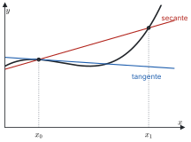

*Figura 4.1. Grafico di una funzione con la secante per $(x_0, f(x_0))$ e $(x_1, f(x_1))$ e la tangente in $x_0$.*

> [!teorema] Derivabile implica continua
> Se $f$ è derivabile in $x_0$, allora è continua in $x_0$.

*Dimostrazione.* Per $x \ne x_0$ si scrive
$$f(x) = f(x_0) + \frac{f(x) - f(x_0)}{x - x_0} \cdot (x - x_0).$$
Per $x \to x_0$ il rapporto incrementale tende al numero finito $f'(x_0)$ e $x - x_0 \to 0$, quindi il prodotto tende a 0 e $f(x) \to f(x_0)$.

Il viceversa è falso: $|x|$ è continua in 0 ma non derivabile, come si vede nel paragrafo 4.4.

### 4.2 Derivate delle funzioni elementari

Si calcolano dalla definizione, usando i limiti notevoli del modulo 2.

- **Costanti.** Se $f(x) = c$, il rapporto incrementale è sempre 0, quindi $f' = 0$.
- **Seno.** Con le formule di addizione,
$$\frac{\sin(x + h) - \sin x}{h} = \sin x \cdot \frac{\cos h - 1}{h} + \cos x \cdot \frac{\sin h}{h} \longrightarrow \sin x \cdot 0 + \cos x \cdot 1 = \cos x,$$
perché $\frac{\cos h - 1}{h} = -\frac{1 - \cos h}{h^2} \cdot h \to -\frac{1}{2} \cdot 0 = 0$. Quindi $(\sin x)' = \cos x$, e allo stesso modo $(\cos x)' = -\sin x$.

- **Esponenziale.** $\frac{e^{x+h} - e^x}{h} = e^x \cdot \frac{e^h - 1}{h} \to e^x$, quindi $(e^x)' = e^x$. Per una base $a > 0$, scrivendo $a^x = e^{x \ln a}$ si ottiene $(a^x)' = a^x \ln a$.
- **Potenze.** Per $x > 0$ e $\alpha \in \mathbb{R}$, con $y = \frac{h}{x} \to 0$:
$$\frac{(x + h)^\alpha - x^\alpha}{h} = x^\alpha \cdot \frac{\left(1 + \frac{h}{x}\right)^\alpha - 1}{h} = x^{\alpha - 1} \cdot \frac{(1 + y)^\alpha - 1}{y} \longrightarrow \alpha\, x^{\alpha - 1}.$$
Quindi $(x^\alpha)' = \alpha x^{\alpha - 1}$, e per gli esponenti interi la formula vale anche per $x \le 0$.

Le altre derivate si ricavano con le regole del paragrafo 4.3. Questa è la tabella da sapere:

| $f(x)$ | $f'(x)$ | | $f(x)$ | $f'(x)$ |
|---|---|---|---|---|
| $x^\alpha$ | $\alpha x^{\alpha - 1}$ | | $\tan x$ | $\frac{1}{\cos^2 x} = 1 + \tan^2 x$ |
| $e^x$ | $e^x$ | | $\cot x$ | $-\frac{1}{\sin^2 x} = -1 - \cot^2 x$ |
| $a^x$ | $a^x \ln a$ | | $\arcsin x$ | $\frac{1}{\sqrt{1 - x^2}}$, per $\lvert x \rvert < 1$ |
| $\ln \lvert x \rvert$ | $\frac{1}{x}$ | | $\arccos x$ | $-\frac{1}{\sqrt{1 - x^2}}$, per $\lvert x \rvert < 1$ |
| $\sin x$ | $\cos x$ | | $\arctan x$ | $\frac{1}{1 + x^2}$ |
| $\cos x$ | $-\sin x$ | | $\operatorname{arccot} x$ | $-\frac{1}{1 + x^2}$ |

### 4.3 Regole di derivazione

> [!teorema] Algebra delle derivate
> Se $f$ e $g$ sono derivabili in $x_0$, lo sono anche $f \pm g$ e $f g$, e
> $$(f \pm g)'(x_0) = f'(x_0) \pm g'(x_0), \qquad (f g)'(x_0) = f'(x_0)\, g(x_0) + f(x_0)\, g'(x_0) \quad \text{(regola di Leibniz)}.$$

*Dimostrazione della regola di Leibniz.* Si aggiunge e si toglie $f(x_0)\, g(x_0 + h)$:
$$\frac{f(x_0 + h)\, g(x_0 + h) - f(x_0)\, g(x_0)}{h} = \frac{f(x_0 + h) - f(x_0)}{h}\, g(x_0 + h) + f(x_0)\, \frac{g(x_0 + h) - g(x_0)}{h}.$$
Per $h \to 0$ il primo rapporto tende a $f'(x_0)$, $g(x_0 + h) \to g(x_0)$ perché $g$ è derivabile e quindi continua, e il secondo rapporto tende a $g'(x_0)$.

> [!teorema] Regola della catena
> Se $f$ è derivabile in $x_0$ e $g$ è derivabile in $y_0 = f(x_0)$, la composta $g \circ f$ è derivabile in $x_0$ e
> $$(g \circ f)'(x_0) = g'(f(x_0)) \cdot f'(x_0).$$

*Dimostrazione.* L'idea è scrivere il rapporto incrementale di $g \circ f$ come prodotto dei rapporti incrementali di $g$ e di $f$. Non si può però dividere direttamente per $f(x_0 + h) - f(x_0)$, che potrebbe annullarsi per infiniti $h$ vicini a 0. Si introduce allora la funzione ausiliaria
$$\varphi(y) = \begin{cases} \dfrac{g(y) - g(y_0)}{y - y_0} & y \ne y_0 \\[2mm] g'(y_0) & y = y_0, \end{cases}$$
che è continua in $y_0$ per la definizione di derivata e soddisfa $g(y) - g(y_0) = \varphi(y)\,(y - y_0)$ per *ogni* $y$, anche $y = y_0$. Con $y = f(x_0 + h)$:
$$\frac{g(f(x_0 + h)) - g(f(x_0))}{h} = \varphi\big(f(x_0 + h)\big) \cdot \frac{f(x_0 + h) - f(x_0)}{h}.$$
Per $h \to 0$ si ha $f(x_0 + h) \to y_0$ perché $f$ è continua in $x_0$, quindi $\varphi(f(x_0 + h)) \to \varphi(y_0) = g'(y_0)$ per la continuità della composta, mentre il secondo fattore tende a $f'(x_0)$.

> [!teorema] Derivata del quoziente
> Se $f$ e $g$ sono derivabili in $x_0$ e $g(x_0) \ne 0$, allora $\frac{f}{g}$ è derivabile in $x_0$ e
> $$\left(\frac{f}{g}\right)'(x_0) = \frac{f'(x_0)\, g(x_0) - f(x_0)\, g'(x_0)}{g(x_0)^2}.$$

*Dimostrazione.* Si scrive $\frac{1}{g} = r \circ g$ con $r(y) = \frac{1}{y} = y^{-1}$, la cui derivata è $r'(y) = -\frac{1}{y^2}$. Per la regola della catena $\left(\frac{1}{g}\right)' = -\frac{g'}{g^2}$, e per Leibniz
$$\left(f \cdot \frac{1}{g}\right)' = \frac{f'}{g} - \frac{f g'}{g^2} = \frac{f' g - f g'}{g^2}.$$

> [!teorema] Derivata della funzione inversa
> Sia $f$ continua e invertibile in un intorno di $x_0$, derivabile in $x_0$ con $f'(x_0) \ne 0$. Allora $f^{-1}$ è derivabile in $y_0 = f(x_0)$ e
> $$\left(f^{-1}\right)'(y_0) = \frac{1}{f'(x_0)} = \frac{1}{f'\big(f^{-1}(y_0)\big)}.$$

> [!aggiunta] Aggiunta in revisione · fonte: Canuto-Tabacco, *Analisi Matematica 1*, cap. 6 (AM1A-12, AM1A-13)
> *Dimostrazione.* Per $y \ne y_0$ si pone $x = f^{-1}(y)$, così che $y = f(x)$ e $x \ne x_0$. Allora
> $$\frac{f^{-1}(y) - f^{-1}(y_0)}{y - y_0} = \frac{x - x_0}{f(x) - f(x_0)} = \frac{1}{R_{f,x_0}(x)}.$$
> L'inversa di una funzione continua su un intervallo è continua (modulo 3), quindi per $y \to y_0$ si ha $x \to x_0$, e il rapporto tende a $\frac{1}{f'(x_0)}$.
>
> *Esempi.* Il logaritmo è l'inverso dell'esponenziale: con $y = e^x$, $(\ln y)' = \frac{1}{e^x} = \frac{1}{y}$. L'arcoseno è l'inverso del seno su $\left[-\frac{\pi}{2}, \frac{\pi}{2}\right]$: con $y = \sin x$,
> $$(\arcsin y)' = \frac{1}{\cos x} = \frac{1}{\sqrt{1 - \sin^2 x}} = \frac{1}{\sqrt{1 - y^2}},$$
> dove si prende la radice positiva perché $\cos x > 0$ per $|x| < \frac{\pi}{2}$; in $y = \pm 1$ la derivata non esiste, perché lì $\cos x = 0$. Per l'arcotangente, con $y = \tan x$, $(\arctan y)' = \frac{1}{1 + \tan^2 x} = \frac{1}{1 + y^2}$.

> [!esempio]
> $\left(\frac{\sin x}{\cos x}\right)' = \frac{\cos x \cos x - \sin x(-\sin x)}{\cos^2 x} = \frac{1}{\cos^2 x}$; $\quad \left(e^{x^2}\right)' = 2x\, e^{x^2}$; $\quad \left(\ln(1 + \sin^2 x)\right)' = \frac{2 \sin x \cos x}{1 + \sin^2 x}$.

### 4.4 Derivata destra e sinistra

> [!definizione] Derivate unilaterali
> Sia $f$ definita in un intorno destro di $x_0$, cioè in $[x_0, x_0 + r)$. La **derivata destra** di $f$ in $x_0$ è
> $$f'_+(x_0) := \lim_{x \to x_0^+} \frac{f(x) - f(x_0)}{x - x_0},$$
> se il limite esiste finito. Analogamente si definisce la **derivata sinistra** $f'_-(x_0)$, con $x \to x_0^-$.

Per le proprietà dei limiti unilaterali, $f$ è derivabile in $x_0$ se e solo se esistono la derivata destra e la sinistra e sono uguali. I punti in cui una funzione continua non è derivabile si classificano guardando i limiti del rapporto incrementale da destra e da sinistra.

> [!esempio] Punto angoloso
> Per $f(x) = |x|$ in 0, il rapporto incrementale è $\frac{|x|}{x}$, che vale 1 per $x > 0$ e $-1$ per $x < 0$: $f'_+(0) = 1$ e $f'_-(0) = -1$. Le due derivate esistono ma sono diverse, e il grafico ha due semitangenti distinte.

> [!esempio] Flesso a tangente verticale
> Per $f(x) = \sqrt[3]{x}$ in 0, il rapporto incrementale è $\frac{\sqrt[3]{x}}{x} = \frac{1}{\sqrt[3]{x^2}}$, che tende a $+\infty$ sia da destra sia da sinistra. La funzione non è derivabile, ma il grafico ha la tangente verticale $x = 0$ e la funzione è crescente da entrambe le parti.

> [!esempio] Cuspide
> Per $f(x) = \sqrt{|x|}$ in 0, da destra il rapporto incrementale è $\frac{\sqrt{x}}{x} = x^{-1/2} \to +\infty$; da sinistra, con $|x| = -x$,
> $$\frac{\sqrt{-x}}{x} = -\frac{\sqrt{-x}}{-x} = -(-x)^{-1/2} \to -\infty.$$
> I limiti sono infiniti e di segno opposto: il grafico ha una punta rivolta verso il basso.

> [!esempio] Derivata da una parte sola
> Per $f(x) = \sqrt{x}$ se $x > 0$ e $f(x) = x$ se $x \le 0$, in 0 la derivata sinistra vale 1, mentre da destra il rapporto incrementale $x^{-1/2}$ tende a $+\infty$: $f$ non è derivabile in 0.

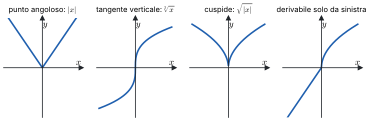

*Figura 4.2. I quattro grafici: punto angoloso ($|x|$), flesso a tangente verticale ($\sqrt[3]{x}$), cuspide ($\sqrt{|x|}$), derivabilità da una parte sola.*

### 4.5 Estremi e teorema di Fermat

> [!definizione] Massimi e minimi
> Sia $f : \operatorname{dom}(f) \to \mathbb{R}$ e $x_0 \in \operatorname{dom}(f)$. Il punto $x_0$ è
>
> - di **massimo relativo** (o locale) se esiste $\delta > 0$ tale che $f(x) \le f(x_0)$ per ogni $x \in \operatorname{dom}(f)$ con $|x - x_0| < \delta$;
> - di **minimo relativo** se, nelle stesse condizioni, $f(x) \ge f(x_0)$;
> - di **massimo** o **minimo assoluto** (o globale) se la disuguaglianza vale per ogni $x \in \operatorname{dom}(f)$.
>
> L'estremo è **stretto** se la disuguaglianza è stretta per $x \ne x_0$. Massimi e minimi si chiamano insieme **estremi**.

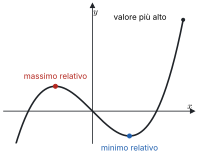

*Figura 4.3. Grafico con un massimo relativo che non è assoluto e un minimo relativo.*

> [!definizione] Punto critico
> Il punto $x_0$ è **critico** (o stazionario) per $f$ se $f$ è derivabile in $x_0$ e $f'(x_0) = 0$.

> [!teorema] Teorema di Fermat
> Sia $f$ definita in un intorno di $x_0$ e derivabile in $x_0$. Se $x_0$ è un punto di estremo relativo, allora $f'(x_0) = 0$.

*Dimostrazione.* Sia $x_0$ un punto di massimo relativo: per $|x - x_0| < \delta$ si ha $f(x) \le f(x_0)$, quindi il numeratore del rapporto incrementale $f(x) - f(x_0)$ è sempre $\le 0$. Per $x > x_0$ il denominatore è positivo e il rapporto è $\le 0$; per $x < x_0$ è negativo e il rapporto è $\ge 0$. Passando al limite, per la permanenza del segno,
$$f'(x_0) = \lim_{x \to x_0^+} \frac{f(x) - f(x_0)}{x - x_0} \le 0, \qquad f'(x_0) = \lim_{x \to x_0^-} \frac{f(x) - f(x_0)}{x - x_0} \ge 0,$$
e quindi $f'(x_0) = 0$. Per il minimo il ragionamento è lo stesso con le disuguaglianze invertite.

> [!attenzione]
> Il teorema richiede che $x_0$ sia **interno** al dominio e che $f$ sia **derivabile** in $x_0$. Agli estremi di un intervallo un massimo può avere derivata diversa da zero ($f(x) = x$ su $[0, 1]$, massimo in 1), e nei punti di non derivabilità la derivata non esiste ($|x|$, minimo in 0). Inoltre il viceversa è falso: $x^3$ ha $f'(0) = 0$, ma 0 non è un estremo. Gli estremi vanno quindi cercati fra i punti critici, i punti di non derivabilità e gli estremi del dominio.

### 4.6 Teoremi di Rolle, Cauchy e Lagrange

> [!teorema] Teorema di Rolle
> Sia $f$ continua su $[a, b]$ e derivabile in $(a, b)$, con $f(a) = f(b)$. Allora esiste $x_0 \in (a, b)$ tale che $f'(x_0) = 0$.

*Dimostrazione.* Per il teorema di Weierstrass $f$ ha su $[a, b]$ un massimo $M$ e un minimo $m$. Se $m = M$, $f$ è costante e $f' = 0$ in tutto $(a, b)$. Se $m < M$, almeno uno dei due valori è diverso da $f(a) = f(b)$, e quindi è assunto in un punto $x_0$ **interno**, $x_0 \in (a, b)$. Lì $f$ è derivabile e ha un estremo: per Fermat, $f'(x_0) = 0$.

Geometricamente: se il grafico parte e arriva alla stessa quota, da qualche parte ha tangente orizzontale. Serve la derivabilità in tutti i punti interni: $f(x) = |x|$ su $[-1, 1]$ ha $f(-1) = f(1)$, ma la derivata non si annulla mai.

> [!teorema] Teorema di Cauchy
> Siano $f$ e $g$ continue su $[a, b]$ e derivabili in $(a, b)$. Esiste $x_0 \in (a, b)$ tale che
> $$f'(x_0)\,\big(g(b) - g(a)\big) = \big(f(b) - f(a)\big)\, g'(x_0).$$

*Dimostrazione.* La funzione
$$h(x) = \big(f(x) - f(a)\big)\big(g(b) - g(a)\big) + \big(f(b) - f(a)\big)\big(g(b) - g(x)\big)$$
è continua su $[a, b]$ e derivabile in $(a, b)$, e si verifica che $h(a) = \big(f(b) - f(a)\big)\big(g(b) - g(a)\big) = h(b)$. Per Rolle esiste $x_0 \in (a, b)$ con
$$0 = h'(x_0) = f'(x_0)\big(g(b) - g(a)\big) - \big(f(b) - f(a)\big)\, g'(x_0).$$

> [!teorema] Teorema di Lagrange (del valor medio)
> Sia $f$ continua su $[a, b]$ e derivabile in $(a, b)$. Esiste $x_0 \in (a, b)$ tale che
> $$f'(x_0) = \frac{f(b) - f(a)}{b - a}.$$

*Dimostrazione.* È il teorema di Cauchy con $g(x) = x$.

Geometricamente: esiste un punto in cui la tangente è parallela alla corda che congiunge $(a, f(a))$ e $(b, f(b))$. In termini di moto: se in due ore si percorrono 120 km, in almeno un istante la velocità è stata esattamente 60 km/h.

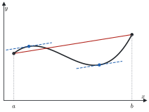

*Figura 4.4. Grafico su $[a, b]$ con la corda fra $(a, f(a))$ e $(b, f(b))$ e i punti in cui la tangente le è parallela.*

**Formule dell'incremento finito.** La definizione di derivata e il teorema di Lagrange danno due modi di stimare $f(x) - f(x_0)$.

La prima vale se $f$ è derivabile in $x_0$. Dire che il rapporto incrementale tende a $f'(x_0)$ equivale a dire che $\frac{f(x) - f(x_0) - f'(x_0)(x - x_0)}{x - x_0} \to 0$, cioè

$$f(x) = f(x_0) + f'(x_0)(x - x_0) + o(x - x_0), \qquad x \to x_0:$$

vicino a $x_0$ la funzione è la sua retta tangente, più un errore trascurabile rispetto a $x - x_0$. È il primo caso della formula di Taylor (modulo 5).

La seconda vale se $f$ è continua su $[a, b]$ e derivabile in $(a, b)$. Per ogni $a \le x_1 < x_2 \le b$, Lagrange su $[x_1, x_2]$ dà un $\bar{x} \in (x_1, x_2)$ con

$$f(x_2) = f(x_1) + f'(\bar{x})(x_2 - x_1).$$

Non dice quale sia $\bar{x}$, ma è esatta, non solo approssimata.

> [!teorema] Funzioni a derivata nulla
> Sia $f$ continua su $[a, b]$ e derivabile in $(a, b)$ con $f'(x) = 0$ per ogni $x \in (a, b)$. Allora $f$ è costante su $[a, b]$.

*Dimostrazione.* Per ogni $x \in [a, b)$, la seconda formula su $[x, b]$ dà $f(b) = f(x) + f'(\bar{x})(b - x) = f(x)$. Quindi $f(x) = f(b)$ per ogni $x$.

> [!attenzione]
> Serve che il dominio sia un intervallo. La funzione uguale a 0 su $(-\infty, 0)$ e a 1 su $(0, +\infty)$ ha derivata nulla ovunque sul suo dominio, ma non è costante.

### 4.7 Teorema di de l'Hôpital

> [!teorema] Teorema di de l'Hôpital
> Siano $f$ e $g$ definite in un intorno di $c$ (che può essere $x_0$, $x_0^\pm$ o $\pm\infty$), escluso al più $c$, e si supponga che
>
> 1. $\lim_{x \to c} f(x) = \lim_{x \to c} g(x) = 0$, oppure entrambi i limiti sono infiniti;
> 2. $f$ e $g$ sono derivabili vicino a $c$ (escluso $c$), con $g'(x) \ne 0$;
> 3. esiste, finito o infinito, $\lim_{x \to c} \frac{f'(x)}{g'(x)} = L$.
>
> Allora esiste anche $\lim_{x \to c} \frac{f(x)}{g(x)}$, ed è uguale a $L$.

> [!aggiunta] Aggiunta in revisione · fonte: Canuto-Tabacco, *Analisi Matematica 1*, cap. 6 (AM1A-16)
> *Dimostrazione (caso $\frac{0}{0}$ con $c = x_0^+$).* Si pone $f(x_0) = g(x_0) = 0$: così $f$ e $g$ diventano continue in $x_0$ da destra. Per ogni $x > x_0$ vicino a $x_0$ si applica il teorema di Cauchy a $f$ e $g$ su $[x_0, x]$: esiste $\xi_x \in (x_0, x)$ con
> $$f'(\xi_x)\, g(x) = f(x)\, g'(\xi_x).$$
> Inoltre $g(x) \ne 0$: se fosse $g(x) = 0 = g(x_0)$, per Rolle $g'$ si annullerebbe in $(x_0, x)$, contro l'ipotesi. Si può quindi dividere:
> $$\frac{f(x)}{g(x)} = \frac{f'(\xi_x)}{g'(\xi_x)}.$$
> Per $x \to x_0^+$ anche $\xi_x \to x_0^+$, perché $x_0 < \xi_x < x$, e il secondo membro tende a $L$ per il teorema di sostituzione. Gli altri casi si riconducono a questo.

> [!attenzione]
> Si deriva numeratore e denominatore **separatamente**: non si deriva il quoziente. Il teorema si applica solo alle forme $\frac{0}{0}$ e $\frac{\infty}{\infty}$, e se il limite di $\frac{f'}{g'}$ non esiste non si può concludere nulla. Ad esempio $\frac{x + \sin x}{x} \to 1$ per $x \to +\infty$, mentre $\frac{1 + \cos x}{1}$ non ha limite.

> [!esempio]
> $\lim_{x \to 0} \frac{e^x - 1 - x}{x^2} \overset{H}{=} \lim_{x \to 0} \frac{e^x - 1}{2x} = \frac{1}{2}$; $\quad \lim_{x \to +\infty} \frac{\ln x}{x} \overset{H}{=} \lim_{x \to +\infty} \frac{1/x}{1} = 0$; $\quad \lim_{x \to 0^+} x \ln x = \lim_{x \to 0^+} \frac{\ln x}{1/x} \overset{H}{=} \lim_{x \to 0^+} \frac{1/x}{-1/x^2} = \lim_{x \to 0^+} (-x) = 0$.

### 4.8 Limite della derivata

> [!teorema] Teorema del limite della derivata
> Sia $f$ continua in un intorno $I$ di $x_0$ e derivabile in $I \setminus \{x_0\}$.
>
> 1. Se esiste finito $\lim_{x \to x_0} f'(x) = L$, allora $f$ è derivabile in $x_0$ e $f'(x_0) = L$.
> 2. Se i limiti $\lim_{x \to x_0^\pm} f'(x)$ esistono ma sono diversi, oppure almeno uno è infinito, $f$ non è derivabile in $x_0$.

*Dimostrazione.* Il rapporto incrementale $\frac{f(x) - f(x_0)}{x - x_0}$ è una forma $\frac{0}{0}$, perché $f$ è continua in $x_0$. Per de l'Hôpital, applicato da destra e da sinistra, ha lo stesso limite di $\frac{f'(x)}{1}$. Nel caso 1 i limiti unilaterali del rapporto valgono entrambi $L$; nel caso 2 le derivate unilaterali sono diverse o non sono finite. (Lo stesso risultato si ottiene dalla seconda formula dell'incremento finito: $\frac{f(x) - f(x_0)}{x - x_0} = f'(\bar{x})$ con $\bar{x}$ fra $x_0$ e $x$.)

> [!attenzione]
> Serve la continuità in $x_0$. Senza, il teorema è falso: la funzione segno ha derivata 0 per ogni $x \ne 0$, ma in 0 non è nemmeno continua.

> [!esempio] Derivabilità con due parametri
> Per quali $\alpha, \beta \in \mathbb{R}$ è derivabile in 0 la funzione
> $$f(x) = \begin{cases} \alpha(e^x - 1) + \beta \cos x & x \ge 0 \\ 1 + x & x < 0 \end{cases}$$
>
> **Continuità in 0.** $\lim_{x \to 0^-} f(x) = 1$ e $f(0) = \lim_{x \to 0^+} f(x) = \beta$: serve $\beta = 1$.
>
> **Derivabilità.** Fuori dallo zero, $f'(x) = \alpha e^x - \beta \sin x$ per $x > 0$ e $f'(x) = 1$ per $x < 0$. Quindi $\lim_{x \to 0^+} f'(x) = \alpha$ e $\lim_{x \to 0^-} f'(x) = 1$. Con $\beta = 1$ la funzione è continua, e per il teorema del limite della derivata è derivabile in 0 se e solo se $\alpha = 1$.
>
> La risposta è $\alpha = \beta = 1$, con $f'(0) = 1$.

### Esempi ed esercizi svolti

> [!aggiunta] Aggiunta in revisione · fonte: esercizi nuovi sul modello del tutorato e delle prove scritte 2025-2026; soluzioni controllate con `strumenti/verifica_ampliamento.py` (AM1A-12, AM1A-13, AM1A-16)
> Il secondo punto di quasi tutte le prove è la derivabilità di una funzione a tratti; seguono la retta tangente, la derivata dell'inversa e le disuguaglianze con Lagrange.

**Esercizio 1. Calcolo di derivate.** Derivare (a) $x^2 e^{-x}$, (b) $\ln\left(x + \sqrt{x^2 + 1}\right)$, (c) $\arctan\frac{1}{x}$, (d) $x^x$ per $x > 0$, (e) $\sin^2(3x)$.

(a) Prodotto: $2x e^{-x} + x^2 \cdot (-e^{-x}) = (2x - x^2)e^{-x}$.

(b) Catena, con la derivata dell'argomento $1 + \frac{x}{\sqrt{x^2 + 1}} = \frac{\sqrt{x^2 + 1} + x}{\sqrt{x^2 + 1}}$:
$$\frac{1}{x + \sqrt{x^2 + 1}} \cdot \frac{\sqrt{x^2 + 1} + x}{\sqrt{x^2 + 1}} = \frac{1}{\sqrt{x^2 + 1}}.$$

(c) $\frac{1}{1 + \frac{1}{x^2}} \cdot \left(-\frac{1}{x^2}\right) = -\frac{1}{x^2 + 1}$ per $x \ne 0$. È la derivata di $-\arctan x$: infatti $\arctan\frac{1}{x} = \frac{\pi}{2} - \arctan x$ per $x > 0$ (e $-\frac{\pi}{2} - \arctan x$ per $x < 0$), che differiscono da $-\arctan x$ per una costante su ciascuna semiretta.

(d) Si scrive $x^x = e^{x \ln x}$: la derivata è $e^{x \ln x}(\ln x + 1) = x^x(\ln x + 1)$. Non si può usare la regola delle potenze ($x \cdot x^{x-1}$), perché l'esponente non è costante, né quella degli esponenziali ($x^x \ln x$), perché la base non è costante.

(e) $2\sin(3x) \cdot \cos(3x) \cdot 3 = 3\sin(6x)$.

**Esercizio 2. Derivabilità a tratti con due parametri.** Per quali $a, b$ è derivabile su $(0, +\infty)$ la funzione $f(x) = ax^2 + b$ per $0 < x \le 1$, $f(x) = \ln x + 1$ per $x > 1$?

*Continuità in 1* (senza continuità non c'è derivabilità): $f(1) = a + b$ e $\lim_{x \to 1^+} (\ln x + 1) = 1$, quindi $a + b = 1$.

*Derivate dei due tratti*: $2ax$ a sinistra, $\frac{1}{x}$ a destra. Con la continuità, per il teorema del limite della derivata basta confrontare i limiti: $2a$ da sinistra, 1 da destra. Serve $a = \frac{1}{2}$, e quindi $b = \frac{1}{2}$. Con questi valori $f'(1) = 1$.

**Esercizio 3. Punti di non derivabilità.** Studiare la derivabilità di (a) $f(x) = x|x|$ in 0 e (b) $g(x) = |x - 1|(x + 1)$ in 1.

(a) Rapporto incrementale: $\frac{x|x| - 0}{x} = |x| \to 0$. Derivabile, con $f'(0) = 0$: il valore assoluto, moltiplicato per $x$, "si raddrizza".

(b) Per $x > 1$, $g(x) = (x - 1)(x + 1) = x^2 - 1$, con derivata $2x \to 2$; per $x < 1$, $g(x) = -(x^2 - 1)$, con derivata $-2x \to -2$. $g$ è continua in 1 ($g(1) = 0$) e le derivate laterali sono $2$ e $-2$: punto angoloso.

**Esercizio 4. Retta tangente.** Scrivere la tangente al grafico di $f(x) = \ln(1 + x^2)$ nel punto di ascissa 1.

$f(1) = \ln 2$; $f'(x) = \frac{2x}{1 + x^2}$, quindi $f'(1) = 1$. La tangente è $y = \ln 2 + (x - 1)$.

**Esercizio 5. Derivata della funzione inversa.** (a) Mostrare che $f(x) = x^3 + x + 1$ è invertibile e calcolare $(f^{-1})'(3)$. (b) Lo stesso per $g(x) = e^x + x$ e $(g^{-1})'(1)$.

(a) $f'(x) = 3x^2 + 1 > 0$, quindi $f$ è strettamente crescente su $\mathbb{R}$ e invertibile. Non serve trovare l'inversa: serve il punto $x_0$ con $f(x_0) = 3$, che si trova a occhio, $x_0 = 1$. Per la formula della derivata dell'inversa,
$$(f^{-1})'(3) = \frac{1}{f'(1)} = \frac{1}{4}.$$
(b) $g' = e^x + 1 > 0$; $g(0) = 1$, quindi $(g^{-1})'(1) = \frac{1}{g'(0)} = \frac{1}{2}$.

**Esercizio 6. Disuguaglianze con Lagrange.** Dimostrare (a) $|\sin a - \sin b| \le |a - b|$ per ogni $a, b$; (b) $\ln(1 + x) < x$ per ogni $x > 0$; (c) $e^x \ge 1 + x$ per ogni $x$, con l'uguaglianza solo in 0.

(a) Per Lagrange su $[a, b]$ esiste $\xi$ con $\sin a - \sin b = \cos\xi\,(a - b)$, e $|\cos\xi| \le 1$.

(b) Su $[0, x]$: $\ln(1 + x) - \ln 1 = \frac{1}{1 + \xi}\,x$ con $0 < \xi < x$, e $\frac{1}{1 + \xi} < 1$.

(c) Per $x > 0$, su $[0, x]$: $e^x - 1 = e^\xi x$ con $0 < \xi < x$, quindi $e^\xi > 1$ e $e^x - 1 > x$. Per $x < 0$, su $[x, 0]$: $e^0 - e^x = e^\xi(0 - x)$ con $x < \xi < 0$, cioè $e^x - 1 = e^\xi x$; ora $e^\xi < 1$ e $x < 0$, quindi $e^\xi x > x$. In 0 vale l'uguaglianza. La disuguaglianza dice che la retta $y = 1 + x$, tangente al grafico di $e^x$ in 0, sta sempre sotto il grafico: è la convessità del modulo 5.

**Esercizio 7. Limiti con de l'Hôpital.** (a) $\displaystyle\lim_{x \to 0} \frac{x - \sin x}{x^3}$; (b) $\displaystyle\lim_{x \to +\infty} \frac{\ln x}{\sqrt{x}}$; (c) $\displaystyle\lim_{x \to 0^+} x \ln x$.

(a) Tre volte la forma $\frac{0}{0}$: $\frac{1 - \cos x}{3x^2} \to \frac{\sin x}{6x} \to \frac{1}{6}$ (l'ultimo passo con il limite notevole). (b) Forma $\frac{\infty}{\infty}$: $\frac{1/x}{1/(2\sqrt{x})} = \frac{2}{\sqrt{x}} \to 0$. (c) Forma $0 \cdot \infty$: si riscrive come $\frac{\ln x}{1/x}$, forma $\frac{\infty}{\infty}$, e il rapporto delle derivate è $\frac{1/x}{-1/x^2} = -x \to 0$.

**Esercizio 8. Raccordo derivabile.** Mostrare che $f(x) = \sin x$ per $x < 0$, $f(x) = x + x^2$ per $x \ge 0$, è derivabile in 0.

Continuità: entrambi i tratti valgono 0 in 0. Derivate: $\cos x \to 1$ da sinistra, $1 + 2x \to 1$ da destra. Per il teorema del limite della derivata, $f'(0) = 1$. Il grafico passa "liscio" da un tratto all'altro, con la stessa tangente $y = x$.

### Esercizi guidati

> [!aggiunta] Aggiunta in revisione · fonte: esercizi nuovi; soluzioni controllate con `strumenti/verifica_ampliamento.py` (AM1A-12, AM1A-13, AM1A-16)
> Ogni esercizio è diviso in passi: si prova un passo alla volta e si confronta solo dopo.

**Guidato 1. Un parametro per la derivabilità.** Sia $f_k(x) = e^{2x} - 1$ per $x < 0$ e $f_k(x) = x^2 + kx$ per $x \ge 0$. Per quali $k$ è continua? Per quali è derivabile?

*Passo 1: continuità.* In 0: limite sinistro $e^0 - 1 = 0$, valore $0$. Continua per ogni $k$.

*Passo 2: le derivate dei tratti.* $2e^{2x}$ per $x < 0$, $2x + k$ per $x > 0$.

*Passo 3: i limiti delle derivate.* Da sinistra 2, da destra $k$.

*Passo 4: conclusione.* Derivabile se e solo se $k = 2$, con $f_2'(0) = 2$. Per $k \ne 2$ c'è un punto angoloso, con semitangenti di pendenza 2 e $k$.

**Guidato 2. La derivata dell'arcoseno.** Ricavare $(\arcsin)'(y)$ dalla formula della derivata dell'inversa.

*Passo 1: la funzione da invertire.* $\sin$ ristretto a $\left[-\frac{\pi}{2}, \frac{\pi}{2}\right]$ è strettamente crescente, con derivata $\cos x$, positiva all'interno.

*Passo 2: la formula.* Per $y = \sin x$ con $x \in \left(-\frac{\pi}{2}, \frac{\pi}{2}\right)$: $(\arcsin)'(y) = \frac{1}{\cos x}$.

*Passo 3: esprimere in $y$.* $\cos x = \sqrt{1 - \sin^2 x} = \sqrt{1 - y^2}$, con il segno $+$ perché il coseno è positivo nell'intervallo.

*Passo 4: risultato.* $(\arcsin)'(y) = \frac{1}{\sqrt{1 - y^2}}$ per $-1 < y < 1$. Negli estremi $\pm 1$ la derivata non esiste: il grafico dell'arcoseno ha lì tangente verticale, simmetrica della tangente orizzontale del seno in $\pm\frac{\pi}{2}$.

**Guidato 3. Una radice e una sola con Rolle.** Dimostrare che $x^5 + x - 1 = 0$ ha esattamente una soluzione reale.

*Passo 1: esistenza.* $p(x) = x^5 + x - 1$ è continua, $p(0) = -1 < 0$ e $p(1) = 1 > 0$: per il teorema degli zeri c'è una soluzione in $(0, 1)$.

*Passo 2: unicità per assurdo.* Se ci fossero due soluzioni $x_1 < x_2$, sarebbe $p(x_1) = p(x_2) = 0$ e, per Rolle, esisterebbe $\xi \in (x_1, x_2)$ con $p'(\xi) = 0$.

*Passo 3: la contraddizione.* $p'(x) = 5x^4 + 1 \ge 1$ non si annulla mai.

*Passo 4: conclusione.* La soluzione è unica, e sta in $(0, 1)$. Lo stesso schema (zeri per l'esistenza, Rolle o la monotonia per l'unicità) serve in molti esercizi d'esame del tipo "quante soluzioni ha l'equazione".

### Riepilogo

La derivata $f'(x_0) = \lim_{h \to 0} \frac{f(x_0 + h) - f(x_0)}{h}$ è il coefficiente angolare della tangente, $y = f(x_0) + f'(x_0)(x - x_0)$. Una funzione derivabile è continua, non il contrario. Le derivate elementari si ricavano dai limiti notevoli; le regole sono
$$(f g)' = f' g + f g', \qquad \left(\frac{f}{g}\right)' = \frac{f' g - f g'}{g^2}, \qquad (g \circ f)' = g'(f) \cdot f', \qquad (f^{-1})'(y) = \frac{1}{f'(f^{-1}(y))}.$$
Punti angolosi, cuspidi e flessi a tangente verticale si riconoscono dalle derivate unilaterali.

Nei punti di estremo interni in cui è derivabile, la funzione ha derivata nulla (Fermat). Rolle, Cauchy e Lagrange garantiscono un punto interno in cui la derivata assume un valore preciso; da Lagrange seguono la formula $f(x_2) - f(x_1) = f'(\bar{x})(x_2 - x_1)$ e il fatto che su un intervallo una funzione a derivata nulla è costante. De l'Hôpital scioglie le forme $\frac{0}{0}$ e $\frac{\infty}{\infty}$ con il limite del rapporto delle derivate, e da esso segue il teorema del limite della derivata.

### Formulario

> [!aggiunta] Aggiunta in revisione · fonte: sintesi del modulo (AM1A-12, AM1A-13, AM1A-16)
> Derivate, regole e teoremi del modulo, con i termini per l'orale.

#### Derivate fondamentali

| $f(x)$ | $f'(x)$ | $f(x)$ | $f'(x)$ |
|---|---|---|---|
| $x^\alpha$ | $\alpha x^{\alpha - 1}$ | $\sin x$ | $\cos x$ |
| $e^x$ | $e^x$ | $\cos x$ | $-\sin x$ |
| $a^x$ | $a^x \ln a$ | $\tan x$ | $1 + \tan^2 x = \frac{1}{\cos^2 x}$ |
| $\ln \lvert x \rvert$ | $\frac{1}{x}$ | $\arcsin x$ | $\frac{1}{\sqrt{1 - x^2}}$ |
| $\log_a x$ | $\frac{1}{x \ln a}$ | $\arccos x$ | $-\frac{1}{\sqrt{1 - x^2}}$ |
| $\lvert x \rvert$ | $\frac{\lvert x \rvert}{x}$ ($x \ne 0$) | $\arctan x$ | $\frac{1}{1 + x^2}$ |

#### Regole

$$(f \pm g)' = f' \pm g', \quad (fg)' = f'g + fg', \quad \left(\frac{f}{g}\right)' = \frac{f'g - fg'}{g^2}, \quad (g \circ f)'(x) = g'(f(x))\,f'(x),$$

$$(f^{-1})'(y_0) = \frac{1}{f'(x_0)} \text{ con } y_0 = f(x_0),\ f'(x_0) \ne 0, \qquad (f^g)' = f^g\left(g' \ln f + g\frac{f'}{f}\right).$$

Tangente in $x_0$: $y = f(x_0) + f'(x_0)(x - x_0)$. Derivabile implica continua.

#### Teoremi

| Teorema | Ipotesi | Tesi |
|---|---|---|
| Fermat | $x_0$ estremo locale interno, $f$ derivabile in $x_0$ | $f'(x_0) = 0$ |
| Rolle | $f$ continua su $[a, b]$, derivabile in $(a, b)$, $f(a) = f(b)$ | $\exists \xi : f'(\xi) = 0$ |
| Lagrange | $f$ continua su $[a, b]$, derivabile in $(a, b)$ | $\exists \xi : f(b) - f(a) = f'(\xi)(b - a)$ |
| Cauchy | $f, g$ come sopra, $g' \ne 0$ | $\exists \xi : \frac{f(b) - f(a)}{g(b) - g(a)} = \frac{f'(\xi)}{g'(\xi)}$ |
| de l'Hôpital | forma $\frac{0}{0}$ o $\frac{\infty}{\infty}$, $g' \ne 0$ vicino al punto, esiste $\lim \frac{f'}{g'}$ | $\lim \frac{f}{g} = \lim \frac{f'}{g'}$ |
| Limite della derivata | $f$ continua in $x_0$, derivabile intorno, $f' \to L$ finito | $f'(x_0) = L$ |

#### Punti di non derivabilità (con $f$ continua)

| Tipo | Derivate laterali |
|---|---|
| Punto angoloso | finite e diverse (almeno una finita) |
| Cuspide | infinite di segno opposto |
| Flesso a tangente verticale | infinite dello stesso segno |

#### Termini per l'orale

| Termine | In una riga |
|---|---|
| Rapporto incrementale | $\frac{f(x_0 + h) - f(x_0)}{h}$, pendenza della secante |
| Derivata | limite del rapporto incrementale, pendenza della tangente |
| Derivata destra e sinistra | limiti unilaterali del rapporto incrementale |
| Punto critico (stazionario) | punto in cui $f'(x_0) = 0$ |
| Estremo locale | massimo o minimo in un intorno del punto |
| Teorema del valor medio | Lagrange: esiste un punto con tangente parallela alla secante |
| Funzione di classe $C^1$ | derivabile con derivata continua |

#### Domande che tornano spesso

- Definire la derivata e la retta tangente; dimostrare che derivabile implica continua (e che il contrario è falso).
- Dimostrare la regola del prodotto e quella della funzione composta.
- Ricavare la derivata dell'inversa e applicarla ad $\arctan$ e $\arcsin$.
- Enunciare e dimostrare Fermat, Rolle e Lagrange; interpretarli sul grafico.
- Conseguenze di Lagrange: funzione con derivata nulla su un intervallo, monotonia e segno della derivata.
- Enunciare de l'Hôpital e mostrare un caso in cui le ipotesi non valgono.
- Classificare i punti di non derivabilità.

## 5 · Monotonia, convessità, studio di funzione e Taylor

**In questo modulo.** Prerequisiti: il modulo 4 (Derivate e teoremi del valor medio) e, per gli sviluppi, i simboli di Landau del modulo 3. Il segno della derivata prima dice dove una funzione cresce e dove ha i suoi estremi; il segno della derivata seconda dice dove è convessa o concava. Con questi strumenti, insieme a limiti e asintoti, si disegna il grafico di una funzione. La seconda parte del modulo è dedicata alla formula di Taylor, che approssima una funzione con un polinomio vicino a un punto. Gli sviluppi notevoli e le regole per combinarli permettono di calcolare limiti e ordini di infinitesimo che con i soli limiti notevoli restano fuori portata. Alla fine del modulo si sa svolgere uno studio di funzione completo e usare gli sviluppi di Taylor negli esercizi d'esame.

### 5.1 Monotonia e segno della derivata

> [!teorema] Criterio di monotonia
> Sia $f$ continua su un intervallo $I$ e derivabile nei punti interni di $I$.
>
> 1. $f$ è crescente su $I$ se e solo se $f'(x) \ge 0$ in ogni punto interno $x$ di $I$; è decrescente se e solo se $f'(x) \le 0$.
> 2. Se $f'(x) > 0$ in ogni punto interno di $I$, allora $f$ è strettamente crescente su $I$; se $f'(x) < 0$, strettamente decrescente.

*Dimostrazione.* (1, $\Rightarrow$) Sia $f$ crescente e $x$ interno a $I$. Per ogni $y \in I$, $y \ne x$, il rapporto incrementale $\frac{f(y) - f(x)}{y - x}$ è $\ge 0$: se $y > x$ numeratore e denominatore sono entrambi $\ge 0$ e $> 0$, se $y < x$ sono entrambi $\le 0$ e $< 0$. Per la permanenza del segno il limite per $y \to x$, cioè $f'(x)$, è $\ge 0$.

> [!aggiunta] Aggiunta in revisione · fonte: Canuto-Tabacco, *Analisi Matematica 1*, cap. 6 (AM1A-14)
> (1, $\Leftarrow$) Siano $x_1 < x_2$ in $I$. Per il teorema di Lagrange su $[x_1, x_2]$ esiste $\bar{x} \in (x_1, x_2)$, interno a $I$, con
> $$f(x_2) - f(x_1) = f'(\bar{x})\,(x_2 - x_1) \ge 0,$$
> quindi $f(x_1) \le f(x_2)$. (2) Con lo stesso argomento, se $f' > 0$ la differenza è strettamente positiva.

> [!attenzione]
> Il punto 2 non si inverte: $f(x) = x^3$ è strettamente crescente su $\mathbb{R}$, ma $f'(0) = 0$. E serve che il dominio sia un intervallo: $-\frac{1}{x}$ ha derivata $\frac{1}{x^2} > 0$ su $\mathbb{R} \setminus \{0\}$, ma non è crescente, perché $-\frac{1}{-1} = 1 > -1 = -\frac{1}{1}$.

### 5.2 Ricerca degli estremi

Dal criterio di monotonia segue il modo standard di classificare i punti critici.

> [!teorema] Test della derivata prima
> Sia $f$ continua su un intervallo $I$ e derivabile nei punti interni, e sia $x_0$ un punto interno con $f'(x_0) = 0$. Se $f'(x) \ge 0$ in un intorno sinistro di $x_0$ e $f'(x) \le 0$ in un intorno destro (escluso $x_0$), allora $x_0$ è un punto di massimo relativo; con i segni opposti è di minimo relativo. Se le disuguaglianze sono strette, l'estremo è stretto.

Gli estremi di una funzione vanno cercati fra i punti critici interni (per Fermat), i punti in cui la funzione non è derivabile e gli estremi del dominio; il segno di $f'$ dice poi quali di questi sono massimi o minimi.

> [!esempio] Gli estremi di $x \arctan x$
> $f(x) = x \arctan x$ è derivabile su $\mathbb{R}$, con
> $$f'(x) = \arctan x + \frac{x}{1 + x^2}.$$
> Per $x > 0$ entrambi gli addendi sono positivi, per $x < 0$ entrambi negativi: $f'(x) > 0$ per $x > 0$, $f'(x) < 0$ per $x < 0$ e $f'(0) = 0$. L'unico punto critico è 0. La funzione decresce strettamente su $(-\infty, 0]$ e cresce strettamente su $[0, +\infty)$: 0 è un punto di minimo stretto, anzi assoluto, con $f(0) = 0$.

### 5.3 Derivate successive

Se $f$ è derivabile in un intorno $I$ di $x_0$, la derivata è a sua volta una funzione $f' : I \to \mathbb{R}$, che si può provare a derivare.

> [!definizione] Derivata seconda e derivate di ordine superiore
> Se $f'$ è derivabile in $x_0$, si dice che $f$ è derivabile due volte in $x_0$, e la **derivata seconda** è
> $$f''(x_0) = \lim_{x \to x_0} \frac{f'(x) - f'(x_0)}{x - x_0}.$$
> Iterando si definiscono $f''' = f^{(3)}$, $f^{(4)}$, …, $f^{(k)}$, con $f^{(0)} = f$.

> [!esempio]
> Per $k \le n$, $(x^n)^{(k)} = n(n-1) \cdots (n - k + 1)\, x^{n-k}$; in particolare $(x^n)^{(n)} = n!$ e $(x^n)^{(k)} = 0$ per $k > n$. Per l'esponenziale $(e^x)^{(k)} = e^x$ per ogni $k$; per il seno le derivate si ripetono ogni quattro: $\sin$, $\cos$, $-\sin$, $-\cos$, $\sin$, …

> [!definizione] Classi $C^k$
> Una funzione $f : I \to \mathbb{R}$ è **di classe $C^k$** sull'intervallo $I$, e si scrive $f \in C^k(I)$, se è derivabile $k$ volte in $I$ e $f^{(k)}$ è continua su $I$; è **di classe $C^\infty$** se è di classe $C^k$ per ogni $k$. Polinomi, esponenziali, seno e coseno sono di classe $C^\infty$ su $\mathbb{R}$.

### 5.4 Convessità e flessi

> [!definizione] Funzione convessa e concava
> Sia $f$ derivabile su un intervallo $I$. La funzione è **convessa** su $I$ se per ogni $x_1, x_2 \in I$
> $$f(x_2) \ge f(x_1) + f'(x_1)(x_2 - x_1),$$
> cioè se il grafico sta sopra ogni sua retta tangente; è **concava** con la disuguaglianza opposta. È **strettamente** convessa o concava se la disuguaglianza è stretta per $x_1 \ne x_2$.

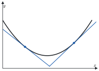

*Figura 5.1. Grafico di una funzione convessa su $I$ con due rette tangenti, sotto il grafico.*

> [!esempio] $x^2$ è strettamente convessa
> Bisogna verificare che $x_2^2 > x_1^2 + 2x_1(x_2 - x_1)$ per ogni $x_1 \ne x_2$. Portando tutto a sinistra:
> $$x_2^2 - x_1^2 - 2x_1 x_2 + 2x_1^2 = x_2^2 - 2x_1 x_2 + x_1^2 = (x_2 - x_1)^2 > 0.$$

> [!teorema] Convessità e derivate
> Sia $f$ derivabile sull'intervallo $I$.
>
> 1. $f$ è convessa su $I$ se e solo se $f'$ è crescente su $I$ (concava se e solo se $f'$ è decrescente).
> 2. Se $f'$ è strettamente crescente, $f$ è strettamente convessa.
>
> Se $f$ è derivabile due volte su $I$, ne segue che $f$ è convessa se e solo se $f''(x) \ge 0$ per ogni $x \in I$, e che $f'' > 0$ su $I$ implica la convessità stretta.

*Dimostrazione di 1.* ($\Rightarrow$) Siano $x_1 < x_2$ in $I$. La convessità, scritta nei due punti, dà
$$f(x_2) \ge f(x_1) + f'(x_1)(x_2 - x_1), \qquad f(x_1) \ge f(x_2) + f'(x_2)(x_1 - x_2).$$
Sommando membro a membro e semplificando si ottiene $0 \ge (x_2 - x_1)\big(f'(x_1) - f'(x_2)\big)$; poiché $x_2 - x_1 > 0$, è $f'(x_1) \le f'(x_2)$.

($\Leftarrow$) Siano $x_1 \ne x_2$ in $I$; per Lagrange $f(x_2) = f(x_1) + f'(\bar{x})(x_2 - x_1)$ con $\bar{x}$ fra $x_1$ e $x_2$. Se $x_1 < x_2$, allora $\bar{x} > x_1$ e, essendo $f'$ crescente, $f'(\bar{x}) \ge f'(x_1)$; moltiplicando per $x_2 - x_1 > 0$ si ha $f(x_2) \ge f(x_1) + f'(x_1)(x_2 - x_1)$. Se $x_1 > x_2$, allora $\bar{x} < x_1$, quindi $f'(\bar{x}) \le f'(x_1)$; moltiplicando per $x_2 - x_1 < 0$ la disuguaglianza si inverte e si ottiene la stessa conclusione. La parte con $f''$ segue applicando il criterio di monotonia (paragrafo 5.1) alla funzione $f'$.

> [!attenzione]
> Anche qui la condizione sufficiente non si inverte: $x^4$ è strettamente convessa, ma $f''(x) = 12x^2$ si annulla in 0.

> [!definizione] Punto di flesso
> Sia $f$ derivabile in $x_0$. Il punto $x_0$ è di **flesso** se in un intorno di $x_0$ il grafico passa da una parte all'altra della tangente in $x_0$, cioè se, con $t(x) = f(x_0) + f'(x_0)(x - x_0)$, vale $f(x) \le t(x)$ per $x < x_0$ e $f(x) \ge t(x)$ per $x > x_0$ (flesso **ascendente**), oppure il contrario (flesso **discendente**).

> [!teorema] Flessi e derivata seconda
> Sia $f$ derivabile due volte in un intorno di $x_0$.
>
> 1. Se $x_0$ è un punto di flesso, allora $f''(x_0) = 0$.
> 2. Se $f''(x_0) = 0$ e $f''$ cambia segno in $x_0$ (negativa a sinistra e positiva a destra, oppure il contrario), allora $x_0$ è un punto di flesso: ascendente nel primo caso, discendente nel secondo.

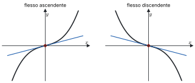

*Figura 5.2. Flesso ascendente e discendente, con la retta tangente nel punto di flesso.*

> [!esempio]
> Per $f(x) = x \arctan x$ si ha
> $$f''(x) = \frac{1}{1 + x^2} + \frac{(1 + x^2) - 2x^2}{(1 + x^2)^2} = \frac{2}{(1 + x^2)^2} > 0,$$
> quindi la funzione è strettamente convessa su $\mathbb{R}$ e non ha flessi.

### 5.5 Studio di funzione

Per disegnare il grafico di $f$ si raccolgono, in quest'ordine, le informazioni seguenti.

1. **Dominio**, eventuali simmetrie (funzione pari o dispari) e periodicità; segno e zeri, se si trovano facilmente.
2. **Limiti** agli estremi del dominio e nei punti esclusi; **asintoti** orizzontali, obliqui e verticali.
3. **Derivata prima**: punti di non derivabilità, punti critici, intervalli di monotonia, estremi relativi e assoluti.
4. **Derivata seconda**: intervalli di convessità e concavità, flessi.
5. **Grafico**, coerente con tutte le informazioni raccolte.

> [!aggiunta] Aggiunta in revisione · fonte: Canuto-Tabacco, *Analisi Matematica 1*, cap. 6; Baronti et al., *Calculus Problems* (AM1A-15)
> **Esempio completo: $f(x) = x\, e^{-x}$.**
>
> *Dominio e segno.* $f$ è definita e di classe $C^\infty$ su $\mathbb{R}$. Non è né pari né dispari. Poiché $e^{-x} > 0$, il segno è quello di $x$: $f < 0$ per $x < 0$, $f(0) = 0$, $f > 0$ per $x > 0$.
>
> *Limiti e asintoti.* Per $x \to -\infty$, $x \to -\infty$ ed $e^{-x} \to +\infty$, quindi $f(x) \to -\infty$; inoltre $\frac{f(x)}{x} = e^{-x} \to +\infty$, e non c'è asintoto obliquo. Per $x \to +\infty$ la forma è $\infty \cdot 0$: $f(x) = \frac{x}{e^x} \to 0$ per la gerarchia degli infiniti (o per de l'Hôpital), e $y = 0$ è asintoto orizzontale a destra.
>
> *Derivata prima.* $f'(x) = e^{-x} - x e^{-x} = (1 - x)\, e^{-x}$, positiva per $x < 1$ e negativa per $x > 1$. La funzione cresce su $(-\infty, 1]$ e decresce su $[1, +\infty)$: $x = 1$ è il punto di massimo assoluto, con $f(1) = \frac{1}{e}$. L'immagine è $\left(-\infty, \frac{1}{e}\right]$.
>
> *Derivata seconda.* $f''(x) = -e^{-x} - (1 - x)\, e^{-x} = (x - 2)\, e^{-x}$: la funzione è concava su $(-\infty, 2]$ e convessa su $[2, +\infty)$, e $x = 2$ è un punto di flesso, con $f(2) = \frac{2}{e^2}$.
>
> *Grafico.* Sale da $-\infty$ passando per l'origine, raggiunge il massimo $\left(1, \frac{1}{e}\right)$, scende, cambia concavità in $\left(2, \frac{2}{e^2}\right)$ e si avvicina all'asse $x$ da sopra.

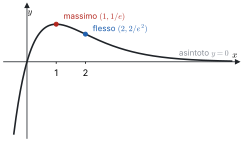

*Figura 5.3. Grafico di $x e^{-x}$ con il massimo in $(1, 1/e)$, il flesso in $(2, 2/e^2)$ e l'asintoto $y = 0$.*

### 5.6 Formula di Taylor

L'idea è approssimare $f$ vicino a $x_0$ con il polinomio che ha in $x_0$ lo stesso valore e le stesse derivate di $f$, fino a un certo ordine.

> [!definizione] Polinomio di Taylor
> Sia $f$ derivabile $n$ volte in $x_0$. Il **polinomio di Taylor** di $f$ di ordine $n$ e centro $x_0$ è
> $$T_{n,x_0} f(x) := \sum_{k=0}^{n} \frac{f^{(k)}(x_0)}{k!}\,(x - x_0)^k = f(x_0) + f'(x_0)(x - x_0) + \frac{f''(x_0)}{2}(x - x_0)^2 + \dots + \frac{f^{(n)}(x_0)}{n!}(x - x_0)^n.$$
> Con $x_0 = 0$ si chiama anche **polinomio di Mac Laurin**.

Per $n = 0$ è la costante $f(x_0)$, per $n = 1$ la retta tangente. Derivando termine a termine e valutando in $x_0$ si verifica che $\left(T_{n,x_0} f\right)^{(k)}(x_0) = f^{(k)}(x_0)$ per $k = 0, 1, \dots, n$: il termine di grado $k$ è l'unico che contribuisce alla derivata $k$-esima in $x_0$, e la sua derivata $k$-esima vale $\frac{f^{(k)}(x_0)}{k!} \cdot k! = f^{(k)}(x_0)$.

> [!teorema] Formula di Taylor con resto di Peano
> Sia $f$ derivabile $n$ volte in $x_0$. Allora
> $$f(x) = T_{n,x_0} f(x) + o\big((x - x_0)^n\big), \qquad x \to x_0.$$

*Dimostrazione.* Si deve mostrare che $\frac{f(x) - T_{n,x_0} f(x)}{(x - x_0)^n} \to 0$. Sia $R = f - T_{n,x_0} f$. Per quanto appena osservato $R^{(k)}(x_0) = 0$ per $k = 0, \dots, n$, e per $k \le n - 1$ la funzione $R^{(k)}$ è derivabile vicino a $x_0$, quindi continua: $R^{(k)}(x) \to 0$ per $x \to x_0$. Numeratore e denominatore sono quindi infinitesimi, e si può applicare de l'Hôpital $n - 1$ volte:
$$\lim_{x \to x_0} \frac{R(x)}{(x - x_0)^n} \overset{H}{=} \lim_{x \to x_0} \frac{R'(x)}{n(x - x_0)^{n-1}} \overset{H}{=} \dots \overset{H}{=} \lim_{x \to x_0} \frac{R^{(n-1)}(x)}{n!\,(x - x_0)}.$$
A questo punto non si deriva più, perché $f^{(n)}$ esiste solo in $x_0$, non in un intorno. Si scrive esplicitamente $R^{(n-1)}(x) = f^{(n-1)}(x) - f^{(n-1)}(x_0) - f^{(n)}(x_0)(x - x_0)$ e si usa la definizione di derivata:
$$\frac{R^{(n-1)}(x)}{n!\,(x - x_0)} = \frac{1}{n!}\left(\frac{f^{(n-1)}(x) - f^{(n-1)}(x_0)}{x - x_0} - f^{(n)}(x_0)\right) \longrightarrow \frac{1}{n!}\big(f^{(n)}(x_0) - f^{(n)}(x_0)\big) = 0.$$

Il resto di Peano dice *come* l'errore tende a zero, ma non quanto vale. Per stimarlo serve un'altra forma del resto.

> [!teorema] Formula di Taylor con resto di Lagrange
> Sia $f$ di classe $C^n$ in un intorno $I$ di $x_0$ e derivabile $n + 1$ volte in $I \setminus \{x_0\}$. Per ogni $x \in I$, $x \ne x_0$, esiste $\bar{x}$ strettamente compreso fra $x_0$ e $x$ tale che
> $$f(x) = T_{n,x_0} f(x) + \frac{f^{(n+1)}(\bar{x})}{(n+1)!}\,(x - x_0)^{n+1}.$$

Per $n = 0$ è il teorema di Lagrange. Ad esempio, per $f(x) = e^x$, $x_0 = 0$ e $x = 1$, con $0 < \bar{x} < 1$:
$$e = \sum_{k=0}^{n} \frac{1}{k!} + \frac{e^{\bar{x}}}{(n+1)!}, \qquad 0 < e - \sum_{k=0}^{n} \frac{1}{k!} < \frac{3}{(n+1)!}.$$
Con $n = 7$ l'errore è minore di $10^{-4}$.

> [!teorema] Unicità del polinomio di Taylor
> Sia $f$ derivabile $n$ volte in $x_0$ e sia $P$ un polinomio di grado $\le n$ tale che $f(x) = P(x) + o\big((x - x_0)^n\big)$ per $x \to x_0$. Allora $P = T_{n,x_0} f$.

È questo risultato a rendere utili gli sviluppi: qualunque procedimento produca un polinomio di grado $\le n$ che approssima $f$ a meno di $o\big((x - x_0)^n\big)$ ha trovato il polinomio di Taylor, anche senza calcolare le derivate.

### 5.7 Sviluppi notevoli e operazioni

Per $x \to 0$ valgono gli sviluppi seguenti. I primi tre si ottengono dalle derivate in 0, come negli appunti.

- **Esponenziale.** $(e^x)^{(k)}(0) = 1$ per ogni $k$, quindi
$$e^x = 1 + x + \frac{x^2}{2} + \frac{x^3}{3!} + \dots + \frac{x^n}{n!} + o(x^n) = \sum_{k=0}^{n} \frac{x^k}{k!} + o(x^n).$$
- **Logaritmo.** Le derivate di $\ln(1 + x)$ sono $\frac{1}{1 + x}$, $-\frac{1}{(1 + x)^2}$, $\frac{2}{(1 + x)^3}$, …, e in generale la $k$-esima vale $(-1)^{k-1}(k-1)!$ in 0. Quindi
$$\ln(1 + x) = x - \frac{x^2}{2} + \frac{x^3}{3} - \dots + (-1)^{n-1}\frac{x^n}{n} + o(x^n) = \sum_{k=1}^{n} \frac{(-1)^{k-1}}{k} x^k + o(x^n).$$
- **Seno.** Le derivate in 0 si ripetono come $0, 1, 0, -1$: quelle di ordine pari sono nulle, quella di ordine $2l + 1$ vale $(-1)^l$. Quindi
$$\sin x = x - \frac{x^3}{3!} + \frac{x^5}{5!} - \dots + (-1)^{n-1}\frac{x^{2n-1}}{(2n-1)!} + o(x^{2n}).$$
Poiché il coefficiente di $x^{2n}$ è nullo, il polinomio di ordine $2n - 1$ coincide con quello di ordine $2n$, e il resto è $o(x^{2n})$ invece che $o(x^{2n-1})$.

> [!aggiunta] Aggiunta in revisione · fonte: Canuto-Tabacco, *Analisi Matematica 1*, cap. 7 (AM1A-17)
> Con lo stesso metodo si ottengono gli altri sviluppi notevoli, per $x \to 0$:
> $$\cos x = 1 - \frac{x^2}{2} + \frac{x^4}{4!} - \dots + (-1)^n \frac{x^{2n}}{(2n)!} + o(x^{2n+1}),$$
> $$\frac{1}{1 - x} = 1 + x + x^2 + \dots + x^n + o(x^n),$$
> $$(1 + x)^\alpha = 1 + \alpha x + \binom{\alpha}{2} x^2 + \dots + \binom{\alpha}{n} x^n + o(x^n), \qquad \binom{\alpha}{k} = \frac{\alpha(\alpha - 1)\cdots(\alpha - k + 1)}{k!},$$
> $$\arctan x = x - \frac{x^3}{3} + \frac{x^5}{5} - \dots + (-1)^n \frac{x^{2n+1}}{2n+1} + o(x^{2n+2}).$$
> Ad esempio $\sqrt{1 + x} = 1 + \frac{x}{2} - \frac{x^2}{8} + o(x^2)$.

Grazie all'unicità, gli sviluppi di funzioni costruite a partire da questi si ottengono con l'algebra, senza calcolare derivate.

**Somma.** Se $f$ e $g$ sono derivabili $n$ volte in $x_0$, sommando i due sviluppi si ottiene un polinomio di grado $\le n$ più $o\big((x - x_0)^n\big)$; per l'unicità, $T_{n,x_0}(f + g) = T_{n,x_0} f + T_{n,x_0} g$.

**Prodotto.** Moltiplicando gli sviluppi,
$$f(x)\, g(x) = T_{n,x_0} f(x) \cdot T_{n,x_0} g(x) + o\big((x - x_0)^n\big).$$
Il prodotto dei due polinomi ha grado fino a $2n$; i termini di grado $> n$ sono anch'essi $o\big((x - x_0)^n\big)$. Quindi $T_{n,x_0}(fg)$ è il prodotto dei polinomi **troncato** al grado $n$.

> [!aggiunta] Aggiunta in revisione · fonte: Canuto-Tabacco, *Analisi Matematica 1*, cap. 7 (AM1A-17)
> **Quoziente.** Se $g(x_0) \ne 0$, si cerca $P = T_{n,x_0}\left(\frac{f}{g}\right)$. Da $f = \frac{f}{g} \cdot g$ e dalla regola del prodotto segue che $T_{n,x_0} f$ è il prodotto $P \cdot T_{n,x_0} g$ troncato al grado $n$: i coefficienti di $P$ si trovano uno alla volta, confrontando i coefficienti delle potenze uguali. In pratica, per $x_0 = 0$ e $g(0) = 1$, conviene scrivere $\frac{1}{g} = \frac{1}{1 - t}$ con $t = 1 - g(x) \to 0$ e usare lo sviluppo di $\frac{1}{1 - t}$. Ad esempio
> $$\tan x = \frac{\sin x}{\cos x} = \left(x - \frac{x^3}{6}\right)\left(1 + \frac{x^2}{2}\right) + o(x^3) = x + \frac{x^3}{3} + o(x^3),$$
> dove $\frac{1}{\cos x} = \frac{1}{1 - \left(\frac{x^2}{2} + o(x^3)\right)} = 1 + \frac{x^2}{2} + o(x^3)$.
>
> **Composizione.** Se $t = g(x) \to 0$ per $x \to 0$, nello sviluppo di $f(t)$ si sostituisce lo sviluppo di $g$ e si tengono solo i termini fino al grado voluto. Ad esempio, con $t = \cos x - 1 = -\frac{x^2}{2} + \frac{x^4}{24} + o(x^4)$:
> $$\ln(\cos x) = \ln(1 + t) = t - \frac{t^2}{2} + o(t^2) = -\frac{x^2}{2} + \frac{x^4}{24} - \frac{x^4}{8} + o(x^4) = -\frac{x^2}{2} - \frac{x^4}{12} + o(x^4).$$
> Poiché $t \sim -\frac{x^2}{2}$, il termine $t^2$ è di ordine 4 e $o(t^2) = o(x^4)$; il termine $t^3$ sarebbe di ordine 6 e si trascura.

### 5.8 Applicazioni degli sviluppi

> [!aggiunta] Aggiunta in revisione · fonte: Canuto-Tabacco, *Analisi Matematica 1*, cap. 7 (AM1A-17)
> **Limiti.** Nelle forme $\frac{0}{0}$ si sviluppano numeratore e denominatore fino al primo termine che non si cancella.
> $$\lim_{x \to 0} \frac{\sin x - x \cos x}{x^3} = \lim_{x \to 0} \frac{\left(x - \frac{x^3}{6}\right) - \left(x - \frac{x^3}{2}\right) + o(x^3)}{x^3} = \lim_{x \to 0} \frac{\frac{x^3}{3} + o(x^3)}{x^3} = \frac{1}{3}.$$
> Con i soli limiti notevoli questo limite non si calcola: i termini di primo grado si cancellano e serve l'ordine successivo.
>
> **Ordine e parte principale.** Lo stesso calcolo dice che $\sin x - x \cos x$ è, per $x \to 0$, un infinitesimo di ordine 3 con parte principale $\frac{x^3}{3}$. Allo stesso modo $e^x - 1 - x = \frac{x^2}{2} + o(x^2)$ ha ordine 2, e $\cos x - 1 + \frac{x^2}{2} = \frac{x^4}{24} + o(x^4)$ ha ordine 4.
>
> **Natura dei punti critici.** Sia $f'(x_0) = 0$ e sia $f^{(n)}(x_0)$ la prima derivata non nulla in $x_0$, con $n \ge 2$. Dalla formula di Peano,
> $$f(x) - f(x_0) = \frac{f^{(n)}(x_0)}{n!}(x - x_0)^n + o\big((x - x_0)^n\big),$$
> quindi vicino a $x_0$ la differenza ha il segno di $f^{(n)}(x_0)(x - x_0)^n$. Se $n$ è pari, $x_0$ è un punto di minimo stretto quando $f^{(n)}(x_0) > 0$ e di massimo stretto quando $f^{(n)}(x_0) < 0$. Se $n$ è dispari, non è un estremo ma un flesso a tangente orizzontale. Il caso più usato è $n = 2$: $f'(x_0) = 0$ e $f''(x_0) > 0$ danno un minimo, $f''(x_0) < 0$ un massimo. Per $x^3$ in 0 la prima derivata non nulla è la terza: flesso; per $x^4$ è la quarta, positiva: minimo.

### 5.9 Gli sviluppi negli esercizi, passo per passo

> [!aggiunta] Aggiunta in revisione · fonte: Canuto-Tabacco, *Analisi Matematica 1*, cap. 7; prove scritte 2025-2026 (AM1A-17)
> Negli esercizi d'esame gli sviluppi servono quasi sempre in tre situazioni: un limite in forma $\frac{0}{0}$ in cui i limiti notevoli non bastano, l'ordine di infinitesimo di una differenza, e il polinomio di Taylor di una funzione composta. Il procedimento è sempre lo stesso.
>
> 1. **Decidere l'ordine.** Si sviluppa il pezzo "più semplice" (di solito il denominatore) e si guarda il suo primo termine: se è $x^n$, numeratore e denominatore vanno sviluppati fino all'ordine $n$. Se dopo le cancellazioni al numeratore resta solo $o(x^n)$, si torna indietro e si sviluppa di un ordine in più.
> 2. **Sviluppare ogni pezzo** con gli sviluppi notevoli, sempre con il resto: $o(x^n)$ va scritto, perché ricorda fin dove si è arrivati.
> 3. **Comporre.** Se compare $f(g(x))$ con $g(x) \to 0$, si pone $t = g(x)$, si sviluppa $f(t)$, si sostituisce lo sviluppo di $g$ e si buttano i termini di grado maggiore di $n$. Per sapere quante potenze di $t$ servono si guarda l'ordine di $g$: se $g \sim x^m$, allora $t^k$ ha ordine $km$, e bastano le potenze con $km \le n$.
> 4. **Sommare e semplificare**, raccogliendo i termini dello stesso grado e tutti i resti in un solo $o(x^n)$.
>
> **Esempio: $e^{\sin x}$ fino all'ordine 3.** Con $t = \sin x = x - \frac{x^3}{6} + o(x^3)$, che ha ordine 1, servono le potenze di $t$ fino alla terza:
> $$e^t = 1 + t + \frac{t^2}{2} + \frac{t^3}{6} + o(t^3).$$
> Sostituendo: $t^2 = x^2 + o(x^3)$ (il doppio prodotto $-\frac{x^4}{3}$ è di ordine 4) e $t^3 = x^3 + o(x^3)$. Quindi
> $$e^{\sin x} = 1 + \left(x - \frac{x^3}{6}\right) + \frac{x^2}{2} + \frac{x^3}{6} + o(x^3) = 1 + x + \frac{x^2}{2} + o(x^3).$$
> Il termine di terzo grado si cancella: per conoscere il primo termine dopo $\frac{x^2}{2}$ bisognerebbe sviluppare fino all'ordine 4 (si troverebbe $-\frac{x^4}{8}$).
>
> **Esempio: un limite con un parametro.** Calcolare, al variare di $k \in \mathbb{R}$, $\displaystyle\lim_{x \to 0} \frac{e^{kx} - \sqrt{1 + 2x}}{x^2}$.
>
> Il denominatore è $x^2$: si sviluppa il numeratore fino all'ordine 2. $e^{kx} = 1 + kx + \frac{k^2 x^2}{2} + o(x^2)$ e, con $(1 + y)^{1/2} = 1 + \frac{y}{2} - \frac{y^2}{8} + o(y^2)$ e $y = 2x$, $\sqrt{1 + 2x} = 1 + x - \frac{x^2}{2} + o(x^2)$. La differenza è
> $$(k - 1)x + \frac{k^2 + 1}{2}x^2 + o(x^2).$$
> Se $k \ne 1$ il termine dominante è $(k - 1)x$, e il rapporto si comporta come $\frac{k - 1}{x}$: il limite destro è $+\infty$ o $-\infty$ secondo il segno di $k - 1$, il sinistro è opposto, e il limite non esiste. Se $k = 1$ il numeratore è $x^2 + o(x^2)$ e il limite vale 1. È la struttura tipica degli esercizi con parametro: il parametro decide quale termine si cancella.
>
> **Esempio: l'esponenziale di una forma $1^\infty$.** Calcolare $\displaystyle\lim_{x \to 0} \frac{(1 + x)^{a/x} - e^a}{x}$.
>
> Si scrive $(1 + x)^{a/x} = e^{\frac{a}{x}\ln(1 + x)}$ e si sviluppa l'esponente: $\frac{a}{x}\left(x - \frac{x^2}{2} + o(x^2)\right) = a - \frac{a}{2}x + o(x)$. Quindi
> $$(1 + x)^{a/x} = e^a \cdot e^{-\frac{a}{2}x + o(x)} = e^a\left(1 - \frac{a}{2}x + o(x)\right),$$
> e il limite è $-\frac{a\,e^a}{2}$. Per $a = 0$ il numeratore è identicamente nullo e il limite è 0, coerente con la formula.

### Esempi ed esercizi svolti

> [!esempio] Un limite con due sviluppi
> $$\lim_{x \to 0} \frac{e^{x^2} - \cos x}{x^2} = \lim_{x \to 0} \frac{\left(1 + x^2\right) - \left(1 - \frac{x^2}{2}\right) + o(x^2)}{x^2} = \frac{3}{2}.$$

> [!esempio] Studio locale
> Per $f(x) = \cos x + \frac{x^2}{2}$, in 0 si ha $f'(0) = 0$ e $f''(0) = -1 + 1 = 0$. Lo sviluppo $f(x) = 1 + \frac{x^4}{24} + o(x^4)$ mostra che la prima derivata non nulla è la quarta, positiva: 0 è un punto di minimo stretto.

#### Altri esercizi svolti

> [!aggiunta] Aggiunta in revisione · fonte: esercizi nuovi sul modello delle prove scritte 2025-2026 e del tutorato; soluzioni controllate con `strumenti/verifica_ampliamento.py` (AM1A-14, AM1A-15, AM1A-17)
> Gli esercizi riprendono la struttura delle prove: studio di funzione completo, numero di soluzioni di un'equazione, estremi globali, sviluppi e ordini di infinitesimo.

**Esercizio 1. Studio completo di $g(x) = x^2 \ln x$.**

*Dominio e segno.* $x > 0$. Il fattore $x^2$ è positivo, quindi $g$ ha il segno di $\ln x$: negativa su $(0, 1)$, nulla in 1, positiva dopo.

*Limiti.* Per $x \to 0^+$, $x^2 \ln x \to 0$ per la gerarchia (paragrafo 2.8): la funzione si può prolungare per continuità con $g(0) = 0$. Per $x \to +\infty$, $g \to +\infty$, e $\frac{g(x)}{x} = x \ln x \to +\infty$: niente asintoto obliquo.

*Derivata prima.* $g'(x) = 2x\ln x + x = x(2\ln x + 1)$. Si annulla per $\ln x = -\frac{1}{2}$, cioè $x = e^{-1/2} = \frac{1}{\sqrt{e}} \approx 0{,}61$. È negativa prima e positiva dopo: $g$ decresce su $\left(0, e^{-1/2}\right]$ e cresce su $\left[e^{-1/2}, +\infty\right)$. Il minimo vale $g\left(e^{-1/2}\right) = e^{-1} \cdot \left(-\frac{1}{2}\right) = -\frac{1}{2e} \approx -0{,}18$, ed è globale. Inoltre $g'(x) \to 0$ per $x \to 0^+$: il grafico parte dall'origine con tangente orizzontale.

*Derivata seconda.* $g''(x) = 2\ln x + 3$, nulla per $x = e^{-3/2} \approx 0{,}22$: $g$ è concava su $\left(0, e^{-3/2}\right]$ e convessa dopo. Il flesso è nel punto $\left(e^{-3/2}, -\frac{3}{2e^3}\right) \approx (0{,}22;\ -0{,}07)$.

*Immagine e numero di soluzioni.* L'immagine è $\left[-\frac{1}{2e}, +\infty\right)$. L'equazione $g(x) = k$ non ha soluzioni per $k < -\frac{1}{2e}$, ne ha una per $k = -\frac{1}{2e}$, due per $-\frac{1}{2e} < k < 0$ (una per tratto di monotonia), e una per $k \ge 0$ (per $k = 0$ è $x = 1$, perché lo 0 non è nel dominio).

**Esercizio 2. Estremi globali su un intervallo chiuso.** Trovare massimo e minimo di $f(x) = x e^{-x}$ su $[0, 3]$.

Per Weierstrass esistono. I candidati sono gli estremi dell'intervallo e i punti critici interni. $f'(x) = (1 - x)e^{-x}$ si annulla solo in 1. I valori sono $f(0) = 0$, $f(1) = e^{-1} \approx 0{,}37$, $f(3) = 3e^{-3} \approx 0{,}15$. Il massimo è $\frac{1}{e}$ in $x = 1$, il minimo 0 in $x = 0$. Il minimo cade in un estremo dell'intervallo, dove la derivata non è nulla ($f'(0) = 1$): il teorema di Fermat vale solo per i punti interni.

**Esercizio 3. Un minimo globale con una disuguaglianza.** Sia $f(x) = e^x - 1 - x + \sin^2 x$. Dire se 0 è un punto di minimo locale e se $f$ ha minimo globale.

$f(0) = 0$, $f'(x) = e^x - 1 + 2\sin x\cos x = e^x - 1 + \sin 2x$, quindi $f'(0) = 0$; $f''(x) = e^x + 2\cos 2x$, quindi $f''(0) = 3 > 0$: minimo locale stretto. Per il minimo globale non serve studiare tutta la funzione: per l'esercizio 6 del modulo 4, $e^x - 1 - x \ge 0$ per ogni $x$, e $\sin^2 x \ge 0$. Quindi $f(x) \ge 0 = f(0)$ ovunque: 0 è anche punto di minimo globale.

**Esercizio 4. Polinomio di McLaurin di una composta e ordine di un prodotto.** Sia $f(x) = \ln(1 + x) - \sqrt{1 + x}$. (a) Scrivere il polinomio di McLaurin di ordine 2 di $g(x) = f(x^2)$. (b) Trovare l'ordine di infinitesimo per $x \to 0$ di $h(x) = \big(g(x) + 1\big)(x - \sin x)$.

(a) Si sviluppa $f$ al primo ordine in $y$ e si pone $y = x^2$: $\ln(1 + y) = y + o(y)$, $\sqrt{1 + y} = 1 + \frac{y}{2} + o(y)$, quindi $f(y) = -1 + \frac{y}{2} + o(y)$ e
$$g(x) = -1 + \frac{x^2}{2} + o(x^2).$$
Il polinomio è $-1 + \frac{x^2}{2}$. Basta l'ordine 1 in $y$, perché $y^2 = x^4$ è già oltre l'ordine 2 in $x$.

(b) $g(x) + 1 = \frac{x^2}{2} + o(x^2) \sim \frac{x^2}{2}$ e $x - \sin x = \frac{x^3}{6} + o(x^3) \sim \frac{x^3}{6}$. Il prodotto è $\sim \frac{x^5}{12}$: ordine 5.

**Esercizio 5. Il polinomio che approssima meglio.** Trovare un polinomio $P$ di grado 2 tale che $f(x) - P(x)$, con $f(x) = x + \sqrt{x^2 + 4}$, sia un infinitesimo di ordine maggiore di 2 per $x \to 0$.

È il polinomio di McLaurin di ordine 2. $\sqrt{x^2 + 4} = 2\sqrt{1 + \frac{x^2}{4}} = 2\left(1 + \frac{x^2}{8} + o(x^2)\right) = 2 + \frac{x^2}{4} + o(x^2)$, quindi $P(x) = 2 + x + \frac{x^2}{4}$. Per l'unicità dello sviluppo è l'unico polinomio di grado al più 2 con questa proprietà.

**Esercizio 6. Un limite con due composizioni.** Calcolare $\displaystyle\lim_{x \to 0} \frac{\ln(1 + \sin x) - x}{1 - \cos x}$.

Il denominatore è $\frac{x^2}{2} + o(x^2)$: serve l'ordine 2. Con $t = \sin x = x + o(x^2)$ (il termine successivo è $-\frac{x^3}{6}$), $\ln(1 + t) = t - \frac{t^2}{2} + o(t^2) = x - \frac{x^2}{2} + o(x^2)$. Il numeratore è $-\frac{x^2}{2} + o(x^2)$ e il limite è $-1$.

### Esercizi guidati

> [!aggiunta] Aggiunta in revisione · fonte: esercizi nuovi; soluzioni controllate con `strumenti/verifica_ampliamento.py` (AM1A-14, AM1A-15, AM1A-17)
> Ogni esercizio è diviso in passi: si prova un passo alla volta e si confronta solo dopo.

**Guidato 1. Studio di $f(x) = x\,e^{1/x}$.**

*Passo 1: dominio, segno, simmetrie.* $x \ne 0$. L'esponenziale è positivo, quindi $f$ ha il segno di $x$. Non è né pari né dispari.

*Passo 2: limiti in 0.* Per $x \to 0^+$, con $y = \frac{1}{x} \to +\infty$: $f = \frac{e^y}{y} \to +\infty$, asintoto verticale da destra. Per $x \to 0^-$, $\frac{1}{x} \to -\infty$ ed $e^{1/x} \to 0$: $f \to 0 \cdot 0 = 0$. Da sinistra il grafico arriva nell'origine (che non fa parte del grafico).

*Passo 3: limiti all'infinito e asintoti obliqui.* $f \to \pm\infty$ per $x \to \pm\infty$. $m = \lim \frac{f(x)}{x} = \lim e^{1/x} = 1$; $q = \lim \big(f(x) - x\big) = \lim x\left(e^{1/x} - 1\right) = \lim_{y \to 0} \frac{e^y - 1}{y} = 1$. Asintoto $y = x + 1$ da entrambe le parti.

*Passo 4: derivata prima.* $f'(x) = e^{1/x} + x e^{1/x}\left(-\frac{1}{x^2}\right) = e^{1/x}\,\frac{x - 1}{x}$. Il segno è quello di $\frac{x - 1}{x}$: positivo per $x < 0$ e per $x > 1$, negativo su $(0, 1)$. $f$ cresce su $(-\infty, 0)$, decresce su $(0, 1]$, cresce su $[1, +\infty)$. In 1 c'è un minimo locale, $f(1) = e$, che non è globale perché $f \to -\infty$ a $-\infty$. Per $x \to 0^-$, $f'(x) \to 0$: il grafico arriva nell'origine con tangente orizzontale.

*Passo 5: derivata seconda.* Derivando $e^{1/x}\left(1 - \frac{1}{x}\right)$ si ottiene $f''(x) = \frac{e^{1/x}}{x^3}$: convessa per $x > 0$, concava per $x < 0$. Non ci sono flessi, perché il cambio di concavità avviene in un punto fuori dal dominio.

*Passo 6: immagine e numero di soluzioni.* Il ramo sinistro copre $(-\infty, 0)$, il ramo destro $[e, +\infty)$. L'equazione $f(x) = k$ ha una soluzione per $k < 0$, nessuna per $0 \le k < e$, una per $k = e$, due per $k > e$ (una in $(0, 1)$ e una in $(1, +\infty)$).

**Guidato 2. Ordine di infinitesimo con un parametro.** Per quali $a \in \mathbb{R}$ l'infinitesimo $f(x) = \sin x - x\cos(ax)$ ha ordine maggiore di 3 per $x \to 0$? Qual è allora l'ordine?

*Passo 1: sviluppare all'ordine 3.* $\sin x = x - \frac{x^3}{6} + o(x^3)$ e $x\cos(ax) = x\left(1 - \frac{a^2x^2}{2} + o(x^2)\right) = x - \frac{a^2}{2}x^3 + o(x^3)$.

*Passo 2: la differenza.* $f(x) = \left(\frac{a^2}{2} - \frac{1}{6}\right)x^3 + o(x^3)$. Se il coefficiente non è nullo l'ordine è 3.

*Passo 3: annullare il coefficiente.* $\frac{a^2}{2} = \frac{1}{6}$ per $a^2 = \frac{1}{3}$, cioè $a = \pm\frac{1}{\sqrt{3}}$.

*Passo 4: andare all'ordine 5.* Con $a^2 = \frac{1}{3}$ i termini di grado 3 si cancellano e serve l'ordine successivo. $\sin x$ ha il termine $\frac{x^5}{120}$, $x\cos(ax)$ ha $x \cdot \frac{a^4 x^4}{24} = \frac{x^5}{9 \cdot 24} = \frac{x^5}{216}$. Quindi $f(x) = \left(\frac{1}{120} - \frac{1}{216}\right)x^5 + o(x^5) = \frac{x^5}{270} + o(x^5)$: ordine 5.

#### Una prova d'esame simulata

> [!aggiunta] Aggiunta in revisione · fonte: prova nuova, con la struttura delle prove scritte del 2026 (un esercizio da 22 punti); soluzione controllata con `strumenti/verifica_ampliamento.py` (AM1A-07, AM1A-11 … AM1A-17)

Si consideri, al variare di $a \in \mathbb{R}$, la funzione $f_a(x) = \ln(1 + x)$ per $-1 < x \le 0$ e $f_a(x) = x - ax^2$ per $x > 0$.

(a) Studiare continuità e derivabilità di $f_a$ in 0; per quali $a$ esiste anche $f_a''(0)$? [5 punti]
(b) Con $a = 1$, tracciare il grafico di $f_1$, con limiti, asintoti, monotonia, estremi e concavità. [8 punti]
(c) Trovare maggioranti, minoranti, sup, inf, massimo e minimo di $A = \left\{(-1)^n\frac{n}{n + 1} : n \ge 1\right\}$. [5 punti]
(d) Calcolare $\displaystyle\lim_{x \to 0} \frac{\ln(1 + \sin x) - x}{1 - \cos x}$. [4 punti]

*Soluzione (a).* I due tratti valgono 0 in 0: continua per ogni $a$. Le derivate sono $\frac{1}{1 + x} \to 1$ da sinistra e $1 - 2ax \to 1$ da destra: derivabile per ogni $a$, con $f_a'(0) = 1$. Le derivate seconde sono $-\frac{1}{(1 + x)^2} \to -1$ e $-2a$: per il teorema del limite della derivata applicato a $f'$, esiste $f_a''(0)$ se e solo se $a = \frac{1}{2}$.

*Soluzione (b).* Il dominio è $(-1, +\infty)$. Per $x \to -1^+$, $\ln(1 + x) \to -\infty$: asintoto verticale $x = -1$. Per $x \to +\infty$, $x - x^2 \to -\infty$, e $\frac{f(x)}{x} = 1 - x \to -\infty$: niente asintoto obliquo. Sul tratto sinistro $f$ è crescente; su quello destro $f' = 1 - 2x$ è positiva fino a $\frac{1}{2}$ e negativa dopo. Poiché $f$ è derivabile in 0 con $f'(0) = 1 > 0$, è crescente su $\left(-1, \frac{1}{2}\right]$ e decrescente dopo: il massimo globale è $f\left(\frac{1}{2}\right) = \frac{1}{4}$, e non c'è minimo. Zeri: $x = 0$ e $x = 1$. Concavità: $f'' < 0$ su entrambi i tratti, e $f'$ è decrescente su tutto il dominio (in 0 vale 1 da entrambe le parti), quindi $f$ è concava su $(-1, +\infty)$.

*Soluzione (c).* Per $n$ pari i termini sono $\frac{n}{n + 1} = 1 - \frac{1}{n + 1}$, crescenti verso 1; per $n$ dispari sono $-\frac{n}{n + 1}$, decrescenti verso $-1$. Tutti stanno in $(-1, 1)$ e si avvicinano quanto si vuole a entrambi gli estremi: $\sup A = 1$, $\inf A = -1$, senza massimo né minimo. I maggioranti sono $[1, +\infty)$, i minoranti $(-\infty, -1]$.

*Soluzione (d).* È l'esercizio 6: il limite vale $-1$.

### Riepilogo

Su un intervallo, $f' \ge 0$ equivale a $f$ crescente, e $f' > 0$ implica la crescenza stretta (non il viceversa: $x^3$). Gli estremi si cercano fra punti critici, punti di non derivabilità ed estremi del dominio, e si classificano con il segno di $f'$. Su un intervallo $f$ è convessa se e solo se $f'$ è crescente, e se è derivabile due volte se e solo se $f'' \ge 0$; nei flessi $f''$ si annulla e, se cambia segno, il flesso c'è. Lo studio di funzione mette insieme dominio, limiti e asintoti, segno di $f'$ e di $f''$.

La formula di Taylor approssima $f$ con il polinomio $T_{n,x_0} f(x) = \sum_{k=0}^{n} \frac{f^{(k)}(x_0)}{k!}(x - x_0)^k$: con il resto di Peano l'errore è $o\big((x - x_0)^n\big)$, con il resto di Lagrange vale $\frac{f^{(n+1)}(\bar{x})}{(n+1)!}(x - x_0)^{n+1}$. Gli sviluppi da sapere, per $x \to 0$, sono
$$e^x = \sum_{k=0}^{n} \frac{x^k}{k!} + o(x^n), \quad \ln(1 + x) = \sum_{k=1}^{n} \frac{(-1)^{k-1}}{k} x^k + o(x^n), \quad \sin x = \sum_{k=0}^{n} \frac{(-1)^k x^{2k+1}}{(2k+1)!} + o(x^{2n+2}),$$
$$\cos x = \sum_{k=0}^{n} \frac{(-1)^k x^{2k}}{(2k)!} + o(x^{2n+1}), \quad (1 + x)^\alpha = \sum_{k=0}^{n} \binom{\alpha}{k} x^k + o(x^n).$$
Per l'unicità del polinomio di Taylor, gli sviluppi di somme, prodotti, quozienti e composte si ottengono con l'algebra, troncando al grado voluto, e servono per calcolare limiti, ordini di infinitesimo e la natura dei punti critici.

### Formulario

> [!aggiunta] Aggiunta in revisione · fonte: sintesi del modulo (AM1A-14, AM1A-15, AM1A-17)
> Criteri, procedura dello studio di funzione, sviluppi e termini per l'orale.

#### Monotonia, estremi, convessità

| Condizione su un intervallo | Conclusione |
|---|---|
| $f' > 0$ ($f' < 0$) | $f$ strettamente crescente (decrescente) |
| $f' = 0$ | $f$ costante |
| $f'(x_0) = 0$, $f'' (x_0) > 0$ | minimo locale stretto |
| $f'(x_0) = 0$, $f''(x_0) < 0$ | massimo locale stretto |
| prima derivata non nulla in $x_0$ di ordine $n$ | $n$ pari: estremo (minimo se positiva); $n$ dispari: flesso |
| $f'' \ge 0$ | $f$ convessa: grafico sopra le tangenti, $f' $ crescente |
| $f''$ cambia segno in $x_0$ | flesso in $x_0$ |

Estremi globali su $[a, b]$: si confrontano i valori agli estremi, nei punti critici interni e nei punti di non derivabilità.

#### Studio di funzione: i passi

1. Dominio, simmetrie (pari, dispari, periodica), segno e intersezioni con gli assi.
2. Limiti agli estremi del dominio e asintoti (verticali, orizzontali, obliqui).
3. Continuità e derivabilità; punti angolosi, cuspidi, prolungamenti.
4. Derivata prima: monotonia, estremi locali e globali.
5. Derivata seconda: convessità e flessi (quando richiesto).
6. Grafico, immagine, numero di soluzioni di $f(x) = k$.

#### Taylor

$$f(x) = \sum_{k=0}^{n} \frac{f^{(k)}(x_0)}{k!}(x - x_0)^k + o\big((x - x_0)^n\big) \quad \text{(Peano)}, \qquad R_n(x) = \frac{f^{(n+1)}(\xi)}{(n + 1)!}(x - x_0)^{n+1} \quad \text{(Lagrange)}.$$

| Funzione ($x \to 0$) | Sviluppo |
|---|---|
| $e^x$ | $1 + x + \frac{x^2}{2} + \frac{x^3}{6} + \dots + \frac{x^n}{n!} + o(x^n)$ |
| $\ln(1 + x)$ | $x - \frac{x^2}{2} + \frac{x^3}{3} - \dots + (-1)^{n-1}\frac{x^n}{n} + o(x^n)$ |
| $\sin x$ | $x - \frac{x^3}{6} + \frac{x^5}{120} - \dots + o(x^{2n})$ |
| $\cos x$ | $1 - \frac{x^2}{2} + \frac{x^4}{24} - \dots + o(x^{2n+1})$ |
| $(1 + x)^\alpha$ | $1 + \alpha x + \binom{\alpha}{2}x^2 + \dots + o(x^n)$; $\sqrt{1 + x} = 1 + \frac{x}{2} - \frac{x^2}{8} + o(x^2)$ |
| $\frac{1}{1 - x}$ | $1 + x + x^2 + \dots + x^n + o(x^n)$ |
| $\arctan x$ | $x - \frac{x^3}{3} + \frac{x^5}{5} - \dots + o(x^{2n+2})$ |
| $\tan x$ | $x + \frac{x^3}{3} + o(x^4)$ |

#### Termini per l'orale

| Termine | In una riga |
|---|---|
| Punto critico | $f'(x_0) = 0$ |
| Estremo locale / globale | massimo o minimo in un intorno / su tutto il dominio |
| Funzione convessa | il segmento fra due punti del grafico sta sopra il grafico |
| Flesso | punto in cui cambia la concavità, con retta tangente |
| Polinomio di Taylor | il polinomio di grado $n$ che ha in $x_0$ le stesse derivate di $f$ fino all'ordine $n$ |
| Polinomio di McLaurin | polinomio di Taylor in $x_0 = 0$ |
| Resto di Peano / di Lagrange | $o((x - x_0)^n)$ / espressione con $f^{(n+1)}(\xi)$ |
| Unicità dello sviluppo | un solo polinomio di grado $n$ approssima $f$ a meno di $o((x - x_0)^n)$ |

#### Domande che tornano spesso

- Dimostrare con Lagrange il legame fra segno della derivata e monotonia.
- Condizioni necessarie e sufficienti per un estremo; perché $f'(x_0) = 0$ non basta ($x^3$)?
- Definire la convessità; legame con la derivata seconda e con le tangenti.
- Enunciare la formula di Taylor con i due resti; ricavare lo sviluppo di $e^x$ o di $\sin x$.
- Come si usano gli sviluppi per calcolare un limite e per decidere la natura di un punto critico?
- Descrivere i passi dello studio di funzione.
