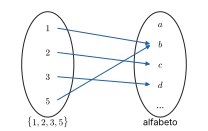
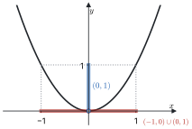
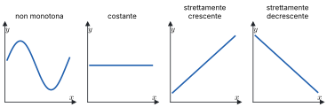
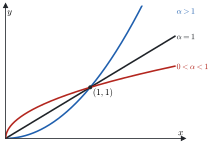
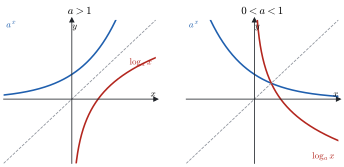
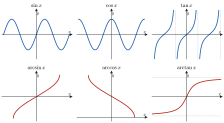
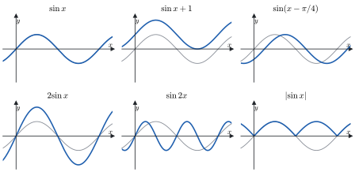

# 1 · Numeri reali e funzioni

**In questo modulo.** Non servono prerequisiti oltre all'algebra delle superiori. Si costruisce il linguaggio su cui poggia tutto il corso: gli insiemi numerici e le proprietà che distinguono $\mathbb{R}$ da $\mathbb{Q}$, in particolare la completezza; il valore assoluto e gli intervalli; estremo superiore e inferiore. Poi si passa alle funzioni: dominio, immagine, grafico, iniettività, inversa, composizione e monotonia, e alle funzioni elementari con i loro grafici. Alla fine del modulo si sanno leggere e scrivere con precisione definizioni ed enunciati, si riconoscono le proprietà di una funzione dal suo grafico e si determinano dominio e immagine delle funzioni elementari e delle loro composizioni.

## 1.1 Insiemi numerici

I **numeri naturali** sono $\mathbb{N} = \{0, 1, 2, 3, \dots\}$; con $\mathbb{N}_0 = \mathbb{N} \setminus \{0\}$ si indicano i naturali positivi. In $\mathbb{N}$ la somma e il prodotto di due elementi restano in $\mathbb{N}$, la differenza no: $2 - 5$ non è un numero naturale. Per poter sempre sottrarre si passa ai **numeri interi** $\mathbb{Z} = \{\dots, -2, -1, 0, 1, 2, \dots\}$, nei quali però non si può sempre dividere.

I **numeri razionali** sono le frazioni $\frac{n}{m}$ con $n \in \mathbb{Z}$ e $m \in \mathbb{N}_0$, dove due frazioni rappresentano lo stesso numero quando $\frac{n}{m} = \frac{n'}{m'} \iff n m' = n' m$. In $\mathbb{Q}$ si può dividere per ogni numero diverso da zero.

Ogni razionale ha una scrittura decimale

$$q = c_k c_{k-1} \dots c_1 c_0 , d_1 d_2 d_3 \dots = c_k \cdot 10^k + \dots + c_1 \cdot 10 + c_0 + \frac{d_1}{10} + \frac{d_2}{10^2} + \dots$$

e si presentano solo due casi: la sequenza delle cifre decimali termina, come in $0{,}15 = \frac{15}{100} = \frac{3}{20}$, oppure non termina ma da un certo punto in poi si ripete con un periodo, come in $0{,}\overline{3} = \frac{1}{3}$. Viceversa, ogni scrittura decimale finita o periodica rappresenta un razionale.

> [!nota]
> La scrittura decimale non è sempre unica: $0{,}\overline{9} = 1$. Infatti, posto $x = 0{,}\overline{9}$, si ha $10x - x = 9{,}\overline{9} - 0{,}\overline{9} = 9$, quindi $x = 1$.

Le scritture decimali infinite e non periodiche corrispondono ai **numeri irrazionali**, come $\sqrt{2}$ o $\pi$ (il rapporto fra la lunghezza di una circonferenza e il suo diametro). Razionali e irrazionali insieme formano i **numeri reali** $\mathbb{R}$. In $\mathbb{R}$ un'equazione come $x^2 = 2$ ha esattamente due soluzioni, $x = \sqrt{2}$ e $x = -\sqrt{2}$, mentre in $\mathbb{Q}$ non ne ha nessuna.

> [!aggiunta] Aggiunta in revisione · fonte: Canuto-Tabacco, *Analisi Matematica 1*, cap. 1 (AM1A-01)
> **$\sqrt{2}$ non è razionale.** Se fosse $\sqrt{2} = \frac{n}{m}$ con la frazione ridotta ai minimi termini, si avrebbe $n^2 = 2m^2$: allora $n^2$ è pari, quindi anche $n$ è pari, $n = 2h$. Sostituendo, $4h^2 = 2m^2$, cioè $m^2 = 2h^2$, e anche $m$ è pari. Ma $n$ e $m$ non possono essere entrambi pari in una frazione ridotta: l'ipotesi è assurda.
>
> **La retta orientata.** Fissati su una retta un punto $O$, un verso di percorrenza e un'unità di misura, a ogni numero reale $x$ corrisponde uno e un solo punto, a distanza $|x|$ da $O$, dalla parte positiva se $x > 0$ e da quella negativa se $x < 0$; e viceversa ogni punto corrisponde a un reale. Per questo si parla indifferentemente di "numeri" e di "punti" della retta reale. I razionali non bastano a riempirla: il punto a distanza $\sqrt{2}$ da $O$ non corrisponde a nessun razionale. Eppure i razionali sono **densi**: fra due reali distinti $a < b$ c'è sempre un razionale, e quindi infiniti.

I numeri reali hanno tre gruppi di proprietà. Le **proprietà algebriche** sono quelle di somma e prodotto, con sottrazione e divisione per numeri non nulli. L'**ordinamento** è **totale**: dati due reali $x$ e $y$ vale sempre $x \le y$ oppure $y \le x$, e l'ordine è compatibile con le operazioni (se $x \le y$ allora $x + z \le y + z$ e, per $z > 0$, $xz \le yz$). La terza è la **completezza**, che distingue $\mathbb{R}$ da $\mathbb{Q}$ e si vede nel paragrafo 1.3.

## 1.2 Valore assoluto e intervalli

> [!definizione] Valore assoluto
> Dato $x \in \mathbb{R}$, il suo **valore assoluto** (o modulo) è
> $$|x| = \begin{cases} x & \text{se } x \ge 0 \\ -x & \text{se } x < 0. \end{cases}$$

Sulla retta orientata $|x|$ è la distanza di $x$ dall'origine, e $|x - y|$ la distanza fra $x$ e $y$. Per ogni $x, y \in \mathbb{R}$ valgono $|xy| = |x|\,|y|$ e la **disuguaglianza triangolare**

$$|x + y| \le |x| + |y|.$$

Da questa segue una disuguaglianza che si usa spesso nelle stime:

$$\big|\, |x| - |y| \,\big| \le |x - y|.$$

Per dimostrarla si scrive $x = (x - y) + y$ e si applica la disuguaglianza triangolare: $|x| \le |x - y| + |y|$, cioè $|x| - |y| \le |x - y|$. Scambiando i ruoli, $|y| = |(y - x) + x| \le |y - x| + |x|$; poiché $|y - x| = |x - y|$, si ottiene $|y| - |x| \le |x - y|$, ossia $-|x - y| \le |x| - |y|$. Le due stime insieme dicono che $|x| - |y|$ sta fra $-|x - y|$ e $|x - y|$, che è la tesi.

> [!definizione] Intervalli
> Dati $a, b \in \mathbb{R}$ con $a < b$:
>
> - intervallo **chiuso** $[a, b] := \{x \in \mathbb{R} : a \le x \le b\}$;
> - intervallo **aperto** $(a, b) := \{x \in \mathbb{R} : a < x < b\}$;
> - intervalli **semiaperti** $[a, b) := \{x : a \le x < b\}$ e $(a, b] := \{x : a < x \le b\}$;
> - intervalli **illimitati** $[a, +\infty) := \{x : x \ge a\}$, $(a, +\infty)$, $(-\infty, b]$, $(-\infty, b)$, e $(-\infty, +\infty) = \mathbb{R}$.

I simboli $+\infty$ e $-\infty$ non sono numeri reali: servono solo a scrivere in breve gli intervalli illimitati, e per questo dalla loro parte la parentesi è sempre tonda.

## 1.3 Estremo superiore e inferiore

> [!definizione] Maggioranti, minoranti, insiemi limitati
> Sia $A \subseteq \mathbb{R}$ non vuoto. Un numero $b \in \mathbb{R}$ è un **maggiorante** di $A$ se $x \le b$ per ogni $x \in A$; un numero $a \in \mathbb{R}$ è un **minorante** di $A$ se $a \le x$ per ogni $x \in A$. L'insieme $A$ è **limitato superiormente** se ha almeno un maggiorante, **limitato inferiormente** se ha almeno un minorante, **limitato** se è entrambe le cose.

> [!definizione] Massimo e minimo
> Un numero $x_0$ è il **massimo** di $A$, e si scrive $x_0 = \max A$, se $x_0 \in A$ e $x \le x_0$ per ogni $x \in A$: è un maggiorante che appartiene ad $A$. Analogamente il **minimo** $\min A$ è un minorante che appartiene ad $A$.

Un insieme limitato può non avere massimo: $A = [0, 1)$ ha come maggioranti tutti i numeri $\ge 1$, ma nessuno di essi sta in $A$. Il numero 1 resta comunque speciale: è il più piccolo dei maggioranti.

> [!definizione] Estremo superiore e inferiore
> Sia $A \subseteq \mathbb{R}$ non vuoto e limitato superiormente. L'**estremo superiore** di $A$ è il più piccolo dei suoi maggioranti:
> $$\sup A := \min\{b \in \mathbb{R} : b \text{ è maggiorante di } A\}.$$
> Se $A$ è limitato inferiormente, l'**estremo inferiore** è il più grande dei minoranti: $\inf A := \max\{a \in \mathbb{R} : a \text{ è minorante di } A\}$. Se $A$ non è limitato superiormente (inferiormente) si pone $\sup A = +\infty$ ($\inf A = -\infty$).

Quando il massimo esiste coincide con l'estremo superiore. Nella pratica si usa quasi sempre la caratterizzazione seguente.

> [!teorema] Caratterizzazione dell'estremo superiore
> Sia $A \subseteq \mathbb{R}$ non vuoto e limitato superiormente. Un numero $S \in \mathbb{R}$ è l'estremo superiore di $A$ se e solo se
>
> 1. $x \le S$ per ogni $x \in A$, cioè $S$ è un maggiorante;
> 2. per ogni $\varepsilon > 0$ esiste $x \in A$ con $x > S - \varepsilon$, cioè nessun numero più piccolo di $S$ è un maggiorante.

La seconda condizione è la traduzione di "è il più piccolo dei maggioranti": se $z < S$, allora $z$ non è un maggiorante, quindi esiste $x \in A$ con $x > z$. Basta prendere $z = S - \varepsilon$.

L'esistenza dell'estremo superiore non è un fatto ovvio, ed è proprio ciò che rende $\mathbb{R}$ diverso da $\mathbb{Q}$.

> [!teorema] Assioma di completezza
> Ogni sottoinsieme di $\mathbb{R}$ non vuoto e limitato superiormente ammette estremo superiore in $\mathbb{R}$. (Allo stesso modo, ogni sottoinsieme non vuoto e limitato inferiormente ammette estremo inferiore.)

> [!esempio] La completezza e $\sqrt{2}$
> L'insieme $A = \{q \in \mathbb{Q} : q > 0,\ q^2 < 2\}$ è non vuoto (contiene 1) e limitato superiormente (2 è un maggiorante, perché se $q \ge 2$ allora $q^2 \ge 4$). In $\mathbb{R}$ il suo estremo superiore esiste e vale $\sqrt{2}$. In $\mathbb{Q}$, invece, $A$ non ha estremo superiore: per ogni razionale positivo $r$ con $r^2 < 2$ si trova un razionale di $A$ più grande, e per ogni $r$ con $r^2 > 2$ si trova un maggiorante razionale più piccolo, mentre $r^2 = 2$ è impossibile. È così che la completezza "riempie i buchi" della retta razionale.

> [!esempio]
> Per $A = \left\{1 - \frac{1}{n} : n \in \mathbb{N}_0\right\} = \left\{0, \frac{1}{2}, \frac{2}{3}, \dots\right\}$ si ha $\min A = \inf A = 0$ e $\sup A = 1$, ma 1 non è un massimo, perché $1 - \frac{1}{n} < 1$ per ogni $n$. La condizione 2 della caratterizzazione si verifica così: dato $\varepsilon > 0$, basta scegliere $n > \frac{1}{\varepsilon}$ per avere $1 - \frac{1}{n} > 1 - \varepsilon$.

## 1.4 Induzione e coefficienti binomiali

> [!aggiunta] Aggiunta in revisione · fonte: Canuto-Tabacco, *Analisi Matematica 1*, cap. 1 (AM1A-18)
> **Principio di induzione.** Sia $P(n)$ un'affermazione che dipende da $n \in \mathbb{N}$. Se $P(n_0)$ è vera (*passo base*) e, per ogni $n \ge n_0$, dalla verità di $P(n)$ segue quella di $P(n + 1)$ (*passo induttivo*), allora $P(n)$ è vera per ogni $n \ge n_0$.
>
> Ad esempio, la **disuguaglianza di Bernoulli** $(1 + x)^n \ge 1 + nx$, per $x \ge -1$ e $n \in \mathbb{N}$, si dimostra così. Per $n = 0$ si ha $1 \ge 1$. Se vale per $n$, moltiplicando per $1 + x \ge 0$ si ottiene $(1 + x)^{n+1} \ge (1 + nx)(1 + x) = 1 + (n + 1)x + nx^2 \ge 1 + (n + 1)x$, che è la tesi per $n + 1$. La disuguaglianza servirà nel modulo 2 per il numero $e$.

Il **fattoriale** di $n \in \mathbb{N}$ è $n! = 1 \cdot 2 \cdots n$, con la convenzione $0! = 1$. Per $0 \le k \le n$ il **coefficiente binomiale** è

$$\binom{n}{k} = \frac{n!}{k!\,(n - k)!}$$

e conta i modi di scegliere $k$ oggetti fra $n$. Dalla definizione segue subito la simmetria $\binom{n}{k} = \binom{n}{n - k}$, perché scambiare $k$ e $n - k$ lascia invariato il denominatore.

> [!teorema] Formula di Stifel
> Per $1 \le k \le n - 1$ vale $\displaystyle \binom{n}{k} = \binom{n-1}{k-1} + \binom{n-1}{k}$.

*Dimostrazione.* Si sommano le due frazioni mettendo in evidenza il fattore comune $\frac{(n-1)!}{(k-1)!\,(n-k-1)!}$:

$$\frac{(n-1)!}{(k-1)!\,(n-k)!} + \frac{(n-1)!}{k!\,(n-k-1)!} = \frac{(n-1)!}{(k-1)!\,(n-k-1)!} \left(\frac{1}{n-k} + \frac{1}{k}\right) = \frac{(n-1)!}{(k-1)!\,(n-k-1)!} \cdot \frac{n}{k\,(n-k)} = \frac{n!}{k!\,(n-k)!}.$$

La formula è la regola con cui si costruisce il triangolo di Tartaglia, e con essa si dimostra per induzione lo **sviluppo del binomio**

$$(a + b)^n = \sum_{k=0}^{n} \binom{n}{k} a^{n-k} b^k.$$

## 1.5 Funzioni

> [!definizione] Funzione
> Dati due insiemi $X$ e $Y$, una **funzione** $f : X \to Y$ è una legge che associa a ogni elemento $x \in X$ uno e un solo elemento $f(x) \in Y$. L'insieme $X$ è il **dominio**, $Y$ il **codominio**; si scrive anche $x \mapsto f(x)$.

In analisi capita spesso di assegnare solo un'espressione, come $f(x) = \sqrt{x - 1}$, senza dire su quali $x$ ha senso. Si parla allora di funzione **definita in** $X$: una legge che a ogni $x \in X$ associa *al più* un elemento di $Y$. L'insieme degli $x$ a cui associa effettivamente un valore è il suo dominio, $\operatorname{dom}(f) \subseteq X$, e si scrive $f : \operatorname{dom}(f) \subseteq X \to Y$. Determinare il dominio significa trovare il più grande insieme su cui l'espressione ha senso.

> [!definizione] Immagine, controimmagine, grafico
> Sia $f : X \to Y$.
>
> - L'**immagine** di $f$ è $\operatorname{im}(f) := \{y \in Y : \exists\, x \in X \text{ con } f(x) = y\}$; più in generale, per $A \subseteq X$, l'immagine di $A$ è $f(A) := \{f(x) : x \in A\}$.
> - Per $B \subseteq Y$, la **controimmagine** di $B$ è $f^{-1}(B) := \{x \in X : f(x) \in B\}$; per un solo punto si scrive $f^{-1}(y)$ invece di $f^{-1}(\{y\})$.
> - Il **grafico** di $f$ è $\Gamma(f) := \{(x, f(x)) : x \in X\} \subseteq X \times Y$.

> [!attenzione]
> Il simbolo $f^{-1}(B)$ indica la controimmagine e ha senso per ogni funzione. La funzione inversa $f^{-1}$ del paragrafo 1.6 esiste solo per le funzioni iniettive. Quando l'inversa esiste, i due significati sono compatibili.

Dalla definizione seguono due relazioni utili: $A \subseteq f^{-1}(f(A))$, con l'uguaglianza se $f$ è iniettiva, e $f(f^{-1}(B)) = B \cap \operatorname{im}(f)$.

> [!esempio] Una funzione fra insiemi finiti
> Sia $f : \{1, 2, 3, 5\} \to \{a, b, c, d, \dots\}$ definita da $1 \mapsto b$, $2 \mapsto c$, $3 \mapsto d$, $5 \mapsto b$. Allora $\operatorname{im}(f) = \{b, c, d\}$ e $\Gamma(f) = \{(1, b), (2, c), (3, d), (5, b)\}$. La controimmagine di $b$ è $f^{-1}(b) = \{1, 5\}$, quella di $a$ è vuota.

*Figura 1.1. Diagramma a frecce fra $\{1, 2, 3, 5\}$ e l'alfabeto per l'esempio precedente.*

> [!esempio] Il valore assoluto e il quadrato
> Per $f : \mathbb{R} \to \mathbb{R}$, $f(x) = |x|$, si ha $\operatorname{im}(f) = [0, +\infty)$ e $\Gamma(f) = \{(x, |x|) : x \in \mathbb{R}\}$: il grafico è formato dalle bisettrici del primo e del secondo quadrante.
>
> Per $g(x) = x^2$ si calcolano immagini e controimmagini di alcuni intervalli. Poiché $x^2$ è crescente per $x \ge 0$: $g((0, 1)) = (0, 1)$, $g([0, 1)) = [0, 1)$, $g([0, 1]) = [0, 1]$. Per le controimmagini bisogna considerare anche le $x$ negative: $g^{-1}((0, 1)) = (-1, 0) \cup (0, 1)$, $g^{-1}([0, 1)) = (-1, 1)$, $g^{-1}([0, 1]) = [-1, 1]$, e $g^{-1}((1, +\infty)) = (-\infty, -1) \cup (1, +\infty)$.

*Figura 1.2. Parabola $y = x^2$ con evidenziati l'intervallo $(0, 1)$ sull'asse $y$ e la sua controimmagine $(-1, 0) \cup (0, 1)$ sull'asse $x$.*

## 1.6 Iniettività, inversa, restrizione e composizione

> [!definizione] Iniettiva, suriettiva, biettiva
> Una funzione $f : X \to Y$ è
>
> - **iniettiva** se ogni $y \in Y$ ha al più una controimmagine, cioè se $x_1 \ne x_2 \Rightarrow f(x_1) \ne f(x_2)$ (equivalentemente, $f(x_1) = f(x_2) \Rightarrow x_1 = x_2$);
> - **suriettiva** se ogni $y \in Y$ ha almeno una controimmagine, cioè se $\operatorname{im}(f) = Y$;
> - **biettiva** se è iniettiva e suriettiva.

Sul grafico, l'iniettività si riconosce perché ogni retta orizzontale lo interseca al più una volta, la suriettività perché ogni retta orizzontale di quota $y \in Y$ lo interseca almeno una volta.

> [!definizione] Funzione inversa
> Sia $f : X \to Y$ iniettiva. La sua **inversa** è la funzione $f^{-1} : \operatorname{im}(f) \to X$ che a ogni $y \in \operatorname{im}(f)$ associa l'unico $x \in X$ tale che $f(x) = y$. Se $f$ è biettiva, $f^{-1}$ è definita su tutto $Y$.

Per costruzione $f(f^{-1}(y)) = y$ per ogni $y \in \operatorname{im}(f)$ e $f^{-1}(f(x)) = x$ per ogni $x \in X$. Il grafico di $f^{-1}$ si ottiene da quello di $f$ per simmetria rispetto alla bisettrice $y = x$, perché $(x, y) \in \Gamma(f)$ se e solo se $(y, x) \in \Gamma(f^{-1})$.

> [!definizione] Restrizione
> Data $f : X \to Y$ e $A \subseteq X$, la **restrizione** di $f$ ad $A$ è la funzione $f|_A : A \to Y$ definita da $f|_A(x) := f(x)$.

Restringere il dominio è il modo standard per rendere invertibile una funzione che non è iniettiva.

> [!esempio] Quando $x^2$ è invertibile
> $f : \mathbb{R} \to \mathbb{R}$, $f(x) = x^2$, non è iniettiva ($f(-1) = f(1)$) né suriettiva (i negativi non sono immagini). Le restrizioni $f|_{(-\infty, 0]}$ e $f|_{[0, +\infty)}$ sono iniettive ma, con codominio $\mathbb{R}$, ancora non suriettive. La funzione $g : [0, +\infty) \to [0, +\infty)$, $g(x) = x^2$, è biettiva, e la sua inversa è la radice quadrata $g^{-1}(y) = \sqrt{y}$.

> [!definizione] Composizione
> Date $f : X \to Y$ e $g : Y \to Z$, la **composizione** $g \circ f : X \to Z$ è $(g \circ f)(x) := g(f(x))$. Se $f$ e $g$ sono definite solo su parte dei rispettivi insiemi, il dominio della composta è
> $$\operatorname{dom}(g \circ f) = \{x \in \operatorname{dom}(f) : f(x) \in \operatorname{dom}(g)\} = f^{-1}(\operatorname{dom}(g)).$$

Ad esempio, per $h(x) = \sqrt{x - 1}$ si ha $h = g \circ f$ con $f(x) = x - 1$ e $g(y) = \sqrt{y}$: il dominio è $\{x : x - 1 \ge 0\} = [1, +\infty)$. In generale $g \circ f \ne f \circ g$: con le stesse funzioni, $(f \circ g)(y) = \sqrt{y} - 1$.

## 1.7 Funzioni monotone

> [!definizione] Funzioni monotone
> Sia $f : \operatorname{dom}(f) \subseteq \mathbb{R} \to \mathbb{R}$. La funzione è
>
> - **crescente** se $x_1 < x_2 \Rightarrow f(x_1) \le f(x_2)$ per ogni $x_1, x_2 \in \operatorname{dom}(f)$;
> - **strettamente crescente** se $x_1 < x_2 \Rightarrow f(x_1) < f(x_2)$;
> - **decrescente** e **strettamente decrescente** se valgono le disuguaglianze opposte, $f(x_1) \ge f(x_2)$ e $f(x_1) > f(x_2)$.
>
> Si dice **monotona** una funzione crescente o decrescente.

"Crescente" qui significa "non decrescente": una funzione costante è contemporaneamente crescente e decrescente. Altri testi dicono "crescente" solo per il caso stretto; in questi appunti si usa sempre "strettamente" quando la disuguaglianza è stretta.

*Figura 1.3. Quattro grafici: una funzione non monotona, una costante (crescente e decrescente), una strettamente crescente, una strettamente decrescente.*

> [!teorema] Monotonia stretta e iniettività
> Una funzione strettamente monotona è iniettiva.

Infatti, se $x_1 \ne x_2$, ad esempio $x_1 < x_2$, la monotonia stretta dà $f(x_1) < f(x_2)$ oppure $f(x_1) > f(x_2)$, comunque $f(x_1) \ne f(x_2)$. Il viceversa è falso.

> [!esempio] Iniettiva ma non monotona
> Sia $f(x) = \frac{1}{x}$ per $x \ne 0$ e $f(0) = 0$. Su $(-\infty, 0)$ e su $(0, +\infty)$ la funzione è strettamente decrescente, ma globalmente non è monotona: $-1 < 1$ e $f(-1) = -1 < 1 = f(1)$, mentre $1 < 2$ e $f(1) > f(2)$. Eppure è iniettiva: valori diversi da 0 vengono da un solo punto, e il valore 0 solo da $x = 0$.

## 1.8 Funzioni elementari

### Potenze

La funzione potenza $x \mapsto x^\alpha$ si definisce per gradi, ampliando l'esponente.

- **Esponente nullo.** Per convenzione $x^0 = 1$ per ogni $x$.
- **Esponente $n \in \mathbb{N}_0$.** $x^n = x \cdot x \cdots x$ ($n$ fattori), definita su $\mathbb{R}$. Se $n$ è pari la funzione è pari ($(-x)^n = x^n$), strettamente decrescente su $(-\infty, 0]$ e strettamente crescente su $[0, +\infty)$; se $n$ è dispari è dispari ($(-x)^n = -x^n$) e strettamente crescente su $\mathbb{R}$.
- **Esponente $\frac{1}{n}$, $n \in \mathbb{N}_0$.** La radice $n$-esima $\sqrt[n]{x} = x^{1/n}$ è l'inversa della potenza $n$-esima: per $n$ pari l'inversa di $x^n|_{[0, +\infty)}$, quindi definita su $[0, +\infty)$; per $n$ dispari l'inversa di $x^n$ su tutto $\mathbb{R}$.
- **Esponente razionale $\frac{m}{n}$**, con $m, n \in \mathbb{N}_0$ senza fattori comuni: $x^{m/n} = \sqrt[n]{x^m}$, composizione di potenza e radice. Per semplicità la si considera su $[0, +\infty)$.
- **Esponente reale $\alpha > 0$ irrazionale.** Si usa la completezza. Per $x \ge 1$ la potenza $x^q$ cresce con l'esponente razionale $q$, e si pone $x^\alpha := \sup\{x^q : q \in \mathbb{Q},\ 0 < q \le \alpha\}$; per $0 \le x < 1$ la potenza decresce con l'esponente, e si pone $x^\alpha := \inf\{x^q : q \in \mathbb{Q},\ 0 < q \le \alpha\}$.
- **Esponente negativo.** $x^{\alpha} := \frac{1}{x^{-\alpha}}$ per $\alpha < 0$, definita dove è definita $x^{-\alpha}$ tolto lo zero; in altre parole è la composta di $x^{-\alpha}$ con $y \mapsto \frac{1}{y}$.

Su $(0, +\infty)$, per $\alpha > 0$ la potenza è strettamente crescente, per $\alpha < 0$ strettamente decrescente. Tutte le potenze passano per $(1, 1)$. Per $\alpha > 1$ il grafico sta sotto la bisettrice in $(0, 1)$ e sopra per $x > 1$; per $0 < \alpha < 1$ vale il contrario.

*Figura 1.4. Grafici di $x^\alpha$ su $[0, +\infty)$ per $\alpha > 1$, $\alpha = 1$ e $0 < \alpha < 1$, con il punto $(1, 1)$ in comune.*

### Esponenziali e logaritmi

> [!aggiunta] Aggiunta in revisione · fonte: Canuto-Tabacco, *Analisi Matematica 1*, cap. 2 (AM1A-02, AM1A-06)
> Fissata una base $a > 0$, $a \ne 1$, la funzione **esponenziale** $x \mapsto a^x$ è definita su tutto $\mathbb{R}$, con lo stesso procedimento delle potenze (prima per $x$ razionale, poi con sup e inf), ed è sempre positiva. Valgono le proprietà
> $$a^{x + y} = a^x a^y, \qquad (a^x)^y = a^{xy}, \qquad a^{-x} = \frac{1}{a^x}.$$
> Per $a > 1$ è strettamente crescente, per $0 < a < 1$ strettamente decrescente; in entrambi i casi l'immagine è $(0, +\infty)$ e il grafico passa per $(0, 1)$.
>
> Essendo strettamente monotona, l'esponenziale è iniettiva, e la sua inversa è il **logaritmo** in base $a$: $\log_a : (0, +\infty) \to \mathbb{R}$, con
> $$y = \log_a x \iff a^y = x.$$
> Dalle proprietà dell'esponenziale seguono quelle del logaritmo: $\log_a(xy) = \log_a x + \log_a y$, $\log_a(x^b) = b \log_a x$, $\log_a 1 = 0$, e il cambiamento di base $\log_a x = \frac{\log_b x}{\log_b a}$. Il logaritmo è strettamente crescente se $a > 1$ e strettamente decrescente se $0 < a < 1$.
>
> La base più usata è il numero $e \approx 2{,}718$, che si definisce nel modulo 2 come limite di $(1 + 1/n)^n$. Si scrive $\ln x = \log_e x$ per il **logaritmo naturale**.

*Figura 1.5. Grafici di $a^x$ e $\log_a x$ per $a > 1$ e per $0 < a < 1$, simmetrici rispetto alla bisettrice.*

### Funzioni trigonometriche

> [!aggiunta] Aggiunta in revisione · fonte: Canuto-Tabacco, *Analisi Matematica 1*, cap. 2 (AM1A-02)
> Sulla circonferenza di centro l'origine e raggio 1, a ogni $x \in \mathbb{R}$ corrisponde il punto $P$ che si raggiunge percorrendo un arco di lunghezza $|x|$ a partire da $(1, 0)$, in verso antiorario se $x > 0$ e orario se $x < 0$ (angolo in radianti). Le coordinate di $P$ sono $(\cos x, \sin x)$. Seno e coseno sono definiti su $\mathbb{R}$, hanno immagine $[-1, 1]$ e sono periodiche di periodo $2\pi$; il seno è dispari, il coseno pari. La **tangente** $\tan x = \frac{\sin x}{\cos x}$ è definita per $x \ne \frac{\pi}{2} + k\pi$, $k \in \mathbb{Z}$, ha periodo $\pi$ e immagine $\mathbb{R}$.

Le identità fondamentali, da sapere a memoria, sono:

$$\cos^2 x + \sin^2 x = 1,$$

$$\sin(\alpha \pm \beta) = \sin\alpha\cos\beta \pm \cos\alpha\sin\beta, \qquad \cos(\alpha \pm \beta) = \cos\alpha\cos\beta \mp \sin\alpha\sin\beta,$$

$$\sin 2x = 2\sin x\cos x, \qquad \cos 2x = 2\cos^2 x - 1 = 1 - 2\sin^2 x,$$

$$\sin x - \sin y = 2\sin\frac{x - y}{2}\cos\frac{x + y}{2}, \qquad \cos x - \cos y = -2\sin\frac{x - y}{2}\sin\frac{x + y}{2},$$

$$\sin(x + \pi) = -\sin x, \quad \cos(x + \pi) = -\cos x, \quad \sin\left(x + \tfrac{\pi}{2}\right) = \cos x, \quad \cos\left(x + \tfrac{\pi}{2}\right) = -\sin x.$$

> [!aggiunta] Aggiunta in revisione · fonte: Canuto-Tabacco, *Analisi Matematica 1*, cap. 2 (AM1A-05, AM1A-06)
> Le funzioni trigonometriche non sono iniettive, ma lo diventano su intervalli opportuni, e lì si invertono:
>
> - $\arcsin : [-1, 1] \to \left[-\frac{\pi}{2}, \frac{\pi}{2}\right]$ è l'inversa di $\sin$ ristretto a $\left[-\frac{\pi}{2}, \frac{\pi}{2}\right]$, strettamente crescente;
> - $\arccos : [-1, 1] \to [0, \pi]$ è l'inversa di $\cos$ ristretto a $[0, \pi]$, strettamente decrescente;
> - $\arctan : \mathbb{R} \to \left(-\frac{\pi}{2}, \frac{\pi}{2}\right)$ è l'inversa di $\tan$ ristretta a $\left(-\frac{\pi}{2}, \frac{\pi}{2}\right)$, strettamente crescente.
>
> Attenzione: $\arcsin(\sin x) = x$ solo per $x \in \left[-\frac{\pi}{2}, \frac{\pi}{2}\right]$; ad esempio $\arcsin(\sin \pi) = 0$.

*Figura 1.6. Grafici di $\sin$, $\cos$, $\tan$ e delle loro inverse $\arcsin$, $\arccos$, $\arctan$.*

## 1.9 Grafici e operazioni sulle funzioni

> [!aggiunta] Aggiunta in revisione · fonte: Canuto-Tabacco, *Analisi Matematica 1*, cap. 2 (AM1A-03)
> Dal grafico di $y = f(x)$ si ottengono quelli di molte funzioni collegate, senza rifare i conti. Con $c > 0$:
>
> - $f(x) + c$ e $f(x) - c$: traslazione verticale, verso l'alto o verso il basso, di $c$;
> - $f(x + c)$ e $f(x - c)$: traslazione orizzontale, verso sinistra o verso destra, di $c$;
> - $c\,f(x)$: dilatazione verticale (contrazione se $c < 1$); $f(cx)$: contrazione orizzontale (dilatazione se $c < 1$);
> - $-f(x)$: simmetria rispetto all'asse $x$; $f(-x)$: simmetria rispetto all'asse $y$;
> - $|f(x)|$: le parti del grafico sotto l'asse $x$ si ribaltano sopra;
> - $f(|x|)$: si tiene la parte con $x \ge 0$ e la si ribalta a sinistra dell'asse $y$.
>
> Ad esempio, il grafico di $y = |x - 2| - 1$ è quello di $|x|$ traslato di 2 a destra e di 1 verso il basso: una "V" con vertice in $(2, -1)$.

*Figura 1.7. Le trasformazioni del grafico di una stessa funzione, ad esempio $\sin x$: $\sin x + 1$, $\sin(x - \pi/4)$, $2\sin x$, $\sin 2x$, $|\sin x|$.*

## 1.10 Logica e tecniche di dimostrazione

> [!aggiunta] Aggiunta in revisione · fonte: Canuto-Tabacco, *Analisi Matematica 1*, cap. 1; fogli di esercizi del corso, "Connettivi logici. Principio di induzione" (AM1A-18)
> All'esame ogni affermazione va "adeguatamente motivata": serve sapere che cosa vuol dire dimostrare, e quali schemi di ragionamento sono corretti. Questo paragrafo raccoglie gli strumenti di logica che si usano in tutto il corso.
>
> **Proposizioni e connettivi.** Una **proposizione** è un'affermazione che è vera (V) o falsa (F). Da due proposizioni $p$ e $q$ se ne costruiscono altre con i **connettivi**: la negazione $\neg p$ ("non $p$"), la congiunzione $p \wedge q$ ("$p$ e $q$"), la disgiunzione $p \vee q$ ("$p$ o $q$", non esclusivo), l'implicazione $p \Rightarrow q$ ("se $p$ allora $q$") e l'equivalenza $p \Leftrightarrow q$ ("$p$ se e solo se $q$"). Il valore di verità di ognuna dipende solo da quelli di $p$ e $q$, ed è dato dalla **tavola di verità**:
>
> | $p$ | $q$ | $\neg p$ | $p \wedge q$ | $p \vee q$ | $p \Rightarrow q$ | $p \Leftrightarrow q$ |
> |---|---|---|---|---|---|---|
> | V | V | F | V | V | V | V |
> | V | F | F | F | V | F | F |
> | F | V | V | F | V | V | F |
> | F | F | V | F | F | V | V |
>
> L'implicazione è falsa in un solo caso, quando $p$ è vera e $q$ è falsa. Se $p$ è falsa, $p \Rightarrow q$ è vera qualunque sia $q$: "se $2 + 2 = 5$, allora la Luna è di formaggio" è un'implicazione vera. Nell'implicazione $p$ si chiama **ipotesi** (o condizione sufficiente per $q$) e $q$ **tesi** (o condizione necessaria per $p$).
>
> **Tautologie ed equivalenze utili.** Una **tautologia** è una proposizione composta che è vera per tutti i valori delle proposizioni che la compongono; si verifica con la tavola di verità, come l'induzione perfetta delle reti logiche. Le più usate sono:
>
> - $(p \Rightarrow q) \Leftrightarrow (\neg p \vee q)$: l'implicazione scritta con "o";
> - $\neg(p \Rightarrow q) \Leftrightarrow (p \wedge \neg q)$: per negare un'implicazione si mostra un caso in cui l'ipotesi è vera e la tesi falsa;
> - $(p \Rightarrow q) \Leftrightarrow (\neg q \Rightarrow \neg p)$: la **contronominale**, equivalente all'implicazione di partenza;
> - $\neg(p \wedge q) \Leftrightarrow (\neg p \vee \neg q)$ e $\neg(p \vee q) \Leftrightarrow (\neg p \wedge \neg q)$: le leggi di De Morgan;
> - $\big((p \Rightarrow q) \wedge (q \Rightarrow r)\big) \Rightarrow (p \Rightarrow r)$: la proprietà transitiva, su cui si costruiscono le catene di passaggi.
>
> L'**inversa** $q \Rightarrow p$, invece, non è equivalente a $p \Rightarrow q$: "se $x = 2$ allora $x^2 = 4$" è vera, "se $x^2 = 4$ allora $x = 2$" è falsa ($x = -2$).
>
> **Quantificatori.** Per le affermazioni che dipendono da una variabile si usano il **quantificatore universale** $\forall$ ("per ogni") e il **quantificatore esistenziale** $\exists$ ("esiste"). La negazione scambia i quantificatori e nega la proprietà:
> $$\neg\big(\forall x : P(x)\big) \Leftrightarrow \exists x : \neg P(x), \qquad \neg\big(\exists x : P(x)\big) \Leftrightarrow \forall x : \neg P(x).$$
> Ad esempio "$A$ è limitato superiormente" si scrive $\exists M \in \mathbb{R}\ \forall x \in A : x \le M$, e la sua negazione, "$A$ non è limitato superiormente", è $\forall M \in \mathbb{R}\ \exists x \in A : x > M$. L'ordine dei quantificatori conta: "$\forall x\ \exists y : y > x$" è vera nei reali (basta $y = x + 1$), "$\exists y\ \forall x : y > x$" è falsa (non c'è un numero più grande di tutti).
>
> **Schemi di dimostrazione.** Per dimostrare $p \Rightarrow q$ si può:
>
> 1. **dimostrazione diretta**: si parte da $p$ e si arriva a $q$ con una catena di implicazioni;
> 2. **per contronominale**: si suppone $\neg q$ e si arriva a $\neg p$;
> 3. **per assurdo**: si suppone $p$ vera e $q$ falsa e si arriva a una contraddizione, cioè a un'affermazione e alla sua negazione insieme;
> 4. **per induzione**, quando $q$ è un'affermazione su tutti i naturali da un certo $n_0$ in poi (paragrafo 1.4).
>
> Per dimostrare che un'affermazione del tipo "$\forall x : P(x)$" è **falsa** basta un **controesempio**, cioè un solo $x$ per cui $P(x)$ è falsa. Al contrario, nessun numero di esempi dimostra un'affermazione universale. Il caso classico è $n^2 + n + 41$, che è primo per $n = 0, 1, \dots, 39$, ma per $n = 40$ vale $1681 = 41^2$.
>
> **Un esempio per assurdo: $\sqrt{2}$ non è razionale.** Si supponga $\sqrt{2} = \frac{m}{n}$ con $m, n$ interi positivi e la frazione ridotta ai minimi termini. Allora $m^2 = 2n^2$, quindi $m^2$ è pari, e quindi $m$ è pari (se $m$ fosse dispari, anche $m^2$ lo sarebbe: è una contronominale). Scritto $m = 2k$, si ha $4k^2 = 2n^2$, cioè $n^2 = 2k^2$, e per lo stesso motivo anche $n$ è pari. Ma allora $m$ e $n$ hanno il fattore comune 2, contro l'ipotesi che la frazione fosse ridotta. La contraddizione mostra che l'ipotesi $\sqrt{2} \in \mathbb{Q}$ è falsa.
>
> **Un esempio per induzione: la somma dei primi $n$ naturali.** $P(n)$: $1 + 2 + \dots + n = \frac{n(n + 1)}{2}$. *Passo base*, $n = 1$: $1 = \frac{1 \cdot 2}{2}$. *Passo induttivo*: si suppone $P(n)$ e si aggiunge $n + 1$ a entrambi i membri,
> $$1 + 2 + \dots + n + (n + 1) = \frac{n(n + 1)}{2} + (n + 1) = \frac{(n + 1)(n + 2)}{2},$$
> che è $P(n + 1)$. Nel passo induttivo non si dimostra $P(n)$: la si usa come ipotesi (**ipotesi induttiva**) per ottenere $P(n + 1)$.

## Esempi ed esercizi svolti

> [!esempio] Domini
> **a)** $f(x) = \frac{\sqrt{x^2 - 3x - 4}}{x + 5}$. Serve il radicando non negativo, $x^2 - 3x - 4 = (x - 4)(x + 1) \ge 0$, cioè $x \le -1$ oppure $x \ge 4$, e il denominatore non nullo, $x \ne -5$. Il dominio è $(-\infty, -5) \cup (-5, -1] \cup [4, +\infty)$.
>
> **b)** $f(x) = \ln(x^2 - x)$. Serve l'argomento positivo: $x(x - 1) > 0$, cioè $x < 0$ oppure $x > 1$. Il dominio è $(-\infty, 0) \cup (1, +\infty)$.
>
> **c)** $f(x) = \sqrt{\cos x - 1}$. Serve $\cos x - 1 \ge 0$, cioè $\cos x \ge 1$; poiché $\cos x \le 1$ sempre, deve essere $\cos x = 1$, quindi $x = 2k\pi$ con $k \in \mathbb{Z}$. Il dominio è l'insieme di questi punti isolati e l'immagine è $\{0\}$.

> [!esempio] Immagini
> **a)** $f(x) = \frac{1}{x^2 + 1}$. Si cerca per quali $y$ l'equazione $y = \frac{1}{x^2 + 1}$ ha soluzione. Deve essere $y > 0$, e allora $x^2 = \frac{1}{y} - 1$, che ha soluzione se e solo se $\frac{1}{y} - 1 \ge 0$, cioè $y \le 1$. L'immagine è $(0, 1]$: il massimo 1 si raggiunge in $x = 0$, mentre lo 0 non si raggiunge mai.
>
> **b)** $f(x) = \sqrt{x + 2} - 1$. Il dominio è $[-2, +\infty)$; la radice assume tutti i valori di $[0, +\infty)$, quindi l'immagine è $[-1, +\infty)$. Sul grafico, è quello di $\sqrt{x}$ traslato di 2 a sinistra e di 1 verso il basso.

### Altri esercizi svolti

> [!aggiunta] Aggiunta in revisione · fonte: esercizi nuovi sul modello dei fogli del corso e delle prove scritte 2025-2026; soluzioni controllate con `strumenti/verifica_ampliamento.py` (AM1A-01, AM1A-05, AM1A-07, AM1A-18)
> Gli esercizi seguono i tipi che compaiono nei fogli e nelle prove d'esame: logica, induzione, estremi di insiemi, domini, inverse e trasformazioni di grafici.

**Esercizio 1. Due ragionamenti, uno giusto e uno sbagliato.** Stabilire con la tavola di verità se sono tautologie (a) $\big(p \wedge (p \Rightarrow q)\big) \Rightarrow q$ e (b) $\big(q \wedge (p \Rightarrow q)\big) \Rightarrow p$.

| $p$ | $q$ | $p \Rightarrow q$ | $p \wedge (p \Rightarrow q)$ | (a) | $q \wedge (p \Rightarrow q)$ | (b) |
|---|---|---|---|---|---|---|
| V | V | V | V | V | V | V |
| V | F | F | F | V | F | V |
| F | V | V | F | V | V | **F** |
| F | F | V | F | V | F | V |

(a) è sempre vera: è il *modus ponens*, lo schema "se vale $p$ e se $p$ implica $q$, allora vale $q$" che si usa in ogni dimostrazione diretta. (b) è falsa per $p$ falsa e $q$ vera: dal fatto che la tesi è vera non si può risalire all'ipotesi. È l'errore di confondere un'implicazione con la sua inversa.

**Esercizio 2. Somma dei dispari.** Dimostrare per induzione che $1 + 3 + 5 + \dots + (2n - 1) = n^2$ per ogni $n \ge 1$.

*Base*: per $n = 1$ il primo membro è 1 e il secondo $1^2 = 1$. *Passo*: se $1 + 3 + \dots + (2n - 1) = n^2$, aggiungendo il dispari successivo, $2(n + 1) - 1 = 2n + 1$, si ottiene $n^2 + 2n + 1 = (n + 1)^2$. Geometricamente: un quadrato $n \times n$ di puntini diventa un quadrato $(n + 1) \times (n + 1)$ aggiungendo una "cornice a L" di $2n + 1$ puntini.

**Esercizio 3. Una divisibilità.** Dimostrare che $7^n - 1$ è divisibile per 6 per ogni $n \in \mathbb{N}$.

*Base*: $7^0 - 1 = 0$, divisibile per 6. *Passo*: si suppone $7^n - 1 = 6h$ con $h$ intero. Allora
$$7^{n+1} - 1 = 7 \cdot 7^n - 1 = 7(7^n - 1) + 7 - 1 = 7 \cdot 6h + 6 = 6(7h + 1),$$
che è divisibile per 6. Il trucco è far comparire nell'espressione di $n + 1$ quella di $n$, per poter usare l'ipotesi induttiva.

**Esercizio 4. Estremi di insiemi.** Determinare estremo superiore e inferiore, dicendo se sono massimo o minimo:
(a) $A = \left\{\frac{n - 1}{n + 1} : n \in \mathbb{N}, n \ge 1\right\}$; (b) $B = \left\{(-1)^n\left(\frac{3}{n} + \frac{1}{n^2}\right) : n \ge 1\right\}$; (c) $C = \{x \in \mathbb{R} : x^2 - 5x + 4 < 0\}$; (d) $D = \left\{n - \frac{1}{n} : n \ge 1\right\}$.

(a) $\frac{n - 1}{n + 1} = 1 - \frac{2}{n + 1}$: al crescere di $n$ la frazione sottratta diminuisce, quindi la successione cresce. Il primo termine, per $n = 1$, è 0, ed è il minimo. Tutti i termini sono minori di 1, e si avvicinano a 1 quanto si vuole: dato $\varepsilon > 0$, $1 - \frac{2}{n + 1} > 1 - \varepsilon$ appena $n + 1 > \frac{2}{\varepsilon}$. Quindi $\sup A = 1$, che non è un massimo perché nessun termine vale 1.

(b) Si separano gli indici pari e dispari. Per $n$ pari i termini sono positivi, $\frac{3}{n} + \frac{1}{n^2}$, e decrescono con $n$: il più grande è quello con $n = 2$, $\frac{3}{2} + \frac{1}{4} = \frac{7}{4}$. Per $n$ dispari sono negativi, $-\left(\frac{3}{n} + \frac{1}{n^2}\right)$, e crescono verso 0: il più piccolo è quello con $n = 1$, $-4$. Quindi $\max B = \frac{7}{4}$ e $\min B = -4$. (Lo 0 non serve: è il limite dei termini, ma sta in mezzo fra il massimo e il minimo.)

(c) $x^2 - 5x + 4 = (x - 1)(x - 4) < 0$ per $1 < x < 4$, quindi $C = (1, 4)$: $\inf C = 1$ e $\sup C = 4$, né minimo né massimo perché gli estremi dell'intervallo sono esclusi.

(d) $n - \frac{1}{n}$ cresce con $n$ (cresce $n$ e diminuisce $\frac{1}{n}$): il minimo è il primo termine, $1 - 1 = 0$. L'insieme non è limitato superiormente, perché $n - \frac{1}{n} \ge n - 1$ supera qualsiasi $M$: $\sup D = +\infty$.

**Esercizio 5. Dominio.** Determinare il dominio di $f(x) = \sqrt{\ln(3 - x)} + \frac{1}{x^2 - 1}$.

Le condizioni vanno messe a sistema. Il logaritmo vuole $3 - x > 0$, cioè $x < 3$. La radice vuole $\ln(3 - x) \ge 0$, cioè $3 - x \ge 1$, quindi $x \le 2$. La frazione vuole $x^2 \ne 1$, cioè $x \ne \pm 1$. La condizione $x \le 2$ contiene già $x < 3$, e il dominio è
$$(-\infty, -1) \cup (-1, 1) \cup (1, 2].$$

**Esercizio 6. Composizioni e loro domini.** Siano $f(x) = x^2$ e $g(x) = \sqrt{x - 1}$. Scrivere $f \circ g$ e $g \circ f$ con i loro domini.

$(f \circ g)(x) = f(g(x)) = \left(\sqrt{x - 1}\right)^2 = x - 1$, ma solo dove $g$ è definita: il dominio è $[1, +\infty)$, e il grafico è una semiretta, non tutta la retta $y = x - 1$. $(g \circ f)(x) = g(x^2) = \sqrt{x^2 - 1}$, definita per $x^2 \ge 1$, cioè $x \le -1$ oppure $x \ge 1$. Le due composte sono diverse: la composizione non è commutativa.

**Esercizio 7. Un'inversa con le radici.** Sia $f(x) = x + \sqrt{x^2 + 4}$. Trovare dominio e immagine, mostrare che $f$ è invertibile e scrivere l'inversa.

*Dominio*: $x^2 + 4 > 0$ sempre, quindi $\mathbb{R}$. *Segno*: $\sqrt{x^2 + 4} > \sqrt{x^2} = |x| \ge -x$, quindi $f(x) > 0$ per ogni $x$. *Invertibilità*: per $y > 0$ si risolve $y = x + \sqrt{x^2 + 4}$. Isolata la radice, $\sqrt{x^2 + 4} = y - x$; elevando al quadrato, $x^2 + 4 = y^2 - 2xy + x^2$, cioè
$$x = \frac{y^2 - 4}{2y}.$$
L'elevamento al quadrato può introdurre soluzioni false, quindi si controlla la condizione $y - x \ge 0$: $y - \frac{y^2 - 4}{2y} = \frac{y^2 + 4}{2y} > 0$ per $y > 0$. Per ogni $y > 0$ c'è quindi una e una sola soluzione: $f$ è iniettiva, la sua immagine è $(0, +\infty)$ e
$$f^{-1} : (0, +\infty) \to \mathbb{R}, \qquad f^{-1}(y) = \frac{y^2 - 4}{2y}.$$
Prova: $f(0) = 2$ e $f^{-1}(2) = \frac{4 - 4}{4} = 0$.

**Esercizio 8. La restrizione invertibile più grande.** Sia $f(x) = x^2 - 4x + 3$. Trovare il più grande intervallo contenente $x_0 = 3$ su cui $f$ è invertibile, e l'inversa.

Completando il quadrato, $f(x) = (x - 2)^2 - 1$: è una parabola con vertice in $(2, -1)$, decrescente su $(-\infty, 2]$ e crescente su $[2, +\infty)$. Il punto 3 sta nel secondo tratto, e nessun intervallo che contiene 3 e un punto a sinistra di 2 può andare bene, perché conterrebbe due punti simmetrici rispetto al vertice con la stessa immagine. L'intervallo è $[2, +\infty)$, l'immagine $[-1, +\infty)$. Da $y = (x - 2)^2 - 1$ con $x \ge 2$: $x - 2 = +\sqrt{y + 1}$, quindi $f^{-1}(y) = 2 + \sqrt{y + 1}$ per $y \ge -1$. Il segno davanti alla radice è quello giusto perché $x \ge 2$.

**Esercizio 9. Un grafico per trasformazioni.** Disegnare $y = |\ln(x - 1)| - 1$ e trovarne gli zeri.

Si parte da $\ln x$; $\ln(x - 1)$ è traslato di 1 a destra (asintoto verticale $x = 1$, zero in $x = 2$); il valore assoluto ribalta sopra l'asse la parte con $1 < x < 2$, dove il logaritmo è negativo; infine si trasla tutto di 1 verso il basso. Il grafico ha un punto angoloso in $(2, -1)$, il minimo. Gli zeri: $|\ln(x - 1)| = 1$, cioè $\ln(x - 1) = 1$ oppure $\ln(x - 1) = -1$, quindi $x = 1 + e$ e $x = 1 + \frac{1}{e}$.

## Esercizi guidati

> [!aggiunta] Aggiunta in revisione · fonte: esercizi nuovi; soluzioni controllate con `strumenti/verifica_ampliamento.py` (AM1A-07, AM1A-18)
> Ogni esercizio è diviso in passi: si prova un passo alla volta, coprendo il resto, e si confronta solo dopo.

**Guidato 1. Somma dei quadrati per induzione.** Dimostrare che per ogni $n \ge 1$
$$\sum_{k=1}^{n} k^2 = \frac{n(n + 1)(2n + 1)}{6}.$$

*Passo 1: scrivere $P(n)$ e controllare la base.* Per $n = 1$: primo membro $1$, secondo $\frac{1 \cdot 2 \cdot 3}{6} = 1$. Vale. Conviene controllare anche $n = 2$: $1 + 4 = 5$ e $\frac{2 \cdot 3 \cdot 5}{6} = 5$. Questo controllo non fa parte della dimostrazione, ma scopre subito un errore nella formula (con 2 al denominatore invece di 6, ad esempio, la base darebbe già $3 \ne 1$).

*Passo 2: scrivere l'obiettivo.* Bisogna arrivare a $\sum_{k=1}^{n+1} k^2 = \frac{(n + 1)(n + 2)(2n + 3)}{6}$.

*Passo 3: usare l'ipotesi induttiva.* $\sum_{k=1}^{n+1} k^2 = \sum_{k=1}^{n} k^2 + (n + 1)^2 = \frac{n(n + 1)(2n + 1)}{6} + (n + 1)^2$.

*Passo 4: raccogliere.* Si mette in evidenza $\frac{n + 1}{6}$:
$$\frac{n + 1}{6}\big(n(2n + 1) + 6(n + 1)\big) = \frac{n + 1}{6}(2n^2 + 7n + 6) = \frac{(n + 1)(n + 2)(2n + 3)}{6},$$
perché $2n^2 + 7n + 6 = (n + 2)(2n + 3)$. È l'obiettivo del passo 2.

**Guidato 2. Estremi di un insieme con il segno alterno.** Sia $A = \left\{(-1)^n + \frac{1}{n} : n \ge 1\right\}$. Trovare $\sup A$ e $\inf A$.

*Passo 1: calcolare i primi termini.* $n = 1$: $-1 + 1 = 0$; $n = 2$: $1 + \frac{1}{2} = \frac{3}{2}$; $n = 3$: $-1 + \frac{1}{3} = -\frac{2}{3}$; $n = 4$: $\frac{5}{4}$; $n = 5$: $-\frac{4}{5}$.

*Passo 2: separare pari e dispari.* Per $n$ pari i termini sono $1 + \frac{1}{n}$, decrescenti, con il più grande in $n = 2$. Per $n$ dispari sono $-1 + \frac{1}{n}$, decrescenti verso $-1$ senza raggiungerlo.

*Passo 3: il massimo.* Ogni termine dispari è $\le 0$, ogni termine pari è $\le \frac{3}{2}$: quindi $\max A = \frac{3}{2}$.

*Passo 4: l'estremo inferiore con la caratterizzazione.* Tutti i termini sono $> -1$, quindi $-1$ è un minorante. Per vedere che è il più grande dei minoranti, dato $\varepsilon > 0$ si cerca un elemento minore di $-1 + \varepsilon$: basta un $n$ dispari con $\frac{1}{n} < \varepsilon$. Quindi $\inf A = -1$, che non è un minimo.

**Guidato 3. $\sqrt{3}$ non è razionale.**

*Passo 1: l'ipotesi per assurdo.* Si suppone $\sqrt{3} = \frac{m}{n}$ con $m, n$ interi positivi primi fra loro.

*Passo 2: togliere la radice.* $m^2 = 3n^2$, quindi 3 divide $m^2$.

*Passo 3: da $m^2$ a $m$.* Se 3 non dividesse $m$, il resto della divisione di $m$ per 3 sarebbe 1 o 2, e quello di $m^2$ sarebbe 1 (perché $1^2 = 1$ e $2^2 = 4 = 3 + 1$): quindi 3 non dividerebbe $m^2$. Per contronominale, 3 divide $m$: $m = 3k$.

*Passo 4: la contraddizione.* $9k^2 = 3n^2$ dà $n^2 = 3k^2$, e per il passo 3 anche $n$ è multiplo di 3. Allora $m$ e $n$ hanno il fattore comune 3, contro il passo 1.

## Riepilogo

I numeri reali estendono i razionali e sono caratterizzati dalle proprietà algebriche, dall'ordinamento totale e dalla completezza: ogni insieme non vuoto e limitato superiormente ha un estremo superiore, cioè un più piccolo maggiorante, che si riconosce dalle due condizioni "$x \le S$ per ogni $x \in A$" e "per ogni $\varepsilon > 0$ c'è un $x \in A$ con $x > S - \varepsilon$". Il valore assoluto misura le distanze e soddisfa $|x + y| \le |x| + |y|$ e $\big||x| - |y|\big| \le |x - y|$.

Una funzione associa a ogni punto del dominio un solo valore; immagine, controimmagine e grafico la descrivono. Una funzione iniettiva ha un'inversa, definita sull'immagine, il cui grafico è il simmetrico rispetto a $y = x$. Restringere il dominio rende invertibili funzioni come $x^2$, seno, coseno e tangente, da cui nascono radici e funzioni trigonometriche inverse. La monotonia stretta implica l'iniettività, non il contrario. Potenze, esponenziali e logaritmi sono strettamente monotone sui loro domini naturali, e $\log_a$ è l'inversa di $a^x$. Infine, traslazioni, dilatazioni, simmetrie e valori assoluti permettono di disegnare molti grafici partendo da quelli elementari.

## Formulario

> [!aggiunta] Aggiunta in revisione · fonte: sintesi del modulo (AM1A-01 … AM1A-07, AM1A-18)
> Le formule, le proprietà e i termini del modulo, con il paragrafo in cui sono spiegati.

### Disuguaglianze e valore assoluto

$$|x| \le a \iff -a \le x \le a, \qquad |x| \ge a \iff x \le -a \ \vee\ x \ge a, \qquad |x + y| \le |x| + |y|, \qquad \big||x| - |y|\big| \le |x - y|.$$

### Estremo superiore

$\lambda = \sup A$ se e solo se (i) $x \le \lambda$ per ogni $x \in A$ e (ii) per ogni $\varepsilon > 0$ esiste $x \in A$ con $x > \lambda - \varepsilon$. Per l'estremo inferiore: $x \ge \mu$ per ogni $x$ e, per ogni $\varepsilon > 0$, esiste $x < \mu + \varepsilon$. Un estremo è massimo (minimo) solo se appartiene all'insieme. Assioma di completezza: ogni insieme non vuoto limitato superiormente ha estremo superiore in $\mathbb{R}$.

### Induzione e binomio

$$\sum_{k=1}^{n} k = \frac{n(n + 1)}{2}, \quad \sum_{k=1}^{n} k^2 = \frac{n(n + 1)(2n + 1)}{6}, \quad \sum_{k=0}^{n} q^k = \frac{1 - q^{n+1}}{1 - q}\ (q \ne 1), \quad (1 + x)^n \ge 1 + nx\ (x \ge -1).$$

$$\binom{n}{k} = \frac{n!}{k!\,(n - k)!}, \qquad \binom{n}{k} = \binom{n-1}{k-1} + \binom{n-1}{k}, \qquad (a + b)^n = \sum_{k=0}^{n} \binom{n}{k} a^{n-k} b^k.$$

### Esponenziali, logaritmi, trigonometria

$$a^{x+y} = a^x a^y, \quad (a^x)^y = a^{xy}, \quad \log_a(xy) = \log_a x + \log_a y, \quad \log_a x^y = y \log_a x, \quad \log_a x = \frac{\ln x}{\ln a}.$$

$$\sin^2 x + \cos^2 x = 1, \quad \sin(2x) = 2 \sin x \cos x, \quad \cos(2x) = \cos^2 x - \sin^2 x = 1 - 2\sin^2 x.$$

| Funzione | Dominio | Immagine |
|---|---|---|
| $\arcsin x$ | $[-1, 1]$ | $[-\pi/2, \pi/2]$ |
| $\arccos x$ | $[-1, 1]$ | $[0, \pi]$ |
| $\arctan x$ | $\mathbb{R}$ | $(-\pi/2, \pi/2)$ |
| $\ln x$ | $(0, +\infty)$ | $\mathbb{R}$ |
| $e^x$ | $\mathbb{R}$ | $(0, +\infty)$ |

### Logica

$$(p \Rightarrow q) \equiv (\neg p \vee q) \equiv (\neg q \Rightarrow \neg p), \qquad \neg(p \Rightarrow q) \equiv p \wedge \neg q, \qquad \neg \forall x\, P(x) \equiv \exists x\, \neg P(x).$$

### Termini per l'orale

| Termine | In una riga |
|---|---|
| Maggiorante, minorante | numero maggiore (minore) o uguale di tutti gli elementi dell'insieme |
| Estremo superiore | il più piccolo dei maggioranti |
| Massimo | estremo superiore che appartiene all'insieme |
| Completezza | proprietà dei reali: ogni insieme limitato superiormente ha sup |
| Densità di $\mathbb{Q}$ | fra due reali distinti c'è sempre un razionale |
| Funzione | legge che associa a ogni punto del dominio un solo valore |
| Iniettiva, suriettiva, biiettiva | punti diversi hanno immagini diverse; ogni valore è raggiunto; entrambe |
| Funzione inversa | definita sull'immagine, ha il grafico simmetrico rispetto a $y = x$ |
| Restrizione | la stessa legge su un sottoinsieme del dominio |
| Monotona | crescente o decrescente; strettamente monotona implica iniettiva |
| Funzione pari, dispari | $f(-x) = f(x)$; $f(-x) = -f(x)$ |
| Tautologia | proposizione composta sempre vera |
| Contronominale | $\neg q \Rightarrow \neg p$, equivalente a $p \Rightarrow q$ |
| Controesempio | un caso che rende falsa un'affermazione universale |
| Ipotesi induttiva | $P(n)$, supposta vera per dimostrare $P(n + 1)$ |

### Domande che tornano spesso

- Definire estremo superiore e massimo; enunciare la caratterizzazione con $\varepsilon$; un esempio di insieme con sup e senza massimo.
- Enunciare l'assioma di completezza e spiegare perché in $\mathbb{Q}$ non vale (l'insieme dei razionali con $x^2 < 2$).
- Il principio di induzione; dimostrare la disuguaglianza di Bernoulli.
- Quando una funzione è invertibile? Che relazione c'è fra il grafico di $f$ e quello di $f^{-1}$?
- Perché una funzione strettamente monotona è iniettiva? Vale il viceversa?
- Domini e immagini delle funzioni trigonometriche inverse.
- Dimostrare per assurdo che $\sqrt{2}$ non è razionale.
