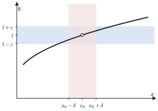

# 2 · Successioni e limiti

**In questo modulo.** Prerequisiti: il modulo 1 (Numeri reali e funzioni), in particolare valore assoluto, estremo superiore e funzioni elementari. Il limite è il concetto su cui si costruiscono continuità, derivate e sviluppi di Taylor. Qui lo si definisce prima per le successioni, poi per le funzioni, si dimostrano i teoremi che permettono di calcolarlo senza tornare ogni volta alla definizione e si raccolgono i limiti notevoli. Alla fine del modulo si sa verificare un limite con la definizione, calcolarlo con l'algebra dei limiti e la sostituzione, riconoscere le forme indeterminate e scioglierle nei casi standard.

## 2.1 Intorni

Le definizioni di limite parlano tutte di "vicinanza", che si esprime con gli intorni.

> [!definizione] Intorni
> Siano $x_0, a, b, r \in \mathbb{R}$ con $r > 0$.
>
> - L'**intorno** di $x_0$ di raggio $r$ è $I_r(x_0) := (x_0 - r, x_0 + r) = \{x \in \mathbb{R} : |x - x_0| < r\}$.
> - Un intorno di $+\infty$ è una semiretta $I_a(+\infty) := (a, +\infty)$.
> - Un intorno di $-\infty$ è una semiretta $I_b(-\infty) := (-\infty, b)$.

L'idea è che un intorno di $+\infty$ contenga "i numeri molto grandi": più grande è $a$, più piccolo è l'intorno.

## 2.2 Limiti di successioni

Una **successione** è una funzione definita su $\mathbb{N}$ (o su $\{n \in \mathbb{N} : n \ge n_0\}$) a valori in $\mathbb{R}$. Invece di $a(n)$ si scrive $a_n$, e la successione si indica con $(a_n)_{n \ge n_0}$. Ad esempio $\left(\frac{1}{n}\right)_{n \ge 1} = \left(1, \frac{1}{2}, \frac{1}{3}, \dots\right)$.

> [!definizione] Successione convergente
> La successione $(a_n)$ **converge** (o tende) a $l \in \mathbb{R}$, e si scrive $\lim_{n \to +\infty} a_n = l$ oppure $a_n \to l$, se
> $$\forall \varepsilon > 0\ \ \exists\, n_\varepsilon \in \mathbb{N} : \ \forall n \ge n_\varepsilon \quad |a_n - l| < \varepsilon.$$

In parole: comunque si scelga il raggio $\varepsilon$, da un certo indice in poi tutti i termini stanno nell'intorno $I_\varepsilon(l)$. L'indice $n_\varepsilon$ dipende da $\varepsilon$: più piccolo è $\varepsilon$, più avanti bisogna andare.

> [!definizione] Successione divergente
> La successione $(a_n)$ **diverge** a $+\infty$, e si scrive $\lim_{n \to +\infty} a_n = +\infty$, se
> $$\forall K > 0\ \ \exists\, n_K \in \mathbb{N} : \ \forall n \ge n_K \quad a_n > K,$$
> cioè se da un certo indice in poi i termini stanno nell'intorno $I_K(+\infty)$. Diverge a $-\infty$ se per ogni $K > 0$ da un certo indice in poi $a_n < -K$, cioè $a_n \in I_{-K}(-\infty)$.

Una successione che non è né convergente né divergente si dice **indeterminata** (o oscillante): ad esempio $((-1)^n)$, che vale alternativamente $1$ e $-1$.

> [!esempio] Verificare un limite con la definizione
> **$\frac{1}{n} \to 0$.** Fissato $\varepsilon > 0$, si cerca $n_\varepsilon$ tale che, per $n \ge n_\varepsilon$, $\left|\frac{1}{n} - 0\right| = \frac{1}{n} < \varepsilon$. La disuguaglianza equivale a $n > \frac{1}{\varepsilon}$, quindi basta scegliere $n_\varepsilon$ intero maggiore di $\frac{1}{\varepsilon}$: per $n \ge n_\varepsilon$ si ha $n > \frac{1}{\varepsilon}$.
>
> **$n^2 \to +\infty$.** Fissato $K > 0$ (la "quota" da superare), si cerca $n_K$ tale che $n^2 > K$ per $n \ge n_K$. Basta $n_K > \sqrt{K}$, perché allora $n \ge n_K > \sqrt{K}$ implica $n^2 > K$.

Uno dei primi teoremi del paragrafo 2.6 dice che il limite, se esiste, è **unico**: per questo si può parlare de *il* limite.

## 2.3 Successioni monotone e numero $e$

> [!definizione] Successioni monotone
> La successione $(a_n)$ è **crescente** se $a_n \le a_{n+1}$ per ogni $n$, **decrescente** se $a_n \ge a_{n+1}$ per ogni $n$; **strettamente** crescente o decrescente con le disuguaglianze strette.

Le successioni monotone non possono oscillare: hanno sempre un limite, finito o infinito.

> [!teorema] Limite delle successioni monotone
> Sia $(a_n)$ crescente. Se è limitata superiormente converge, e $\lim_{n \to +\infty} a_n = \sup_n a_n$; altrimenti diverge a $+\infty$.
>
> Sia $(a_n)$ decrescente. Se è limitata inferiormente converge, e $\lim_{n \to +\infty} a_n = \inf_n a_n$; altrimenti diverge a $-\infty$.

*Dimostrazione (caso crescente e limitato).* Per la completezza esiste $l = \sup_n a_n \in \mathbb{R}$. Fissato $\varepsilon > 0$, bisogna trovare $n_\varepsilon$ tale che $l - \varepsilon < a_n < l + \varepsilon$ per $n \ge n_\varepsilon$. La disuguaglianza destra vale per ogni $n$, perché $l$ è un maggiorante: $a_n \le l < l + \varepsilon$. Per la sinistra si usa che $l$ è il *più piccolo* dei maggioranti: $l - \varepsilon$ non è un maggiorante, quindi esiste un indice $n_\varepsilon$ con $a_{n_\varepsilon} > l - \varepsilon$. Per $n \ge n_\varepsilon$, la crescenza dà $a_n \ge a_{n_\varepsilon} > l - \varepsilon$. Messe insieme, per $n \ge n_\varepsilon$ si ha $|a_n - l| < \varepsilon$.

Se invece $(a_n)$ non è limitata superiormente, per ogni $K > 0$ esiste $n_K$ con $a_{n_K} > K$, e per la crescenza $a_n > K$ per ogni $n \ge n_K$: la successione diverge a $+\infty$. Il caso decrescente è analogo.

> [!esempio]
> $\left(\frac{1}{n}\right)$ è decrescente e limitata inferiormente da 0, e converge a $\inf = 0$. $(n^2)$ è crescente e non limitata, e diverge. $\left(\frac{n - 1}{n}\right) = \left(1 - \frac{1}{n}\right)$ è crescente e limitata, e converge al suo estremo superiore 1.

La successione più importante di questo tipo definisce il numero di Nepero.

> [!teorema] Il numero $e$
> La successione $a_n = \left(1 + \frac{1}{n}\right)^n$, $n \ge 1$, è crescente e limitata superiormente. Il suo limite si chiama **numero di Nepero**:
> $$e := \lim_{n \to +\infty} \left(1 + \frac{1}{n}\right)^n = \sup_n \left(1 + \frac{1}{n}\right)^n \approx 2{,}71828.$$

*Dimostrazione.* **Limitata.** Per lo sviluppo del binomio (modulo 1, paragrafo 1.4),
$$\left(1 + \frac{1}{n}\right)^n = \sum_{k=0}^{n} \binom{n}{k} \frac{1}{n^k} = \sum_{k=0}^{n} \frac{1}{k!} \cdot \frac{n(n-1)\cdots(n-k+1)}{n^k} \le \sum_{k=0}^{n} \frac{1}{k!},$$
perché ogni fattore $\frac{n - j}{n}$ è al più 1. Inoltre $k! \ge 2^{k-1}$ per $k \ge 1$, quindi la somma è al più $1 + 1 + \frac{1}{2} + \frac{1}{4} + \dots + \frac{1}{2^{n-1}} < 3$.

**Crescente.** Il rapporto fra due termini consecutivi si riscrive come
$$\frac{a_n}{a_{n-1}} = \left(\frac{n+1}{n}\right)^n \left(\frac{n-1}{n}\right)^{n-1} = \frac{n}{n-1} \left(1 - \frac{1}{n^2}\right)^n \ge \frac{n}{n-1}\left(1 - \frac{1}{n}\right) = 1,$$
dove la disuguaglianza è quella di Bernoulli (modulo 1) con $x = -\frac{1}{n^2}$. Quindi $a_n \ge a_{n-1}$.

## 2.4 Sottosuccessioni

> [!definizione] Sottosuccessione
> Data una successione $(a_n)$ e una successione di indici naturali **strettamente crescente** $n_0 < n_1 < n_2 < \dots$, la successione $(a_{n_k})_{k \ge 0}$ si chiama **sottosuccessione** (o successione estratta) di $(a_n)$.

Si prendono cioè infiniti termini della successione, nell'ordine in cui compaiono. Poiché gli indici sono strettamente crescenti, $n_k \ge k$ e quindi $n_k \to +\infty$.

> [!esempio]
> Da $a_n = (-1)^n$ si estraggono la sottosuccessione dei termini pari, $n_k = 2k$, con $a_{2k} = 1$ per ogni $k$, e quella dei dispari, $n_k = 2k + 1$, con $a_{2k+1} = -1$.

> [!teorema] Limite delle sottosuccessioni
> Se $\lim_{n \to +\infty} a_n = l$ (finito o infinito), ogni sottosuccessione ha lo stesso limite: $\lim_{k \to +\infty} a_{n_k} = l$.

Il teorema segue dalla definizione: se da $n_\varepsilon$ in poi tutti i termini stanno vicino a $l$, ci stanno anche i termini estratti con $n_k \ge n_\varepsilon$. Si usa soprattutto al contrario, per mostrare che un limite **non** esiste: se due sottosuccessioni hanno limiti diversi, la successione non ha limite. È il caso di $(-1)^n$, le cui sottosuccessioni pari e dispari tendono a 1 e a $-1$.

## 2.5 Limiti di funzione

Le definizioni per le funzioni ricalcano quelle per le successioni; cambia solo il punto verso cui tende la variabile, che può essere $\pm\infty$ oppure un numero $x_0$.

> [!definizione] Limiti all'infinito
> Sia $f$ definita in un intorno di $+\infty$. Si dice che
>
> - $\lim_{x \to +\infty} f(x) = l \in \mathbb{R}$ se $\forall \varepsilon > 0\ \exists B > 0 : \forall x \in \operatorname{dom}(f),\ x > B \Rightarrow |f(x) - l| < \varepsilon$;
> - $\lim_{x \to +\infty} f(x) = +\infty$ se $\forall M > 0\ \exists B > 0 : \forall x \in \operatorname{dom}(f),\ x > B \Rightarrow f(x) > M$;
> - $\lim_{x \to +\infty} f(x) = -\infty$ se $\forall M > 0\ \exists B > 0 : \forall x \in \operatorname{dom}(f),\ x > B \Rightarrow f(x) < -M$.
>
> Per $x \to -\infty$ le definizioni sono le stesse con $x < -B$ al posto di $x > B$.

> [!definizione] Limiti al finito
> Sia $x_0 \in \mathbb{R}$ e sia $f$ definita in un intorno di $x_0$, eventualmente escluso $x_0$. Si dice che
>
> - $\lim_{x \to x_0} f(x) = l \in \mathbb{R}$ se $\forall \varepsilon > 0\ \exists \delta > 0 : \forall x \in \operatorname{dom}(f),\ 0 < |x - x_0| < \delta \Rightarrow |f(x) - l| < \varepsilon$;
> - $\lim_{x \to x_0} f(x) = +\infty$ se $\forall M > 0\ \exists \delta > 0 : \forall x \in \operatorname{dom}(f),\ 0 < |x - x_0| < \delta \Rightarrow f(x) > M$;
> - $\lim_{x \to x_0} f(x) = -\infty$ se $\forall M > 0\ \exists \delta > 0 : \forall x \in \operatorname{dom}(f),\ 0 < |x - x_0| < \delta \Rightarrow f(x) < -M$.

La condizione $0 < |x - x_0|$ esclude il punto $x_0$: il limite descrive cosa fa $f$ *vicino* a $x_0$, non *in* $x_0$, dove la funzione potrebbe non essere definita o avere un valore qualsiasi.

*Figura 2.1. Grafico di una funzione con la fascia orizzontale $(l - \varepsilon, l + \varepsilon)$ e l'intervallo $(x_0 - \delta, x_0 + \delta)$: per le $x$ dell'intervallo, escluso $x_0$, il grafico resta nella fascia.*

**Limite destro e sinistro.** Se nella definizione si considerano solo le $x > x_0$, cioè $0 < x - x_0 < \delta$, si ottiene il **limite destro** $\lim_{x \to x_0^+} f(x)$; con le sole $x < x_0$ il **limite sinistro** $\lim_{x \to x_0^-} f(x)$. Il limite esiste se e solo se esistono il destro e il sinistro e sono uguali. Ad esempio $\lim_{x \to 0^+} \frac{1}{x} = +\infty$ e $\lim_{x \to 0^-} \frac{1}{x} = -\infty$, quindi $\lim_{x \to 0} \frac{1}{x}$ non esiste.

> [!esempio] Verifica con la definizione
> Si verifica che $f(x) = \frac{x^2 + 3x + 2}{3x^2 + 1} \to \frac{1}{3}$ per $x \to +\infty$. Fissato $\varepsilon > 0$, si cerca $B > 0$ tale che $x > B$ implichi $\left|f(x) - \frac{1}{3}\right| < \varepsilon$. Per $x > 0$:
> $$\left|f(x) - \frac{1}{3}\right| = \left|\frac{3(x^2 + 3x + 2) - (3x^2 + 1)}{3(3x^2 + 1)}\right| = \frac{3x + \frac{5}{3}}{3x^2 + 1} < \frac{3x + \frac{5}{3}}{3x^2} = \frac{1}{x} + \frac{5}{9x^2}.$$
> Basta allora che ciascuno dei due addendi sia minore di $\frac{\varepsilon}{2}$: $\frac{1}{x} < \frac{\varepsilon}{2}$ per $x > \frac{2}{\varepsilon}$, e $\frac{5}{9x^2} < \frac{\varepsilon}{2}$ per $x > \sqrt{\frac{10}{9\varepsilon}}$. Si sceglie $B = \max\left\{\frac{2}{\varepsilon}, \sqrt{\frac{10}{9\varepsilon}}\right\}$.

## 2.6 Teoremi sui limiti

I teoremi seguenti valgono per le successioni e per le funzioni, per $x$ che tende a un numero o a $\pm\infty$. Si enunciano per le funzioni; per le successioni basta leggere $n \to +\infty$.

**Unicità del limite.** Se il limite esiste, è unico. *Dimostrazione (caso finito).* Se $f(x) \to l_1$ e $f(x) \to l_2$ con $l_1 \ne l_2$, si prende $\varepsilon = \frac{|l_1 - l_2|}{2}$. Vicino al punto, $f(x)$ dovrebbe stare sia in $I_\varepsilon(l_1)$ sia in $I_\varepsilon(l_2)$, ma i due intorni sono disgiunti.

**Permanenza del segno.** Se $\lim f(x) = l > 0$ (oppure $l = +\infty$), allora $f(x) > 0$ in un intorno del punto, escluso al più il punto stesso. *Dimostrazione.* Con $\varepsilon = l$ nella definizione si ha $f(x) > l - l = 0$ vicino al punto. Viceversa, se $f(x) \ge 0$ vicino al punto e il limite esiste, il limite è $\ge 0$: il segno si conserva, ma non la disuguaglianza stretta, come mostra $\frac{1}{n} > 0$ con limite 0.

**Confronto (teorema dei carabinieri).** Se $g(x) \le f(x) \le h(x)$ vicino al punto e $g$ e $h$ hanno lo stesso limite finito $l$, anche $f$ tende a $l$. Se $f(x) \ge g(x)$ e $g \to +\infty$, anche $f \to +\infty$. *Dimostrazione.* Fissato $\varepsilon$, vicino al punto si ha $l - \varepsilon < g(x) \le f(x) \le h(x) < l + \varepsilon$.

**Algebra dei limiti.** Se $f \to l$ e $g \to m$ con $l, m \in \mathbb{R}$, allora $f \pm g \to l \pm m$, $f g \to l m$ e, se $m \ne 0$, $\frac{f}{g} \to \frac{l}{m}$. Le regole si estendono ai limiti infiniti con le convenzioni, per $l \in \mathbb{R}$:
$$l \pm \infty = \pm\infty, \quad +\infty + \infty = +\infty, \quad l \cdot (\pm\infty) = \pm\infty \text{ se } l > 0, \quad (\pm\infty)(\pm\infty) = +\infty, \quad \frac{l}{\pm\infty} = 0, \quad \frac{l}{0^+} = +\infty \text{ se } l > 0.$$
Qui $0^+$ indica una funzione che tende a 0 restando positiva.

Restano fuori dalle regole alcuni casi, detti **forme indeterminate**: in questi casi il limite dipende dalle funzioni, non solo dai loro limiti.

$$+\infty - \infty, \qquad 0 \cdot \infty, \qquad \frac{0}{0}, \qquad \frac{\infty}{\infty}, \qquad 1^\infty, \qquad 0^0, \qquad \infty^0.$$

Ad esempio, per $x \to +\infty$ sia $x - x$ sia $(x + 1) - x$ sono della forma $+\infty - \infty$, ma tendono a 0 e a 1. Sciogliere una forma indeterminata significa riscrivere l'espressione in modo che le regole si possano applicare.

## 2.7 Polinomi e funzioni razionali all'infinito

Sia $P(x) = a_n x^n + a_{n-1} x^{n-1} + \dots + a_0$ un polinomio di grado $n \ge 1$, con $a_n \ne 0$. Per $x \to \pm\infty$ la somma è in generale una forma $+\infty - \infty$, che si scioglie raccogliendo la potenza di grado massimo:

$$P(x) = x^n \left(a_n + \frac{a_{n-1}}{x} + \dots + \frac{a_0}{x^n}\right).$$

La parentesi tende ad $a_n$, perché ogni termine $\frac{a_k}{x^{n-k}}$ tende a 0. Quindi $P(x)$ si comporta come $a_n x^n$:

$$\lim_{x \to +\infty} P(x) = \begin{cases} +\infty & a_n > 0 \\ -\infty & a_n < 0 \end{cases} \qquad \lim_{x \to -\infty} P(x) = \lim_{x \to -\infty} a_n x^n,$$

dove per $x \to -\infty$ il segno dipende anche dalla parità di $n$: $x^n \to +\infty$ se $n$ è pari e $x^n \to -\infty$ se $n$ è dispari.

Per una funzione razionale $\frac{P(x)}{Q(x)}$, con $Q(x) = b_m x^m + \dots + b_0$ e $b_m \ne 0$, si raccolgono le potenze massime di numeratore e denominatore:

$$\frac{P(x)}{Q(x)} = \frac{x^n \left(a_n + \frac{a_{n-1}}{x} + \dots\right)}{x^m \left(b_m + \frac{b_{m-1}}{x} + \dots\right)}, \qquad \text{quindi} \qquad \lim_{x \to \pm\infty} \frac{P(x)}{Q(x)} = \lim_{x \to \pm\infty} \frac{a_n}{b_m} x^{n-m}.$$

Il limite vale $\frac{a_n}{b_m}$ se $n = m$ e 0 se $n < m$. Se $n > m$ è infinito, con il segno di $\frac{a_n}{b_m}$ per $x \to +\infty$, mentre per $x \to -\infty$ va moltiplicato per $(-1)^{n-m}$.

> [!esempio]
> $\lim_{x \to -\infty} \frac{2x^3 - x}{x^2 + 5} = \lim_{x \to -\infty} 2x = -\infty$; $\quad \lim_{x \to +\infty} \frac{4x^2 + 1}{2x^2 - x} = \frac{4}{2} = 2$; $\quad \lim_{x \to +\infty} \frac{x + 7}{x^3} = 0$.

## 2.8 Limiti notevoli

Alcuni limiti in forma $\frac{0}{0}$ tornano così spesso che conviene saperli a memoria. Il primo è la base di tutti quelli trigonometrici.

> [!teorema] Limite fondamentale del seno
> $$\lim_{x \to 0} \frac{\sin x}{x} = 1.$$

*Dimostrazione.* Per $0 < x < \frac{\pi}{2}$, confrontando sulla circonferenza unitaria l'area del triangolo inscritto, del settore circolare e del triangolo circoscritto si ottiene $\sin x < x < \tan x$. Dividendo per $\sin x > 0$ e passando ai reciproci, $\cos x < \frac{\sin x}{x} < 1$. Per $x \to 0^+$ il coseno tende a 1, e il teorema del confronto dà il limite destro. Poiché $\frac{\sin x}{x}$ è pari, anche il limite sinistro vale 1.

Dal limite del seno si ricavano gli altri limiti trigonometrici:

$$\lim_{x \to 0} \frac{\tan x}{x} = \lim_{x \to 0} \frac{\sin x}{x} \cdot \frac{1}{\cos x} = 1,$$

$$\lim_{x \to 0} \frac{1 - \cos x}{x^2} = \lim_{x \to 0} \frac{(1 - \cos x)(1 + \cos x)}{x^2 (1 + \cos x)} = \lim_{x \to 0} \left(\frac{\sin x}{x}\right)^2 \frac{1}{1 + \cos x} = \frac{1}{2},$$

dove si è usato $1 - \cos^2 x = \sin^2 x$. Con la sostituzione $y = \arcsin x$ (rispettivamente $y = \arctan x$) si ottiene anche

$$\lim_{x \to 0} \frac{\arcsin x}{x} = \lim_{y \to 0} \frac{y}{\sin y} = 1, \qquad \lim_{x \to 0} \frac{\arctan x}{x} = 1.$$

Dal numero $e$ derivano i limiti con esponenziali e logaritmi. Il limite $\left(1 + \frac{1}{n}\right)^n \to e$ vale anche per una variabile reale, $\lim_{x \to \pm\infty} \left(1 + \frac{1}{x}\right)^x = e$, e da lì, con le sostituzioni del paragrafo 2.9:

$$\lim_{x \to \pm\infty} \left(1 + \frac{a}{x}\right)^x = e^a, \qquad \lim_{x \to 0} (1 + x)^{1/x} = e,$$

$$\lim_{x \to 0} \frac{\ln(1 + x)}{x} = 1, \qquad \lim_{x \to 0} \frac{\log_a(1 + x)}{x} = \frac{1}{\ln a}, \qquad \lim_{x \to 0} \frac{e^x - 1}{x} = 1, \qquad \lim_{x \to 0} \frac{(1 + x)^\alpha - 1}{x} = \alpha.$$

> [!nota]
> Ad esempio $\frac{\ln(1 + x)}{x} = \ln\left((1 + x)^{1/x}\right) \to \ln e = 1$, usando che il logaritmo è continuo (modulo 3). Posto poi $y = e^x - 1$, cioè $x = \ln(1 + y)$, si ha $\frac{e^x - 1}{x} = \frac{y}{\ln(1 + y)} \to 1$.

Servono infine i limiti delle funzioni elementari agli estremi del dominio, che si leggono sui grafici del modulo 1: per $\alpha > 0$, $x^\alpha \to +\infty$ per $x \to +\infty$ e $x^\alpha \to 0$ per $x \to 0^+$ (il contrario per $\alpha < 0$); per $a > 1$, $a^x \to +\infty$ per $x \to +\infty$ e $a^x \to 0$ per $x \to -\infty$, $\log_a x \to +\infty$ per $x \to +\infty$ e $\log_a x \to -\infty$ per $x \to 0^+$ (il contrario per $0 < a < 1$); $\tan x \to \pm\infty$ per $x \to \left(\frac{\pi}{2} + k\pi\right)^\mp$; $\arctan x \to \pm\frac{\pi}{2}$ per $x \to \pm\infty$. Seno e coseno non hanno limite per $x \to \pm\infty$, come si vede alla fine del prossimo paragrafo.

## 2.9 Sostituzione e forme esponenziali

> [!teorema] Teorema di sostituzione (limite della funzione composta)
> Sia $\lim_{x \to c} f(x) = l$, con $c$ e $l$ finiti o infiniti, e sia $g$ definita in un intorno di $l$, eventualmente escluso $l$. Si supponga che valga una delle condizioni seguenti:
>
> 1. $l$ è finito e $g$ è continua in $l$ (la continuità si studia nel modulo 3; tutte le funzioni elementari sono continue nel loro dominio);
> 2. $l$ è finito, esiste $\lim_{y \to l} g(y)$ e $f(x) \ne l$ in un intorno di $c$, escluso $c$;
> 3. $l = \pm\infty$ ed esiste $\lim_{y \to l} g(y)$.
>
> Allora $\lim_{x \to c} g(f(x)) = \lim_{y \to l} g(y)$.

In pratica si pone $y = f(x)$, si calcola dove va $y$ e si fa il limite in $y$.

> [!esempio]
> Per $x \to +\infty$, $\frac{1}{x} \to 0$, quindi $\sin\frac{1}{x} \to \sin 0 = 0$ e infine $e^{\sin(1/x)} \to e^0 = 1$.

Il teorema serve anche a dimostrare che un limite **non** esiste: basta trovare due modi di far tendere la variabile al punto che portano a limiti diversi.

> [!esempio] $\lim_{y \to +\infty} \sin y$ non esiste
> Si considerano le successioni $y_n = 2\pi n$ e $y'_n = \frac{\pi}{2} + 2\pi n$, che tendono entrambe a $+\infty$. Se esistesse $\lim_{y \to +\infty} \sin y = L$, per il teorema di sostituzione dovrebbe essere $\sin y_n \to L$ e $\sin y'_n \to L$. Ma $\sin(2\pi n) = 0$ e $\sin\left(\frac{\pi}{2} + 2\pi n\right) = 1$ per ogni $n$: i due limiti sono 0 e 1, diversi. Il limite non esiste.

**Forme esponenziali.** Per le potenze con base e esponente variabili, $f(x)^{g(x)}$ con $f(x) > 0$, si usa l'identità
$$f(x)^{g(x)} = e^{g(x) \ln f(x)}.$$
Per la sostituzione, basta calcolare il limite dell'esponente $g(x) \ln f(x)$. Le forme $1^\infty$, $0^0$ e $\infty^0$ diventano così forme $0 \cdot \infty$ nell'esponente. Ad esempio, per $x \to +\infty$
$$\left(1 + \frac{2}{x}\right)^{3x} = e^{3x \ln\left(1 + \frac{2}{x}\right)}, \qquad 3x \ln\left(1 + \frac{2}{x}\right) = 6 \cdot \frac{\ln\left(1 + \frac{2}{x}\right)}{\frac{2}{x}} \to 6,$$
usando $\frac{\ln(1 + t)}{t} \to 1$ con $t = \frac{2}{x} \to 0$. Il limite è $e^6$.

## Esempi ed esercizi svolti

> [!esempio] Razionalizzare
> $\lim_{x \to -\infty} \frac{x}{\sqrt{x^2 - 1}}$. Per $x < 0$ si ha $\sqrt{x^2} = |x| = -x$, quindi
> $$\frac{x}{\sqrt{x^2 - 1}} = \frac{x}{|x| \sqrt{1 - \frac{1}{x^2}}} = \frac{x}{-x \sqrt{1 - \frac{1}{x^2}}} = -\frac{1}{\sqrt{1 - \frac{1}{x^2}}} \to -1.$$
> L'errore tipico è scrivere $\sqrt{x^2} = x$, che per $x$ negativo porterebbe a $+1$.

> [!esempio] Una differenza $+\infty - \infty$
> $\lim_{x \to +\infty} \left(\sqrt{x^2 + x} - x\right)$. Si moltiplica e si divide per $\sqrt{x^2 + x} + x$:
> $$\sqrt{x^2 + x} - x = \frac{x^2 + x - x^2}{\sqrt{x^2 + x} + x} = \frac{x}{x\left(\sqrt{1 + \frac{1}{x}} + 1\right)} \to \frac{1}{2}.$$

> [!esempio] Con i limiti notevoli
> $\lim_{x \to 0} \frac{1 - \cos(3x)}{x \sin x} = \lim_{x \to 0} \frac{1 - \cos(3x)}{(3x)^2} \cdot \frac{9x^2}{x \sin x} = \frac{1}{2} \cdot 9 \cdot \lim_{x \to 0} \frac{x}{\sin x} = \frac{9}{2}$.

### Altri esercizi svolti

Prima di ogni calcolo conviene scrivere la forma del limite ($\frac{0}{0}$, $\frac{\infty}{\infty}$, $\infty - \infty$, $1^\infty$, …): è quella che dice quale strumento usare.

**Esercizio 1. Verificare un limite con la definizione.** Mostrare che $\lim_{n \to \infty} \frac{3n + 1}{n + 2} = 3$.

Dato $\varepsilon > 0$, si cerca $\bar{n}$ tale che $\left|\frac{3n + 1}{n + 2} - 3\right| < \varepsilon$ per ogni $n > \bar{n}$. Si semplifica la differenza:
$$\left|\frac{3n + 1 - 3n - 6}{n + 2}\right| = \frac{5}{n + 2} < \varepsilon \iff n + 2 > \frac{5}{\varepsilon} \iff n > \frac{5}{\varepsilon} - 2.$$
Basta prendere $\bar{n}$ uguale alla parte intera di $\frac{5}{\varepsilon}$. Per $\varepsilon = 0{,}01$, ad esempio, la distanza da 3 è minore di un centesimo da $n = 499$ in poi. Nella verifica non si calcola il limite: lo si conosce già e si controlla la definizione.

**Esercizio 2. Limiti di successioni.**
(a) $\displaystyle\lim_{n \to \infty} \frac{n^2 + n \sin n}{3n^2 + 1}$; (b) $\displaystyle\lim_{n \to \infty} \frac{2^n + n^3}{3^n - n}$; (c) $\displaystyle\lim_{n \to \infty} \left(\sqrt{n^2 + 3n} - n\right)$; (d) $\displaystyle\lim_{n \to \infty} \left(1 + \frac{2}{n}\right)^n$.

(a) Si divide per $n^2$: $\frac{1 + \frac{\sin n}{n}}{3 + \frac{1}{n^2}}$. Il termine $\frac{\sin n}{n}$ tende a 0 perché è il prodotto di una successione limitata, $\sin n$, per una infinitesima, $\frac{1}{n}$. Il limite è $\frac{1}{3}$. Non si può dire che $\sin n$ "tende a qualcosa": non ha limite, ma non serve.

(b) Si raccoglie l'infinito più forte, $3^n$: $\frac{3^n\left(\left(\frac{2}{3}\right)^n + \frac{n^3}{3^n}\right)}{3^n\left(1 - \frac{n}{3^n}\right)}$. Per la gerarchia degli infiniti $\frac{n^3}{3^n} \to 0$ e $\frac{n}{3^n} \to 0$; $\left(\frac{2}{3}\right)^n \to 0$ perché la base è minore di 1. Il limite è 0.

(c) Forma $\infty - \infty$: si razionalizza. $\sqrt{n^2 + 3n} - n = \frac{3n}{\sqrt{n^2 + 3n} + n} = \frac{3}{\sqrt{1 + \frac{3}{n}} + 1} \to \frac{3}{2}$.

(d) È il limite notevole $\left(1 + \frac{a}{n}\right)^n \to e^a$ con $a = 2$: il limite è $e^2$.

**Esercizio 3. Limiti notevoli con un cambio di scala.**
(a) $\displaystyle\lim_{x \to 0} \frac{e^{3x} - 1}{\sin(2x)}$; (b) $\displaystyle\lim_{x \to 0} \frac{\ln(1 + x^2)}{1 - \cos x}$; (c) $\displaystyle\lim_{x \to +\infty} x\big(\ln(x + 1) - \ln x\big)$.

(a) Si fa comparire in ogni pezzo il suo limite notevole, moltiplicando e dividendo:
$$\frac{e^{3x} - 1}{3x} \cdot \frac{2x}{\sin(2x)} \cdot \frac{3x}{2x} \to 1 \cdot 1 \cdot \frac{3}{2} = \frac{3}{2}.$$
(b) $\frac{\ln(1 + x^2)}{x^2} \cdot \frac{x^2}{1 - \cos x} \to 1 \cdot 2 = 2$, perché $\frac{1 - \cos x}{x^2} \to \frac{1}{2}$.
(c) Per le proprietà del logaritmo, $x \ln\left(1 + \frac{1}{x}\right)$. Con $y = \frac{1}{x} \to 0^+$ diventa $\frac{\ln(1 + y)}{y} \to 1$.

**Esercizio 4. Una forma $1^\infty$.** Calcolare $\lim_{x \to +\infty} \left(\frac{x + 2}{x - 1}\right)^x$.

La base tende a 1 e l'esponente a $+\infty$. Si scrive $f^g = e^{g \ln f}$ e si studia l'esponente:
$$x \ln\frac{x + 2}{x - 1} = x \ln\left(1 + \frac{3}{x - 1}\right) = \frac{3x}{x - 1} \cdot \frac{\ln\left(1 + \frac{3}{x - 1}\right)}{\frac{3}{x - 1}} \to 3 \cdot 1 = 3.$$
Il limite è $e^3$. L'errore tipico è "la base tende a 1, e 1 elevato a qualsiasi cosa fa 1": $1^\infty$ è una forma indeterminata.

**Esercizio 5. Una forma $0^0$.** Calcolare $\lim_{x \to 0^+} x^x$.

$x^x = e^{x \ln x}$, e $x \ln x \to 0$ per $x \to 0^+$ (il logaritmo va all'infinito più lentamente di qualsiasi potenza: è la gerarchia scritta con $y = \frac{1}{x}$, $x \ln x = -\frac{\ln y}{y} \to 0$). Il limite è $e^0 = 1$.

**Esercizio 6. Un limite con un parametro.** Calcolare $\lim_{x \to +\infty} \left(\sqrt{x^2 + ax} - x\right)$ al variare di $a \in \mathbb{R}$.

Razionalizzando, $\frac{ax}{\sqrt{x^2 + ax} + x} = \frac{a}{\sqrt{1 + \frac{a}{x}} + 1} \to \frac{a}{2}$ per ogni $a$. Per $a = 0$ il limite è 0, coerente con la formula. Lo stesso conto per $x \to -\infty$ va rifatto con $\sqrt{x^2} = -x$: la funzione tende a $+\infty$, perché è la somma di due quantità positive che crescono.

**Esercizio 7. Limiti che non esistono.** Mostrare che non esistono (a) $\lim_{x \to 0} \frac{|x|}{x}$ e (b) $\lim_{x \to 0} \sin\frac{1}{x}$.

(a) Per $x > 0$ la funzione vale 1, per $x < 0$ vale $-1$: il limite destro è 1, quello sinistro $-1$, e un limite che esiste deve averli uguali. (b) Lungo $x_n = \frac{1}{n\pi}$, che tende a 0, la funzione vale $\sin(n\pi) = 0$; lungo $x_n = \frac{1}{\frac{\pi}{2} + 2n\pi}$ vale 1. Due successioni che tendono a 0 danno due limiti diversi: per il teorema ponte il limite non esiste.

## Esercizi guidati

Ogni esercizio è diviso in passi: si prova un passo alla volta e si confronta solo dopo.

**Guidato 1. Limite di funzione con la definizione.** Verificare che $\lim_{x \to 2} (3x - 1) = 5$.

*Passo 1: scrivere che cosa si deve trovare.* Per ogni $\varepsilon > 0$ serve un $\delta > 0$ tale che $0 < |x - 2| < \delta$ implichi $|(3x - 1) - 5| < \varepsilon$.

*Passo 2: semplificare.* $|(3x - 1) - 5| = |3x - 6| = 3|x - 2|$.

*Passo 3: scegliere $\delta$.* $3|x - 2| < \varepsilon$ se $|x - 2| < \frac{\varepsilon}{3}$: basta $\delta = \frac{\varepsilon}{3}$.

*Passo 4: rileggere.* Più piccola è la tolleranza $\varepsilon$ sull'uscita, più stretto deve essere l'intorno di 2: qui la funzione "allarga" le distanze di un fattore 3, e $\delta$ è $\varepsilon$ diviso 3.

**Guidato 2. La forma $1^\infty$ con il coseno.** Calcolare $\lim_{x \to 0} (\cos x)^{1/x^2}$.

*Passo 1: la forma.* $\cos x \to 1$ e $\frac{1}{x^2} \to +\infty$: è $1^\infty$.

*Passo 2: passare all'esponenziale.* $(\cos x)^{1/x^2} = \exp\left(\frac{\ln(\cos x)}{x^2}\right)$.

*Passo 3: il limite dell'esponente.* Si scrive $\ln(\cos x) = \ln\big(1 + (\cos x - 1)\big)$ e si usa il limite notevole del logaritmo con $y = \cos x - 1 \to 0$:
$$\frac{\ln\big(1 + (\cos x - 1)\big)}{\cos x - 1} \cdot \frac{\cos x - 1}{x^2} \to 1 \cdot \left(-\frac{1}{2}\right) = -\frac{1}{2}.$$

*Passo 4: tornare alla funzione.* Il limite è $e^{-1/2} = \frac{1}{\sqrt{e}}$. Lo stesso risultato si ritrova nel modulo 5 con lo sviluppo $\ln(\cos x) = -\frac{x^2}{2} + o(x^2)$.

**Guidato 3. Una successione con la gerarchia degli infiniti.** Calcolare $\lim_{n \to \infty} \frac{n^2 \, 2^n + n!}{3^n + (n + 1)!}$.

*Passo 1: ordinare gli infiniti.* Fra potenze, esponenziali e fattoriali, il fattoriale vince: $n^2 \ll 2^n \ll 3^n \ll n!$. Al numeratore il termine dominante è $n!$, al denominatore $(n + 1)!$.

*Passo 2: raccogliere.* $\frac{n!\left(\frac{n^2 2^n}{n!} + 1\right)}{(n + 1)!\left(\frac{3^n}{(n + 1)!} + 1\right)} = \frac{1}{n + 1} \cdot \frac{\frac{n^2 2^n}{n!} + 1}{\frac{3^n}{(n + 1)!} + 1}$.

*Passo 3: i limiti dei pezzi.* Le due frazioni interne tendono a 0, quindi il secondo fattore tende a 1; il primo, $\frac{1}{n + 1}$, tende a 0. Il limite è 0.

*Passo 4: il controllo del rapporto.* Che $\frac{3^n}{n!} \to 0$ si vede anche così: il rapporto fra un termine e il precedente è $\frac{3}{n + 1}$, che da $n = 3$ in poi è minore di $\frac{3}{4}$, quindi i termini si riducono almeno di un quarto a ogni passo.

## Riepilogo

Una successione converge a $l$ se, per ogni $\varepsilon > 0$, da un certo indice in poi $|a_n - l| < \varepsilon$; diverge a $+\infty$ se da un certo indice in poi supera ogni quota $K$. Le successioni monotone hanno sempre limite, uguale al loro estremo superiore o inferiore: così si definisce $e = \lim \left(1 + \frac{1}{n}\right)^n$. Le sottosuccessioni hanno lo stesso limite della successione, e due sottosuccessioni con limiti diversi provano che il limite non esiste.

Per le funzioni il limite in $x_0$ descrive il comportamento vicino a $x_0$, escluso il punto; il limite esiste se e solo se esistono e coincidono il destro e il sinistro. Il limite è unico, conserva il segno e si confronta con i carabinieri; l'algebra dei limiti lo calcola su somme, prodotti e quozienti, tranne nelle forme indeterminate $+\infty - \infty$, $0 \cdot \infty$, $\frac{0}{0}$, $\frac{\infty}{\infty}$, $1^\infty$, $0^0$, $\infty^0$. Polinomi e funzioni razionali all'infinito si comportano come il rapporto dei termini di grado massimo. I limiti notevoli da ricordare sono
$$\frac{\sin x}{x} \to 1, \quad \frac{1 - \cos x}{x^2} \to \frac{1}{2}, \quad \frac{\ln(1 + x)}{x} \to 1, \quad \frac{e^x - 1}{x} \to 1, \quad \frac{(1 + x)^\alpha - 1}{x} \to \alpha \qquad (x \to 0),$$
e il teorema di sostituzione, insieme all'identità $f^g = e^{g \ln f}$, riduce a questi molti altri limiti.

## Formulario

Le definizioni, i teoremi e i limiti da avere sotto mano, con il paragrafo in cui sono spiegati.

### Definizioni di limite

| Caso | Definizione |
|---|---|
| $a_n \to l$ | $\forall \varepsilon > 0\ \exists \bar{n} : n > \bar{n} \Rightarrow \lvert a_n - l\rvert < \varepsilon$ |
| $a_n \to +\infty$ | $\forall M\ \exists \bar{n} : n > \bar{n} \Rightarrow a_n > M$ |
| $f(x) \to l$ per $x \to c$ | $\forall \varepsilon > 0\ \exists \delta > 0 : 0 < \lvert x - c\rvert < \delta \Rightarrow \lvert f(x) - l\rvert < \varepsilon$ |
| $f(x) \to l$ per $x \to +\infty$ | $\forall \varepsilon > 0\ \exists M : x > M \Rightarrow \lvert f(x) - l\rvert < \varepsilon$ |

### Teoremi

- Unicità del limite; limite destro e sinistro uguali se e solo se esiste il limite.
- Permanenza del segno: se $l > 0$, la funzione è positiva in un intorno del punto (escluso il punto).
- Confronto (carabinieri): $f \le g \le h$ e $f, h \to l$ implicano $g \to l$.
- Limitata per infinitesima è infinitesima.
- Successioni monotone: hanno sempre limite, finito se e solo se sono limitate.
- Teorema ponte: $f(x) \to l$ per $x \to c$ se e solo se $f(x_n) \to l$ per ogni successione $x_n \to c$, $x_n \ne c$.

### Algebra dei limiti e forme indeterminate

$l + \infty = \infty$, $l \cdot \infty = \infty$ per $l \ne 0$, $\frac{l}{\infty} = 0$, $\frac{l}{0^\pm} = \pm\infty$ per $l > 0$. Forme indeterminate: $\infty - \infty$, $0 \cdot \infty$, $\frac{0}{0}$, $\frac{\infty}{\infty}$, $1^\infty$, $0^0$, $\infty^0$; le ultime tre si trattano con $f^g = e^{g \ln f}$.

### Limiti notevoli ($x \to 0$)

$$\frac{\sin x}{x} \to 1, \quad \frac{1 - \cos x}{x^2} \to \frac{1}{2}, \quad \frac{\tan x}{x} \to 1, \quad \frac{\arcsin x}{x} \to 1, \quad \frac{\arctan x}{x} \to 1,$$

$$\frac{e^x - 1}{x} \to 1, \quad \frac{\ln(1 + x)}{x} \to 1, \quad \frac{(1 + x)^\alpha - 1}{x} \to \alpha, \quad (1 + x)^{1/x} \to e, \quad \left(1 + \frac{a}{x}\right)^x \to e^a \ (x \to \pm\infty).$$

### Gerarchia degli infiniti

Per $n \to \infty$: $\ln n \ll n^\alpha \ (\alpha > 0) \ll a^n \ (a > 1) \ll n! \ll n^n$. Per $x \to +\infty$: $\frac{(\ln x)^\beta}{x^\alpha} \to 0$ e $\frac{x^\alpha}{a^x} \to 0$; per $x \to 0^+$: $x^\alpha \ln x \to 0$.

Polinomi e razionali all'infinito: conta solo il termine di grado massimo; $\frac{P(x)}{Q(x)}$ tende a 0, al rapporto dei coefficienti direttivi o a $\pm\infty$ secondo che il grado di $P$ sia minore, uguale o maggiore di quello di $Q$.

### Termini per l'orale

| Termine | In una riga |
|---|---|
| Intorno | intervallo aperto che contiene il punto; di $+\infty$: semiretta $(M, +\infty)$ |
| Punto di accumulazione | ogni suo intorno contiene punti del dominio diversi da lui |
| Successione convergente, divergente, irregolare | ha limite finito; ha limite infinito; non ha limite |
| Sottosuccessione | successione ottenuta prendendo infiniti termini in ordine |
| Forma indeterminata | combinazione di limiti il cui risultato dipende dalle funzioni, non solo dai limiti |
| Infinitesimo | funzione che tende a 0 |
| Numero $e$ | limite di $\left(1 + \frac{1}{n}\right)^n$, successione crescente e limitata |

### Domande che tornano spesso

- Dare la definizione di limite di successione e di funzione nei vari casi, e verificarla su un esempio.
- Dimostrare l'unicità del limite.
- Enunciare e dimostrare il teorema del confronto.
- Perché una successione monotona e limitata converge? Applicarlo a $\left(1 + \frac{1}{n}\right)^n$.
- Dimostrare $\frac{\sin x}{x} \to 1$ e ricavarne $\frac{1 - \cos x}{x^2} \to \frac{1}{2}$.
- Come si mostra che un limite non esiste?
- Che cosa sono le forme indeterminate esponenziali e come si trattano?
