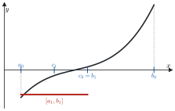
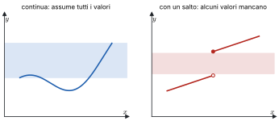
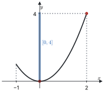
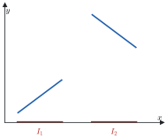

# 3 · Continuità e confronto locale

**In questo modulo.** Prerequisiti: i moduli 1 (Numeri reali e funzioni) e 2 (Successioni e limiti). Una funzione continua è una funzione il cui grafico "non si spezza". Questa proprietà, scritta con i limiti, ha conseguenze globali molto forti: una funzione continua su un intervallo che cambia segno si annulla, assume tutti i valori intermedi e, su un intervallo chiuso e limitato, ha massimo e minimo. Nella seconda parte del modulo si confrontano le funzioni vicino a un punto, con gli asintoti e i simboli di Landau, strumenti che servono poi per lo studio di funzione e per Taylor.

## 3.1 Funzioni continue

> [!definizione] Continuità
> Sia $f : \operatorname{dom}(f) \subseteq \mathbb{R} \to \mathbb{R}$ e sia $x_0 \in \operatorname{dom}(f)$. La funzione è **continua** in $x_0$ se
> $$\forall \varepsilon > 0\ \ \exists \delta > 0 : \ \forall x \in \operatorname{dom}(f), \quad |x - x_0| < \delta \Rightarrow |f(x) - f(x_0)| < \varepsilon.$$
> È continua su un insieme $I \subseteq \operatorname{dom}(f)$ se è continua in ogni punto di $I$.

Rispetto alla definizione di limite, qui il punto $x_0$ deve appartenere al dominio e il valore di riferimento è proprio $f(x_0)$. Ne segue che, se $f$ è definita in un intorno di $x_0$, essere continua in $x_0$ equivale a

$$\lim_{x \to x_0} f(x) = f(x_0):$$

il limite esiste, è finito e coincide con il valore della funzione.

> [!teorema] Continuità della funzione composta
> Se $f$ è continua in $x_0$ e $g$ è continua in $f(x_0)$, allora $g \circ f$ è continua in $x_0$.

È un caso particolare del teorema di sostituzione (modulo 2, paragrafo 2.9).

> [!aggiunta] Aggiunta in revisione · fonte: Canuto-Tabacco, *Analisi Matematica 1*, cap. 3 (AM1A-11)
> **Le funzioni elementari sono continue** in tutti i punti del loro dominio: polinomi, potenze, esponenziali, logaritmi, funzioni trigonometriche e loro inverse. Per l'algebra dei limiti sono continue anche somme, prodotti e quozienti (dove il denominatore non si annulla) di funzioni continue, e per il teorema precedente le loro composte.
>
> **Tipi di discontinuità.** Sia $f$ definita in un intorno di $x_0$, escluso al più $x_0$. Il punto $x_0$ è
>
> - una discontinuità **eliminabile** se $\lim_{x \to x_0} f(x)$ esiste finito ma è diverso da $f(x_0)$, oppure $f$ non è definita in $x_0$: ridefinendo $f(x_0)$ uguale al limite si ottiene una funzione continua. Esempio: $\frac{\sin x}{x}$ in 0;
> - una discontinuità **di salto** se i limiti destro e sinistro esistono finiti ma sono diversi. Esempio: la funzione segno, $\operatorname{sgn} x = \frac{x}{|x|}$, in 0;
> - una discontinuità **di seconda specie** in tutti gli altri casi: almeno uno dei limiti unilaterali è infinito o non esiste. Esempi: $\frac{1}{x}$ e $\sin\frac{1}{x}$ in 0.

## 3.2 Permanenza del segno ed esistenza degli zeri

> [!teorema] Permanenza del segno
> Sia $f$ definita in un intorno di $x_0$ e continua in $x_0$. Se $f(x_0) > 0$, esiste un intorno $I$ di $x_0$ in cui $f(x) > 0$ per ogni $x \in I$. Lo stesso vale con $f(x_0) < 0$.

*Dimostrazione.* Si applica la permanenza del segno per i limiti (modulo 2, paragrafo 2.6) a $\lim_{x \to x_0} f(x) = f(x_0) > 0$; poiché anche in $x_0$ il valore è positivo, l'intorno può includere il punto.

> [!attenzione]
> L'ipotesi deve essere $f(x_0) > 0$, non $f(x_0) \ge 0$: la funzione $f(x) = -x^2$ vale 0 in 0, ma è negativa in ogni punto vicino.

> [!definizione] Zero di una funzione
> Uno **zero** di $f$ è un punto $x_0 \in \operatorname{dom}(f)$ tale che $f(x_0) = 0$.

> [!teorema] Teorema di esistenza degli zeri
> Sia $f$ continua sull'intervallo $[a, b]$. Se $f(a) \cdot f(b) < 0$, esiste $x_0 \in (a, b)$ tale che $f(x_0) = 0$. Se inoltre $f$ è iniettiva su $[a, b]$, lo zero è unico.

*Dimostrazione (metodo di bisezione).* Si supponga $f(a) < 0 < f(b)$; l'altro caso è simmetrico. Si costruisce una successione di intervalli incapsulati $[a_0, b_0] \supseteq [a_1, b_1] \supseteq [a_2, b_2] \supseteq \dots$ con

$$f(a_n) < 0 < f(b_n), \qquad b_n - a_n = \frac{b - a}{2^n}.$$

Si parte da $a_0 = a$ e $b_0 = b$. Costruito $[a_n, b_n]$, se ne prende il punto medio $c_n = \frac{a_n + b_n}{2}$. Se $f(c_n) = 0$, lo zero è trovato. Se $f(c_n) > 0$ si pone $[a_{n+1}, b_{n+1}] = [a_n, c_n]$, se $f(c_n) < 0$ si pone $[a_{n+1}, b_{n+1}] = [c_n, b_n]$: in entrambi i casi il nuovo intervallo è metà del precedente e la funzione ha segni opposti agli estremi.

> [!aggiunta] Aggiunta in revisione · fonte: Canuto-Tabacco, *Analisi Matematica 1*, cap. 4 (AM1A-11)
> Se il procedimento non si ferma mai, la successione $(a_n)$ è crescente e limitata da $b$, la $(b_n)$ è decrescente e limitata da $a$: per il teorema sulle successioni monotone (modulo 2) entrambe convergono. Poiché $b_n - a_n = \frac{b - a}{2^n} \to 0$, il limite è lo stesso: $a_n \to x_0$ e $b_n \to x_0$, con $x_0 \in [a, b]$. Per la continuità di $f$, $f(a_n) \to f(x_0)$ e $f(b_n) \to f(x_0)$. Ma $f(a_n) < 0$ per ogni $n$, quindi $f(x_0) \le 0$; e $f(b_n) > 0$, quindi $f(x_0) \ge 0$. Allora $f(x_0) = 0$, e $x_0 \ne a, b$ perché lì $f$ non si annulla.
>
> Se $f$ è iniettiva, assume il valore 0 al più una volta, quindi lo zero è unico.

La dimostrazione è anche un algoritmo: dopo $n$ passi lo zero è noto a meno di $\frac{b - a}{2^n}$, cioè ogni passo aggiunge circa un bit di precisione.

*Figura 3.1. Grafico di una funzione continua su $[a, b]$ con $f(a) < 0 < f(b)$ e i primi intervalli della bisezione.*

> [!esempio] Polinomi di grado dispari
> Ogni polinomio $P$ di grado dispari ha almeno uno zero reale. Infatti, se ad esempio $a_n > 0$, si ha $P(x) \to +\infty$ per $x \to +\infty$ e $P(x) \to -\infty$ per $x \to -\infty$ (modulo 2, paragrafo 2.7). Per la permanenza del segno dei limiti esistono $a < b$ con $P(a) < 0 < P(b)$, e $P$ è continuo su $[a, b]$: il teorema degli zeri dà $x_0 \in (a, b)$ con $P(x_0) = 0$.

> [!esempio] L'equazione $e^x + \sin x = 0$
> La funzione $f(x) = e^x + \sin x$ è continua, con $f(0) = 1 > 0$ e $f\left(-\frac{\pi}{2}\right) = e^{-\pi/2} - 1 < 0$. Per il teorema degli zeri esiste $x_0 \in \left(-\frac{\pi}{2}, 0\right)$ con $f(x_0) = 0$. Su $\left[-\frac{\pi}{2}, 0\right]$ sia $e^x$ sia $\sin x$ sono strettamente crescenti, quindi lo è la loro somma, che è dunque iniettiva: in questo intervallo lo zero è unico.
>
> Attenzione a non concludere troppo: in tutto $\mathbb{R}$ le soluzioni sono infinite. Per $x$ molto negativo $e^x$ è quasi nullo, e $f$ cambia segno vicino a ogni zero di $\sin x$, cioè vicino a $-\pi, -2\pi, -3\pi, \dots$

## 3.3 Teorema dei valori intermedi

> [!teorema] Teorema dei valori intermedi
> Sia $f$ continua sull'intervallo $[a, b]$. Allora $f$ assume tutti i valori compresi fra $f(a)$ e $f(b)$.

*Dimostrazione.* Sia $y$ strettamente compreso fra $f(a)$ e $f(b)$. La funzione $g(x) = f(x) - y$ è continua su $[a, b]$, e $g(a)$, $g(b)$ hanno segni opposti. Per il teorema degli zeri esiste $x_0$ con $g(x_0) = 0$, cioè $f(x_0) = y$.

> [!teorema] Corollario: immagine di un intervallo
> Se $f$ è continua su un intervallo $I$, l'immagine $f(I)$ è un intervallo, di estremi $\inf_I f$ e $\sup_I f$.

Gli estremi possono appartenere o no all'immagine: $f(x) = \frac{1}{x^2 + 1}$ ha immagine $(0, 1]$.

> [!esempio] Servono le ipotesi
> Senza la continuità il teorema è falso: la funzione $f(x) = \frac{1}{x}$ per $x \ne 0$, con $f(0) = 1$, è definita su $\mathbb{R}$, ma la sua immagine $\mathbb{R} \setminus \{0\}$ non è un intervallo. Anche il dominio deve essere un intervallo: $\frac{1}{x}$ è continua su $\mathbb{R} \setminus \{0\}$, che non è un intervallo, e non assume il valore 0 pur prendendo valori positivi e negativi.

*Figura 3.2. Una funzione continua su $[a, b]$ che assume tutti i valori fra $f(a)$ e $f(b)$, e una funzione con un salto che ne salta qualcuno.*

## 3.4 Teoremi di Bolzano-Weierstrass e di Weierstrass

> [!teorema] Teorema di Bolzano-Weierstrass
> Da ogni successione limitata si può estrarre una sottosuccessione convergente.

*Idea della dimostrazione.* Se $a \le x_n \le b$ per ogni $n$, si divide $[a, b]$ a metà: almeno una delle due metà contiene $x_n$ per infiniti indici $n$, e si tiene quella. Ripetendo si ottengono intervalli incapsulati di ampiezza $\frac{b - a}{2^k}$, ciascuno con infiniti termini. Si sceglie un termine in ognuno, con indici crescenti: la sottosuccessione così estratta converge al punto comune agli intervalli, come nella dimostrazione del teorema degli zeri.

> [!teorema] Teorema di Weierstrass
> Sia $f$ continua sull'intervallo chiuso e limitato $[a, b]$. Allora $f$ è limitata e ammette massimo e minimo su $[a, b]$:
> $$M = \max_{x \in [a, b]} f(x), \qquad m = \min_{x \in [a, b]} f(x), \qquad f([a, b]) = [m, M].$$

*Dimostrazione (massimo).* Sia $M = \sup\{f(x) : x \in [a, b]\}$, finito oppure $+\infty$.

Se $M = +\infty$, per ogni $n$ esiste $x_n \in [a, b]$ con $f(x_n) > n$, quindi $f(x_n) \to +\infty$. La successione $(x_n)$ è limitata e per Bolzano-Weierstrass ha una sottosuccessione $x_{n_k} \to \bar{x}$; poiché $a \le x_{n_k} \le b$, anche $\bar{x} \in [a, b]$. Per la continuità di $f$ in $\bar{x}$, $f(x_{n_k}) \to f(\bar{x}) \in \mathbb{R}$; ma $f(x_{n_k})$ è una sottosuccessione di una successione che diverge, quindi tende a $+\infty$. È una contraddizione: $M$ è finito.

Se $M$ è finito, per la caratterizzazione dell'estremo superiore per ogni $n$ esiste $x_n \in [a, b]$ con $M - \frac{1}{n} < f(x_n) \le M$, e per il confronto $f(x_n) \to M$. Di nuovo si estrae $x_{n_k} \to \bar{x} \in [a, b]$, e per la continuità $f(x_{n_k}) \to f(\bar{x})$. Poiché anche $f(x_{n_k}) \to M$, per l'unicità del limite $f(\bar{x}) = M$: il valore $M$ è assunto, ed è il massimo.

Per il minimo si procede allo stesso modo, oppure si applica il risultato a $-f$. L'immagine è un intervallo per il corollario del paragrafo 3.3, quindi è $[m, M]$.

> [!attenzione]
> Tutte le ipotesi servono. $f(x) = x$ su $(0, 1)$ è continua ma non ha né massimo né minimo, perché l'intervallo non è chiuso. $f(x) = x$ su $[0, +\infty)$ non è limitata, perché l'intervallo non è limitato. Una funzione discontinua su $[0, 1]$, come $f(x) = \frac{1}{x}$ per $x > 0$ con $f(0) = 0$, non è limitata.

*Figura 3.3. La parabola $y = x^2$ su $[-1, 2]$ con minimo in 0 e massimo in 2, e l'immagine $[0, 4]$ sull'asse $y$.*

## 3.5 Continuità, monotonia e inversa

> [!teorema] Iniettività e monotonia sugli intervalli
> Sia $f$ continua su un intervallo $I$. Allora $f$ è iniettiva su $I$ se e solo se è strettamente monotona su $I$.

Nel modulo 1 si è visto che la monotonia stretta implica sempre l'iniettività. Il viceversa è falso in generale, ma diventa vero per le funzioni continue su un intervallo. Se $f$ fosse iniettiva ma non monotona, ci sarebbero tre punti $x_1 < x_2 < x_3$ con $f(x_2)$ maggiore (o minore) sia di $f(x_1)$ sia di $f(x_3)$. Per i valori intermedi, un valore compreso fra $\max\{f(x_1), f(x_3)\}$ e $f(x_2)$ verrebbe allora assunto sia in $(x_1, x_2)$ sia in $(x_2, x_3)$, contro l'iniettività.

*Figura 3.4. Controesempio: una funzione iniettiva ma non monotona su $I = I_1 \cup I_2$, unione di due intervalli disgiunti.*

> [!teorema] Continuità dell'inversa
> Sia $f$ continua e invertibile su un intervallo $I$. Allora l'inversa $f^{-1}$ è continua sull'intervallo $J = f(I)$.

Per questo radici, logaritmi e funzioni trigonometriche inverse sono continue. Anche qui serve che il dominio sia un intervallo: se $f$ è definita su due intervalli disgiunti, l'inversa può avere un salto.

## 3.6 Asintoti

> [!definizione] Asintoti orizzontali e obliqui
> Siano $f$ e $g$ definite in un intorno di $+\infty$. La funzione $f$ è **asintotica** a $g$ per $x \to +\infty$ se $\lim_{x \to +\infty} (f(x) - g(x)) = 0$. Se $g(x) = mx + q$ è una retta, si dice che è un **asintoto** di $f$ per $x \to +\infty$: **orizzontale** se $m = 0$, **obliquo** se $m \ne 0$. Per $x \to -\infty$ la definizione è analoga.

> [!teorema] Come si trova l'asintoto
> La retta $y = mx + q$ è asintoto di $f$ per $x \to +\infty$ se e solo se
> $$m = \lim_{x \to +\infty} \frac{f(x)}{x} \in \mathbb{R} \qquad \text{e} \qquad q = \lim_{x \to +\infty} \big(f(x) - mx\big) \in \mathbb{R}.$$

In pratica: se $f(x) \to l \in \mathbb{R}$ c'è l'asintoto orizzontale $y = l$; se $f(x) \to \pm\infty$ si calcola $m$, e se è finito e non nullo si calcola $q$. Se uno dei due limiti non esiste o è infinito, l'asintoto non c'è.

> [!aggiunta] Aggiunta in revisione · fonte: Canuto-Tabacco, *Analisi Matematica 1*, cap. 5 (AM1A-15)
> **Asintoti verticali.** Se almeno uno dei limiti $\lim_{x \to x_0^+} f(x)$, $\lim_{x \to x_0^-} f(x)$ è $\pm\infty$, la retta $x = x_0$ è un **asintoto verticale** di $f$. Si cercano nei punti esclusi dal dominio e agli estremi finiti del dominio: ad esempio $x = 0$ per $\ln x$ (solo da destra) e $x = \frac{\pi}{2}$ per $\tan x$.

> [!esempio]
> $f(x) = \frac{x^2 + x^{1/3} + \sin x + 2x}{x}$ per $x \to +\infty$. Si ha $\frac{f(x)}{x} = 1 + \frac{x^{1/3} + \sin x + 2x}{x^2} \to 1$, quindi $m = 1$. Poi
> $$f(x) - x = \frac{x^{1/3} + \sin x + 2x}{x} = \frac{x^{1/3}}{x} + \frac{\sin x}{x} + 2 \to 2,$$
> perché $\frac{x^{1/3}}{x} = x^{-2/3} \to 0$ e $\left|\frac{\sin x}{x}\right| \le \frac{1}{x} \to 0$. L'asintoto è $y = x + 2$.

## 3.7 Infinitesimi, infiniti e simboli di Landau

Per calcolare limiti in forma indeterminata conviene confrontare le funzioni vicino al punto, guardando il loro rapporto.

> [!definizione] Simboli di Landau
> Siano $f$ e $g$ definite in un intorno di $c$ (un numero o $\pm\infty$), con $g(x) \ne 0$ vicino a $c$, e si supponga che esista $l := \lim_{x \to c} \frac{f(x)}{g(x)}$. Allora, per $x \to c$:
>
> - se $l \in \mathbb{R}$, si dice che $f$ è **controllata** da $g$ e si scrive $f = O(g)$;
> - se $l = 1$, si dice che $f$ è **equivalente** a $g$ e si scrive $f \sim g$;
> - se $l = 0$, si dice che $f$ è **trascurabile** rispetto a $g$ e si scrive $f = o(g)$ ("o piccolo di $g$").

> [!nota]
> Nella definizione usuale $f = O(g)$ chiede solo che $\frac{f}{g}$ sia limitato vicino a $c$, senza che il limite esista. Qui si segue la definizione data a lezione, che basta per gli esercizi del corso.

Ad esempio, per $x \to 0$, si ha $\sin x \sim x$ e $1 - \cos x \sim \frac{1}{2} x^2$: sono i limiti notevoli del modulo 2 riscritti con i simboli. Inoltre $x^2 = o(x)$ per $x \to 0$, ma $x = o(x^2)$ per $x \to +\infty$: il simbolo dipende sempre dal punto.

> [!aggiunta] Aggiunta in revisione · fonte: Canuto-Tabacco, *Analisi Matematica 1*, cap. 5 (AM1A-10)
> **Regole di calcolo con l'o piccolo** (tutte per $x \to c$): $o(g) + o(g) = o(g)$; $k \cdot o(g) = o(g)$ per ogni costante $k$; $f \cdot o(g) = o(fg)$; $o(o(g)) = o(g)$. Per $x \to 0$ e $0 < \alpha < \beta$ vale $x^\beta = o(x^\alpha)$. Servono per gli sviluppi di Taylor del modulo 5.
>
> **Gerarchia degli infiniti.** Per $x \to +\infty$, con $\alpha, \beta > 0$ e $a > 1$:
> $$(\ln x)^\beta = o(x^\alpha), \qquad x^\alpha = o(a^x).$$
> Ogni potenza del logaritmo cresce meno di ogni potenza di $x$, e ogni potenza cresce meno di ogni esponenziale con base maggiore di 1. Ad esempio $\frac{x^{100}}{2^x} \to 0$ e $\frac{\ln x}{\sqrt{x}} \to 0$.

> [!definizione] Infinitesimi e infiniti
> Una funzione $f$, definita in un intorno di $c$ escluso al più $c$, è un **infinitesimo** per $x \to c$ se $\lim_{x \to c} f(x) = 0$, un **infinito** se $\lim_{x \to c} f(x) = \pm\infty$.

Due infinitesimi $f$ e $g$ si confrontano con il limite del rapporto. Sono **dello stesso ordine** se $\lim \frac{f}{g} \in \mathbb{R} \setminus \{0\}$; $f$ è **di ordine superiore** se $f = o(g)$, cioè se tende a zero più in fretta; **di ordine inferiore** se $g = o(f)$. Se il limite del rapporto non esiste, $f$ e $g$ sono **non confrontabili**, come $x \sin\frac{1}{x}$ e $x$ per $x \to 0$. Per gli infiniti si ragiona allo stesso modo.

Per misurare l'ordine si sceglie un **campione**, cioè un infinitesimo o un infinito di riferimento.

| Punto $c$ | Infinitesimi campione | Infiniti campione |
|---|---|---|
| $x_0 \in \mathbb{R}$ | $x - x_0$, $\ \lvert x - x_0 \rvert$ | $\frac{1}{\lvert x - x_0 \rvert}$ |
| $x_0^+$ (da destra) | $x - x_0$ | $\frac{1}{x - x_0}$ |
| $x_0^-$ (da sinistra) | $x_0 - x$ | $\frac{1}{x_0 - x}$ |
| $\pm\infty$ | $\frac{1}{\lvert x \rvert}$ | $\lvert x \rvert$ |

> [!definizione] Ordine e parte principale
> Sia $f$ un infinitesimo (o un infinito) per $x \to c$ e $\varphi$ il campione corrispondente. Se esiste $\alpha > 0$ tale che $f$ e $\varphi^\alpha$ sono dello stesso ordine, cioè
> $$\lim_{x \to c} \frac{f(x)}{\varphi(x)^\alpha} = l \in \mathbb{R} \setminus \{0\},$$
> si dice che $f$ ha **ordine** $\alpha$ rispetto a $\varphi$, e la funzione $p(x) = l\,\varphi(x)^\alpha$ si chiama **parte principale** di $f$. In questo caso $f \sim p$, cioè $f = p + o(\varphi^\alpha)$.

> [!esempio] Una parte principale
> Si cerca la parte principale di $f(x) = x + x\left(5x - \sqrt{x} + \ln x\right)^{1/2}$ per $x \to +\infty$, rispetto al campione $\varphi(x) = x$. Si raccoglie la potenza dominante sotto radice:
> $$f(x) = x + x \cdot x^{1/2} \left(5 - x^{-1/2} + \frac{\ln x}{x}\right)^{1/2} = x + x^{3/2}\left(\sqrt{5} + o(1)\right),$$
> perché $x^{-1/2} \to 0$ e $\frac{\ln x}{x} \to 0$. Poiché $x = o(x^{3/2})$, si ottiene $f(x) = \sqrt{5}\, x^{3/2} + o(x^{3/2})$: l'ordine è $\alpha = \frac{3}{2}$ e la parte principale $p(x) = \sqrt{5}\, x^{3/2}$.

## Esempi ed esercizi svolti

> [!esempio] Continuità con un parametro
> Per quali $k \in \mathbb{R}$ la funzione $f(x) = \frac{\sin(2x)}{x}$ per $x \ne 0$, $f(0) = k$, è continua su $\mathbb{R}$? Fuori dall'origine è continua come quoziente di funzioni continue. In 0 serve $\lim_{x \to 0} \frac{\sin 2x}{x} = 2 \lim_{x \to 0} \frac{\sin 2x}{2x} = 2 = k$. Quindi $k = 2$; per ogni altro valore 0 è una discontinuità eliminabile.

> [!esempio] Ordine di infinitesimo
> Per $x \to 0$, $f(x) = \sin x - x \cos x$ è un infinitesimo. Si mostrerà con Taylor (modulo 5) che $f(x) \sim \frac{x^3}{3}$: ha ordine 3 rispetto a $x$. Con i soli limiti notevoli ci si ferma a dire che $\sin x \sim x$ e $x \cos x \sim x$, cioè che i due termini si cancellano al primo ordine: per conoscere l'ordine della differenza servono gli sviluppi.

## Riepilogo

Una funzione è continua in $x_0$ se $\lim_{x \to x_0} f(x) = f(x_0)$. Somme, prodotti, quozienti e composte di funzioni continue sono continue, e tutte le funzioni elementari lo sono sul loro dominio. Sugli intervalli la continuità ha conseguenze globali: se $f(a) f(b) < 0$ esiste uno zero in $(a, b)$, trovabile per bisezione; $f$ assume tutti i valori intermedi e trasforma intervalli in intervalli; su $[a, b]$ chiuso e limitato è limitata e ha massimo e minimo (Weierstrass, dimostrato con Bolzano-Weierstrass). Per le funzioni continue su un intervallo, iniettività e monotonia stretta coincidono, e l'inversa è continua.

Gli asintoti descrivono il comportamento all'infinito ($m = \lim \frac{f}{x}$, $q = \lim (f - mx)$) e vicino ai punti in cui la funzione diverge. I simboli $O$, $o$, $\sim$ confrontano le funzioni con il limite del loro rapporto; ordine e parte principale misurano quanto in fretta un infinitesimo tende a zero, o un infinito all'infinito, rispetto a un campione. Valgono la gerarchia $\ln x \ll x^\alpha \ll a^x$ per $x \to +\infty$ e le regole di calcolo dell'o piccolo, che il modulo 5 usa per gli sviluppi di Taylor.
