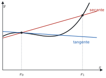
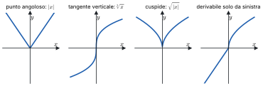
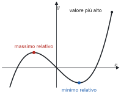
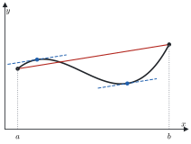

# 4 · Derivate e teoremi del valor medio

**In questo modulo.** Prerequisiti: i moduli 2 (Successioni e limiti) e 3 (Continuità e confronto locale). La derivata misura la velocità con cui una funzione cambia e, geometricamente, la pendenza della retta tangente al grafico. Si definisce come limite, si calcola per le funzioni elementari e si estende a somme, prodotti, quozienti, composte e inverse con le regole di derivazione. Poi si studiano i punti di estremo e i teoremi di Fermat, Rolle, Cauchy e Lagrange, che collegano il valore della derivata all'andamento della funzione, e il teorema di de l'Hôpital per le forme indeterminate. Alla fine del modulo si sa derivare qualunque funzione elementare, riconoscere i punti di non derivabilità e usare i teoremi del valor medio nelle dimostrazioni e negli esercizi.

## 4.1 Derivata

> [!definizione] Rapporto incrementale e derivata
> Sia $f$ definita in un intorno di $x_0$. Il **rapporto incrementale** di $f$ in $x_0$ è
> $$R_{f,x_0}(x) = \frac{f(x) - f(x_0)}{x - x_0}, \qquad x \ne x_0.$$
> La funzione è **derivabile** in $x_0$ se esiste finito il limite
> $$f'(x_0) := \lim_{x \to x_0} \frac{f(x) - f(x_0)}{x - x_0} = \lim_{h \to 0} \frac{f(x_0 + h) - f(x_0)}{h},$$
> che si chiama **derivata** (prima) di $f$ in $x_0$, e si scrive anche $\frac{df}{dx}(x_0)$.

La seconda forma si ottiene con la sostituzione $x = x_0 + h$ ed è spesso la più comoda nei calcoli.

**Significato geometrico.** La retta per i punti $(x_0, f(x_0))$ e $(x_1, f(x_1))$ del grafico, detta retta **secante**, ha equazione

$$y = f(x_0) + R_{f,x_0}(x_1)\,(x - x_0):$$

il rapporto incrementale è il suo coefficiente angolare. Quando $x_1 \to x_0$ la secante tende alla retta **tangente** al grafico in $(x_0, f(x_0))$, il cui coefficiente angolare è $f'(x_0)$:

$$y = f(x_0) + f'(x_0)(x - x_0).$$

*Figura 4.1. Grafico di una funzione con la secante per $(x_0, f(x_0))$ e $(x_1, f(x_1))$ e la tangente in $x_0$.*

> [!teorema] Derivabile implica continua
> Se $f$ è derivabile in $x_0$, allora è continua in $x_0$.

*Dimostrazione.* Per $x \ne x_0$ si scrive
$$f(x) = f(x_0) + \frac{f(x) - f(x_0)}{x - x_0} \cdot (x - x_0).$$
Per $x \to x_0$ il rapporto incrementale tende al numero finito $f'(x_0)$ e $x - x_0 \to 0$, quindi il prodotto tende a 0 e $f(x) \to f(x_0)$.

Il viceversa è falso: $|x|$ è continua in 0 ma non derivabile, come si vede nel paragrafo 4.4.

## 4.2 Derivate delle funzioni elementari

Si calcolano dalla definizione, usando i limiti notevoli del modulo 2.

- **Costanti.** Se $f(x) = c$, il rapporto incrementale è sempre 0, quindi $f' = 0$.
- **Seno.** Con le formule di addizione,
$$\frac{\sin(x + h) - \sin x}{h} = \sin x \cdot \frac{\cos h - 1}{h} + \cos x \cdot \frac{\sin h}{h} \longrightarrow \sin x \cdot 0 + \cos x \cdot 1 = \cos x,$$
perché $\frac{\cos h - 1}{h} = -\frac{1 - \cos h}{h^2} \cdot h \to -\frac{1}{2} \cdot 0 = 0$. Quindi $(\sin x)' = \cos x$, e allo stesso modo $(\cos x)' = -\sin x$.
- **Esponenziale.** $\frac{e^{x+h} - e^x}{h} = e^x \cdot \frac{e^h - 1}{h} \to e^x$, quindi $(e^x)' = e^x$. Per una base $a > 0$, scrivendo $a^x = e^{x \ln a}$ si ottiene $(a^x)' = a^x \ln a$.
- **Potenze.** Per $x > 0$ e $\alpha \in \mathbb{R}$, con $y = \frac{h}{x} \to 0$:
$$\frac{(x + h)^\alpha - x^\alpha}{h} = x^\alpha \cdot \frac{\left(1 + \frac{h}{x}\right)^\alpha - 1}{h} = x^{\alpha - 1} \cdot \frac{(1 + y)^\alpha - 1}{y} \longrightarrow \alpha\, x^{\alpha - 1}.$$
Quindi $(x^\alpha)' = \alpha x^{\alpha - 1}$, e per gli esponenti interi la formula vale anche per $x \le 0$.

Le altre derivate si ricavano con le regole del paragrafo 4.3. Questa è la tabella da sapere:

| $f(x)$ | $f'(x)$ | | $f(x)$ | $f'(x)$ |
|---|---|---|---|---|
| $x^\alpha$ | $\alpha x^{\alpha - 1}$ | | $\tan x$ | $\frac{1}{\cos^2 x} = 1 + \tan^2 x$ |
| $e^x$ | $e^x$ | | $\cot x$ | $-\frac{1}{\sin^2 x} = -1 - \cot^2 x$ |
| $a^x$ | $a^x \ln a$ | | $\arcsin x$ | $\frac{1}{\sqrt{1 - x^2}}$, per $\lvert x \rvert < 1$ |
| $\ln \lvert x \rvert$ | $\frac{1}{x}$ | | $\arccos x$ | $-\frac{1}{\sqrt{1 - x^2}}$, per $\lvert x \rvert < 1$ |
| $\sin x$ | $\cos x$ | | $\arctan x$ | $\frac{1}{1 + x^2}$ |
| $\cos x$ | $-\sin x$ | | $\operatorname{arccot} x$ | $-\frac{1}{1 + x^2}$ |

## 4.3 Regole di derivazione

> [!teorema] Algebra delle derivate
> Se $f$ e $g$ sono derivabili in $x_0$, lo sono anche $f \pm g$ e $f g$, e
> $$(f \pm g)'(x_0) = f'(x_0) \pm g'(x_0), \qquad (f g)'(x_0) = f'(x_0)\, g(x_0) + f(x_0)\, g'(x_0) \quad \text{(regola di Leibniz)}.$$

*Dimostrazione della regola di Leibniz.* Si aggiunge e si toglie $f(x_0)\, g(x_0 + h)$:
$$\frac{f(x_0 + h)\, g(x_0 + h) - f(x_0)\, g(x_0)}{h} = \frac{f(x_0 + h) - f(x_0)}{h}\, g(x_0 + h) + f(x_0)\, \frac{g(x_0 + h) - g(x_0)}{h}.$$
Per $h \to 0$ il primo rapporto tende a $f'(x_0)$, $g(x_0 + h) \to g(x_0)$ perché $g$ è derivabile e quindi continua, e il secondo rapporto tende a $g'(x_0)$.

> [!teorema] Regola della catena
> Se $f$ è derivabile in $x_0$ e $g$ è derivabile in $y_0 = f(x_0)$, la composta $g \circ f$ è derivabile in $x_0$ e
> $$(g \circ f)'(x_0) = g'(f(x_0)) \cdot f'(x_0).$$

*Dimostrazione.* L'idea è scrivere il rapporto incrementale di $g \circ f$ come prodotto dei rapporti incrementali di $g$ e di $f$. Non si può però dividere direttamente per $f(x_0 + h) - f(x_0)$, che potrebbe annullarsi per infiniti $h$ vicini a 0. Si introduce allora la funzione ausiliaria
$$\varphi(y) = \begin{cases} \dfrac{g(y) - g(y_0)}{y - y_0} & y \ne y_0 \\[2mm] g'(y_0) & y = y_0, \end{cases}$$
che è continua in $y_0$ per la definizione di derivata e soddisfa $g(y) - g(y_0) = \varphi(y)\,(y - y_0)$ per *ogni* $y$, anche $y = y_0$. Con $y = f(x_0 + h)$:
$$\frac{g(f(x_0 + h)) - g(f(x_0))}{h} = \varphi\big(f(x_0 + h)\big) \cdot \frac{f(x_0 + h) - f(x_0)}{h}.$$
Per $h \to 0$ si ha $f(x_0 + h) \to y_0$ perché $f$ è continua in $x_0$, quindi $\varphi(f(x_0 + h)) \to \varphi(y_0) = g'(y_0)$ per la continuità della composta, mentre il secondo fattore tende a $f'(x_0)$.

> [!teorema] Derivata del quoziente
> Se $f$ e $g$ sono derivabili in $x_0$ e $g(x_0) \ne 0$, allora $\frac{f}{g}$ è derivabile in $x_0$ e
> $$\left(\frac{f}{g}\right)'(x_0) = \frac{f'(x_0)\, g(x_0) - f(x_0)\, g'(x_0)}{g(x_0)^2}.$$

*Dimostrazione.* Si scrive $\frac{1}{g} = r \circ g$ con $r(y) = \frac{1}{y} = y^{-1}$, la cui derivata è $r'(y) = -\frac{1}{y^2}$. Per la regola della catena $\left(\frac{1}{g}\right)' = -\frac{g'}{g^2}$, e per Leibniz
$$\left(f \cdot \frac{1}{g}\right)' = \frac{f'}{g} - \frac{f g'}{g^2} = \frac{f' g - f g'}{g^2}.$$

> [!teorema] Derivata della funzione inversa
> Sia $f$ continua e invertibile in un intorno di $x_0$, derivabile in $x_0$ con $f'(x_0) \ne 0$. Allora $f^{-1}$ è derivabile in $y_0 = f(x_0)$ e
> $$\left(f^{-1}\right)'(y_0) = \frac{1}{f'(x_0)} = \frac{1}{f'\big(f^{-1}(y_0)\big)}.$$

> [!aggiunta] Aggiunta in revisione · fonte: Canuto-Tabacco, *Analisi Matematica 1*, cap. 6 (AM1A-12, AM1A-13)
> *Dimostrazione.* Per $y \ne y_0$ si pone $x = f^{-1}(y)$, così che $y = f(x)$ e $x \ne x_0$. Allora
> $$\frac{f^{-1}(y) - f^{-1}(y_0)}{y - y_0} = \frac{x - x_0}{f(x) - f(x_0)} = \frac{1}{R_{f,x_0}(x)}.$$
> L'inversa di una funzione continua su un intervallo è continua (modulo 3), quindi per $y \to y_0$ si ha $x \to x_0$, e il rapporto tende a $\frac{1}{f'(x_0)}$.
>
> *Esempi.* Il logaritmo è l'inverso dell'esponenziale: con $y = e^x$, $(\ln y)' = \frac{1}{e^x} = \frac{1}{y}$. L'arcoseno è l'inverso del seno su $\left[-\frac{\pi}{2}, \frac{\pi}{2}\right]$: con $y = \sin x$,
> $$(\arcsin y)' = \frac{1}{\cos x} = \frac{1}{\sqrt{1 - \sin^2 x}} = \frac{1}{\sqrt{1 - y^2}},$$
> dove si prende la radice positiva perché $\cos x > 0$ per $|x| < \frac{\pi}{2}$; in $y = \pm 1$ la derivata non esiste, perché lì $\cos x = 0$. Per l'arcotangente, con $y = \tan x$, $(\arctan y)' = \frac{1}{1 + \tan^2 x} = \frac{1}{1 + y^2}$.

> [!esempio]
> $\left(\frac{\sin x}{\cos x}\right)' = \frac{\cos x \cos x - \sin x(-\sin x)}{\cos^2 x} = \frac{1}{\cos^2 x}$; $\quad \left(e^{x^2}\right)' = 2x\, e^{x^2}$; $\quad \left(\ln(1 + \sin^2 x)\right)' = \frac{2 \sin x \cos x}{1 + \sin^2 x}$.

## 4.4 Derivata destra e sinistra

> [!definizione] Derivate unilaterali
> Sia $f$ definita in un intorno destro di $x_0$, cioè in $[x_0, x_0 + r)$. La **derivata destra** di $f$ in $x_0$ è
> $$f'_+(x_0) := \lim_{x \to x_0^+} \frac{f(x) - f(x_0)}{x - x_0},$$
> se il limite esiste finito. Analogamente si definisce la **derivata sinistra** $f'_-(x_0)$, con $x \to x_0^-$.

Per le proprietà dei limiti unilaterali, $f$ è derivabile in $x_0$ se e solo se esistono la derivata destra e la sinistra e sono uguali. I punti in cui una funzione continua non è derivabile si classificano guardando i limiti del rapporto incrementale da destra e da sinistra.

> [!esempio] Punto angoloso
> Per $f(x) = |x|$ in 0, il rapporto incrementale è $\frac{|x|}{x}$, che vale 1 per $x > 0$ e $-1$ per $x < 0$: $f'_+(0) = 1$ e $f'_-(0) = -1$. Le due derivate esistono ma sono diverse, e il grafico ha due semitangenti distinte.

> [!esempio] Flesso a tangente verticale
> Per $f(x) = \sqrt[3]{x}$ in 0, il rapporto incrementale è $\frac{\sqrt[3]{x}}{x} = \frac{1}{\sqrt[3]{x^2}}$, che tende a $+\infty$ sia da destra sia da sinistra. La funzione non è derivabile, ma il grafico ha la tangente verticale $x = 0$ e la funzione è crescente da entrambe le parti.

> [!esempio] Cuspide
> Per $f(x) = \sqrt{|x|}$ in 0, da destra il rapporto incrementale è $\frac{\sqrt{x}}{x} = x^{-1/2} \to +\infty$; da sinistra, con $|x| = -x$,
> $$\frac{\sqrt{-x}}{x} = -\frac{\sqrt{-x}}{-x} = -(-x)^{-1/2} \to -\infty.$$
> I limiti sono infiniti e di segno opposto: il grafico ha una punta rivolta verso il basso.

> [!esempio] Derivata da una parte sola
> Per $f(x) = \sqrt{x}$ se $x > 0$ e $f(x) = x$ se $x \le 0$, in 0 la derivata sinistra vale 1, mentre da destra il rapporto incrementale $x^{-1/2}$ tende a $+\infty$: $f$ non è derivabile in 0.

*Figura 4.2. I quattro grafici: punto angoloso ($|x|$), flesso a tangente verticale ($\sqrt[3]{x}$), cuspide ($\sqrt{|x|}$), derivabilità da una parte sola.*

## 4.5 Estremi e teorema di Fermat

> [!definizione] Massimi e minimi
> Sia $f : \operatorname{dom}(f) \to \mathbb{R}$ e $x_0 \in \operatorname{dom}(f)$. Il punto $x_0$ è
>
> - di **massimo relativo** (o locale) se esiste $\delta > 0$ tale che $f(x) \le f(x_0)$ per ogni $x \in \operatorname{dom}(f)$ con $|x - x_0| < \delta$;
> - di **minimo relativo** se, nelle stesse condizioni, $f(x) \ge f(x_0)$;
> - di **massimo** o **minimo assoluto** (o globale) se la disuguaglianza vale per ogni $x \in \operatorname{dom}(f)$.
>
> L'estremo è **stretto** se la disuguaglianza è stretta per $x \ne x_0$. Massimi e minimi si chiamano insieme **estremi**.

*Figura 4.3. Grafico con un massimo relativo che non è assoluto e un minimo relativo.*

> [!definizione] Punto critico
> Il punto $x_0$ è **critico** (o stazionario) per $f$ se $f$ è derivabile in $x_0$ e $f'(x_0) = 0$.

> [!teorema] Teorema di Fermat
> Sia $f$ definita in un intorno di $x_0$ e derivabile in $x_0$. Se $x_0$ è un punto di estremo relativo, allora $f'(x_0) = 0$.

*Dimostrazione.* Sia $x_0$ un punto di massimo relativo: per $|x - x_0| < \delta$ si ha $f(x) \le f(x_0)$, quindi il numeratore del rapporto incrementale $f(x) - f(x_0)$ è sempre $\le 0$. Per $x > x_0$ il denominatore è positivo e il rapporto è $\le 0$; per $x < x_0$ è negativo e il rapporto è $\ge 0$. Passando al limite, per la permanenza del segno,
$$f'(x_0) = \lim_{x \to x_0^+} \frac{f(x) - f(x_0)}{x - x_0} \le 0, \qquad f'(x_0) = \lim_{x \to x_0^-} \frac{f(x) - f(x_0)}{x - x_0} \ge 0,$$
e quindi $f'(x_0) = 0$. Per il minimo il ragionamento è lo stesso con le disuguaglianze invertite.

> [!attenzione]
> Il teorema richiede che $x_0$ sia **interno** al dominio e che $f$ sia **derivabile** in $x_0$. Agli estremi di un intervallo un massimo può avere derivata diversa da zero ($f(x) = x$ su $[0, 1]$, massimo in 1), e nei punti di non derivabilità la derivata non esiste ($|x|$, minimo in 0). Inoltre il viceversa è falso: $x^3$ ha $f'(0) = 0$, ma 0 non è un estremo. Gli estremi vanno quindi cercati fra i punti critici, i punti di non derivabilità e gli estremi del dominio.

## 4.6 Teoremi di Rolle, Cauchy e Lagrange

> [!teorema] Teorema di Rolle
> Sia $f$ continua su $[a, b]$ e derivabile in $(a, b)$, con $f(a) = f(b)$. Allora esiste $x_0 \in (a, b)$ tale che $f'(x_0) = 0$.

*Dimostrazione.* Per il teorema di Weierstrass $f$ ha su $[a, b]$ un massimo $M$ e un minimo $m$. Se $m = M$, $f$ è costante e $f' = 0$ in tutto $(a, b)$. Se $m < M$, almeno uno dei due valori è diverso da $f(a) = f(b)$, e quindi è assunto in un punto $x_0$ **interno**, $x_0 \in (a, b)$. Lì $f$ è derivabile e ha un estremo: per Fermat, $f'(x_0) = 0$.

Geometricamente: se il grafico parte e arriva alla stessa quota, da qualche parte ha tangente orizzontale. Serve la derivabilità in tutti i punti interni: $f(x) = |x|$ su $[-1, 1]$ ha $f(-1) = f(1)$, ma la derivata non si annulla mai.

> [!teorema] Teorema di Cauchy
> Siano $f$ e $g$ continue su $[a, b]$ e derivabili in $(a, b)$. Esiste $x_0 \in (a, b)$ tale che
> $$f'(x_0)\,\big(g(b) - g(a)\big) = \big(f(b) - f(a)\big)\, g'(x_0).$$

*Dimostrazione.* La funzione
$$h(x) = \big(f(x) - f(a)\big)\big(g(b) - g(a)\big) + \big(f(b) - f(a)\big)\big(g(b) - g(x)\big)$$
è continua su $[a, b]$ e derivabile in $(a, b)$, e si verifica che $h(a) = \big(f(b) - f(a)\big)\big(g(b) - g(a)\big) = h(b)$. Per Rolle esiste $x_0 \in (a, b)$ con
$$0 = h'(x_0) = f'(x_0)\big(g(b) - g(a)\big) - \big(f(b) - f(a)\big)\, g'(x_0).$$

> [!teorema] Teorema di Lagrange (del valor medio)
> Sia $f$ continua su $[a, b]$ e derivabile in $(a, b)$. Esiste $x_0 \in (a, b)$ tale che
> $$f'(x_0) = \frac{f(b) - f(a)}{b - a}.$$

*Dimostrazione.* È il teorema di Cauchy con $g(x) = x$.

Geometricamente: esiste un punto in cui la tangente è parallela alla corda che congiunge $(a, f(a))$ e $(b, f(b))$. In termini di moto: se in due ore si percorrono 120 km, in almeno un istante la velocità è stata esattamente 60 km/h.

*Figura 4.4. Grafico su $[a, b]$ con la corda fra $(a, f(a))$ e $(b, f(b))$ e i punti in cui la tangente le è parallela.*

**Formule dell'incremento finito.** La definizione di derivata e il teorema di Lagrange danno due modi di stimare $f(x) - f(x_0)$.

La prima vale se $f$ è derivabile in $x_0$. Dire che il rapporto incrementale tende a $f'(x_0)$ equivale a dire che $\frac{f(x) - f(x_0) - f'(x_0)(x - x_0)}{x - x_0} \to 0$, cioè

$$f(x) = f(x_0) + f'(x_0)(x - x_0) + o(x - x_0), \qquad x \to x_0:$$

vicino a $x_0$ la funzione è la sua retta tangente, più un errore trascurabile rispetto a $x - x_0$. È il primo caso della formula di Taylor (modulo 5).

La seconda vale se $f$ è continua su $[a, b]$ e derivabile in $(a, b)$. Per ogni $a \le x_1 < x_2 \le b$, Lagrange su $[x_1, x_2]$ dà un $\bar{x} \in (x_1, x_2)$ con

$$f(x_2) = f(x_1) + f'(\bar{x})(x_2 - x_1).$$

Non dice quale sia $\bar{x}$, ma è esatta, non solo approssimata.

> [!teorema] Funzioni a derivata nulla
> Sia $f$ continua su $[a, b]$ e derivabile in $(a, b)$ con $f'(x) = 0$ per ogni $x \in (a, b)$. Allora $f$ è costante su $[a, b]$.

*Dimostrazione.* Per ogni $x \in [a, b)$, la seconda formula su $[x, b]$ dà $f(b) = f(x) + f'(\bar{x})(b - x) = f(x)$. Quindi $f(x) = f(b)$ per ogni $x$.

> [!attenzione]
> Serve che il dominio sia un intervallo. La funzione uguale a 0 su $(-\infty, 0)$ e a 1 su $(0, +\infty)$ ha derivata nulla ovunque sul suo dominio, ma non è costante.

## 4.7 Teorema di de l'Hôpital

> [!teorema] Teorema di de l'Hôpital
> Siano $f$ e $g$ definite in un intorno di $c$ (che può essere $x_0$, $x_0^\pm$ o $\pm\infty$), escluso al più $c$, e si supponga che
>
> 1. $\lim_{x \to c} f(x) = \lim_{x \to c} g(x) = 0$, oppure entrambi i limiti sono infiniti;
> 2. $f$ e $g$ sono derivabili vicino a $c$ (escluso $c$), con $g'(x) \ne 0$;
> 3. esiste, finito o infinito, $\lim_{x \to c} \frac{f'(x)}{g'(x)} = L$.
>
> Allora esiste anche $\lim_{x \to c} \frac{f(x)}{g(x)}$, ed è uguale a $L$.

> [!aggiunta] Aggiunta in revisione · fonte: Canuto-Tabacco, *Analisi Matematica 1*, cap. 6 (AM1A-16)
> *Dimostrazione (caso $\frac{0}{0}$ con $c = x_0^+$).* Si pone $f(x_0) = g(x_0) = 0$: così $f$ e $g$ diventano continue in $x_0$ da destra. Per ogni $x > x_0$ vicino a $x_0$ si applica il teorema di Cauchy a $f$ e $g$ su $[x_0, x]$: esiste $\xi_x \in (x_0, x)$ con
> $$f'(\xi_x)\, g(x) = f(x)\, g'(\xi_x).$$
> Inoltre $g(x) \ne 0$: se fosse $g(x) = 0 = g(x_0)$, per Rolle $g'$ si annullerebbe in $(x_0, x)$, contro l'ipotesi. Si può quindi dividere:
> $$\frac{f(x)}{g(x)} = \frac{f'(\xi_x)}{g'(\xi_x)}.$$
> Per $x \to x_0^+$ anche $\xi_x \to x_0^+$, perché $x_0 < \xi_x < x$, e il secondo membro tende a $L$ per il teorema di sostituzione. Gli altri casi si riconducono a questo.

> [!attenzione]
> Si deriva numeratore e denominatore **separatamente**: non si deriva il quoziente. Il teorema si applica solo alle forme $\frac{0}{0}$ e $\frac{\infty}{\infty}$, e se il limite di $\frac{f'}{g'}$ non esiste non si può concludere nulla. Ad esempio $\frac{x + \sin x}{x} \to 1$ per $x \to +\infty$, mentre $\frac{1 + \cos x}{1}$ non ha limite.

> [!esempio]
> $\lim_{x \to 0} \frac{e^x - 1 - x}{x^2} \overset{H}{=} \lim_{x \to 0} \frac{e^x - 1}{2x} = \frac{1}{2}$; $\quad \lim_{x \to +\infty} \frac{\ln x}{x} \overset{H}{=} \lim_{x \to +\infty} \frac{1/x}{1} = 0$; $\quad \lim_{x \to 0^+} x \ln x = \lim_{x \to 0^+} \frac{\ln x}{1/x} \overset{H}{=} \lim_{x \to 0^+} \frac{1/x}{-1/x^2} = \lim_{x \to 0^+} (-x) = 0$.

## 4.8 Limite della derivata

> [!teorema] Teorema del limite della derivata
> Sia $f$ continua in un intorno $I$ di $x_0$ e derivabile in $I \setminus \{x_0\}$.
>
> 1. Se esiste finito $\lim_{x \to x_0} f'(x) = L$, allora $f$ è derivabile in $x_0$ e $f'(x_0) = L$.
> 2. Se i limiti $\lim_{x \to x_0^\pm} f'(x)$ esistono ma sono diversi, oppure almeno uno è infinito, $f$ non è derivabile in $x_0$.

*Dimostrazione.* Il rapporto incrementale $\frac{f(x) - f(x_0)}{x - x_0}$ è una forma $\frac{0}{0}$, perché $f$ è continua in $x_0$. Per de l'Hôpital, applicato da destra e da sinistra, ha lo stesso limite di $\frac{f'(x)}{1}$. Nel caso 1 i limiti unilaterali del rapporto valgono entrambi $L$; nel caso 2 le derivate unilaterali sono diverse o non sono finite. (Lo stesso risultato si ottiene dalla seconda formula dell'incremento finito: $\frac{f(x) - f(x_0)}{x - x_0} = f'(\bar{x})$ con $\bar{x}$ fra $x_0$ e $x$.)

> [!attenzione]
> Serve la continuità in $x_0$. Senza, il teorema è falso: la funzione segno ha derivata 0 per ogni $x \ne 0$, ma in 0 non è nemmeno continua.

> [!esempio] Derivabilità con due parametri
> Per quali $\alpha, \beta \in \mathbb{R}$ è derivabile in 0 la funzione
> $$f(x) = \begin{cases} \alpha(e^x - 1) + \beta \cos x & x \ge 0 \\ 1 + x & x < 0 \end{cases}$$
>
> **Continuità in 0.** $\lim_{x \to 0^-} f(x) = 1$ e $f(0) = \lim_{x \to 0^+} f(x) = \beta$: serve $\beta = 1$.
>
> **Derivabilità.** Fuori dallo zero, $f'(x) = \alpha e^x - \beta \sin x$ per $x > 0$ e $f'(x) = 1$ per $x < 0$. Quindi $\lim_{x \to 0^+} f'(x) = \alpha$ e $\lim_{x \to 0^-} f'(x) = 1$. Con $\beta = 1$ la funzione è continua, e per il teorema del limite della derivata è derivabile in 0 se e solo se $\alpha = 1$.
>
> La risposta è $\alpha = \beta = 1$, con $f'(0) = 1$.

## Riepilogo

La derivata $f'(x_0) = \lim_{h \to 0} \frac{f(x_0 + h) - f(x_0)}{h}$ è il coefficiente angolare della tangente, $y = f(x_0) + f'(x_0)(x - x_0)$. Una funzione derivabile è continua, non il contrario. Le derivate elementari si ricavano dai limiti notevoli; le regole sono
$$(f g)' = f' g + f g', \qquad \left(\frac{f}{g}\right)' = \frac{f' g - f g'}{g^2}, \qquad (g \circ f)' = g'(f) \cdot f', \qquad (f^{-1})'(y) = \frac{1}{f'(f^{-1}(y))}.$$
Punti angolosi, cuspidi e flessi a tangente verticale si riconoscono dalle derivate unilaterali.

Nei punti di estremo interni in cui è derivabile, la funzione ha derivata nulla (Fermat). Rolle, Cauchy e Lagrange garantiscono un punto interno in cui la derivata assume un valore preciso; da Lagrange seguono la formula $f(x_2) - f(x_1) = f'(\bar{x})(x_2 - x_1)$ e il fatto che su un intervallo una funzione a derivata nulla è costante. De l'Hôpital scioglie le forme $\frac{0}{0}$ e $\frac{\infty}{\infty}$ con il limite del rapporto delle derivate, e da esso segue il teorema del limite della derivata.
