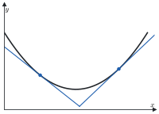
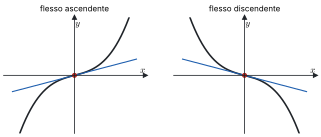
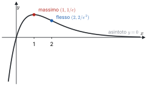

# 5 · Monotonia, convessità, studio di funzione e Taylor

**In questo modulo.** Prerequisiti: il modulo 4 (Derivate e teoremi del valor medio) e, per gli sviluppi, i simboli di Landau del modulo 3. Il segno della derivata prima dice dove una funzione cresce e dove ha i suoi estremi; il segno della derivata seconda dice dove è convessa o concava. Con questi strumenti, insieme a limiti e asintoti, si disegna il grafico di una funzione. La seconda parte del modulo è dedicata alla formula di Taylor, che approssima una funzione con un polinomio vicino a un punto. Gli sviluppi notevoli e le regole per combinarli permettono di calcolare limiti e ordini di infinitesimo che con i soli limiti notevoli restano fuori portata. Alla fine del modulo si sa svolgere uno studio di funzione completo e usare gli sviluppi di Taylor negli esercizi d'esame.

## 5.1 Monotonia e segno della derivata

> [!teorema] Criterio di monotonia
> Sia $f$ continua su un intervallo $I$ e derivabile nei punti interni di $I$.
>
> 1. $f$ è crescente su $I$ se e solo se $f'(x) \ge 0$ in ogni punto interno $x$ di $I$; è decrescente se e solo se $f'(x) \le 0$.
> 2. Se $f'(x) > 0$ in ogni punto interno di $I$, allora $f$ è strettamente crescente su $I$; se $f'(x) < 0$, strettamente decrescente.

*Dimostrazione.* (1, $\Rightarrow$) Sia $f$ crescente e $x$ interno a $I$. Per ogni $y \in I$, $y \ne x$, il rapporto incrementale $\frac{f(y) - f(x)}{y - x}$ è $\ge 0$: se $y > x$ numeratore e denominatore sono entrambi $\ge 0$ e $> 0$, se $y < x$ sono entrambi $\le 0$ e $< 0$. Per la permanenza del segno il limite per $y \to x$, cioè $f'(x)$, è $\ge 0$.

> [!aggiunta] Aggiunta in revisione · fonte: Canuto-Tabacco, *Analisi Matematica 1*, cap. 6 (AM1A-14)
> (1, $\Leftarrow$) Siano $x_1 < x_2$ in $I$. Per il teorema di Lagrange su $[x_1, x_2]$ esiste $\bar{x} \in (x_1, x_2)$, interno a $I$, con
> $$f(x_2) - f(x_1) = f'(\bar{x})\,(x_2 - x_1) \ge 0,$$
> quindi $f(x_1) \le f(x_2)$. (2) Con lo stesso argomento, se $f' > 0$ la differenza è strettamente positiva.

> [!attenzione]
> Il punto 2 non si inverte: $f(x) = x^3$ è strettamente crescente su $\mathbb{R}$, ma $f'(0) = 0$. E serve che il dominio sia un intervallo: $-\frac{1}{x}$ ha derivata $\frac{1}{x^2} > 0$ su $\mathbb{R} \setminus \{0\}$, ma non è crescente, perché $-\frac{1}{-1} = 1 > -1 = -\frac{1}{1}$.

## 5.2 Ricerca degli estremi

Dal criterio di monotonia segue il modo standard di classificare i punti critici.

> [!teorema] Test della derivata prima
> Sia $f$ continua su un intervallo $I$ e derivabile nei punti interni, e sia $x_0$ un punto interno con $f'(x_0) = 0$. Se $f'(x) \ge 0$ in un intorno sinistro di $x_0$ e $f'(x) \le 0$ in un intorno destro (escluso $x_0$), allora $x_0$ è un punto di massimo relativo; con i segni opposti è di minimo relativo. Se le disuguaglianze sono strette, l'estremo è stretto.

Gli estremi di una funzione vanno cercati fra i punti critici interni (per Fermat), i punti in cui la funzione non è derivabile e gli estremi del dominio; il segno di $f'$ dice poi quali di questi sono massimi o minimi.

> [!esempio] Gli estremi di $x \arctan x$
> $f(x) = x \arctan x$ è derivabile su $\mathbb{R}$, con
> $$f'(x) = \arctan x + \frac{x}{1 + x^2}.$$
> Per $x > 0$ entrambi gli addendi sono positivi, per $x < 0$ entrambi negativi: $f'(x) > 0$ per $x > 0$, $f'(x) < 0$ per $x < 0$ e $f'(0) = 0$. L'unico punto critico è 0. La funzione decresce strettamente su $(-\infty, 0]$ e cresce strettamente su $[0, +\infty)$: 0 è un punto di minimo stretto, anzi assoluto, con $f(0) = 0$.

## 5.3 Derivate successive

Se $f$ è derivabile in un intorno $I$ di $x_0$, la derivata è a sua volta una funzione $f' : I \to \mathbb{R}$, che si può provare a derivare.

> [!definizione] Derivata seconda e derivate di ordine superiore
> Se $f'$ è derivabile in $x_0$, si dice che $f$ è derivabile due volte in $x_0$, e la **derivata seconda** è
> $$f''(x_0) = \lim_{x \to x_0} \frac{f'(x) - f'(x_0)}{x - x_0}.$$
> Iterando si definiscono $f''' = f^{(3)}$, $f^{(4)}$, …, $f^{(k)}$, con $f^{(0)} = f$.

> [!esempio]
> Per $k \le n$, $(x^n)^{(k)} = n(n-1) \cdots (n - k + 1)\, x^{n-k}$; in particolare $(x^n)^{(n)} = n!$ e $(x^n)^{(k)} = 0$ per $k > n$. Per l'esponenziale $(e^x)^{(k)} = e^x$ per ogni $k$; per il seno le derivate si ripetono ogni quattro: $\sin$, $\cos$, $-\sin$, $-\cos$, $\sin$, …

> [!definizione] Classi $C^k$
> Una funzione $f : I \to \mathbb{R}$ è **di classe $C^k$** sull'intervallo $I$, e si scrive $f \in C^k(I)$, se è derivabile $k$ volte in $I$ e $f^{(k)}$ è continua su $I$; è **di classe $C^\infty$** se è di classe $C^k$ per ogni $k$. Polinomi, esponenziali, seno e coseno sono di classe $C^\infty$ su $\mathbb{R}$.

## 5.4 Convessità e flessi

> [!definizione] Funzione convessa e concava
> Sia $f$ derivabile su un intervallo $I$. La funzione è **convessa** su $I$ se per ogni $x_1, x_2 \in I$
> $$f(x_2) \ge f(x_1) + f'(x_1)(x_2 - x_1),$$
> cioè se il grafico sta sopra ogni sua retta tangente; è **concava** con la disuguaglianza opposta. È **strettamente** convessa o concava se la disuguaglianza è stretta per $x_1 \ne x_2$.

*Figura 5.1. Grafico di una funzione convessa su $I$ con due rette tangenti, sotto il grafico.*

> [!esempio] $x^2$ è strettamente convessa
> Bisogna verificare che $x_2^2 > x_1^2 + 2x_1(x_2 - x_1)$ per ogni $x_1 \ne x_2$. Portando tutto a sinistra:
> $$x_2^2 - x_1^2 - 2x_1 x_2 + 2x_1^2 = x_2^2 - 2x_1 x_2 + x_1^2 = (x_2 - x_1)^2 > 0.$$

> [!teorema] Convessità e derivate
> Sia $f$ derivabile sull'intervallo $I$.
>
> 1. $f$ è convessa su $I$ se e solo se $f'$ è crescente su $I$ (concava se e solo se $f'$ è decrescente).
> 2. Se $f'$ è strettamente crescente, $f$ è strettamente convessa.
>
> Se $f$ è derivabile due volte su $I$, ne segue che $f$ è convessa se e solo se $f''(x) \ge 0$ per ogni $x \in I$, e che $f'' > 0$ su $I$ implica la convessità stretta.

*Dimostrazione di 1.* ($\Rightarrow$) Siano $x_1 < x_2$ in $I$. La convessità, scritta nei due punti, dà
$$f(x_2) \ge f(x_1) + f'(x_1)(x_2 - x_1), \qquad f(x_1) \ge f(x_2) + f'(x_2)(x_1 - x_2).$$
Sommando membro a membro e semplificando si ottiene $0 \ge (x_2 - x_1)\big(f'(x_1) - f'(x_2)\big)$; poiché $x_2 - x_1 > 0$, è $f'(x_1) \le f'(x_2)$.

($\Leftarrow$) Siano $x_1 \ne x_2$ in $I$; per Lagrange $f(x_2) = f(x_1) + f'(\bar{x})(x_2 - x_1)$ con $\bar{x}$ fra $x_1$ e $x_2$. Se $x_1 < x_2$, allora $\bar{x} > x_1$ e, essendo $f'$ crescente, $f'(\bar{x}) \ge f'(x_1)$; moltiplicando per $x_2 - x_1 > 0$ si ha $f(x_2) \ge f(x_1) + f'(x_1)(x_2 - x_1)$. Se $x_1 > x_2$, allora $\bar{x} < x_1$, quindi $f'(\bar{x}) \le f'(x_1)$; moltiplicando per $x_2 - x_1 < 0$ la disuguaglianza si inverte e si ottiene la stessa conclusione. La parte con $f''$ segue applicando il criterio di monotonia (paragrafo 5.1) alla funzione $f'$.

> [!attenzione]
> Anche qui la condizione sufficiente non si inverte: $x^4$ è strettamente convessa, ma $f''(x) = 12x^2$ si annulla in 0.

> [!definizione] Punto di flesso
> Sia $f$ derivabile in $x_0$. Il punto $x_0$ è di **flesso** se in un intorno di $x_0$ il grafico passa da una parte all'altra della tangente in $x_0$, cioè se, con $t(x) = f(x_0) + f'(x_0)(x - x_0)$, vale $f(x) \le t(x)$ per $x < x_0$ e $f(x) \ge t(x)$ per $x > x_0$ (flesso **ascendente**), oppure il contrario (flesso **discendente**).

> [!teorema] Flessi e derivata seconda
> Sia $f$ derivabile due volte in un intorno di $x_0$.
>
> 1. Se $x_0$ è un punto di flesso, allora $f''(x_0) = 0$.
> 2. Se $f''(x_0) = 0$ e $f''$ cambia segno in $x_0$ (negativa a sinistra e positiva a destra, oppure il contrario), allora $x_0$ è un punto di flesso: ascendente nel primo caso, discendente nel secondo.

*Figura 5.2. Flesso ascendente e discendente, con la retta tangente nel punto di flesso.*

> [!esempio]
> Per $f(x) = x \arctan x$ si ha
> $$f''(x) = \frac{1}{1 + x^2} + \frac{(1 + x^2) - 2x^2}{(1 + x^2)^2} = \frac{2}{(1 + x^2)^2} > 0,$$
> quindi la funzione è strettamente convessa su $\mathbb{R}$ e non ha flessi.

## 5.5 Studio di funzione

Per disegnare il grafico di $f$ si raccolgono, in quest'ordine, le informazioni seguenti.

1. **Dominio**, eventuali simmetrie (funzione pari o dispari) e periodicità; segno e zeri, se si trovano facilmente.
2. **Limiti** agli estremi del dominio e nei punti esclusi; **asintoti** orizzontali, obliqui e verticali.
3. **Derivata prima**: punti di non derivabilità, punti critici, intervalli di monotonia, estremi relativi e assoluti.
4. **Derivata seconda**: intervalli di convessità e concavità, flessi.
5. **Grafico**, coerente con tutte le informazioni raccolte.

> [!aggiunta] Aggiunta in revisione · fonte: Canuto-Tabacco, *Analisi Matematica 1*, cap. 6; Baronti et al., *Calculus Problems* (AM1A-15)
> **Esempio completo: $f(x) = x\, e^{-x}$.**
>
> *Dominio e segno.* $f$ è definita e di classe $C^\infty$ su $\mathbb{R}$. Non è né pari né dispari. Poiché $e^{-x} > 0$, il segno è quello di $x$: $f < 0$ per $x < 0$, $f(0) = 0$, $f > 0$ per $x > 0$.
>
> *Limiti e asintoti.* Per $x \to -\infty$, $x \to -\infty$ ed $e^{-x} \to +\infty$, quindi $f(x) \to -\infty$; inoltre $\frac{f(x)}{x} = e^{-x} \to +\infty$, e non c'è asintoto obliquo. Per $x \to +\infty$ la forma è $\infty \cdot 0$: $f(x) = \frac{x}{e^x} \to 0$ per la gerarchia degli infiniti (o per de l'Hôpital), e $y = 0$ è asintoto orizzontale a destra.
>
> *Derivata prima.* $f'(x) = e^{-x} - x e^{-x} = (1 - x)\, e^{-x}$, positiva per $x < 1$ e negativa per $x > 1$. La funzione cresce su $(-\infty, 1]$ e decresce su $[1, +\infty)$: $x = 1$ è il punto di massimo assoluto, con $f(1) = \frac{1}{e}$. L'immagine è $\left(-\infty, \frac{1}{e}\right]$.
>
> *Derivata seconda.* $f''(x) = -e^{-x} - (1 - x)\, e^{-x} = (x - 2)\, e^{-x}$: la funzione è concava su $(-\infty, 2]$ e convessa su $[2, +\infty)$, e $x = 2$ è un punto di flesso, con $f(2) = \frac{2}{e^2}$.
>
> *Grafico.* Sale da $-\infty$ passando per l'origine, raggiunge il massimo $\left(1, \frac{1}{e}\right)$, scende, cambia concavità in $\left(2, \frac{2}{e^2}\right)$ e si avvicina all'asse $x$ da sopra.

*Figura 5.3. Grafico di $x e^{-x}$ con il massimo in $(1, 1/e)$, il flesso in $(2, 2/e^2)$ e l'asintoto $y = 0$.*

## 5.6 Formula di Taylor

L'idea è approssimare $f$ vicino a $x_0$ con il polinomio che ha in $x_0$ lo stesso valore e le stesse derivate di $f$, fino a un certo ordine.

> [!definizione] Polinomio di Taylor
> Sia $f$ derivabile $n$ volte in $x_0$. Il **polinomio di Taylor** di $f$ di ordine $n$ e centro $x_0$ è
> $$T_{n,x_0} f(x) := \sum_{k=0}^{n} \frac{f^{(k)}(x_0)}{k!}\,(x - x_0)^k = f(x_0) + f'(x_0)(x - x_0) + \frac{f''(x_0)}{2}(x - x_0)^2 + \dots + \frac{f^{(n)}(x_0)}{n!}(x - x_0)^n.$$
> Con $x_0 = 0$ si chiama anche **polinomio di Mac Laurin**.

Per $n = 0$ è la costante $f(x_0)$, per $n = 1$ la retta tangente. Derivando termine a termine e valutando in $x_0$ si verifica che $\left(T_{n,x_0} f\right)^{(k)}(x_0) = f^{(k)}(x_0)$ per $k = 0, 1, \dots, n$: il termine di grado $k$ è l'unico che contribuisce alla derivata $k$-esima in $x_0$, e la sua derivata $k$-esima vale $\frac{f^{(k)}(x_0)}{k!} \cdot k! = f^{(k)}(x_0)$.

> [!teorema] Formula di Taylor con resto di Peano
> Sia $f$ derivabile $n$ volte in $x_0$. Allora
> $$f(x) = T_{n,x_0} f(x) + o\big((x - x_0)^n\big), \qquad x \to x_0.$$

*Dimostrazione.* Si deve mostrare che $\frac{f(x) - T_{n,x_0} f(x)}{(x - x_0)^n} \to 0$. Sia $R = f - T_{n,x_0} f$. Per quanto appena osservato $R^{(k)}(x_0) = 0$ per $k = 0, \dots, n$, e per $k \le n - 1$ la funzione $R^{(k)}$ è derivabile vicino a $x_0$, quindi continua: $R^{(k)}(x) \to 0$ per $x \to x_0$. Numeratore e denominatore sono quindi infinitesimi, e si può applicare de l'Hôpital $n - 1$ volte:
$$\lim_{x \to x_0} \frac{R(x)}{(x - x_0)^n} \overset{H}{=} \lim_{x \to x_0} \frac{R'(x)}{n(x - x_0)^{n-1}} \overset{H}{=} \dots \overset{H}{=} \lim_{x \to x_0} \frac{R^{(n-1)}(x)}{n!\,(x - x_0)}.$$
A questo punto non si deriva più, perché $f^{(n)}$ esiste solo in $x_0$, non in un intorno. Si scrive esplicitamente $R^{(n-1)}(x) = f^{(n-1)}(x) - f^{(n-1)}(x_0) - f^{(n)}(x_0)(x - x_0)$ e si usa la definizione di derivata:
$$\frac{R^{(n-1)}(x)}{n!\,(x - x_0)} = \frac{1}{n!}\left(\frac{f^{(n-1)}(x) - f^{(n-1)}(x_0)}{x - x_0} - f^{(n)}(x_0)\right) \longrightarrow \frac{1}{n!}\big(f^{(n)}(x_0) - f^{(n)}(x_0)\big) = 0.$$

Il resto di Peano dice *come* l'errore tende a zero, ma non quanto vale. Per stimarlo serve un'altra forma del resto.

> [!teorema] Formula di Taylor con resto di Lagrange
> Sia $f$ di classe $C^n$ in un intorno $I$ di $x_0$ e derivabile $n + 1$ volte in $I \setminus \{x_0\}$. Per ogni $x \in I$, $x \ne x_0$, esiste $\bar{x}$ strettamente compreso fra $x_0$ e $x$ tale che
> $$f(x) = T_{n,x_0} f(x) + \frac{f^{(n+1)}(\bar{x})}{(n+1)!}\,(x - x_0)^{n+1}.$$

Per $n = 0$ è il teorema di Lagrange. Ad esempio, per $f(x) = e^x$, $x_0 = 0$ e $x = 1$, con $0 < \bar{x} < 1$:
$$e = \sum_{k=0}^{n} \frac{1}{k!} + \frac{e^{\bar{x}}}{(n+1)!}, \qquad 0 < e - \sum_{k=0}^{n} \frac{1}{k!} < \frac{3}{(n+1)!}.$$
Con $n = 7$ l'errore è minore di $10^{-4}$.

> [!teorema] Unicità del polinomio di Taylor
> Sia $f$ derivabile $n$ volte in $x_0$ e sia $P$ un polinomio di grado $\le n$ tale che $f(x) = P(x) + o\big((x - x_0)^n\big)$ per $x \to x_0$. Allora $P = T_{n,x_0} f$.

È questo risultato a rendere utili gli sviluppi: qualunque procedimento produca un polinomio di grado $\le n$ che approssima $f$ a meno di $o\big((x - x_0)^n\big)$ ha trovato il polinomio di Taylor, anche senza calcolare le derivate.

## 5.7 Sviluppi notevoli e operazioni

Per $x \to 0$ valgono gli sviluppi seguenti. I primi tre si ottengono dalle derivate in 0, come negli appunti.

- **Esponenziale.** $(e^x)^{(k)}(0) = 1$ per ogni $k$, quindi
$$e^x = 1 + x + \frac{x^2}{2} + \frac{x^3}{3!} + \dots + \frac{x^n}{n!} + o(x^n) = \sum_{k=0}^{n} \frac{x^k}{k!} + o(x^n).$$
- **Logaritmo.** Le derivate di $\ln(1 + x)$ sono $\frac{1}{1 + x}$, $-\frac{1}{(1 + x)^2}$, $\frac{2}{(1 + x)^3}$, …, e in generale la $k$-esima vale $(-1)^{k-1}(k-1)!$ in 0. Quindi
$$\ln(1 + x) = x - \frac{x^2}{2} + \frac{x^3}{3} - \dots + (-1)^{n-1}\frac{x^n}{n} + o(x^n) = \sum_{k=1}^{n} \frac{(-1)^{k-1}}{k} x^k + o(x^n).$$
- **Seno.** Le derivate in 0 si ripetono come $0, 1, 0, -1$: quelle di ordine pari sono nulle, quella di ordine $2l + 1$ vale $(-1)^l$. Quindi
$$\sin x = x - \frac{x^3}{3!} + \frac{x^5}{5!} - \dots + (-1)^{n-1}\frac{x^{2n-1}}{(2n-1)!} + o(x^{2n}).$$
Poiché il coefficiente di $x^{2n}$ è nullo, il polinomio di ordine $2n - 1$ coincide con quello di ordine $2n$, e il resto è $o(x^{2n})$ invece che $o(x^{2n-1})$.

> [!aggiunta] Aggiunta in revisione · fonte: Canuto-Tabacco, *Analisi Matematica 1*, cap. 7 (AM1A-17)
> Con lo stesso metodo si ottengono gli altri sviluppi notevoli, per $x \to 0$:
> $$\cos x = 1 - \frac{x^2}{2} + \frac{x^4}{4!} - \dots + (-1)^n \frac{x^{2n}}{(2n)!} + o(x^{2n+1}),$$
> $$\frac{1}{1 - x} = 1 + x + x^2 + \dots + x^n + o(x^n),$$
> $$(1 + x)^\alpha = 1 + \alpha x + \binom{\alpha}{2} x^2 + \dots + \binom{\alpha}{n} x^n + o(x^n), \qquad \binom{\alpha}{k} = \frac{\alpha(\alpha - 1)\cdots(\alpha - k + 1)}{k!},$$
> $$\arctan x = x - \frac{x^3}{3} + \frac{x^5}{5} - \dots + (-1)^n \frac{x^{2n+1}}{2n+1} + o(x^{2n+2}).$$
> Ad esempio $\sqrt{1 + x} = 1 + \frac{x}{2} - \frac{x^2}{8} + o(x^2)$.

Grazie all'unicità, gli sviluppi di funzioni costruite a partire da questi si ottengono con l'algebra, senza calcolare derivate.

**Somma.** Se $f$ e $g$ sono derivabili $n$ volte in $x_0$, sommando i due sviluppi si ottiene un polinomio di grado $\le n$ più $o\big((x - x_0)^n\big)$; per l'unicità, $T_{n,x_0}(f + g) = T_{n,x_0} f + T_{n,x_0} g$.

**Prodotto.** Moltiplicando gli sviluppi,
$$f(x)\, g(x) = T_{n,x_0} f(x) \cdot T_{n,x_0} g(x) + o\big((x - x_0)^n\big).$$
Il prodotto dei due polinomi ha grado fino a $2n$; i termini di grado $> n$ sono anch'essi $o\big((x - x_0)^n\big)$. Quindi $T_{n,x_0}(fg)$ è il prodotto dei polinomi **troncato** al grado $n$.

> [!aggiunta] Aggiunta in revisione · fonte: Canuto-Tabacco, *Analisi Matematica 1*, cap. 7 (AM1A-17)
> **Quoziente.** Se $g(x_0) \ne 0$, si cerca $P = T_{n,x_0}\left(\frac{f}{g}\right)$. Da $f = \frac{f}{g} \cdot g$ e dalla regola del prodotto segue che $T_{n,x_0} f$ è il prodotto $P \cdot T_{n,x_0} g$ troncato al grado $n$: i coefficienti di $P$ si trovano uno alla volta, confrontando i coefficienti delle potenze uguali. In pratica, per $x_0 = 0$ e $g(0) = 1$, conviene scrivere $\frac{1}{g} = \frac{1}{1 - t}$ con $t = 1 - g(x) \to 0$ e usare lo sviluppo di $\frac{1}{1 - t}$. Ad esempio
> $$\tan x = \frac{\sin x}{\cos x} = \left(x - \frac{x^3}{6}\right)\left(1 + \frac{x^2}{2}\right) + o(x^3) = x + \frac{x^3}{3} + o(x^3),$$
> dove $\frac{1}{\cos x} = \frac{1}{1 - \left(\frac{x^2}{2} + o(x^3)\right)} = 1 + \frac{x^2}{2} + o(x^3)$.
>
> **Composizione.** Se $t = g(x) \to 0$ per $x \to 0$, nello sviluppo di $f(t)$ si sostituisce lo sviluppo di $g$ e si tengono solo i termini fino al grado voluto. Ad esempio, con $t = \cos x - 1 = -\frac{x^2}{2} + \frac{x^4}{24} + o(x^4)$:
> $$\ln(\cos x) = \ln(1 + t) = t - \frac{t^2}{2} + o(t^2) = -\frac{x^2}{2} + \frac{x^4}{24} - \frac{x^4}{8} + o(x^4) = -\frac{x^2}{2} - \frac{x^4}{12} + o(x^4).$$
> Poiché $t \sim -\frac{x^2}{2}$, il termine $t^2$ è di ordine 4 e $o(t^2) = o(x^4)$; il termine $t^3$ sarebbe di ordine 6 e si trascura.

## 5.8 Applicazioni degli sviluppi

> [!aggiunta] Aggiunta in revisione · fonte: Canuto-Tabacco, *Analisi Matematica 1*, cap. 7 (AM1A-17)
> **Limiti.** Nelle forme $\frac{0}{0}$ si sviluppano numeratore e denominatore fino al primo termine che non si cancella.
> $$\lim_{x \to 0} \frac{\sin x - x \cos x}{x^3} = \lim_{x \to 0} \frac{\left(x - \frac{x^3}{6}\right) - \left(x - \frac{x^3}{2}\right) + o(x^3)}{x^3} = \lim_{x \to 0} \frac{\frac{x^3}{3} + o(x^3)}{x^3} = \frac{1}{3}.$$
> Con i soli limiti notevoli questo limite non si calcola: i termini di primo grado si cancellano e serve l'ordine successivo.
>
> **Ordine e parte principale.** Lo stesso calcolo dice che $\sin x - x \cos x$ è, per $x \to 0$, un infinitesimo di ordine 3 con parte principale $\frac{x^3}{3}$. Allo stesso modo $e^x - 1 - x = \frac{x^2}{2} + o(x^2)$ ha ordine 2, e $\cos x - 1 + \frac{x^2}{2} = \frac{x^4}{24} + o(x^4)$ ha ordine 4.
>
> **Natura dei punti critici.** Sia $f'(x_0) = 0$ e sia $f^{(n)}(x_0)$ la prima derivata non nulla in $x_0$, con $n \ge 2$. Dalla formula di Peano,
> $$f(x) - f(x_0) = \frac{f^{(n)}(x_0)}{n!}(x - x_0)^n + o\big((x - x_0)^n\big),$$
> quindi vicino a $x_0$ la differenza ha il segno di $f^{(n)}(x_0)(x - x_0)^n$. Se $n$ è pari, $x_0$ è un punto di minimo stretto quando $f^{(n)}(x_0) > 0$ e di massimo stretto quando $f^{(n)}(x_0) < 0$. Se $n$ è dispari, non è un estremo ma un flesso a tangente orizzontale. Il caso più usato è $n = 2$: $f'(x_0) = 0$ e $f''(x_0) > 0$ danno un minimo, $f''(x_0) < 0$ un massimo. Per $x^3$ in 0 la prima derivata non nulla è la terza: flesso; per $x^4$ è la quarta, positiva: minimo.

## Esempi ed esercizi svolti

> [!esempio] Un limite con due sviluppi
> $$\lim_{x \to 0} \frac{e^{x^2} - \cos x}{x^2} = \lim_{x \to 0} \frac{\left(1 + x^2\right) - \left(1 - \frac{x^2}{2}\right) + o(x^2)}{x^2} = \frac{3}{2}.$$

> [!esempio] Studio locale
> Per $f(x) = \cos x + \frac{x^2}{2}$, in 0 si ha $f'(0) = 0$ e $f''(0) = -1 + 1 = 0$. Lo sviluppo $f(x) = 1 + \frac{x^4}{24} + o(x^4)$ mostra che la prima derivata non nulla è la quarta, positiva: 0 è un punto di minimo stretto.

## Riepilogo

Su un intervallo, $f' \ge 0$ equivale a $f$ crescente, e $f' > 0$ implica la crescenza stretta (non il viceversa: $x^3$). Gli estremi si cercano fra punti critici, punti di non derivabilità ed estremi del dominio, e si classificano con il segno di $f'$. Su un intervallo $f$ è convessa se e solo se $f'$ è crescente, e se è derivabile due volte se e solo se $f'' \ge 0$; nei flessi $f''$ si annulla e, se cambia segno, il flesso c'è. Lo studio di funzione mette insieme dominio, limiti e asintoti, segno di $f'$ e di $f''$.

La formula di Taylor approssima $f$ con il polinomio $T_{n,x_0} f(x) = \sum_{k=0}^{n} \frac{f^{(k)}(x_0)}{k!}(x - x_0)^k$: con il resto di Peano l'errore è $o\big((x - x_0)^n\big)$, con il resto di Lagrange vale $\frac{f^{(n+1)}(\bar{x})}{(n+1)!}(x - x_0)^{n+1}$. Gli sviluppi da sapere, per $x \to 0$, sono
$$e^x = \sum_{k=0}^{n} \frac{x^k}{k!} + o(x^n), \quad \ln(1 + x) = \sum_{k=1}^{n} \frac{(-1)^{k-1}}{k} x^k + o(x^n), \quad \sin x = \sum_{k=0}^{n} \frac{(-1)^k x^{2k+1}}{(2k+1)!} + o(x^{2n+2}),$$
$$\cos x = \sum_{k=0}^{n} \frac{(-1)^k x^{2k}}{(2k)!} + o(x^{2n+1}), \quad (1 + x)^\alpha = \sum_{k=0}^{n} \binom{\alpha}{k} x^k + o(x^n).$$
Per l'unicità del polinomio di Taylor, gli sviluppi di somme, prodotti, quozienti e composte si ottengono con l'algebra, troncando al grado voluto, e servono per calcolare limiti, ordini di infinitesimo e la natura dei punti critici.
