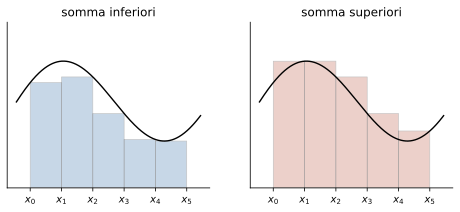
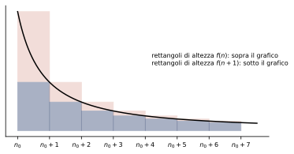
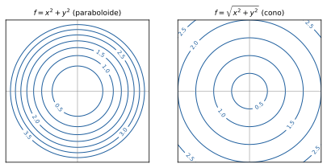

# Analisi Matematica 1B

**Appunti del corso · a.a. 2026/27 · Mobius**

Appunti personali e non ufficiali, rivisti e confrontati con il programma ufficiale del corso. Non sostituiscono le lezioni né i testi consigliati.

## Indice

1. Calcolo integrale
2. Serie numeriche
3. Funzioni di più variabili
4. Equazioni differenziali ordinarie e sistemi

## 1 · Calcolo integrale

**In questo modulo.** Si usano le derivate, i teoremi di Lagrange e di Weierstrass, i valori intermedi e gli sviluppi di Taylor del corso di Analisi 1A. Il modulo affronta il problema inverso della derivazione: data una funzione, trovarne una la cui derivata sia la funzione data. Si introducono le primitive e i metodi per calcolarle (linearità, parti, sostituzione, funzioni razionali), poi l'integrale definito secondo Riemann come area con segno, le sue proprietà e il teorema della media. Il teorema fondamentale del calcolo collega le due cose e dà la formula per calcolare gli integrali definiti. L'ultima parte estende l'integrale a intervalli illimitati e a funzioni illimitate, con i criteri di convergenza. Alla fine del modulo si sanno calcolare primitive e integrali definiti, calcolare aree, e stabilire se un integrale improprio converge.

### 1.1 Primitive e integrale indefinito

> [!definizione] Primitiva
> Sia $I \subseteq \mathbb{R}$ un intervallo e $f : I \to \mathbb{R}$. Una funzione $F$ è una **primitiva** di $f$ su $I$ se $F$ è derivabile su $I$ e $F'(x) = f(x)$ per ogni $x \in I$.

Per esempio $F(x) = \frac{x^2}{2}$ è una primitiva di $f(x) = x$ su $\mathbb{R}$, e $F(x) = -\cos x$ è una primitiva di $\sin x$. Anche $\frac{x^2}{2} + 1$ è una primitiva di $x$: la derivata di una costante è nulla, quindi se $F$ è una primitiva lo è anche $F + c$ per ogni $c \in \mathbb{R}$. Vale anche il viceversa, ed è qui che conta che $I$ sia un intervallo.

> [!teorema] Primitive di una stessa funzione
> Se $F$ e $G$ sono primitive di $f$ sull'intervallo $I$, esiste $c \in \mathbb{R}$ tale che $G(x) = F(x) + c$ per ogni $x \in I$.

*Dimostrazione.* Sia $H = G - F$. Allora $H'(x) = f(x) - f(x) = 0$ per ogni $x \in I$, e una funzione con derivata nulla su un intervallo è costante, per il teorema di Lagrange: per ogni $x_1 < x_2$ in $I$ esiste $\xi$ con $H(x_2) - H(x_1) = H'(\xi)(x_2 - x_1) = 0$. $\square$

> [!aggiunta] Aggiunta in revisione · fonte: Canuto-Tabacco, *Analisi Matematica 1* (AM1B-01)
> Su un insieme che non è un intervallo la conclusione cade: $\ln\lvert x\rvert$ e $\ln\lvert x\rvert + \operatorname{sgn}(x)$ hanno la stessa derivata $\frac{1}{x}$ su $\mathbb{R} \setminus \{0\}$, ma non differiscono per una costante.

> [!definizione] Integrale indefinito
> L'insieme di tutte le primitive di $f$ su $I$ si chiama **integrale indefinito** di $f$ e si indica con $\int f(x)\, dx$. Se $F$ è una primitiva, si scrive $\int f(x)\, dx = F(x) + c$.

Non tutte le funzioni hanno una primitiva; si vedrà nel paragrafo 1.6 che la continuità basta a garantirne l'esistenza.

> [!aggiunta] Aggiunta in revisione · fonte: Canuto-Tabacco, *Analisi Matematica 1* (AM1B-01)
> Un esempio: la funzione che vale 0 per $x < 0$ e 1 per $x \ge 0$ non ha primitive su $\mathbb{R}$. Una primitiva dovrebbe valere $c_1$ per $x < 0$ e $x + c_2$ per $x \ge 0$, con $c_1 = c_2$ per la continuità, ma allora in 0 avrebbe derivata sinistra 0 e destra 1, e non sarebbe derivabile.

Le primitive delle funzioni elementari si ottengono leggendo al contrario la tabella delle derivate:

| $f(x)$ | $\int f(x)\, dx$ | dove |
|---|---|---|
| $x^\alpha$, $\alpha \neq -1$ | $\frac{x^{\alpha+1}}{\alpha+1} + c$ | dove è definita $x^\alpha$ |
| $\frac{1}{x}$ | $\ln\lvert x\rvert + c$ | su $(-\infty, 0)$ e su $(0, +\infty)$ |
| $e^x$ | $e^x + c$ | $\mathbb{R}$ |
| $\sin x$, $\cos x$ | $-\cos x + c$, $\sin x + c$ | $\mathbb{R}$ |
| $\frac{1}{\cos^2 x}$ | $\tan x + c$ | intervalli dove $\cos x \neq 0$ |
| $\frac{1}{1+x^2}$ | $\arctan x + c$ | $\mathbb{R}$ |
| $\frac{1}{\sqrt{1-x^2}}$ | $\arcsin x + c$ | $(-1, 1)$ |

### 1.2 Metodi di integrazione

> [!teorema] Linearità
> Se $f$ e $g$ hanno primitive su $I$ e $\alpha, \beta \in \mathbb{R}$, anche $\alpha f + \beta g$ ha primitiva su $I$ e
> $$\int \big(\alpha f(x) + \beta g(x)\big)\, dx = \alpha \int f(x)\, dx + \beta \int g(x)\, dx.$$

Basta derivare $\alpha F + \beta G$. Per esempio $\int (5x^2 + e^x)\, dx = \frac{5}{3}x^3 + e^x + c$.

> [!teorema] Integrazione per parti
> Siano $f$, $g$ derivabili su $I$ e supponiamo che $f' g$ abbia una primitiva su $I$. Allora anche $f g'$ ha una primitiva e
> $$\int f(x)\, g'(x)\, dx = f(x)\, g(x) - \int f'(x)\, g(x)\, dx.$$

Segue dalla regola del prodotto, $(fg)' = f'g + fg'$, integrando entrambi i membri. Il metodo serve quando il prodotto $f'g$ è più semplice di $fg'$. Per esempio, scrivendo $\ln x = 1 \cdot \ln x$ con $f = \ln x$ e $g' = 1$, su $(0, +\infty)$:
$$\int \ln x\, dx = x \ln x - \int \frac{1}{x} \cdot x\, dx = x\ln x - x + c.$$

> [!teorema] Integrazione per sostituzione
> Sia $F$ una primitiva di $f$ sull'intervallo $J$ e sia $\varphi : I \to J$ derivabile. Allora
> $$\int f(\varphi(x))\, \varphi'(x)\, dx = F(\varphi(x)) + c.$$
> In pratica si pone $y = \varphi(x)$, $dy = \varphi'(x)\, dx$, si calcola $\int f(y)\, dy$ e alla fine si risostituisce.

È la regola di derivazione della funzione composta letta al contrario.

> [!esempio] Sostituzioni
>
> - $\int x\, e^{x^2}\, dx$: con $y = x^2$, $dy = 2x\, dx$, si ottiene $\frac{1}{2}\int e^y\, dy = \frac{1}{2}e^{x^2} + c$.
> - $\int \tan x\, dx = \int \frac{\sin x}{\cos x}\, dx$: con $y = \cos x$, $dy = -\sin x\, dx$, si ottiene $-\ln\lvert\cos x\rvert + c$.
> - $\int \frac{e^x}{1 + e^{2x}}\, dx$: con $y = e^x$, $dy = e^x\, dx$, si ottiene $\int \frac{dy}{1+y^2} = \arctan(e^x) + c$.

Una funzione definita a tratti si integra tratto per tratto, ma la primitiva deve essere derivabile, quindi continua, anche nei punti di raccordo: le costanti dei due tratti non sono indipendenti.

> [!esempio] Primitiva di $\sin\lvert x\rvert$
> Per $x > 0$ la funzione è $\sin x$, per $x < 0$ è $-\sin x$. Una primitiva deve essere $F(x) = -\cos x + c_1$ per $x > 0$ e $F(x) = \cos x + c_2$ per $x < 0$. La continuità in 0 chiede $-1 + c_1 = 1 + c_2$, cioè $c_1 = c_2 + 2$. Quindi le primitive sono $F(x) = -\cos x + 2 + c$ per $x \ge 0$ e $F(x) = \cos x + c$ per $x < 0$; si verifica che $F$ è derivabile anche in 0, con $F'(0) = 0 = \sin\lvert 0\rvert$.

### 1.3 Funzioni razionali

Si vuole calcolare $\int \frac{P(x)}{Q(x)}\, dx$ con $P$, $Q$ polinomi. Se $\deg P \ge \deg Q$ si fa prima la divisione, $P = SQ + R$ con $\deg R < \deg Q$, e resta da integrare $\frac{R}{Q}$. Con il denominatore di primo grado si arriva subito a un logaritmo: $\int \frac{dx}{x+1} = \ln\lvert x+1\rvert + c$. Con il denominatore di secondo grado $ax^2 + bx + c$ si guarda il discriminante $\Delta = b^2 - 4ac$.

- **$\Delta > 0$**: il denominatore si fattorizza come $a(x - x_1)(x - x_2)$, si scrive $\frac{1}{(x - x_1)(x - x_2)} = \frac{\alpha}{x - x_1} + \frac{\beta}{x - x_2}$ (**fratti semplici**) e si integra in due logaritmi.
- **$\Delta = 0$**: il denominatore è $a(x - x_0)^2$ e l'integrale è quello di una potenza con esponente $-2$.
- **$\Delta < 0$**: il denominatore non ha radici reali; si completa il quadrato e ci si riconduce a $\int \frac{dt}{1 + t^2} = \arctan t + c$.

> [!esempio] I tre casi
>
> - $\int \frac{dx}{x^2 - 3x + 2}$: le radici sono 1 e 2, e $\frac{1}{(x-1)(x-2)} = \frac{1}{x-2} - \frac{1}{x-1}$. Quindi l'integrale è $\ln\lvert x-2\rvert - \ln\lvert x-1\rvert + c = \ln\left\lvert\frac{x-2}{x-1}\right\rvert + c$.
> - $\int \frac{dx}{(x-3)^2} = -\frac{1}{x-3} + c$.
> - $\int \frac{dx}{x^2 + 2x + 5}$: $x^2 + 2x + 5 = (x+1)^2 + 4 = 4\left(1 + \left(\frac{x+1}{2}\right)^2\right)$. Con $t = \frac{x+1}{2}$, $dx = 2\,dt$, si ottiene $\frac{1}{4}\int \frac{2\,dt}{1+t^2} = \frac{1}{2}\arctan\frac{x+1}{2} + c$.

### 1.4 L'integrale di Riemann

L'integrale definito formalizza l'idea di area sotto il grafico di una funzione su un intervallo chiuso e limitato.

> [!definizione] Partizione e somme di Riemann
> Sia $f : [a, b] \to \mathbb{R}$ limitata. Una **partizione** di $[a, b]$ è un insieme finito di punti $P = \{x_0, \dots, x_k\}$ con $a = x_0 < x_1 < \dots < x_k = b$; divide $[a, b]$ negli intervalli $I_i = [x_{i-1}, x_i]$ di ampiezza $l_i = x_i - x_{i-1}$. Le **somme inferiore e superiore** di $f$ relative a $P$ sono
> $$s(f, P) = \sum_{i=1}^{k} \Big(\inf_{I_i} f\Big)\, l_i, \qquad S(f, P) = \sum_{i=1}^{k} \Big(\sup_{I_i} f\Big)\, l_i.$$

Geometricamente $s$ è l'area di rettangoli contenuti sotto il grafico e $S$ quella di rettangoli che lo contengono (figura 1.1). Sempre $s(f, P) \le S(f, P)$. Se si aggiungono punti alla partizione (un **raffinamento** $P^*$), le somme inferiori crescono e le superiori decrescono: $s(P) \le s(P^*) \le S(P^*) \le S(P)$. Confrontando due partizioni qualsiasi con il loro raffinamento comune $P_1 \cup P_2$ si ottiene che ogni somma inferiore è minore o uguale di ogni somma superiore, quindi $\sup_P s(f, P) \le \inf_P S(f, P)$.

> [!definizione] Funzione integrabile
> $f : [a, b] \to \mathbb{R}$ limitata è **integrabile secondo Riemann** se $\sup_P s(f, P) = \inf_P S(f, P)$. Il valore comune è l'**integrale definito** $\int_a^b f(x)\, dx$.

Per una costante $f = k$ ogni somma vale $k(b - a)$, quindi $\int_a^b k\, dx = k(b - a)$: l'area del rettangolo. La **funzione di Dirichlet**, che vale 1 sui razionali e 0 sugli irrazionali, non è integrabile: in ogni intervallo ci sono razionali e irrazionali, quindi ogni somma superiore vale $b - a$ e ogni somma inferiore 0.

Sono integrabili su $[a, b]$ le funzioni continue, quelle continue tranne che in un numero finito di punti (purché limitate) e quelle monotone. Valgono le proprietà seguenti, per $f$, $g$ integrabili su $[a, b]$:

1. **additività**: per $c \in (a, b)$, $\int_a^b f = \int_a^c f + \int_c^b f$; si pone $\int_b^a f = -\int_a^b f$ e $\int_a^a f = 0$;
2. **linearità**: $\int_a^b (\alpha f + \beta g) = \alpha\int_a^b f + \beta\int_a^b g$;
3. **monotonia**: se $f \le g$ allora $\int_a^b f \le \int_a^b g$;
4. **valore assoluto**: $\lvert f\rvert$ è integrabile e $\left\lvert\int_a^b f\right\rvert \le \int_a^b \lvert f\rvert$;
5. cambiando il valore di $f$ in un numero finito di punti l'integrale non cambia.

L'integrale è un'**area con segno**: le parti dove $f < 0$ contano negativamente. Se $A^+$ è l'area fra l'asse e il grafico dove $f \ge 0$ e $A^-$ quella dove $f < 0$, si ha $\int_a^b f = A^+ - A^-$ e $\int_a^b \lvert f\rvert = A^+ + A^-$.

### 1.5 Il teorema della media integrale

La **media integrale** di $f$ su $[a, b]$ è $\frac{1}{b - a}\int_a^b f(x)\, dx$.

> [!teorema] Teorema della media integrale
> Se $f : [a, b] \to \mathbb{R}$ è continua, esiste $c \in [a, b]$ tale che
> $$f(c) = \frac{1}{b - a}\int_a^b f(x)\, dx.$$

*Dimostrazione.* Per il teorema di Weierstrass $f$ ha minimo $m$ e massimo $M$ su $[a, b]$, quindi $m \le f(x) \le M$. Per la monotonia dell'integrale $m(b - a) \le \int_a^b f \le M(b - a)$, e dividendo per $b - a > 0$ la media $\mu$ sta fra $m$ e $M$. Per il teorema dei valori intermedi $f$ assume il valore $\mu$ in qualche $c \in [a, b]$. $\square$

Geometricamente: il rettangolo di base $[a, b]$ e altezza $f(c)$ ha la stessa area della regione sotto il grafico.

### 1.6 Il teorema fondamentale del calcolo integrale

> [!definizione] Funzione integrale
> Sia $f$ integrabile su ogni intervallo chiuso e limitato contenuto nell'intervallo $I$, e sia $x_0 \in I$. La **funzione integrale** di $f$ di punto base $x_0$ è
> $$F_{x_0}(x) = \int_{x_0}^{x} f(t)\, dt, \qquad x \in I.$$

> [!teorema] Teorema fondamentale del calcolo integrale
> Se $f$ è continua sull'intervallo $I$ e $x_0 \in I$, la funzione integrale $F_{x_0}$ è derivabile su $I$ e $F_{x_0}'(x) = f(x)$ per ogni $x \in I$: è una primitiva di $f$.

*Dimostrazione.* Per $x \in I$ e $h \neq 0$ piccolo, per l'additività
$$\frac{F_{x_0}(x + h) - F_{x_0}(x)}{h} = \frac{1}{h}\int_x^{x+h} f(t)\, dt,$$
che è la media integrale di $f$ sull'intervallo di estremi $x$ e $x + h$. Per il teorema della media esiste $c_h$ fra $x$ e $x + h$ con $\frac{1}{h}\int_x^{x+h} f = f(c_h)$. Per $h \to 0$ si ha $c_h \to x$ e, per la continuità di $f$, $f(c_h) \to f(x)$. $\square$

In particolare ogni funzione continua su un intervallo ha una primitiva.

> [!teorema] Formula fondamentale (Torricelli-Barrow)
> Se $f$ è continua su $[a, b]$ e $F$ è una qualsiasi sua primitiva,
> $$\int_a^b f(x)\, dx = F(b) - F(a) = \big[F(x)\big]_a^b.$$

*Dimostrazione.* $F$ e $F_a$ sono primitive di $f$ sull'intervallo $[a, b]$, quindi $F = F_a + c$. Allora $F(b) - F(a) = F_a(b) - F_a(a) = \int_a^b f - 0$. $\square$

I metodi del paragrafo 1.2 valgono anche per gli integrali definiti. Per parti, con $f$, $g$ di classe $C^1$ su $[a, b]$: $\int_a^b f g' = [fg]_a^b - \int_a^b f' g$. Per sostituzione, con $\varphi : [c, d] \to [a, b]$ di classe $C^1$, si cambiano anche gli estremi:
$$\int_{\varphi(c)}^{\varphi(d)} f(x)\, dx = \int_c^d f(\varphi(t))\, \varphi'(t)\, dt.$$

> [!esempio] Area fra due curve
> L'area della regione compresa fra $y = x$ e $y = x^2$ per $x \in [0, 1]$, dove $x \ge x^2$, è
> $$\int_0^1 (x - x^2)\, dx = \left[\frac{x^2}{2} - \frac{x^3}{3}\right]_0^1 = \frac{1}{2} - \frac{1}{3} = \frac{1}{6}.$$
> In generale l'area fra i grafici di $f$ e $g$ su $[a, b]$ è $\int_a^b \lvert f - g\rvert$, e conviene dividere l'intervallo nei punti in cui le curve si incrociano.

La funzione integrale si può studiare come una funzione qualsiasi, anche quando la primitiva non si scrive con funzioni elementari, perché la sua derivata è nota. Per $F(x) = \int_0^x e^{-t^2}\, dt$: $F(0) = 0$; $F'(x) = e^{-x^2} > 0$, quindi $F$ è strettamente crescente; $F''(x) = -2x\, e^{-x^2}$, quindi $F$ è convessa per $x < 0$ e concava per $x > 0$, con un flesso in 0; ed è dispari, perché l'integranda è pari.

### 1.7 Integrali impropri

La teoria di Riemann richiede un intervallo chiuso e limitato e una funzione limitata. Se cade una delle due ipotesi si passa al limite.

> [!definizione] Integrale improprio su un intervallo illimitato
> Sia $f : [a, +\infty) \to \mathbb{R}$ integrabile su $[a, b]$ per ogni $b > a$. L'**integrale improprio** di $f$ su $[a, +\infty)$ è
> $$\int_a^{+\infty} f(x)\, dx = \lim_{b \to +\infty} \int_a^b f(x)\, dx.$$
> Si dice **convergente** se il limite esiste finito, **divergente** se vale $\pm\infty$, **oscillante** se non esiste. Allo stesso modo si definisce $\int_{-\infty}^b f$; su tutta la retta si spezza in due, $\int_{-\infty}^{+\infty} f = \int_{-\infty}^{0} f + \int_0^{+\infty} f$, e l'integrale converge se convergono entrambi.

Se $f \ge 0$ (anche solo per $x$ abbastanza grande), la funzione $b \mapsto \int_a^b f$ è crescente, quindi il limite esiste sempre, finito o $+\infty$: un integrale di una funzione di segno costante non oscilla.

> [!esempio] Integrali campione all'infinito
>
> - $\int_0^{+\infty} \frac{dx}{1 + x^2} = \lim_{b \to +\infty} \arctan b = \frac{\pi}{2}$: converge.
> - Per $\alpha \neq 1$, $\int_1^b x^{-\alpha}\, dx = \frac{b^{1-\alpha} - 1}{1 - \alpha}$, che per $b \to +\infty$ tende a $\frac{1}{\alpha - 1}$ se $\alpha > 1$ e a $+\infty$ se $\alpha < 1$; per $\alpha = 1$, $\int_1^b \frac{dx}{x} = \ln b \to +\infty$. Quindi $\int_1^{+\infty} \frac{dx}{x^\alpha}$ converge se e solo se $\alpha > 1$.
> - Con la sostituzione $y = \ln x$, $\int_e^{+\infty} \frac{dx}{x (\ln x)^\alpha} = \int_1^{+\infty} \frac{dy}{y^\alpha}$: converge se e solo se $\alpha > 1$.

Quando la primitiva non è calcolabile si usano i criteri.

> [!teorema] Criteri di convergenza all'infinito
> Siano $f$, $g$ integrabili su ogni $[a, b]$.
>
> 1. **Confronto.** Se $0 \le f(x) \le g(x)$ per $x$ abbastanza grande: se $\int_a^{+\infty} g$ converge, converge anche $\int_a^{+\infty} f$; se $\int_a^{+\infty} f$ diverge, diverge anche $\int_a^{+\infty} g$.
> 2. **Confronto asintotico.** Se $f \ge 0$ e $\lim_{x \to +\infty} \frac{f(x)}{1/x^\alpha} = L \in (0, +\infty)$, l'integrale di $f$ converge se e solo se $\alpha > 1$.
> 3. **Convergenza assoluta.** Se $\int_a^{+\infty} \lvert f\rvert$ converge, converge anche $\int_a^{+\infty} f$, e $\left\lvert\int_a^{+\infty} f\right\rvert \le \int_a^{+\infty} \lvert f\rvert$.

> [!esempio] Una funzione di segno variabile
> $\int_1^{+\infty} \frac{\cos x}{x^2}\, dx$: si studia il valore assoluto. Poiché $\frac{\lvert\cos x\rvert}{x^2} \le \frac{1}{x^2}$ e $\int_1^{+\infty} \frac{dx}{x^2}$ converge ($\alpha = 2 > 1$), per confronto converge $\int_1^{+\infty} \frac{\lvert\cos x\rvert}{x^2}$, e quindi, per la convergenza assoluta, l'integrale di partenza.

> [!definizione] Integrale improprio di una funzione illimitata
> Sia $f : [a, b) \to \mathbb{R}$ integrabile su $[a, c]$ per ogni $c < b$ e illimitata vicino a $b$. Si pone
> $$\int_a^b f(x)\, dx = \lim_{c \to b^-} \int_a^c f(x)\, dx,$$
> con la stessa classificazione. Allo stesso modo per una singolarità nell'estremo sinistro o in un punto interno, spezzando l'intervallo.

Se $f$ è già integrabile secondo Riemann su $[a, b]$, il limite dà lo stesso valore dell'integrale ordinario. I criteri di confronto e di convergenza assoluta valgono anche qui. Per il confronto asintotico la funzione campione diventa $\frac{1}{(b - x)^\alpha}$ (o $\frac{1}{(x - a)^\alpha}$), e la situazione si rovescia: $\int_a^b \frac{dx}{(b - x)^\alpha}$ converge se e solo se $\alpha < 1$.

> [!attenzione]
> Le due soglie sono opposte: all'infinito $\frac{1}{x^\alpha}$ è integrabile per $\alpha > 1$, vicino a un punto $\frac{1}{\lvert x - x_0\rvert^\alpha}$ è integrabile per $\alpha < 1$. Per $\alpha = 1$ diverge in entrambi i casi.

### Esempi ed esercizi svolti

**Esercizio 1.** $\int_0^1 \frac{x^2}{\sqrt{1 - x}}\, dx$. Il problema è in $x = 1$, dove l'integranda tende a $+\infty$ come $\frac{1}{(1 - x)^{1/2}}$: l'ordine è $\frac{1}{2} < 1$ e l'integrale converge. Per calcolarlo si pone $\sqrt{1 - x} = y$, cioè $x = 1 - y^2$ e $dx = -2y\, dy$; per $x$ da 0 a 1, $y$ va da 1 a 0:
$$\int_1^0 \frac{(1 - y^2)^2}{y}(-2y)\, dy = 2\int_0^1 (1 - 2y^2 + y^4)\, dy = 2\left(1 - \frac{2}{3} + \frac{1}{5}\right) = \frac{16}{15}.$$

**Esercizio 2.** $\int_0^{\pi/2} \frac{dx}{x^2 \sin x}$. Per $x \to 0^+$, $\sin x \sim x$ e l'integranda è asintotica a $\frac{1}{x^3}$: ordine $3 \ge 1$, l'integrale diverge a $+\infty$.

**Esercizio 3.** $\int x^2 e^x\, dx$. Due volte per parti, derivando la potenza: $\int x^2 e^x = x^2 e^x - 2\int x e^x = x^2 e^x - 2(x e^x - e^x) + c = e^x(x^2 - 2x + 2) + c$.

**Esercizio 4.** $\int_0^{+\infty} x e^{-x}\, dx$. Per parti, $\int_0^b x e^{-x}\, dx = [-x e^{-x}]_0^b + \int_0^b e^{-x}\, dx = -b e^{-b} + 1 - e^{-b}$, che tende a 1 per $b \to +\infty$. L'integrale converge e vale 1.

#### Altri esercizi svolti

> [!aggiunta] Aggiunta in revisione · fonte: esercizi nuovi sul modello dei fogli di esercizi e delle prove scritte 2025-2026; l'esercizio 11 è quello della lezione 6, ricontrollato; soluzioni verificate con `strumenti/verifica_ampliamento.py` (AM1B-01)
> Nelle prove il primo punto è quasi sempre un integrale definito da calcolare con una sostituzione, per parti o con i fratti semplici; spesso segue un integrale improprio con un parametro o lo studio di una funzione integrale.

**Esercizio 5. Sostituzione con una radice.** Calcolare $\int_{\sqrt{3}}^{2} x^3\sqrt{x^2 - 3}\,dx$.

Si pone $u = x^2 - 3$: $du = 2x\,dx$ e $x^2 = u + 3$, quindi $x^3\,dx = x^2 \cdot x\,dx = (u + 3)\frac{du}{2}$. Gli estremi diventano $u = 0$ e $u = 1$:
$$\frac{1}{2}\int_0^1 (u + 3)\sqrt{u}\,du = \frac{1}{2}\left[\frac{2}{5}u^{5/2} + 2u^{3/2}\right]_0^1 = \frac{1}{2}\left(\frac{2}{5} + 2\right) = \frac{6}{5}.$$
Cambiando gli estremi insieme alla variabile non serve tornare a $x$.

**Esercizio 6. Fratti semplici con una radice doppia.** Calcolare $\int_2^4 \frac{2x + 1}{(x - 1)^2}\,dx$.

Si scrive $\frac{2x + 1}{(x - 1)^2} = \frac{A}{x - 1} + \frac{B}{(x - 1)^2}$, cioè $2x + 1 = A(x - 1) + B$: con $x = 1$ si ha $B = 3$, confrontando i coefficienti di $x$ si ha $A = 2$. Quindi
$$\int_2^4 \left(\frac{2}{x - 1} + \frac{3}{(x - 1)^2}\right)dx = \left[2\ln|x - 1| - \frac{3}{x - 1}\right]_2^4 = (2\ln 3 - 1) - (0 - 3) = 2 + 2\ln 3.$$
Un modo veloce per i numeratori di primo grado: $2x + 1 = 2(x - 1) + 3$, e la scomposizione si legge subito.

**Esercizio 7. Sostituzione con la tangente.** Calcolare $\int_0^{\pi/3} \frac{e^{\tan x}}{\cos^2 x}\,dx$.

La derivata di $\tan x$ è $\frac{1}{\cos^2 x}$, che compare già: con $u = \tan x$ l'integrale è $\int_0^{\sqrt{3}} e^u\,du = e^{\sqrt{3}} - 1$. È il caso $\int g(f(x)) f'(x)\,dx$: va riconosciuto prima di fare qualsiasi conto.

**Esercizio 8. Per parti con l'arcotangente.** Calcolare $\int_0^1 x^2\arctan x\,dx$.

Si deriva l'arcotangente e si integra la potenza:
$$\int_0^1 x^2\arctan x\,dx = \left[\frac{x^3}{3}\arctan x\right]_0^1 - \frac{1}{3}\int_0^1 \frac{x^3}{1 + x^2}\,dx.$$
Il primo termine vale $\frac{\pi}{12}$. Nel secondo si divide: $\frac{x^3}{1 + x^2} = x - \frac{x}{1 + x^2}$, quindi $\int_0^1 = \frac{1}{2} - \frac{1}{2}\ln 2$. Il risultato è
$$\frac{\pi}{12} - \frac{1}{6} + \frac{\ln 2}{6}.$$

**Esercizio 9. Integrale improprio con un parametro.** Per quali $\alpha \in \mathbb{R}$ converge $\int_0^{+\infty} \frac{x^\alpha}{1 + x^2}\,dx$? Calcolarlo per $\alpha = 0$.

L'integrale è improprio in entrambi gli estremi e si spezza, per esempio, in 1. *Vicino a 0*: $\frac{x^\alpha}{1 + x^2} \sim x^\alpha = \frac{1}{x^{-\alpha}}$, che è integrabile in 0 se $-\alpha < 1$, cioè $\alpha > -1$. *Vicino a $+\infty$*: $\frac{x^\alpha}{1 + x^2} \sim \frac{1}{x^{2 - \alpha}}$, integrabile se $2 - \alpha > 1$, cioè $\alpha < 1$. Servono entrambe: l'integrale converge per $-1 < \alpha < 1$. Per $\alpha = 0$ vale $\lim_{b \to +\infty} \arctan b = \frac{\pi}{2}$.

**Esercizio 10. I limiti di una funzione integrale.** Sia $F(x) = \frac{1}{x}\int_0^x \frac{\sin t}{t}\,dt$ per $x \ne 0$ (l'integranda vale 1 in $t = 0$). Calcolare i limiti di $F$ per $x \to 0$ e per $x \to +\infty$.

L'integranda $g(t) = \frac{\sin t}{t}$, prolungata con $g(0) = 1$, è continua su $\mathbb{R}$, quindi $G(x) = \int_0^x g$ è derivabile con $G' = g$ per il teorema fondamentale. *Per $x \to 0$*: $F = \frac{G(x)}{x}$ è una forma $\frac{0}{0}$, e per de l'Hôpital $\lim \frac{G'(x)}{1} = g(0) = 1$. In altre parole, $F(x)$ è la media di $g$ su $[0, x]$ e tende al valore di $g$ in 0. *Per $x \to +\infty$*: basta che $G(x)$ resti limitata. Lo è, perché l'integrale improprio di $\frac{\sin t}{t}$ converge: per parti, $\int_1^b \frac{\sin t}{t}\,dt = \left[-\frac{\cos t}{t}\right]_1^b - \int_1^b \frac{\cos t}{t^2}\,dt$, il primo termine ha limite e il secondo converge assolutamente perché $\left|\frac{\cos t}{t^2}\right| \le \frac{1}{t^2}$. (Il valore è $\int_0^{+\infty} \frac{\sin t}{t}\,dt = \frac{\pi}{2}$, ma non serve.) Quindi $F(x) = \frac{G(x)}{x} \to 0$.

**Esercizio 11. L'integrale della lezione 6.** Calcolare $\int_0^{+\infty} \frac{|x^2 - 2x - 3| - x^2 - 2x - 3}{x^{5/2}}\,dx$.

*Il valore assoluto.* $x^2 - 2x - 3 = (x + 1)(x - 3)$ è negativo su $(0, 3)$ e positivo da 3 in poi. Il numeratore vale quindi $-x^2 + 2x + 3 - x^2 - 2x - 3 = -2x^2$ su $(0, 3)$, e $-4x - 6$ su $[3, +\infty)$.

*Convergenza.* Su $(0, 3)$ l'integranda è $-2x^{-1/2}$, integrabile in 0 (ordine $\frac{1}{2} < 1$). Su $[3, +\infty)$ è $\frac{-4x - 6}{x^{5/2}} \sim -\frac{4}{x^{3/2}}$, integrabile all'infinito (ordine $\frac{3}{2} > 1$).

*Calcolo.*
$$-2\int_0^3 x^{-1/2}\,dx - 4\int_3^{+\infty} x^{-3/2}\,dx - 6\int_3^{+\infty} x^{-5/2}\,dx = -4\sqrt{3} - \frac{8}{\sqrt{3}} - \frac{4}{3\sqrt{3}} = -\frac{36 + 24 + 4}{3\sqrt{3}} = -\frac{64}{3\sqrt{3}}.$$
Il risultato degli appunti è giusto; razionalizzato è $-\frac{64\sqrt{3}}{9}$. Che sia negativo si vede anche senza conti: per $x > 0$ si ha $|x^2 - 2x - 3| < x^2 + 2x + 3$, perché la differenza fra i due membri vale $2x^2$ oppure $4x + 6$, e quindi l'integranda è sempre negativa.

**Esercizio 12. Dove è integrabile?** Sia $f(x) = \frac{1}{(x + 2)\sqrt{x + 1}}$. (a) Dominio. (b) Calcolare $\int_0^3 f$. (c) Su quali intervalli $[a, b]$ è integrabile secondo Riemann? E in senso improprio?

(a) $x > -1$. (b) Con $t = \sqrt{x + 1}$, $x = t^2 - 1$, $dx = 2t\,dt$, $x + 2 = t^2 + 1$:
$$\int_1^2 \frac{2t}{(t^2 + 1)\,t}\,dt = 2\big[\arctan t\big]_1^2 = 2\arctan 2 - \frac{\pi}{2}.$$
(c) Secondo Riemann serve una funzione limitata su un intervallo chiuso e limitato contenuto nel dominio: tutti gli $[a, b]$ con $-1 < a < b$. In $-1$ la funzione non è limitata, ma $f(x) \sim \frac{1}{\sqrt{x + 1}}$ ha ordine $\frac{1}{2}$: su $[-1, b]$ l'integrale improprio converge. Converge anche su $[a, +\infty)$, perché all'infinito $f \sim \frac{1}{x^{3/2}}$.

### Esercizi guidati

> [!aggiunta] Aggiunta in revisione · fonte: esercizi nuovi; soluzioni verificate con `strumenti/verifica_ampliamento.py` (AM1B-01)
> Ogni esercizio è diviso in passi: si prova un passo alla volta e si confronta solo dopo.

**Guidato 1. L'integrazione per parti "circolare".** Calcolare $\int e^x \sin x\,dx$.

*Passo 1.* Per parti, integrando $e^x$: $\int e^x\sin x = e^x\sin x - \int e^x\cos x$.

*Passo 2.* Di nuovo per parti, sempre integrando $e^x$ (se si cambiasse ruolo si tornerebbe indietro): $\int e^x\cos x = e^x\cos x + \int e^x\sin x$.

*Passo 3.* Sostituendo, $I = e^x\sin x - e^x\cos x - I$, dove $I$ è l'integrale cercato: l'incognita compare a entrambi i membri.

*Passo 4.* $2I = e^x(\sin x - \cos x)$, quindi $\int e^x\sin x\,dx = \frac{e^x(\sin x - \cos x)}{2} + c$. Controllo: derivando si ottiene $\frac{e^x(\sin x - \cos x) + e^x(\cos x + \sin x)}{2} = e^x\sin x$.

**Guidato 2. Convergenza di un integrale improprio "doppio".** Studiare $\int_0^{+\infty} \frac{1 - \cos x}{x^{5/2}}\,dx$.

*Passo 1: i punti critici.* L'integranda è continua su $(0, +\infty)$; i problemi sono in 0 e all'infinito. Si spezza in 1.

*Passo 2: vicino a 0.* $1 - \cos x \sim \frac{x^2}{2}$, quindi l'integranda $\sim \frac{1}{2}x^{-1/2}$: ordine $\frac{1}{2} < 1$, converge.

*Passo 3: all'infinito.* $1 - \cos x$ non ha limite, quindi il confronto asintotico non si applica; si usa il confronto semplice: $0 \le \frac{1 - \cos x}{x^{5/2}} \le \frac{2}{x^{5/2}}$, integrabile perché $\frac{5}{2} > 1$.

*Passo 4: conclusione.* Convergono entrambi i pezzi, quindi l'integrale converge. Il valore non serve: la domanda era solo sul carattere.

**Guidato 3. Area fra due curve.** Calcolare l'area della regione compresa fra le parabole $y = x^2$ e $y = 2 - x^2$.

*Passo 1: le intersezioni.* $x^2 = 2 - x^2$ per $x = \pm 1$.

*Passo 2: chi sta sopra.* In $x = 0$: $2 - 0 > 0$, quindi su $[-1, 1]$ la curva superiore è $y = 2 - x^2$.

*Passo 3: l'integrale.* $\int_{-1}^{1}\big((2 - x^2) - x^2\big)dx = \int_{-1}^{1}(2 - 2x^2)\,dx = 4 - \frac{4}{3} = \frac{8}{3}$.

*Passo 4: la simmetria.* L'integranda è pari, quindi si poteva scrivere $2\int_0^1 (2 - 2x^2)\,dx$: stesso risultato con metà dei conti.

### Riepilogo

Una primitiva di $f$ su un intervallo è una funzione con derivata $f$; due primitive differiscono per una costante, e il loro insieme è l'integrale indefinito. Le primitive si calcolano con la tabella delle derivate, la linearità, l'integrazione per parti, la sostituzione e, per le funzioni razionali, la divisione e i fratti semplici, distinguendo i casi secondo il discriminante del denominatore. L'integrale di Riemann di una funzione limitata su $[a, b]$ è il valore comune dell'estremo superiore delle somme inferiori e dell'estremo inferiore delle somme superiori; esiste per le funzioni continue e monotone, è lineare, additivo e monotono, e rappresenta un'area con segno. Il teorema della media dice che una funzione continua assume la sua media integrale. Il teorema fondamentale dice che la funzione integrale di una funzione continua è una sua primitiva, e da qui $\int_a^b f = F(b) - F(a)$. Gli integrali impropri si definiscono come limiti su intervalli illimitati o vicino a punti in cui la funzione è illimitata; per stabilire se convergono si usano il confronto, il confronto asintotico con le potenze, con soglia $\alpha > 1$ all'infinito e $\alpha < 1$ vicino a un punto, e la convergenza assoluta.

### Formulario

> [!aggiunta] Aggiunta in revisione · fonte: sintesi del modulo (AM1B-01)
> Primitive, metodi, teoremi e criteri del modulo, con i termini per l'orale.

#### Primitive fondamentali

| $f(x)$ | $\int f\,dx$ | $f(x)$ | $\int f\,dx$ |
|---|---|---|---|
| $x^\alpha$ ($\alpha \ne -1$) | $\frac{x^{\alpha+1}}{\alpha + 1}$ | $\frac{1}{x}$ | $\ln\lvert x\rvert$ |
| $e^{kx}$ | $\frac{e^{kx}}{k}$ | $a^x$ | $\frac{a^x}{\ln a}$ |
| $\sin x$ | $-\cos x$ | $\cos x$ | $\sin x$ |
| $\frac{1}{\cos^2 x}$ | $\tan x$ | $\frac{1}{1 + x^2}$ | $\arctan x$ |
| $\frac{1}{\sqrt{1 - x^2}}$ | $\arcsin x$ | $\frac{f'(x)}{f(x)}$ | $\ln\lvert f(x)\rvert$ |
| $\frac{1}{x^2 + a^2}$ | $\frac{1}{a}\arctan\frac{x}{a}$ | $f'(x)\,f(x)^\alpha$ | $\frac{f(x)^{\alpha+1}}{\alpha + 1}$ |

#### Metodi

$$\int f'g = fg - \int fg' \quad \text{(per parti)}, \qquad \int_a^b g(f(x))f'(x)\,dx = \int_{f(a)}^{f(b)} g(u)\,du \quad \text{(sostituzione)}.$$

Funzioni razionali: se il grado del numeratore è $\ge$ di quello del denominatore si divide; poi fratti semplici $\frac{A}{x - a}$, $\frac{B}{(x - a)^2}$, $\frac{Cx + D}{x^2 + px + q}$ (con $\Delta < 0$: si completa il quadrato e si arriva all'arcotangente).

#### Teoremi

| Teorema | Enunciato |
|---|---|
| Integrabilità | continue, monotone e limitate con un numero finito di discontinuità sono integrabili su $[a, b]$ |
| Media integrale | $f$ continua su $[a, b]$: esiste $c$ con $\int_a^b f = f(c)(b - a)$ |
| Fondamentale (prima parte) | $f$ continua: $F(x) = \int_{x_0}^x f$ è derivabile e $F' = f$ |
| Fondamentale (seconda parte) | $G$ primitiva di $f$ continua: $\int_a^b f = G(b) - G(a)$ |
| Derivata con estremi variabili | $\frac{d}{dx}\int_{a(x)}^{b(x)} f = f(b(x))b'(x) - f(a(x))a'(x)$ |

#### Integrali impropri

$$\int_1^{+\infty} \frac{dx}{x^\alpha} \text{ converge} \iff \alpha > 1, \qquad \int_0^1 \frac{dx}{x^\alpha} \text{ converge} \iff \alpha < 1.$$

Criteri per $f \ge 0$: confronto ($0 \le f \le g$, $\int g$ converge $\Rightarrow$ $\int f$ converge) e confronto asintotico ($f \sim g$: stesso carattere). Assoluta convergenza implica convergenza.

#### Termini per l'orale

| Termine | In una riga |
|---|---|
| Primitiva | funzione con derivata $f$; due primitive su un intervallo differiscono per una costante |
| Integrale indefinito | l'insieme di tutte le primitive |
| Somme inferiori e superiori | approssimano l'area con rettangoli sotto e sopra il grafico |
| Integrabile secondo Riemann | sup delle somme inferiori = inf delle superiori |
| Funzione integrale | $F(x) = \int_{x_0}^x f(t)\,dt$ |
| Integrale improprio | limite di integrali su intervalli che si allargano verso un punto critico |
| Convergenza assoluta | converge l'integrale di $\lvert f\rvert$ |

#### Domande che tornano spesso

- Definire l'integrale di Riemann con le somme inferiori e superiori; un esempio di funzione non integrabile (Dirichlet).
- Enunciare e dimostrare il teorema della media integrale.
- Enunciare e dimostrare il teorema fondamentale del calcolo integrale.
- Ricavare la formula di integrazione per parti dalla derivata del prodotto.
- Definire l'integrale improprio e dimostrare il criterio per $\int_1^{+\infty} x^{-\alpha}$.

## 2 · Serie numeriche

**In questo modulo.** Si usano i limiti di successioni e il confronto fra infinitesimi del corso di Analisi 1A, e gli integrali impropri del modulo 1 (*Calcolo integrale*). Si dà un senso alla somma di infiniti termini come limite delle somme parziali, si studiano le serie di cui si conosce la somma (geometrica e telescopiche) e le proprietà generali. Poi si passa ai criteri per stabilire il carattere di una serie senza calcolarne la somma: per le serie a termini positivi il confronto, il confronto asintotico, il criterio integrale, il rapporto e la radice; per le serie di segno variabile la convergenza assoluta e il criterio di Leibniz. Alla fine del modulo si sa determinare se una serie converge, scegliendo il criterio adatto alla forma del termine generale.

### 2.1 Definizione e carattere di una serie

Data una successione $(a_n)_{n \ge n_0}$ di numeri reali, si vuole dare un significato all'espressione $\sum_{n = n_0}^{\infty} a_n = a_{n_0} + a_{n_0 + 1} + \dots$, dove $n_0$ è di solito 0 o 1. Non potendo sommare infiniti termini, si passa al limite.

> [!definizione] Somme parziali e serie
> La **successione delle somme parziali** (o ridotte) è $S_N = \sum_{n = n_0}^{N} a_n$. La **serie** di termine generale $a_n$ è il limite
> $$\sum_{n = n_0}^{\infty} a_n = \lim_{N \to \infty} S_N.$$
> La serie è **convergente** se il limite esiste finito (e il limite si chiama **somma** della serie), **divergente** se vale $+\infty$ o $-\infty$, **indeterminata** se il limite non esiste.

L'analogia con gli integrali impropri è stretta: la somma parziale fa la parte di $\int_a^b f$, e la serie quella di $\int_a^{+\infty} f$.

> [!esempio] Una serie divergente e una indeterminata
> Con $a_n = 1$ per $n \ge 1$ si ha $S_N = N \to +\infty$: la serie diverge. Con $a_n = (-1)^n$ per $n \ge 0$ le somme parziali valgono 1 per $N$ pari e 0 per $N$ dispari: il limite non esiste e la serie è indeterminata.

### 2.2 Serie geometriche e telescopiche

La **serie geometrica** di ragione $q \in \mathbb{R}$ ha termine generale $q^n$, $n \ge 0$. Per $q \neq 1$, moltiplicando la somma parziale per $1 - q$ quasi tutti i termini si cancellano:
$$S_N = 1 + q + \dots + q^N = \frac{1 - q^{N+1}}{1 - q}.$$
Per $q = 1$ si ha $S_N = N + 1$. Studiando il limite di $q^{N+1}$:

$$\sum_{n=0}^{\infty} q^n \;\begin{cases} = \dfrac{1}{1 - q} & \text{se } \lvert q\rvert < 1, \\[2mm] = +\infty & \text{se } q \ge 1, \\[1mm] \text{è indeterminata} & \text{se } q \le -1. \end{cases}$$

Per esempio $\sum_{n \ge 0} \frac{1}{2^n} = \frac{1}{1 - 1/2} = 2$: sommando $1 + \frac{1}{2} + \frac{1}{4} + \dots$ ci si avvicina a 2 senza superarlo.

Una serie è **telescopica** se il termine generale si scrive come $a_n = b_n - b_{n+1}$. Allora le somme parziali si semplificano:
$$S_N = (b_1 - b_2) + (b_2 - b_3) + \dots + (b_N - b_{N+1}) = b_1 - b_{N+1},$$
e la serie converge se e solo se $b_n$ ha limite finito $L$, con somma $b_1 - L$.

> [!esempio] Serie di Mengoli
> $\sum_{n \ge 1} \frac{1}{n(n+1)}$: con i fratti semplici $\frac{1}{n(n+1)} = \frac{1}{n} - \frac{1}{n+1}$, quindi $b_n = \frac{1}{n}$ e $S_N = 1 - \frac{1}{N+1} \to 1$. La serie converge e vale 1.
>
> Con $b_n = -\ln n$ invece, cioè $a_n = \ln(n+1) - \ln n = \ln\left(1 + \frac{1}{n}\right)$, si ha $S_N = \ln(N+1) \to +\infty$: la serie diverge, anche se $a_n \to 0$.

### 2.3 Proprietà generali

Il carattere di una serie dipende solo dal comportamento "all'infinito": aggiungere, togliere o cambiare un numero finito di termini non cambia il carattere (cambia la somma, se la serie converge). Per questo nei criteri basta che le ipotesi valgano **definitivamente**, cioè da un certo indice in poi.

> [!teorema] Condizione necessaria
> Se la serie $\sum a_n$ converge, allora $\lim_{n \to \infty} a_n = 0$.

*Dimostrazione.* Se $S_N \to L \in \mathbb{R}$, anche $S_{N-1} \to L$, e $a_N = S_N - S_{N-1} \to L - L = 0$. $\square$

La condizione non è sufficiente: l'esempio $\ln\left(1 + \frac{1}{n}\right)$ del paragrafo 2.2 ha termine generale infinitesimo e diverge, e lo stesso vale per la **serie armonica** $\sum \frac{1}{n}$ (paragrafo 2.4). Si usa al contrario: se $a_n$ non tende a 0, la serie non converge.

Se la serie converge, il **resto** $N$-esimo $R_N = \sum_{n = N+1}^{\infty} a_n$ è l'errore che si commette fermandosi alla somma parziale $S_N$, e tende a 0 per $N \to \infty$.

### 2.4 Serie a termini positivi

Se $a_n \ge 0$ definitivamente, le somme parziali sono definitivamente crescenti e quindi hanno limite, finito o $+\infty$: **una serie a termini positivi converge oppure diverge a $+\infty$**, e non può essere indeterminata.

> [!teorema] Criterio del confronto
> Se $0 \le a_n \le b_n$ definitivamente: se $\sum b_n$ converge, converge anche $\sum a_n$; se $\sum a_n$ diverge, diverge anche $\sum b_n$.

> [!esempio] La serie $\sum \frac{1}{n^2}$
> Per $n \ge 1$ si ha $n^2 \ge \frac{n(n+1)}{2}$, cioè $\frac{1}{n^2} \le \frac{2}{n(n+1)}$. La serie $\sum \frac{2}{n(n+1)}$ converge (vale 2, per il paragrafo 2.2), quindi converge anche $\sum \frac{1}{n^2}$. La sua somma è $\frac{\pi^2}{6}$, ma il criterio dice solo che è finita.

> [!teorema] Criterio del confronto asintotico
> Se $a_n \ge 0$, $b_n > 0$ definitivamente e $\lim_{n \to \infty} \frac{a_n}{b_n} = L \in (0, +\infty)$, le serie $\sum a_n$ e $\sum b_n$ hanno lo stesso carattere.

In pratica si confronta $a_n$ con una serie campione dello stesso ordine di infinitesimo, come si faceva con le funzioni campione negli integrali impropri.

> [!esempio] Due confronti asintotici
>
> - $a_n = \frac{n + 3}{2n^2 + 5}$ si comporta come $\frac{1}{n}$: $\frac{a_n}{1/n} = \frac{n^2 + 3n}{2n^2 + 5} \to \frac{1}{2}$. La serie armonica diverge, quindi anche $\sum a_n$ diverge.
> - $a_n = \sin\frac{1}{n^2}$, positivo per $n \ge 1$: per il limite notevole $\frac{\sin(1/n^2)}{1/n^2} \to 1$, quindi $\sum a_n$ ha il carattere di $\sum \frac{1}{n^2}$ e converge.

> [!teorema] Criterio integrale
> Sia $f : [n_0, +\infty) \to \mathbb{R}$ positiva e decrescente. Allora la serie $\sum_{n \ge n_0} f(n)$ e l'integrale $\int_{n_0}^{+\infty} f(x)\, dx$ hanno lo stesso carattere. Inoltre
> $$\sum_{n = n_0 + 1}^{\infty} f(n) \le \int_{n_0}^{+\infty} f(x)\, dx \le \sum_{n = n_0}^{\infty} f(n).$$

*Dimostrazione.* Poiché $f$ è decrescente, per $x \in [n, n+1]$ si ha $f(n+1) \le f(x) \le f(n)$, e integrando su $[n, n+1]$: $f(n+1) \le \int_n^{n+1} f \le f(n)$. Sommando per $n$ da $n_0$ a $N - 1$:
$$\sum_{n = n_0 + 1}^{N} f(n) \le \int_{n_0}^{N} f \le \sum_{n = n_0}^{N - 1} f(n).$$
La prima disuguaglianza dice che se l'integrale converge le somme parziali sono limitate, e la serie converge; la seconda che se l'integrale diverge le somme parziali divergono. Passando al limite si ottiene la stima dell'enunciato. $\square$

Geometricamente le somme sono aree di rettangoli di base 1, sotto e sopra il grafico (figura 2.1).

Con il criterio integrale e gli integrali campione del paragrafo 1.7 si ottiene il carattere della **serie armonica generalizzata**:
$$\sum_{n \ge 2} \frac{1}{n^\alpha (\ln n)^\beta} \text{ converge se e solo se } \alpha > 1, \text{ oppure } \alpha = 1 \text{ e } \beta > 1.$$
In particolare $\sum \frac{1}{n^\alpha}$ converge se e solo se $\alpha > 1$: la serie armonica ($\alpha = 1$) diverge.

> [!teorema] Criteri del rapporto e della radice
> Sia $a_n > 0$ definitivamente, e sia $L = \lim_{n \to \infty} \frac{a_{n+1}}{a_n}$ (**rapporto**) oppure $L = \lim_{n \to \infty} \sqrt[n]{a_n}$ (**radice**), supposto che esista in $[0, +\infty]$. Se $L < 1$ la serie converge; se $L > 1$ diverge. Se $L = 1$ il criterio non dice niente.

Il caso $L = 1$ si presenta con tutte le serie del tipo $\frac{1}{n^\alpha}$, che convergono o divergono secondo $\alpha$: per quelle servono i confronti. Il rapporto è adatto ai fattoriali e agli esponenziali, la radice alle potenze $n$-esime. Con i fattoriali è utile anche la **formula di Stirling** $n! \sim \sqrt{2\pi n}\left(\frac{n}{e}\right)^n$, da usare con il confronto asintotico.

### 2.5 Serie di segno variabile

> [!teorema] Convergenza assoluta
> Se la serie dei moduli $\sum \lvert a_n\rvert$ converge, converge anche $\sum a_n$, e $\left\lvert\sum a_n\right\rvert \le \sum \lvert a_n\rvert$. Si dice che la serie **converge assolutamente**.

> [!aggiunta] Aggiunta in revisione · fonte: Canuto-Tabacco, *Analisi Matematica 1* (AM1B-02)
> *Dimostrazione.* Si ha $0 \le a_n + \lvert a_n\rvert \le 2\lvert a_n\rvert$. Per il confronto la serie $\sum (a_n + \lvert a_n\rvert)$ converge, e $\sum a_n$ è la differenza di due serie convergenti, $\sum (a_n + \lvert a_n\rvert) - \sum \lvert a_n\rvert$. La disuguaglianza vale per le somme parziali e passa al limite. $\square$

Una serie che converge ma non assolutamente si dice **semplicemente convergente**: converge grazie alle cancellazioni fra termini di segno opposto.

> [!esempio] Una serie trigonometrica
> $\sum_{n \ge 1} \frac{\cos n}{n^2}$ ha termini di segno irregolare. Poiché $\frac{\lvert\cos n\rvert}{n^2} \le \frac{1}{n^2}$, la serie dei moduli converge per confronto, e la serie converge assolutamente.

Per le serie **a segno alterno** $\sum (-1)^n b_n$, con $b_n \ge 0$, c'è un criterio specifico.

> [!teorema] Criterio di Leibniz
> Se $b_n \ge 0$, $(b_n)$ è decrescente (anche solo definitivamente) e $b_n \to 0$, la serie $\sum (-1)^n b_n$ converge. Inoltre il resto è maggiorato dal primo termine trascurato: $\lvert R_N\rvert \le b_{N+1}$.

> [!aggiunta] Aggiunta in revisione · fonte: Canuto-Tabacco, *Analisi Matematica 1* (AM1B-02)
> *Idea della dimostrazione.* Le somme parziali di indice pari formano una successione decrescente, quelle di indice dispari una crescente, perché a ogni passo si aggiunge e si toglie una quantità sempre più piccola; e ogni somma pari supera ogni somma dispari. Le due successioni monotone hanno limite, e i limiti coincidono perché $S_{2k+1} - S_{2k} = -b_{2k+1} \to 0$. Il limite comune sta sempre fra due somme parziali consecutive, da cui la stima del resto.
>
> **L'esempio tipico.** $\sum_{n \ge 1} \frac{(-1)^n}{n}$ converge per Leibniz, perché $\frac{1}{n}$ decresce e tende a 0, ma non converge assolutamente, perché la serie dei moduli è la serie armonica. La sua somma è $-\ln 2$.

### Esempi ed esercizi svolti

**Esercizio 1.** $\sum_{n \ge 1} \frac{\cos(n^3)}{n^2 + 1}$. Il modulo del termine generale è al più $\frac{1}{n^2 + 1} \le \frac{1}{n^2}$: la serie converge assolutamente.

**Esercizio 2.** $\sum_{n \ge 1} 2^n \sin\frac{1}{3^n}$. I termini sono positivi e, poiché $\sin x \sim x$ per $x \to 0$, $2^n \sin\frac{1}{3^n} \sim \left(\frac{2}{3}\right)^n$. La serie geometrica di ragione $\frac{2}{3}$ converge, quindi converge anche questa per confronto asintotico.

**Esercizio 3.** $\sum_{n \ge 1} \frac{n!}{n^n}$. Con il rapporto:
$$\frac{a_{n+1}}{a_n} = \frac{(n+1)!}{(n+1)^{n+1}} \cdot \frac{n^n}{n!} = \left(\frac{n}{n+1}\right)^n = \frac{1}{\left(1 + \frac{1}{n}\right)^n} \to \frac{1}{e} < 1.$$
La serie converge.

**Esercizio 4.** $\sum_{n \ge 2} \frac{\ln n}{n^2}$. È la serie armonica generalizzata con $\alpha = 2$ e $\beta = -1$: converge perché $\alpha > 1$. Lo stesso si vede con un confronto: $\ln n \le \sqrt{n}$ definitivamente, quindi $\frac{\ln n}{n^2} \le \frac{1}{n^{3/2}}$.

**Esercizio 5.** $\sum_{n \ge 1} \left(\frac{n}{n+1}\right)^{n^2}$. Con la radice: $\sqrt[n]{a_n} = \left(\frac{n}{n+1}\right)^n \to \frac{1}{e} < 1$. La serie converge.

#### Altri esercizi svolti

> [!aggiunta] Aggiunta in revisione · fonte: esercizi nuovi sul modello del foglio "Serie numeriche" e delle prove scritte 2025-2026; soluzioni verificate con `strumenti/verifica_ampliamento.py` (AM1B-02)
> In ogni prova ci sono due serie: una a termini positivi da studiare con gli asintotici o con il rapporto, e una a segni alterni di cui si chiede convergenza e convergenza assoluta. Il primo controllo è sempre lo stesso: il termine generale tende a 0?

**Esercizio 6.** $\sum_{n \ge 1} \sqrt{n + 2}\left(1 - \cos\frac{1}{n}\right)$. Termini positivi. $1 - \cos\frac{1}{n} \sim \frac{1}{2n^2}$ e $\sqrt{n + 2} \sim \sqrt{n}$, quindi $a_n \sim \frac{1}{2n^{3/2}}$. Per il confronto asintotico con la serie armonica generalizzata di esponente $\frac{3}{2} > 1$, la serie converge.

**Esercizio 7.** $\sum_{n \ge 1} n\left(e^{1/n^2} - 1\right)\sin\frac{1}{n}$. $e^{1/n^2} - 1 \sim \frac{1}{n^2}$ e $\sin\frac{1}{n} \sim \frac{1}{n}$, quindi $a_n \sim n \cdot \frac{1}{n^2} \cdot \frac{1}{n} = \frac{1}{n^2}$: converge.

**Esercizio 8.** $\sum_{n \ge 1} \frac{\ln\left(1 + \frac{1}{n^3}\right)}{1 - \cos\frac{1}{n}}$. $\ln\left(1 + \frac{1}{n^3}\right) \sim \frac{1}{n^3}$ e $1 - \cos\frac{1}{n} \sim \frac{1}{2n^2}$, quindi $a_n \sim \frac{2}{n}$: diverge come la serie armonica. Con $\frac{1}{n^2}$ al posto di $\frac{1}{n^3}$ il termine generale tenderebbe a 2, e la serie divergerebbe ancora prima, perché manca la condizione necessaria.

**Esercizio 9.** $\sum_{n \ge 1} \frac{(n + 1)^2\,3^n}{(2n)!}$. Fattoriali ed esponenziali: rapporto.
$$\frac{a_{n+1}}{a_n} = \frac{(n + 2)^2}{(n + 1)^2} \cdot \frac{3^{n+1}}{3^n} \cdot \frac{(2n)!}{(2n + 2)!} = \frac{(n + 2)^2}{(n + 1)^2} \cdot \frac{3}{(2n + 2)(2n + 1)} \to 0 < 1.$$
Converge. Attenzione al fattoriale: $(2n + 2)! = (2n + 2)(2n + 1)(2n)!$, non $(2n)! \cdot 2$.

**Esercizio 10.** $\sum_{n \ge 1} \frac{(n - 1)!}{9^n (n + 1)^4}$. Rapporto: $\frac{a_{n+1}}{a_n} = \frac{n!}{(n - 1)!} \cdot \frac{1}{9} \cdot \left(\frac{n + 1}{n + 2}\right)^4 = \frac{n}{9}\left(\frac{n + 1}{n + 2}\right)^4 \to +\infty$. Diverge: il fattoriale vince su qualsiasi esponenziale e qualsiasi potenza.

**Esercizio 11.** $\sum_{n \ge 1} (-1)^n\left(\sqrt{n + 2} - \sqrt{n}\right)$: convergenza e convergenza assoluta.

Razionalizzando, $b_n = \sqrt{n + 2} - \sqrt{n} = \frac{2}{\sqrt{n + 2} + \sqrt{n}}$. *Assoluta*: $b_n \sim \frac{1}{\sqrt{n}}$, esponente $\frac{1}{2} < 1$, la serie dei moduli diverge. *Semplice*: $b_n$ è positivo, tende a 0 ed è decrescente (il denominatore cresce), quindi per Leibniz la serie converge. Converge, ma non assolutamente.

**Esercizio 12.** $\sum_{n \ge 1} (-1)^n\sin\frac{1}{n}$. $\sin\frac{1}{n}$ è positivo per $n \ge 1$ (perché $0 < \frac{1}{n} \le 1 < \pi$), decrescente (il seno cresce su $[0, 1]$ e $\frac{1}{n}$ decresce) e infinitesimo: per Leibniz converge. Non assolutamente, perché $\sin\frac{1}{n} \sim \frac{1}{n}$.

**Esercizio 13.** $\sum_{n \ge 1} \left(\sqrt{n^2 + 1} - n\right)$. $\sqrt{n^2 + 1} - n = \frac{1}{\sqrt{n^2 + 1} + n} \sim \frac{1}{2n}$: diverge. Senza razionalizzare si poteva sbagliare pensando che "$\sqrt{n^2 + 1} \approx n$, quindi i termini sono quasi 0": tendono a 0, ma troppo lentamente.

**Esercizio 14.** $\sum_{n \ge 1} (-1)^n n^2\left(1 - \cos\frac{1}{n}\right)$. $|a_n| = n^2\left(1 - \cos\frac{1}{n}\right) \to \frac{1}{2}$: il termine generale non tende a 0, e la serie non converge (oscilla). Leibniz non si applica, e non c'è bisogno di guardare altro.

### Esercizi guidati

> [!aggiunta] Aggiunta in revisione · fonte: esercizi nuovi; soluzioni verificate con `strumenti/verifica_ampliamento.py` (AM1B-02)
> Ogni esercizio è diviso in passi: si prova un passo alla volta e si confronta solo dopo.

**Guidato 1. Una serie con un parametro.** Per quali $\alpha \in \mathbb{R}$ converge $\sum_{n \ge 1} n^\alpha\left(1 - \cos\frac{1}{n}\right)$?

*Passo 1: segno.* $1 - \cos\frac{1}{n} > 0$: serie a termini positivi, si possono usare gli asintotici.

*Passo 2: l'asintotico.* $a_n \sim n^\alpha \cdot \frac{1}{2n^2} = \frac{1}{2n^{2 - \alpha}}$.

*Passo 3: il confronto.* La serie armonica generalizzata di esponente $2 - \alpha$ converge se $2 - \alpha > 1$.

*Passo 4: risposta.* Converge per $\alpha < 1$, diverge per $\alpha \ge 1$ (per $\alpha = 1$ è $\sim \frac{1}{2n}$; per $\alpha > 2$ il termine generale non tende nemmeno a 0).

**Guidato 2. Leibniz con la monotonia da dimostrare.** Studiare $\sum_{n \ge 1} (-1)^n\frac{\ln n}{n}$.

*Passo 1: assoluta.* $\frac{\ln n}{n} \ge \frac{1}{n}$ per $n \ge 3$, e la serie armonica diverge: niente convergenza assoluta.

*Passo 2: il limite.* $\frac{\ln n}{n} \to 0$ per la gerarchia degli infiniti.

*Passo 3: la monotonia, con la derivata.* Si studia $g(x) = \frac{\ln x}{x}$: $g'(x) = \frac{1 - \ln x}{x^2}$, negativa per $x > e$. Quindi $\frac{\ln n}{n}$ è decrescente da $n = 3$ in poi.

*Passo 4: conclusione.* Per Leibniz (che basta valga definitivamente, cioè da un certo $n$ in poi) la serie converge, non assolutamente.

**Guidato 3. Una telescopica.** Calcolare $\sum_{n \ge 1} \frac{1}{n(n + 2)}$.

*Passo 1: fratti semplici.* $\frac{1}{n(n + 2)} = \frac{1}{2}\left(\frac{1}{n} - \frac{1}{n + 2}\right)$.

*Passo 2: la somma parziale.* Scrivendo i termini, si cancellano a distanza due: $S_N = \frac{1}{2}\left(1 + \frac{1}{2} - \frac{1}{N + 1} - \frac{1}{N + 2}\right)$.

*Passo 3: il limite.* $S_N \to \frac{1}{2} \cdot \frac{3}{2} = \frac{3}{4}$.

*Passo 4: il controllo.* $S_1 = \frac{1}{3} \approx 0{,}33$, $S_2 = \frac{1}{3} + \frac{1}{8} \approx 0{,}46$, $S_{10} \approx 0{,}66$: crescono verso $0{,}75$.

### Riepilogo

Una serie è il limite delle sue somme parziali, e può convergere, divergere o essere indeterminata. La serie geometrica converge a $\frac{1}{1 - q}$ per $\lvert q\rvert < 1$; le serie telescopiche $\sum (b_n - b_{n+1})$ convergono se e solo se $b_n$ ha limite finito. Il carattere non cambia modificando un numero finito di termini, e una serie convergente ha il termine generale infinitesimo, ma non viceversa. Le serie a termini positivi convergono o divergono a $+\infty$; per studiarle si usano il confronto, il confronto asintotico con la serie armonica generalizzata (convergente per $\alpha > 1$, oppure $\alpha = 1$ e $\beta > 1$), il criterio integrale, il rapporto e la radice, che non decidono quando il limite vale 1. Per le serie di segno variabile la convergenza assoluta implica la convergenza; le serie a segno alterno con termini decrescenti e infinitesimi convergono per Leibniz, con il resto maggiorato dal primo termine trascurato.

### Formulario

> [!aggiunta] Aggiunta in revisione · fonte: sintesi del modulo (AM1B-02)
> Serie di riferimento, criteri e procedura, con i termini per l'orale.

#### Serie di riferimento

$$\sum_{n \ge 0} q^n = \frac{1}{1 - q} \ (|q| < 1), \qquad \sum_{n \ge 1} \frac{1}{n^\alpha} \text{ converge} \iff \alpha > 1, \qquad \sum_{n \ge 2} \frac{1}{n^\alpha (\ln n)^\beta} \text{ converge} \iff \alpha > 1 \ \vee\ (\alpha = 1, \beta > 1).$$

#### Criteri

| Criterio | Per | Enunciato |
|---|---|---|
| Condizione necessaria | ogni serie | se converge, $a_n \to 0$ |
| Confronto | $a_n \ge 0$ | $a_n \le b_n$: se $\sum b_n$ converge, converge $\sum a_n$ |
| Confronto asintotico | $a_n, b_n > 0$ | $\frac{a_n}{b_n} \to L \in (0, +\infty)$: stesso carattere |
| Rapporto | $a_n > 0$ | $\frac{a_{n+1}}{a_n} \to L$: converge se $L < 1$, diverge se $L > 1$ |
| Radice | $a_n \ge 0$ | $\sqrt[n]{a_n} \to L$: come il rapporto |
| Assoluta convergenza | ogni serie | $\sum \lvert a_n\rvert$ converge $\Rightarrow$ $\sum a_n$ converge |
| Leibniz | $(-1)^n b_n$ | $b_n \ge 0$ decrescente e infinitesima $\Rightarrow$ converge, con $\lvert S - S_N\rvert \le b_{N+1}$ |

#### Procedura

1. Il termine generale tende a 0? Se no, la serie non converge.
2. Termini positivi: asintotici (con i limiti notevoli e Taylor) e confronto con $\frac{1}{n^\alpha}$; con fattoriali ed esponenziali, rapporto; con potenze $n$-esime, radice.
3. Segni qualsiasi: prima la convergenza assoluta; se manca, Leibniz per le serie a segni alterni.

#### Termini per l'orale

| Termine | In una riga |
|---|---|
| Somma parziale | $S_N = a_1 + \dots + a_N$ |
| Serie convergente, divergente, indeterminata | $S_N$ ha limite finito, infinito, non ha limite |
| Serie telescopica | $a_n = b_n - b_{n+1}$: $S_N = b_1 - b_{N+1}$ |
| Resto | $S - S_N$, la parte di serie trascurata |
| Convergenza assoluta / semplice | converge $\sum \lvert a_n\rvert$ / converge solo $\sum a_n$ |

#### Domande che tornano spesso

- Definire il carattere di una serie; dimostrare la condizione necessaria e mostrare che non è sufficiente (armonica).
- Studiare la serie geometrica al variare di $q$.
- Dimostrare il criterio del confronto e quello del rapporto.
- Dimostrare che la convergenza assoluta implica la convergenza.
- Enunciare il criterio di Leibniz con la stima del resto.

## 3 · Funzioni di più variabili

**In questo modulo.** Si usano i limiti, le derivate, Fermat, Weierstrass e la formula di Taylor del corso di Analisi 1A; per il criterio dell'Hessiana servono anche autovalori e determinanti di una matrice simmetrica, dal corso di Geometria. Si introduce lo spazio $\mathbb{R}^n$ con la sua struttura algebrica e geometrica (norma, distanza, prodotto scalare) e le nozioni topologiche che servono per parlare di limiti: intorni, punti interni e di frontiera, insiemi aperti, chiusi, limitati e compatti. Poi si studiano le funzioni $f : \mathbb{R}^n \to \mathbb{R}$: dominio, grafico, insiemi di livello, limiti e continuità, derivate parziali e direzionali, gradiente, differenziabilità e piano tangente, derivate seconde, Hessiana e teorema di Schwarz. L'ultima parte è la ricerca dei massimi e minimi liberi con il teorema di Fermat e il criterio dell'Hessiana. Alla fine del modulo si sa studiare il dominio e le curve di livello di una funzione di due variabili, decidere se un limite esiste, calcolare gradiente e piano tangente e classificare i punti critici.

### 3.1 Lo spazio euclideo $\mathbb{R}^n$

$\mathbb{R}^n$ è l'insieme delle $n$-uple ordinate di numeri reali, $x = (x_1, \dots, x_n)$; $\mathbb{R}^2$ è il piano cartesiano e $\mathbb{R}^3$ lo spazio. Un elemento di $\mathbb{R}^n$ si può pensare come un **punto** (una posizione) o come un **vettore** applicato nell'origine (uno spostamento). In questo modulo i vettori si scrivono in tondo come i punti, $x$, $v$; negli appunti a mano sono sottolineati.

Con la somma componente per componente e il prodotto per uno scalare, $\mathbb{R}^n$ è uno spazio vettoriale, con la base canonica $e_1 = (1, 0, \dots, 0)$, …, $e_n = (0, \dots, 0, 1)$: ogni vettore si scrive $x = x_1 e_1 + \dots + x_n e_n$.

> [!definizione] Prodotto scalare, norma e distanza
> Il **prodotto scalare** di $x, y \in \mathbb{R}^n$ è $x \cdot y = x_1 y_1 + \dots + x_n y_n$. La **norma** (euclidea) di $x$ è $\lVert x\rVert = \sqrt{x \cdot x} = \sqrt{x_1^2 + \dots + x_n^2}$, la distanza di $x$ dall'origine. La **distanza** fra $x$ e $y$ è $d(x, y) = \lVert x - y\rVert$.

La norma è nulla solo per il vettore nullo, è omogenea, $\lVert \alpha x\rVert = \lvert\alpha\rvert\, \lVert x\rVert$, e soddisfa la **disuguaglianza triangolare** $\lVert x + y\rVert \le \lVert x\rVert + \lVert y\rVert$. Vale la **disuguaglianza di Cauchy-Schwarz** $\lvert x \cdot y\rvert \le \lVert x\rVert\, \lVert y\rVert$, che permette di definire l'angolo $\theta \in [0, \pi]$ fra due vettori non nulli con $\cos\theta = \frac{x \cdot y}{\lVert x\rVert\, \lVert y\rVert}$; in particolare $x \cdot y = 0$ vuol dire che $x$ e $y$ sono **ortogonali**.

### 3.2 Nozioni di topologia

> [!definizione] Intorno sferico
> L'**intorno sferico** (palla aperta) di centro $x_0$ e raggio $r > 0$ è $B_r(x_0) = \{x \in \mathbb{R}^n : \lVert x - x_0\rVert < r\}$. In $\mathbb{R}^2$ è il disco senza la circonferenza, in $\mathbb{R}$ l'intervallo $(x_0 - r, x_0 + r)$.

Sia $\Omega \subseteq \mathbb{R}^n$. Un punto $x$ è **interno** a $\Omega$ se qualche $B_r(x)$ è contenuto in $\Omega$; **esterno** se qualche $B_r(x)$ è contenuto nel complementare; **di frontiera** se non è né interno né esterno, cioè se ogni intorno di $x$ contiene punti di $\Omega$ e punti del complementare. L'insieme dei punti interni è l'**interno** $\mathring{\Omega}$, quello dei punti di frontiera è la **frontiera** $\partial\Omega$, e $\bar{\Omega} = \Omega \cup \partial\Omega$ è la **chiusura**. Vale $\mathring{\Omega} \subseteq \Omega \subseteq \bar{\Omega}$.

> [!definizione] Aperti, chiusi, limitati, compatti
> $\Omega$ è **aperto** se ogni suo punto è interno ($\Omega = \mathring{\Omega}$), **chiuso** se contiene la sua frontiera ($\Omega = \bar{\Omega}$), equivalentemente se il complementare è aperto. È **limitato** se è contenuto in qualche palla $B_R(0)$. È **compatto** se è chiuso e limitato.

Le palle aperte sono aperte, le palle chiuse $\{\lVert x - x_0\rVert \le r\}$ sono chiuse; $\mathbb{R}^n$ e $\emptyset$ sono gli unici insiemi aperti e chiusi insieme. Un insieme può non essere né aperto né chiuso: la corona $\{2 < \lVert x\rVert \le 3\}$ non è aperta, perché i punti di norma 3 le appartengono ma non sono interni, e non è chiusa, perché i punti di norma 2 sono di frontiera ma non le appartengono. Le unioni di aperti e le intersezioni finite di aperti sono aperte; le intersezioni di chiusi e le unioni finite di chiusi sono chiuse.

Un punto $x_0$ è **di accumulazione** per $\Omega$ se ogni suo intorno contiene punti di $\Omega$ diversi da $x_0$; un punto di $\Omega$ che non è di accumulazione è **isolato**. Un insieme è **connesso** se, intuitivamente, è fatto di un solo pezzo: non si può scrivere come unione di due aperti disgiunti e non vuoti (relativamente a $\Omega$).

### 3.3 Funzioni di più variabili, grafici e insiemi di livello

Una funzione di più variabili reali è $f : \operatorname{dom}(f) \subseteq \mathbb{R}^n \to \mathbb{R}$. L'**immagine** è $\operatorname{im}(f) = \{f(x) : x \in \operatorname{dom}(f)\}$ e il **grafico** è il sottoinsieme di $\mathbb{R}^{n+1}$
$$G(f) = \{(x, z) \in \mathbb{R}^{n+1} : x \in \operatorname{dom}(f),\ z = f(x)\}.$$
Per $n = 2$ il grafico è una superficie nello spazio.

> [!esempio] Domini
>
> - $f(x, y) = \frac{x^2 + y^2}{x^2 - y^2}$: serve $x^2 \neq y^2$, cioè $y \neq \pm x$. Il dominio è il piano senza le due bisettrici.
> - $f(x, y, z) = \ln(1 - x^2 - y^2 - z^2)$: serve $x^2 + y^2 + z^2 < 1$. Il dominio è la palla aperta $B_1(0) \subseteq \mathbb{R}^3$.
> - $f(x, y) = \ln(xy - x^2)$: serve $x(y - x) > 0$, cioè $x > 0$ e $y > x$, oppure $x < 0$ e $y < x$. Il dominio è l'unione di due regioni angolari aperte del piano, delimitate dall'asse $y$ e dalla bisettrice.

> [!definizione] Insieme di livello
> Per $k \in \mathbb{R}$, l'**insieme di livello** $k$ di $f$ è $L(f, k) = \{x \in \operatorname{dom}(f) : f(x) = k\}$. Per $n = 2$ si chiama di solito **curva di livello**: è la proiezione sul piano $xy$ della sezione del grafico all'altezza $z = k$.

> [!esempio] Paraboloide e cono
> Per $f(x, y) = x^2 + y^2$ l'immagine è $[0, +\infty)$. Per $k > 0$ l'insieme di livello è la circonferenza di centro l'origine e raggio $\sqrt{k}$; per $k = 0$ è il solo punto $(0, 0)$; per $k < 0$ è vuoto. Il grafico è un **paraboloide**. Per $f(x, y) = \sqrt{x^2 + y^2}$ le curve di livello sono ancora circonferenze, di raggio $k$, e il grafico è un **cono** con vertice nell'origine. Le due famiglie si distinguono dalla spaziatura: per il cono, a livelli equispaziati corrispondono circonferenze equispaziate; per il paraboloide le circonferenze si infittiscono allontanandosi dall'origine (figura 3.1).

### 3.4 Limiti e continuità

> [!definizione] Limite
> Sia $f : \Omega \subseteq \mathbb{R}^n \to \mathbb{R}$ e $x_0$ di accumulazione per $\Omega$. Si dice che $\lim_{x \to x_0} f(x) = L \in \mathbb{R}$ se per ogni $\varepsilon > 0$ esiste $\delta > 0$ tale che $\lvert f(x) - L\rvert < \varepsilon$ per ogni $x \in \Omega$ con $0 < \lVert x - x_0\rVert < \delta$.

Valgono, come in una variabile, l'unicità del limite, l'algebra dei limiti e il teorema del confronto. $f$ è **continua** in $x_0 \in \Omega$ se $x_0$ è isolato oppure se $\lim_{x \to x_0} f(x) = f(x_0)$. Somme, prodotti, quozienti e composizioni di funzioni elementari sono continui dove sono definiti.

La differenza con una variabile è che ci si può avvicinare a $x_0$ lungo infinite curve diverse, e il limite deve esistere indipendentemente dal percorso. Ne viene un modo per dimostrare che un limite **non** esiste: trovare due curve lungo le quali si ottengono limiti diversi.

> [!esempio] Tre limiti nell'origine
>
> - $\lim_{(x,y) \to (0,0)} \frac{x^3}{x^2 + y^2}$. Poiché $x^2 + y^2 \ge x^2$, si ha $\left\lvert\frac{x^3}{x^2 + y^2}\right\rvert \le \frac{\lvert x\rvert^3}{x^2} = \lvert x\rvert \to 0$: il limite è 0 per confronto.
> - $\lim_{(x,y) \to (0,0)} \frac{x + y}{x - y}$. Lungo l'asse $x$ ($y = 0$) la funzione vale 1, lungo l'asse $y$ ($x = 0$) vale $-1$: il limite non esiste.
> - $\lim_{(x,y) \to (0,0)} \frac{x^2 y}{x^4 + y^2}$. Lungo ogni retta $y = mx$ si ottiene $\frac{m x^3}{x^4 + m^2 x^2} = \frac{m x}{x^2 + m^2} \to 0$. Ma lungo la parabola $y = x^2$ la funzione vale $\frac{x^4}{2x^4} = \frac{1}{2}$: il limite non esiste. Provare tutte le rette non basta.

In $\mathbb{R}^2$, per i limiti nell'origine conviene spesso passare alle **coordinate polari** $x = \rho\cos\theta$, $y = \rho\sin\theta$, con $(x, y) \to (0, 0)$ che diventa $\rho \to 0^+$ per ogni $\theta$.

> [!teorema] Criterio in coordinate polari
> Se esistono $L \in \mathbb{R}$ e una funzione $g(\rho)$, che dipende solo da $\rho$, con $\lvert f(\rho\cos\theta, \rho\sin\theta) - L\rvert \le g(\rho)$ per ogni $\theta$ e ogni $\rho$ piccolo, e $g(\rho) \to 0$ per $\rho \to 0^+$, allora $\lim_{(x,y) \to (0,0)} f(x, y) = L$.

Per il primo esempio: $\left\lvert\frac{\rho^3\cos^3\theta}{\rho^2}\right\rvert = \rho\lvert\cos\theta\rvert^3 \le \rho \to 0$. Il punto essenziale è che la maggiorazione deve valere **uniformemente** in $\theta$: per $\frac{x^2 y}{x^4 + y^2}$ in polari si ottiene $\frac{\rho\cos^2\theta\sin\theta}{\rho^2\cos^4\theta + \sin^2\theta}$, che tende a 0 per ogni $\theta$ fissato ma non si maggiora con una $g(\rho)$ indipendente da $\theta$.

### 3.5 Derivate parziali, gradiente, derivate direzionali

> [!definizione] Derivata parziale e gradiente
> Sia $x_0$ interno al dominio di $f$. La **derivata parziale** di $f$ rispetto a $x_i$ in $x_0$ è, se esiste finito,
> $$\frac{\partial f}{\partial x_i}(x_0) = \lim_{h \to 0} \frac{f(x_0 + h e_i) - f(x_0)}{h}.$$
> Se esistono tutte, $f$ si dice **derivabile** in $x_0$ e il vettore $\nabla f(x_0) = \left(\frac{\partial f}{\partial x_1}(x_0), \dots, \frac{\partial f}{\partial x_n}(x_0)\right)$ si chiama **gradiente**.

In pratica la derivata rispetto a $x$ si calcola derivando come in una variabile e trattando le altre variabili come costanti.

> [!esempio] Un gradiente
> $f(x, y, z) = x\ln(x + y - z)$, definita per $x + y - z > 0$:
> $$\frac{\partial f}{\partial x} = \ln(x + y - z) + \frac{x}{x + y - z}, \quad \frac{\partial f}{\partial y} = \frac{x}{x + y - z}, \quad \frac{\partial f}{\partial z} = -\frac{x}{x + y - z}.$$

> [!definizione] Derivata direzionale
> Sia $v \in \mathbb{R}^n$ non nullo (di solito un versore, $\lVert v\rVert = 1$). La **derivata direzionale** di $f$ in $x_0$ lungo $v$ è
> $$D_v f(x_0) = \frac{\partial f}{\partial v}(x_0) = \lim_{h \to 0} \frac{f(x_0 + hv) - f(x_0)}{h}.$$

Le derivate parziali sono le derivate direzionali lungo i vettori della base canonica. Per $f(x, y) = x^2 + y^3$, $x_0 = (0, 1)$ e $v = (1, 1)$:
$$D_v f(0, 1) = \lim_{h \to 0} \frac{h^2 + (1 + h)^3 - 1}{h} = \lim_{h \to 0} (3 + 4h + h^2) = 3.$$

In più variabili la derivabilità **non** implica la continuità, perché le derivate parziali guardano solo lungo gli assi.

> [!aggiunta] Aggiunta in revisione · fonte: Canuto-Tabacco, *Analisi Matematica 2* (AM1B-03)
> **Derivabile ma non continua.** Sia $f(x, y) = \frac{xy}{x^2 + y^2}$ per $(x, y) \neq (0, 0)$ e $f(0, 0) = 0$. Sugli assi $f$ è nulla, quindi $\frac{\partial f}{\partial x}(0, 0) = \frac{\partial f}{\partial y}(0, 0) = 0$: la funzione è derivabile nell'origine. Ma lungo la retta $y = x$ vale $\frac{1}{2}$, quindi non ha limite 0 e non è continua nell'origine.

### 3.6 Differenziabilità e piano tangente

Serve una nozione più forte della derivabilità, che controlli tutte le direzioni insieme.

> [!definizione] Funzione differenziabile
> $f$, derivabile nel punto interno $x_0$, è **differenziabile** in $x_0$ se
> $$f(x) = f(x_0) + \nabla f(x_0) \cdot (x - x_0) + o(\lVert x - x_0\rVert) \quad \text{per } x \to x_0,$$
> cioè se $\displaystyle\lim_{x \to x_0} \frac{f(x) - f(x_0) - \nabla f(x_0) \cdot (x - x_0)}{\lVert x - x_0\rVert} = 0$.

> [!teorema] Conseguenze della differenziabilità
> Se $f$ è differenziabile in $x_0$: $f$ è continua in $x_0$; ha derivata direzionale lungo ogni $v \neq 0$; e vale la **formula del gradiente** $D_v f(x_0) = \nabla f(x_0) \cdot v$.

Per l'esempio del paragrafo 3.5, $\nabla f(0, 1) = (0, 3)$ e $\nabla f(0, 1) \cdot (1, 1) = 3$, come trovato con la definizione.

> [!aggiunta] Aggiunta in revisione · fonte: Canuto-Tabacco, *Analisi Matematica 2* (AM1B-04, AM1B-05)
> **Significato del gradiente.** Dalla formula del gradiente e da Cauchy-Schwarz, fra le direzioni unitarie $v$ la derivata direzionale $\nabla f(x_0) \cdot v$ è massima per $v = \frac{\nabla f(x_0)}{\lVert\nabla f(x_0)\rVert}$ e nulla per $v$ ortogonale al gradiente. Il gradiente indica quindi la direzione di massima crescita di $f$, ed è ortogonale all'insieme di livello che passa per $x_0$, lungo il quale $f$ non cambia.

Per $n = 2$ la differenziabilità vuol dire che il grafico ha nel punto $(x_0, y_0, f(x_0, y_0))$ un **piano tangente**, di equazione
$$z = f(x_0, y_0) + \frac{\partial f}{\partial x}(x_0, y_0)(x - x_0) + \frac{\partial f}{\partial y}(x_0, y_0)(y - y_0).$$

Verificare la differenziabilità con la definizione è laborioso; di solito si usa una condizione sufficiente.

> [!teorema] Teorema del differenziale totale
> Se le derivate parziali di $f$ esistono in un intorno di $x_0$ e sono continue in $x_0$, allora $f$ è differenziabile in $x_0$. In particolare le funzioni di classe $C^1$ su un aperto sono differenziabili in ogni punto.

> [!esempio] Piano tangente
> $f(x, y) = x^3 + y^3 + xy$ è un polinomio, quindi di classe $C^1$. Si ha $\nabla f(x, y) = (3x^2 + y, 3y^2 + x)$, $\nabla f(1, 1) = (4, 4)$ e $f(1, 1) = 3$. Il piano tangente al grafico in $(1, 1, 3)$ è $z = 3 + 4(x - 1) + 4(y - 1)$, cioè $z = 4x + 4y - 5$.

### 3.7 Derivate seconde, Hessiana e teorema di Schwarz

Se le derivate parziali esistono in un intorno, si possono derivare di nuovo: $\frac{\partial^2 f}{\partial x_j \partial x_i} = \frac{\partial}{\partial x_j}\frac{\partial f}{\partial x_i}$. Per $i = j$ si parla di **derivata pura**, per $i \neq j$ di **derivata mista**; si scrive anche $f_{x_i x_j}$.

> [!definizione] Matrice Hessiana
> Se in $x_0$ esistono tutte le derivate seconde, la **matrice Hessiana** è la matrice $n \times n$ $H_f(x_0)$ che ha nella riga $i$ e colonna $j$ la derivata $\frac{\partial^2 f}{\partial x_i \partial x_j}(x_0)$. $f$ è **di classe $C^2$** su un aperto se tutte le derivate seconde esistono e sono continue.

> [!teorema] Teorema di Schwarz
> Se $f$ è di classe $C^2$ sull'aperto $\Omega$, per ogni $x_0 \in \Omega$ e ogni $i$, $j$ le derivate miste coincidono: $\frac{\partial^2 f}{\partial x_i \partial x_j}(x_0) = \frac{\partial^2 f}{\partial x_j \partial x_i}(x_0)$. Quindi l'Hessiana è una matrice simmetrica.

Per $f$ di classe $C^2$ vale la **formula di Taylor del secondo ordine**:
$$f(x) = f(x_0) + \nabla f(x_0) \cdot (x - x_0) + \frac{1}{2}(x - x_0)^T H_f(x_0)(x - x_0) + o(\lVert x - x_0\rVert^2).$$
Il termine quadratico fa la parte della derivata seconda in una variabile: descrive come il grafico si incurva vicino al punto.

### 3.8 Massimi e minimi liberi

> [!definizione] Estremi locali e globali
> $x_0 \in \operatorname{dom}(f)$ è un punto di **minimo locale** se esiste $\varepsilon > 0$ tale che $f(x) \ge f(x_0)$ per ogni $x \in B_\varepsilon(x_0) \cap \operatorname{dom}(f)$; di **massimo locale** se vale $f(x) \le f(x_0)$. È di minimo (massimo) **globale** su $A$ se la disuguaglianza vale per ogni $x \in A$. Massimi e minimi si chiamano **estremi**.

> [!teorema] Teorema di Weierstrass
> Una funzione continua su un insieme compatto (chiuso e limitato) $K$ ha in $K$ almeno un punto di massimo globale e almeno un punto di minimo globale.

> [!definizione] Punto critico
> Un punto $x_0$ in cui $f$ è derivabile si dice **critico** (o stazionario) se $\nabla f(x_0) = 0$.

> [!teorema] Teorema di Fermat
> Se $x_0$ è interno al dominio, $f$ è derivabile in $x_0$ e $x_0$ è un estremo locale, allora $\nabla f(x_0) = 0$.

*Dimostrazione.* Per ogni $i$ la funzione di una variabile $g(t) = f(x_0 + t e_i)$ ha un estremo locale in $t = 0$, ed è derivabile in 0 con $g'(0) = \frac{\partial f}{\partial x_i}(x_0)$. Per il teorema di Fermat in una variabile $g'(0) = 0$. $\square$

Come in una variabile il viceversa è falso: $f(x, y) = xy$ ha gradiente nullo nell'origine, ma ha valori positivi nel primo e terzo quadrante e negativi negli altri due. Un punto critico che non è né di massimo né di minimo si chiama **punto di sella**. Gli estremi di $f$ su un insieme vanno quindi cercati fra i punti critici interni, i punti interni in cui $f$ non è derivabile (come il vertice del cono $\sqrt{x^2 + y^2}$) e i punti della frontiera.

> [!teorema] Criterio dell'Hessiana
> Sia $x_0$ un punto critico e $f$ di classe $C^2$ in un suo intorno.
>
> 1. Se $H_f(x_0)$ è definita positiva (tutti gli autovalori positivi), $x_0$ è un minimo locale.
> 2. Se è definita negativa (tutti gli autovalori negativi), $x_0$ è un massimo locale.
> 3. Se è indefinita (autovalori di segno opposto), $x_0$ è un punto di sella.
> 4. Se è semidefinita (qualche autovalore nullo e gli altri dello stesso segno), il criterio non decide.

Per $n = 2$, con $\Delta = \det H_f(x_0) = f_{xx} f_{yy} - f_{xy}^2$:

- $\Delta > 0$ e $f_{xx} > 0$: minimo locale;
- $\Delta > 0$ e $f_{xx} < 0$: massimo locale;
- $\Delta < 0$: punto di sella;
- $\Delta = 0$: caso dubbio.

> [!esempio] Cinque punti critici nell'origine
> In tutti i casi l'unico punto critico è $(0, 0)$.
>
> - $x^2 + y^2$: $H = \operatorname{diag}(2, 2)$, $\Delta = 4 > 0$, $f_{xx} > 0$: minimo (globale).
> - $-x^2 - y^2$: $H = \operatorname{diag}(-2, -2)$, $\Delta = 4$, $f_{xx} < 0$: massimo.
> - $x^2 - y^2$: $H = \operatorname{diag}(2, -2)$, $\Delta = -4 < 0$: sella; la funzione cresce lungo l'asse $x$ e decresce lungo l'asse $y$.
> - $x^2 + y^4$: $H(0, 0) = \operatorname{diag}(2, 0)$, $\Delta = 0$, caso dubbio. Ma $f \ge 0 = f(0, 0)$ ovunque: minimo globale.
> - $(y - x^2)(y - 2x^2) = y^2 - 3x^2 y + 2x^4$: $\nabla f = (8x^3 - 6xy, 2y - 3x^2)$ si annulla in $(0, 0)$, $H(0, 0) = \operatorname{diag}(0, 2)$, caso dubbio. Studiando il segno: $f < 0$ fra le due parabole, cioè per $x^2 < y < 2x^2$, e $f > 0$ fuori. In ogni intorno dell'origine ci sono valori dei due segni: è un punto di sella, anche se lungo ogni retta per l'origine la funzione ha un minimo in 0.

### Esempi ed esercizi svolti

**Esercizio 1.** Gradiente di $f(x, y, z) = \sin\left(\frac{xy^2}{1 + z^2}\right)$ nel punto $(0, 1, 1)$. Con la regola della catena:
$$\frac{\partial f}{\partial x} = \cos\left(\tfrac{xy^2}{1+z^2}\right)\frac{y^2}{1 + z^2}, \quad \frac{\partial f}{\partial y} = \cos\left(\tfrac{xy^2}{1+z^2}\right)\frac{2xy}{1 + z^2}, \quad \frac{\partial f}{\partial z} = -\cos\left(\tfrac{xy^2}{1+z^2}\right)\frac{2xy^2 z}{(1 + z^2)^2}.$$
In $(0, 1, 1)$ l'argomento del coseno è 0, e $\nabla f(0, 1, 1) = \left(\frac{1}{2}, 0, 0\right)$.

**Esercizio 2.** Punti critici di $f(x, y) = x^3 - 3x + y^2$. $\nabla f = (3x^2 - 3, 2y) = 0$ dà $(1, 0)$ e $(-1, 0)$. L'Hessiana è $\begin{pmatrix} 6x & 0 \\ 0 & 2 \end{pmatrix}$. In $(1, 0)$: $\Delta = 12 > 0$, $f_{xx} = 6 > 0$, minimo locale. In $(-1, 0)$: $\Delta = -12 < 0$, sella. Non ci sono estremi globali, perché $f(x, 0) = x^3 - 3x$ è illimitata sopra e sotto.

**Esercizio 3.** Massimo e minimo di $f(x, y) = x^2 + y^2 - 2x$ sul disco chiuso $K = \{x^2 + y^2 \le 4\}$. $K$ è compatto e $f$ continua: per Weierstrass gli estremi esistono. All'interno, $\nabla f = (2x - 2, 2y) = 0$ dà $(1, 0)$, con $f(1, 0) = -1$. Sulla frontiera $x^2 + y^2 = 4$ la funzione vale $4 - 2x$ con $x \in [-2, 2]$: minimo 0 in $(2, 0)$, massimo 8 in $(-2, 0)$. Confrontando: il minimo globale è $-1$ in $(1, 0)$, il massimo globale è 8 in $(-2, 0)$.

#### Altri esercizi svolti

> [!aggiunta] Aggiunta in revisione · fonte: esercizi nuovi sul modello dei fogli "Funzioni di più variabili", "Derivate parziali", "Ottimizzazione" e delle prove scritte 2025-2026; soluzioni verificate con `strumenti/verifica_ampliamento.py` (AM1B-03 … AM1B-06)
> Nelle prove si chiede quasi sempre di disegnare un dominio, di calcolare un limite nell'origine, e di trovare e classificare i punti stazionari; a volte una derivata direzionale o la differenziabilità.

**Esercizio 4. Un dominio da disegnare.** Dominio di $f(x, y) = \sqrt{4 - x^2 - y^2} + \ln(y - x^2)$.

La radice vuole $x^2 + y^2 \le 4$: il disco chiuso di centro l'origine e raggio 2, bordo compreso. Il logaritmo vuole $y > x^2$: la parte di piano strettamente sopra la parabola $y = x^2$, che resta esclusa. Il dominio è l'intersezione: la "lente" dentro il cerchio e sopra la parabola. Le due curve si incontrano dove $y + y^2 = 4$, cioè $y = \frac{-1 + \sqrt{17}}{2} \approx 1{,}56$ e $x = \pm\sqrt{y} \approx \pm 1{,}25$. Nel disegno l'arco di circonferenza va tratto pieno (incluso) e l'arco di parabola tratteggiato (escluso); i due punti d'incontro sono esclusi, perché stanno sulla parabola.

**Esercizio 5. Un dominio con una frazione sotto radice.** Dominio di $f(x, y) = \sqrt{\dfrac{xy - 1}{x^2 + y^2 - 9}}$.

Serve la frazione $\ge 0$ con il denominatore non nullo. Numeratore e denominatore devono avere lo stesso segno: (i) $xy \ge 1$ e $x^2 + y^2 > 9$: le due regioni del primo e del terzo quadrante che stanno al di là dei rami dell'iperbole $xy = 1$ (dalla parte opposta agli assi), limitatamente ai punti fuori dal cerchio di raggio 3; oppure (ii) $xy \le 1$ e $x^2 + y^2 < 9$, cioè l'interno del cerchio tolte le due regioni oltre l'iperbole. L'iperbole fa parte del dominio (numeratore nullo), la circonferenza no (denominatore nullo). Conviene disegnare prima le due curve, che dividono il piano in sei regioni, e poi controllare il segno con un punto per regione: $(0, 0)$ dà $\frac{-1}{-9} > 0$ (sì), $(4, 4)$ dà $\frac{15}{23} > 0$ (sì), $(4, 0)$ dà $\frac{-1}{7} < 0$ (no).

**Esercizio 6. Limiti nell'origine.** (a) $\displaystyle\lim \frac{x^3 y}{x^2 + y^2}$; (b) $\displaystyle\lim \frac{e^{x^2 y} - 1}{x^2 + y^2}$; (c) $\displaystyle\lim \frac{\ln(1 + xy^3)}{(x^2 + y^2)^2}$; (d) $\displaystyle\lim \frac{x\sin(xy)}{x^2 + y^2}$.

(a) In polari $\left|\frac{\rho^4\cos^3\theta\sin\theta}{\rho^2}\right| \le \rho^2 \to 0$ indipendentemente da $\theta$: il limite è 0. (b) $e^u - 1 \sim u$ con $u = x^2 y \to 0$, quindi la funzione si comporta come $\frac{x^2 y}{x^2 + y^2}$, che in modulo è $\le \rho\,|\cos^2\theta\sin\theta| \le \rho$: limite 0. (c) $\ln(1 + u) \sim u$ con $u = xy^3$: si studia $\frac{xy^3}{(x^2 + y^2)^2} = \cos\theta\sin^3\theta$, che non dipende da $\rho$ ma da $\theta$. Lungo l'asse $x$ vale 0, lungo la bisettrice $y = x$ vale $\frac{x^4}{4x^4} = \frac{1}{4}$: il limite non esiste. (d) $\sin(xy) \sim xy$, e $\left|\frac{x^2 y}{x^2 + y^2}\right| \le \rho$: limite 0.

Il punto delicato, in (b) e (d), è che l'equivalenza $\sin u \sim u$ vale perché $u = xy \to 0$; formalmente si scrive $\frac{\sin(xy)}{xy} \to 1$ (con la convenzione che vale 1 dove $xy = 0$) e si moltiplica.

**Esercizio 7. Derivate parziali e direzionali senza continuità.** Sia $g(x, y) = \frac{x^2 y}{x^4 + y^2}$ per $(x, y) \ne (0, 0)$, $g(0, 0) = 0$. Studiare in $(0, 0)$ continuità, derivate parziali e derivate direzionali.

*Derivate parziali*: $g(h, 0) = 0$ e $g(0, h) = 0$ per ogni $h$, quindi i rapporti incrementali sono nulli e $g_x(0, 0) = g_y(0, 0) = 0$. *Derivate direzionali*: per $v = (a, b)$ con $b \ne 0$, $\frac{g(ta, tb)}{t} = \frac{a^2 b}{t^2 a^4 + b^2} \to \frac{a^2}{b}$; per $b = 0$ il rapporto è 0. Esistono tutte. *Continuità*: lungo le rette $y = mx$, $g = \frac{mx}{x^2 + m^2} \to 0$; ma lungo la parabola $y = x^2$, $g = \frac{x^4}{2x^4} = \frac{1}{2}$. Non è continua. In più variabili l'esistenza di tutte le derivate direzionali non implica nemmeno la continuità: serve la differenziabilità.

**Esercizio 8. Punti stazionari.** Classificare i punti stazionari di $f(x, y) = x^2 - 2xy + y^3$.

$\nabla f = (2x - 2y,\ -2x + 3y^2)$. Dalla prima equazione $x = y$, e la seconda diventa $3y^2 - 2y = 0$: $y = 0$ oppure $y = \frac{2}{3}$. Punti $(0, 0)$ e $\left(\frac{2}{3}, \frac{2}{3}\right)$. L'Hessiana è $\begin{pmatrix} 2 & -2 \\ -2 & 6y \end{pmatrix}$, con determinante $12y - 4$. In $(0, 0)$ vale $-4 < 0$: sella. In $\left(\frac{2}{3}, \frac{2}{3}\right)$ vale $4 > 0$ con $f_{xx} = 2 > 0$: minimo locale, $f = \frac{4}{9} - \frac{8}{9} + \frac{8}{27} = -\frac{4}{27}$. Non è globale, perché $f(0, y) = y^3 \to -\infty$.

**Esercizio 9. Tre punti stazionari.** Classificare quelli di $f(x, y) = x^4 + y^4 - 4xy$.

$\nabla f = (4x^3 - 4y,\ 4y^3 - 4x) = 0$ dà $y = x^3$ e $x = y^3 = x^9$, cioè $x(x^8 - 1) = 0$: $x = 0, \pm 1$. Punti $(0, 0)$, $(1, 1)$, $(-1, -1)$. Hessiana $\begin{pmatrix} 12x^2 & -4 \\ -4 & 12y^2 \end{pmatrix}$: in $(0, 0)$ il determinante è $-16$, sella; in $(\pm 1, \pm 1)$ è $144 - 16 = 128 > 0$ con $f_{xx} = 12 > 0$, minimi, con $f = -2$. Sono minimi globali: $f \to +\infty$ all'infinito (domina $x^4 + y^4$), quindi il minimo globale esiste ed è uno dei punti stazionari.

**Esercizio 10. Derivata direzionale.** Calcolare la derivata di $f(x, y) = \sqrt{x + y^2 + 1}$ in $P = (0, 1)$ nella direzione $v = \left(\frac{3}{5}, \frac{4}{5}\right)$.

$f$ è differenziabile vicino a $P$ (le derivate parziali sono continue dove il radicando è positivo), quindi $D_v f(P) = \nabla f(P) \cdot v$. $\nabla f = \left(\frac{1}{2\sqrt{x + y^2 + 1}},\ \frac{y}{\sqrt{x + y^2 + 1}}\right)$, in $P$: $\left(\frac{1}{2\sqrt{2}}, \frac{1}{\sqrt{2}}\right)$. Quindi
$$D_v f(P) = \frac{3}{5} \cdot \frac{1}{2\sqrt{2}} + \frac{4}{5} \cdot \frac{1}{\sqrt{2}} = \frac{3 + 8}{10\sqrt{2}} = \frac{11\sqrt{2}}{20}.$$
Il vettore $v$ ha norma 1: se non l'avesse, va prima normalizzato.

**Esercizio 11. Piano tangente.** Scrivere il piano tangente al grafico di $f(x, y) = x e^{xy}$ nel punto $(1, 0)$.

$f(1, 0) = 1$; $f_x = e^{xy}(1 + xy)$ e $f_y = x^2 e^{xy}$, quindi $f_x(1, 0) = 1$ e $f_y(1, 0) = 1$. Il piano è $z = 1 + (x - 1) + y$, cioè $z = x + y$.

**Esercizio 12. Differenziabile qui, non lì.** Sia $f(x, y) = y\ln(1 + x^2 + y^2) + \sqrt{x^2 + y^2}$. È differenziabile vicino a $(1, 1)$? E in $(0, 0)$?

Lontano dall'origine $\sqrt{x^2 + y^2}$ ha derivate parziali $\frac{x}{\sqrt{x^2 + y^2}}$, $\frac{y}{\sqrt{x^2 + y^2}}$, continue; anche il primo addendo è $C^1$. Per il teorema del differenziale totale, $f$ è differenziabile in un intorno di $(1, 1)$. In $(0, 0)$ il primo addendo è differenziabile, ma $\sqrt{x^2 + y^2}$ non ha nemmeno le derivate parziali: $\frac{\sqrt{h^2}}{h} = \frac{|h|}{h}$ non ha limite. Il grafico di $\sqrt{x^2 + y^2}$ è un cono, con la punta nell'origine.

### Esercizi guidati

> [!aggiunta] Aggiunta in revisione · fonte: esercizi nuovi; soluzioni verificate con `strumenti/verifica_ampliamento.py` (AM1B-03 … AM1B-06)
> Ogni esercizio è diviso in passi: si prova un passo alla volta e si confronta solo dopo.

**Guidato 1. Le rette non bastano.** Studiare $\lim_{(x, y) \to (0, 0)} \frac{xy^2}{x^2 + y^4}$.

*Passo 1: lungo gli assi.* Per $y = 0$ e per $x = 0$ la funzione è nulla: se il limite esiste, vale 0.

*Passo 2: lungo le rette.* Con $y = mx$: $\frac{m^2 x^3}{x^2 + m^4 x^4} = \frac{m^2 x}{1 + m^4 x^2} \to 0$ per ogni $m$.

*Passo 3: le polari non chiudono.* $\frac{\rho^3\cos\theta\sin^2\theta}{\rho^2\cos^2\theta + \rho^4\sin^4\theta}$: per $\theta$ vicino a $\frac{\pi}{2}$ il denominatore può essere piccolo quanto il numeratore, e non si trova una stima uniforme in $\theta$. È il segnale di cercare un'altra curva.

*Passo 4: la curva giusta.* I due termini del denominatore hanno lo stesso ordine se $x = y^2$: lungo questa parabola la funzione vale $\frac{y^4}{2y^4} = \frac{1}{2}$. Il limite non esiste.

**Guidato 2. Classificare con l'Hessiana.** Punti stazionari di $f(x, y) = x^3 + y^3 - 3xy$.

*Passo 1: il gradiente.* $\nabla f = (3x^2 - 3y,\ 3y^2 - 3x)$.

*Passo 2: il sistema.* $y = x^2$ e $x = y^2 = x^4$, quindi $x(x^3 - 1) = 0$: $x = 0$ o $x = 1$. Punti $(0, 0)$ e $(1, 1)$.

*Passo 3: l'Hessiana.* $H = \begin{pmatrix} 6x & -3 \\ -3 & 6y \end{pmatrix}$, $\det H = 36xy - 9$.

*Passo 4: classificazione.* In $(0, 0)$: $\det H = -9 < 0$, sella. In $(1, 1)$: $\det H = 27 > 0$, $f_{xx} = 6 > 0$, minimo locale con $f(1, 1) = -1$. Non globale: $f(x, 0) = x^3 \to -\infty$.

**Guidato 3. Estremi su un quadrato.** Massimo e minimo di $f(x, y) = x^2 + y^2 - x - y$ su $Q = [0, 1] \times [0, 1]$.

*Passo 1: esistenza.* $f$ è continua e $Q$ è chiuso e limitato: per Weierstrass massimo e minimo esistono.

*Passo 2: interno.* $\nabla f = (2x - 1, 2y - 1) = 0$ in $\left(\frac{1}{2}, \frac{1}{2}\right)$, dove $f = -\frac{1}{2}$.

*Passo 3: bordo.* Sul lato $x = 0$: $f = y^2 - y$, con minimo $-\frac{1}{4}$ in $y = \frac{1}{2}$ e massimo 0 agli estremi. Gli altri tre lati, per simmetria, danno gli stessi valori. Nei vertici $f = 0$.

*Passo 4: confronto.* I candidati valgono $-\frac{1}{2}$, $-\frac{1}{4}$ e 0: il minimo è $-\frac{1}{2}$ nel centro, il massimo 0 nei quattro vertici.

### Riepilogo

$\mathbb{R}^n$ è uno spazio vettoriale con prodotto scalare, norma e distanza, e la disuguaglianza di Cauchy-Schwarz. Con le palle aperte si definiscono punti interni, esterni e di frontiera, insiemi aperti, chiusi, limitati e compatti. Una funzione di più variabili ha un dominio, un grafico e insiemi di livello, che per due variabili sono le curve di livello. Il limite deve essere lo stesso lungo ogni percorso: due percorsi con limiti diversi provano che non esiste, una maggiorazione uniforme (in coordinate polari) prova che esiste. Le derivate parziali formano il gradiente; la derivabilità non dà la continuità, la differenziabilità sì, e con essa la formula del gradiente per le derivate direzionali e il piano tangente; una funzione $C^1$ è differenziabile. Per le funzioni $C^2$ l'Hessiana è simmetrica (Schwarz) e compare nella formula di Taylor del secondo ordine. Gli estremi interni sono punti critici (Fermat); il segno degli autovalori dell'Hessiana, o in due variabili il segno del determinante e di $f_{xx}$, li classifica in minimi, massimi e selle, tranne nel caso semidefinito, in cui si studia direttamente il segno di $f - f(x_0)$. Su un compatto gli estremi globali esistono (Weierstrass) e si cercano fra i punti critici interni e la frontiera.

### Formulario

> [!aggiunta] Aggiunta in revisione · fonte: sintesi del modulo (AM1B-03 … AM1B-07)
> Definizioni, teoremi e procedure del calcolo differenziale in più variabili, con i termini per l'orale.

#### Limiti in due variabili

- Per mostrare che un limite **non esiste**: due curve per il punto lungo cui la funzione ha limiti diversi (rette $y = mx$, parabole $x = y^2$, …).
- Per mostrare che **esiste** e vale $l$: in polari, $|f(\rho\cos\theta, \rho\sin\theta) - l| \le g(\rho)$ con $g(\rho) \to 0$ indipendente da $\theta$.
- Le equivalenze di una variabile valgono con l'argomento che tende a 0: $\sin(xy) \sim xy$, $e^{u} - 1 \sim u$, $\ln(1 + u) \sim u$.

#### Derivate

$$\frac{\partial f}{\partial x}(x_0, y_0) = \lim_{h \to 0} \frac{f(x_0 + h, y_0) - f(x_0, y_0)}{h}, \qquad \nabla f = \left(f_x, f_y\right), \qquad D_v f = \nabla f \cdot v \ \text{(se differenziabile, } \lVert v\rVert = 1).$$

Differenziabilità in $x_0$: $f(x_0 + h) = f(x_0) + \nabla f(x_0) \cdot h + o(\lVert h\rVert)$. Piano tangente: $z = f(x_0, y_0) + f_x(x_0, y_0)(x - x_0) + f_y(x_0, y_0)(y - y_0)$.

| Implicazioni | |
|---|---|
| $C^1$ in un intorno (derivate parziali continue) | $\Rightarrow$ differenziabile (differenziale totale) |
| differenziabile | $\Rightarrow$ continua, derivabile in ogni direzione, $D_v f = \nabla f \cdot v$ |
| derivate parziali (o direzionali) esistenti | $\not\Rightarrow$ continua |

Il gradiente indica la direzione di massima crescita, con $\lVert\nabla f\rVert$ come pendenza massima, ed è perpendicolare agli insiemi di livello.

#### Estremi liberi

Condizione necessaria (Fermat): $\nabla f(x_0) = 0$ nei punti interni. Hessiana $H = \begin{pmatrix} f_{xx} & f_{xy} \\ f_{yx} & f_{yy} \end{pmatrix}$, simmetrica se $f \in C^2$ (Schwarz). Con $\Delta = \det H(x_0)$:

| $\Delta$ | $f_{xx}$ | Punto |
|---|---|---|
| $> 0$ | $> 0$ | minimo locale |
| $> 0$ | $< 0$ | massimo locale |
| $< 0$ | – | sella |
| $= 0$ | – | caso dubbio: si studia il segno di $f - f(x_0)$ |

Estremi su un compatto: si confrontano i punti stazionari interni e il massimo e il minimo sul bordo.

#### Termini per l'orale

| Termine | In una riga |
|---|---|
| Insieme aperto, chiuso, limitato, compatto | ogni punto interno; contiene il bordo; sta in una palla; chiuso e limitato |
| Punto interno, di frontiera | ha un intorno nell'insieme; ogni intorno ha punti dentro e fuori |
| Insieme di livello | $\{f = c\}$: curve di livello in $\mathbb{R}^2$ |
| Derivata direzionale | derivata lungo la retta per $x_0$ di direzione $v$ |
| Differenziabilità | approssimazione lineare con errore $o(\lVert h\rVert)$ |
| Punto di sella | punto stazionario che non è né massimo né minimo |
| Matrice Hessiana | matrice delle derivate seconde |

#### Domande che tornano spesso

- Definire la differenziabilità; dimostrare che differenziabile implica continua e che $D_v f = \nabla f \cdot v$.
- Un esempio di funzione con derivate parziali ma non continua.
- Enunciare il teorema del differenziale totale.
- Perché il gradiente è la direzione di massima crescita? Perché è perpendicolare alle curve di livello?
- Enunciare Fermat in più variabili e il criterio dell'Hessiana; che cosa fare nel caso dubbio.
- Enunciare il teorema di Schwarz.

## 4 · Equazioni differenziali ordinarie e sistemi

**In questo modulo.** Si usano le primitive del modulo 1 (*Calcolo integrale*), le derivate parziali del modulo 3 (*Funzioni di più variabili*) e, per i sistemi lineari, autovalori e autovettori dal corso di Geometria. Si parte da tre modelli (un corpo che cade nell'aria, una massa attaccata a una molla, una popolazione) che portano in modo naturale a equazioni differenziali. Poi si danno le definizioni generali e si risolvono le equazioni a variabili separabili, le lineari del primo ordine e le lineari del secondo ordine a coefficienti costanti, anche non omogenee con il metodo di somiglianza. L'ultima parte riguarda i sistemi: esistenza e unicità per il problema di Cauchy, struttura delle soluzioni dei sistemi lineari, calcolo dell'integrale generale con autovalori e autovettori, stabilità dell'equilibrio. Alla fine del modulo si sanno riconoscere e risolvere i tipi di equazione del programma, impostare un problema di Cauchy e valutare se la soluzione trovata è plausibile.

### 4.1 Tre modelli

**Caduta con attrito.** Un corpo di massa $m$ cade soggetto al peso $-mg$ e a un attrito viscoso $-kv$, con $k > 0$, proporzionale alla velocità e opposto al moto. Se $y(t)$ è la quota, la velocità è $y'$ e l'accelerazione $y''$, e la legge di Newton $F = ma$ diventa
$$m y'' = -mg - k y'.$$
È un'equazione del secondo ordine. Se il corpo parte da fermo dalla quota $h_0$, servono anche le condizioni $y(0) = h_0$, $y'(0) = 0$. La velocità tende alla **velocità limite** $v_{lim} = -\frac{mg}{k}$, per cui peso e attrito si bilanciano, e la soluzione è
$$y(t) = h_0 - \frac{mg}{k}\,t + \frac{m^2 g}{k^2}\left(1 - e^{-\frac{k}{m}t}\right).$$

**Massa e molla.** Una massa $m$ su un piano senza attrito è attaccata a una molla di costante $k$; lo spostamento $x(t)$ dall'equilibrio subisce la forza di richiamo $-kx$ (legge di Hooke). Da $m x'' = -kx$, posto $\omega^2 = \frac{k}{m}$:
$$x'' + \omega^2 x = 0,$$
l'equazione del **moto armonico**, con soluzioni $x(t) = c_1\cos(\omega t) + c_2\sin(\omega t)$; le costanti si fissano con la posizione e la velocità iniziali.

**Popolazioni.** Se $y(t)$ è il numero di individui, il modello di Malthus suppone la crescita proporzionale alla popolazione, $y' = \varepsilon y$. Il modello **logistico** (di Verhulst) tiene conto delle risorse limitate con una **capacità portante** $K$:
$$y' = \varepsilon y\left(1 - \frac{y}{K}\right).$$
Le funzioni costanti $y \equiv 0$ e $y \equiv K$ sono soluzioni (di **equilibrio**). Con $y(0) = P_0 \in (0, K)$ la popolazione cresce e si avvicina a $K$; la soluzione è $y(t) = \frac{K P_0 e^{\varepsilon t}}{K - P_0 + P_0 e^{\varepsilon t}}$.

### 4.2 Definizioni

> [!definizione] Equazione differenziale ordinaria
> Un'**equazione differenziale ordinaria** (EDO) di ordine $n$ è un'equazione $F\big(t, y(t), y'(t), \dots, y^{(n)}(t)\big) = 0$, dove $F$ è una funzione assegnata di $n + 2$ variabili e l'incognita è una funzione $y : I \to \mathbb{R}$, derivabile $n$ volte su un intervallo $I$, che la soddisfa per ogni $t \in I$. L'**ordine** è quello della derivata più alta. L'insieme di tutte le soluzioni è l'**integrale generale**.

> [!definizione] Problema di Cauchy
> Il **problema di Cauchy** associa all'equazione di ordine $n$ le $n$ **condizioni iniziali** $y(t_0) = y_0$, $y'(t_0) = y_1$, …, $y^{(n-1)}(t_0) = y_{n-1}$ in un punto $t_0$. Una soluzione è una funzione $y \in C^n(I)$, su un intervallo aperto $I \ni t_0$, che soddisfa l'equazione e tutte le condizioni.

Un'equazione è **autonoma** se $F$ non dipende esplicitamente da $t$ ($y'' + y = 0$ lo è, $y'' + ty = t$ no); è in **forma normale** se si può scrivere $y^{(n)} = f(t, y, \dots, y^{(n-1)})$; è **lineare** se ha la forma
$$a_n(t)\, y^{(n)} + \dots + a_1(t)\, y' + a_0(t)\, y = b(t),$$
**omogenea** se $b = 0$, **a coefficienti costanti** se le $a_i$ sono costanti.

> [!teorema] Struttura delle soluzioni di un'equazione lineare
> Se $y_p$ è una soluzione dell'equazione lineare completa, tutte le soluzioni sono $y = y_o + y_p$, con $y_o$ che varia fra le soluzioni dell'omogenea associata. Inoltre, se il termine noto è $b = b_1 + b_2$ e $y_1$, $y_2$ risolvono le equazioni con termini noti $b_1$ e $b_2$, allora $y_1 + y_2$ risolve quella con termine noto $b$ (**principio di sovrapposizione**).

Entrambe le affermazioni vengono dalla linearità: la differenza di due soluzioni della completa risolve l'omogenea.

### 4.3 Equazioni a variabili separabili

> [!definizione] Equazione a variabili separabili
> È un'equazione del primo ordine della forma $y' = g(t)\, h(y)$, con $g : I \to \mathbb{R}$ e $h : J \to \mathbb{R}$ continue su intervalli aperti.

**Metodo.** (1) Si cercano le soluzioni costanti: se $h(y_0) = 0$, la funzione $y \equiv y_0$ è una soluzione. (2) Dove $h(y) \neq 0$ si divide: $\frac{y'(t)}{h(y(t))} = g(t)$. Se $H$ è una primitiva di $\frac{1}{h}$ e $G$ una di $g$, il primo membro è la derivata di $H(y(t))$, quindi
$$H(y(t)) = G(t) + C,$$
e, se $H$ è invertibile, $y(t) = H^{-1}(G(t) + C)$. (3) L'integrale generale è l'unione di queste soluzioni e di quelle costanti. Il procedimento si ricorda separando formalmente i differenziali: $\int \frac{dy}{h(y)} = \int g(t)\, dt$.

> [!teorema] Problema di Cauchy per le equazioni separabili
> Siano $g$ continua su $I$, $h$ continua su $J$, $t_0 \in I$, $y_0 \in J$. Il problema $y' = g(t)h(y)$, $y(t_0) = y_0$ ha almeno una soluzione definita in un intervallo contenente $t_0$. La soluzione è unica (vicino a $t_0$) se $h$ è di classe $C^1$, o più in generale localmente lipschitziana, su $J$; è unica anche se $h(y_0) \neq 0$.

> [!esempio] Crescita esponenziale
> $y' = ky$: $h(y) = y$ si annulla in 0, quindi $y \equiv 0$ è soluzione. Per $y \neq 0$: $\int\frac{dy}{y} = \int k\, dt$, $\ln\lvert y\rvert = kt + C$, $y = \pm e^C e^{kt}$. Includendo la soluzione nulla, l'integrale generale è $y(t) = \alpha e^{kt}$ con $\alpha \in \mathbb{R}$. Con $y(0) = 1$ e $k = 1$ si ottiene $y(t) = e^t$.

> [!esempio] Equazione logistica
> $y' = 2y(1 - y)$ ha le soluzioni costanti $y = 0$ e $y = 1$. Per $y \neq 0, 1$, con i fratti semplici $\frac{1}{y(1 - y)} = \frac{1}{y} + \frac{1}{1 - y}$:
> $$\ln\lvert y\rvert - \ln\lvert 1 - y\rvert = 2t + C, \qquad \frac{y}{1 - y} = \alpha e^{2t}, \qquad y(t) = \frac{\alpha e^{2t}}{1 + \alpha e^{2t}}, \quad \alpha \neq 0.$$
> Con $y(0) = 2$: $\frac{\alpha}{1 + \alpha} = 2$, cioè $\alpha = -2$, e $y(t) = \frac{2e^{2t}}{2e^{2t} - 1}$, definita per $t > -\frac{\ln 2}{2}$ (dove il denominatore è positivo), decrescente e con limite 1.

> [!esempio] Pennello di Peano: manca l'unicità
> $y' = \sqrt[3]{y}$, $y(0) = 0$. La funzione $y \equiv 0$ è una soluzione. Ma $h(y) = y^{1/3}$ non è lipschitziana vicino a 0, e il teorema non garantisce l'unicità. Separando per $y > 0$: $\frac{3}{2}y^{2/3} = t + C$; con $C = 0$ si trova $y(t) = \left(\frac{2t}{3}\right)^{3/2}$ per $t \ge 0$. La funzione che vale 0 per $t < 0$ e $\left(\frac{2t}{3}\right)^{3/2}$ per $t \ge 0$ è di classe $C^1$, risolve l'equazione e soddisfa $y(0) = 0$. Spostando il punto di raccordo, cioè usando $\left(\frac{2(t - \tau)}{3}\right)^{3/2}$ per $t \ge \tau$ con $\tau \ge 0$, si ottengono infinite soluzioni dello stesso problema.

### 4.4 Equazioni lineari del primo ordine

L'equazione è $y' = a(t)\, y + b(t)$, con $a$, $b$ continue su $I$. Sia $A$ una primitiva di $a$.

- **Omogenea**, $y' = a(t)y$: è separabile, e come nell'esempio precedente l'integrale generale è $y(t) = C e^{A(t)}$, $C \in \mathbb{R}$.
- **Completa**: l'integrale generale è
$$y(t) = e^{A(t)}\left(\int b(t)\, e^{-A(t)}\, dt\right) = e^{A(t)}\big(K(t) + \alpha\big), \quad \alpha \in \mathbb{R},$$
dove $K$ è una primitiva di $b\, e^{-A}$.

La formula si verifica derivando: $\big(e^{A}(K + \alpha)\big)' = a\, e^{A}(K + \alpha) + e^{A} b\, e^{-A} = a\,y + b$. Si ottiene con il metodo della **variazione delle costanti** (si cerca una soluzione $C(t)\, e^{A(t)}$) o moltiplicando l'equazione per il **fattore integrante** $e^{-A(t)}$.

> [!esempio] Un problema di Cauchy
> $y' = -\sin t\; y + \sin t$, $y(0) = 3$. Qui $a(t) = -\sin t$, $A(t) = \cos t$, e $K(t) = \int \sin t\; e^{-\cos t}\, dt = e^{-\cos t}$. Quindi $y(t) = e^{\cos t}\left(e^{-\cos t} + \alpha\right) = 1 + \alpha e^{\cos t}$. Da $y(0) = 1 + \alpha e = 3$ si ha $\alpha = \frac{2}{e}$ e $y(t) = 1 + 2e^{\cos t - 1}$.

### 4.5 Equazioni lineari del secondo ordine a coefficienti costanti

L'equazione è $y'' + a y' + b y = f(t)$ con $a, b \in \mathbb{R}$.

**Omogenea.** Si cercano soluzioni della forma $e^{\lambda t}$: sostituendo si ottiene $e^{\lambda t}(\lambda^2 + a\lambda + b) = 0$, quindi $\lambda$ deve essere radice del **polinomio caratteristico** $P(\lambda) = \lambda^2 + a\lambda + b$. Secondo il discriminante $\Delta = a^2 - 4b$:

| Caso | Radici | Integrale generale dell'omogenea |
|---|---|---|
| $\Delta > 0$ | $\lambda_1 \neq \lambda_2$ reali | $c_1 e^{\lambda_1 t} + c_2 e^{\lambda_2 t}$ |
| $\Delta = 0$ | $\lambda = -\frac{a}{2}$ doppia | $e^{\lambda t}(c_1 + c_2 t)$ |
| $\Delta < 0$ | $\alpha \pm i\beta$, con $\alpha = -\frac{a}{2}$, $\beta = \frac{\sqrt{-\Delta}}{2}$ | $e^{\alpha t}\big(c_1\cos(\beta t) + c_2\sin(\beta t)\big)$ |

Nel caso $\Delta < 0$ le funzioni $e^{(\alpha \pm i\beta)t}$ sono soluzioni complesse, e con la formula di Eulero se ne prendono parte reale e immaginaria, $e^{\alpha t}\cos(\beta t)$ ed $e^{\alpha t}\sin(\beta t)$. Nel caso $\Delta = 0$ la seconda soluzione $t e^{\lambda t}$ si verifica sostituendo: si ottiene $(2\lambda + a)e^{\lambda t} + P(\lambda)\, t e^{\lambda t}$, e entrambi i termini sono nulli perché $\lambda = -\frac{a}{2}$ è radice.

**Completa: metodo di somiglianza.** Per certi termini noti si conosce la forma di una soluzione particolare $y_p$, con coefficienti da determinare sostituendo nell'equazione.

- Se $f(t) = P_n(t)\, e^{\alpha t}$, con $P_n$ polinomio di grado $n$: $y_p = t^\mu Q_n(t)\, e^{\alpha t}$, con $Q_n$ polinomio di grado $n$ da determinare e $\mu$ la molteplicità di $\alpha$ come radice di $P$ ($\mu = 0$ se non è radice).
- Se $f(t) = P_n(t)\, e^{\alpha t}\cos(\beta t)$ (o con il seno): $y_p = t^\mu e^{\alpha t}\big(R_n(t)\cos(\beta t) + S_n(t)\sin(\beta t)\big)$, con $\mu$ la molteplicità di $\alpha + i\beta$.
- Se $f$ è una somma di termini di questo tipo, si sommano le soluzioni particolari (sovrapposizione).

> [!esempio] Due soluzioni particolari
>
> - $y'' + y = t^2$. $P(\lambda) = \lambda^2 + 1$ ha radici $\pm i$; $\alpha = 0$ non è radice, quindi $y_p = At^2 + Bt + C$. Sostituendo, $2A + At^2 + Bt + C = t^2$: $A = 1$, $B = 0$, $C = -2$. L'integrale generale è $y = c_1\cos t + c_2\sin t + t^2 - 2$.
> - $y'' + y = t^2\cos t$. Qui $\alpha + i\beta = i$ è radice semplice, quindi $\mu = 1$ e $y_p = t\big((At^2 + Bt + C)\cos t + (Dt^2 + Et + F)\sin t\big)$, con sei coefficienti da trovare sostituendo.

### 4.6 Sistemi: esistenza e unicità

Un **sistema del primo ordine** in forma normale è $y' = f(t, y)$, con $y(t) \in \mathbb{R}^n$ e $f : I \times D \to \mathbb{R}^n$, $I$ intervallo aperto e $D \subseteq \mathbb{R}^n$ aperto. Il problema di Cauchy aggiunge $y(t_0) = y_0$.

> [!teorema] Esistenza e unicità locale
> Se $f$ è continua su $I \times D$, per ogni $t_0 \in I$ e $y_0 \in D$ il problema di Cauchy ha una soluzione su un intervallo $J \ni t_0$. Se inoltre le derivate parziali $\frac{\partial f_i}{\partial y_j}$ sono continue (o, più in generale, $f$ è localmente lipschitziana in $y$), la soluzione è unica.

> [!teorema] Esistenza globale
> Se, oltre alle ipotesi di unicità, $f$ è **sublineare** in $y$, cioè $\lVert f(t, y)\rVert \le \alpha(t) + \beta(t)\lVert y\rVert$ con $\alpha$, $\beta$ continue e non negative (e $D = \mathbb{R}^n$), la soluzione è definita su tutto $I$.

> [!esempio] Globale e non globale
>
> - $y' = t^2\sin y + e^t y$: $f$ è di classe $C^1$ e $\lvert f\rvert \le t^2 + e^t\lvert y\rvert$. Ogni problema di Cauchy ha un'unica soluzione definita su tutto $\mathbb{R}$.
> - $y' = y^2$, $y(0) = 1$: $f$ è $C^1$, quindi la soluzione è unica, ma $y^2$ cresce più che linearmente. Separando si trova $y(t) = \frac{1}{1 - t}$, che "esplode" per $t \to 1^-$: la soluzione è definita solo su $(-\infty, 1)$.

> [!aggiunta] Aggiunta in revisione · fonte: Canuto-Tabacco, *Analisi Matematica 2* (AM1B-09)
> **Un'equazione di ordine $n$ è un sistema.** Ponendo $y_1 = y$, $y_2 = y'$, …, $y_n = y^{(n-1)}$, l'equazione $y^{(n)} = f(t, y, \dots, y^{(n-1)})$ diventa il sistema del primo ordine $y_1' = y_2$, …, $y_{n-1}' = y_n$, $y_n' = f(t, y_1, \dots, y_n)$. Per questo i teoremi sui sistemi valgono anche per le equazioni di ordine $n$, e il problema di Cauchy richiede $n$ condizioni iniziali.

### 4.7 Sistemi lineari

Un **sistema lineare** è $y' = A(t)\, y + b(t)$, con $A(t)$ matrice $n \times n$ e $b(t) \in \mathbb{R}^n$ continue su $I$. Poiché $\lVert A(t)y\rVert \le \lVert A(t)\rVert\, \lVert y\rVert$, la condizione di sublinearità vale sempre.

> [!teorema] Sistemi lineari
>
> 1. Ogni problema di Cauchy per un sistema lineare ha un'unica soluzione, definita su tutto $I$.
> 2. Le soluzioni dell'omogeneo $y' = A(t)y$ formano uno spazio vettoriale di dimensione $n$.
> 3. Le soluzioni del sistema completo sono $y = y_o + y_p$, con $y_p$ una soluzione particolare e $y_o$ le soluzioni dell'omogeneo.

Se $\varphi_1, \dots, \varphi_n$ sono soluzioni linearmente indipendenti dell'omogeneo, la matrice che le ha come colonne, $W(t) = \big(\varphi_1(t) \mid \dots \mid \varphi_n(t)\big)$, si chiama **matrice fondamentale**, e ogni soluzione è $y(t) = W(t)\, c$ con $c \in \mathbb{R}^n$. La soluzione con $y(t_0) = y_0$ si ottiene da $W(t_0)c = y_0$:
$$y(t) = W(t)\, W(t_0)^{-1}\, y_0.$$
Per il sistema completo si cerca una soluzione $y_p = W(t)\, k(t)$ (**variazione delle costanti**).

### 4.8 Sistemi lineari a coefficienti costanti

Se $A$ è costante si cercano soluzioni $y(t) = v\, e^{\lambda t}$ con $v \neq 0$. Sostituendo: $\lambda v e^{\lambda t} = A v e^{\lambda t}$, cioè $Av = \lambda v$. Quindi $\lambda$ deve essere un **autovalore** di $A$, radice di $P(\lambda) = \det(A - \lambda I)$, e $v$ un **autovettore**.

Per ogni autovalore la **molteplicità algebrica** $m_a$ è la molteplicità come radice di $P$, la **molteplicità geometrica** $m_g$ la dimensione dell'autospazio $\ker(A - \lambda I)$; sempre $1 \le m_g \le m_a$, e l'autovalore è **regolare** se $m_g = m_a$. Se tutti gli autovalori sono regolari, $A$ è diagonalizzabile, ci sono $n$ autovettori indipendenti $v_i$ e l'integrale generale è $y(t) = \sum c_i\, v_i\, e^{\lambda_i t}$.

> [!esempio] Un sistema $2 \times 2$
> $y_1' = 2y_1 + 3y_2$, $y_2' = 2y_1 + y_2$. Con $A = \begin{pmatrix} 2 & 3 \\ 2 & 1 \end{pmatrix}$: $P(\lambda) = (2 - \lambda)(1 - \lambda) - 6 = \lambda^2 - 3\lambda - 4 = (\lambda - 4)(\lambda + 1)$. Per $\lambda = 4$: $2v_1 + 3v_2 = 4v_1$, cioè $2v_1 = 3v_2$, $v = (3, 2)$. Per $\lambda = -1$: $3v_1 = -3v_2$, $v = (1, -1)$. Quindi
> $$y(t) = c_1 e^{4t}\begin{pmatrix} 3 \\ 2 \end{pmatrix} + c_2 e^{-t}\begin{pmatrix} 1 \\ -1 \end{pmatrix}.$$

> [!esempio] Un sistema $3 \times 3$
> $A = \begin{pmatrix} 0 & 1 & -1 \\ 2 & 1 & 6 \\ 0 & 1 & -1 \end{pmatrix}$ ha $P(\lambda) = -\lambda(\lambda - 3)(\lambda + 3)$. Gli autovettori sono $(7, -2, -2)$ per $\lambda = 0$, $(1, 4, 1)$ per $\lambda = 3$ e $(1, -2, 1)$ per $\lambda = -3$, e
> $$y(t) = c_1\begin{pmatrix} 7 \\ -2 \\ -2 \end{pmatrix} + c_2 e^{3t}\begin{pmatrix} 1 \\ 4 \\ 1 \end{pmatrix} + c_3 e^{-3t}\begin{pmatrix} 1 \\ -2 \\ 1 \end{pmatrix}.$$

> [!aggiunta] Aggiunta in revisione · fonte: Canuto-Tabacco, *Analisi Matematica 2* (AM1B-11)
> **Autovalori complessi.** Se $A$ è reale e ha l'autovalore $\lambda = \alpha + i\beta$, $\beta \neq 0$, con autovettore $v = u + iw$, la soluzione complessa $v\, e^{\lambda t}$ dà due soluzioni reali indipendenti, la sua parte reale e la sua parte immaginaria:
> $$e^{\alpha t}\big(u\cos(\beta t) - w\sin(\beta t)\big), \qquad e^{\alpha t}\big(u\sin(\beta t) + w\cos(\beta t)\big).$$
> Per esempio $A = \begin{pmatrix} 0 & 1 \\ -1 & 0 \end{pmatrix}$ ha autovalori $\pm i$, con autovettore $(1, i)$ per $i$: le soluzioni reali sono $(\cos t, -\sin t)$ e $(\sin t, \cos t)$.

**Autovalori non regolari.** Se $m_g < m_a$ mancano autovettori, e si usano gli **autovettori generalizzati**: partendo da un autovettore $v^{(0)}$ si risolvono a catena $(A - \lambda I)v^{(1)} = v^{(0)}$, $(A - \lambda I)v^{(2)} = v^{(1)}$, …, e alla catena corrispondono le soluzioni
$$v^{(0)} e^{\lambda t}, \qquad \big(v^{(1)} + t\, v^{(0)}\big) e^{\lambda t}, \qquad \left(v^{(2)} + t\, v^{(1)} + \frac{t^2}{2} v^{(0)}\right) e^{\lambda t}, \quad \dots$$
che completano la base.

> [!esempio] Un autovalore doppio con un solo autovettore
> $A = \begin{pmatrix} 0 & 1 & 0 \\ 0 & 0 & 1 \\ 0 & -4 & 4 \end{pmatrix}$ ha $P(\lambda) = -\lambda^3 + 4\lambda^2 - 4\lambda = -\lambda(\lambda - 2)^2$. Per $\lambda = 0$ l'autovettore è $(1, 0, 0)$. Per $\lambda = 2$, $(A - 2I)v = 0$ dà $-2v_1 + v_2 = 0$ e $-2v_2 + v_3 = 0$: un solo autovettore, $v^{(0)} = (1, 2, 4)$, quindi $m_g = 1 < m_a = 2$. L'autovettore generalizzato risolve $(A - 2I)v^{(1)} = v^{(0)}$: $-2a + b = 1$, $-2b + c = 2$, e si può scegliere $v^{(1)} = (0, 1, 4)$. L'integrale generale è
> $$y(t) = c_1\begin{pmatrix} 1 \\ 0 \\ 0 \end{pmatrix} + c_2 e^{2t}\begin{pmatrix} 1 \\ 2 \\ 4 \end{pmatrix} + c_3 e^{2t}\begin{pmatrix} t \\ 1 + 2t \\ 4 + 4t \end{pmatrix}.$$

### 4.9 Stabilità dell'equilibrio

> [!definizione] Stabilità
> Sia $\tilde{y}$ un punto di equilibrio del sistema $y' = f(t, y)$, cioè $f(t, \tilde{y}) = 0$ per ogni $t$, così che $y \equiv \tilde{y}$ è una soluzione. $\tilde{y}$ è **stabile** (secondo Ljapunov) se per ogni $\varepsilon > 0$ esiste $\delta > 0$ tale che ogni soluzione con $\lVert y(t_0) - \tilde{y}\rVert < \delta$ soddisfa $\lVert y(t) - \tilde{y}\rVert < \varepsilon$ per ogni $t \ge t_0$. È **asintoticamente stabile** se è stabile e inoltre $y(t) \to \tilde{y}$ per $t \to +\infty$.

> [!teorema] Stabilità dei sistemi lineari a coefficienti costanti
> Per $y' = Ay$ l'origine è un equilibrio, e:
>
> 1. è asintoticamente stabile se e solo se ogni autovalore ha parte reale negativa;
> 2. è stabile se ogni autovalore ha parte reale $\le 0$ e quelli con parte reale nulla sono regolari;
> 3. è instabile negli altri casi: c'è un autovalore con parte reale positiva, oppure uno con parte reale nulla e non regolare.

Il motivo sta nella forma delle soluzioni: per un autovalore $\alpha + i\beta$ compaiono termini $t^k e^{\alpha t}\cos(\beta t)$ e $t^k e^{\alpha t}\sin(\beta t)$, con potenze $t^k$ solo se l'autovalore non è regolare. Se $\alpha < 0$ l'esponenziale porta tutto a zero anche in presenza delle potenze; se $\alpha = 0$ i termini restano limitati solo se non ci sono potenze; se $\alpha > 0$ crescono.

> [!esempio] Oscillatore smorzato
> $y'' + k y' + y = 0$, con $k \in \mathbb{R}$. Con $y_1 = y$, $y_2 = y'$ diventa il sistema con matrice $\begin{pmatrix} 0 & 1 \\ -1 & -k \end{pmatrix}$, il cui polinomio caratteristico è $\lambda^2 + k\lambda + 1$, con radici $\frac{-k \pm \sqrt{k^2 - 4}}{2}$.
>
> - $k > 0$ (attrito): per $k \ge 2$ radici reali negative, per $0 < k < 2$ complesse con parte reale $-\frac{k}{2} < 0$. In entrambi i casi l'origine è asintoticamente stabile: le oscillazioni si smorzano.
> - $k = 0$: radici $\pm i$, semplici. L'origine è stabile ma non asintoticamente: le traiettorie nel piano $(y, y')$ sono circonferenze, il moto armonico non si smorza.
> - $k < 0$: almeno una radice ha parte reale positiva e l'origine è instabile: il sistema riceve energia.

### 4.10 Il piano delle fasi dei sistemi lineari $2 \times 2$

> [!aggiunta] Aggiunta in revisione · fonte: Canuto-Tabacco, *Analisi Matematica 2*; dispense del corso, § stabilità; ricostruzione della lezione 22 (19/05/2026), di cui mancano gli appunti, fra la lezione 21 sui sistemi lineari e la 23 (AM1B-09, AM1B-11)
> Per un sistema $y' = Ay$ con $A$ matrice reale $2 \times 2$ e $\det A \ne 0$, l'unico equilibrio è l'origine. Disegnando nel piano $(y_1, y_2)$ le traiettorie, cioè le curve $t \mapsto (y_1(t), y_2(t))$, si ottiene il **ritratto di fase**, che ha poche forme possibili decise dagli autovalori $\lambda_1, \lambda_2$.
>
> | Autovalori | Nome | Stabilità dell'origine |
> |---|---|---|
> | reali, entrambi negativi | nodo stabile: le traiettorie entrano nell'origine | asintoticamente stabile |
> | reali, entrambi positivi | nodo instabile: le traiettorie escono | instabile |
> | reali, di segno opposto | sella: si entra lungo un autovettore e si esce lungo l'altro | instabile |
> | $\alpha \pm i\beta$ con $\alpha < 0$ | fuoco stabile: spirali verso l'origine | asintoticamente stabile |
> | $\alpha \pm i\beta$ con $\alpha > 0$ | fuoco instabile: spirali verso l'esterno | instabile |
> | $\pm i\beta$ | centro: curve chiuse (ellissi) intorno all'origine | stabile, non asintoticamente |
>
> Gli autovalori sono le radici di $\lambda^2 - (\operatorname{tr} A)\,\lambda + \det A = 0$, quindi la classificazione si legge anche da **traccia** e **determinante**: se $\det A < 0$ è una sella; se $\det A > 0$ e $\operatorname{tr} A < 0$ l'origine è asintoticamente stabile (nodo se $(\operatorname{tr} A)^2 \ge 4\det A$, fuoco altrimenti); se $\det A > 0$ e $\operatorname{tr} A > 0$ è instabile; se $\det A > 0$ e $\operatorname{tr} A = 0$ è un centro.
>
> **Esempi.** $A = \begin{pmatrix} -2 & 1 \\ 0 & -3 \end{pmatrix}$: autovalori $-2$, $-3$, nodo stabile. $A = \begin{pmatrix} 1 & 0 \\ 0 & -1 \end{pmatrix}$: sella, con soluzioni $y_1 = c_1 e^t$, $y_2 = c_2 e^{-t}$, e traiettorie sulle iperboli $y_1 y_2 = c_1 c_2$. $A = \begin{pmatrix} 1 & 2 \\ -2 & 1 \end{pmatrix}$: $\operatorname{tr} A = 2$, $\det A = 5$, autovalori $1 \pm 2i$, fuoco instabile. $A = \begin{pmatrix} 0 & 1 \\ -4 & 0 \end{pmatrix}$, cioè $y'' + 4y = 0$ scritto come sistema: autovalori $\pm 2i$, centro; le traiettorie sono le ellissi $4y_1^2 + y_2^2 = \text{cost}$, che sono la conservazione dell'energia dell'oscillatore armonico.
>
> **Linearizzazione.** Per un sistema non lineare autonomo $y' = F(y)$ con $F$ di classe $C^1$ e un equilibrio $\tilde{y}$ ($F(\tilde{y}) = 0$), vicino a $\tilde{y}$ il sistema si comporta come quello lineare con la matrice jacobiana $J = DF(\tilde{y})$. Vale il **teorema di linearizzazione**: se tutti gli autovalori di $J$ hanno parte reale negativa, $\tilde{y}$ è asintoticamente stabile; se almeno uno ha parte reale positiva, è instabile. Se ci sono autovalori con parte reale nulla (centri, per esempio) il teorema non conclude.
>
> Per una sola equazione autonoma $y' = f(y)$ il criterio diventa: un equilibrio $\tilde{y}$ è asintoticamente stabile se $f'(\tilde{y}) < 0$ e instabile se $f'(\tilde{y}) > 0$. Per l'equazione logistica $y' = y(1 - y)$, con $f'(y) = 1 - 2y$: $f'(0) = 1 > 0$, l'equilibrio 0 è instabile; $f'(1) = -1 < 0$, l'equilibrio 1 è asintoticamente stabile. Lo si vede anche dal segno di $f$: fra 0 e 1 le soluzioni crescono verso 1, sopra 1 decrescono verso 1.

### 4.11 Studio qualitativo senza risolvere

> [!aggiunta] Aggiunta in revisione · fonte: Canuto-Tabacco, *Analisi Matematica 2*; prove scritte 2025-2026 (AM1B-08, AM1B-10)
> Molte domande d'esame chiedono informazioni sulla soluzione di un problema di Cauchy $y' = f(t, y)$, $y(t_0) = y_0$, *senza risolverlo*. Gli strumenti sono quattro.
>
> **1. Esistenza e unicità locale.** Se $f$ e $\frac{\partial f}{\partial y}$ sono continue in un intorno di $(t_0, y_0)$, il teorema di Cauchy garantisce una e una sola soluzione in un intorno di $t_0$. Basta controllare queste due continuità nel punto: per $y' = t e^{-y}$, $f$ e $f_y = -t e^{-y}$ sono continue ovunque, e il problema ha soluzione unica per ogni dato iniziale. Per $y' = \sqrt{|y|}$ con $y(0) = 0$, invece, $f_y$ non esiste in $y = 0$, e infatti le soluzioni sono infinite ($y \equiv 0$ e $y = \frac{t^2}{4}$ per $t \ge 0$, per esempio).
>
> **2. Derivate nel punto iniziale.** L'equazione dà subito $y'(t_0) = f(t_0, y_0)$. Derivando l'equazione rispetto a $t$, con la regola della catena ($y$ è funzione di $t$), si ottiene $y''(t) = f_t(t, y) + f_y(t, y)\,y'(t)$, e quindi $y''(t_0)$. Così si scrive il **polinomio di Taylor** della soluzione,
> $$y(t) = y_0 + y'(t_0)(t - t_0) + \frac{y''(t_0)}{2}(t - t_0)^2 + o\big((t - t_0)^2\big),$$
> e si calcolano limiti come $\lim_{t \to t_0} \frac{y(t) - y_0}{t - t_0} = y'(t_0)$.
>
> **3. Grafico locale.** Il segno di $y'(t_0)$ dice se la soluzione cresce o decresce vicino a $t_0$, quello di $y''(t_0)$ se è convessa o concava; insieme danno il disegno della soluzione vicino al punto iniziale, con la tangente $y = y_0 + y'(t_0)(t - t_0)$.
>
> **4. Soluzioni costanti.** Se $f(t, \tilde{y}) = 0$ per ogni $t$, la costante $y \equiv \tilde{y}$ è una soluzione (un equilibrio). Per l'unicità, nessun'altra soluzione può attraversarla: per $y' = (y - 1)t$ la retta $y = 1$ separa le soluzioni che restano sopra da quelle che restano sotto, e con $y(0) = 1$ la soluzione è proprio $y \equiv 1$.

### 4.12 Equazioni di Bernoulli

> [!aggiunta] Aggiunta in revisione · fonte: Canuto-Tabacco, *Analisi Matematica 2*; prova scritta del 17/06/2025 (AM1B-08)
> Un'equazione della forma
> $$y' = a(t)\,y + b(t)\,y^\alpha, \qquad \alpha \ne 0, 1,$$
> si chiama **di Bernoulli**. Non è lineare per il termine $y^\alpha$, ma lo diventa con il cambio di variabile $z = y^{1 - \alpha}$. Infatti, dove $y \ne 0$, $z' = (1 - \alpha)y^{-\alpha}y'$, e moltiplicando l'equazione per $(1 - \alpha)y^{-\alpha}$:
> $$z' = (1 - \alpha)a(t)\,z + (1 - \alpha)b(t),$$
> che è lineare del primo ordine e si risolve con la formula del paragrafo 4.4. Se $\alpha > 0$ anche $y \equiv 0$ è una soluzione, che il cambio di variabile perde e va aggiunta a parte. Il caso più frequente è $\alpha = 2$, con $z = \frac{1}{y}$.

### Esempi ed esercizi svolti

**Esercizio 1.** $y'' - 3y' + 2y = e^t$. $P(\lambda) = \lambda^2 - 3\lambda + 2 = (\lambda - 1)(\lambda - 2)$, quindi $y_o = c_1 e^t + c_2 e^{2t}$. Il termine noto ha $\alpha = 1$, radice semplice: $y_p = A t e^t$. Con $y_p' = A(1 + t)e^t$ e $y_p'' = A(2 + t)e^t$, sostituendo si ottiene $A\big((2 + t) - 3(1 + t) + 2t\big)e^t = -A e^t = e^t$, quindi $A = -1$ e $y = c_1 e^t + c_2 e^{2t} - t e^t$.

**Esercizio 2.** $y' = \frac{t}{y}$, $y(0) = 2$. Separando: $y\, dy = t\, dt$, $\frac{y^2}{2} = \frac{t^2}{2} + C$; con la condizione iniziale $C = 2$, quindi $y^2 = t^2 + 4$ e, poiché $y(0) > 0$, $y(t) = \sqrt{t^2 + 4}$ per ogni $t \in \mathbb{R}$.

**Esercizio 3.** $y' = \frac{2}{t}\,y + t^3$ su $(0, +\infty)$. $A(t) = 2\ln t$, $e^{A} = t^2$, $K(t) = \int t^3 \cdot t^{-2}\, dt = \frac{t^2}{2}$. Quindi $y(t) = t^2\left(\frac{t^2}{2} + \alpha\right) = \frac{t^4}{2} + \alpha t^2$.

**Esercizio 4.** Stabilità dell'origine per $y' = \begin{pmatrix} -1 & 2 \\ 0 & -3 \end{pmatrix} y$. La matrice è triangolare, con autovalori $-1$ e $-3$, entrambi negativi: l'origine è asintoticamente stabile.

#### Altri esercizi svolti

> [!aggiunta] Aggiunta in revisione · fonte: esercizi nuovi sul modello dei fogli "Equazioni differenziali", "… lineari", "Sistemi …", "Esistenza e unicità" e delle prove scritte 2025-2026; soluzioni verificate con `strumenti/verifica_ampliamento.py` (AM1B-08 … AM1B-11)
> La seconda parte di ogni prova è un problema di Cauchy: esistenza e unicità, polinomio di Taylor o grafico locale senza risolvere, poi la soluzione esplicita con il suo intervallo di definizione.

**Esercizio 5. Separabile, con l'intervallo massimale.** Risolvere $y' = x e^{y}$, $y(0) = 0$, e scrivere senza risolverla il polinomio di Taylor di grado 2 della soluzione.

*Senza risolvere.* $f = x e^y$ e $f_y = x e^y$ sono continue: soluzione unica. $y'(0) = 0 \cdot e^0 = 0$. Derivando, $y'' = e^y + x e^y y'$, quindi $y''(0) = 1$. Il polinomio è $P_2(x) = \frac{x^2}{2}$: la soluzione ha un minimo in 0.

*Risolvendo.* $e^{-y}\,dy = x\,dx$, quindi $-e^{-y} = \frac{x^2}{2} + C$ e, con $y(0) = 0$, $C = -1$: $e^{-y} = 1 - \frac{x^2}{2}$ e
$$y(x) = -\ln\left(1 - \frac{x^2}{2}\right), \qquad -\sqrt{2} < x < \sqrt{2}.$$
L'intervallo è quello che contiene 0 su cui l'argomento del logaritmo è positivo: agli estremi la soluzione va a $+\infty$ (esplode in tempo finito). Lo sviluppo $-\ln(1 - u) = u + o(u)$ con $u = \frac{x^2}{2}$ ritrova il polinomio di Taylor.

**Esercizio 6. Bernoulli.** Risolvere $y' = \frac{y}{t} + y^2$, $y(1) = 1$.

È di Bernoulli con $\alpha = 2$: si pone $z = \frac{1}{y}$, $z' = -\frac{y'}{y^2} = -\frac{1}{ty} - 1 = -\frac{z}{t} - 1$. L'equazione lineare $z' + \frac{z}{t} = -1$ si moltiplica per $t$: $(tz)' = -t$, quindi $tz = -\frac{t^2}{2} + C$. Con $z(1) = 1$: $C = \frac{3}{2}$, e
$$z = \frac{3 - t^2}{2t}, \qquad y(t) = \frac{2t}{3 - t^2}, \qquad 0 < t < \sqrt{3}.$$
L'intervallo contiene $t_0 = 1$ e si ferma in 0 (dove il coefficiente $\frac{1}{t}$ non è definito) e in $\sqrt{3}$ (dove la soluzione esplode).

**Esercizio 7. Un parametro in un'equazione del secondo ordine.** Per quale $k$ la funzione $e^{2x}\cos(3x)$ risolve $y'' - 4y' + ky = 0$? Per $k = -5$, quali soluzioni tendono a 0 per $x \to +\infty$?

$e^{2x}\cos(3x)$ è soluzione se $2 \pm 3i$ sono radici del polinomio caratteristico, cioè se $\lambda^2 - 4\lambda + k = (\lambda - 2)^2 + 9 = \lambda^2 - 4\lambda + 13$: $k = 13$. Per $k = -5$, $\lambda^2 - 4\lambda - 5 = (\lambda - 5)(\lambda + 1)$, e $y = c_1 e^{5x} + c_2 e^{-x}$. Tende a 0 per $x \to +\infty$ se e solo se $c_1 = 0$: le soluzioni cercate sono $y = c\,e^{-x}$.

**Esercizio 8. Risonanza nel metodo di somiglianza.** Risolvere $y'' - 5y' + 6y = 3e^{3x}$, $y(0) = 0$, $y'(0) = 0$.

$\lambda^2 - 5\lambda + 6 = (\lambda - 2)(\lambda - 3)$: $y_o = c_1 e^{2x} + c_2 e^{3x}$. Il termine noto ha $\alpha = 3$, radice semplice: si cerca $y_p = Ax e^{3x}$ (con $Ae^{3x}$ si otterrebbe 0, perché è già una soluzione dell'omogenea). Sostituendo, i termini con $x e^{3x}$ si cancellano e resta $A(2 \cdot 3 - 5)e^{3x} = 3e^{3x}$, quindi $A = 3$. Dalle condizioni iniziali, $c_1 + c_2 = 0$ e $2c_1 + 3c_2 + 3 = 0$: $c_1 = 3$, $c_2 = -3$.
$$y(x) = 3e^{2x} - 3e^{3x} + 3x e^{3x}.$$

**Esercizio 9. Il dato iniziale cambia tutto.** Sia $y' = (y + 1)t^2$, $y(0) = y_0$. Discutere esistenza e unicità e risolvere.

$f = (y + 1)t^2$ e $f_y = t^2$ sono continue ovunque: per ogni $y_0$ la soluzione esiste ed è unica. $y \equiv -1$ è una soluzione costante, quindi per $y_0 = -1$ la soluzione è quella. Per $y_0 \ne -1$ si separano le variabili: $\ln|y + 1| = \frac{t^3}{3} + C$, e
$$y(t) = -1 + (y_0 + 1)e^{t^3/3}, \qquad t \in \mathbb{R}.$$
La formula comprende anche il caso $y_0 = -1$. Le soluzioni non attraversano mai la retta $y = -1$, come previsto dall'unicità.

**Esercizio 10. Grafico locale senza risolvere.** Disegnare vicino a $x_0 = 1$ la soluzione di $y' = \frac{x^2 - y}{1 + y^2}$, $y(1) = 0$.

$f$ e $f_y$ sono continue ($1 + y^2 \ne 0$): soluzione unica. $y'(1) = \frac{1 - 0}{1} = 1 > 0$: crescente, con tangente $y = x - 1$. Derivando con la regola del quoziente,
$$y'' = \frac{(2x - y')(1 + y^2) - (x^2 - y)\,2yy'}{(1 + y^2)^2},$$
e in $x = 1$, con $y = 0$ e $y' = 1$: $y''(1) = 1 > 0$. Vicino a 1 la soluzione è crescente e convessa, sopra la tangente: $y(x) = (x - 1) + \frac{(x - 1)^2}{2} + o\big((x - 1)^2\big)$.

**Esercizio 11. Classificare l'equilibrio.** Classificare l'origine per $y' = Ay$ con $A = \begin{pmatrix} 1 & -5 \\ 1 & -3 \end{pmatrix}$.

$\operatorname{tr} A = -2$, $\det A = -3 + 5 = 2 > 0$: l'origine è asintoticamente stabile. $(\operatorname{tr} A)^2 = 4 < 8 = 4\det A$, quindi gli autovalori sono complessi, $-1 \pm i$: è un fuoco stabile, e le traiettorie spiraleggiano verso l'origine.

### Esercizi guidati

> [!aggiunta] Aggiunta in revisione · fonte: esercizi nuovi; soluzioni verificate con `strumenti/verifica_ampliamento.py` (AM1B-08 … AM1B-11)
> Ogni esercizio è diviso in passi: si prova un passo alla volta e si confronta solo dopo.

**Guidato 1. Il polinomio di Taylor della soluzione.** Sia $y' = y^2 e^x$, $y(0) = 1$. Scrivere il polinomio di Taylor di ordine 2 della soluzione e poi risolvere.

*Passo 1: esistenza e unicità.* $f = y^2 e^x$ e $f_y = 2ye^x$ sono continue: soluzione unica vicino a 0.

*Passo 2: $y'(0)$.* Dall'equazione, $y'(0) = 1^2 \cdot e^0 = 1$.

*Passo 3: $y''(0)$.* Derivando $y' = y^2 e^x$: $y'' = 2yy'e^x + y^2 e^x$. In 0: $y''(0) = 2 \cdot 1 \cdot 1 + 1 = 3$.

*Passo 4: il polinomio.* $P_2(x) = 1 + x + \frac{3}{2}x^2$.

*Passo 5: la soluzione.* Separando, $\frac{dy}{y^2} = e^x\,dx$: $-\frac{1}{y} = e^x + C$, con $C = -2$. Quindi $y = \frac{1}{2 - e^x}$, definita per $x < \ln 2$ (l'intervallo che contiene 0). Controllo: $\frac{1}{2 - e^x} = \frac{1}{1 - x - \frac{x^2}{2} + o(x^2)} = 1 + x + \frac{x^2}{2} + x^2 + o(x^2) = 1 + x + \frac{3}{2}x^2 + o(x^2)$.

**Guidato 2. Un'equazione lineare del primo ordine con intervallo.** Risolvere $y' + \frac{2}{t}y = \frac{\cos t}{t^2}$, $y(\pi) = 0$.

*Passo 1: il coefficiente.* $\frac{2}{t}$ non è definito in 0, e $t_0 = \pi > 0$: si lavora su $(0, +\infty)$.

*Passo 2: il fattore integrante.* $e^{\int 2/t} = t^2$. Moltiplicando, $(t^2 y)' = \cos t$.

*Passo 3: integrare.* $t^2 y = \sin t + C$, e con $y(\pi) = 0$: $C = 0$.

*Passo 4: la soluzione.* $y(t) = \frac{\sin t}{t^2}$ su $(0, +\infty)$. Per $t \to 0^+$ la soluzione si comporta come $\frac{1}{t}$ ed esplode, coerentemente con il coefficiente singolare.

**Guidato 3. Un sistema non lineare linearizzato.** Trovare gli equilibri del sistema $x' = x - xy$, $y' = -y + xy$ e studiarne la stabilità con la linearizzazione.

*Passo 1: gli equilibri.* $x(1 - y) = 0$ e $y(x - 1) = 0$: $(0, 0)$ e $(1, 1)$.

*Passo 2: la jacobiana.* $J(x, y) = \begin{pmatrix} 1 - y & -x \\ y & x - 1 \end{pmatrix}$.

*Passo 3: nell'origine.* $J(0, 0) = \begin{pmatrix} 1 & 0 \\ 0 & -1 \end{pmatrix}$: autovalori $\pm 1$, sella, equilibrio instabile.

*Passo 4: in $(1, 1)$.* $J(1, 1) = \begin{pmatrix} 0 & -1 \\ 1 & 0 \end{pmatrix}$: autovalori $\pm i$, parte reale nulla. Il teorema di linearizzazione non conclude. (Per questo sistema, il modello preda-predatore di Lotka-Volterra, si dimostra con una quantità conservata che le traiettorie intorno a $(1, 1)$ sono chiuse: l'equilibrio è stabile, non asintoticamente.)

### Riepilogo

Le equazioni differenziali nascono dalla modellizzazione: la legge di Newton per la caduta con attrito e per la molla, la crescita esponenziale e logistica per le popolazioni. Un'equazione di ordine $n$ ha come soluzioni funzioni derivabili $n$ volte su un intervallo; il problema di Cauchy aggiunge $n$ condizioni iniziali. Le equazioni separabili si risolvono separando le variabili, dopo aver trovato le soluzioni costanti; l'unicità può mancare quando $h$ non è lipschitziana, come nel pennello di Peano. Le lineari del primo ordine hanno la formula $y = e^{A}(\int b\, e^{-A} + \alpha)$. Le lineari del secondo ordine a coefficienti costanti si risolvono con il polinomio caratteristico, nei tre casi del discriminante, e il metodo di somiglianza dà una soluzione particolare per termini noti polinomiali, esponenziali e trigonometrici, tenendo conto della molteplicità della radice. Per i sistemi la continuità di $f$ dà l'esistenza, la continuità delle derivate in $y$ l'unicità, la sublinearità l'esistenza globale. I sistemi lineari hanno soluzioni globali che formano uno spazio di dimensione $n$, descritte da una matrice fondamentale; a coefficienti costanti si costruiscono con autovalori e autovettori, generalizzati quando un autovalore non è regolare. Il segno della parte reale degli autovalori decide la stabilità dell'origine.

### Formulario

> [!aggiunta] Aggiunta in revisione · fonte: sintesi del modulo (AM1B-08 … AM1B-12)
> Metodi risolutivi, teoremi e criteri di stabilità, con i termini per l'orale.

#### Equazioni del primo ordine

| Tipo | Forma | Metodo |
|---|---|---|
| Separabile | $y' = a(t)\,b(y)$ | soluzioni costanti dove $b = 0$; poi $\int \frac{dy}{b(y)} = \int a(t)\,dt$ |
| Lineare | $y' = a(t)y + f(t)$ | $y = e^{A(t)}\left(\int f(t)e^{-A(t)}dt + C\right)$, $A' = a$ |
| Bernoulli | $y' = a(t)y + b(t)y^\alpha$ | $z = y^{1-\alpha}$ dà un'equazione lineare; $y \equiv 0$ a parte se $\alpha > 0$ |

#### Secondo ordine a coefficienti costanti: $y'' + ay' + by = f(t)$

| Radici di $\lambda^2 + a\lambda + b$ | Integrale dell'omogenea |
|---|---|
| reali distinte $\lambda_1, \lambda_2$ | $c_1 e^{\lambda_1 t} + c_2 e^{\lambda_2 t}$ |
| reale doppia $\lambda$ | $(c_1 + c_2 t)e^{\lambda t}$ |
| complesse $\alpha \pm i\beta$ | $e^{\alpha t}(c_1\cos\beta t + c_2\sin\beta t)$ |

Somiglianza: per $f = P_n(t)e^{\alpha t}$ si cerca $y_p = t^\mu Q_n(t)e^{\alpha t}$, con $\mu$ la molteplicità di $\alpha$ come radice (0 se non lo è); per $f = e^{\alpha t}(P\cos\beta t + Q\sin\beta t)$ si guarda $\alpha + i\beta$.

#### Teoremi

- **Cauchy (esistenza e unicità locale):** $f$ e $f_y$ continue vicino a $(t_0, y_0)$ $\Rightarrow$ una e una sola soluzione in un intorno di $t_0$.
- **Esistenza globale (lineari):** coefficienti continui su un intervallo $I$ $\Rightarrow$ la soluzione esiste su tutto $I$.
- **Struttura:** l'integrale generale di un'equazione o di un sistema lineare è $y_o + y_p$; le soluzioni dell'omogenea di ordine $n$ formano uno spazio vettoriale di dimensione $n$.
- **Sistemi $y' = Ay$:** con autovettori $v_i$ di autovalori $\lambda_i$, $y = \sum c_i e^{\lambda_i t}v_i$ (se $A$ è diagonalizzabile); matrice fondamentale $\Phi(t)$ con $\Phi' = A\Phi$.

#### Stabilità

| Caso | Criterio |
|---|---|
| $y' = Ay$ | asintoticamente stabile $\iff$ tutti gli autovalori con parte reale $< 0$ |
| $2 \times 2$ | $\det A < 0$ sella; $\det A > 0$: $\operatorname{tr} A < 0$ stabile, $> 0$ instabile, $= 0$ centro |
| $y' = F(y)$ non lineare | autovalori della jacobiana nell'equilibrio: tutti $\operatorname{Re} < 0$ stabile, uno $\operatorname{Re} > 0$ instabile |
| $y' = f(y)$ scalare | $f'(\tilde{y}) < 0$ stabile, $f'(\tilde{y}) > 0$ instabile |

#### Senza risolvere

$$y'(t_0) = f(t_0, y_0), \qquad y''(t_0) = f_t(t_0, y_0) + f_y(t_0, y_0)\,f(t_0, y_0).$$

#### Termini per l'orale

| Termine | In una riga |
|---|---|
| Ordine di un'equazione | ordine massimo di derivata che compare |
| Problema di Cauchy | equazione più condizioni iniziali nel punto $t_0$ |
| Integrale generale | famiglia di tutte le soluzioni, con costanti arbitrarie |
| Soluzione massimale | soluzione definita sull'intervallo più grande possibile |
| Equazione autonoma | $f$ non dipende da $t$ |
| Equilibrio | soluzione costante, zero di $f$ |
| Stabile / asintoticamente stabile | le soluzioni vicine restano vicine / tendono all'equilibrio |
| Ritratto di fase | disegno delle traiettorie nel piano $(y_1, y_2)$ |
| Nodo, sella, fuoco, centro | le forme del ritratto di fase di un sistema lineare $2 \times 2$ |

#### Domande che tornano spesso

- Enunciare il teorema di esistenza e unicità; un esempio in cui l'unicità manca ($y' = \sqrt{|y|}$).
- Ricavare la formula risolutiva delle equazioni lineari del primo ordine.
- Perché le soluzioni di un'equazione lineare omogenea di ordine $n$ formano uno spazio di dimensione $n$?
- Come si passa da un'equazione di ordine $n$ a un sistema del primo ordine?
- Spiegare il metodo di somiglianza e il caso di risonanza.
- Definire la stabilità e classificare gli equilibri dei sistemi lineari $2 \times 2$.
