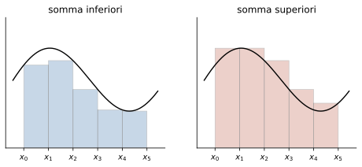

# 1 · Calcolo integrale

**In questo modulo.** Si usano le derivate, i teoremi di Lagrange e di Weierstrass, i valori intermedi e gli sviluppi di Taylor del corso di Analisi 1A. Il modulo affronta il problema inverso della derivazione: data una funzione, trovarne una la cui derivata sia la funzione data. Si introducono le primitive e i metodi per calcolarle (linearità, parti, sostituzione, funzioni razionali), poi l'integrale definito secondo Riemann come area con segno, le sue proprietà e il teorema della media. Il teorema fondamentale del calcolo collega le due cose e dà la formula per calcolare gli integrali definiti. L'ultima parte estende l'integrale a intervalli illimitati e a funzioni illimitate, con i criteri di convergenza. Alla fine del modulo si sanno calcolare primitive e integrali definiti, calcolare aree, e stabilire se un integrale improprio converge.

## 1.1 Primitive e integrale indefinito

> [!definizione] Primitiva
> Sia $I \subseteq \mathbb{R}$ un intervallo e $f : I \to \mathbb{R}$. Una funzione $F$ è una **primitiva** di $f$ su $I$ se $F$ è derivabile su $I$ e $F'(x) = f(x)$ per ogni $x \in I$.

Per esempio $F(x) = \frac{x^2}{2}$ è una primitiva di $f(x) = x$ su $\mathbb{R}$, e $F(x) = -\cos x$ è una primitiva di $\sin x$. Anche $\frac{x^2}{2} + 1$ è una primitiva di $x$: la derivata di una costante è nulla, quindi se $F$ è una primitiva lo è anche $F + c$ per ogni $c \in \mathbb{R}$. Vale anche il viceversa, ed è qui che conta che $I$ sia un intervallo.

> [!teorema] Primitive di una stessa funzione
> Se $F$ e $G$ sono primitive di $f$ sull'intervallo $I$, esiste $c \in \mathbb{R}$ tale che $G(x) = F(x) + c$ per ogni $x \in I$.

*Dimostrazione.* Sia $H = G - F$. Allora $H'(x) = f(x) - f(x) = 0$ per ogni $x \in I$, e una funzione con derivata nulla su un intervallo è costante, per il teorema di Lagrange: per ogni $x_1 < x_2$ in $I$ esiste $\xi$ con $H(x_2) - H(x_1) = H'(\xi)(x_2 - x_1) = 0$. $\square$

Su un insieme che non è un intervallo la conclusione cade: $\ln\lvert x\rvert$ e $\ln\lvert x\rvert + \operatorname{sgn}(x)$ hanno la stessa derivata $\frac{1}{x}$ su $\mathbb{R} \setminus \{0\}$, ma non differiscono per una costante.

> [!definizione] Integrale indefinito
> L'insieme di tutte le primitive di $f$ su $I$ si chiama **integrale indefinito** di $f$ e si indica con $\int f(x)\, dx$. Se $F$ è una primitiva, si scrive $\int f(x)\, dx = F(x) + c$.

Non tutte le funzioni hanno una primitiva; si vedrà nel paragrafo 1.6 che la continuità basta a garantirne l'esistenza.

Un esempio: la funzione che vale 0 per $x < 0$ e 1 per $x \ge 0$ non ha primitive su $\mathbb{R}$. Una primitiva dovrebbe valere $c_1$ per $x < 0$ e $x + c_2$ per $x \ge 0$, con $c_1 = c_2$ per la continuità, ma allora in 0 avrebbe derivata sinistra 0 e destra 1, e non sarebbe derivabile.

Le primitive delle funzioni elementari si ottengono leggendo al contrario la tabella delle derivate:

| $f(x)$ | $\int f(x)\, dx$ | dove |
|---|---|---|
| $x^\alpha$, $\alpha \neq -1$ | $\frac{x^{\alpha+1}}{\alpha+1} + c$ | dove è definita $x^\alpha$ |
| $\frac{1}{x}$ | $\ln\lvert x\rvert + c$ | su $(-\infty, 0)$ e su $(0, +\infty)$ |
| $e^x$ | $e^x + c$ | $\mathbb{R}$ |
| $\sin x$, $\cos x$ | $-\cos x + c$, $\sin x + c$ | $\mathbb{R}$ |
| $\frac{1}{\cos^2 x}$ | $\tan x + c$ | intervalli dove $\cos x \neq 0$ |
| $\frac{1}{1+x^2}$ | $\arctan x + c$ | $\mathbb{R}$ |
| $\frac{1}{\sqrt{1-x^2}}$ | $\arcsin x + c$ | $(-1, 1)$ |

## 1.2 Metodi di integrazione

> [!teorema] Linearità
> Se $f$ e $g$ hanno primitive su $I$ e $\alpha, \beta \in \mathbb{R}$, anche $\alpha f + \beta g$ ha primitiva su $I$ e
> $$\int \big(\alpha f(x) + \beta g(x)\big)\, dx = \alpha \int f(x)\, dx + \beta \int g(x)\, dx.$$

Basta derivare $\alpha F + \beta G$. Per esempio $\int (5x^2 + e^x)\, dx = \frac{5}{3}x^3 + e^x + c$.

> [!teorema] Integrazione per parti
> Siano $f$, $g$ derivabili su $I$ e supponiamo che $f' g$ abbia una primitiva su $I$. Allora anche $f g'$ ha una primitiva e
> $$\int f(x)\, g'(x)\, dx = f(x)\, g(x) - \int f'(x)\, g(x)\, dx.$$

Segue dalla regola del prodotto, $(fg)' = f'g + fg'$, integrando entrambi i membri. Il metodo serve quando il prodotto $f'g$ è più semplice di $fg'$. Per esempio, scrivendo $\ln x = 1 \cdot \ln x$ con $f = \ln x$ e $g' = 1$, su $(0, +\infty)$:
$$\int \ln x\, dx = x \ln x - \int \frac{1}{x} \cdot x\, dx = x\ln x - x + c.$$

> [!teorema] Integrazione per sostituzione
> Sia $F$ una primitiva di $f$ sull'intervallo $J$ e sia $\varphi : I \to J$ derivabile. Allora
> $$\int f(\varphi(x))\, \varphi'(x)\, dx = F(\varphi(x)) + c.$$
> In pratica si pone $y = \varphi(x)$, $dy = \varphi'(x)\, dx$, si calcola $\int f(y)\, dy$ e alla fine si risostituisce.

È la regola di derivazione della funzione composta letta al contrario.

> [!esempio] Sostituzioni
>
> - $\int x\, e^{x^2}\, dx$: con $y = x^2$, $dy = 2x\, dx$, si ottiene $\frac{1}{2}\int e^y\, dy = \frac{1}{2}e^{x^2} + c$.
> - $\int \tan x\, dx = \int \frac{\sin x}{\cos x}\, dx$: con $y = \cos x$, $dy = -\sin x\, dx$, si ottiene $-\ln\lvert\cos x\rvert + c$.
> - $\int \frac{e^x}{1 + e^{2x}}\, dx$: con $y = e^x$, $dy = e^x\, dx$, si ottiene $\int \frac{dy}{1+y^2} = \arctan(e^x) + c$.

Una funzione definita a tratti si integra tratto per tratto, ma la primitiva deve essere derivabile, quindi continua, anche nei punti di raccordo: le costanti dei due tratti non sono indipendenti.

> [!esempio] Primitiva di $\sin\lvert x\rvert$
> Per $x > 0$ la funzione è $\sin x$, per $x < 0$ è $-\sin x$. Una primitiva deve essere $F(x) = -\cos x + c_1$ per $x > 0$ e $F(x) = \cos x + c_2$ per $x < 0$. La continuità in 0 chiede $-1 + c_1 = 1 + c_2$, cioè $c_1 = c_2 + 2$. Quindi le primitive sono $F(x) = -\cos x + 2 + c$ per $x \ge 0$ e $F(x) = \cos x + c$ per $x < 0$; si verifica che $F$ è derivabile anche in 0, con $F'(0) = 0 = \sin\lvert 0\rvert$.

## 1.3 Funzioni razionali

Si vuole calcolare $\int \frac{P(x)}{Q(x)}\, dx$ con $P$, $Q$ polinomi. Se $\deg P \ge \deg Q$ si fa prima la divisione, $P = SQ + R$ con $\deg R < \deg Q$, e resta da integrare $\frac{R}{Q}$. Con il denominatore di primo grado si arriva subito a un logaritmo: $\int \frac{dx}{x+1} = \ln\lvert x+1\rvert + c$. Con il denominatore di secondo grado $ax^2 + bx + c$ si guarda il discriminante $\Delta = b^2 - 4ac$.

- **$\Delta > 0$**: il denominatore si fattorizza come $a(x - x_1)(x - x_2)$, si scrive $\frac{1}{(x - x_1)(x - x_2)} = \frac{\alpha}{x - x_1} + \frac{\beta}{x - x_2}$ (**fratti semplici**) e si integra in due logaritmi.
- **$\Delta = 0$**: il denominatore è $a(x - x_0)^2$ e l'integrale è quello di una potenza con esponente $-2$.
- **$\Delta < 0$**: il denominatore non ha radici reali; si completa il quadrato e ci si riconduce a $\int \frac{dt}{1 + t^2} = \arctan t + c$.

> [!esempio] I tre casi
>
> - $\int \frac{dx}{x^2 - 3x + 2}$: le radici sono 1 e 2, e $\frac{1}{(x-1)(x-2)} = \frac{1}{x-2} - \frac{1}{x-1}$. Quindi l'integrale è $\ln\lvert x-2\rvert - \ln\lvert x-1\rvert + c = \ln\left\lvert\frac{x-2}{x-1}\right\rvert + c$.
> - $\int \frac{dx}{(x-3)^2} = -\frac{1}{x-3} + c$.
> - $\int \frac{dx}{x^2 + 2x + 5}$: $x^2 + 2x + 5 = (x+1)^2 + 4 = 4\left(1 + \left(\frac{x+1}{2}\right)^2\right)$. Con $t = \frac{x+1}{2}$, $dx = 2\,dt$, si ottiene $\frac{1}{4}\int \frac{2\,dt}{1+t^2} = \frac{1}{2}\arctan\frac{x+1}{2} + c$.

## 1.4 L'integrale di Riemann

L'integrale definito formalizza l'idea di area sotto il grafico di una funzione su un intervallo chiuso e limitato.

> [!definizione] Partizione e somme di Riemann
> Sia $f : [a, b] \to \mathbb{R}$ limitata. Una **partizione** di $[a, b]$ è un insieme finito di punti $P = \{x_0, \dots, x_k\}$ con $a = x_0 < x_1 < \dots < x_k = b$; divide $[a, b]$ negli intervalli $I_i = [x_{i-1}, x_i]$ di ampiezza $l_i = x_i - x_{i-1}$. Le **somme inferiore e superiore** di $f$ relative a $P$ sono
> $$s(f, P) = \sum_{i=1}^{k} \Big(\inf_{I_i} f\Big)\, l_i, \qquad S(f, P) = \sum_{i=1}^{k} \Big(\sup_{I_i} f\Big)\, l_i.$$

Geometricamente $s$ è l'area di rettangoli contenuti sotto il grafico e $S$ quella di rettangoli che lo contengono (figura 1.1). Sempre $s(f, P) \le S(f, P)$. Se si aggiungono punti alla partizione (un **raffinamento** $P^*$), le somme inferiori crescono e le superiori decrescono: $s(P) \le s(P^*) \le S(P^*) \le S(P)$. Confrontando due partizioni qualsiasi con il loro raffinamento comune $P_1 \cup P_2$ si ottiene che ogni somma inferiore è minore o uguale di ogni somma superiore, quindi $\sup_P s(f, P) \le \inf_P S(f, P)$.

> [!definizione] Funzione integrabile
> $f : [a, b] \to \mathbb{R}$ limitata è **integrabile secondo Riemann** se $\sup_P s(f, P) = \inf_P S(f, P)$. Il valore comune è l'**integrale definito** $\int_a^b f(x)\, dx$.

Per una costante $f = k$ ogni somma vale $k(b - a)$, quindi $\int_a^b k\, dx = k(b - a)$: l'area del rettangolo. La **funzione di Dirichlet**, che vale 1 sui razionali e 0 sugli irrazionali, non è integrabile: in ogni intervallo ci sono razionali e irrazionali, quindi ogni somma superiore vale $b - a$ e ogni somma inferiore 0.

Sono integrabili su $[a, b]$ le funzioni continue, quelle continue tranne che in un numero finito di punti (purché limitate) e quelle monotone. Valgono le proprietà seguenti, per $f$, $g$ integrabili su $[a, b]$:

1. **additività**: per $c \in (a, b)$, $\int_a^b f = \int_a^c f + \int_c^b f$; si pone $\int_b^a f = -\int_a^b f$ e $\int_a^a f = 0$;
2. **linearità**: $\int_a^b (\alpha f + \beta g) = \alpha\int_a^b f + \beta\int_a^b g$;
3. **monotonia**: se $f \le g$ allora $\int_a^b f \le \int_a^b g$;
4. **valore assoluto**: $\lvert f\rvert$ è integrabile e $\left\lvert\int_a^b f\right\rvert \le \int_a^b \lvert f\rvert$;
5. cambiando il valore di $f$ in un numero finito di punti l'integrale non cambia.

L'integrale è un'**area con segno**: le parti dove $f < 0$ contano negativamente. Se $A^+$ è l'area fra l'asse e il grafico dove $f \ge 0$ e $A^-$ quella dove $f < 0$, si ha $\int_a^b f = A^+ - A^-$ e $\int_a^b \lvert f\rvert = A^+ + A^-$.

## 1.5 Il teorema della media integrale

La **media integrale** di $f$ su $[a, b]$ è $\frac{1}{b - a}\int_a^b f(x)\, dx$.

> [!teorema] Teorema della media integrale
> Se $f : [a, b] \to \mathbb{R}$ è continua, esiste $c \in [a, b]$ tale che
> $$f(c) = \frac{1}{b - a}\int_a^b f(x)\, dx.$$

*Dimostrazione.* Per il teorema di Weierstrass $f$ ha minimo $m$ e massimo $M$ su $[a, b]$, quindi $m \le f(x) \le M$. Per la monotonia dell'integrale $m(b - a) \le \int_a^b f \le M(b - a)$, e dividendo per $b - a > 0$ la media $\mu$ sta fra $m$ e $M$. Per il teorema dei valori intermedi $f$ assume il valore $\mu$ in qualche $c \in [a, b]$. $\square$

Geometricamente: il rettangolo di base $[a, b]$ e altezza $f(c)$ ha la stessa area della regione sotto il grafico.

## 1.6 Il teorema fondamentale del calcolo integrale

> [!definizione] Funzione integrale
> Sia $f$ integrabile su ogni intervallo chiuso e limitato contenuto nell'intervallo $I$, e sia $x_0 \in I$. La **funzione integrale** di $f$ di punto base $x_0$ è
> $$F_{x_0}(x) = \int_{x_0}^{x} f(t)\, dt, \qquad x \in I.$$

> [!teorema] Teorema fondamentale del calcolo integrale
> Se $f$ è continua sull'intervallo $I$ e $x_0 \in I$, la funzione integrale $F_{x_0}$ è derivabile su $I$ e $F_{x_0}'(x) = f(x)$ per ogni $x \in I$: è una primitiva di $f$.

*Dimostrazione.* Per $x \in I$ e $h \neq 0$ piccolo, per l'additività
$$\frac{F_{x_0}(x + h) - F_{x_0}(x)}{h} = \frac{1}{h}\int_x^{x+h} f(t)\, dt,$$
che è la media integrale di $f$ sull'intervallo di estremi $x$ e $x + h$. Per il teorema della media esiste $c_h$ fra $x$ e $x + h$ con $\frac{1}{h}\int_x^{x+h} f = f(c_h)$. Per $h \to 0$ si ha $c_h \to x$ e, per la continuità di $f$, $f(c_h) \to f(x)$. $\square$

In particolare ogni funzione continua su un intervallo ha una primitiva.

> [!teorema] Formula fondamentale (Torricelli-Barrow)
> Se $f$ è continua su $[a, b]$ e $F$ è una qualsiasi sua primitiva,
> $$\int_a^b f(x)\, dx = F(b) - F(a) = \big[F(x)\big]_a^b.$$

*Dimostrazione.* $F$ e $F_a$ sono primitive di $f$ sull'intervallo $[a, b]$, quindi $F = F_a + c$. Allora $F(b) - F(a) = F_a(b) - F_a(a) = \int_a^b f - 0$. $\square$

I metodi del paragrafo 1.2 valgono anche per gli integrali definiti. Per parti, con $f$, $g$ di classe $C^1$ su $[a, b]$: $\int_a^b f g' = [fg]_a^b - \int_a^b f' g$. Per sostituzione, con $\varphi : [c, d] \to [a, b]$ di classe $C^1$, si cambiano anche gli estremi:
$$\int_{\varphi(c)}^{\varphi(d)} f(x)\, dx = \int_c^d f(\varphi(t))\, \varphi'(t)\, dt.$$

> [!esempio] Area fra due curve
> L'area della regione compresa fra $y = x$ e $y = x^2$ per $x \in [0, 1]$, dove $x \ge x^2$, è
> $$\int_0^1 (x - x^2)\, dx = \left[\frac{x^2}{2} - \frac{x^3}{3}\right]_0^1 = \frac{1}{2} - \frac{1}{3} = \frac{1}{6}.$$
> In generale l'area fra i grafici di $f$ e $g$ su $[a, b]$ è $\int_a^b \lvert f - g\rvert$, e conviene dividere l'intervallo nei punti in cui le curve si incrociano.

La funzione integrale si può studiare come una funzione qualsiasi, anche quando la primitiva non si scrive con funzioni elementari, perché la sua derivata è nota. Per $F(x) = \int_0^x e^{-t^2}\, dt$: $F(0) = 0$; $F'(x) = e^{-x^2} > 0$, quindi $F$ è strettamente crescente; $F''(x) = -2x\, e^{-x^2}$, quindi $F$ è convessa per $x < 0$ e concava per $x > 0$, con un flesso in 0; ed è dispari, perché l'integranda è pari.

## 1.7 Integrali impropri

La teoria di Riemann richiede un intervallo chiuso e limitato e una funzione limitata. Se cade una delle due ipotesi si passa al limite.

> [!definizione] Integrale improprio su un intervallo illimitato
> Sia $f : [a, +\infty) \to \mathbb{R}$ integrabile su $[a, b]$ per ogni $b > a$. L'**integrale improprio** di $f$ su $[a, +\infty)$ è
> $$\int_a^{+\infty} f(x)\, dx = \lim_{b \to +\infty} \int_a^b f(x)\, dx.$$
> Si dice **convergente** se il limite esiste finito, **divergente** se vale $\pm\infty$, **oscillante** se non esiste. Allo stesso modo si definisce $\int_{-\infty}^b f$; su tutta la retta si spezza in due, $\int_{-\infty}^{+\infty} f = \int_{-\infty}^{0} f + \int_0^{+\infty} f$, e l'integrale converge se convergono entrambi.

Se $f \ge 0$ (anche solo per $x$ abbastanza grande), la funzione $b \mapsto \int_a^b f$ è crescente, quindi il limite esiste sempre, finito o $+\infty$: un integrale di una funzione di segno costante non oscilla.

> [!esempio] Integrali campione all'infinito
>
> - $\int_0^{+\infty} \frac{dx}{1 + x^2} = \lim_{b \to +\infty} \arctan b = \frac{\pi}{2}$: converge.
> - Per $\alpha \neq 1$, $\int_1^b x^{-\alpha}\, dx = \frac{b^{1-\alpha} - 1}{1 - \alpha}$, che per $b \to +\infty$ tende a $\frac{1}{\alpha - 1}$ se $\alpha > 1$ e a $+\infty$ se $\alpha < 1$; per $\alpha = 1$, $\int_1^b \frac{dx}{x} = \ln b \to +\infty$. Quindi $\int_1^{+\infty} \frac{dx}{x^\alpha}$ converge se e solo se $\alpha > 1$.
> - Con la sostituzione $y = \ln x$, $\int_e^{+\infty} \frac{dx}{x (\ln x)^\alpha} = \int_1^{+\infty} \frac{dy}{y^\alpha}$: converge se e solo se $\alpha > 1$.

Quando la primitiva non è calcolabile si usano i criteri.

> [!teorema] Criteri di convergenza all'infinito
> Siano $f$, $g$ integrabili su ogni $[a, b]$.
>
> 1. **Confronto.** Se $0 \le f(x) \le g(x)$ per $x$ abbastanza grande: se $\int_a^{+\infty} g$ converge, converge anche $\int_a^{+\infty} f$; se $\int_a^{+\infty} f$ diverge, diverge anche $\int_a^{+\infty} g$.
> 2. **Confronto asintotico.** Se $f \ge 0$ e $\lim_{x \to +\infty} \frac{f(x)}{1/x^\alpha} = L \in (0, +\infty)$, l'integrale di $f$ converge se e solo se $\alpha > 1$.
> 3. **Convergenza assoluta.** Se $\int_a^{+\infty} \lvert f\rvert$ converge, converge anche $\int_a^{+\infty} f$, e $\left\lvert\int_a^{+\infty} f\right\rvert \le \int_a^{+\infty} \lvert f\rvert$.

> [!esempio] Una funzione di segno variabile
> $\int_1^{+\infty} \frac{\cos x}{x^2}\, dx$: si studia il valore assoluto. Poiché $\frac{\lvert\cos x\rvert}{x^2} \le \frac{1}{x^2}$ e $\int_1^{+\infty} \frac{dx}{x^2}$ converge ($\alpha = 2 > 1$), per confronto converge $\int_1^{+\infty} \frac{\lvert\cos x\rvert}{x^2}$, e quindi, per la convergenza assoluta, l'integrale di partenza.

> [!definizione] Integrale improprio di una funzione illimitata
> Sia $f : [a, b) \to \mathbb{R}$ integrabile su $[a, c]$ per ogni $c < b$ e illimitata vicino a $b$. Si pone
> $$\int_a^b f(x)\, dx = \lim_{c \to b^-} \int_a^c f(x)\, dx,$$
> con la stessa classificazione. Allo stesso modo per una singolarità nell'estremo sinistro o in un punto interno, spezzando l'intervallo.

Se $f$ è già integrabile secondo Riemann su $[a, b]$, il limite dà lo stesso valore dell'integrale ordinario. I criteri di confronto e di convergenza assoluta valgono anche qui. Per il confronto asintotico la funzione campione diventa $\frac{1}{(b - x)^\alpha}$ (o $\frac{1}{(x - a)^\alpha}$), e la situazione si rovescia: $\int_a^b \frac{dx}{(b - x)^\alpha}$ converge se e solo se $\alpha < 1$.

> [!attenzione]
> Le due soglie sono opposte: all'infinito $\frac{1}{x^\alpha}$ è integrabile per $\alpha > 1$, vicino a un punto $\frac{1}{\lvert x - x_0\rvert^\alpha}$ è integrabile per $\alpha < 1$. Per $\alpha = 1$ diverge in entrambi i casi.

## Esempi ed esercizi svolti

**Esercizio 1.** $\int_0^1 \frac{x^2}{\sqrt{1 - x}}\, dx$. Il problema è in $x = 1$, dove l'integranda tende a $+\infty$ come $\frac{1}{(1 - x)^{1/2}}$: l'ordine è $\frac{1}{2} < 1$ e l'integrale converge. Per calcolarlo si pone $\sqrt{1 - x} = y$, cioè $x = 1 - y^2$ e $dx = -2y\, dy$; per $x$ da 0 a 1, $y$ va da 1 a 0:
$$\int_1^0 \frac{(1 - y^2)^2}{y}(-2y)\, dy = 2\int_0^1 (1 - 2y^2 + y^4)\, dy = 2\left(1 - \frac{2}{3} + \frac{1}{5}\right) = \frac{16}{15}.$$

**Esercizio 2.** $\int_0^{\pi/2} \frac{dx}{x^2 \sin x}$. Per $x \to 0^+$, $\sin x \sim x$ e l'integranda è asintotica a $\frac{1}{x^3}$: ordine $3 \ge 1$, l'integrale diverge a $+\infty$.

**Esercizio 3.** $\int x^2 e^x\, dx$. Due volte per parti, derivando la potenza: $\int x^2 e^x = x^2 e^x - 2\int x e^x = x^2 e^x - 2(x e^x - e^x) + c = e^x(x^2 - 2x + 2) + c$.

**Esercizio 4.** $\int_0^{+\infty} x e^{-x}\, dx$. Per parti, $\int_0^b x e^{-x}\, dx = [-x e^{-x}]_0^b + \int_0^b e^{-x}\, dx = -b e^{-b} + 1 - e^{-b}$, che tende a 1 per $b \to +\infty$. L'integrale converge e vale 1.

### Altri esercizi svolti

Nelle prove il primo punto è quasi sempre un integrale definito da calcolare con una sostituzione, per parti o con i fratti semplici; spesso segue un integrale improprio con un parametro o lo studio di una funzione integrale.

**Esercizio 5. Sostituzione con una radice.** Calcolare $\int_{\sqrt{3}}^{2} x^3\sqrt{x^2 - 3}\,dx$.

Si pone $u = x^2 - 3$: $du = 2x\,dx$ e $x^2 = u + 3$, quindi $x^3\,dx = x^2 \cdot x\,dx = (u + 3)\frac{du}{2}$. Gli estremi diventano $u = 0$ e $u = 1$:
$$\frac{1}{2}\int_0^1 (u + 3)\sqrt{u}\,du = \frac{1}{2}\left[\frac{2}{5}u^{5/2} + 2u^{3/2}\right]_0^1 = \frac{1}{2}\left(\frac{2}{5} + 2\right) = \frac{6}{5}.$$
Cambiando gli estremi insieme alla variabile non serve tornare a $x$.

**Esercizio 6. Fratti semplici con una radice doppia.** Calcolare $\int_2^4 \frac{2x + 1}{(x - 1)^2}\,dx$.

Si scrive $\frac{2x + 1}{(x - 1)^2} = \frac{A}{x - 1} + \frac{B}{(x - 1)^2}$, cioè $2x + 1 = A(x - 1) + B$: con $x = 1$ si ha $B = 3$, confrontando i coefficienti di $x$ si ha $A = 2$. Quindi
$$\int_2^4 \left(\frac{2}{x - 1} + \frac{3}{(x - 1)^2}\right)dx = \left[2\ln|x - 1| - \frac{3}{x - 1}\right]_2^4 = (2\ln 3 - 1) - (0 - 3) = 2 + 2\ln 3.$$
Un modo veloce per i numeratori di primo grado: $2x + 1 = 2(x - 1) + 3$, e la scomposizione si legge subito.

**Esercizio 7. Sostituzione con la tangente.** Calcolare $\int_0^{\pi/3} \frac{e^{\tan x}}{\cos^2 x}\,dx$.

La derivata di $\tan x$ è $\frac{1}{\cos^2 x}$, che compare già: con $u = \tan x$ l'integrale è $\int_0^{\sqrt{3}} e^u\,du = e^{\sqrt{3}} - 1$. È il caso $\int g(f(x)) f'(x)\,dx$: va riconosciuto prima di fare qualsiasi conto.

**Esercizio 8. Per parti con l'arcotangente.** Calcolare $\int_0^1 x^2\arctan x\,dx$.

Si deriva l'arcotangente e si integra la potenza:
$$\int_0^1 x^2\arctan x\,dx = \left[\frac{x^3}{3}\arctan x\right]_0^1 - \frac{1}{3}\int_0^1 \frac{x^3}{1 + x^2}\,dx.$$
Il primo termine vale $\frac{\pi}{12}$. Nel secondo si divide: $\frac{x^3}{1 + x^2} = x - \frac{x}{1 + x^2}$, quindi $\int_0^1 = \frac{1}{2} - \frac{1}{2}\ln 2$. Il risultato è
$$\frac{\pi}{12} - \frac{1}{6} + \frac{\ln 2}{6}.$$

**Esercizio 9. Integrale improprio con un parametro.** Per quali $\alpha \in \mathbb{R}$ converge $\int_0^{+\infty} \frac{x^\alpha}{1 + x^2}\,dx$? Calcolarlo per $\alpha = 0$.

L'integrale è improprio in entrambi gli estremi e si spezza, per esempio, in 1. *Vicino a 0*: $\frac{x^\alpha}{1 + x^2} \sim x^\alpha = \frac{1}{x^{-\alpha}}$, che è integrabile in 0 se $-\alpha < 1$, cioè $\alpha > -1$. *Vicino a $+\infty$*: $\frac{x^\alpha}{1 + x^2} \sim \frac{1}{x^{2 - \alpha}}$, integrabile se $2 - \alpha > 1$, cioè $\alpha < 1$. Servono entrambe: l'integrale converge per $-1 < \alpha < 1$. Per $\alpha = 0$ vale $\lim_{b \to +\infty} \arctan b = \frac{\pi}{2}$.

**Esercizio 10. I limiti di una funzione integrale.** Sia $F(x) = \frac{1}{x}\int_0^x \frac{\sin t}{t}\,dt$ per $x \ne 0$ (l'integranda vale 1 in $t = 0$). Calcolare i limiti di $F$ per $x \to 0$ e per $x \to +\infty$.

L'integranda $g(t) = \frac{\sin t}{t}$, prolungata con $g(0) = 1$, è continua su $\mathbb{R}$, quindi $G(x) = \int_0^x g$ è derivabile con $G' = g$ per il teorema fondamentale. *Per $x \to 0$*: $F = \frac{G(x)}{x}$ è una forma $\frac{0}{0}$, e per de l'Hôpital $\lim \frac{G'(x)}{1} = g(0) = 1$. In altre parole, $F(x)$ è la media di $g$ su $[0, x]$ e tende al valore di $g$ in 0. *Per $x \to +\infty$*: basta che $G(x)$ resti limitata. Lo è, perché l'integrale improprio di $\frac{\sin t}{t}$ converge: per parti, $\int_1^b \frac{\sin t}{t}\,dt = \left[-\frac{\cos t}{t}\right]_1^b - \int_1^b \frac{\cos t}{t^2}\,dt$, il primo termine ha limite e il secondo converge assolutamente perché $\left|\frac{\cos t}{t^2}\right| \le \frac{1}{t^2}$. (Il valore è $\int_0^{+\infty} \frac{\sin t}{t}\,dt = \frac{\pi}{2}$, ma non serve.) Quindi $F(x) = \frac{G(x)}{x} \to 0$.

**Esercizio 11. L'integrale della lezione 6.** Calcolare $\int_0^{+\infty} \frac{|x^2 - 2x - 3| - x^2 - 2x - 3}{x^{5/2}}\,dx$.

*Il valore assoluto.* $x^2 - 2x - 3 = (x + 1)(x - 3)$ è negativo su $(0, 3)$ e positivo da 3 in poi. Il numeratore vale quindi $-x^2 + 2x + 3 - x^2 - 2x - 3 = -2x^2$ su $(0, 3)$, e $-4x - 6$ su $[3, +\infty)$.

*Convergenza.* Su $(0, 3)$ l'integranda è $-2x^{-1/2}$, integrabile in 0 (ordine $\frac{1}{2} < 1$). Su $[3, +\infty)$ è $\frac{-4x - 6}{x^{5/2}} \sim -\frac{4}{x^{3/2}}$, integrabile all'infinito (ordine $\frac{3}{2} > 1$).

*Calcolo.*
$$-2\int_0^3 x^{-1/2}\,dx - 4\int_3^{+\infty} x^{-3/2}\,dx - 6\int_3^{+\infty} x^{-5/2}\,dx = -4\sqrt{3} - \frac{8}{\sqrt{3}} - \frac{4}{3\sqrt{3}} = -\frac{36 + 24 + 4}{3\sqrt{3}} = -\frac{64}{3\sqrt{3}}.$$
Il risultato degli appunti è giusto; razionalizzato è $-\frac{64\sqrt{3}}{9}$. Che sia negativo si vede anche senza conti: per $x > 0$ si ha $|x^2 - 2x - 3| < x^2 + 2x + 3$, perché la differenza fra i due membri vale $2x^2$ oppure $4x + 6$, e quindi l'integranda è sempre negativa.

**Esercizio 12. Dove è integrabile?** Sia $f(x) = \frac{1}{(x + 2)\sqrt{x + 1}}$. (a) Dominio. (b) Calcolare $\int_0^3 f$. (c) Su quali intervalli $[a, b]$ è integrabile secondo Riemann? E in senso improprio?

(a) $x > -1$. (b) Con $t = \sqrt{x + 1}$, $x = t^2 - 1$, $dx = 2t\,dt$, $x + 2 = t^2 + 1$:
$$\int_1^2 \frac{2t}{(t^2 + 1)\,t}\,dt = 2\big[\arctan t\big]_1^2 = 2\arctan 2 - \frac{\pi}{2}.$$
(c) Secondo Riemann serve una funzione limitata su un intervallo chiuso e limitato contenuto nel dominio: tutti gli $[a, b]$ con $-1 < a < b$. In $-1$ la funzione non è limitata, ma $f(x) \sim \frac{1}{\sqrt{x + 1}}$ ha ordine $\frac{1}{2}$: su $[-1, b]$ l'integrale improprio converge. Converge anche su $[a, +\infty)$, perché all'infinito $f \sim \frac{1}{x^{3/2}}$.

## Esercizi guidati

Ogni esercizio è diviso in passi: si prova un passo alla volta e si confronta solo dopo.

**Guidato 1. L'integrazione per parti "circolare".** Calcolare $\int e^x \sin x\,dx$.

*Passo 1.* Per parti, integrando $e^x$: $\int e^x\sin x = e^x\sin x - \int e^x\cos x$.

*Passo 2.* Di nuovo per parti, sempre integrando $e^x$ (se si cambiasse ruolo si tornerebbe indietro): $\int e^x\cos x = e^x\cos x + \int e^x\sin x$.

*Passo 3.* Sostituendo, $I = e^x\sin x - e^x\cos x - I$, dove $I$ è l'integrale cercato: l'incognita compare a entrambi i membri.

*Passo 4.* $2I = e^x(\sin x - \cos x)$, quindi $\int e^x\sin x\,dx = \frac{e^x(\sin x - \cos x)}{2} + c$. Controllo: derivando si ottiene $\frac{e^x(\sin x - \cos x) + e^x(\cos x + \sin x)}{2} = e^x\sin x$.

**Guidato 2. Convergenza di un integrale improprio "doppio".** Studiare $\int_0^{+\infty} \frac{1 - \cos x}{x^{5/2}}\,dx$.

*Passo 1: i punti critici.* L'integranda è continua su $(0, +\infty)$; i problemi sono in 0 e all'infinito. Si spezza in 1.

*Passo 2: vicino a 0.* $1 - \cos x \sim \frac{x^2}{2}$, quindi l'integranda $\sim \frac{1}{2}x^{-1/2}$: ordine $\frac{1}{2} < 1$, converge.

*Passo 3: all'infinito.* $1 - \cos x$ non ha limite, quindi il confronto asintotico non si applica; si usa il confronto semplice: $0 \le \frac{1 - \cos x}{x^{5/2}} \le \frac{2}{x^{5/2}}$, integrabile perché $\frac{5}{2} > 1$.

*Passo 4: conclusione.* Convergono entrambi i pezzi, quindi l'integrale converge. Il valore non serve: la domanda era solo sul carattere.

**Guidato 3. Area fra due curve.** Calcolare l'area della regione compresa fra le parabole $y = x^2$ e $y = 2 - x^2$.

*Passo 1: le intersezioni.* $x^2 = 2 - x^2$ per $x = \pm 1$.

*Passo 2: chi sta sopra.* In $x = 0$: $2 - 0 > 0$, quindi su $[-1, 1]$ la curva superiore è $y = 2 - x^2$.

*Passo 3: l'integrale.* $\int_{-1}^{1}\big((2 - x^2) - x^2\big)dx = \int_{-1}^{1}(2 - 2x^2)\,dx = 4 - \frac{4}{3} = \frac{8}{3}$.

*Passo 4: la simmetria.* L'integranda è pari, quindi si poteva scrivere $2\int_0^1 (2 - 2x^2)\,dx$: stesso risultato con metà dei conti.

## Riepilogo

Una primitiva di $f$ su un intervallo è una funzione con derivata $f$; due primitive differiscono per una costante, e il loro insieme è l'integrale indefinito. Le primitive si calcolano con la tabella delle derivate, la linearità, l'integrazione per parti, la sostituzione e, per le funzioni razionali, la divisione e i fratti semplici, distinguendo i casi secondo il discriminante del denominatore. L'integrale di Riemann di una funzione limitata su $[a, b]$ è il valore comune dell'estremo superiore delle somme inferiori e dell'estremo inferiore delle somme superiori; esiste per le funzioni continue e monotone, è lineare, additivo e monotono, e rappresenta un'area con segno. Il teorema della media dice che una funzione continua assume la sua media integrale. Il teorema fondamentale dice che la funzione integrale di una funzione continua è una sua primitiva, e da qui $\int_a^b f = F(b) - F(a)$. Gli integrali impropri si definiscono come limiti su intervalli illimitati o vicino a punti in cui la funzione è illimitata; per stabilire se convergono si usano il confronto, il confronto asintotico con le potenze, con soglia $\alpha > 1$ all'infinito e $\alpha < 1$ vicino a un punto, e la convergenza assoluta.

## Formulario

Primitive, metodi, teoremi e criteri del modulo, con i termini per l'orale.

### Primitive fondamentali

| $f(x)$ | $\int f\,dx$ | $f(x)$ | $\int f\,dx$ |
|---|---|---|---|
| $x^\alpha$ ($\alpha \ne -1$) | $\frac{x^{\alpha+1}}{\alpha + 1}$ | $\frac{1}{x}$ | $\ln\lvert x\rvert$ |
| $e^{kx}$ | $\frac{e^{kx}}{k}$ | $a^x$ | $\frac{a^x}{\ln a}$ |
| $\sin x$ | $-\cos x$ | $\cos x$ | $\sin x$ |
| $\frac{1}{\cos^2 x}$ | $\tan x$ | $\frac{1}{1 + x^2}$ | $\arctan x$ |
| $\frac{1}{\sqrt{1 - x^2}}$ | $\arcsin x$ | $\frac{f'(x)}{f(x)}$ | $\ln\lvert f(x)\rvert$ |
| $\frac{1}{x^2 + a^2}$ | $\frac{1}{a}\arctan\frac{x}{a}$ | $f'(x)\,f(x)^\alpha$ | $\frac{f(x)^{\alpha+1}}{\alpha + 1}$ |

### Metodi

$$\int f'g = fg - \int fg' \quad \text{(per parti)}, \qquad \int_a^b g(f(x))f'(x)\,dx = \int_{f(a)}^{f(b)} g(u)\,du \quad \text{(sostituzione)}.$$

Funzioni razionali: se il grado del numeratore è $\ge$ di quello del denominatore si divide; poi fratti semplici $\frac{A}{x - a}$, $\frac{B}{(x - a)^2}$, $\frac{Cx + D}{x^2 + px + q}$ (con $\Delta < 0$: si completa il quadrato e si arriva all'arcotangente).

### Teoremi

| Teorema | Enunciato |
|---|---|
| Integrabilità | continue, monotone e limitate con un numero finito di discontinuità sono integrabili su $[a, b]$ |
| Media integrale | $f$ continua su $[a, b]$: esiste $c$ con $\int_a^b f = f(c)(b - a)$ |
| Fondamentale (prima parte) | $f$ continua: $F(x) = \int_{x_0}^x f$ è derivabile e $F' = f$ |
| Fondamentale (seconda parte) | $G$ primitiva di $f$ continua: $\int_a^b f = G(b) - G(a)$ |
| Derivata con estremi variabili | $\frac{d}{dx}\int_{a(x)}^{b(x)} f = f(b(x))b'(x) - f(a(x))a'(x)$ |

### Integrali impropri

$$\int_1^{+\infty} \frac{dx}{x^\alpha} \text{ converge} \iff \alpha > 1, \qquad \int_0^1 \frac{dx}{x^\alpha} \text{ converge} \iff \alpha < 1.$$

Criteri per $f \ge 0$: confronto ($0 \le f \le g$, $\int g$ converge $\Rightarrow$ $\int f$ converge) e confronto asintotico ($f \sim g$: stesso carattere). Assoluta convergenza implica convergenza.

### Termini per l'orale

| Termine | In una riga |
|---|---|
| Primitiva | funzione con derivata $f$; due primitive su un intervallo differiscono per una costante |
| Integrale indefinito | l'insieme di tutte le primitive |
| Somme inferiori e superiori | approssimano l'area con rettangoli sotto e sopra il grafico |
| Integrabile secondo Riemann | sup delle somme inferiori = inf delle superiori |
| Funzione integrale | $F(x) = \int_{x_0}^x f(t)\,dt$ |
| Integrale improprio | limite di integrali su intervalli che si allargano verso un punto critico |
| Convergenza assoluta | converge l'integrale di $\lvert f\rvert$ |

### Domande che tornano spesso

- Definire l'integrale di Riemann con le somme inferiori e superiori; un esempio di funzione non integrabile (Dirichlet).
- Enunciare e dimostrare il teorema della media integrale.
- Enunciare e dimostrare il teorema fondamentale del calcolo integrale.
- Ricavare la formula di integrazione per parti dalla derivata del prodotto.
- Definire l'integrale improprio e dimostrare il criterio per $\int_1^{+\infty} x^{-\alpha}$.
