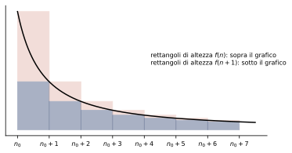

# 2 · Serie numeriche

**In questo modulo.** Si usano i limiti di successioni e il confronto fra infinitesimi del corso di Analisi 1A, e gli integrali impropri del modulo 1 (*Calcolo integrale*). Si dà un senso alla somma di infiniti termini come limite delle somme parziali, si studiano le serie di cui si conosce la somma (geometrica e telescopiche) e le proprietà generali. Poi si passa ai criteri per stabilire il carattere di una serie senza calcolarne la somma: per le serie a termini positivi il confronto, il confronto asintotico, il criterio integrale, il rapporto e la radice; per le serie di segno variabile la convergenza assoluta e il criterio di Leibniz. Alla fine del modulo si sa determinare se una serie converge, scegliendo il criterio adatto alla forma del termine generale.

## 2.1 Definizione e carattere di una serie

Data una successione $(a_n)_{n \ge n_0}$ di numeri reali, si vuole dare un significato all'espressione $\sum_{n = n_0}^{\infty} a_n = a_{n_0} + a_{n_0 + 1} + \dots$, dove $n_0$ è di solito 0 o 1. Non potendo sommare infiniti termini, si passa al limite.

> [!definizione] Somme parziali e serie
> La **successione delle somme parziali** (o ridotte) è $S_N = \sum_{n = n_0}^{N} a_n$. La **serie** di termine generale $a_n$ è il limite
> $$\sum_{n = n_0}^{\infty} a_n = \lim_{N \to \infty} S_N.$$
> La serie è **convergente** se il limite esiste finito (e il limite si chiama **somma** della serie), **divergente** se vale $+\infty$ o $-\infty$, **indeterminata** se il limite non esiste.

L'analogia con gli integrali impropri è stretta: la somma parziale fa la parte di $\int_a^b f$, e la serie quella di $\int_a^{+\infty} f$.

> [!esempio] Una serie divergente e una indeterminata
> Con $a_n = 1$ per $n \ge 1$ si ha $S_N = N \to +\infty$: la serie diverge. Con $a_n = (-1)^n$ per $n \ge 0$ le somme parziali valgono 1 per $N$ pari e 0 per $N$ dispari: il limite non esiste e la serie è indeterminata.

## 2.2 Serie geometriche e telescopiche

La **serie geometrica** di ragione $q \in \mathbb{R}$ ha termine generale $q^n$, $n \ge 0$. Per $q \neq 1$, moltiplicando la somma parziale per $1 - q$ quasi tutti i termini si cancellano:
$$S_N = 1 + q + \dots + q^N = \frac{1 - q^{N+1}}{1 - q}.$$
Per $q = 1$ si ha $S_N = N + 1$. Studiando il limite di $q^{N+1}$:

$$\sum_{n=0}^{\infty} q^n \;\begin{cases} = \dfrac{1}{1 - q} & \text{se } \lvert q\rvert < 1, \\[2mm] = +\infty & \text{se } q \ge 1, \\[1mm] \text{è indeterminata} & \text{se } q \le -1. \end{cases}$$

Per esempio $\sum_{n \ge 0} \frac{1}{2^n} = \frac{1}{1 - 1/2} = 2$: sommando $1 + \frac{1}{2} + \frac{1}{4} + \dots$ ci si avvicina a 2 senza superarlo.

Una serie è **telescopica** se il termine generale si scrive come $a_n = b_n - b_{n+1}$. Allora le somme parziali si semplificano:
$$S_N = (b_1 - b_2) + (b_2 - b_3) + \dots + (b_N - b_{N+1}) = b_1 - b_{N+1},$$
e la serie converge se e solo se $b_n$ ha limite finito $L$, con somma $b_1 - L$.

> [!esempio] Serie di Mengoli
> $\sum_{n \ge 1} \frac{1}{n(n+1)}$: con i fratti semplici $\frac{1}{n(n+1)} = \frac{1}{n} - \frac{1}{n+1}$, quindi $b_n = \frac{1}{n}$ e $S_N = 1 - \frac{1}{N+1} \to 1$. La serie converge e vale 1.
>
> Con $b_n = -\ln n$ invece, cioè $a_n = \ln(n+1) - \ln n = \ln\left(1 + \frac{1}{n}\right)$, si ha $S_N = \ln(N+1) \to +\infty$: la serie diverge, anche se $a_n \to 0$.

## 2.3 Proprietà generali

Il carattere di una serie dipende solo dal comportamento "all'infinito": aggiungere, togliere o cambiare un numero finito di termini non cambia il carattere (cambia la somma, se la serie converge). Per questo nei criteri basta che le ipotesi valgano **definitivamente**, cioè da un certo indice in poi.

> [!teorema] Condizione necessaria
> Se la serie $\sum a_n$ converge, allora $\lim_{n \to \infty} a_n = 0$.

*Dimostrazione.* Se $S_N \to L \in \mathbb{R}$, anche $S_{N-1} \to L$, e $a_N = S_N - S_{N-1} \to L - L = 0$. $\square$

La condizione non è sufficiente: l'esempio $\ln\left(1 + \frac{1}{n}\right)$ del paragrafo 2.2 ha termine generale infinitesimo e diverge, e lo stesso vale per la **serie armonica** $\sum \frac{1}{n}$ (paragrafo 2.4). Si usa al contrario: se $a_n$ non tende a 0, la serie non converge.

Se la serie converge, il **resto** $N$-esimo $R_N = \sum_{n = N+1}^{\infty} a_n$ è l'errore che si commette fermandosi alla somma parziale $S_N$, e tende a 0 per $N \to \infty$.

## 2.4 Serie a termini positivi

Se $a_n \ge 0$ definitivamente, le somme parziali sono definitivamente crescenti e quindi hanno limite, finito o $+\infty$: **una serie a termini positivi converge oppure diverge a $+\infty$**, e non può essere indeterminata.

> [!teorema] Criterio del confronto
> Se $0 \le a_n \le b_n$ definitivamente: se $\sum b_n$ converge, converge anche $\sum a_n$; se $\sum a_n$ diverge, diverge anche $\sum b_n$.

> [!esempio] La serie $\sum \frac{1}{n^2}$
> Per $n \ge 1$ si ha $n^2 \ge \frac{n(n+1)}{2}$, cioè $\frac{1}{n^2} \le \frac{2}{n(n+1)}$. La serie $\sum \frac{2}{n(n+1)}$ converge (vale 2, per il paragrafo 2.2), quindi converge anche $\sum \frac{1}{n^2}$. La sua somma è $\frac{\pi^2}{6}$, ma il criterio dice solo che è finita.

> [!teorema] Criterio del confronto asintotico
> Se $a_n \ge 0$, $b_n > 0$ definitivamente e $\lim_{n \to \infty} \frac{a_n}{b_n} = L \in (0, +\infty)$, le serie $\sum a_n$ e $\sum b_n$ hanno lo stesso carattere.

In pratica si confronta $a_n$ con una serie campione dello stesso ordine di infinitesimo, come si faceva con le funzioni campione negli integrali impropri.

> [!esempio] Due confronti asintotici
>
> - $a_n = \frac{n + 3}{2n^2 + 5}$ si comporta come $\frac{1}{n}$: $\frac{a_n}{1/n} = \frac{n^2 + 3n}{2n^2 + 5} \to \frac{1}{2}$. La serie armonica diverge, quindi anche $\sum a_n$ diverge.
> - $a_n = \sin\frac{1}{n^2}$, positivo per $n \ge 1$: per il limite notevole $\frac{\sin(1/n^2)}{1/n^2} \to 1$, quindi $\sum a_n$ ha il carattere di $\sum \frac{1}{n^2}$ e converge.

> [!teorema] Criterio integrale
> Sia $f : [n_0, +\infty) \to \mathbb{R}$ positiva e decrescente. Allora la serie $\sum_{n \ge n_0} f(n)$ e l'integrale $\int_{n_0}^{+\infty} f(x)\, dx$ hanno lo stesso carattere. Inoltre
> $$\sum_{n = n_0 + 1}^{\infty} f(n) \le \int_{n_0}^{+\infty} f(x)\, dx \le \sum_{n = n_0}^{\infty} f(n).$$

*Dimostrazione.* Poiché $f$ è decrescente, per $x \in [n, n+1]$ si ha $f(n+1) \le f(x) \le f(n)$, e integrando su $[n, n+1]$: $f(n+1) \le \int_n^{n+1} f \le f(n)$. Sommando per $n$ da $n_0$ a $N - 1$:
$$\sum_{n = n_0 + 1}^{N} f(n) \le \int_{n_0}^{N} f \le \sum_{n = n_0}^{N - 1} f(n).$$
La prima disuguaglianza dice che se l'integrale converge le somme parziali sono limitate, e la serie converge; la seconda che se l'integrale diverge le somme parziali divergono. Passando al limite si ottiene la stima dell'enunciato. $\square$

Geometricamente le somme sono aree di rettangoli di base 1, sotto e sopra il grafico (figura 2.1).

Con il criterio integrale e gli integrali campione del paragrafo 1.7 si ottiene il carattere della **serie armonica generalizzata**:
$$\sum_{n \ge 2} \frac{1}{n^\alpha (\ln n)^\beta} \text{ converge se e solo se } \alpha > 1, \text{ oppure } \alpha = 1 \text{ e } \beta > 1.$$
In particolare $\sum \frac{1}{n^\alpha}$ converge se e solo se $\alpha > 1$: la serie armonica ($\alpha = 1$) diverge.

> [!teorema] Criteri del rapporto e della radice
> Sia $a_n > 0$ definitivamente, e sia $L = \lim_{n \to \infty} \frac{a_{n+1}}{a_n}$ (**rapporto**) oppure $L = \lim_{n \to \infty} \sqrt[n]{a_n}$ (**radice**), supposto che esista in $[0, +\infty]$. Se $L < 1$ la serie converge; se $L > 1$ diverge. Se $L = 1$ il criterio non dice niente.

Il caso $L = 1$ si presenta con tutte le serie del tipo $\frac{1}{n^\alpha}$, che convergono o divergono secondo $\alpha$: per quelle servono i confronti. Il rapporto è adatto ai fattoriali e agli esponenziali, la radice alle potenze $n$-esime. Con i fattoriali è utile anche la **formula di Stirling** $n! \sim \sqrt{2\pi n}\left(\frac{n}{e}\right)^n$, da usare con il confronto asintotico.

## 2.5 Serie di segno variabile

> [!teorema] Convergenza assoluta
> Se la serie dei moduli $\sum \lvert a_n\rvert$ converge, converge anche $\sum a_n$, e $\left\lvert\sum a_n\right\rvert \le \sum \lvert a_n\rvert$. Si dice che la serie **converge assolutamente**.

> [!aggiunta] Aggiunta in revisione · fonte: Canuto-Tabacco, *Analisi Matematica 1* (AM1B-02)
> *Dimostrazione.* Si ha $0 \le a_n + \lvert a_n\rvert \le 2\lvert a_n\rvert$. Per il confronto la serie $\sum (a_n + \lvert a_n\rvert)$ converge, e $\sum a_n$ è la differenza di due serie convergenti, $\sum (a_n + \lvert a_n\rvert) - \sum \lvert a_n\rvert$. La disuguaglianza vale per le somme parziali e passa al limite. $\square$

Una serie che converge ma non assolutamente si dice **semplicemente convergente**: converge grazie alle cancellazioni fra termini di segno opposto.

> [!esempio] Una serie trigonometrica
> $\sum_{n \ge 1} \frac{\cos n}{n^2}$ ha termini di segno irregolare. Poiché $\frac{\lvert\cos n\rvert}{n^2} \le \frac{1}{n^2}$, la serie dei moduli converge per confronto, e la serie converge assolutamente.

Per le serie **a segno alterno** $\sum (-1)^n b_n$, con $b_n \ge 0$, c'è un criterio specifico.

> [!teorema] Criterio di Leibniz
> Se $b_n \ge 0$, $(b_n)$ è decrescente (anche solo definitivamente) e $b_n \to 0$, la serie $\sum (-1)^n b_n$ converge. Inoltre il resto è maggiorato dal primo termine trascurato: $\lvert R_N\rvert \le b_{N+1}$.

> [!aggiunta] Aggiunta in revisione · fonte: Canuto-Tabacco, *Analisi Matematica 1* (AM1B-02)
> *Idea della dimostrazione.* Le somme parziali di indice pari formano una successione decrescente, quelle di indice dispari una crescente, perché a ogni passo si aggiunge e si toglie una quantità sempre più piccola; e ogni somma pari supera ogni somma dispari. Le due successioni monotone hanno limite, e i limiti coincidono perché $S_{2k+1} - S_{2k} = -b_{2k+1} \to 0$. Il limite comune sta sempre fra due somme parziali consecutive, da cui la stima del resto.
>
> **L'esempio tipico.** $\sum_{n \ge 1} \frac{(-1)^n}{n}$ converge per Leibniz, perché $\frac{1}{n}$ decresce e tende a 0, ma non converge assolutamente, perché la serie dei moduli è la serie armonica. La sua somma è $-\ln 2$.

## Esempi ed esercizi svolti

**Esercizio 1.** $\sum_{n \ge 1} \frac{\cos(n^3)}{n^2 + 1}$. Il modulo del termine generale è al più $\frac{1}{n^2 + 1} \le \frac{1}{n^2}$: la serie converge assolutamente.

**Esercizio 2.** $\sum_{n \ge 1} 2^n \sin\frac{1}{3^n}$. I termini sono positivi e, poiché $\sin x \sim x$ per $x \to 0$, $2^n \sin\frac{1}{3^n} \sim \left(\frac{2}{3}\right)^n$. La serie geometrica di ragione $\frac{2}{3}$ converge, quindi converge anche questa per confronto asintotico.

**Esercizio 3.** $\sum_{n \ge 1} \frac{n!}{n^n}$. Con il rapporto:
$$\frac{a_{n+1}}{a_n} = \frac{(n+1)!}{(n+1)^{n+1}} \cdot \frac{n^n}{n!} = \left(\frac{n}{n+1}\right)^n = \frac{1}{\left(1 + \frac{1}{n}\right)^n} \to \frac{1}{e} < 1.$$
La serie converge.

**Esercizio 4.** $\sum_{n \ge 2} \frac{\ln n}{n^2}$. È la serie armonica generalizzata con $\alpha = 2$ e $\beta = -1$: converge perché $\alpha > 1$. Lo stesso si vede con un confronto: $\ln n \le \sqrt{n}$ definitivamente, quindi $\frac{\ln n}{n^2} \le \frac{1}{n^{3/2}}$.

**Esercizio 5.** $\sum_{n \ge 1} \left(\frac{n}{n+1}\right)^{n^2}$. Con la radice: $\sqrt[n]{a_n} = \left(\frac{n}{n+1}\right)^n \to \frac{1}{e} < 1$. La serie converge.

### Altri esercizi svolti

> [!aggiunta] Aggiunta in revisione · fonte: esercizi nuovi sul modello del foglio "Serie numeriche" e delle prove scritte 2025-2026; soluzioni verificate con `strumenti/verifica_ampliamento.py` (AM1B-02)
> In ogni prova ci sono due serie: una a termini positivi da studiare con gli asintotici o con il rapporto, e una a segni alterni di cui si chiede convergenza e convergenza assoluta. Il primo controllo è sempre lo stesso: il termine generale tende a 0?

**Esercizio 6.** $\sum_{n \ge 1} \sqrt{n + 2}\left(1 - \cos\frac{1}{n}\right)$. Termini positivi. $1 - \cos\frac{1}{n} \sim \frac{1}{2n^2}$ e $\sqrt{n + 2} \sim \sqrt{n}$, quindi $a_n \sim \frac{1}{2n^{3/2}}$. Per il confronto asintotico con la serie armonica generalizzata di esponente $\frac{3}{2} > 1$, la serie converge.

**Esercizio 7.** $\sum_{n \ge 1} n\left(e^{1/n^2} - 1\right)\sin\frac{1}{n}$. $e^{1/n^2} - 1 \sim \frac{1}{n^2}$ e $\sin\frac{1}{n} \sim \frac{1}{n}$, quindi $a_n \sim n \cdot \frac{1}{n^2} \cdot \frac{1}{n} = \frac{1}{n^2}$: converge.

**Esercizio 8.** $\sum_{n \ge 1} \frac{\ln\left(1 + \frac{1}{n^3}\right)}{1 - \cos\frac{1}{n}}$. $\ln\left(1 + \frac{1}{n^3}\right) \sim \frac{1}{n^3}$ e $1 - \cos\frac{1}{n} \sim \frac{1}{2n^2}$, quindi $a_n \sim \frac{2}{n}$: diverge come la serie armonica. Con $\frac{1}{n^2}$ al posto di $\frac{1}{n^3}$ il termine generale tenderebbe a 2, e la serie divergerebbe ancora prima, perché manca la condizione necessaria.

**Esercizio 9.** $\sum_{n \ge 1} \frac{(n + 1)^2\,3^n}{(2n)!}$. Fattoriali ed esponenziali: rapporto.
$$\frac{a_{n+1}}{a_n} = \frac{(n + 2)^2}{(n + 1)^2} \cdot \frac{3^{n+1}}{3^n} \cdot \frac{(2n)!}{(2n + 2)!} = \frac{(n + 2)^2}{(n + 1)^2} \cdot \frac{3}{(2n + 2)(2n + 1)} \to 0 < 1.$$
Converge. Attenzione al fattoriale: $(2n + 2)! = (2n + 2)(2n + 1)(2n)!$, non $(2n)! \cdot 2$.

**Esercizio 10.** $\sum_{n \ge 1} \frac{(n - 1)!}{9^n (n + 1)^4}$. Rapporto: $\frac{a_{n+1}}{a_n} = \frac{n!}{(n - 1)!} \cdot \frac{1}{9} \cdot \left(\frac{n + 1}{n + 2}\right)^4 = \frac{n}{9}\left(\frac{n + 1}{n + 2}\right)^4 \to +\infty$. Diverge: il fattoriale vince su qualsiasi esponenziale e qualsiasi potenza.

**Esercizio 11.** $\sum_{n \ge 1} (-1)^n\left(\sqrt{n + 2} - \sqrt{n}\right)$: convergenza e convergenza assoluta.

Razionalizzando, $b_n = \sqrt{n + 2} - \sqrt{n} = \frac{2}{\sqrt{n + 2} + \sqrt{n}}$. *Assoluta*: $b_n \sim \frac{1}{\sqrt{n}}$, esponente $\frac{1}{2} < 1$, la serie dei moduli diverge. *Semplice*: $b_n$ è positivo, tende a 0 ed è decrescente (il denominatore cresce), quindi per Leibniz la serie converge. Converge, ma non assolutamente.

**Esercizio 12.** $\sum_{n \ge 1} (-1)^n\sin\frac{1}{n}$. $\sin\frac{1}{n}$ è positivo per $n \ge 1$ (perché $0 < \frac{1}{n} \le 1 < \pi$), decrescente (il seno cresce su $[0, 1]$ e $\frac{1}{n}$ decresce) e infinitesimo: per Leibniz converge. Non assolutamente, perché $\sin\frac{1}{n} \sim \frac{1}{n}$.

**Esercizio 13.** $\sum_{n \ge 1} \left(\sqrt{n^2 + 1} - n\right)$. $\sqrt{n^2 + 1} - n = \frac{1}{\sqrt{n^2 + 1} + n} \sim \frac{1}{2n}$: diverge. Senza razionalizzare si poteva sbagliare pensando che "$\sqrt{n^2 + 1} \approx n$, quindi i termini sono quasi 0": tendono a 0, ma troppo lentamente.

**Esercizio 14.** $\sum_{n \ge 1} (-1)^n n^2\left(1 - \cos\frac{1}{n}\right)$. $|a_n| = n^2\left(1 - \cos\frac{1}{n}\right) \to \frac{1}{2}$: il termine generale non tende a 0, e la serie non converge (oscilla). Leibniz non si applica, e non c'è bisogno di guardare altro.

## Esercizi guidati

> [!aggiunta] Aggiunta in revisione · fonte: esercizi nuovi; soluzioni verificate con `strumenti/verifica_ampliamento.py` (AM1B-02)
> Ogni esercizio è diviso in passi: si prova un passo alla volta e si confronta solo dopo.

**Guidato 1. Una serie con un parametro.** Per quali $\alpha \in \mathbb{R}$ converge $\sum_{n \ge 1} n^\alpha\left(1 - \cos\frac{1}{n}\right)$?

*Passo 1: segno.* $1 - \cos\frac{1}{n} > 0$: serie a termini positivi, si possono usare gli asintotici.

*Passo 2: l'asintotico.* $a_n \sim n^\alpha \cdot \frac{1}{2n^2} = \frac{1}{2n^{2 - \alpha}}$.

*Passo 3: il confronto.* La serie armonica generalizzata di esponente $2 - \alpha$ converge se $2 - \alpha > 1$.

*Passo 4: risposta.* Converge per $\alpha < 1$, diverge per $\alpha \ge 1$ (per $\alpha = 1$ è $\sim \frac{1}{2n}$; per $\alpha > 2$ il termine generale non tende nemmeno a 0).

**Guidato 2. Leibniz con la monotonia da dimostrare.** Studiare $\sum_{n \ge 1} (-1)^n\frac{\ln n}{n}$.

*Passo 1: assoluta.* $\frac{\ln n}{n} \ge \frac{1}{n}$ per $n \ge 3$, e la serie armonica diverge: niente convergenza assoluta.

*Passo 2: il limite.* $\frac{\ln n}{n} \to 0$ per la gerarchia degli infiniti.

*Passo 3: la monotonia, con la derivata.* Si studia $g(x) = \frac{\ln x}{x}$: $g'(x) = \frac{1 - \ln x}{x^2}$, negativa per $x > e$. Quindi $\frac{\ln n}{n}$ è decrescente da $n = 3$ in poi.

*Passo 4: conclusione.* Per Leibniz (che basta valga definitivamente, cioè da un certo $n$ in poi) la serie converge, non assolutamente.

**Guidato 3. Una telescopica.** Calcolare $\sum_{n \ge 1} \frac{1}{n(n + 2)}$.

*Passo 1: fratti semplici.* $\frac{1}{n(n + 2)} = \frac{1}{2}\left(\frac{1}{n} - \frac{1}{n + 2}\right)$.

*Passo 2: la somma parziale.* Scrivendo i termini, si cancellano a distanza due: $S_N = \frac{1}{2}\left(1 + \frac{1}{2} - \frac{1}{N + 1} - \frac{1}{N + 2}\right)$.

*Passo 3: il limite.* $S_N \to \frac{1}{2} \cdot \frac{3}{2} = \frac{3}{4}$.

*Passo 4: il controllo.* $S_1 = \frac{1}{3} \approx 0{,}33$, $S_2 = \frac{1}{3} + \frac{1}{8} \approx 0{,}46$, $S_{10} \approx 0{,}66$: crescono verso $0{,}75$.

## Riepilogo

Una serie è il limite delle sue somme parziali, e può convergere, divergere o essere indeterminata. La serie geometrica converge a $\frac{1}{1 - q}$ per $\lvert q\rvert < 1$; le serie telescopiche $\sum (b_n - b_{n+1})$ convergono se e solo se $b_n$ ha limite finito. Il carattere non cambia modificando un numero finito di termini, e una serie convergente ha il termine generale infinitesimo, ma non viceversa. Le serie a termini positivi convergono o divergono a $+\infty$; per studiarle si usano il confronto, il confronto asintotico con la serie armonica generalizzata (convergente per $\alpha > 1$, oppure $\alpha = 1$ e $\beta > 1$), il criterio integrale, il rapporto e la radice, che non decidono quando il limite vale 1. Per le serie di segno variabile la convergenza assoluta implica la convergenza; le serie a segno alterno con termini decrescenti e infinitesimi convergono per Leibniz, con il resto maggiorato dal primo termine trascurato.

## Formulario

> [!aggiunta] Aggiunta in revisione · fonte: sintesi del modulo (AM1B-02)
> Serie di riferimento, criteri e procedura, con i termini per l'orale.

### Serie di riferimento

$$\sum_{n \ge 0} q^n = \frac{1}{1 - q} \ (|q| < 1), \qquad \sum_{n \ge 1} \frac{1}{n^\alpha} \text{ converge} \iff \alpha > 1, \qquad \sum_{n \ge 2} \frac{1}{n^\alpha (\ln n)^\beta} \text{ converge} \iff \alpha > 1 \ \vee\ (\alpha = 1, \beta > 1).$$

### Criteri

| Criterio | Per | Enunciato |
|---|---|---|
| Condizione necessaria | ogni serie | se converge, $a_n \to 0$ |
| Confronto | $a_n \ge 0$ | $a_n \le b_n$: se $\sum b_n$ converge, converge $\sum a_n$ |
| Confronto asintotico | $a_n, b_n > 0$ | $\frac{a_n}{b_n} \to L \in (0, +\infty)$: stesso carattere |
| Rapporto | $a_n > 0$ | $\frac{a_{n+1}}{a_n} \to L$: converge se $L < 1$, diverge se $L > 1$ |
| Radice | $a_n \ge 0$ | $\sqrt[n]{a_n} \to L$: come il rapporto |
| Assoluta convergenza | ogni serie | $\sum \lvert a_n\rvert$ converge $\Rightarrow$ $\sum a_n$ converge |
| Leibniz | $(-1)^n b_n$ | $b_n \ge 0$ decrescente e infinitesima $\Rightarrow$ converge, con $\lvert S - S_N\rvert \le b_{N+1}$ |

### Procedura

1. Il termine generale tende a 0? Se no, la serie non converge.
2. Termini positivi: asintotici (con i limiti notevoli e Taylor) e confronto con $\frac{1}{n^\alpha}$; con fattoriali ed esponenziali, rapporto; con potenze $n$-esime, radice.
3. Segni qualsiasi: prima la convergenza assoluta; se manca, Leibniz per le serie a segni alterni.

### Termini per l'orale

| Termine | In una riga |
|---|---|
| Somma parziale | $S_N = a_1 + \dots + a_N$ |
| Serie convergente, divergente, indeterminata | $S_N$ ha limite finito, infinito, non ha limite |
| Serie telescopica | $a_n = b_n - b_{n+1}$: $S_N = b_1 - b_{N+1}$ |
| Resto | $S - S_N$, la parte di serie trascurata |
| Convergenza assoluta / semplice | converge $\sum \lvert a_n\rvert$ / converge solo $\sum a_n$ |

### Domande che tornano spesso

- Definire il carattere di una serie; dimostrare la condizione necessaria e mostrare che non è sufficiente (armonica).
- Studiare la serie geometrica al variare di $q$.
- Dimostrare il criterio del confronto e quello del rapporto.
- Dimostrare che la convergenza assoluta implica la convergenza.
- Enunciare il criterio di Leibniz con la stima del resto.
