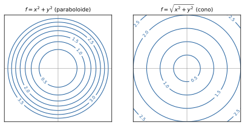

# 3 · Funzioni di più variabili

**In questo modulo.** Si usano i limiti, le derivate, Fermat, Weierstrass e la formula di Taylor del corso di Analisi 1A; per il criterio dell'Hessiana servono anche autovalori e determinanti di una matrice simmetrica, dal corso di Geometria. Si introduce lo spazio $\mathbb{R}^n$ con la sua struttura algebrica e geometrica (norma, distanza, prodotto scalare) e le nozioni topologiche che servono per parlare di limiti: intorni, punti interni e di frontiera, insiemi aperti, chiusi, limitati e compatti. Poi si studiano le funzioni $f : \mathbb{R}^n \to \mathbb{R}$: dominio, grafico, insiemi di livello, limiti e continuità, derivate parziali e direzionali, gradiente, differenziabilità e piano tangente, derivate seconde, Hessiana e teorema di Schwarz. L'ultima parte è la ricerca dei massimi e minimi liberi con il teorema di Fermat e il criterio dell'Hessiana. Alla fine del modulo si sa studiare il dominio e le curve di livello di una funzione di due variabili, decidere se un limite esiste, calcolare gradiente e piano tangente e classificare i punti critici.

## 3.1 Lo spazio euclideo $\mathbb{R}^n$

$\mathbb{R}^n$ è l'insieme delle $n$-uple ordinate di numeri reali, $x = (x_1, \dots, x_n)$; $\mathbb{R}^2$ è il piano cartesiano e $\mathbb{R}^3$ lo spazio. Un elemento di $\mathbb{R}^n$ si può pensare come un **punto** (una posizione) o come un **vettore** applicato nell'origine (uno spostamento). In questo modulo i vettori si scrivono in tondo come i punti, $x$, $v$; negli appunti a mano sono sottolineati.

Con la somma componente per componente e il prodotto per uno scalare, $\mathbb{R}^n$ è uno spazio vettoriale, con la base canonica $e_1 = (1, 0, \dots, 0)$, …, $e_n = (0, \dots, 0, 1)$: ogni vettore si scrive $x = x_1 e_1 + \dots + x_n e_n$.

> [!definizione] Prodotto scalare, norma e distanza
> Il **prodotto scalare** di $x, y \in \mathbb{R}^n$ è $x \cdot y = x_1 y_1 + \dots + x_n y_n$. La **norma** (euclidea) di $x$ è $\lVert x\rVert = \sqrt{x \cdot x} = \sqrt{x_1^2 + \dots + x_n^2}$, la distanza di $x$ dall'origine. La **distanza** fra $x$ e $y$ è $d(x, y) = \lVert x - y\rVert$.

La norma è nulla solo per il vettore nullo, è omogenea, $\lVert \alpha x\rVert = \lvert\alpha\rvert\, \lVert x\rVert$, e soddisfa la **disuguaglianza triangolare** $\lVert x + y\rVert \le \lVert x\rVert + \lVert y\rVert$. Vale la **disuguaglianza di Cauchy-Schwarz** $\lvert x \cdot y\rvert \le \lVert x\rVert\, \lVert y\rVert$, che permette di definire l'angolo $\theta \in [0, \pi]$ fra due vettori non nulli con $\cos\theta = \frac{x \cdot y}{\lVert x\rVert\, \lVert y\rVert}$; in particolare $x \cdot y = 0$ vuol dire che $x$ e $y$ sono **ortogonali**.

## 3.2 Nozioni di topologia

> [!definizione] Intorno sferico
> L'**intorno sferico** (palla aperta) di centro $x_0$ e raggio $r > 0$ è $B_r(x_0) = \{x \in \mathbb{R}^n : \lVert x - x_0\rVert < r\}$. In $\mathbb{R}^2$ è il disco senza la circonferenza, in $\mathbb{R}$ l'intervallo $(x_0 - r, x_0 + r)$.

Sia $\Omega \subseteq \mathbb{R}^n$. Un punto $x$ è **interno** a $\Omega$ se qualche $B_r(x)$ è contenuto in $\Omega$; **esterno** se qualche $B_r(x)$ è contenuto nel complementare; **di frontiera** se non è né interno né esterno, cioè se ogni intorno di $x$ contiene punti di $\Omega$ e punti del complementare. L'insieme dei punti interni è l'**interno** $\mathring{\Omega}$, quello dei punti di frontiera è la **frontiera** $\partial\Omega$, e $\bar{\Omega} = \Omega \cup \partial\Omega$ è la **chiusura**. Vale $\mathring{\Omega} \subseteq \Omega \subseteq \bar{\Omega}$.

> [!definizione] Aperti, chiusi, limitati, compatti
> $\Omega$ è **aperto** se ogni suo punto è interno ($\Omega = \mathring{\Omega}$), **chiuso** se contiene la sua frontiera ($\Omega = \bar{\Omega}$), equivalentemente se il complementare è aperto. È **limitato** se è contenuto in qualche palla $B_R(0)$. È **compatto** se è chiuso e limitato.

Le palle aperte sono aperte, le palle chiuse $\{\lVert x - x_0\rVert \le r\}$ sono chiuse; $\mathbb{R}^n$ e $\emptyset$ sono gli unici insiemi aperti e chiusi insieme. Un insieme può non essere né aperto né chiuso: la corona $\{2 < \lVert x\rVert \le 3\}$ non è aperta, perché i punti di norma 3 le appartengono ma non sono interni, e non è chiusa, perché i punti di norma 2 sono di frontiera ma non le appartengono. Le unioni di aperti e le intersezioni finite di aperti sono aperte; le intersezioni di chiusi e le unioni finite di chiusi sono chiuse.

Un punto $x_0$ è **di accumulazione** per $\Omega$ se ogni suo intorno contiene punti di $\Omega$ diversi da $x_0$; un punto di $\Omega$ che non è di accumulazione è **isolato**. Un insieme è **connesso** se, intuitivamente, è fatto di un solo pezzo: non si può scrivere come unione di due aperti disgiunti e non vuoti (relativamente a $\Omega$).

## 3.3 Funzioni di più variabili, grafici e insiemi di livello

Una funzione di più variabili reali è $f : \operatorname{dom}(f) \subseteq \mathbb{R}^n \to \mathbb{R}$. L'**immagine** è $\operatorname{im}(f) = \{f(x) : x \in \operatorname{dom}(f)\}$ e il **grafico** è il sottoinsieme di $\mathbb{R}^{n+1}$
$$G(f) = \{(x, z) \in \mathbb{R}^{n+1} : x \in \operatorname{dom}(f),\ z = f(x)\}.$$
Per $n = 2$ il grafico è una superficie nello spazio.

> [!esempio] Domini
> - $f(x, y) = \frac{x^2 + y^2}{x^2 - y^2}$: serve $x^2 \neq y^2$, cioè $y \neq \pm x$. Il dominio è il piano senza le due bisettrici.
> - $f(x, y, z) = \ln(1 - x^2 - y^2 - z^2)$: serve $x^2 + y^2 + z^2 < 1$. Il dominio è la palla aperta $B_1(0) \subseteq \mathbb{R}^3$.
> - $f(x, y) = \ln(xy - x^2)$: serve $x(y - x) > 0$, cioè $x > 0$ e $y > x$, oppure $x < 0$ e $y < x$. Il dominio è l'unione di due regioni angolari aperte del piano, delimitate dall'asse $y$ e dalla bisettrice.

> [!definizione] Insieme di livello
> Per $k \in \mathbb{R}$, l'**insieme di livello** $k$ di $f$ è $L(f, k) = \{x \in \operatorname{dom}(f) : f(x) = k\}$. Per $n = 2$ si chiama di solito **curva di livello**: è la proiezione sul piano $xy$ della sezione del grafico all'altezza $z = k$.

> [!esempio] Paraboloide e cono
> Per $f(x, y) = x^2 + y^2$ l'immagine è $[0, +\infty)$. Per $k > 0$ l'insieme di livello è la circonferenza di centro l'origine e raggio $\sqrt{k}$; per $k = 0$ è il solo punto $(0, 0)$; per $k < 0$ è vuoto. Il grafico è un **paraboloide**. Per $f(x, y) = \sqrt{x^2 + y^2}$ le curve di livello sono ancora circonferenze, di raggio $k$, e il grafico è un **cono** con vertice nell'origine. Le due famiglie si distinguono dalla spaziatura: per il cono, a livelli equispaziati corrispondono circonferenze equispaziate; per il paraboloide le circonferenze si infittiscono allontanandosi dall'origine (figura 3.1).

## 3.4 Limiti e continuità

> [!definizione] Limite
> Sia $f : \Omega \subseteq \mathbb{R}^n \to \mathbb{R}$ e $x_0$ di accumulazione per $\Omega$. Si dice che $\lim_{x \to x_0} f(x) = L \in \mathbb{R}$ se per ogni $\varepsilon > 0$ esiste $\delta > 0$ tale che $\lvert f(x) - L\rvert < \varepsilon$ per ogni $x \in \Omega$ con $0 < \lVert x - x_0\rVert < \delta$.

Valgono, come in una variabile, l'unicità del limite, l'algebra dei limiti e il teorema del confronto. $f$ è **continua** in $x_0 \in \Omega$ se $x_0$ è isolato oppure se $\lim_{x \to x_0} f(x) = f(x_0)$. Somme, prodotti, quozienti e composizioni di funzioni elementari sono continui dove sono definiti.

La differenza con una variabile è che ci si può avvicinare a $x_0$ lungo infinite curve diverse, e il limite deve esistere indipendentemente dal percorso. Ne viene un modo per dimostrare che un limite **non** esiste: trovare due curve lungo le quali si ottengono limiti diversi.

> [!esempio] Tre limiti nell'origine
> - $\lim_{(x,y) \to (0,0)} \frac{x^3}{x^2 + y^2}$. Poiché $x^2 + y^2 \ge x^2$, si ha $\left\lvert\frac{x^3}{x^2 + y^2}\right\rvert \le \frac{\lvert x\rvert^3}{x^2} = \lvert x\rvert \to 0$: il limite è 0 per confronto.
> - $\lim_{(x,y) \to (0,0)} \frac{x + y}{x - y}$. Lungo l'asse $x$ ($y = 0$) la funzione vale 1, lungo l'asse $y$ ($x = 0$) vale $-1$: il limite non esiste.
> - $\lim_{(x,y) \to (0,0)} \frac{x^2 y}{x^4 + y^2}$. Lungo ogni retta $y = mx$ si ottiene $\frac{m x^3}{x^4 + m^2 x^2} = \frac{m x}{x^2 + m^2} \to 0$. Ma lungo la parabola $y = x^2$ la funzione vale $\frac{x^4}{2x^4} = \frac{1}{2}$: il limite non esiste. Provare tutte le rette non basta.

In $\mathbb{R}^2$, per i limiti nell'origine conviene spesso passare alle **coordinate polari** $x = \rho\cos\theta$, $y = \rho\sin\theta$, con $(x, y) \to (0, 0)$ che diventa $\rho \to 0^+$ per ogni $\theta$.

> [!teorema] Criterio in coordinate polari
> Se esistono $L \in \mathbb{R}$ e una funzione $g(\rho)$, che dipende solo da $\rho$, con $\lvert f(\rho\cos\theta, \rho\sin\theta) - L\rvert \le g(\rho)$ per ogni $\theta$ e ogni $\rho$ piccolo, e $g(\rho) \to 0$ per $\rho \to 0^+$, allora $\lim_{(x,y) \to (0,0)} f(x, y) = L$.

Per il primo esempio: $\left\lvert\frac{\rho^3\cos^3\theta}{\rho^2}\right\rvert = \rho\lvert\cos\theta\rvert^3 \le \rho \to 0$. Il punto essenziale è che la maggiorazione deve valere **uniformemente** in $\theta$: per $\frac{x^2 y}{x^4 + y^2}$ in polari si ottiene $\frac{\rho\cos^2\theta\sin\theta}{\rho^2\cos^4\theta + \sin^2\theta}$, che tende a 0 per ogni $\theta$ fissato ma non si maggiora con una $g(\rho)$ indipendente da $\theta$.

## 3.5 Derivate parziali, gradiente, derivate direzionali

> [!definizione] Derivata parziale e gradiente
> Sia $x_0$ interno al dominio di $f$. La **derivata parziale** di $f$ rispetto a $x_i$ in $x_0$ è, se esiste finito,
> $$\frac{\partial f}{\partial x_i}(x_0) = \lim_{h \to 0} \frac{f(x_0 + h e_i) - f(x_0)}{h}.$$
> Se esistono tutte, $f$ si dice **derivabile** in $x_0$ e il vettore $\nabla f(x_0) = \left(\frac{\partial f}{\partial x_1}(x_0), \dots, \frac{\partial f}{\partial x_n}(x_0)\right)$ si chiama **gradiente**.

In pratica la derivata rispetto a $x$ si calcola derivando come in una variabile e trattando le altre variabili come costanti.

> [!esempio] Un gradiente
> $f(x, y, z) = x\ln(x + y - z)$, definita per $x + y - z > 0$:
> $$\frac{\partial f}{\partial x} = \ln(x + y - z) + \frac{x}{x + y - z}, \quad \frac{\partial f}{\partial y} = \frac{x}{x + y - z}, \quad \frac{\partial f}{\partial z} = -\frac{x}{x + y - z}.$$

> [!definizione] Derivata direzionale
> Sia $v \in \mathbb{R}^n$ non nullo (di solito un versore, $\lVert v\rVert = 1$). La **derivata direzionale** di $f$ in $x_0$ lungo $v$ è
> $$D_v f(x_0) = \frac{\partial f}{\partial v}(x_0) = \lim_{h \to 0} \frac{f(x_0 + hv) - f(x_0)}{h}.$$

Le derivate parziali sono le derivate direzionali lungo i vettori della base canonica. Per $f(x, y) = x^2 + y^3$, $x_0 = (0, 1)$ e $v = (1, 1)$:
$$D_v f(0, 1) = \lim_{h \to 0} \frac{h^2 + (1 + h)^3 - 1}{h} = \lim_{h \to 0} (3 + 4h + h^2) = 3.$$

In più variabili la derivabilità **non** implica la continuità, perché le derivate parziali guardano solo lungo gli assi.

> [!aggiunta] Aggiunta in revisione · fonte: Canuto-Tabacco, *Analisi Matematica 2* (AM1B-03)
> **Derivabile ma non continua.** Sia $f(x, y) = \frac{xy}{x^2 + y^2}$ per $(x, y) \neq (0, 0)$ e $f(0, 0) = 0$. Sugli assi $f$ è nulla, quindi $\frac{\partial f}{\partial x}(0, 0) = \frac{\partial f}{\partial y}(0, 0) = 0$: la funzione è derivabile nell'origine. Ma lungo la retta $y = x$ vale $\frac{1}{2}$, quindi non ha limite 0 e non è continua nell'origine.

## 3.6 Differenziabilità e piano tangente

Serve una nozione più forte della derivabilità, che controlli tutte le direzioni insieme.

> [!definizione] Funzione differenziabile
> $f$, derivabile nel punto interno $x_0$, è **differenziabile** in $x_0$ se
> $$f(x) = f(x_0) + \nabla f(x_0) \cdot (x - x_0) + o(\lVert x - x_0\rVert) \quad \text{per } x \to x_0,$$
> cioè se $\displaystyle\lim_{x \to x_0} \frac{f(x) - f(x_0) - \nabla f(x_0) \cdot (x - x_0)}{\lVert x - x_0\rVert} = 0$.

> [!teorema] Conseguenze della differenziabilità
> Se $f$ è differenziabile in $x_0$: $f$ è continua in $x_0$; ha derivata direzionale lungo ogni $v \neq 0$; e vale la **formula del gradiente** $D_v f(x_0) = \nabla f(x_0) \cdot v$.

Per l'esempio del paragrafo 3.5, $\nabla f(0, 1) = (0, 3)$ e $\nabla f(0, 1) \cdot (1, 1) = 3$, come trovato con la definizione.

> [!aggiunta] Aggiunta in revisione · fonte: Canuto-Tabacco, *Analisi Matematica 2* (AM1B-04, AM1B-05)
> **Significato del gradiente.** Dalla formula del gradiente e da Cauchy-Schwarz, fra le direzioni unitarie $v$ la derivata direzionale $\nabla f(x_0) \cdot v$ è massima per $v = \frac{\nabla f(x_0)}{\lVert\nabla f(x_0)\rVert}$ e nulla per $v$ ortogonale al gradiente. Il gradiente indica quindi la direzione di massima crescita di $f$, ed è ortogonale all'insieme di livello che passa per $x_0$, lungo il quale $f$ non cambia.

Per $n = 2$ la differenziabilità vuol dire che il grafico ha nel punto $(x_0, y_0, f(x_0, y_0))$ un **piano tangente**, di equazione
$$z = f(x_0, y_0) + \frac{\partial f}{\partial x}(x_0, y_0)(x - x_0) + \frac{\partial f}{\partial y}(x_0, y_0)(y - y_0).$$

Verificare la differenziabilità con la definizione è laborioso; di solito si usa una condizione sufficiente.

> [!teorema] Teorema del differenziale totale
> Se le derivate parziali di $f$ esistono in un intorno di $x_0$ e sono continue in $x_0$, allora $f$ è differenziabile in $x_0$. In particolare le funzioni di classe $C^1$ su un aperto sono differenziabili in ogni punto.

> [!esempio] Piano tangente
> $f(x, y) = x^3 + y^3 + xy$ è un polinomio, quindi di classe $C^1$. Si ha $\nabla f(x, y) = (3x^2 + y, 3y^2 + x)$, $\nabla f(1, 1) = (4, 4)$ e $f(1, 1) = 3$. Il piano tangente al grafico in $(1, 1, 3)$ è $z = 3 + 4(x - 1) + 4(y - 1)$, cioè $z = 4x + 4y - 5$.

## 3.7 Derivate seconde, Hessiana e teorema di Schwarz

Se le derivate parziali esistono in un intorno, si possono derivare di nuovo: $\frac{\partial^2 f}{\partial x_j \partial x_i} = \frac{\partial}{\partial x_j}\frac{\partial f}{\partial x_i}$. Per $i = j$ si parla di **derivata pura**, per $i \neq j$ di **derivata mista**; si scrive anche $f_{x_i x_j}$.

> [!definizione] Matrice Hessiana
> Se in $x_0$ esistono tutte le derivate seconde, la **matrice Hessiana** è la matrice $n \times n$ $H_f(x_0)$ che ha nella riga $i$ e colonna $j$ la derivata $\frac{\partial^2 f}{\partial x_i \partial x_j}(x_0)$. $f$ è **di classe $C^2$** su un aperto se tutte le derivate seconde esistono e sono continue.

> [!teorema] Teorema di Schwarz
> Se $f$ è di classe $C^2$ sull'aperto $\Omega$, per ogni $x_0 \in \Omega$ e ogni $i$, $j$ le derivate miste coincidono: $\frac{\partial^2 f}{\partial x_i \partial x_j}(x_0) = \frac{\partial^2 f}{\partial x_j \partial x_i}(x_0)$. Quindi l'Hessiana è una matrice simmetrica.

Per $f$ di classe $C^2$ vale la **formula di Taylor del secondo ordine**:
$$f(x) = f(x_0) + \nabla f(x_0) \cdot (x - x_0) + \frac{1}{2}(x - x_0)^T H_f(x_0)(x - x_0) + o(\lVert x - x_0\rVert^2).$$
Il termine quadratico fa la parte della derivata seconda in una variabile: descrive come il grafico si incurva vicino al punto.

## 3.8 Massimi e minimi liberi

> [!definizione] Estremi locali e globali
> $x_0 \in \operatorname{dom}(f)$ è un punto di **minimo locale** se esiste $\varepsilon > 0$ tale che $f(x) \ge f(x_0)$ per ogni $x \in B_\varepsilon(x_0) \cap \operatorname{dom}(f)$; di **massimo locale** se vale $f(x) \le f(x_0)$. È di minimo (massimo) **globale** su $A$ se la disuguaglianza vale per ogni $x \in A$. Massimi e minimi si chiamano **estremi**.

> [!teorema] Teorema di Weierstrass
> Una funzione continua su un insieme compatto (chiuso e limitato) $K$ ha in $K$ almeno un punto di massimo globale e almeno un punto di minimo globale.

> [!definizione] Punto critico
> Un punto $x_0$ in cui $f$ è derivabile si dice **critico** (o stazionario) se $\nabla f(x_0) = 0$.

> [!teorema] Teorema di Fermat
> Se $x_0$ è interno al dominio, $f$ è derivabile in $x_0$ e $x_0$ è un estremo locale, allora $\nabla f(x_0) = 0$.

*Dimostrazione.* Per ogni $i$ la funzione di una variabile $g(t) = f(x_0 + t e_i)$ ha un estremo locale in $t = 0$, ed è derivabile in 0 con $g'(0) = \frac{\partial f}{\partial x_i}(x_0)$. Per il teorema di Fermat in una variabile $g'(0) = 0$. $\square$

Come in una variabile il viceversa è falso: $f(x, y) = xy$ ha gradiente nullo nell'origine, ma ha valori positivi nel primo e terzo quadrante e negativi negli altri due. Un punto critico che non è né di massimo né di minimo si chiama **punto di sella**. Gli estremi di $f$ su un insieme vanno quindi cercati fra i punti critici interni, i punti interni in cui $f$ non è derivabile (come il vertice del cono $\sqrt{x^2 + y^2}$) e i punti della frontiera.

> [!teorema] Criterio dell'Hessiana
> Sia $x_0$ un punto critico e $f$ di classe $C^2$ in un suo intorno.
> 1. Se $H_f(x_0)$ è definita positiva (tutti gli autovalori positivi), $x_0$ è un minimo locale.
> 2. Se è definita negativa (tutti gli autovalori negativi), $x_0$ è un massimo locale.
> 3. Se è indefinita (autovalori di segno opposto), $x_0$ è un punto di sella.
> 4. Se è semidefinita (qualche autovalore nullo e gli altri dello stesso segno), il criterio non decide.

Per $n = 2$, con $\Delta = \det H_f(x_0) = f_{xx} f_{yy} - f_{xy}^2$:

- $\Delta > 0$ e $f_{xx} > 0$: minimo locale;
- $\Delta > 0$ e $f_{xx} < 0$: massimo locale;
- $\Delta < 0$: punto di sella;
- $\Delta = 0$: caso dubbio.

> [!esempio] Cinque punti critici nell'origine
> In tutti i casi l'unico punto critico è $(0, 0)$.
> - $x^2 + y^2$: $H = \operatorname{diag}(2, 2)$, $\Delta = 4 > 0$, $f_{xx} > 0$: minimo (globale).
> - $-x^2 - y^2$: $H = \operatorname{diag}(-2, -2)$, $\Delta = 4$, $f_{xx} < 0$: massimo.
> - $x^2 - y^2$: $H = \operatorname{diag}(2, -2)$, $\Delta = -4 < 0$: sella; la funzione cresce lungo l'asse $x$ e decresce lungo l'asse $y$.
> - $x^2 + y^4$: $H(0, 0) = \operatorname{diag}(2, 0)$, $\Delta = 0$, caso dubbio. Ma $f \ge 0 = f(0, 0)$ ovunque: minimo globale.
> - $(y - x^2)(y - 2x^2) = y^2 - 3x^2 y + 2x^4$: $\nabla f = (8x^3 - 6xy, 2y - 3x^2)$ si annulla in $(0, 0)$, $H(0, 0) = \operatorname{diag}(0, 2)$, caso dubbio. Studiando il segno: $f < 0$ fra le due parabole, cioè per $x^2 < y < 2x^2$, e $f > 0$ fuori. In ogni intorno dell'origine ci sono valori dei due segni: è un punto di sella, anche se lungo ogni retta per l'origine la funzione ha un minimo in 0.

## Esempi ed esercizi svolti

**Esercizio 1.** Gradiente di $f(x, y, z) = \sin\left(\frac{xy^2}{1 + z^2}\right)$ nel punto $(0, 1, 1)$. Con la regola della catena:
$$\frac{\partial f}{\partial x} = \cos\left(\tfrac{xy^2}{1+z^2}\right)\frac{y^2}{1 + z^2}, \quad \frac{\partial f}{\partial y} = \cos\left(\tfrac{xy^2}{1+z^2}\right)\frac{2xy}{1 + z^2}, \quad \frac{\partial f}{\partial z} = -\cos\left(\tfrac{xy^2}{1+z^2}\right)\frac{2xy^2 z}{(1 + z^2)^2}.$$
In $(0, 1, 1)$ l'argomento del coseno è 0, e $\nabla f(0, 1, 1) = \left(\frac{1}{2}, 0, 0\right)$.

**Esercizio 2.** Punti critici di $f(x, y) = x^3 - 3x + y^2$. $\nabla f = (3x^2 - 3, 2y) = 0$ dà $(1, 0)$ e $(-1, 0)$. L'Hessiana è $\begin{pmatrix} 6x & 0 \\ 0 & 2 \end{pmatrix}$. In $(1, 0)$: $\Delta = 12 > 0$, $f_{xx} = 6 > 0$, minimo locale. In $(-1, 0)$: $\Delta = -12 < 0$, sella. Non ci sono estremi globali, perché $f(x, 0) = x^3 - 3x$ è illimitata sopra e sotto.

**Esercizio 3.** Massimo e minimo di $f(x, y) = x^2 + y^2 - 2x$ sul disco chiuso $K = \{x^2 + y^2 \le 4\}$. $K$ è compatto e $f$ continua: per Weierstrass gli estremi esistono. All'interno, $\nabla f = (2x - 2, 2y) = 0$ dà $(1, 0)$, con $f(1, 0) = -1$. Sulla frontiera $x^2 + y^2 = 4$ la funzione vale $4 - 2x$ con $x \in [-2, 2]$: minimo 0 in $(2, 0)$, massimo 8 in $(-2, 0)$. Confrontando: il minimo globale è $-1$ in $(1, 0)$, il massimo globale è 8 in $(-2, 0)$.

## Riepilogo

$\mathbb{R}^n$ è uno spazio vettoriale con prodotto scalare, norma e distanza, e la disuguaglianza di Cauchy-Schwarz. Con le palle aperte si definiscono punti interni, esterni e di frontiera, insiemi aperti, chiusi, limitati e compatti. Una funzione di più variabili ha un dominio, un grafico e insiemi di livello, che per due variabili sono le curve di livello. Il limite deve essere lo stesso lungo ogni percorso: due percorsi con limiti diversi provano che non esiste, una maggiorazione uniforme (in coordinate polari) prova che esiste. Le derivate parziali formano il gradiente; la derivabilità non dà la continuità, la differenziabilità sì, e con essa la formula del gradiente per le derivate direzionali e il piano tangente; una funzione $C^1$ è differenziabile. Per le funzioni $C^2$ l'Hessiana è simmetrica (Schwarz) e compare nella formula di Taylor del secondo ordine. Gli estremi interni sono punti critici (Fermat); il segno degli autovalori dell'Hessiana, o in due variabili il segno del determinante e di $f_{xx}$, li classifica in minimi, massimi e selle, tranne nel caso semidefinito, in cui si studia direttamente il segno di $f - f(x_0)$. Su un compatto gli estremi globali esistono (Weierstrass) e si cercano fra i punti critici interni e la frontiera.
