# Architettura dei Calcolatori

**Appunti del corso · a.a. 2026/27 · Mobius**

Appunti personali e non ufficiali, rivisti e confrontati con il programma ufficiale del corso. Non sostituiscono le lezioni né i testi consigliati.

## Indice

1. Astrazione, prestazioni e l'ISA RISC-V
2. Programmazione in assembly RISC-V
3. L'ALU e l'aritmetica del calcolatore
4. Il processore, la pipeline e il parallelismo fra istruzioni
5. La gerarchia di memoria, la cache e l'input/output

## 1 · Astrazione, prestazioni e l'ISA RISC-V

**In questo modulo.** Prerequisiti: porte, registri e complemento a 2 (Reti Logiche). Livelli di astrazione e modello di von Neumann; come si misurano le prestazioni (equazione del tempo di CPU, legge di Amdahl); l'ISA RISC-V: registri, memoria, i sei formati con la disposizione dei campi, le istruzioni principali. Alla fine si confrontano due macchine con l'equazione delle prestazioni e si codifica e decodifica a mano un'istruzione. All'orale si chiede spesso l'ordine dei formati R, I, S, B, U, J e perché i campi sono disposti così (1.5).

### 1.1 Livelli di astrazione e interfacce

Ogni livello offre servizi a quello sopra attraverso un'**interfaccia** e nasconde come li realizza. Dal basso:

| Livello | Che cosa contiene |
|---|---|
| dispositivi e porte | transistor, porte logiche |
| reti | sommatori, registri, memorie |
| microarchitettura | organizzazione dei blocchi che eseguono le istruzioni (datapath, pipeline, cache) |
| **ISA** | istruzioni, codifica, registri, accesso alla memoria: confine hardware/software |
| sistema operativo | gestione delle risorse, astrazioni (file, processi) |
| linguaggi e applicazioni | compilatori, programmi |

- L'**ISA** dice *che cosa* fa ogni istruzione, non *come*: processori diversi con la stessa ISA eseguono gli stessi programmi. Per questo il software sopravvive a molte generazioni di hardware.
- **Virtualizzazione**: uno strato di software che realizza un'interfaccia sopra un'altra.
  - *macchina virtuale di processo*: un ambiente diverso per un programma (macchina virtuale Java, emulatore di un'altra ISA);
  - *macchina virtuale di sistema*: un'intera macchina su cui gira un sistema operativo (*hypervisor*).

### 1.2 Il modello di von Neumann

- **CPU** (ALU + unità di controllo), **memoria** unica per dati e istruzioni, **ingresso e uscita**, collegati da bus.
- **Programma memorizzato**: le istruzioni sono numeri in memoria; si riprogramma la macchina cambiando la memoria, non i collegamenti.

**Il ciclo dell'istruzione.**

| Passo | Che cosa | Stadio della pipeline (modulo 4) |
|---|---|---|
| prelievo | legge l'istruzione all'indirizzo nel **PC** | IF |
| decodifica | capisce l'istruzione, legge i registri | ID |
| esecuzione | ALU, o calcolo di un indirizzo | EX |
| memoria | legge o scrive un dato, se serve | MEM |
| scrittura | risultato nel registro; PC aggiornato | WB |

**Collo di bottiglia di von Neumann**: tutte le istruzioni e tutti i dati passano dal collegamento CPU-memoria, e la memoria è molto più lenta. Risposta: le cache (modulo 5).

### 1.3 Le prestazioni

- **Tempo di esecuzione** (interessa all'utente) e **throughput** (lavoro per unità di tempo, interessa a chi gestisce un server).
- A è $n$ volte più veloce di B se $\frac{\text{Prestazione}_A}{\text{Prestazione}_B} = \frac{T_B}{T_A} = n$.

**Equazione delle prestazioni.**
$$T_{CPU} = N_{istr} \times CPI \times T_{clk} = \frac{N_{istr} \times CPI}{f}.$$

| Fattore | Da che cosa dipende |
|---|---|
| $N_{istr}$ | programma, compilatore, ISA |
| CPI (cicli per istruzione) | microarchitettura, tipo di istruzioni |
| $T_{clk}$ | tecnologia, microarchitettura |

$$CPI = \sum_i \phi_i \, CPI_i \qquad (\phi_i = \text{frazione di istruzioni della classe } i).$$

> [!esempio] Due compilatori
> Compilatore 1: 2 milioni di istruzioni A (CPI 1), 1 di B (CPI 2), 1 di C (CPI 3). Compilatore 2: 4, 1, 1 milioni. Cicli: 7 milioni contro 9 milioni. CPI: 1,75 contro 1,5. Il secondo ha il CPI migliore ma è più lento: conta il prodotto $N_{istr} \times CPI$.

- Il **MIPS** (milioni di istruzioni al secondo) non è una buona misura: dipende dal programma e dall'ISA.
- Giudicare un processore dalla sola frequenza è lo stesso errore.

> [!teorema] Legge di Amdahl
> Se un miglioramento accelera di $k$ la frazione $F$ del tempo di esecuzione:
> $$T' = T\left((1 - F) + \frac{F}{k}\right), \qquad S = \frac{1}{(1 - F) + F/k}.$$

- Limite: con $k \to \infty$, $S \to \frac{1}{1 - F}$. Con $F = 0{,}8$ al massimo 5 volte più veloce.
- Regola pratica: rendere veloce il caso frequente.

### 1.4 L'ISA RISC-V: registri e memoria

**RISC-V**: ISA aperta (Berkeley, dal 2010), **RISC**: poche istruzioni semplici, tutte di 32 bit in RV32I, operazioni solo fra registri, memoria solo con load e store (**load/store**).

**Principi di progetto.** La semplicità favorisce la regolarità; più piccolo è più veloce; rendere veloce il caso frequente; un buon progetto richiede buoni compromessi.

**Registri** (32 da 32 bit, `x0` … `x31`):

| Registro | Nome | Uso | Preservato dalle chiamate? |
|---|---|---|---|
| `x0` | `zero` | sempre 0 | – |
| `x1` | `ra` | indirizzo di ritorno | sì |
| `x2` | `sp` | cima dello stack | sì |
| `x3`, `x4` | `gp`, `tp` | puntatore globale, al thread | – |
| `x5`–`x7`, `x28`–`x31` | `t0`–`t6` | temporanei | no |
| `x8`, `x9`, `x18`–`x27` | `s0`–`s11` | salvati (`s0` = frame pointer `fp`) | sì |
| `x10`–`x17` | `a0`–`a7` | argomenti; `a0`, `a1` valori di ritorno | no |

Perché `x0`: costanti e operazioni utili senza istruzioni apposite (`mv` = `addi rd, rs, 0`; `nop` = `addi x0, x0, 0`; `j` = `jal x0, …`).

**Memoria.**

- indirizzata al **byte**; parola = 4 byte, di solito a indirizzi multipli di 4 (**allineamento**);
- **little endian**: il byte meno significativo all'indirizzo più basso. `0x12345678` all'indirizzo 100: byte 100 = `0x78`, 101 = `0x56`, 102 = `0x34`, 103 = `0x12`.

### 1.5 I formati delle istruzioni

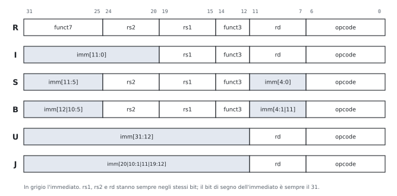

| Formato | Per che cosa | Esempi |
|---|---|---|
| **R** | operazioni fra registri | `add`, `sub`, `and`, `slt`, `sll` |
| **I** | immediato di 12 bit, load, `jalr` | `addi`, `lw`, `jalr`, `slli` |
| **S** | store | `sw`, `sb` |
| **B** | salti condizionati | `beq`, `bne`, `blt`, `bge` |
| **U** | immediato di 20 bit alti | `lui`, `auipc` |
| **J** | salto incondizionato | `jal` |

**I campi fissi.**

| Campo | Bit | Che cosa |
|---|---|---|
| opcode | 6-0 | formato e famiglia |
| rd | 11-7 | registro di destinazione (R, I, U, J) |
| funct3 | 14-12 | distingue le istruzioni con lo stesso opcode |
| rs1 | 19-15 | primo registro sorgente |
| rs2 | 24-20 | secondo registro sorgente (R, S, B) |
| funct7 | 31-25 | distingue ancora (`add`/`sub`: bit 30) |

**Perché i campi sono disposti così.**

- **rs1, rs2, rd sempre negli stessi bit**: il banco dei registri si legge in ID prima di sapere che istruzione è (modulo 4).
- **S spezza l'immediato** (11:5 e 4:0) per lasciare rs2 al suo posto: una store non ha rd, e i bit 11-7 ospitano un pezzo dell'immediato.
- **B è S con i bit rimescolati**: l'offset è in multipli di 2 byte (il bit 0 vale sempre 0 e non si scrive), e i bit sono messi in modo che ognuno stia, quando possibile, nella stessa posizione che ha in S e in I: il generatore degli immediati usa meno multiplexer.
- **U e J** hanno 20 bit di immediato; J rimescola i bit per lo stesso motivo di B.
- **Il bit 31 è sempre il segno** dell'immediato: l'estensione del segno parte prima di sapere il formato.

**Gli immediati.**

- 12 bit in I, S, B, estesi con il segno: un immediato I va da $-2048$ a $2047$.
- B e J: **offset** rispetto al PC in mezze parole (salti di ±4 KiB per B, ±1 MiB per J).
- Costanti di 32 bit: `lui` (20 bit alti) + `addi` (12 bassi). Se il bit 11 della parte bassa è 1, `addi` sottrae: la parte alta va aumentata di 1.

> [!esempio] Codificare `add x9, x20, x21`
> Tipo R: opcode `0110011`, funct3 `000`, funct7 `0000000`, rd = 9 (`01001`), rs1 = 20 (`10100`), rs2 = 21 (`10101`). Dal bit 31 al bit 0:
> $$\underbrace{0000000}_{funct7}\ \underbrace{10101}_{rs2}\ \underbrace{10100}_{rs1}\ \underbrace{000}_{funct3}\ \underbrace{01001}_{rd}\ \underbrace{0110011}_{opcode}$$
> cioè `0000 0001 0101 1010 0000 0100 1011 0011` = `0x015A04B3`.

**Decodificare a mano**, in quest'ordine: (1) i 7 bit bassi danno l'opcode e quindi il formato; (2) si leggono rd, funct3, rs1, rs2 dalle posizioni fisse; (3) si ricompone l'immediato secondo il formato; (4) funct3 e funct7 danno l'istruzione.

### 1.6 Le istruzioni principali

| Famiglia | Istruzioni | Note |
|---|---|---|
| aritmetiche e logiche | `add`, `sub`, `and`, `or`, `xor`; `addi`, `andi`, `ori`, `xori` | non c'è `subi`: `addi` con immediato negativo |
| shift | `sll`, `srl` (entra 0), `sra` (entra il segno); `slli`, `srli`, `srai` | shift a sinistra di $k$ = × $2^k$ |
| confronti | `slt`, `sltu`, `slti` | risultato 0 o 1 in un registro: niente flag |
| memoria | `lw`, `sw`; `lb`, `lbu`, `sb`; `lh`, `lhu`, `sh` | solo base + spiazzamento; `lb` estende il segno, `lbu` con zeri |
| salti condizionati | `beq`, `bne`, `blt`, `bge`, `bltu`, `bgeu` | offset relativo al PC |
| salti incondizionati | `jal rd, etichetta`; `jalr rd, off(rs1)` | salvano PC + 4 in rd; con `ra` sono chiamate, con `x0` salti semplici |

**Pseudo-istruzioni** (le traduce l'assemblatore): `li`, `mv`, `nop`, `j`, `ret` (`jalr x0, 0(ra)`), `la`, `call`, `bgt` e `ble` (operandi scambiati), `neg`, `not`.

**Modi di indirizzamento.** Immediato (`addi`), registro (`add`), base + spiazzamento (`lw`, `sw`), relativo al PC (salti, `auipc`).

### Esempi ed esercizi svolti

**Esercizio 1. Codificare quattro istruzioni.** Scrivere in esadecimale (a) `sub x5, x6, x7`, (b) `addi x5, x6, -12`, (c) `lw x10, 8(x2)`, (d) `sw x10, 12(x2)`.

(a) Tipo R con funct7 `0100000` (è il bit che distingue `sub` da `add`), rs2 = 7, rs1 = 6, funct3 `000`, rd = 5, opcode `0110011`: `0x407302B3`.

(b) Tipo I, opcode `0010011`, funct3 `000`. L'immediato $-12$ su 12 bit in complemento a 2 è `111111110100`. Con rs1 = 6 e rd = 5: `0xFF430293`. Le prime tre cifre esadecimali, `FF4`, sono proprio l'immediato.

(c) Tipo I con opcode `0000011` e funct3 `010` (parola): immediato 8, rs1 = 2, rd = 10: `0x00812503`.

(d) Tipo S, opcode `0100011`, funct3 `010`. L'immediato 12 = `000000001100` si spezza: imm[11:5] = `0000000` nei bit 31-25, imm[4:0] = `01100` nei bit 11-7. Con rs2 = 10 (il dato da scrivere) e rs1 = 2 (la base): `0x00A12623`.

**Esercizio 2. Decodificare.** Che istruzioni sono `0x40B50533` e `0x00C58593`?

`0x40B50533` = `0100 0000 1011 0101 0000 0101 0011 0011`. Opcode `0110011`: tipo R. funct3 = `000`, funct7 = `0100000`: è una `sub`. rd = bit 11-7 = `01010` = 10, rs1 = `01010` = 10, rs2 = `01011` = 11. È `sub x10, x10, x11`, cioè `sub a0, a0, a1`.

`0x00C58593` = `0000 0000 1100 0101 1000 0101 1001 0011`. Opcode `0010011` con funct3 `000`: `addi`. rd = `01011` = 11, rs1 = `01011` = 11, immediato = `000000001100` = 12. È `addi a1, a1, 12`.

**Esercizio 3. Il CPI medio e il confronto fra due macchine.** Un programma ha il 50% di istruzioni ALU, il 20% di load, il 10% di store e il 20% di salti. Sulla macchina A i CPI sono 1, 5, 3, 2 e il clock è a 2 GHz; sulla macchina B sono 1, 2, 2, 2 con clock a 1,5 GHz. Quale macchina è più veloce, e di quanto?

$CPI_A = 0{,}5 + 1 + 0{,}3 + 0{,}4 = 2{,}2$; $CPI_B = 0{,}5 + 0{,}4 + 0{,}2 + 0{,}4 = 1{,}5$. Il numero di istruzioni è lo stesso (stessa ISA, stesso programma), quindi si confrontano i tempi per istruzione: $\frac{2{,}2}{2\ \text{GHz}} = 1{,}1$ ns per A, $\frac{1{,}5}{1{,}5\ \text{GHz}} = 1{,}0$ ns per B. B è più veloce di $\frac{1{,}1}{1{,}0} = 1{,}1$ volte, nonostante il clock più lento.

**Esercizio 4. Amdahl.** In un programma i calcoli in virgola mobile occupano il 40% del tempo. Conviene un'unità in virgola mobile 10 volte più veloce o un miglioramento che accelera tutto del 30%?

Con l'unità nuova: $S = \frac{1}{0{,}6 + 0{,}04} = 1{,}5625$. Con l'accelerazione generale, $S = 1{,}3$. Conviene la prima. Anche con un'unità infinitamente veloce, però, non si andrebbe oltre $\frac{1}{0{,}6} = 1{,}67$.

**Esercizio 5. Costanti di 32 bit.** Come si carica `0x12345678` in `t0`?

`lui t0, 0x12345` mette `0x12345000` in `t0`; `addi t0, t0, 0x678` aggiunge i 12 bit bassi. Funziona perché `0x678` ha il bit 11 a 0. Se i 12 bit bassi avessero il bit 11 a 1, `addi` li estenderebbe con il segno come numero negativo, e bisognerebbe caricare con `lui` la parte alta aumentata di 1: è il conto che fa l'assemblatore quando si scrive la pseudo-istruzione `li t0, 0x12345678`.

### Esercizi guidati

Ogni esercizio è diviso in passi: si prova un passo alla volta e si confronta solo dopo.

**Guidato 1. Codificare un salto condizionato.** Codificare `beq x5, x6, +16` (il salto va 16 byte avanti).

*Passo 1: il formato.* `beq` è di tipo B, opcode `1100011`, funct3 `000`.

*Passo 2: l'immediato.* L'offset 16 su 13 bit è `0 0000 0001 0000`: imm[12] = 0, imm[11] = 0, imm[10:5] = `000000`, imm[4:1] = `1000`.

*Passo 3: i campi al loro posto.* Bit 31 = imm[12] = 0; bit 30-25 = imm[10:5] = `000000`; rs2 = 6 = `00110`; rs1 = 5 = `00101`; funct3 = `000`; bit 11-8 = imm[4:1] = `1000`; bit 7 = imm[11] = 0; opcode `1100011`.

*Passo 4: il risultato.* `0000 0000 0110 0010 1000 1000 0110 0011` = `0x00628863`.

**Guidato 2. Quanto si guadagna con un clock più veloce?** Un programma impiega 10 s sulla macchina A con clock a 2 GHz. Si vuole una macchina B che lo esegua in 6 s; con un clock più veloce, però, B ha bisogno di 1,2 volte i cicli di A. Che frequenza serve?

*Passo 1: i cicli di A.* $\text{cicli}_A = T \times f = 10 \times 2 \cdot 10^9 = 2 \cdot 10^{10}$.

*Passo 2: i cicli di B.* $1{,}2 \times 2 \cdot 10^{10} = 2{,}4 \cdot 10^{10}$.

*Passo 3: la frequenza.* $f_B = \frac{2{,}4 \cdot 10^{10}}{6\ \text{s}} = 4$ GHz.

*Passo 4: il controllo.* $\frac{2{,}4 \cdot 10^{10}}{4 \cdot 10^9} = 6$ s. Raddoppiare la frequenza non basta a dimezzare il tempo, perché i cicli aumentano.

**Guidato 3. Little endian.** All'indirizzo 200 c'è la parola `0xA1B2C3D4`. Che cosa carica `lbu t0, 201(zero)`? E `lb t1, 200(zero)`?

*Passo 1: i byte in memoria.* Little endian: 200 → `D4`, 201 → `C3`, 202 → `B2`, 203 → `A1`.

*Passo 2: `lbu`.* Carica `0xC3` ed estende con zeri: `t0` = `0x000000C3` = 195.

*Passo 3: `lb`.* Carica `0xD4`, il cui bit 7 è 1, ed estende il segno: `t1` = `0xFFFFFFD4` = $-44$.

### Riepilogo

Un calcolatore si organizza in livelli di astrazione separati da interfacce, la più importante delle quali è l'ISA, il confine fra hardware e software; la virtualizzazione realizza un'interfaccia sopra un'altra. Il modello di von Neumann mette dati e istruzioni nella stessa memoria e le esegue con il ciclo prelievo-decodifica-esecuzione. Il tempo di CPU è il prodotto di numero di istruzioni, CPI e periodo del clock; nessuno dei tre fattori da solo misura le prestazioni, e la legge di Amdahl limita il guadagno di ogni miglioramento parziale. RISC-V è un'ISA load/store con 32 registri (`x0` sempre nullo), memoria indirizzata al byte e little endian, e istruzioni da 32 bit in sei formati (R, I, S, B, U, J) con i campi dei registri sempre negli stessi bit; gli immediati si estendono con il segno, e gli offset dei salti sono relativi al PC.

### Formulario

#### Prestazioni

$$T_{CPU} = N_{istr} \cdot CPI \cdot T_{clk}, \qquad CPI = \sum_i \phi_i CPI_i, \qquad \frac{\text{Prest}_A}{\text{Prest}_B} = \frac{T_B}{T_A}, \qquad S_{Amdahl} = \frac{1}{(1 - F) + F/k} \le \frac{1}{1 - F}.$$

#### Formati RV32I

| Formato | Campi (dal bit 31 al bit 0) |
|---|---|
| R | funct7 · rs2 · rs1 · funct3 · rd · opcode |
| I | imm[11:0] · rs1 · funct3 · rd · opcode |
| S | imm[11:5] · rs2 · rs1 · funct3 · imm[4:0] · opcode |
| B | imm[12, 10:5] · rs2 · rs1 · funct3 · imm[4:1, 11] · opcode |
| U | imm[31:12] · rd · opcode |
| J | imm[20, 10:1, 11, 19:12] · rd · opcode |

Opcode più usati: `0110011` R, `0010011` I aritmetiche, `0000011` load, `0100011` store, `1100011` branch, `1101111` `jal`, `1100111` `jalr`, `0110111` `lui`.

#### Termini per l'orale

| Termine | In una riga |
|---|---|
| ISA | insieme di istruzioni, registri e regole che un programma vede |
| Microarchitettura | organizzazione interna che realizza un'ISA |
| Macchina virtuale di processo / di sistema | ambiente per un programma / per un intero sistema operativo |
| Programma memorizzato | istruzioni e dati nella stessa memoria |
| CPI | numero medio di cicli per istruzione |
| RISC | ISA con poche istruzioni semplici e di lunghezza fissa |
| Architettura load/store | solo load e store accedono alla memoria |
| Little endian | il byte meno significativo all'indirizzo più basso |
| Estensione del segno | ripetere il bit di segno per allungare un numero |
| Pseudo-istruzione | istruzione dell'assemblatore tradotta in istruzioni reali |

#### Domande che tornano spesso

- Che cos'è l'ISA e perché è un'interfaccia così importante? Che cosa sono le macchine virtuali?
- Descrivere il modello di von Neumann e il ciclo di esecuzione delle istruzioni.
- Ricavare l'equazione delle prestazioni; perché il MIPS è una misura fuorviante?
- Enunciare la legge di Amdahl e spiegarne le conseguenze.
- Descrivere i formati delle istruzioni RISC-V; perché i campi dei registri sono sempre negli stessi bit?
- Perché nei formati B e J l'immediato è "rimescolato" e non contiene il bit 0?
- Elencare i formati nell'ordine R, I, S, B, U, J e disegnarli con i campi e i bit (figura 1.1).

## 2 · Programmazione in assembly RISC-V

**In questo modulo.** Prerequisiti: registri, formati e istruzioni del modulo 1, un po' di C. Come si traducono in assembly espressioni, condizioni, cicli, array, matrici e stringhe; il modello di memoria di un programma; le procedure, lo stack e la ricorsione; il percorso inverso dall'assembly al C. Il paragrafo 2.8 è dedicato alla prova scritta: tradurre un programma C (di solito un ordinamento ricorsivo) e motivare ogni scelta. Tutti i programmi del modulo sono stati eseguiti in un simulatore RISC-V.

### 2.1 Espressioni, condizioni, cicli

**Le regole di traduzione.**

| C | Assembly | Nota |
|---|---|---|
| variabile | un registro | `s` se deve sopravvivere a una chiamata, `t` altrimenti |
| espressione | sequenza di istruzioni con risultati intermedi nei `t` | |
| `if (c)` | salto con la condizione **negata** oltre il ramo vero | |
| `if … else` | salto all'`else`, `j` oltre l'`else` alla fine del ramo vero | |
| `while`, `for` | controllo in testa, salto all'indietro in fondo | `for`: inizializzazione prima, incremento in fondo |

`f = (g + h) - (i + j);` con `f`, `g`, `h`, `i`, `j` in `s0`…`s4`:

```text
add  t0, s1, s2      # t0 = g + h
add  t1, s3, s4      # t1 = i + j
sub  s0, t0, t1      # f = t0 - t1
```

`if (i == j) f = g + h; else f = g - h;`:

```text
      bne  s3, s4, Else   # se i != j salta al ramo else
      add  s0, s1, s2     # f = g + h
      j    Fine           # salta oltre il ramo else
Else: sub  s0, s1, s2     # f = g - h
Fine:
```

`while (v[i] == k) i += 1;` con `i` in `s3`, `k` in `s5`, indirizzo di `v` in `s6`:

```text
Ciclo: slli t1, s3, 2     # t1 = 4 * i (ogni intero occupa 4 byte)
       add  t1, t1, s6    # t1 = indirizzo di v[i]
       lw   t0, 0(t1)     # t0 = v[i]
       bne  t0, s5, Esci  # se v[i] != k esci
       addi s3, s3, 1     # i += 1
       j    Ciclo
Esci:
```

### 2.2 Array e matrici

- `v[i]` di interi: indirizzo $\text{base} + 4i$ → `slli t, i, 2` e `add`. Per i `char` niente shift. L'indice del C conta elementi, l'indirizzo conta byte.
- `int M[R][C]` è memorizzata **per righe**: `M[i][j]` a $\text{base} + (i \cdot C + j) \cdot 4$. Con $C$ potenza di 2, $i \cdot C$ è uno shift; altrimenti `mul`.
- Scorrere con un **puntatore** che avanza di 4 risparmia il calcolo dell'indirizzo a ogni giro.

> [!esempio] Somma degli elementi di un array
> La funzione `int somma(int v[], int n)` riceve l'indirizzo di `v` in `a0` e `n` in `a1`, e restituisce il risultato in `a0`.
>
> ```text
> somma:  li   t0, 0          # i = 0
>         li   t1, 0          # s = 0
> ciclo:  bge  t0, a1, fine   # se i >= n esci
>         slli t2, t0, 2      # t2 = 4 * i
>         add  t2, a0, t2     # t2 = &v[i]
>         lw   t3, 0(t2)      # t3 = v[i]
>         add  t1, t1, t3     # s += v[i]
>         addi t0, t0, 1      # i++
>         j    ciclo
> fine:   mv   a0, t1         # risultato in a0
>         ret
> ```

### 2.3 Byte e stringhe

- Stringa C = array di byte chiuso da 0.
- Si legge con `lbu` (codici da 0 a 255, niente estensione del segno), si scrive con `sb`.

```text
strlen: mv   t0, a0         # t0 = puntatore al carattere corrente
loop:   lbu  t1, 0(t0)      # t1 = *t0
        beq  t1, zero, end  # fine della stringa
        addi t0, t0, 1      # carattere successivo
        j    loop
end:    sub  a0, t0, a0     # lunghezza = puntatore finale - iniziale
        ret
```

Aritmetica dei puntatori: si incrementa l'indirizzo invece di calcolare $\text{base} + i$ a ogni giro.

### 2.4 Il modello di memoria di un programma

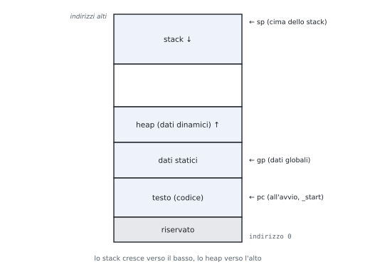

| Zona | Contenuto | Direttiva |
|---|---|---|
| testo | codice macchina | `.text` |
| dati statici | variabili globali e costanti (tramite `gp`) | `.data`, `.word 3, 5, 7`, `.asciz "ciao"`, `.space n` |
| heap | memoria dinamica (`malloc`, `new`), cresce verso l'alto | – |
| stack | variabili locali, record delle chiamate, cresce verso il basso da `sp` | – |

- Heap e stack crescono uno verso l'altro: lo spazio libero serve a entrambi.
- Nel simulatore QtRvSim il programma comincia a `_start` (`.globl _start`) e termina con una `ecall` o con un ciclo di arresto; si seguono registri, memoria e pipeline passo per passo.

### 2.5 Le procedure

**I sei passi di una chiamata.** (1) Argomenti al loro posto; (2) salto alla procedura; (3) la procedura si procura la memoria; (4) lavora; (5) risultato al suo posto; (6) ritorno.

| Che cosa | Dove |
|---|---|
| argomenti | `a0`…`a7` (gli altri sullo stack) |
| risultato | `a0` (e `a1`) |
| chiamata | `jal ra, proc` (`call proc`): salva PC + 4 in `ra` |
| ritorno | `jalr zero, 0(ra)` (`ret`) |

**La convenzione di chiamata.**

| Registri | Chi li salva | Regola |
|---|---|---|
| `s0`…`s11`, `sp`, `ra` (per il chiamante) | la procedura chiamata (*callee-saved*) | al ritorno devono valere come prima: se la procedura li usa, li salva all'inizio e li ripristina alla fine |
| `t0`…`t6`, `a0`…`a7` | il chiamante (*caller-saved*) | la procedura può cambiarli: se servono dopo la chiamata, il chiamante li tiene altrove |

**Lo stack.**

1. `addi sp, sp, -k` (riserva $k$ byte);
2. `sw` dei registri da salvare a offset positivi da `sp`;
3. corpo della procedura;
4. `lw` per ripristinarli, `addi sp, sp, k`, `ret`.

La zona di una chiamata è il **record di attivazione** (*stack frame*). La convenzione standard tiene `sp` allineato a 16 byte; negli esempi del corso si riservano solo i byte necessari.

| Procedura | Stack |
|---|---|
| **foglia** (non chiama nessuno) | spesso nessuno: usa i `t` e non tocca `ra` |
| non foglia | salva almeno `ra` (la sua `jal` lo sovrascrive) e gli `s` che usa |

### 2.6 Procedure ricorsive

Ogni chiamata ha il suo record di attivazione con i suoi valori.

> [!esempio] Fattoriale
> `int fact(int n) { return n < 2 ? 1 : n * fact(n - 1); }`
>
> ```text
> fact:   addi sp, sp, -8     # spazio per ra e n
>         sw   ra, 4(sp)
>         sw   a0, 0(sp)      # salva n
>         li   t0, 2
>         blt  a0, t0, base   # n < 2: caso base
>         addi a0, a0, -1
>         jal  ra, fact       # a0 = fact(n - 1)
>         lw   t1, 0(sp)      # t1 = n (salvato prima della chiamata)
>         mul  a0, a0, t1     # a0 = n * fact(n - 1)
>         j    esci
> base:   li   a0, 1
> esci:   lw   ra, 4(sp)
>         addi sp, sp, 8
>         ret
> ```
>
> Per `fact(3)` lo stack contiene, al momento più profondo, tre frame con $n = 3, 2, 1$ e i rispettivi indirizzi di ritorno; i frame si liberano in ordine inverso mentre si calcolano $1$, $2 \cdot 1$, $3 \cdot 2$.


> [!esempio] Fibonacci
> `int fib(int n) { return n < 2 ? n : fib(n - 1) + fib(n - 2); }`. Dopo la prima chiamata ricorsiva serve ancora sia $n$ sia $fib(n - 1)$: si tengono in due registri salvati, `s0` e `s1`, che vanno quindi salvati sullo stack.
>
> ```text
> fib:    li   t0, 2
>         blt  a0, t0, fine   # n < 2: restituisce n, che è già in a0
>         addi sp, sp, -12
>         sw   ra, 8(sp)
>         sw   s0, 4(sp)
>         sw   s1, 0(sp)
>         mv   s0, a0         # s0 = n
>         addi a0, s0, -1
>         jal  ra, fib        # a0 = fib(n - 1)
>         mv   s1, a0         # s1 = fib(n - 1)
>         addi a0, s0, -2
>         jal  ra, fib        # a0 = fib(n - 2)
>         add  a0, s1, a0
>         lw   s1, 0(sp)
>         lw   s0, 4(sp)
>         lw   ra, 8(sp)
>         addi sp, sp, 12
> fine:   ret
> ```
>
> Nel caso base la procedura è foglia e non tocca lo stack. Il numero di chiamate cresce come i numeri di Fibonacci stessi: `fib(10)` = 55 richiede 177 chiamate. La versione con un ciclo ne richiede una.

### 2.7 Dall'assembly al C

1. Argomenti (`a0`, `a1`…) e valore di ritorno.
2. Salti all'indietro: i cicli; salti in avanti: le condizioni (negate).
3. Corpo istruzione per istruzione.
4. Riscrittura in C leggibile, con nomi e `for` dove c'è un contatore.

### 2.8 La prova scritta: tradurre e motivare

Nella prova scritta si traduce un programma C (di solito un ordinamento ricorsivo, a volte la ricerca binaria o un altro programma del libro o delle schede) e si **motiva ogni scelta**. La traccia della risposta è sempre la stessa.

1. **Firma.** Dove arrivano gli argomenti, dove va il risultato.
2. **Foglia o no.** Se chiama qualcuno serve lo stack, almeno per `ra`.
3. **Che cosa serve dopo una chiamata.** Ogni valore che si usa dopo una `jal` va in un registro `s` (salvato all'inizio) oppure sullo stack: i `t` e gli `a` possono essere cambiati dalla procedura chiamata.
4. **Il record.** 4 byte per `ra` e per ogni `s` usato; `sp` torna al valore iniziale su tutti i percorsi di uscita.
5. **Indirizzi.** `slli` di 2 per gli interi; la base resta in un registro.
6. **Condizioni.** Negate, con `bge`/`blt` per i confronti con segno.
7. **Controllo.** Un caso piccolo eseguito a mano (o nel simulatore).

Gli esercizi 5-8 dopo gli esempi sono tracce d'esame svolte con queste motivazioni.

### Esempi ed esercizi svolti

**Esercizio 1. Il massimo di un array.** Scrivere `int max(int v[], int n)` (con $n \ge 1$).

```text
max:    lw   t1, 0(a0)      # m = v[0]
        li   t0, 1          # i = 1
ciclo:  bge  t0, a1, fine
        slli t2, t0, 2
        add  t2, a0, t2
        lw   t3, 0(t2)      # t3 = v[i]
        bge  t1, t3, avanti # se m >= v[i] non cambia
        mv   t1, t3         # m = v[i]
avanti: addi t0, t0, 1
        j    ciclo
fine:   mv   a0, t1
        ret
```

Con $v = (3, -2, 9, 4)$ restituisce 9. La condizione del C è `if (v[i] > m) m = v[i];`, e il salto la nega: si salta oltre l'assegnamento se $m \ge v[i]$.

**Esercizio 2. La traccia di una matrice.** `M` è una matrice $N \times N$ di interi, con l'indirizzo in `a0` e $N$ in `a1`. Scrivere la somma degli elementi della diagonale.

L'elemento `M[i][i]` è all'indirizzo $\text{base} + (iN + i) \cdot 4 = \text{base} + i(N + 1) \cdot 4$: passando da un elemento della diagonale al successivo l'indirizzo cresce di $4(N + 1)$. Conviene quindi un puntatore che avanza di quel passo:

```text
traccia: addi t2, a1, 1     # t2 = N + 1
         slli t2, t2, 2     # passo = 4(N + 1) byte
         li   t0, 0         # i = 0
         li   t1, 0         # s = 0
ciclo:   bge  t0, a1, fine
         lw   t3, 0(a0)     # M[i][i]
         add  t1, t1, t3
         add  a0, a0, t2    # puntatore al prossimo elemento della diagonale
         addi t0, t0, 1
         j    ciclo
fine:    mv   a0, t1
         ret
```

Per la matrice $3 \times 3$ con elementi $1, \dots, 9$ per righe la traccia è $1 + 5 + 9 = 15$.

**Esercizio 3. Reverse coding.** Che cosa calcola questa funzione, con l'indirizzo di un array in `a0` e la sua lunghezza in `a1`?

```text
        li   t0, 0
        li   t1, 0
L1:     bge  t0, a1, L3
        slli t2, t0, 2
        add  t2, a0, t2
        lw   t3, 0(t2)
        bge  t3, zero, L2
        addi t1, t1, 1
L2:     addi t0, t0, 1
        j    L1
L3:     mv   a0, t1
        ret
```

`t0` parte da 0, cresce di 1 e il ciclo esce quando arriva ad `a1`: è un indice $i$ da 0 a $n - 1$. Il corpo carica `v[i]` e, se **non** è $\ge 0$, cioè se è negativo, incrementa `t1`, che è restituito. In C:

```c
int conta_negativi(int v[], int n) {
    int c = 0;
    for (int i = 0; i < n; i++)
        if (v[i] < 0) c++;
    return c;
}
```

**Esercizio 4. Una procedura che ne chiama un'altra.** Scrivere `int somma_quadrati(int a, int b)` che restituisce $a^2 + b^2$ usando una procedura foglia `quad(x)` che restituisce $x^2$.

```text
quad:   mul  a0, a0, a0     # foglia: niente stack
        ret

somma_quadrati:
        addi sp, sp, -8
        sw   ra, 4(sp)      # la jal sotto sovrascrive ra
        sw   s0, 0(sp)      # s0 serve dopo la chiamata
        mv   s0, a1         # tiene b al sicuro
        jal  ra, quad       # a0 = a^2
        mv   t0, a0
        mv   a0, s0
        mv   s0, t0         # s0 = a^2
        jal  ra, quad       # a0 = b^2
        add  a0, a0, s0
        lw   s0, 0(sp)
        lw   ra, 4(sp)
        addi sp, sp, 8
        ret
```

`b` non può restare in `a1`, perché per la convenzione `quad` potrebbe cambiarlo; e $a^2$ non può restare in `t0` durante la seconda chiamata, per lo stesso motivo. Per questo entrambi passano da `s0`, salvato sullo stack. Con $a = 3$ e $b = 4$ restituisce 25.

#### Tracce della prova scritta

**Esercizio 5. Ordinamento a bolle con una procedura di scambio.**

```c
void scambia(int *a, int *b) { int t = *a; *a = *b; *b = t; }

void bubble(int v[], int n) {
    for (int i = n - 1; i > 0; i--)
        for (int j = 0; j < i; j++)
            if (v[j] > v[j + 1]) scambia(&v[j], &v[j + 1]);
}
```

*Le scelte.*

| Valore | Registro | Perché |
|---|---|---|
| `a`, `b` di `scambia` | `a0`, `a1` | argomenti; `scambia` è foglia: usa `t0`, `t1`, niente stack |
| `v` | `s0` | serve dopo ogni chiamata a `scambia` |
| `i`, `j` | `s1`, `s2` | idem: in un `t` andrebbero persi alla chiamata |
| `&v[j]`, `&v[j + 1]` | `a0`, `a1` | sono già gli argomenti di `scambia`: calcolati direttamente lì |
| record di `bubble` | 16 byte | `ra` + `s0`, `s1`, `s2` |

```text
scambia:   lw   t0, 0(a0)        # t = *a
           lw   t1, 0(a1)
           sw   t1, 0(a0)        # *a = *b
           sw   t0, 0(a1)        # *b = t
           ret
bubble:    addi sp, sp, -16
           sw   ra, 12(sp)
           sw   s0, 8(sp)
           sw   s1, 4(sp)
           sw   s2, 0(sp)
           mv   s0, a0           # s0 = v
           addi s1, a1, -1       # i = n - 1
bb_est:    bge  zero, s1, bb_fine  # i <= 0: fine
           li   s2, 0            # j = 0
bb_int:    bge  s2, s1, bb_dopo  # j >= i: fine del ciclo interno
           slli t0, s2, 2
           add  a0, s0, t0       # a0 = &v[j]
           addi a1, a0, 4        # a1 = &v[j + 1]
           lw   t1, 0(a0)        # v[j]
           lw   t2, 0(a1)        # v[j + 1]
           bge  t2, t1, bb_avanti  # già in ordine: niente scambio
           jal  ra, scambia
bb_avanti: addi s2, s2, 1        # j++
           j    bb_int
bb_dopo:   addi s1, s1, -1       # i--
           j    bb_est
bb_fine:   lw   s2, 0(sp)
           lw   s1, 4(sp)
           lw   s0, 8(sp)
           lw   ra, 12(sp)
           addi sp, sp, 16
           ret
```

Da motivare: la condizione `v[j] > v[j + 1]` diventa "salta oltre lo scambio se `v[j + 1] >= v[j]`"; `i > 0` diventa "esci se `0 >= i`". `&v[j + 1]` è `&v[j] + 4`, non `+ 1`. Con `v` = {5, 1, 4, 2, 8} il risultato è {1, 2, 4, 5, 8}.

**Esercizio 6. Quicksort (partizione di Lomuto).**

```c
void quicksort(int v[], int lo, int hi) {
    if (lo >= hi) return;
    int p = v[hi], i = lo;
    for (int j = lo; j < hi; j++)
        if (v[j] < p) { int t = v[i]; v[i] = v[j]; v[j] = t; i++; }
    int t = v[i]; v[i] = v[hi]; v[hi] = t;
    quicksort(v, lo, i - 1);
    quicksort(v, i + 1, hi);
}
```

*Le scelte.*

| Valore | Registro | Perché |
|---|---|---|
| `v` | `s0` | serve per la seconda chiamata |
| `hi` | `s1` | serve per la seconda chiamata |
| `i` | `s2` | serve dopo la prima chiamata (`i + 1`) |
| `lo` | resta in `a1` | serve solo come argomento della prima chiamata, che avviene prima di qualsiasi altra `jal` |
| `p`, `j`, `&v[hi]`, temporanei | `t0`…`t6` | usati solo prima delle chiamate |
| caso base | `ret` subito | prima di toccare lo stack: nessun record da disfare |
| record | 16 byte | `ra`, `s0`, `s1`, `s2` |

```text
quicksort: bge  a1, a2, qs_fine  # lo >= hi: niente da fare
           addi sp, sp, -16
           sw   ra, 12(sp)
           sw   s0, 8(sp)
           sw   s1, 4(sp)
           sw   s2, 0(sp)
           mv   s0, a0           # s0 = v
           mv   s1, a2           # s1 = hi
           slli t0, a2, 2
           add  t0, a0, t0       # t0 = &v[hi]
           lw   t1, 0(t0)        # t1 = p
           mv   s2, a1           # i = lo
           mv   t2, a1           # j = lo
qs_ciclo:  bge  t2, s1, qs_dopo  # j >= hi: fine della partizione
           slli t3, t2, 2
           add  t3, s0, t3       # t3 = &v[j]
           lw   t4, 0(t3)        # t4 = v[j]
           bge  t4, t1, qs_avanti  # v[j] >= p: resta dov'è
           slli t5, s2, 2
           add  t5, s0, t5       # t5 = &v[i]
           lw   t6, 0(t5)
           sw   t4, 0(t5)        # v[i] = v[j]
           sw   t6, 0(t3)        # v[j] = vecchio v[i]
           addi s2, s2, 1        # i++
qs_avanti: addi t2, t2, 1        # j++
           j    qs_ciclo
qs_dopo:   slli t5, s2, 2
           add  t5, s0, t5       # t5 = &v[i]
           lw   t6, 0(t5)
           sw   t1, 0(t5)        # v[i] = p
           sw   t6, 0(t0)        # v[hi] = vecchio v[i]
           addi a2, s2, -1       # quicksort(v, lo, i - 1): a0 = v, a1 = lo
           jal  ra, quicksort
           mv   a0, s0
           addi a1, s2, 1
           mv   a2, s1           # quicksort(v, i + 1, hi)
           jal  ra, quicksort
           lw   s2, 0(sp)
           lw   s1, 4(sp)
           lw   s0, 8(sp)
           lw   ra, 12(sp)
           addi sp, sp, 16
qs_fine:   ret
```

Da motivare: alla prima chiamata `a0` vale ancora `v` e `a1` ancora `lo`, perché non c'è stata nessuna `jal` prima; alla seconda vanno ricaricati da `s0`, `s2`, `s1`. Lo scambio finale usa `t0` = `&v[hi]` calcolato prima del ciclo: il ciclo non lo tocca. Con `v` = {7, 2, 9, 4, 3, 8, 1} il risultato è {1, 2, 3, 4, 7, 8, 9}.

**Esercizio 7. Merge sort.**

```c
void merge(int v[], int tmp[], int lo, int m, int hi) {
    int i = lo, j = m + 1, k = lo;
    while (i <= m && j <= hi)
        tmp[k++] = (v[j] < v[i]) ? v[j++] : v[i++];
    while (i <= m) tmp[k++] = v[i++];
    while (j <= hi) tmp[k++] = v[j++];
    for (k = lo; k <= hi; k++) v[k] = tmp[k];
}

void mergesort(int v[], int tmp[], int lo, int hi) {
    if (lo >= hi) return;
    int m = (lo + hi) / 2;
    mergesort(v, tmp, lo, m);
    mergesort(v, tmp, m + 1, hi);
    merge(v, tmp, lo, m, hi);
}
```

*Le scelte.*

| Valore | Registro | Perché |
|---|---|---|
| `v`, `tmp`, `lo`, `hi`, `m` | `s0`…`s4` | tutti servono dopo almeno una chiamata ricorsiva |
| `(lo + hi) / 2` | `add` + `srai 1` | gli indici non sono negativi: lo shift è la divisione intera |
| `merge` | foglia, solo `t` | non chiama nessuno: niente stack |
| il quinto argomento `hi` | `a4` | ci sono 8 registri per gli argomenti |
| record di `mergesort` | 24 byte | `ra` + 5 registri `s` |
| `v[j] < v[i]` | prende `v[j]` solo se strettamente minore | a parità prende `v[i]`: l'ordinamento è stabile |

```text
mergesort: bge  a2, a3, ms_fine  # lo >= hi: un elemento, già ordinato
           addi sp, sp, -24
           sw   ra, 20(sp)
           sw   s0, 16(sp)
           sw   s1, 12(sp)
           sw   s2, 8(sp)
           sw   s3, 4(sp)
           sw   s4, 0(sp)
           mv   s0, a0           # v
           mv   s1, a1           # tmp
           mv   s2, a2           # lo
           mv   s3, a3           # hi
           add  s4, a2, a3
           srai s4, s4, 1        # m = (lo + hi) / 2
           mv   a3, s4           # mergesort(v, tmp, lo, m)
           jal  ra, mergesort
           mv   a0, s0
           mv   a1, s1
           addi a2, s4, 1
           mv   a3, s3           # mergesort(v, tmp, m + 1, hi)
           jal  ra, mergesort
           mv   a0, s0
           mv   a1, s1
           mv   a2, s2
           mv   a3, s4
           mv   a4, s3           # merge(v, tmp, lo, m, hi)
           jal  ra, merge
           lw   s4, 0(sp)
           lw   s3, 4(sp)
           lw   s2, 8(sp)
           lw   s1, 12(sp)
           lw   s0, 16(sp)
           lw   ra, 20(sp)
           addi sp, sp, 24
ms_fine:   ret
merge:     mv   t0, a2           # i = lo
           addi t1, a3, 1        # j = m + 1
           mv   t2, a2           # k = lo
mg_ciclo:  blt  a3, t0, mg_resto_j  # i > m: resta la seconda metà
           blt  a4, t1, mg_resto_i  # j > hi: resta la prima metà
           slli t3, t0, 2
           add  t3, a0, t3
           lw   t3, 0(t3)        # t3 = v[i]
           slli t4, t1, 2
           add  t4, a0, t4
           lw   t4, 0(t4)        # t4 = v[j]
           slli t5, t2, 2
           add  t5, a1, t5       # t5 = &tmp[k]
           addi t2, t2, 1        # k++
           blt  t4, t3, mg_da_j  # v[j] < v[i]: prende v[j]
           sw   t3, 0(t5)        # tmp[k] = v[i]
           addi t0, t0, 1        # i++
           j    mg_ciclo
mg_da_j:   sw   t4, 0(t5)        # tmp[k] = v[j]
           addi t1, t1, 1        # j++
           j    mg_ciclo
mg_resto_i: blt a3, t0, mg_copia
           slli t3, t0, 2
           add  t3, a0, t3
           lw   t3, 0(t3)
           slli t5, t2, 2
           add  t5, a1, t5
           sw   t3, 0(t5)        # tmp[k++] = v[i++]
           addi t0, t0, 1
           addi t2, t2, 1
           j    mg_resto_i
mg_resto_j: blt a4, t1, mg_copia
           slli t4, t1, 2
           add  t4, a0, t4
           lw   t4, 0(t4)
           slli t5, t2, 2
           add  t5, a1, t5
           sw   t4, 0(t5)        # tmp[k++] = v[j++]
           addi t1, t1, 1
           addi t2, t2, 1
           j    mg_resto_j
mg_copia:  mv   t2, a2           # k = lo
mg_cc:     blt  a4, t2, mg_fine  # k > hi: finito
           slli t5, t2, 2
           add  t3, a1, t5
           lw   t3, 0(t3)        # tmp[k]
           add  t4, a0, t5
           sw   t3, 0(t4)        # v[k] = tmp[k]
           addi t2, t2, 1
           j    mg_cc
mg_fine:   ret
```

Da motivare: `i <= m` diventa "esci se `m < i`", cioè `blt a3, t0`; `merge` può usare tutti i `t` perché nessuno dei chiamanti ci tiene niente dentro; `m` deve stare in un `s`, perché serve sia alla seconda chiamata sia a `merge`. Con `v` = {38, 27, 43, 3, 9, 82, 10} il risultato è {3, 9, 10, 27, 38, 43, 82}.

**Esercizio 8. Ricerca binaria ricorsiva.**

```c
int cerca(int v[], int lo, int hi, int x) {
    if (lo > hi) return -1;
    int m = (lo + hi) / 2;
    if (v[m] == x) return m;
    if (v[m] < x) return cerca(v, m + 1, hi, x);
    return cerca(v, lo, m - 1, x);
}
```

*Le scelte.*

| Valore | Registro | Perché |
|---|---|---|
| `v`, `lo`, `hi`, `x` | `a0`…`a3` | dopo la chiamata ricorsiva non servono più: il risultato è quello della chiamata |
| `m`, `v[m]` | `t0`, `t1` | usati solo prima della chiamata |
| record | 4 byte, solo `ra` | nessun `s`: non c'è niente da conservare |
| casi base | `ret` senza stack | lo stack si apre solo sul ramo che chiama |

```text
cerca:     blt  a2, a1, cr_no    # lo > hi: non c'è
           add  t0, a1, a2
           srai t0, t0, 1        # m = (lo + hi) / 2
           slli t1, t0, 2
           add  t1, a0, t1
           lw   t1, 0(t1)        # t1 = v[m]
           beq  t1, a3, cr_si
           addi sp, sp, -4
           sw   ra, 0(sp)
           blt  t1, a3, cr_destra  # v[m] < x: cerca a destra
           addi a2, t0, -1       # cerca(v, lo, m - 1, x)
           jal  ra, cerca
           j    cr_esci
cr_destra: addi a1, t0, 1        # cerca(v, m + 1, hi, x)
           jal  ra, cerca
cr_esci:   lw   ra, 0(sp)
           addi sp, sp, 4
           ret
cr_si:     mv   a0, t0           # trovato: restituisce m
           ret
cr_no:     li   a0, -1
           ret
```

Da motivare: è una ricorsione **in coda** (il risultato della chiamata è restituito così com'è). Un compilatore la trasforma in un ciclo: al posto di `jal` + `ret` basta `j cerca`, e lo stack non serve più. In {1, 3, 5, 7, 9, 11, 13} la ricerca di 11 dà 5, quella di 4 dà −1.

### Esercizi guidati

Ogni esercizio è diviso in passi: si prova un passo alla volta e si confronta solo dopo.

**Guidato 1. Tradurre un ciclo con una condizione.** Tradurre `int s = 0; for (int i = 0; i < n; i++) if (v[i] % 2 == 0) s += v[i];` (somma dei pari), con `v` in `a0`, `n` in `a1`, risultato in `a0`.

*Passo 1: i registri.* `i` in `t0`, `s` in `t1`, temporanei `t2`, `t3`.

*Passo 2: il test di parità senza divisione.* Un numero è pari se il bit meno significativo è 0: `andi t4, t3, 1`.

*Passo 3: la condizione negata.* Il C dice "se è pari somma": si salta oltre la somma se è dispari, `bne t4, zero, avanti`.

*Passo 4: il codice.*

```text
        li   t0, 0
        li   t1, 0
ciclo:  bge  t0, a1, fine
        slli t2, t0, 2
        add  t2, a0, t2
        lw   t3, 0(t2)
        andi t4, t3, 1
        bne  t4, zero, avanti
        add  t1, t1, t3
avanti: addi t0, t0, 1
        j    ciclo
fine:   mv   a0, t1
        ret
```

*Passo 5: il controllo.* Con $v = (1, 2, 3, 4, -6)$ la somma dei pari è $2 + 4 - 6 = 0$. Il test con `andi` funziona anche per i negativi in complemento a 2 ($-6$ = `…11111010`, bit 0 a 0).

**Guidato 2. Disegnare lo stack.** Durante `fact(3)` dell'esempio del paragrafo 2.6, con `sp` = `0x1000` all'inizio, che cosa c'è nello stack quando si raggiunge il caso base?

*Passo 1: la prima chiamata.* `sp` scende a `0x0FF8`; in `0x0FFC` c'è `ra` del chiamante esterno, in `0x0FF8` c'è $n = 3$.

*Passo 2: la seconda.* `sp` = `0x0FF0`; in `0x0FF4` l'indirizzo di ritorno dentro `fact` (l'istruzione dopo la `jal`), in `0x0FF0` $n = 2$.

*Passo 3: la terza, caso base.* `sp` = `0x0FE8`; in `0x0FEC` lo stesso indirizzo di ritorno, in `0x0FE8` $n = 1$. Con $n = 1 < 2$ si va al caso base.

*Passo 4: la risalita.* Ogni ritorno rilascia 8 byte: `sp` torna a `0x0FF0`, `0x0FF8`, `0x1000`, mentre `a0` vale 1, 2, 6.

**Guidato 3. Reverse coding con un puntatore.** Che cosa fa questa funzione, con `a0` e `a1` indirizzi di due stringhe?

```text
f:      lbu  t0, 0(a1)
        sb   t0, 0(a0)
        beq  t0, zero, fine
        addi a0, a0, 1
        addi a1, a1, 1
        j    f
fine:   ret
```

*Passo 1: che cosa si legge e si scrive.* Si legge un byte da `a1` e lo si scrive in `a0`.

*Passo 2: il ciclo.* Si avanza di un byte su entrambe le stringhe finché il byte copiato non è lo 0.

*Passo 3: il C.* `void copia(char *dst, const char *src) { while ((*dst = *src) != 0) { dst++; src++; } }`: è `strcpy`. Lo 0 finale viene copiato prima del test, così la stringa di destinazione è terminata correttamente.

### Riepilogo

Il compilatore assegna le variabili ai registri e traduce condizioni e cicli in salti condizionati con la condizione negata. L'indirizzo di `v[i]` è $\text{base} + 4i$ per gli interi, e una matrice è memorizzata per righe, con `M[i][j]` a $\text{base} + (iC + j) \cdot 4$; scorrere con un puntatore invece che con un indice risparmia istruzioni. La memoria di un programma è divisa in testo, dati statici, heap e stack; le direttive dell'assemblatore scelgono la zona. Nelle procedure gli argomenti passano in `a0`…`a7`, il risultato in `a0`, la chiamata è `jal ra` e il ritorno `jalr zero, 0(ra)`; i registri `s` e `ra` sono preservati da chi li usa, i `t` e gli `a` da chi ne ha bisogno dopo la chiamata. Una procedura non foglia salva `ra` e i registri salvati nel suo stack frame; la ricorsione funziona perché ogni chiamata ha il suo frame.

### Formulario

#### Schemi di traduzione

| C | RISC-V |
|---|---|
| `if (a == b) X; else Y;` | `bne a, b, Else` · X · `j Fine` · `Else:` Y · `Fine:` |
| `while (cond) X;` | `Ciclo:` salto fuori se non cond · X · `j Ciclo` |
| `for (i = 0; i < n; i++) X;` | `li i, 0` · `Ciclo: bge i, n, Fine` · X · `addi i, i, 1` · `j Ciclo` |
| `v[i]` (int) | `slli t, i, 2` · `add t, base, t` · `lw x, 0(t)` |
| `M[i][j]` (int, $C$ colonne) | indirizzo $\text{base} + (iC + j) \cdot 4$ |
| `c = s[i]` (char) | `add t, base, i` · `lbu c, 0(t)` |

#### Convenzione di chiamata

| Chi salva | Registri |
|---|---|
| la procedura chiamata (callee-saved) | `s0`–`s11`, `sp`, `ra` (se ne chiama altre) |
| il chiamante (caller-saved) | `t0`–`t6`, `a0`–`a7` |

Prologo: `addi sp, sp, -k` · `sw ra, …(sp)` · `sw s…, …(sp)`. Epilogo: `lw` in ordine inverso · `addi sp, sp, k` · `ret`.

#### Termini per l'orale

| Termine | In una riga |
|---|---|
| Procedura foglia | non chiama altre procedure, spesso non usa lo stack |
| Stack frame | zona di stack di una chiamata: registri salvati e variabili locali |
| Indirizzo di ritorno | indirizzo dell'istruzione dopo la chiamata, salvato in `ra` |
| Caller-saved / callee-saved | salvati da chi chiama / da chi è chiamato |
| Row-major | memorizzazione delle matrici riga per riga |
| Aritmetica dei puntatori | avanzare un indirizzo invece di ricalcolarlo da un indice |
| Direttiva | comando per l'assemblatore (`.data`, `.word`, `.asciz`) |

#### Domande che tornano spesso

- Quali sono i passi di una chiamata di procedura e come li realizza RISC-V?
- Perché alcuni registri sono preservati e altri no? Che cosa deve salvare una procedura non foglia?
- Disegnare lo stack durante una chiamata ricorsiva.
- Come si calcola l'indirizzo di un elemento di un array e di una matrice?
- Descrivere le zone della memoria di un programma.
- Tradurre in C un frammento assembly assegnato.
- Prova scritta: tradurre un ordinamento ricorsivo (merge sort, quicksort) o la ricerca binaria e motivare registri, record di attivazione e condizioni (2.8, esercizi 5-8).

## 3 · L'ALU e l'aritmetica del calcolatore

**In questo modulo.** Prerequisiti: complemento a 2, sommatori e multiplexer (Reti Logiche). Si costruisce l'ALU di RISC-V a partire da un bit, la si rende veloce con l'anticipo del riporto, poi moltiplicazione (somma e scorri, Booth), divisione, virgola mobile e codici di Hamming. All'orale si disegnano l'ALU a un bit e a 32 bit (figure 3.1 e 3.2) spiegando ogni segnale.

### 3.1 L'ALU a un bit


| Parte | A che serve |
|---|---|
| AND, OR | operazioni logiche |
| full adder | somma: $s = a \oplus b \oplus c_{in}$, $c_{out} = ab + (a + b)c_{in}$ |
| multiplexer **Operation** (2 bit) | sceglie AND (0), OR (1), somma (2), Less (3) |
| **Binvert** | usa $\bar b$: $a - b = a + \bar b + 1$ (il +1 è il CarryIn del bit 0) |
| **Ainvert** | usa $\bar a$: con Binvert e AND dà la NOR ($\overline{a + b} = \bar a \cdot \bar b$) |
| **Less** | ingresso per `slt` (3.2) |

**Perché tutto in parallelo.** I tre risultati si calcolano sempre; il multiplexer sceglie alla fine. Il ritardo è quello del percorso più lento (la somma), non della somma dei percorsi.

### 3.2 L'ALU a 32 bit

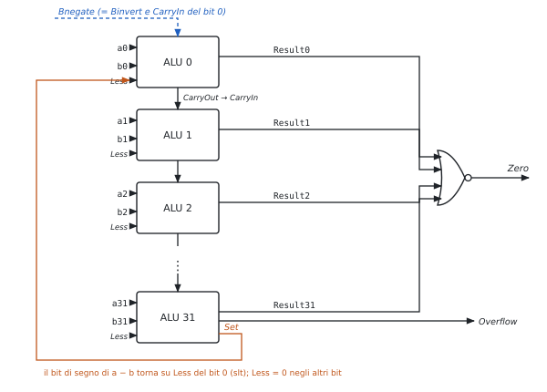

**Ripple carry.** 32 ALU da un bit in fila, CarryOut del bit $i$ → CarryIn del bit $i + 1$.

**Le tre aggiunte.**

| Aggiunta | Come | Perché |
|---|---|---|
| `slt` | si calcola $a - b$; il bit di segno (uscita **Set** del bit 31) va su Less del bit 0; Less = 0 negli altri bit | il risultato è 0…01 o 0…00 |
| **Zero** | $\overline{r_{31} + \dots + r_0}$ | `beq`, `bne`: $a = b \iff a - b = 0$ |
| **Overflow** | $V = c_{31} \oplus c_{32}$ (riporto entrante ed uscente del bit di segno diversi) | solo sommando numeri dello stesso segno o sottraendo di segno opposto |

**Attenzione a `slt`.** Se $a - b$ va in overflow il segno è sbagliato: il valore giusto è $\text{Set} \oplus \text{Overflow}$.

**Il controllo dell'ALU** (4 bit: Ainvert, Bnegate, Operation):

| Controllo ALU | Funzione |
|---|---|
| 0000 | AND |
| 0001 | OR |
| 0010 | somma |
| 0110 | sottrazione |
| 0111 | `slt` |
| 1100 | NOR |

RISC-V non genera eccezioni per l'overflow: se serve, lo controlla il programma.

**All'orale.**

- *Perché Bnegate è un solo segnale?* Negare $b$ e mettere 1 nel riporto del bit 0 servono sempre insieme: è la sottrazione in complemento a 2.
- *Perché Set è un'uscita separata e non Result31?* Per `slt` Result31 vale Less = 0; il segno della sottrazione è l'uscita del sommatore, prima del multiplexer.
- *Che problema ha il ripple carry?* Il riporto attraversa 32 stadi: il ritardo cresce linearmente con i bit. Soluzione: 3.3.

### 3.3 L'anticipo del riporto (carry lookahead)

Dal full adder $c_{i+1} = a_i b_i + (a_i + b_i)c_i$. Si definiscono

$$g_i = a_i b_i \ \text{(il bit genera un riporto)}, \qquad p_i = a_i + b_i \ \text{(il bit propaga il riporto in arrivo)},$$

quindi $c_{i+1} = g_i + p_i c_i$, e svolgendo:
$$c_1 = g_0 + p_0 c_0, \qquad c_2 = g_1 + p_1 g_0 + p_1 p_0 c_0,$$
$$c_3 = g_2 + p_2 g_1 + p_2 p_1 g_0 + p_2 p_1 p_0 c_0, \qquad c_4 = g_3 + p_3 g_2 + p_3 p_2 g_1 + p_3 p_2 p_1 g_0 + p_3 p_2 p_1 p_0 c_0.$$

- Ogni riporto è una rete a **due livelli** in $g$, $p$, $c_0$: tutti pronti dopo lo stesso tempo.
- Le espressioni crescono in fretta → per 32 bit si lavora a **blocchi di 4** con $P$ e $G$ di blocco, e si ripete lo schema sui blocchi.

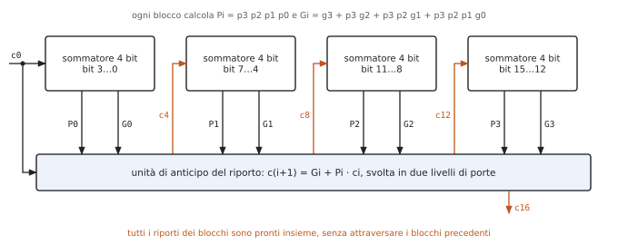

$$P_0 = p_3 p_2 p_1 p_0, \qquad G_0 = g_3 + p_3 g_2 + p_3 p_2 g_1 + p_3 p_2 p_1 g_0.$$

### 3.4 La moltiplicazione

**Somma e scorri** (*add and right shift*, versione delle slide):

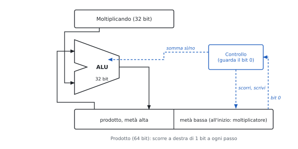

1. Prodotto ← (0, moltiplicatore).
2. Se il bit 0 del prodotto è 1: metà alta ← metà alta + moltiplicando.
3. Prodotto scorre a destra di 1 (il riporto della somma entra in cima).
4. Ripetere $n$ volte.

Perché la metà bassa ospita il moltiplicatore: a ogni passo se ne consuma un bit e si libera un posto per un bit del prodotto. Un registro solo, un sommatore solo.

**Numeri con segno: algoritmo di Booth.** Una sequenza di 1 si sostituisce con una sottrazione e una somma ($0110 = 1000 - 0010$). Si guarda la coppia ($q_0$, $q_{-1}$), con $q_{-1} = 0$ all'inizio:

| $q_0\ q_{-1}$ | Operazione | Significato |
|---|---|---|
| 1 0 | $A = A - M$ | inizio di una sequenza di 1 |
| 1 1 | nessuna | dentro la sequenza |
| 0 1 | $A = A + M$ | fine della sequenza |
| 0 0 | nessuna | dentro una sequenza di 0 |

Dopo ogni passo: **shift aritmetico** a destra di $A$, $Q$, $q_{-1}$ (conserva il segno). Funziona direttamente in complemento a 2.

**In RISC-V** (estensione M): `mul` (32 bit bassi), `mulh` e `mulhu` (32 bit alti, con e senza segno). Il prodotto sta in 32 bit se la parte alta è l'estensione del segno di quella bassa.

### 3.5 La divisione

- $\text{dividendo} = \text{quoziente} \times \text{divisore} + \text{resto}$, $0 \le \text{resto} < \text{divisore}$.
- **Restoring**: a ogni passo si sottrae il divisore allineato; se il resto è $\ge 0$ il bit del quoziente è 1, altrimenti 0 e si ripristina il resto.
- In hardware: divisore nella metà alta di un registro da $2n$ bit che scorre a destra, quoziente che si forma a sinistra.
- Perché è lenta: ogni passo dipende dal segno del precedente, non si parallelizza.
- RISC-V: `div`, `divu`, `rem`, `remu`; la divisione per zero non dà eccezione (quoziente con tutti i bit a 1).

### 3.6 La virgola mobile

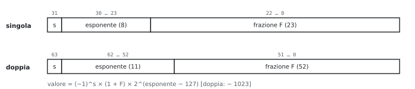

| | Segno | Esponente | Frazione | Eccesso |
|---|---|---|---|---|
| singola | 1 | 8 | 23 | 127 |
| doppia | 1 | 11 | 52 | 1023 |

$$x = (-1)^s \times (1 + F) \times 2^{E - 127}.$$

- **1 nascosto**: un numero normalizzato comincia sempre con 1, che non si scrive: un bit di precisione gratis.
- **Esponente in eccesso**: si confrontano due numeri positivi come interi.
- Esponente tutto a 0 e tutto a 1: riservati (zero, denormalizzati, infinito, NaN).
- **Overflow**: esponente oltre il massimo. **Underflow**: numero non nullo sotto il minimo normalizzato.

**Somma.**

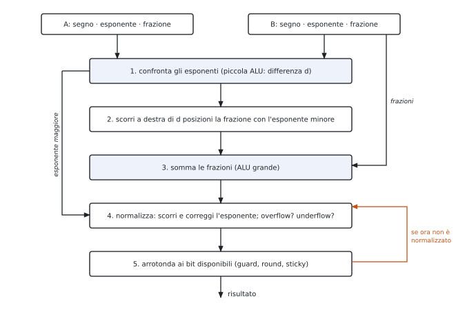

**Prodotto.** (1) Esponenti sommati togliendo un eccesso: $(E_1 + 127) + (E_2 + 127) - 127$. (2) Mantisse moltiplicate. (3) Normalizzazione, overflow e underflow. (4) Arrotondamento. (5) Segno = XOR dei segni.

**Arrotondamento.** Due bit in più durante i calcoli (**guard**, **round**) e un bit **sticky** (1 se qualche bit scartato era 1). Modo standard: al più vicino, in caso di pareggio al pari.

### 3.7 I codici di Hamming

**Distanza di Hamming**: numero di posizioni diverse, $d(1011, 1110) = 2$. Un codice a distanza $d$ rileva $d - 1$ errori o ne corregge $\lfloor (d - 1)/2 \rfloor$.

| $d$ | Che cosa fa | Esempio |
|---|---|---|
| 2 | rileva 1 errore | bit di parità |
| 3 | corregge 1 errore | Hamming |
| 4 | corregge 1, rileva 2 | SECDED (memorie ECC) |

**Quanti bit di controllo.** Per correggere un errore su $M$ bit di dati con $K$ bit di controllo:
$$2^K \ge M + K + 1.$$

| $M$ | 4 | 8 | 16 | 32 | 64 |
|---|---|---|---|---|---|
| $K$ | 3 | 4 | 5 | 6 | 7 |

**Costruzione.**

- posizioni numerate da 1; controlli nelle potenze di 2 (1, 2, 4, 8, …), dati nelle altre;
- il controllo in $2^j$ è la parità pari delle posizioni con il bit $j$ a 1 nel loro numero (1: posizioni 1, 3, 5, 7…; 2: 2, 3, 6, 7…; 4: 4, 5, 6, 7…);
- chi riceve ricalcola le parità: la **sindrome** letta in binario vale 0 se non ci sono errori, altrimenti è la posizione del bit sbagliato;
- un bit di parità in più su tutta la parola → SECDED.

**All'orale.**

- *Perché i bit di controllo nelle potenze di 2?* Ognuno compare in una sola delle parità (la sua): così la sindrome è proprio la posizione dell'errore.
- *Che errore non vede il codice di Hamming semplice?* Due errori: la sindrome indica una terza posizione, e la "correzione" aggiunge un errore. Per questo SECDED aggiunge la parità globale.

### Esempi ed esercizi svolti

**Esercizio 1. I riporti anticipati di una somma a 4 bit.** $a = 1011$, $b = 0110$, $c_0 = 0$.

$g = a \cdot b$ bit per bit $= 0010$, $p = a + b = 1111$. Quindi $c_1 = g_0 = 0$; $c_2 = g_1 + p_1 g_0 = 1$; $c_3 = g_2 + p_2 g_1 + p_2 p_1 g_0 = 0 + 1 + 0 = 1$; $c_4 = g_3 + p_3 g_2 + p_3 p_2 g_1 + \dots = 0 + 0 + 1 = 1$. Le somme sono $s_i = a_i \oplus b_i \oplus c_i$: $s_0 = 1$, $s_1 = 0$, $s_2 = 0$, $s_3 = 0$, e il risultato è $1\,0001$, cioè $11 + 6 = 17$. Il riporto finale nasce in $g_1$ e viaggia attraverso $p_2$ e $p_3$: nel ripple impiegherebbe tre stadi, con il lookahead è pronto subito.

**Esercizio 2. Moltiplicazione con l'hardware add and right shift.** $6 \times 5$ con 4 bit: moltiplicando $M = 0110$, registro prodotto iniziale $0000\,0101$.

| Passo | Bit basso | Dopo l'eventuale somma | Dopo lo shift |
|---|---|---|---|
| 1 | 1 | $0110\,0101$ | $0011\,0010$ |
| 2 | 0 | – | $0001\,1001$ |
| 3 | 1 | $0111\,1001$ | $0011\,1100$ |
| 4 | 0 | – | $0001\,1110$ |

Il risultato è $0001\,1110 = 30$. A ogni passo il moltiplicatore "esce" a destra e il prodotto parziale "entra" da sinistra: lo stesso registro contiene entrambi.

**Esercizio 3. Booth con un moltiplicatore negativo.** $3 \times (-2)$ con 4 bit: $M = 0011$, $Q = 1110$, $q_{-1} = 0$, $A = 0000$.

| Passo | $q_0\,q_{-1}$ | Operazione | $A$ dopo lo shift | $Q$ dopo lo shift | $q_{-1}$ |
|---|---|---|---|---|---|
| 1 | 0 0 | nessuna | 0000 | 0111 | 0 |
| 2 | 1 0 | $A = A - M = 1101$ | 1110 | 1011 | 1 |
| 3 | 1 1 | nessuna | 1111 | 0101 | 1 |
| 4 | 1 1 | nessuna | 1111 | 1010 | 1 |

Il prodotto è $A\,Q = 1111\,1010 = -6$ in complemento a 2. Il moltiplicatore $1110$ è una sola sequenza di 1 che arriva fino al bit di segno: c'è una sola sottrazione e nessuna somma, perché la sequenza non "finisce".

**Esercizio 4. Divisione in binario.** $1011 \div 0011$ ($11 \div 3$).

Si procede come in colonna, abbassando un bit alla volta: $1 < 11$, quoziente 0; $10 < 11$, quoziente 0; $101 \ge 11$, quoziente 1 e resto $101 - 11 = 10$; si abbassa l'ultimo bit, $101 \ge 11$, quoziente 1 e resto $10$. Quoziente $0011 = 3$, resto $10 = 2$, e infatti $3 \cdot 3 + 2 = 11$.

**Esercizio 5. Somma in virgola mobile.** $1{,}75 + 0{,}3125$.

$1{,}75 = 1{,}11_2 \times 2^0$ e $0{,}3125 = 1{,}01_2 \times 2^{-2}$. (1) Si allinea il secondo all'esponente 0: $0{,}0101_2 \times 2^0$. (2) Somma: $1{,}1100 + 0{,}0101 = 10{,}0001_2$. (3) Normalizzazione: $1{,}00001_2 \times 2^1$. (4) Con 23 bit di frazione non serve arrotondare. Il risultato è $2 + \frac{2}{32} = 2{,}0625$.

**Esercizio 6. Prodotto in virgola mobile.** $1{,}5 \times (-2{,}25)$ in singola precisione.

$1{,}5 = 1{,}1_2 \times 2^0$ (campo esponente 127), $-2{,}25 = -1{,}001_2 \times 2^1$ (campo 128). (1) Esponente: $127 + 128 - 127 = 128$, cioè $E = 1$. (2) Mantisse: $1{,}1 \times 1{,}001 = 1{,}1011_2$. (3) Già normalizzata. (5) Segno: $0 \oplus 1 = 1$. Il risultato è $-1{,}1011_2 \times 2^1 = -3{,}375$.

**Esercizio 7. Un codice di Hamming (7, 4).** Codificare i dati $1011$ e correggere la parola ricevuta se il bit in posizione 6 si altera.

I dati vanno nelle posizioni 3, 5, 6, 7: $b_3 = 1$, $b_5 = 0$, $b_6 = 1$, $b_7 = 1$. Parità: $b_1 = b_3 \oplus b_5 \oplus b_7 = 0$, $b_2 = b_3 \oplus b_6 \oplus b_7 = 1$, $b_4 = b_5 \oplus b_6 \oplus b_7 = 0$. La parola trasmessa, dalla posizione 1 alla 7, è $0\,1\,1\,0\,0\,1\,1$. Se si altera $b_6$ si riceve $0\,1\,1\,0\,0\,0\,1$. Il ricevitore calcola $s_1 = b_1 \oplus b_3 \oplus b_5 \oplus b_7 = 0$, $s_2 = b_2 \oplus b_3 \oplus b_6 \oplus b_7 = 1$, $s_4 = b_4 \oplus b_5 \oplus b_6 \oplus b_7 = 1$: la sindrome $s_4 s_2 s_1 = 110 = 6$ indica la posizione sbagliata, e invertendo $b_6$ si ritrova la parola giusta.

### Esercizi guidati

Ogni esercizio è diviso in passi: si prova un passo alla volta e si confronta solo dopo.

**Guidato 1. L'overflow dell'ALU.** Con 8 bit, l'ALU calcola $100 + 50$ e $(-100) - 50$. In quali casi segnala overflow e che cosa dà `slt` per $a = 100$, $b = -100$?

*Passo 1.* $100 + 50 = 150 > 127$: il risultato $1001\,0110$ ha segno negativo; i riporti nel e dal bit di segno sono $c_7 = 1$, $c_8 = 0$, diversi: overflow.

*Passo 2.* $(-100) - 50 = -150 < -128$: overflow anche qui, con risultato $0110\,1010$ apparentemente positivo.

*Passo 3: `slt` di $100$ e $-100$.* $100 - (-100) = 200$ va in overflow, e il bit di segno della sottrazione è 1, come se $100 < -100$. Il valore giusto di Set è il bit di segno XOR overflow: $1 \oplus 1 = 0$, quindi `slt` dà 0, correttamente.

**Guidato 2. Quanti bit di controllo?** Si vuole correggere un errore singolo su parole di 32 bit, e rilevarne due.

*Passo 1: la disuguaglianza.* $2^K \ge 32 + K + 1$.

*Passo 2: provare.* $K = 5$: $32 \ge 38$, no. $K = 6$: $64 \ge 39$, sì.

*Passo 3: SECDED.* Per rilevare anche gli errori doppi si aggiunge un bit di parità globale: 7 bit di controllo su 32 di dati, una parola di 39 bit.

*Passo 4: il confronto.* Per 64 bit di dati bastano $K = 7$ più 1, cioè 8: è il formato delle memorie ECC, con 72 bit per ogni 64.

**Guidato 3. Somma in virgola mobile con numeri di segno diverso.** $0{,}5 + (-0{,}4375)$ con 4 bit di mantissa.

*Passo 1: i numeri.* $0{,}5 = 1{,}000_2 \times 2^{-1}$; $-0{,}4375 = -1{,}110_2 \times 2^{-2}$.

*Passo 2: allineare.* Il secondo diventa $-0{,}111_2 \times 2^{-1}$.

*Passo 3: sommare.* $1{,}000 - 0{,}111 = 0{,}001_2$, con esponente $-1$.

*Passo 4: normalizzare.* $0{,}001_2 \times 2^{-1} = 1{,}000_2 \times 2^{-4}$: lo shift è a sinistra di tre posti, e l'esponente scende di 3.

*Passo 5: risultato.* $2^{-4} = 0{,}0625$. La differenza di due numeri vicini perde cifre significative: è la **cancellazione**, il principale motivo di errore nei calcoli in virgola mobile.

### Riepilogo

L'ALU a un bit sceglie con un multiplexer fra AND, OR e somma; con Binvert e il riporto iniziale a 1 sottrae, con Ainvert fa la NOR. L'ALU a 32 bit aggiunge l'ingresso Less per `slt`, l'uscita Zero per i salti e il rilevamento dell'overflow con $c_{31} \oplus c_{32}$. Il calcolo anticipato del riporto rende i riporti reti a due livelli nei segnali di generazione e propagazione, e si applica a blocchi. La moltiplicazione si fa con somme e shift su un registro di $2n$ bit; l'algoritmo di Booth sostituisce le sequenze di 1 con una sottrazione e una somma e lavora in complemento a 2. La divisione si fa con sottrazioni di prova e ripristini, un passo alla volta. In virgola mobile la somma richiede allineamento, somma, normalizzazione e arrotondamento; il prodotto somma gli esponenti togliendo l'eccesso e moltiplica le mantisse. I codici di Hamming con distanza 3 correggono un errore con $K$ bit di controllo tali che $2^K \ge M + K + 1$, e la sindrome indica la posizione dell'errore.

### Formulario

#### Interi

$$a - b = a + \bar b + 1, \qquad V = c_{n-1} \oplus c_n, \qquad \text{Zero} = \overline{r_{31} + \dots + r_0}, \qquad \text{Set}_{slt} = s_{31} \oplus V.$$

$$g_i = a_i b_i, \quad p_i = a_i + b_i, \quad c_{i+1} = g_i + p_i c_i, \quad P = p_3 p_2 p_1 p_0, \quad G = g_3 + p_3 g_2 + p_3 p_2 g_1 + p_3 p_2 p_1 g_0.$$

| Algoritmo | Regola del passo |
|---|---|
| Add and right shift | se il bit basso è 1, somma $M$ alla metà alta; poi shift a destra |
| Booth | $10$: $A - M$; $01$: $A + M$; $00$, $11$: niente; poi shift aritmetico a destra |
| Divisione restoring | sottrai; se negativo ripristina e il bit è 0, altrimenti il bit è 1 |

#### Virgola mobile

$$N = (-1)^s (1 + F) 2^{E - bias}, \quad bias = 127 \text{ (32 bit)}, 1023 \text{ (64 bit)}; \qquad E_{prodotto} = E_1 + E_2 - bias.$$

Somma: allinea, somma, normalizza, arrotonda. Prodotto: esponenti, mantisse, normalizza, arrotonda, segno. Bit di arrotondamento: guard, round, sticky.

#### Hamming

$d$ = distanza minima: rileva $d - 1$ errori, ne corregge $\lfloor (d - 1)/2 \rfloor$. Bit di controllo: $2^K \ge M + K + 1$ (SECDED: $K + 1$). Bit di controllo nelle posizioni $1, 2, 4, 8, \dots$; il bit $2^j$ è la parità delle posizioni con il bit $j$ a 1; la sindrome dà la posizione dell'errore.

#### Termini per l'orale

| Termine | In una riga |
|---|---|
| Ripple carry | riporto che si propaga stadio per stadio |
| Carry lookahead | riporti calcolati in anticipo con generazione e propagazione |
| Algoritmo di Booth | moltiplicazione con somme e sottrazioni secondo le coppie di bit del moltiplicatore |
| Shift aritmetico | shift a destra che ripete il bit di segno |
| Normalizzazione | portare la mantissa nella forma $1{,}F$ |
| Guard, round, sticky | bit extra per arrotondare correttamente |
| Distanza di Hamming | numero di bit in cui differiscono due parole |
| Sindrome | risultato dei controlli di parità, posizione dell'errore |
| SECDED | corregge un errore singolo e rileva quelli doppi |

#### Domande che tornano spesso

- Costruire l'ALU a un bit e poi a 32 bit; come si realizzano sottrazione, `slt`, Zero e overflow?
- Perché il ripple carry è lento? Ricavare le equazioni del carry lookahead.
- Descrivere l'hardware della moltiplicazione e l'algoritmo di Booth, con un esempio.
- Perché la divisione è più lenta della moltiplicazione?
- Algoritmi di somma e prodotto in virgola mobile; perché nel prodotto si toglie il bias?
- Codici di Hamming: distanza, numero di bit di controllo, sindrome; che cos'è il SECDED?

## 4 · Il processore, la pipeline e il parallelismo fra istruzioni

**In questo modulo.** Prerequisiti: formati e istruzioni (modulo 1), ALU (modulo 3), registri, multiplexer e memorie (Reti Logiche). Si costruisce il datapath a ciclo singolo con la sua unità di controllo, lo si spezza nella pipeline a cinque stadi e si risolvono i conflitti: propagazione, stallo load-use, salti decisi in ID, previsione statica e dinamica, eccezioni. Chiudono VLIW e superscalari. Ogni schema è accompagnato dalle domande che si fanno all'orale (perché un blocco sta lì, che errore evita, che problemi introduce). In fondo al capitolo, nel paragrafo 4.9, c'è la scaletta per ridisegnare il datapath a mano.

**Convenzioni degli schemi.** In nero i dati, in blu tratteggiato i segnali di controllo, in arancio le parti aggiunte rispetto allo schema precedente. Si usano i nomi dei segnali del Patterson-Hennessy, gli stessi delle slide del corso.

### 4.1 Il datapath a ciclo singolo


**Che cosa fa ogni istruzione.**

| Fase | Tipo R | `lw` | `sw` | `beq` |
|---|---|---|---|---|
| prelievo | istruzione da Mem[PC] | uguale | uguale | uguale |
| lettura registri | rs1, rs2 | rs1 | rs1, rs2 | rs1, rs2 |
| ALU | operazione | rs1 + imm | rs1 + imm | rs1 − rs2 (Zero?) |
| memoria dati | – | lettura | scrittura | – |
| scrittura registro | rd ← ALU | rd ← memoria | – | – |
| nuovo PC | PC + 4 | PC + 4 | PC + 4 | PC + imm·2 se Zero |

**I blocchi.**

| Blocco | A che serve | Perché è fatto così |
|---|---|---|
| PC | indirizzo dell'istruzione corrente | elemento di stato: si aggiorna sul fronte del clock |
| memoria istruzioni | legge l'istruzione | separata da quella dati: nello stesso ciclo servono entrambe |
| sommatore PC + 4 | istruzione successiva | le istruzioni sono tutte di 4 byte |
| banco dei registri | 2 letture e 1 scrittura per ciclo | due porte di lettura perché il tipo R ha due sorgenti |
| generatore degli immediati | estrae l'immediato e lo estende con il segno | l'immediato è in posizioni diverse in I, S, B |
| ALU | calcolo, indirizzo, confronto | la stessa per tre usi diversi |
| `<< 1` e sommatore del salto | destinazione PC + imm·2 | gli offset dei salti sono in mezze parole; serve un sommatore a parte perché l'ALU è occupata dal confronto |
| memoria dati | `lw` e `sw` | MemRead e MemWrite dicono se e come si usa |

**I tre multiplexer.** Si mette un multiplexer dove un ingresso può arrivare da due sorgenti.

| Multiplexer | Sceglie fra | Segnale | 1 per |
|---|---|---|---|
| secondo operando ALU | registro rs2 / immediato | ALUSrc | `lw`, `sw` |
| dato da scrivere | ALU / memoria | MemtoReg | `lw` |
| nuovo PC | PC + 4 / destinazione del salto | PCSrc = Branch · Zero | `beq` preso |

**Quanto dura un ciclo.** Il ciclo deve bastare all'istruzione più lenta. Tempi delle slide: memorie e ALU 200 ps, banco dei registri 100 ps.

| Istruzione | Mem. istr. | Lett. reg. | ALU | Mem. dati | Scritt. reg. | Totale |
|---|---|---|---|---|---|---|
| tipo R | 200 | 100 | 200 | – | 100 | 600 ps |
| `lw` | 200 | 100 | 200 | 200 | 100 | **800 ps** |
| `sw` | 200 | 100 | 200 | 200 | – | 700 ps |
| `beq` | 200 | 100 | 200 | – | – | 500 ps |

Clock da 800 ps per tutte, anche per `beq` che ne userebbe 500. Difetti del ciclo singolo:

- il caso lento detta il ritmo per tutti: un'istruzione lenta in più (una moltiplicazione, una load in virgola mobile) allungherebbe il ciclo di tutte;
- ogni blocco si usa una volta per ciclo: due memorie e tre sommatori invece di uno;
- la soluzione è la pipeline (4.3).

**All'orale.**

- *Perché due memorie?* Nello stesso ciclo `lw` legge un'istruzione e un dato: una memoria sola sarebbe una risorsa contesa. Nella realtà sono due cache (istruzioni e dati) davanti a una memoria unica.
- *Perché il dato da scrivere entra nel banco dei registri dal fondo dello schema?* Arriva dall'ultima fase (MemtoReg): è il filo che "chiude il cerchio". La scrittura avviene sul fronte del clock, quindi non si legge e scrive lo stesso registro "a metà" di un ciclo.
- *Perché `rs1` e `rs2` si collegano senza logica?* In tutti i formati stanno negli stessi bit (figura 1.1): si leggono i registri prima ancora di sapere che istruzione è. Se un'istruzione non li usa, i valori letti si ignorano.
- *Come si aggiunge `jal`?* Un terzo ingresso al multiplexer del dato da scrivere (PC + 4, per salvare l'indirizzo di ritorno) e il PC che diventa sempre PC + imm·2. Per `jalr` la destinazione è rs1 + imm, calcolata dall'ALU.

### 4.2 L'unità di controllo

L'unità di controllo è una rete combinatoria: dall'**opcode** (bit 6-0) genera i segnali in blu della figura 4.1.

| Istruzione | ALUSrc | MemtoReg | RegWrite | MemRead | MemWrite | Branch | ALUOp |
|---|---|---|---|---|---|---|---|
| tipo R | 0 | 0 | 1 | 0 | 0 | 0 | 10 |
| `lw` | 1 | 1 | 1 | 1 | 0 | 0 | 00 |
| `sw` | 1 | X | 0 | 0 | 1 | 0 | 00 |
| `beq` | 0 | X | 0 | 0 | 0 | 1 | 01 |

**Controllo dell'ALU a due livelli.** L'unità principale non guarda `funct`: produce ALUOp (2 bit), e una rete piccola lo combina con `funct7` (bit 30) e `funct3`.

| Istruzione | ALUOp | funct7 | funct3 | Operazione | Controllo ALU |
|---|---|---|---|---|---|
| `lw`, `sw` | 00 | X | X | somma (indirizzo) | 0010 |
| `beq` | 01 | X | X | sottrazione (confronto) | 0110 |
| `add` | 10 | 0000000 | 000 | somma | 0010 |
| `sub` | 10 | 0100000 | 000 | sottrazione | 0110 |
| `and` | 10 | 0000000 | 111 | AND | 0000 |
| `or` | 10 | 0000000 | 110 | OR | 0001 |

Perché due livelli: l'unità principale resta piccola (dipende solo dall'opcode), e la rete dell'ALU, che dipende da più bit, è separata e più veloce da progettare. Lo stesso schema nei processori più grandi si realizza come macchina a stati o con un microprogramma.

**All'orale.**

- *Perché MemtoReg può valere X in `sw` e `beq`?* Perché RegWrite = 0: qualunque cosa arrivi al banco dei registri non viene scritta. La X lascia libertà nella sintesi della rete.
- *E se in `sw` RegWrite fosse sbagliato a 1?* Si scriverebbe in un registro il valore dei bit 11-7 dell'istruzione (che in S sono un pezzo dell'immediato, non un rd): un registro qualsiasi verrebbe sporcato.
- *Perché PCSrc non esce direttamente dall'unità di controllo?* Dipende dal risultato del confronto, che si conosce solo dopo l'ALU: è l'AND fra Branch (dall'opcode) e Zero (dall'ALU).
- *Perché `beq` usa la sottrazione?* $a = b \iff a - b = 0$, e l'ALU ha già l'uscita Zero (NOR di tutti i bit, modulo 3).

### 4.3 La pipeline

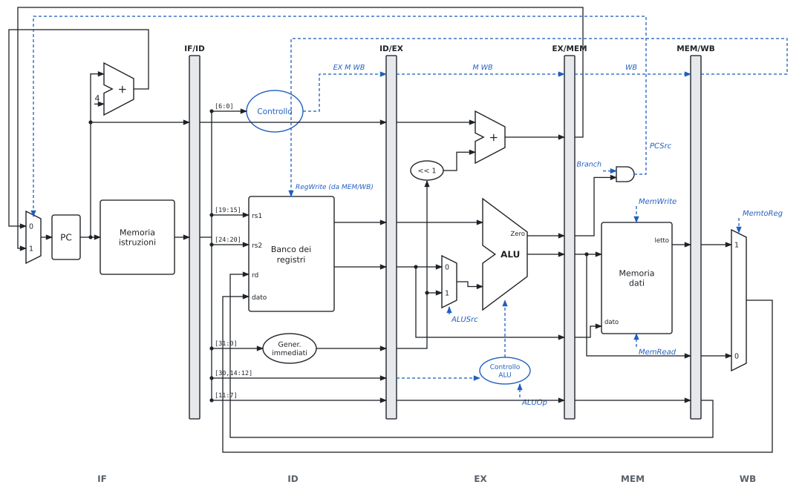

**L'idea.** Catena di montaggio: l'istruzione $i + 1$ comincia prima che la $i$ finisca. Cinque stadi, uno per risorsa:

| Stadio | Che cosa | Blocchi | Registro dopo |
|---|---|---|---|
| IF | preleva l'istruzione, PC + 4 | PC, memoria istruzioni, sommatore | IF/ID: istruzione, PC |
| ID | decodifica, legge i registri, estende l'immediato | controllo, banco dei registri, gen. immediati | ID/EX: dati letti, imm, PC, rd, funct, controlli EX M WB |
| EX | ALU, destinazione del salto | ALU, ALUSrc, sommatore del salto | EX/MEM: risultato, Zero, destinazione, dato per `sw`, rd, controlli M WB |
| MEM | memoria dati, decisione del salto | memoria dati, AND Branch · Zero | MEM/WB: dato letto, risultato, rd, controlli WB |
| WB | scrittura nel banco | MemtoReg | – |

**Regole del datapath a pipeline.**

- Ogni stadio usa solo ciò che trova nel registro alla sua sinistra: il registro conserva tutto quello che servirà dopo.
- I controlli si generano in ID e viaggiano: ogni stadio consuma i suoi (EX: ALUSrc, ALUOp; MEM: MemRead, MemWrite, Branch; WB: MemtoReg, RegWrite).
- Anche **rd viaggia** fino a MEM/WB: quando l'istruzione arriva in WB, in IF/ID c'è già un'altra istruzione con un altro rd.
- Il ciclo è quello dello stadio più lento: 200 ps invece di 800.

**Latenza e throughput.** Con $k$ stadi, ciclo $T_c$ e $n$ istruzioni senza conflitti:
$$T_{pipeline} = (k + n - 1)\,T_c, \qquad \text{accelerazione} \xrightarrow{n \to \infty} \frac{T_{\text{ciclo singolo}}}{T_c}.$$

- La latenza di un'istruzione **cresce**: $5 \times 200 = 1000$ ps contro 800.
- Il throughput cresce: a regime un'istruzione per ciclo.
- L'accelerazione tende a $800/200 = 4$, non a 5: gli stadi non sono bilanciati (ID e WB usano 100 ps su 200).

**Perché RISC-V si presta alla pipeline.** Istruzioni tutte di 32 bit (IF sempre uguale); rs1 e rs2 sempre negli stessi bit (registri letti in ID mentre si decodifica); memoria solo con `lw` e `sw` (indirizzo in EX, accesso in MEM, mai un'ALU dopo la memoria); accessi allineati (un solo accesso per dato).

**All'orale.**

- *Perché il numero del registro di destinazione viaggia fino a WB?* Se il banco dei registri usasse i bit 11-7 di IF/ID, scriverebbe nel registro dell'istruzione arrivata quattro cicli dopo. È l'errore classico del primo disegno della pipeline.
- *Che cosa contiene IF/ID, e perché anche il PC?* L'istruzione e il suo PC: il PC serve in EX per la destinazione del salto, e in caso di eccezione per salvarne l'indirizzo.
- *Perché la pipeline non riduce il tempo di una singola istruzione?* Ogni istruzione attraversa tutti gli stadi, anche quelli che non usa, e i registri aggiungono il loro ritardo; si guadagna solo perché le istruzioni si sovrappongono.

### 4.4 I conflitti

Un **conflitto** (*hazard*) è un caso in cui l'istruzione successiva non può avanzare nel ciclo previsto.

| Conflitto | Causa | Esempio | Soluzione | Costo |
|---|---|---|---|---|
| strutturale | due istruzioni vogliono la stessa risorsa | `lw` in MEM e prelievo in IF con una memoria sola | memorie separate; banco dei registri scritto nella prima metà del ciclo e letto nella seconda | hardware in più |
| sui dati | serve un risultato non ancora scritto (RAW) | `add x1,…` seguita da `sub …, x1, …` | stallo; propagazione (4.5); riordino del codice | 0-2 cicli |
| sul controllo | non si sa quale istruzione prelevare dopo un salto | `beq` | decisione in ID; previsione (4.6) | 0-3 cicli |

**Dati senza propagazione.** Per l'istruzione che dipende da quella subito prima, 2 stalli; da quella due posti prima, 1; da tre posti prima, nessuno (il banco scrive nella prima metà del ciclo e legge nella seconda).

```text
add  x1, x2, x3      # scrive x1 in WB, ciclo 5
sub  x4, x1, x5      # leggerebbe x1 in ID al ciclo 3: valore vecchio
and  x6, x1, x7      # al ciclo 4: valore vecchio
or   x8, x1, x9      # al ciclo 5, seconda metà: valore giusto
```

**Stallo e bolla.** Fermare la pipeline vuol dire tenere ferme le istruzioni dietro (PC e IF/ID non si aggiornano) e far avanzare negli stadi successivi una **bolla**: un'istruzione con tutti i controlli a 0, che non scrive niente.

### 4.5 La propagazione e lo stallo load-use

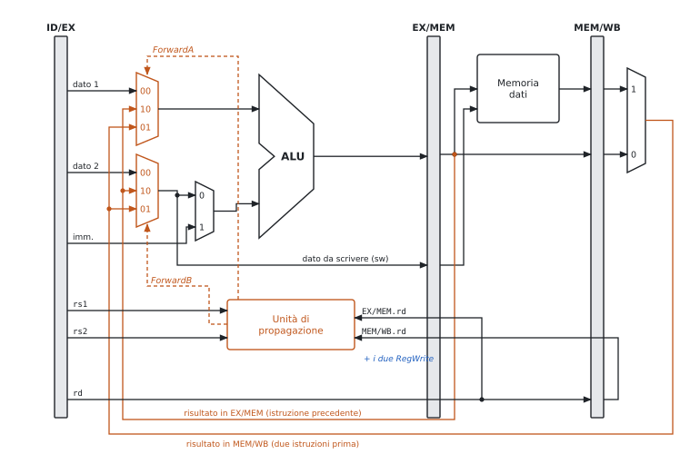

**L'idea.** Il risultato di `add` esiste alla fine di EX, nel registro EX/MEM: lo si porta all'ALU dell'istruzione successiva senza aspettare il banco dei registri.

**Le condizioni dell'unità di propagazione** (per rs1 → ForwardA, uguale per rs2 → ForwardB):

| Caso | Condizione | ForwardA |
|---|---|---|
| dall'istruzione precedente | EX/MEM.RegWrite ∧ EX/MEM.rd ≠ 0 ∧ EX/MEM.rd = ID/EX.rs1 | 10 |
| da due istruzioni prima | MEM/WB.RegWrite ∧ MEM/WB.rd ≠ 0 ∧ MEM/WB.rd = ID/EX.rs1 ∧ **non** il caso precedente | 01 |
| altrimenti | – | 00 |

Perché ogni pezzo della condizione:

- **RegWrite**: `sw` e `beq` hanno un campo nei bit 11-7 ma non scrivono un registro; senza RegWrite si propagherebbe un valore inventato.
- **rd ≠ 0**: `x0` vale sempre 0; un'istruzione che "scrive" `x0` non deve passare il suo risultato.
- **"non il caso precedente"**: in `add x1,x1,x2 / add x1,x1,x3 / add x1,x1,x4` la terza trova `x1` sia in EX/MEM sia in MEM/WB: il valore giusto è il più recente, EX/MEM.
- Il dato della **`sw`** passa dal multiplexer ForwardB prima di andare in EX/MEM: così anche il dato da scrivere in memoria è quello aggiornato.

**Lo stallo load-use.** Il dato di `lw` esce dalla memoria alla fine di MEM; l'istruzione dopo lo vorrebbe all'inizio di EX dello stesso ciclo. Propagare all'indietro nel tempo non si può: serve **1 stallo**, poi il dato arriva da MEM/WB.


**L'unità di rilevamento dei conflitti** lavora in ID, un ciclo prima che il danno avvenga (figura 4.5):
$$\text{ID/EX.MemRead} \wedge \big(\text{ID/EX.rd} = \text{IF/ID.rs1} \vee \text{ID/EX.rd} = \text{IF/ID.rs2}\big) \Rightarrow \text{stallo}.$$

Che cosa fa per fermare la pipeline:

1. **PCWrite = 0**: il PC non cambia, si ripreleva la stessa istruzione;
2. **IF/IDWrite = 0**: l'istruzione in ID resta lì;
3. **bolla**: un multiplexer mette a 0 i controlli che entrano in ID/EX, così in EX passa un'istruzione che non scrive niente.

**Riordinare il codice.** Il compilatore mette fra la `lw` e l'istruzione che usa il dato un'istruzione indipendente (esercizio 3).

**All'orale.**

- *Perché la propagazione si controlla in EX e il rilevamento in ID?* La propagazione serve nel ciclo in cui l'ALU usa l'operando. Lo stallo invece va deciso prima: quando la `lw` è in EX e l'istruzione dipendente in ID, bisogna fermare quest'ultima prima che entri in EX.
- *Perché basta guardare MemRead?* Solo le load producono il dato in MEM invece che in EX; per tutte le altre la propagazione basta.
- *Che errore si introdurrebbe senza la bolla, fermando solo PC e IF/ID?* L'istruzione in ID verrebbe copiata in ID/EX e anche eseguita: la stessa istruzione passerebbe due volte in EX, scrivendo due volte.
- *La propagazione elimina tutti gli stalli sui dati?* No: resta il load-use (1 ciclo), e in ID i confronti dei salti (4.6).

### 4.6 I salti: decidere prima, prevedere

**Il problema.** Dopo una `beq` non si sa quale istruzione prelevare. Nella pipeline di base (figura 4.2) la decisione è in MEM: se il salto è preso, le 3 istruzioni prelevate nel frattempo vanno scartate (**flush**). Con un salto ogni 5-6 istruzioni, il costo è alto.

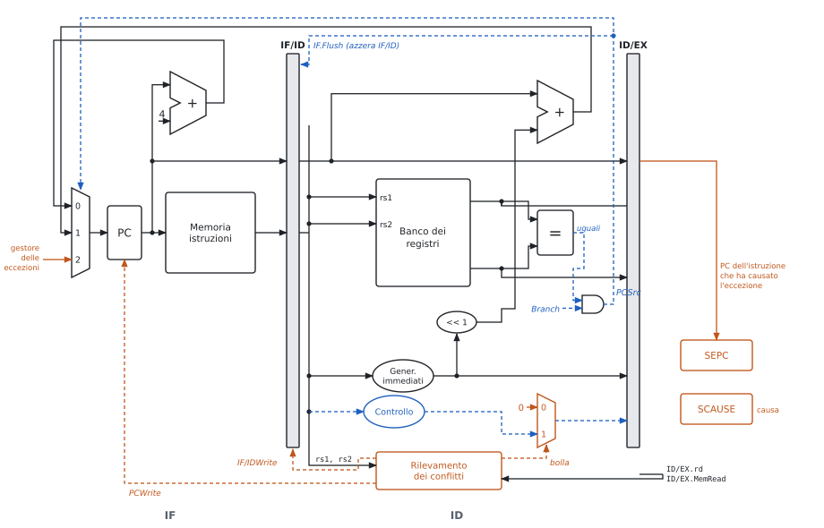

**Decidere in ID** (figura 4.5):

- sommatore della destinazione spostato in ID (PC e immediato ci sono già);
- comparatore di uguaglianza fra i due registri: XOR bit a bit e NOR, molto più veloce di una sottrazione;
- **IF.Flush**: se il salto è preso, IF/ID viene azzerato (l'istruzione prelevata diventa una `nop`);
- penalità di un salto preso: **1 ciclo** invece di 3.

Prezzo: il confronto in ID ha bisogno degli operandi un ciclo prima. Serve una propagazione verso ID e nuovi stalli:

| Il salto usa il risultato di | Stalli |
|---|---|
| un'istruzione aritmetica subito prima | 1 |
| una `lw` subito prima | 2 |
| un'istruzione due posti prima | 0 (propagazione) |

**Previsione statica.** Decisa una volta per tutte, senza storia.

- **"non preso"**: si continua a prelevare in sequenza; se il salto è preso si fa il flush. Hardware: solo IF.Flush. Bene per i salti in testa ai cicli, male per quelli in fondo (quasi sempre presi).
- **"indietro preso, avanti non preso"**: i salti all'indietro chiudono i cicli e di solito sono presi. Serve conoscere la direzione (il segno dell'offset) e la destinazione presto.
- **salto ritardato** (MIPS delle slide): l'istruzione dopo il salto si esegue sempre e il compilatore la riempie con qualcosa di utile. RISC-V non lo ha.

**Previsione dinamica.** Usa la storia di ogni salto, letta in IF.

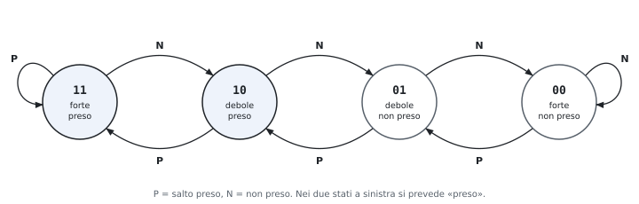

- **Tabella della storia dei salti** (BHT): piccola memoria indirizzata dai bit bassi del PC, con l'esito recente. Più salti possono condividere la stessa riga (l'effetto è solo una previsione peggiore, mai un errore di esecuzione).
- **1 bit**: prevede l'ultimo esito. Un ciclo sbaglia 2 volte per esecuzione: all'uscita e alla prima iterazione della volta dopo.
- **2 bit** (contatore saturato, figura 4.6): il ciclo sbaglia solo all'uscita. Ciclo di 10 iterazioni: dall'80% al 90% di previsioni giuste.
- **Branch target buffer** (BTB, figura 4.7): una cache indirizzata dal PC che contiene, per i salti già visti, la **destinazione** e i bit di previsione. Se il PC è nel BTB e la previsione è "preso", il PC successivo è la destinazione già nel ciclo IF: un salto preso previsto bene costa 0 cicli.

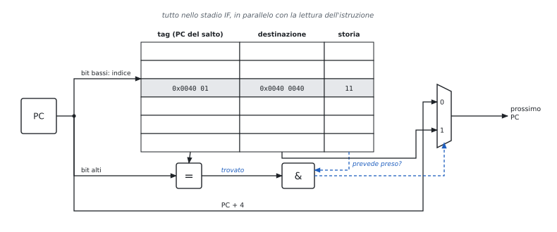

**Statica e dinamica a confronto.**

| | Statica ("non preso") | Dinamica (BHT 2 bit + BTB) |
|---|---|---|
| chi decide la previsione | regola fissa (o il compilatore) | l'hardware, dalla storia del salto |
| dove si legge | – | IF, in parallelo con la memoria istruzioni |
| hardware nel datapath | flush di IF/ID, decisione in ID | in più: BHT/BTB in IF, un ingresso in più al multiplexer del PC, logica che in ID confronta previsione ed esito e aggiorna la tabella |
| salto non preso | 0 cicli | 0 se previsto bene |
| salto preso | 1 ciclo (sempre) | 0 se previsto bene e nel BTB |
| previsione sbagliata | 1 ciclo | 1 ciclo (flush e PC corretto: destinazione o PC + 4 del salto) |
| quando conviene | pipeline corte, hardware minimo | pipeline lunghe, superscalari: la penalità cresce con gli stadi prima della decisione |

**All'orale.**

- *Perché il comparatore in ID non è una sottrazione?* Per l'uguaglianza basta $\overline{\sum (a_i \oplus b_i)}$: due livelli di porte, senza propagazione del riporto. Ci sta nella seconda metà di ID, dopo la lettura dei registri.
- *Che errore copre IF.Flush e che rischio introduce?* Impedisce che l'istruzione prelevata per sbaglio scriva qualcosa. Deve azzerare IF/ID (cioè trasformarla in `nop`) e non ID/EX, altrimenti si annullerebbe il salto stesso.
- *Che cosa succede se due salti condividono una riga della BHT?* Si leggono i bit dell'altro: la previsione può essere sbagliata, ma il programma resta corretto, perché l'esito vero si controlla comunque in ID.
- *Perché a 2 bit e non a 3 o 4?* Il secondo bit toglie l'errore alla prima iterazione; bit in più servono poco. I processori moderni usano invece predittori che correlano più salti.

### 4.7 Le eccezioni

**Definizioni.** **Eccezione**: evento che cambia il flusso del programma, causato dall'istruzione stessa (sincrono). **Interruzione** (*interrupt*): richiesta dall'esterno, per esempio un dispositivo di I/O (asincrona).

| Evento | Stadio | Tipo |
|---|---|---|
| istruzione non definita | ID | eccezione |
| errore di accesso alla memoria, page fault | IF, MEM | eccezione |
| `ecall` (chiamata al sistema operativo) | ID | eccezione |
| overflow (solo nelle ISA che lo segnalano, come MIPS) | EX | eccezione |
| richiesta di un dispositivo | qualsiasi | interruzione |

**Che cosa fa l'hardware** (parti arancio della figura 4.5):

1. lascia completare le istruzioni **precedenti**;
2. scarta quella che ha causato l'eccezione e le successive: IF.Flush, e azzeramento dei controlli in ID ed EX (ID.Flush, EX.Flush, con multiplexer come quello della bolla);
3. salva l'indirizzo dell'istruzione in **SEPC** e la causa in **SCAUSE**;
4. carica nel PC l'indirizzo fisso del gestore del sistema operativo (terzo ingresso del multiplexer del PC);
5. il gestore, finito, torna all'indirizzo in SEPC (oppure termina il programma).

**Eccezione precisa**: tutte le istruzioni prima sono completate, nessuna dopo ha cambiato lo stato. Con più eccezioni nello stesso ciclo si serve quella dell'istruzione più avanti nella pipeline (la più vecchia).

> [!nota] Lo schema dell'appunto a mano
> L'appunto a mano dell'autore disegna il datapath completo di fine capitolo: i quattro registri di pipeline, il comparatore in ID con la sua propagazione, l'unità di propagazione in EX, l'unità di rilevamento in ID e, all'ingresso del multiplexer del PC, l'indirizzo fisso del gestore (nello schema quello MIPS delle slide, `8000 0180` esadecimale). Le figure 4.2, 4.3 e 4.5 insieme sono lo stesso schema, diviso in tre per leggerlo meglio.

**All'orale.**

- *Perché salvare il PC dell'istruzione e non PC + 4?* Dopo un page fault l'istruzione va rieseguita da capo; per una `ecall` il gestore aggiunge 4 lui.
- *Perché il PC arriva a SEPC da un registro di pipeline?* Quando l'eccezione si scopre (in ID, EX o MEM) il PC ha già prelevato altre istruzioni: serve il PC di quella che ha sbagliato, che viaggia nei registri di pipeline.
- *Perché precise?* Altrimenti il sistema operativo non saprebbe da dove ripartire, e un'istruzione successiva potrebbe aver già scritto un registro.

### 4.8 Più istruzioni per ciclo

La pipeline porta il CPI vicino a 1; per scendere sotto si avviano più istruzioni per ciclo (**multiple issue**) e si ragiona in **IPC** = 1/CPI.

| | Avvio multiplo statico (VLIW) | Avvio multiplo dinamico (superscalare) |
|---|---|---|
| chi sceglie cosa parte insieme | il compilatore, in **pacchetti** | l'hardware, durante l'esecuzione |
| esempio del corso | 2 posti: aritmetica o salto, `lw` o `sw` | più unità funzionali con stazioni di prenotazione |
| conflitti | evitati dal compilatore (`nop` se non trova niente) | risolti dall'hardware |
| ordine | in ordine | esecuzione **fuori ordine**, completamento in ordine |
| hardware in più | porte del banco dei registri, sommatore per gli indirizzi | stazioni, buffer di riordino, ridenominazione, previsione |

**Regole del VLIW a due vie.** Niente istruzioni dipendenti nello stesso pacchetto; un'aritmetica si usa dal pacchetto dopo; una `lw` due pacchetti dopo.

**Srotolamento dei cicli** (*loop unrolling*): si copia il corpo del ciclo, si aggiornano i puntatori una volta sola e si usano registri diversi per le copie. Meno istruzioni di controllo, più istruzioni indipendenti da accoppiare (esercizio 7).

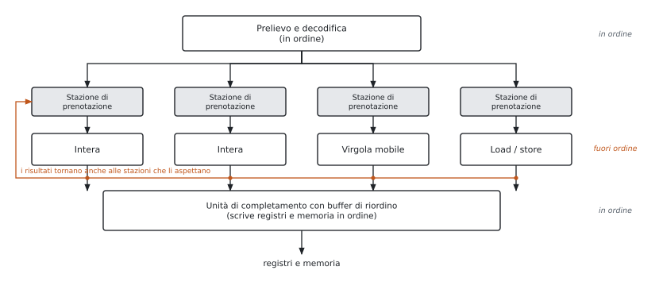

**Le dipendenze** fra $i$ e $j$ ($i$ prima di $j$):

| Dipendenza | Che cosa | Si può togliere? |
|---|---|---|
| vera, RAW (*read after write*) | $j$ legge ciò che $i$ scrive | no: è il flusso dei dati |
| antidipendenza, WAR (*write after read*) | $j$ scrive ciò che $i$ legge | sì, con un altro registro |
| di uscita, WAW (*write after write*) | $i$ e $j$ scrivono lo stesso registro | sì, con un altro registro |

**Ridenominazione dei registri** (*register renaming*): l'hardware ha più registri fisici che architetturali e assegna a ogni nuova scrittura un registro fisico libero; WAR e WAW spariscono.

**Perché si completa in ordine.** Le eccezioni restano precise e le istruzioni eseguite dopo una previsione sbagliata (esecuzione **speculativa**) si possono annullare prima che scrivano lo stato.

**I limiti.** Dal Pentium 4 (fino a 31 stadi, 3,6 GHz, oltre 100 W) si è tornati a pipeline più corte e a più core: consumo e calore (*power wall*), poco parallelismo nei programmi, latenza della memoria.

### 4.9 All'orale: ridisegnare il datapath

La domanda tipica è "disegnami e spiegami il datapath con …". Conviene costruirlo per strati, spiegando a ogni passo perché si aggiunge il pezzo.

1. **IF**: PC, memoria istruzioni, sommatore + 4, multiplexer del PC. Due righe: "il PC è un registro; tutte le istruzioni sono di 4 byte".
2. **ID**: bus dell'istruzione con i campi [19:15], [24:20], [11:7], [6:0], [31:0]; banco dei registri con due letture; generatore degli immediati; unità di controllo.
3. **EX**: ALU con ALUSrc; `<< 1` e sommatore della destinazione; controllo dell'ALU con ALUOp e funct.
4. **MEM** e **WB**: memoria dati con MemRead e MemWrite; AND Branch · Zero → PCSrc; MemtoReg e il filo che torna al banco.
5. **Pipeline**: i quattro registri; i controlli che viaggiano (EX M WB → M WB → WB); rd che viaggia fino a WB e torna al banco; il PC che viaggia fino a EX.
6. **Propagazione**: due multiplexer a tre ingressi davanti all'ALU, l'unità di propagazione con rs1, rs2 da ID/EX e rd, RegWrite da EX/MEM e MEM/WB.
7. **Rilevamento**: unità in ID con ID/EX.MemRead, ID/EX.rd, IF/ID.rs1, rs2; uscite PCWrite, IF/IDWrite e il multiplexer della bolla.
8. **Salti**: comparatore e sommatore in ID, IF.Flush; per la previsione dinamica BHT e BTB in IF.
9. **Eccezioni**: SEPC, SCAUSE, ingresso del gestore sul multiplexer del PC, flush di ID ed EX.

**Le domande "perché" più frequenti**, con la risposta breve:

| Domanda | Risposta |
|---|---|
| perché i registri di pipeline? | ogni stadio lavora su un'istruzione diversa: serve conservare dati e controlli di ognuna |
| perché i controlli si generano in ID? | lì si conosce l'opcode; li si porta avanti invece di ricalcolarli |
| perché rd viaggia? | in WB l'istruzione in ID è un'altra |
| perché il banco scrive nella prima metà e legge nella seconda? | così l'istruzione in ID legge il valore scritto da quella in WB nello stesso ciclo: un conflitto in meno |
| perché due multiplexer prima dell'ALU e non uno? | gli operandi rs1 e rs2 possono arrivare da posti diversi in modo indipendente |
| perché ForwardB sta prima di ALUSrc? | il dato della `sw` (rs2) deve essere quello aggiornato anche se l'ALU usa l'immediato |
| che problema introduce spostare i salti in ID? | operandi richiesti un ciclo prima: propagazione verso ID e stalli in più dopo `lw` e aritmetiche |
| che problema introduce la previsione dinamica? | hardware e tabelle in IF, aggiornamento, e il recupero quando sbaglia |

### Esempi ed esercizi svolti

**Esercizio 1. Ciclo singolo o pipeline?** Memorie 250 ps, ALU 150 ps, register file 100 ps. Si confrontino il ciclo singolo e la pipeline a 5 stadi su 1000 istruzioni senza conflitti.

Ciclo singolo: l'istruzione più lunga è `lw`, $250 + 100 + 150 + 250 + 100 = 850$ ps; il programma dura $1000 \times 850 = 850$ ns. Pipeline: il ciclo è quello dello stadio più lento, 250 ps; il programma dura $(5 + 999) \times 250 = 251$ ns. L'accelerazione è $850/251 \approx 3{,}39$. Il limite per $n \to \infty$ è $850/250 = 3{,}4$, lontano da 5 perché gli stadi sono sbilanciati: ID, EX e WB lavorano 100 o 150 ps su 250.

**Esercizio 2. I segnali di controllo di `lw` e `beq`.** Perché ALUSrc vale 1 in `lw` e 0 in `beq`, e perché ALUOp è diverso?

`lw x5, 8(x10)` somma il registro `x10` e l'immediato 8: il secondo operando dell'ALU è l'immediato, ALUSrc = 1, e l'operazione è una somma, ALUOp = 00. `beq x5, x6, L` confronta due registri: il secondo operando è un registro, ALUSrc = 0, e il confronto si fa con una sottrazione che accende Zero se il risultato è nullo, ALUOp = 01. L'immediato di `beq` serve, ma al sommatore della destinazione, non all'ALU.

**Esercizio 3. Stalli e riordino.** Si contino i cicli del frammento, con e senza forwarding, e lo si riordini per togliere gli stalli.

```text
lw   t0, 0(a0)
lw   t1, 4(a0)
add  t2, t0, t1
sw   t2, 8(a0)
addi a0, a0, 12
```

*Senza forwarding.* `add` legge `t1` in ID e deve aspettare che la seconda `lw` lo scriva in WB: 2 stalli. `sw` legge `t2`, prodotto da `add` subito prima: altri 2 stalli. In tutto $5 + 4 + 4 = 13$ cicli.

*Con forwarding.* Resta solo lo stallo load-use fra la seconda `lw` e `add`: 10 cicli. Il diagramma:

| | 1 | 2 | 3 | 4 | 5 | 6 | 7 | 8 | 9 | 10 |
|---|---|---|---|---|---|---|---|---|---|---|
| `lw t0` | IF | ID | EX | MEM | WB | | | | | |
| `lw t1` | | IF | ID | EX | MEM | WB | | | | |
| `add` | | | IF | ID | ID | EX | MEM | WB | | |
| `sw` | | | | IF | IF | ID | EX | MEM | WB | |
| `addi` | | | | | | IF | ID | EX | MEM | WB |

Al ciclo 5 in EX passa una bolla; `t1` arriva all'ALU di `add` al ciclo 6 dal registro MEM/WB.

*Riordino.* `addi` non dipende da nessuna delle istruzioni precedenti tranne che per `a0`, che le due `lw` leggono prima. La si sposta fra la seconda `lw` e `add`, correggendo lo spiazzamento della `sw`, che ora vede `a0` già aumentato di 12:

```text
lw   t0, 0(a0)
lw   t1, 4(a0)
addi a0, a0, 12
add  t2, t0, t1
sw   t2, -4(a0)
```

Con il forwarding non ci sono più stalli: 9 cicli, il minimo per 5 istruzioni. Senza forwarding servono 12 cicli.

**Esercizio 4. Una catena di dipendenze.**

```text
add  s1, s2, s3
sub  s4, s1, s5
and  s6, s1, s4
or   s7, s6, s2
sw   s7, 0(a0)
```

Ogni istruzione dipende da quella immediatamente precedente. Senza forwarding: 2 stalli per ciascuna delle ultime quattro, $9 + 8 = 17$ cicli. Con il forwarding nessuno stallo, perché nessun dato viene da una `lw`: 9 cicli. Il guidato 1 mostra da dove arriva ogni operando.

**Esercizio 5. Salti decisi in ID.** Quanti stalli in queste due coppie, con forwarding e salti decisi in ID?

```text
lw   t0, 0(a0)          addi t1, t1, 1
beq  t0, zero, fine     bne  t1, t2, ciclo
```

La `beq` confronta in ID, un ciclo prima di quando un'istruzione aritmetica userebbe l'operando in EX. Il valore di `lw` è pronto alla fine di MEM: se `lw` è in MEM al ciclo $c$, la `beq` può essere in ID solo al ciclo $c + 1$, cioè 2 stalli. Il valore di `addi` è pronto alla fine di EX: 1 stallo. In un ciclo conviene quindi mettere fra l'aggiornamento del contatore e il salto un'istruzione indipendente.

**Esercizio 6. Il CPI con stalli e salti.** In un programma il 25% delle istruzioni sono `lw`, e il 40% di queste è seguito da un'istruzione che usa il dato; il 15% sono salti, presi nel 60% dei casi. La pipeline ha il forwarding e prevede "non preso". Calcolare il CPI con salti decisi in ID e in MEM, e con un predittore dinamico corretto nel 90% dei casi (e un BTB) con decisione in ID.

Ogni stallo load-use costa 1 ciclo: $0{,}25 \times 0{,}4 = 0{,}1$ cicli per istruzione. Decisione in ID: un salto preso costa 1 ciclo, $0{,}15 \times 0{,}6 \times 1 = 0{,}09$; $\text{CPI} = 1 + 0{,}1 + 0{,}09 = 1{,}19$. Decisione in MEM: un salto preso costa 3 cicli, $0{,}15 \times 0{,}6 \times 3 = 0{,}27$; $\text{CPI} = 1{,}37$. Predittore dinamico: si paga 1 ciclo solo sugli errori, $0{,}15 \times 0{,}1 = 0{,}015$; $\text{CPI} = 1{,}115$.

**Esercizio 7. VLIW e srotolamento.** Il ciclo `b[i] = 2 * a[i]` su $n$ elementi ($n$ pari), con `a0` = indirizzo di `a`, `a1` = indirizzo di `b`, `a2` = indirizzo di fine di `a`, va schedulato su un processore a due vie (aritmetica o salto | `lw` o `sw`).

```text
lp:  lw   t0, 0(a0)
     slli t0, t0, 1
     sw   t0, 0(a1)
     addi a0, a0, 4
     addi a1, a1, 4
     bne  a0, a2, lp
```

*Senza srotolamento.* `slli` usa il dato della `lw`: almeno due pacchetti dopo. `sw` usa `slli`: un pacchetto dopo. Le due `addi` si possono anticipare, correggendo lo spiazzamento della `sw`:

```text
lp:  addi a0, a0, 4     |  lw   t0, 0(a0)
     addi a1, a1, 4     |  nop
     slli t0, t0, 1     |  nop
     bne  a0, a2, lp    |  sw   t0, -4(a1)
```

Nel primo pacchetto `lw` legge `a0` insieme ad `addi`, quindi il valore vecchio. Sono 6 istruzioni in 4 cicli: IPC 1,5.

*Srotolando due volte* (copie con `t0` e `t1`, puntatori aggiornati di 8):

```text
lp:  addi a0, a0, 8     |  lw   t0, 0(a0)
     addi a1, a1, 8     |  lw   t1, -4(a0)
     slli t0, t0, 1     |  nop
     slli t1, t1, 1     |  sw   t0, -8(a1)
     bne  a0, a2, lp    |  sw   t1, -4(a1)
```

Sono 9 istruzioni in 5 cicli: IPC 1,8, cioè 2,5 cicli per elemento invece di 4. Il secondo `lw` vede `a0` già aumentato di 8, per questo il suo spiazzamento è −4 (cioè $+4$ rispetto al valore vecchio). Senza il secondo registro `t1` le due copie si pesterebbero i piedi: è la ridenominazione fatta dal compilatore.

**Esercizio 8. Dipendenze e ridenominazione.**

```text
mul  t0, t1, t2      # 1
add  t3, t0, t4      # 2
sub  t0, t5, t6      # 3
and  t4, t0, t3      # 4
```

Dipendenze vere: 1 → 2 su `t0`, 3 → 4 su `t0`, 2 → 4 su `t3`. Antidipendenze: 2 legge `t0` che 3 scrive (2 → 3); 2 legge `t4` che 4 scrive (2 → 4). Dipendenza di uscita: 1 e 3 scrivono `t0`. Ridenominando il `t0` scritto da 3 in un registro fisico nuovo `p1` (e il `t4` scritto da 4 in `p2`), la 3 diventa `sub p1, t5, t6` e la 4 `and p2, p1, t3`: la 3 può partire subito, in parallelo alla `mul`, che è lenta.

### Esercizi guidati

Ogni esercizio è diviso in passi: si prova un passo alla volta e si confronta solo dopo.

**Guidato 1. I segnali di forwarding.** Per il frammento dell'esercizio 4, dire per ogni istruzione che valori hanno ForwardA e ForwardB quando è in EX.

*Passo 1: che cosa c'è negli stadi.* Quando l'istruzione $i$ è in EX, la $i - 1$ è in MEM (il suo risultato è in EX/MEM) e la $i - 2$ in WB (il risultato è in MEM/WB).

*Passo 2: `sub s4, s1, s5`.* In EX/MEM c'è `add`, con rd = `s1` = rs1: ForwardA = 10. `s5` viene dal register file: ForwardB = 00.

*Passo 3: `and s6, s1, s4`.* In EX/MEM c'è `sub` (rd = `s4` = rs2): ForwardB = 10. In MEM/WB c'è `add` (rd = `s1` = rs1), e EX/MEM non scrive `s1`: ForwardA = 01.

*Passo 4: `or s7, s6, s2`.* In EX/MEM c'è `and` (rd = `s6` = rs1): ForwardA = 10. `s2` non è scritto da nessuna delle due: ForwardB = 00.

*Passo 5: `sw s7, 0(a0)`.* Il dato da scrivere `s7` (rs2) viene da `or` in EX/MEM: ForwardB = 10; `a0` (rs1) dal register file: ForwardA = 00.

**Guidato 2. Predittore a 1 e a 2 bit su un ciclo annidato.** Il ciclo interno ha 4 iterazioni e viene eseguito molte volte: il suo salto in fondo dà la sequenza preso, preso, preso, non preso, ripetuta. Che percentuale di previsioni corrette danno i due predittori a regime?

*Passo 1: un bit.* All'inizio di un'esecuzione il bit vale "non preso" (l'ultimo esito). Prima iterazione: previsto non preso, è preso, errore; il bit diventa "preso". Seconda e terza: giuste. Quarta: previsto preso, non preso, errore. Due errori su quattro: 50%.

*Passo 2: due bit.* A regime il contatore è a "fortemente preso" durante il ciclo; all'uscita sbaglia e scende a "debolmente preso". Alla prima iterazione successiva prevede ancora preso e indovina, tornando a "fortemente preso". Un errore su quattro: 75%.

*Passo 3: il confronto.* Più il ciclo è corto, più conta il secondo bit: per 10 iterazioni si passa da 80% a 90%, per 4 da 50% a 75%.

**Guidato 3. Diagramma con un salto preso.** Con forwarding, salti decisi in ID e previsione "non preso", quanti cicli impiega questo frammento se il salto è preso e la destinazione è `fine: sub t3, t0, t1`?

```text
     addi t1, t1, 1
     beq  t1, t2, fine
     add  t4, t4, t1
fine: sub  t3, t0, t1
```

*Passo 1: lo stallo.* `beq` usa `t1` da `addi` immediatamente prima, e la decide in ID: 1 stallo.

*Passo 2: il flush.* Mentre `beq` è in ID (al secondo tentativo, ciclo 4), in IF c'è `add`. Il salto è preso: `add` si scarta e al ciclo 5 si legge `sub`.

*Passo 3: il conto.* `sub` è in IF al ciclo 5 e in WB al ciclo 9. In tutto 9 cicli per 3 istruzioni utili: i cicli persi sono uno per lo stallo e uno per il flush.

### Riepilogo

Il datapath a ciclo singolo esegue ogni istruzione in un ciclo lungo quanto quella più lenta; l'unità di controllo genera dai campi dell'istruzione i segnali dei multiplexer, delle scritture e dell'ALU, con il controllo dell'ALU a due livelli. La pipeline a cinque stadi IF, ID, EX, MEM, WB, con i registri di pipeline, completa a regime un'istruzione per ciclo: aumenta il throughput, non riduce la latenza, e il ciclo è fissato dallo stadio più lento. I conflitti strutturali si evitano con memorie separate e con il register file che scrive e legge nelle due metà del ciclo. I conflitti sui dati si risolvono con il forwarding da EX/MEM e da MEM/WB; resta lo stallo load-use, inserito dall'unità di rilevamento dei conflitti e spesso evitabile riordinando il codice. I conflitti sul controllo si riducono decidendo i salti in ID e con la previsione statica o dinamica (BHT a uno o due bit, BTB). Le eccezioni sono conflitti sul controllo gestiti salvando l'indirizzo e la causa. Per avviare più istruzioni per ciclo ci sono il VLIW, in cui il compilatore forma i pacchetti aiutandosi con lo srotolamento dei cicli, e i processori superscalari, che eseguono fuori ordine, eliminano antidipendenze e dipendenze di uscita con la ridenominazione e scrivono i risultati in ordine.

### Formulario

#### Tempi

$$T_{\text{ciclo singolo}} = n \cdot T_{\text{istr. più lenta}}, \qquad T_{pipeline} = (k + n - 1) T_c, \qquad T_c = \max(\text{stadi}), \qquad \text{accelerazione} \to \frac{T_{\text{ciclo singolo}}}{T_c}.$$

$$\text{CPI} = 1 + \sum (\text{frequenza} \times \text{cicli di stallo}), \qquad \text{IPC} = 1/\text{CPI}.$$

#### Stalli nella pipeline a 5 stadi

| Situazione | Senza forwarding | Con forwarding |
|---|---|---|
| uso subito dopo un'istruzione aritmetica | 2 | 0 |
| uso due istruzioni dopo | 1 | 0 |
| uso subito dopo una `lw` | 2 | 1 |
| salto in ID subito dopo un'aritmetica | 2 | 1 |
| salto in ID subito dopo una `lw` | 2 | 2 |
| salto preso con previsione "non preso" | 1 (decisione in ID), 3 (in MEM) | uguale |

#### Condizioni

Forwarding da EX/MEM: RegWrite ∧ rd ≠ 0 ∧ rd = rs1 (rs2) → 10. Da MEM/WB: RegWrite ∧ rd ≠ 0 ∧ rd = rs1 (rs2) ∧ non dal precedente → 01. Load-use: ID/EX.MemRead ∧ ID/EX.rd ∈ {IF/ID.rs1, IF/ID.rs2} → stallo (PC e IF/ID fermi, controlli azzerati).

#### Segnali di controllo

| | ALUSrc | MemtoReg | RegWrite | MemRead | MemWrite | Branch | ALUOp |
|---|---|---|---|---|---|---|---|
| R | 0 | 0 | 1 | 0 | 0 | 0 | 10 |
| `lw` | 1 | 1 | 1 | 1 | 0 | 0 | 00 |
| `sw` | 1 | X | 0 | 0 | 1 | 0 | 00 |
| `beq` | 0 | X | 0 | 0 | 0 | 1 | 01 |

#### Termini per l'orale

| Termine | In una riga |
|---|---|
| Throughput, latenza | istruzioni completate per unità di tempo; durata di una istruzione |
| Registro di pipeline | conserva dati e controlli fra due stadi |
| Hazard strutturale, sui dati, sul controllo | risorsa contesa; dato non pronto; PC non noto |
| Stallo, bolla | fermare le istruzioni dietro; istruzione nulla che avanza |
| Forwarding | portare un risultato all'ALU prima della scrittura nei registri |
| Load-use | uso del dato di una `lw` subito dopo: 1 stallo |
| Flush | scartare le istruzioni lette per errore |
| BHT, BTB | tabella degli esiti dei salti; tabella delle destinazioni |
| Eccezione precisa | prima completate, dopo nessun effetto |
| VLIW, superscalare | avvio multiplo deciso dal compilatore; dall'hardware |
| RAW, WAR, WAW | dipendenza vera, antidipendenza, di uscita |
| Register renaming | registri fisici in più per eliminare WAR e WAW |

#### Domande che tornano spesso

- Disegnare il datapath a ciclo singolo e spiegare i segnali di controllo per `lw`, `sw`, `beq` e tipo R.
- Perché la pipeline aumenta il throughput ma non riduce la latenza? Formula dell'accelerazione.
- Tipi di conflitti e soluzioni; condizioni del forwarding e dello stallo load-use.
- Come si riducono i conflitti sul controllo? Predittori a uno e due bit.
- "Disegnami e spiegami il datapath con la previsione dei salti": statica e dinamica, differenze teoriche e differenze nel datapath (4.6, figure 4.5 e 4.7).
- Disegnare il datapath a pipeline con propagazione e rilevamento dei conflitti, spiegando ogni segnale (4.9).
- Come gestisce le eccezioni la pipeline?
- VLIW e superscalare: differenze; srotolamento dei cicli; dipendenze e ridenominazione.

## 5 · La gerarchia di memoria, la cache e l'input/output

**In questo modulo.** Prerequisiti: CPI (modulo 1) e pipeline (modulo 4). Perché serve una gerarchia di memoria e perché funziona (località); la cache a mappatura diretta, associativa a insiemi e completamente associativa; scritture, cause dei miss, prestazioni, cache a più livelli, DRAM; un cenno alla memoria virtuale; l'input/output. Si impara a scomporre un indirizzo in tag, indice e offset, a simulare a mano una sequenza di accessi, a dimensionare una cache e a calcolare AMAT e CPI. All'orale si chiede di disegnare le strutture (figure 5.2, 5.3, 5.5, 5.6) e di spiegare il perché di ogni campo.

### 5.1 Perché una gerarchia

**Il problema.** I processori sono cresciuti per anni di circa il 55% all'anno, la DRAM di circa il 7%: un accesso alla memoria principale costa centinaia di cicli. Una memoria grande, veloce ed economica insieme non esiste.

| Tecnologia | Bit | Accesso | Uso | Nota |
|---|---|---|---|---|
| SRAM | 6 transistor | ~1 ns | cache | statica: tiene il dato finché è alimentata |
| DRAM | 1 transistor + 1 condensatore | decine di ns | memoria principale | dinamica: va rinfrescata ogni pochi ms |
| flash, disco | – | da µs a ms | memoria di massa | permanente, enorme |

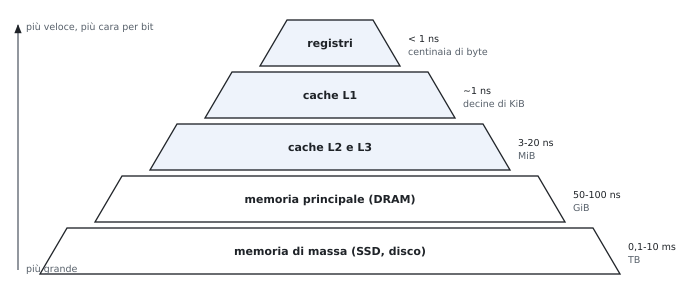

**Perché funziona: la località.**

- **temporale**: un dato usato ora sarà probabilmente usato di nuovo presto (variabili e istruzioni di un ciclo) → tenere vicino al processore i dati recenti;
- **spaziale**: dopo un indirizzo si useranno probabilmente quelli vicini (istruzioni in sequenza, elementi di un array) → spostare blocchi interi di dati contigui.

**Chi sposta i dati.** Registri ↔ memoria: il compilatore. Cache ↔ memoria principale: l'hardware. Memoria principale ↔ disco: il sistema operativo (memoria virtuale, 5.8).

### 5.2 I termini

| Termine | Significato |
|---|---|
| blocco (linea) | unità trasferita fra due livelli |
| hit, miss | il dato c'è / non c'è nel livello superiore |
| hit rate, miss rate | frazione di hit; miss rate = 1 − hit rate |
| hit time | tempo per accedere al livello superiore, compreso capire se è un hit |
| miss penalty | tempo per portare il blocco dal livello inferiore e consegnare il dato |

$$\text{AMAT} = \text{hit time} + \text{miss rate} \times \text{miss penalty}.$$

### 5.3 La cache a mappatura diretta

Due domande: il dato c'è? Se sì, dove? A mappatura diretta ogni blocco di memoria ha **un solo posto**:
$$\text{indice} = (\text{indirizzo del blocco}) \bmod (\text{numero di blocchi}).$$

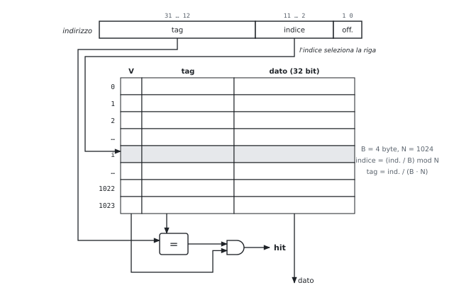

**I campi dell'indirizzo** (blocchi di $2^m$ parole da 4 byte, $2^n$ blocchi, indirizzi di 32 bit):

| Campo | Bit | A che serve |
|---|---|---|
| offset | $m + 2$ | sceglie parola e byte nel blocco |
| indice | $n$ | sceglie la riga |
| tag | $32 - n - m - 2$ | dice quale dei blocchi che condividono la riga c'è davvero |

**Ogni riga contiene** il bit di validità V (all'accensione la cache è vuota), il tag, i dati.

$$\text{bit totali} = 2^n \times (\text{bit del blocco} + \text{bit del tag} + 1).$$

Esempio delle slide: 16 KiB di dati in blocchi di 4 parole → $2^{10}$ blocchi, tag di 18 bit, $2^{10} \times (128 + 18 + 1) = 147$ Kibit ≈ 18,4 KiB.

**La dimensione del blocco.**

- blocco più grande → più località spaziale, miss rate più basso;
- ma a parità di capacità meno blocchi → più conflitti, il miss rate risale;
- e la miss penalty cresce (più dati da trasferire). Rimedi: ripartire appena arriva la parola cercata (*early restart*), o farla arrivare per prima (*requested word first*).

**All'orale.**

- *Perché l'indice sono i bit bassi e il tag quelli alti?* Con i bit bassi indirizzi vicini vanno in righe diverse: un array occupa tutta la cache invece di contendersi una riga. Con i bit alti come indice, blocchi vicini andrebbero tutti nella stessa riga.
- *Perché serve il bit di validità?* All'accensione le righe contengono bit casuali: un tag casuale potrebbe coincidere e dare un falso hit.
- *Perché non si memorizza anche l'indice?* È implicito nella posizione della riga.

### 5.4 Le scritture

| Politica | Che cosa fa | Pregi | Difetti | Aggiunte |
|---|---|---|---|---|
| **write-through** | scrive cache e memoria | memoria sempre aggiornata, semplice | una scrittura in memoria per ogni `sw` | **write buffer**: coda di scritture; il processore si ferma solo se è piena |
| **write-back** | scrive solo la cache; ricopia il blocco quando viene sostituito | poco traffico se un blocco è scritto più volte | memoria non aggiornata per un po'; sostituzione più lenta | **dirty bit**: solo i blocchi modificati si ricopiano |

**Miss in scrittura.** *Write allocate*: si porta il blocco in cache e lo si scrive (di solito con write-back). *No-write allocate*: si scrive solo nel livello sotto (di solito con write-through).

**Miss in lettura.** Si ferma la pipeline; se il blocco da sostituire è sporco lo si ricopia; si legge il blocco nuovo, lo si scrive in cache e si ripete l'accesso. Le cache **non bloccanti** servono altri hit durante un miss (*hit under miss*).

**All'orale.**

- *Che problema risolve il write buffer, e quale introduce?* Evita di aspettare la memoria a ogni `sw`. Introduce un caso nuovo: una `lw` che cerca un dato ancora nel buffer va servita dal buffer (o aspettare che si svuoti), altrimenti legge il valore vecchio.
- *Perché il dirty bit?* Senza, con il write-back si dovrebbe ricopiare ogni blocco sostituito, anche quelli solo letti.

### 5.5 Le cause dei miss e l'associatività

**Le tre C.**

| Miss | Causa | Si riduce con |
|---|---|---|
| obbligatori (*compulsory*) | primo accesso al blocco | blocchi più grandi |
| di capacità | la cache non contiene tutti i blocchi usati | cache più grande |
| di conflitto | blocchi usati insieme nella stessa posizione | più associatività |

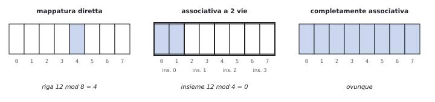

| Organizzazione | Dove va un blocco | Confronti | Indice |
|---|---|---|---|
| mappatura diretta | una riga: blocco mod N | 1 | $\log_2 N$ bit |
| associativa a $n$ vie | un insieme: blocco mod (N/n), qualsiasi via | $n$ in parallelo | $\log_2 (N/n)$ bit |
| completamente associativa | ovunque | N (uno per blocco) | nessuno |

A parità di capacità, raddoppiando le vie l'indice perde un bit e il tag ne guadagna uno.

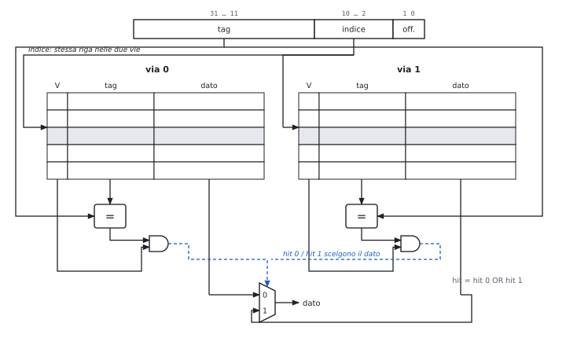

**Il prezzo.** $n$ comparatori, un multiplexer sul percorso del dato (hit time più lungo), e una politica di **sostituzione**:

- **LRU** (*least recently used*): si sostituisce il blocco non usato da più tempo; a 2 vie basta un bit per insieme;
- con molte vie LRU esatto costa: approssimazioni (NRU, *not recently used*) o scelta casuale.

**All'orale.**

- *Perché nella cache associativa il multiplexer peggiora l'hit time?* Nella mappatura diretta il dato si può usare mentre si controlla il tag (se non è hit lo si scarta); con più vie si sa quale dato usare solo dopo il confronto.
- *Perché la completamente associativa non si usa per cache grandi?* Un comparatore per blocco: migliaia di comparatori, area e consumo enormi. Si usa per strutture piccole come il TLB.

### 5.6 Le prestazioni della cache

$$\text{CPI} = \text{CPI}_{base} + \frac{\text{accessi}}{\text{istruzione}} \times \text{miss rate} \times \text{miss penalty},$$
con istruzioni (1 accesso per istruzione) e dati (1 per ogni `lw` o `sw`) calcolati a parte.

- Processore più veloce → la miss penalty in **cicli** cresce (la memoria non accelera): gli stalli pesano di più (guidato 3).
- Ridurre il CPI di base serve sempre meno: la parte dei miss resta.

**Cache a più livelli.**

| | L1 | L2 |
|---|---|---|
| obiettivo | hit time minimo | miss rate basso |
| com'è | piccola, poche vie, separata istruzioni/dati | grande, più vie, blocchi più grandi |

Miss rate **locale** della L2 = miss L2 / accessi alla L2 (cioè i miss della L1); **globale** = miss L2 / tutti gli accessi. Il locale è molto più alto: alla L2 arrivano solo gli accessi "difficili".
$$\text{AMAT} = \text{hit time}_{L1} + \text{miss rate}_{L1} \times (\text{hit time}_{L2} + \text{miss rate locale}_{L2} \times \text{miss penalty}_{L2}).$$

**Il software conta.** Una matrice C scorsa per righe sfrutta la località spaziale, per colonne no; gli algoritmi a blocchi (*blocking*) riusano i dati finché sono in cache.

### 5.7 La DRAM e il collegamento con la cache

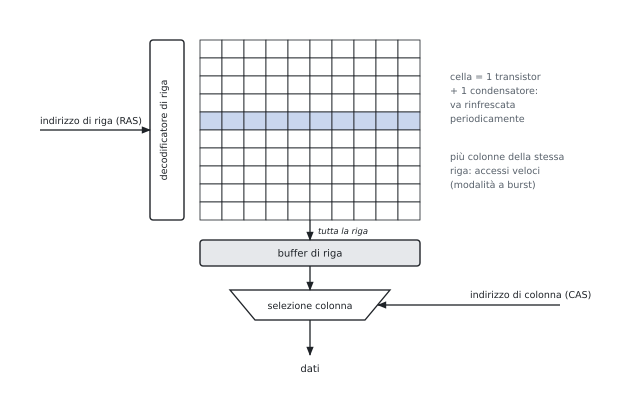

- **SDRAM**: sincrona con il bus. **DDR**: un dato su entrambi i fronti del clock; DDR2, DDR3, DDR4 aumentano la velocità di trasferimento e il prefetch interno, abbassando la tensione.
- **Refresh**: il condensatore si scarica; il controllore rilegge e riscrive ogni riga periodicamente.

**Modello delle slide per un blocco di più parole** (bus largo una parola): 1 ciclo per l'indirizzo, alcuni cicli per ogni accesso alla DRAM, 1 ciclo per trasferire ogni parola.

| Organizzazione | Come si legge il blocco |
|---|---|
| un accesso per parola | ogni parola un accesso completo |
| stessa riga (burst) | dopo la prima parola basta l'accesso di colonna |
| interallacciata (*interleaved*) | parole in banchi diversi letti in parallelo, poi una per ciclo sul bus |

**Larghezza di banda** = byte trasferiti per ciclo di bus durante un miss (esercizio 6).

### 5.8 La memoria virtuale (cenno)

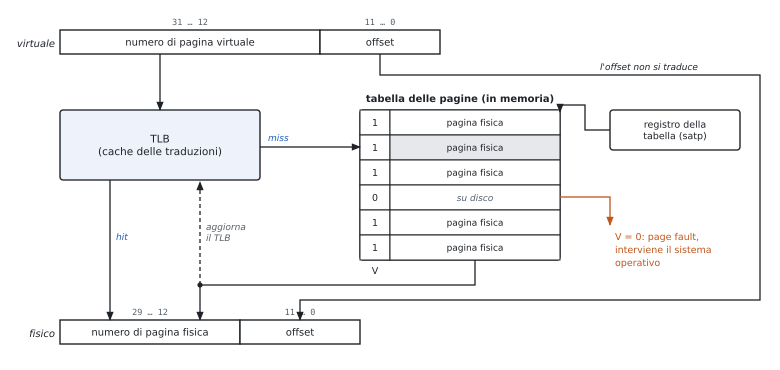

- Ogni processo usa indirizzi **virtuali**, divisi in pagine (tipicamente 4 KiB); il sistema operativo decide in quale pagina **fisica** sta ogni pagina, o se è sul disco.
- **Tabella delle pagine** (una per processo, in memoria): numero di pagina virtuale → numero di pagina fisica, con il bit di validità.
- **Page fault**: pagina non in memoria → eccezione, il sistema operativo la carica dal disco. Costa milioni di cicli, quindi: pagine grandi, posizionamento completamente associativo, sostituzione che approssima LRU, sempre write-back.
- **TLB**: piccola cache (spesso completamente associativa) delle traduzioni recenti, per non leggere la tabella in memoria a ogni accesso. Nelle slide: ITLB e DTLB accanto alle L1.
- **Protezione**: ogni processo vede solo le sue pagine. È la virtualizzazione del modulo 1 applicata alla memoria.

**All'orale.**

- *Perché l'offset non si traduce?* La pagina virtuale e quella fisica hanno la stessa dimensione: cambia solo dove comincia la pagina.
- *Perché write-back e non write-through?* Una scrittura sul disco costa milioni di cicli: impensabile per ogni `sw`.

### 5.9 L'input/output

**Misure.** Throughput (dati o operazioni per unità di tempo) e tempo di risposta (latenza di un'operazione, decisivo in tempo reale). Fra una tastiera e una scheda di rete ci sono circa otto ordini di grandezza di velocità.

**I bus.**

| Tipo | Come | Pro | Contro |
|---|---|---|---|
| sincrono | clock fra le linee, protocollo fisso | poca logica, veloce | tutti allo stesso clock; corto (*clock skew*) |
| asincrono | *handshaking*: richiesta, conferma, dato pronto | dispositivi di velocità diverse | più lento |

Bus processore-memoria (corto, veloce), di I/O (USB, SATA), di collegamento (PCI Express). Tendenza: da bus paralleli a collegamenti seriali punto a punto.

**Comandare i dispositivi.** Registri di stato, controllo e dati del dispositivo; in RISC-V **I/O mappato in memoria**: `lw` e `sw` su indirizzi riservati. Il sistema operativo fa da intermediario (protezione, condivisione).

**Sapere quando il dispositivo è pronto.**

| Metodo | Come | Pro | Contro |
|---|---|---|---|
| polling | il processore legge il registro di stato a intervalli | semplice | cicli sprecati con dispositivi lenti |
| interruzioni | il dispositivo segnala; servita fra due istruzioni come un'eccezione (4.7) | niente attese | servono identificazione e priorità |
| DMA | il controllore trasferisce un blocco intero da solo, poi una sola interruzione | adatto ai dispositivi veloci | si contende il bus; problemi di coerenza |

**Priorità delle interruzioni.** Il gestore maschera quelle di priorità uguale o minore, salva lo stato, riabilita le più urgenti, alla fine ripristina tutto.

**I problemi della DMA.**

- **Dati vecchi**: un ingresso DMA aggiorna la memoria ma non la cache; con write-back un'uscita DMA legge dalla memoria dati non ancora ricopiati. Rimedi: I/O attraverso la cache, invalidazione o ricopiatura da parte del sistema operativo (*cache flush*), invalidazione selettiva in hardware (*snooping*).
- **Memoria virtuale**: con indirizzi fisici un trasferimento non deve attraversare il confine di una pagina; con indirizzi virtuali il controllore deve tradurli. Il sistema operativo non deve spostare le pagine coinvolte durante il trasferimento.

### Esempi ed esercizi svolti

**Esercizio 1. Dimensionare una cache.** Indirizzi di 32 bit, 64 KB di dati, blocchi di 32 byte. Campi dell'indirizzo e bit totali, a corrispondenza diretta e a 4 vie.

Blocchi: $64\,\text{KB} / 32\,\text{B} = 2048 = 2^{11}$. Offset: 5 bit. *Diretta*: indice 11 bit, tag $32 - 11 - 5 = 16$ bit. Ogni blocco ha $256$ bit di dati, 16 di tag e 1 di validità: $2^{11} \times 273 = 559\,104$ bit, cioè $68{,}25$ KB (il 6,6% in più dei dati). *4 vie*: $2048 / 4 = 512 = 2^9$ insiemi, indice 9 bit, tag 18 bit; $2^{11} \times 275 = 563\,200$ bit, più i bit per l'LRU. Più vie, più bit di tag e più comparatori (4 invece di 1).

**Esercizio 2. Una sequenza di accessi in tre cache.** Cache di 8 blocchi da una parola. Indirizzi in byte: 0, 8, 32, 0, 40, 8, 64, 32. Hit e miss con corrispondenza diretta, a 2 vie (LRU) e completamente associativa (LRU).

Gli indirizzi delle parole sono 0, 2, 8, 0, 10, 2, 16, 8.

*Diretta* (posizione = parola mod 8): 0, 2, 0, 0, 2, 2, 0, 0. Le parole 0, 8 e 16 si contendono la posizione 0, le parole 2 e 10 la posizione 2: ogni accesso caccia il blocco che servirà dopo. Otto miss, nessun hit.

*2 vie, 4 insiemi* (insieme = parola mod 4): tutte le parole vanno negli insiemi 0 e 2.

| Accesso | 0 | 8 | 32 | 0 | 40 | 8 | 64 | 32 |
|---|---|---|---|---|---|---|---|---|
| Insieme | 0 | 2 | 0 | 0 | 2 | 2 | 0 | 0 |
| Esito | M | M | M | H | M | H | M | M |
| Insieme 0 dopo | 0 | 0 | 0, 32 | 32, 0 | 32, 0 | 32, 0 | 0, 64 | 64, 32 |

(nell'ultima riga il blocco più recente è a destra). L'accesso a 64 sostituisce 32, il meno usato di recente, che serve subito dopo: due hit.

*Completamente associativa*: gli indirizzi diversi sono 5 e la cache ne contiene 8, quindi gli unici miss sono i 5 obbligatori: tre hit (il secondo 0, il secondo 8, il secondo 32).

*Classificazione*: nella cache diretta 5 miss sono obbligatori e 3 di conflitto; nessuno è di capacità, perché la cache completamente associativa della stessa dimensione non li ha.

**Esercizio 3. La località spaziale.** Cache diretta di 4 blocchi da 16 byte; un programma legge in ordine le 16 parole di un array che parte dall'indirizzo 0.

Ogni blocco contiene 4 parole. La prima lettura di ogni blocco è un miss, le altre tre sono hit: M H H H M H H H … , 4 miss e 12 hit, hit rate del 75%. Con blocchi di una parola sarebbero 16 miss.

**Esercizio 4. Tempo medio di accesso con uno e due livelli.** L1: hit time 1 ciclo, miss rate 5%; memoria: 100 cicli. Poi si aggiunge una L2 con hit time 10 cicli e miss rate locale del 40%.

Un livello: $\text{AMAT} = 1 + 0{,}05 \times 100 = 6$ cicli. Due livelli: la miss penalty della L1 diventa $10 + 0{,}4 \times 100 = 50$ cicli, e $\text{AMAT} = 1 + 0{,}05 \times 50 = 3{,}5$ cicli. Il miss rate globale della L2 è $0{,}05 \times 0{,}4 = 2\%$.

**Esercizio 5. Il CPI con gli stalli di memoria.** CPI di base 1,5; miss rate della cache istruzioni 2%, della cache dati 5%; il 30% delle istruzioni sono `lw` o `sw`; miss penalty 120 cicli. Poi si aggiunge una L2 con hit time 20 cicli e miss rate globale dell'1% (per istruzioni e dati).

Senza L2: stalli per istruzione $0{,}02 \times 120 + 0{,}3 \times 0{,}05 \times 120 = 2{,}4 + 1{,}8 = 4{,}2$, e $\text{CPI} = 5{,}7$. Il processore passa quasi tre quarti del tempo ad aspettare la memoria. Con la L2: ogni miss della L1 costa 20 cicli, e quelli che mancano anche la L2 altri 120:
$$\text{CPI} = 1{,}5 + (0{,}02 + 0{,}3 \times 0{,}05) \times 20 + (0{,}01 + 0{,}3 \times 0{,}01) \times 120 = 1{,}5 + 0{,}7 + 1{,}56 = 3{,}76.$$
L'accelerazione dovuta alla L2 è $5{,}7 / 3{,}76 \approx 1{,}52$.

**Esercizio 6. La miss penalty e la DRAM.** Blocchi di 8 parole, bus largo una parola: 1 ciclo per l'indirizzo, 25 cicli per un accesso alla DRAM, 6 cicli per le parole successive nella stessa riga, 1 ciclo per trasferire una parola.

(a) Ogni parola con un accesso completo: $1 + 8 \times 25 + 1 = 202$ cicli; banda $32/202 \approx 0{,}16$ byte per ciclo. (b) Parole nella stessa riga: $1 + 25 + 7 \times 6 + 1 = 69$ cicli; banda $32/69 \approx 0{,}46$. (c) Memoria interallacciata in 8 banchi: $1 + 25 + 8 \times 1 = 34$ cicli; banda $32/34 \approx 0{,}94$. L'interallacciamento divide la miss penalty per sei.

**Esercizio 7. Write-through o write-back?** Un ciclo esegue 100 volte `sw` sulla stessa parola, poi il blocco viene sostituito. Quante scritture arrivano alla memoria?

Con il write-through ogni `sw` scrive anche in memoria: 100 scritture di una parola (smaltite dal write buffer, se tiene il passo). Con il write-back le 100 scritture restano in cache e il blocco, sporco, viene riscritto una sola volta alla sostituzione. Al contrario, per dati scritti una sola volta e mai riletti il write-back non risparmia nulla.

**Esercizio 8. Indirizzi virtuali.** Indirizzi virtuali di 32 bit, pagine di 4 KB, voci della tabella delle pagine di 4 byte. Quanto è grande la tabella di un processo?

Offset: $4\,\text{KB} = 2^{12}$, 12 bit. Numero di pagina virtuale: 20 bit, cioè $2^{20}$ pagine. Tabella: $2^{20} \times 4\,\text{B} = 4$ MB per processo; è per questo che nei sistemi reali le tabelle sono a più livelli e si caricano solo le parti usate.

**Esercizio 9. Il costo del polling e della DMA.** Processore a 1 GHz; ogni interrogazione costa 400 cicli. (a) Un mouse interrogato 30 volte al secondo. (b) Un disco che trasferisce 4 MB/s a blocchi di 16 byte, interrogato ogni volta che può avere un dato. (c) Lo stesso disco con DMA a blocchi di 16 KB, con 1000 cicli per programmare il trasferimento e 500 per l'interruzione finale (1 MB = $10^6$ byte, 1 KB = $10^3$ byte).

(a) $30 \times 400 = 12\,000$ cicli al secondo: lo $0{,}0012\%$ del processore, trascurabile. (b) $4 \cdot 10^6 / 16 = 250\,000$ interrogazioni al secondo, $250\,000 \times 400 = 10^8$ cicli: il 10% del processore, solo per il disco. (c) $4 \cdot 10^6 / 16\,000 = 250$ trasferimenti al secondo, $250 \times 1500 = 375\,000$ cicli: lo $0{,}0375\%$.

### Esercizi guidati

Ogni esercizio è diviso in passi: si prova un passo alla volta e si confronta solo dopo.

**Guidato 1. Da un indirizzo ai campi.** Nella cache diretta dell'esercizio 1, dove va l'indirizzo `0x1234ABCD`?

*Passo 1: i campi.* Tag 16 bit, indice 11, offset 5.

*Passo 2: in binario la parte bassa.* $\texttt{0xABCD} = 1010\,1011\,1100\,1101$.

*Passo 3: offset.* I 5 bit bassi, $01101 = 13$: è il byte 1 della parola 3 del blocco.

*Passo 4: indice.* I bit da 5 a 15, $10101011110_2 = 1374$ (`0x55E`).

*Passo 5: tag.* I 16 bit alti, `0x1234`. Il controllore guarda la posizione 1374, controlla il bit di validità e confronta il tag memorizzato con `0x1234`.

**Guidato 2. La stessa cache con blocchi più grandi.** Cache diretta da 32 byte. Accessi (indirizzi in byte): 0, 4, 16, 64, 68, 0, 20. Blocchi da 4 byte (8 blocchi) o da 16 byte (2 blocchi)?

*Passo 1: blocchi da 4 byte.* Parole 0, 1, 4, 16, 17, 0, 5; posizioni (mod 8) 0, 1, 4, 0, 1, 0, 5. Il 64 caccia lo 0, il 68 caccia il 4, il secondo 0 caccia il 64: tutti miss, 7 su 7.

*Passo 2: blocchi da 16 byte.* Blocchi di memoria 0, 0, 1, 4, 4, 0, 1; posizioni (mod 2) 0, 0, 1, 0, 0, 0, 1. Esiti: M, H (stesso blocco), M, M (il blocco 4 caccia lo 0), H, M (lo 0 caccia il 4), H (il blocco 1 è ancora lì). 4 miss e 3 hit.

*Passo 3: la morale.* Con blocchi più grandi la località spaziale (0 e 4, 64 e 68, 16 e 20) diventa hit; ma con soli 2 blocchi i conflitti fra 0 e 64 restano.

**Guidato 3. Un processore più veloce con la stessa memoria.** Il processore dell'esercizio 5 (senza L2) raddoppia la frequenza di clock; la memoria resta uguale. Di quanto migliora?

*Passo 1: la miss penalty in cicli.* La memoria impiega lo stesso tempo, quindi i cicli raddoppiano: 240.

*Passo 2: il nuovo CPI.* $1{,}5 + (0{,}02 + 0{,}3 \times 0{,}05) \times 240 = 1{,}5 + 8{,}4 = 9{,}9$.

*Passo 3: il confronto.* Tempo per istruzione: prima $5{,}7\,T$, ora $9{,}9 \times T/2 = 4{,}95\,T$. L'accelerazione è $5{,}7/4{,}95 \approx 1{,}15$, non 2: è la legge di Amdahl, perché la parte dovuta alla memoria non è accelerata.

### Riepilogo

La gerarchia di memoria sfrutta la località temporale e spaziale per dare l'illusione di una memoria grande come l'ultimo livello e veloce quasi come il primo: SRAM per le cache, DRAM per la memoria principale, dischi per la memoria secondaria. La cache a corrispondenza diretta mette ogni blocco in una sola posizione, data dall'indice; tag e bit di validità dicono se il blocco è presente. Le scritture si gestiscono con write-through e write buffer, o con write-back e dirty bit; nei miss in scrittura si sceglie fra write allocate e no-write allocate. I miss sono obbligatori, di capacità o di conflitto; i conflitti si riducono con le cache associative a $n$ vie, che richiedono più comparatori e una politica di sostituzione come LRU. Le prestazioni si misurano con il tempo medio di accesso e con gli stalli aggiunti al CPI; le cache a più livelli riducono la miss penalty, e l'organizzazione della DRAM e del bus (stessa riga, interallacciamento) la banda. La memoria virtuale traduce gli indirizzi a pagine con la tabella delle pagine e il TLB. L'I/O usa bus sincroni o asincroni, I/O mappato in memoria, polling, interruzioni e DMA, con i problemi di coerenza fra DMA e cache.

### Formulario

#### Indirizzi e dimensioni

$$\text{offset} = \log_2(\text{byte per blocco}), \quad \text{indice} = \log_2(\text{insiemi}), \quad \text{tag} = 32 - \text{indice} - \text{offset}, \quad \text{insiemi} = \frac{\text{blocchi}}{\text{vie}}.$$

$$\text{posizione} = \text{blocco} \bmod \text{insiemi}, \qquad \text{bit totali} = \text{blocchi} \times (\text{bit del blocco} + \text{tag} + 1\ [+ 1\ \text{dirty}]).$$

#### Prestazioni

$$\text{AMAT} = t_{hit} + m \cdot P, \qquad \text{AMAT}_2 = t_{L1} + m_{L1}(t_{L2} + m_{L2,loc} P_{mem}), \qquad m_{L2,glob} = m_{L1} \cdot m_{L2,loc}.$$

$$\text{CPI} = \text{CPI}_{base} + m_I \cdot P + f_{ld/st} \cdot m_D \cdot P.$$

Miss penalty con bus da una parola e blocchi di $k$ parole: $1 + k \cdot t_{DRAM} + 1$; stessa riga: $1 + t_{DRAM} + (k - 1) t_{col} + 1$; $k$ banchi: $1 + t_{DRAM} + k$. Banda = byte del blocco / miss penalty.

#### Politiche

| Scelta | Opzioni |
|---|---|
| Posizionamento | diretta, $n$ vie, completamente associativa |
| Sostituzione | LRU, NRU, casuale |
| Scrittura (hit) | write-through (+ write buffer), write-back (+ dirty bit) |
| Scrittura (miss) | write allocate, no-write allocate |
| Miss | obbligatori, di capacità, di conflitto |
| I/O | polling, interruzioni, DMA |

#### Termini per l'orale

| Termine | In una riga |
|---|---|
| Località temporale, spaziale | riuso dello stesso dato; uso dei dati vicini |
| Blocco (linea) | unità di trasferimento fra due livelli |
| Hit time, miss penalty | tempo di un hit; costo di un miss |
| Tag, indice, offset | bit alti di confronto; posizione; parola e byte nel blocco |
| Bit di validità, dirty bit | posizione piena; blocco modificato |
| Write buffer | coda delle scritture verso la memoria |
| Miss rate locale, globale | rispetto agli accessi al livello; rispetto a tutti |
| Interallacciamento | parole consecutive in banchi diversi |
| TLB | cache delle traduzioni degli indirizzi |
| I/O mappato in memoria | registri dei dispositivi come indirizzi di memoria |
| DMA | trasferimento di blocchi senza il processore |
| Snooping | controllore che osserva il bus e invalida i blocchi |

#### Domande che tornano spesso

- Perché serve una gerarchia di memoria e perché funziona? SRAM e DRAM.
- Come si trova un dato in una cache diretta, associativa a insiemi e completamente associativa? Calcolo di tag, indice e offset. Disegnare la struttura (figure 5.2 e 5.4).
- Disegnare un chip DRAM e la traduzione di un indirizzo virtuale con il TLB (figure 5.5 e 5.6).
- Politiche di scrittura e di sostituzione; le tre cause dei miss.
- Formula dell'AMAT e del CPI con gli stalli; perché le cache a più livelli?
- Come si riduce la miss penalty con l'organizzazione della DRAM?
- Polling, interruzioni e DMA; i problemi della DMA con cache e memoria virtuale.
