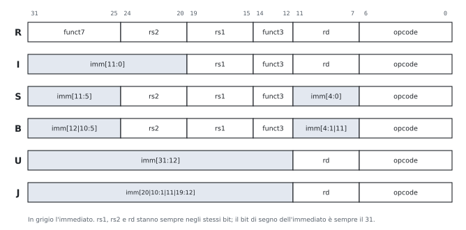

# 1 · Astrazione, prestazioni e l'ISA RISC-V

**In questo modulo.** Prerequisiti: porte, registri e complemento a 2 (Reti Logiche). Livelli di astrazione e modello di von Neumann; come si misurano le prestazioni (equazione del tempo di CPU, legge di Amdahl); l'ISA RISC-V: registri, memoria, i sei formati con la disposizione dei campi, le istruzioni principali. Alla fine si confrontano due macchine con l'equazione delle prestazioni e si codifica e decodifica a mano un'istruzione. All'orale si chiede spesso l'ordine dei formati R, I, S, B, U, J e perché i campi sono disposti così (1.5).

## 1.1 Livelli di astrazione e interfacce

Ogni livello offre servizi a quello sopra attraverso un'**interfaccia** e nasconde come li realizza. Dal basso:

| Livello | Che cosa contiene |
|---|---|
| dispositivi e porte | transistor, porte logiche |
| reti | sommatori, registri, memorie |
| microarchitettura | organizzazione dei blocchi che eseguono le istruzioni (datapath, pipeline, cache) |
| **ISA** | istruzioni, codifica, registri, accesso alla memoria: confine hardware/software |
| sistema operativo | gestione delle risorse, astrazioni (file, processi) |
| linguaggi e applicazioni | compilatori, programmi |

- L'**ISA** dice *che cosa* fa ogni istruzione, non *come*: processori diversi con la stessa ISA eseguono gli stessi programmi. Per questo il software sopravvive a molte generazioni di hardware.
- **Virtualizzazione**: uno strato di software che realizza un'interfaccia sopra un'altra.
  - *macchina virtuale di processo*: un ambiente diverso per un programma (macchina virtuale Java, emulatore di un'altra ISA);
  - *macchina virtuale di sistema*: un'intera macchina su cui gira un sistema operativo (*hypervisor*).

## 1.2 Il modello di von Neumann

- **CPU** (ALU + unità di controllo), **memoria** unica per dati e istruzioni, **ingresso e uscita**, collegati da bus.
- **Programma memorizzato**: le istruzioni sono numeri in memoria; si riprogramma la macchina cambiando la memoria, non i collegamenti.

**Il ciclo dell'istruzione.**

| Passo | Che cosa | Stadio della pipeline (modulo 4) |
|---|---|---|
| prelievo | legge l'istruzione all'indirizzo nel **PC** | IF |
| decodifica | capisce l'istruzione, legge i registri | ID |
| esecuzione | ALU, o calcolo di un indirizzo | EX |
| memoria | legge o scrive un dato, se serve | MEM |
| scrittura | risultato nel registro; PC aggiornato | WB |

**Collo di bottiglia di von Neumann**: tutte le istruzioni e tutti i dati passano dal collegamento CPU-memoria, e la memoria è molto più lenta. Risposta: le cache (modulo 5).

## 1.3 Le prestazioni

- **Tempo di esecuzione** (interessa all'utente) e **throughput** (lavoro per unità di tempo, interessa a chi gestisce un server).
- A è $n$ volte più veloce di B se $\frac{\text{Prestazione}_A}{\text{Prestazione}_B} = \frac{T_B}{T_A} = n$.

**Equazione delle prestazioni.**
$$T_{CPU} = N_{istr} \times CPI \times T_{clk} = \frac{N_{istr} \times CPI}{f}.$$

| Fattore | Da che cosa dipende |
|---|---|
| $N_{istr}$ | programma, compilatore, ISA |
| CPI (cicli per istruzione) | microarchitettura, tipo di istruzioni |
| $T_{clk}$ | tecnologia, microarchitettura |

$$CPI = \sum_i \phi_i \, CPI_i \qquad (\phi_i = \text{frazione di istruzioni della classe } i).$$

> [!esempio] Due compilatori
> Compilatore 1: 2 milioni di istruzioni A (CPI 1), 1 di B (CPI 2), 1 di C (CPI 3). Compilatore 2: 4, 1, 1 milioni. Cicli: 7 milioni contro 9 milioni. CPI: 1,75 contro 1,5. Il secondo ha il CPI migliore ma è più lento: conta il prodotto $N_{istr} \times CPI$.

- Il **MIPS** (milioni di istruzioni al secondo) non è una buona misura: dipende dal programma e dall'ISA.
- Giudicare un processore dalla sola frequenza è lo stesso errore.

> [!teorema] Legge di Amdahl
> Se un miglioramento accelera di $k$ la frazione $F$ del tempo di esecuzione:
> $$T' = T\left((1 - F) + \frac{F}{k}\right), \qquad S = \frac{1}{(1 - F) + F/k}.$$

- Limite: con $k \to \infty$, $S \to \frac{1}{1 - F}$. Con $F = 0{,}8$ al massimo 5 volte più veloce.
- Regola pratica: rendere veloce il caso frequente.

## 1.4 L'ISA RISC-V: registri e memoria

**RISC-V**: ISA aperta (Berkeley, dal 2010), **RISC**: poche istruzioni semplici, tutte di 32 bit in RV32I, operazioni solo fra registri, memoria solo con load e store (**load/store**).

**Principi di progetto.** La semplicità favorisce la regolarità; più piccolo è più veloce; rendere veloce il caso frequente; un buon progetto richiede buoni compromessi.

**Registri** (32 da 32 bit, `x0` … `x31`):

| Registro | Nome | Uso | Preservato dalle chiamate? |
|---|---|---|---|
| `x0` | `zero` | sempre 0 | – |
| `x1` | `ra` | indirizzo di ritorno | sì |
| `x2` | `sp` | cima dello stack | sì |
| `x3`, `x4` | `gp`, `tp` | puntatore globale, al thread | – |
| `x5`–`x7`, `x28`–`x31` | `t0`–`t6` | temporanei | no |
| `x8`, `x9`, `x18`–`x27` | `s0`–`s11` | salvati (`s0` = frame pointer `fp`) | sì |
| `x10`–`x17` | `a0`–`a7` | argomenti; `a0`, `a1` valori di ritorno | no |

Perché `x0`: costanti e operazioni utili senza istruzioni apposite (`mv` = `addi rd, rs, 0`; `nop` = `addi x0, x0, 0`; `j` = `jal x0, …`).

**Memoria.**

- indirizzata al **byte**; parola = 4 byte, di solito a indirizzi multipli di 4 (**allineamento**);
- **little endian**: il byte meno significativo all'indirizzo più basso. `0x12345678` all'indirizzo 100: byte 100 = `0x78`, 101 = `0x56`, 102 = `0x34`, 103 = `0x12`.

## 1.5 I formati delle istruzioni

| Formato | Per che cosa | Esempi |
|---|---|---|
| **R** | operazioni fra registri | `add`, `sub`, `and`, `slt`, `sll` |
| **I** | immediato di 12 bit, load, `jalr` | `addi`, `lw`, `jalr`, `slli` |
| **S** | store | `sw`, `sb` |
| **B** | salti condizionati | `beq`, `bne`, `blt`, `bge` |
| **U** | immediato di 20 bit alti | `lui`, `auipc` |
| **J** | salto incondizionato | `jal` |

**I campi fissi.**

| Campo | Bit | Che cosa |
|---|---|---|
| opcode | 6-0 | formato e famiglia |
| rd | 11-7 | registro di destinazione (R, I, U, J) |
| funct3 | 14-12 | distingue le istruzioni con lo stesso opcode |
| rs1 | 19-15 | primo registro sorgente |
| rs2 | 24-20 | secondo registro sorgente (R, S, B) |
| funct7 | 31-25 | distingue ancora (`add`/`sub`: bit 30) |

**Perché i campi sono disposti così.**

- **rs1, rs2, rd sempre negli stessi bit**: il banco dei registri si legge in ID prima di sapere che istruzione è (modulo 4).
- **S spezza l'immediato** (11:5 e 4:0) per lasciare rs2 al suo posto: una store non ha rd, e i bit 11-7 ospitano un pezzo dell'immediato.
- **B è S con i bit rimescolati**: l'offset è in multipli di 2 byte (il bit 0 vale sempre 0 e non si scrive), e i bit sono messi in modo che ognuno stia, quando possibile, nella stessa posizione che ha in S e in I: il generatore degli immediati usa meno multiplexer.
- **U e J** hanno 20 bit di immediato; J rimescola i bit per lo stesso motivo di B.
- **Il bit 31 è sempre il segno** dell'immediato: l'estensione del segno parte prima di sapere il formato.

**Gli immediati.**

- 12 bit in I, S, B, estesi con il segno: un immediato I va da $-2048$ a $2047$.
- B e J: **offset** rispetto al PC in mezze parole (salti di ±4 KiB per B, ±1 MiB per J).
- Costanti di 32 bit: `lui` (20 bit alti) + `addi` (12 bassi). Se il bit 11 della parte bassa è 1, `addi` sottrae: la parte alta va aumentata di 1.

> [!esempio] Codificare `add x9, x20, x21`
> Tipo R: opcode `0110011`, funct3 `000`, funct7 `0000000`, rd = 9 (`01001`), rs1 = 20 (`10100`), rs2 = 21 (`10101`). Dal bit 31 al bit 0:
> $$\underbrace{0000000}_{funct7}\ \underbrace{10101}_{rs2}\ \underbrace{10100}_{rs1}\ \underbrace{000}_{funct3}\ \underbrace{01001}_{rd}\ \underbrace{0110011}_{opcode}$$
> cioè `0000 0001 0101 1010 0000 0100 1011 0011` = `0x015A04B3`.

**Decodificare a mano**, in quest'ordine: (1) i 7 bit bassi danno l'opcode e quindi il formato; (2) si leggono rd, funct3, rs1, rs2 dalle posizioni fisse; (3) si ricompone l'immediato secondo il formato; (4) funct3 e funct7 danno l'istruzione.

## 1.6 Le istruzioni principali

| Famiglia | Istruzioni | Note |
|---|---|---|
| aritmetiche e logiche | `add`, `sub`, `and`, `or`, `xor`; `addi`, `andi`, `ori`, `xori` | non c'è `subi`: `addi` con immediato negativo |
| shift | `sll`, `srl` (entra 0), `sra` (entra il segno); `slli`, `srli`, `srai` | shift a sinistra di $k$ = × $2^k$ |
| confronti | `slt`, `sltu`, `slti` | risultato 0 o 1 in un registro: niente flag |
| memoria | `lw`, `sw`; `lb`, `lbu`, `sb`; `lh`, `lhu`, `sh` | solo base + spiazzamento; `lb` estende il segno, `lbu` con zeri |
| salti condizionati | `beq`, `bne`, `blt`, `bge`, `bltu`, `bgeu` | offset relativo al PC |
| salti incondizionati | `jal rd, etichetta`; `jalr rd, off(rs1)` | salvano PC + 4 in rd; con `ra` sono chiamate, con `x0` salti semplici |

**Pseudo-istruzioni** (le traduce l'assemblatore): `li`, `mv`, `nop`, `j`, `ret` (`jalr x0, 0(ra)`), `la`, `call`, `bgt` e `ble` (operandi scambiati), `neg`, `not`.

**Modi di indirizzamento.** Immediato (`addi`), registro (`add`), base + spiazzamento (`lw`, `sw`), relativo al PC (salti, `auipc`).

## Esempi ed esercizi svolti

**Esercizio 1. Codificare quattro istruzioni.** Scrivere in esadecimale (a) `sub x5, x6, x7`, (b) `addi x5, x6, -12`, (c) `lw x10, 8(x2)`, (d) `sw x10, 12(x2)`.

(a) Tipo R con funct7 `0100000` (è il bit che distingue `sub` da `add`), rs2 = 7, rs1 = 6, funct3 `000`, rd = 5, opcode `0110011`: `0x407302B3`.

(b) Tipo I, opcode `0010011`, funct3 `000`. L'immediato $-12$ su 12 bit in complemento a 2 è `111111110100`. Con rs1 = 6 e rd = 5: `0xFF430293`. Le prime tre cifre esadecimali, `FF4`, sono proprio l'immediato.

(c) Tipo I con opcode `0000011` e funct3 `010` (parola): immediato 8, rs1 = 2, rd = 10: `0x00812503`.

(d) Tipo S, opcode `0100011`, funct3 `010`. L'immediato 12 = `000000001100` si spezza: imm[11:5] = `0000000` nei bit 31-25, imm[4:0] = `01100` nei bit 11-7. Con rs2 = 10 (il dato da scrivere) e rs1 = 2 (la base): `0x00A12623`.

**Esercizio 2. Decodificare.** Che istruzioni sono `0x40B50533` e `0x00C58593`?

`0x40B50533` = `0100 0000 1011 0101 0000 0101 0011 0011`. Opcode `0110011`: tipo R. funct3 = `000`, funct7 = `0100000`: è una `sub`. rd = bit 11-7 = `01010` = 10, rs1 = `01010` = 10, rs2 = `01011` = 11. È `sub x10, x10, x11`, cioè `sub a0, a0, a1`.

`0x00C58593` = `0000 0000 1100 0101 1000 0101 1001 0011`. Opcode `0010011` con funct3 `000`: `addi`. rd = `01011` = 11, rs1 = `01011` = 11, immediato = `000000001100` = 12. È `addi a1, a1, 12`.

**Esercizio 3. Il CPI medio e il confronto fra due macchine.** Un programma ha il 50% di istruzioni ALU, il 20% di load, il 10% di store e il 20% di salti. Sulla macchina A i CPI sono 1, 5, 3, 2 e il clock è a 2 GHz; sulla macchina B sono 1, 2, 2, 2 con clock a 1,5 GHz. Quale macchina è più veloce, e di quanto?

$CPI_A = 0{,}5 + 1 + 0{,}3 + 0{,}4 = 2{,}2$; $CPI_B = 0{,}5 + 0{,}4 + 0{,}2 + 0{,}4 = 1{,}5$. Il numero di istruzioni è lo stesso (stessa ISA, stesso programma), quindi si confrontano i tempi per istruzione: $\frac{2{,}2}{2\ \text{GHz}} = 1{,}1$ ns per A, $\frac{1{,}5}{1{,}5\ \text{GHz}} = 1{,}0$ ns per B. B è più veloce di $\frac{1{,}1}{1{,}0} = 1{,}1$ volte, nonostante il clock più lento.

**Esercizio 4. Amdahl.** In un programma i calcoli in virgola mobile occupano il 40% del tempo. Conviene un'unità in virgola mobile 10 volte più veloce o un miglioramento che accelera tutto del 30%?

Con l'unità nuova: $S = \frac{1}{0{,}6 + 0{,}04} = 1{,}5625$. Con l'accelerazione generale, $S = 1{,}3$. Conviene la prima. Anche con un'unità infinitamente veloce, però, non si andrebbe oltre $\frac{1}{0{,}6} = 1{,}67$.

**Esercizio 5. Costanti di 32 bit.** Come si carica `0x12345678` in `t0`?

`lui t0, 0x12345` mette `0x12345000` in `t0`; `addi t0, t0, 0x678` aggiunge i 12 bit bassi. Funziona perché `0x678` ha il bit 11 a 0. Se i 12 bit bassi avessero il bit 11 a 1, `addi` li estenderebbe con il segno come numero negativo, e bisognerebbe caricare con `lui` la parte alta aumentata di 1: è il conto che fa l'assemblatore quando si scrive la pseudo-istruzione `li t0, 0x12345678`.

## Esercizi guidati

Ogni esercizio è diviso in passi: si prova un passo alla volta e si confronta solo dopo.

**Guidato 1. Codificare un salto condizionato.** Codificare `beq x5, x6, +16` (il salto va 16 byte avanti).

*Passo 1: il formato.* `beq` è di tipo B, opcode `1100011`, funct3 `000`.

*Passo 2: l'immediato.* L'offset 16 su 13 bit è `0 0000 0001 0000`: imm[12] = 0, imm[11] = 0, imm[10:5] = `000000`, imm[4:1] = `1000`.

*Passo 3: i campi al loro posto.* Bit 31 = imm[12] = 0; bit 30-25 = imm[10:5] = `000000`; rs2 = 6 = `00110`; rs1 = 5 = `00101`; funct3 = `000`; bit 11-8 = imm[4:1] = `1000`; bit 7 = imm[11] = 0; opcode `1100011`.

*Passo 4: il risultato.* `0000 0000 0110 0010 1000 1000 0110 0011` = `0x00628863`.

**Guidato 2. Quanto si guadagna con un clock più veloce?** Un programma impiega 10 s sulla macchina A con clock a 2 GHz. Si vuole una macchina B che lo esegua in 6 s; con un clock più veloce, però, B ha bisogno di 1,2 volte i cicli di A. Che frequenza serve?

*Passo 1: i cicli di A.* $\text{cicli}_A = T \times f = 10 \times 2 \cdot 10^9 = 2 \cdot 10^{10}$.

*Passo 2: i cicli di B.* $1{,}2 \times 2 \cdot 10^{10} = 2{,}4 \cdot 10^{10}$.

*Passo 3: la frequenza.* $f_B = \frac{2{,}4 \cdot 10^{10}}{6\ \text{s}} = 4$ GHz.

*Passo 4: il controllo.* $\frac{2{,}4 \cdot 10^{10}}{4 \cdot 10^9} = 6$ s. Raddoppiare la frequenza non basta a dimezzare il tempo, perché i cicli aumentano.

**Guidato 3. Little endian.** All'indirizzo 200 c'è la parola `0xA1B2C3D4`. Che cosa carica `lbu t0, 201(zero)`? E `lb t1, 200(zero)`?

*Passo 1: i byte in memoria.* Little endian: 200 → `D4`, 201 → `C3`, 202 → `B2`, 203 → `A1`.

*Passo 2: `lbu`.* Carica `0xC3` ed estende con zeri: `t0` = `0x000000C3` = 195.

*Passo 3: `lb`.* Carica `0xD4`, il cui bit 7 è 1, ed estende il segno: `t1` = `0xFFFFFFD4` = $-44$.

## Riepilogo

Un calcolatore si organizza in livelli di astrazione separati da interfacce, la più importante delle quali è l'ISA, il confine fra hardware e software; la virtualizzazione realizza un'interfaccia sopra un'altra. Il modello di von Neumann mette dati e istruzioni nella stessa memoria e le esegue con il ciclo prelievo-decodifica-esecuzione. Il tempo di CPU è il prodotto di numero di istruzioni, CPI e periodo del clock; nessuno dei tre fattori da solo misura le prestazioni, e la legge di Amdahl limita il guadagno di ogni miglioramento parziale. RISC-V è un'ISA load/store con 32 registri (`x0` sempre nullo), memoria indirizzata al byte e little endian, e istruzioni da 32 bit in sei formati (R, I, S, B, U, J) con i campi dei registri sempre negli stessi bit; gli immediati si estendono con il segno, e gli offset dei salti sono relativi al PC.

## Formulario

### Prestazioni

$$T_{CPU} = N_{istr} \cdot CPI \cdot T_{clk}, \qquad CPI = \sum_i \phi_i CPI_i, \qquad \frac{\text{Prest}_A}{\text{Prest}_B} = \frac{T_B}{T_A}, \qquad S_{Amdahl} = \frac{1}{(1 - F) + F/k} \le \frac{1}{1 - F}.$$

### Formati RV32I

| Formato | Campi (dal bit 31 al bit 0) |
|---|---|
| R | funct7 · rs2 · rs1 · funct3 · rd · opcode |
| I | imm[11:0] · rs1 · funct3 · rd · opcode |
| S | imm[11:5] · rs2 · rs1 · funct3 · imm[4:0] · opcode |
| B | imm[12, 10:5] · rs2 · rs1 · funct3 · imm[4:1, 11] · opcode |
| U | imm[31:12] · rd · opcode |
| J | imm[20, 10:1, 11, 19:12] · rd · opcode |

Opcode più usati: `0110011` R, `0010011` I aritmetiche, `0000011` load, `0100011` store, `1100011` branch, `1101111` `jal`, `1100111` `jalr`, `0110111` `lui`.

### Termini per l'orale

| Termine | In una riga |
|---|---|
| ISA | insieme di istruzioni, registri e regole che un programma vede |
| Microarchitettura | organizzazione interna che realizza un'ISA |
| Macchina virtuale di processo / di sistema | ambiente per un programma / per un intero sistema operativo |
| Programma memorizzato | istruzioni e dati nella stessa memoria |
| CPI | numero medio di cicli per istruzione |
| RISC | ISA con poche istruzioni semplici e di lunghezza fissa |
| Architettura load/store | solo load e store accedono alla memoria |
| Little endian | il byte meno significativo all'indirizzo più basso |
| Estensione del segno | ripetere il bit di segno per allungare un numero |
| Pseudo-istruzione | istruzione dell'assemblatore tradotta in istruzioni reali |

### Domande che tornano spesso

- Che cos'è l'ISA e perché è un'interfaccia così importante? Che cosa sono le macchine virtuali?
- Descrivere il modello di von Neumann e il ciclo di esecuzione delle istruzioni.
- Ricavare l'equazione delle prestazioni; perché il MIPS è una misura fuorviante?
- Enunciare la legge di Amdahl e spiegarne le conseguenze.
- Descrivere i formati delle istruzioni RISC-V; perché i campi dei registri sono sempre negli stessi bit?
- Perché nei formati B e J l'immediato è "rimescolato" e non contiene il bit 0?
- Elencare i formati nell'ordine R, I, S, B, U, J e disegnarli con i campi e i bit (figura 1.1).
