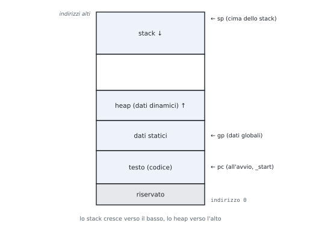

# 2 · Programmazione in assembly RISC-V

**In questo modulo.** Prerequisiti: registri, formati e istruzioni del modulo 1, un po' di C. Come si traducono in assembly espressioni, condizioni, cicli, array, matrici e stringhe; il modello di memoria di un programma; le procedure, lo stack e la ricorsione; il percorso inverso dall'assembly al C. Il paragrafo 2.8 è dedicato alla prova scritta: tradurre un programma C (di solito un ordinamento ricorsivo) e motivare ogni scelta. Tutti i programmi del modulo sono stati eseguiti in un simulatore RISC-V.

## 2.1 Espressioni, condizioni, cicli

**Le regole di traduzione.**

| C | Assembly | Nota |
|---|---|---|
| variabile | un registro | `s` se deve sopravvivere a una chiamata, `t` altrimenti |
| espressione | sequenza di istruzioni con risultati intermedi nei `t` | |
| `if (c)` | salto con la condizione **negata** oltre il ramo vero | |
| `if … else` | salto all'`else`, `j` oltre l'`else` alla fine del ramo vero | |
| `while`, `for` | controllo in testa, salto all'indietro in fondo | `for`: inizializzazione prima, incremento in fondo |

`f = (g + h) - (i + j);` con `f`, `g`, `h`, `i`, `j` in `s0`…`s4`:

```text
add  t0, s1, s2      # t0 = g + h
add  t1, s3, s4      # t1 = i + j
sub  s0, t0, t1      # f = t0 - t1
```

`if (i == j) f = g + h; else f = g - h;`:

```text
      bne  s3, s4, Else   # se i != j salta al ramo else
      add  s0, s1, s2     # f = g + h
      j    Fine           # salta oltre il ramo else
Else: sub  s0, s1, s2     # f = g - h
Fine:
```

`while (v[i] == k) i += 1;` con `i` in `s3`, `k` in `s5`, indirizzo di `v` in `s6`:

```text
Ciclo: slli t1, s3, 2     # t1 = 4 * i (ogni intero occupa 4 byte)
       add  t1, t1, s6    # t1 = indirizzo di v[i]
       lw   t0, 0(t1)     # t0 = v[i]
       bne  t0, s5, Esci  # se v[i] != k esci
       addi s3, s3, 1     # i += 1
       j    Ciclo
Esci:
```

## 2.2 Array e matrici

- `v[i]` di interi: indirizzo $\text{base} + 4i$ → `slli t, i, 2` e `add`. Per i `char` niente shift. L'indice del C conta elementi, l'indirizzo conta byte.
- `int M[R][C]` è memorizzata **per righe**: `M[i][j]` a $\text{base} + (i \cdot C + j) \cdot 4$. Con $C$ potenza di 2, $i \cdot C$ è uno shift; altrimenti `mul`.
- Scorrere con un **puntatore** che avanza di 4 risparmia il calcolo dell'indirizzo a ogni giro.

> [!esempio] Somma degli elementi di un array
> La funzione `int somma(int v[], int n)` riceve l'indirizzo di `v` in `a0` e `n` in `a1`, e restituisce il risultato in `a0`.
>
> ```text
> somma:  li   t0, 0          # i = 0
>         li   t1, 0          # s = 0
> ciclo:  bge  t0, a1, fine   # se i >= n esci
>         slli t2, t0, 2      # t2 = 4 * i
>         add  t2, a0, t2     # t2 = &v[i]
>         lw   t3, 0(t2)      # t3 = v[i]
>         add  t1, t1, t3     # s += v[i]
>         addi t0, t0, 1      # i++
>         j    ciclo
> fine:   mv   a0, t1         # risultato in a0
>         ret
> ```

## 2.3 Byte e stringhe

- Stringa C = array di byte chiuso da 0.
- Si legge con `lbu` (codici da 0 a 255, niente estensione del segno), si scrive con `sb`.

```text
strlen: mv   t0, a0         # t0 = puntatore al carattere corrente
loop:   lbu  t1, 0(t0)      # t1 = *t0
        beq  t1, zero, end  # fine della stringa
        addi t0, t0, 1      # carattere successivo
        j    loop
end:    sub  a0, t0, a0     # lunghezza = puntatore finale - iniziale
        ret
```

Aritmetica dei puntatori: si incrementa l'indirizzo invece di calcolare $\text{base} + i$ a ogni giro.

## 2.4 Il modello di memoria di un programma



| Zona | Contenuto | Direttiva |
|---|---|---|
| testo | codice macchina | `.text` |
| dati statici | variabili globali e costanti (tramite `gp`) | `.data`, `.word 3, 5, 7`, `.asciz "ciao"`, `.space n` |
| heap | memoria dinamica (`malloc`, `new`), cresce verso l'alto | – |
| stack | variabili locali, record delle chiamate, cresce verso il basso da `sp` | – |

- Heap e stack crescono uno verso l'altro: lo spazio libero serve a entrambi.
- Nel simulatore QtRvSim il programma comincia a `_start` (`.globl _start`) e termina con una `ecall` o con un ciclo di arresto; si seguono registri, memoria e pipeline passo per passo.

## 2.5 Le procedure

**I sei passi di una chiamata.** (1) Argomenti al loro posto; (2) salto alla procedura; (3) la procedura si procura la memoria; (4) lavora; (5) risultato al suo posto; (6) ritorno.

| Che cosa | Dove |
|---|---|
| argomenti | `a0`…`a7` (gli altri sullo stack) |
| risultato | `a0` (e `a1`) |
| chiamata | `jal ra, proc` (`call proc`): salva PC + 4 in `ra` |
| ritorno | `jalr zero, 0(ra)` (`ret`) |

**La convenzione di chiamata.**

| Registri | Chi li salva | Regola |
|---|---|---|
| `s0`…`s11`, `sp`, `ra` (per il chiamante) | la procedura chiamata (*callee-saved*) | al ritorno devono valere come prima: se la procedura li usa, li salva all'inizio e li ripristina alla fine |
| `t0`…`t6`, `a0`…`a7` | il chiamante (*caller-saved*) | la procedura può cambiarli: se servono dopo la chiamata, il chiamante li tiene altrove |

**Lo stack.**

1. `addi sp, sp, -k` (riserva $k$ byte);
2. `sw` dei registri da salvare a offset positivi da `sp`;
3. corpo della procedura;
4. `lw` per ripristinarli, `addi sp, sp, k`, `ret`.

La zona di una chiamata è il **record di attivazione** (*stack frame*). La convenzione standard tiene `sp` allineato a 16 byte; negli esempi del corso si riservano solo i byte necessari.

| Procedura | Stack |
|---|---|
| **foglia** (non chiama nessuno) | spesso nessuno: usa i `t` e non tocca `ra` |
| non foglia | salva almeno `ra` (la sua `jal` lo sovrascrive) e gli `s` che usa |

## 2.6 Procedure ricorsive

Ogni chiamata ha il suo record di attivazione con i suoi valori.

> [!esempio] Fattoriale
> `int fact(int n) { return n < 2 ? 1 : n * fact(n - 1); }`
>
> ```text
> fact:   addi sp, sp, -8     # spazio per ra e n
>         sw   ra, 4(sp)
>         sw   a0, 0(sp)      # salva n
>         li   t0, 2
>         blt  a0, t0, base   # n < 2: caso base
>         addi a0, a0, -1
>         jal  ra, fact       # a0 = fact(n - 1)
>         lw   t1, 0(sp)      # t1 = n (salvato prima della chiamata)
>         mul  a0, a0, t1     # a0 = n * fact(n - 1)
>         j    esci
> base:   li   a0, 1
> esci:   lw   ra, 4(sp)
>         addi sp, sp, 8
>         ret
> ```
>
> Per `fact(3)` lo stack contiene, al momento più profondo, tre frame con $n = 3, 2, 1$ e i rispettivi indirizzi di ritorno; i frame si liberano in ordine inverso mentre si calcolano $1$, $2 \cdot 1$, $3 \cdot 2$.


> [!esempio] Fibonacci
> `int fib(int n) { return n < 2 ? n : fib(n - 1) + fib(n - 2); }`. Dopo la prima chiamata ricorsiva serve ancora sia $n$ sia $fib(n - 1)$: si tengono in due registri salvati, `s0` e `s1`, che vanno quindi salvati sullo stack.
>
> ```text
> fib:    li   t0, 2
>         blt  a0, t0, fine   # n < 2: restituisce n, che è già in a0
>         addi sp, sp, -12
>         sw   ra, 8(sp)
>         sw   s0, 4(sp)
>         sw   s1, 0(sp)
>         mv   s0, a0         # s0 = n
>         addi a0, s0, -1
>         jal  ra, fib        # a0 = fib(n - 1)
>         mv   s1, a0         # s1 = fib(n - 1)
>         addi a0, s0, -2
>         jal  ra, fib        # a0 = fib(n - 2)
>         add  a0, s1, a0
>         lw   s1, 0(sp)
>         lw   s0, 4(sp)
>         lw   ra, 8(sp)
>         addi sp, sp, 12
> fine:   ret
> ```
>
> Nel caso base la procedura è foglia e non tocca lo stack. Il numero di chiamate cresce come i numeri di Fibonacci stessi: `fib(10)` = 55 richiede 177 chiamate. La versione con un ciclo ne richiede una.

## 2.7 Dall'assembly al C

1. Argomenti (`a0`, `a1`…) e valore di ritorno.
2. Salti all'indietro: i cicli; salti in avanti: le condizioni (negate).
3. Corpo istruzione per istruzione.
4. Riscrittura in C leggibile, con nomi e `for` dove c'è un contatore.

## 2.8 La prova scritta: tradurre e motivare

Nella prova scritta si traduce un programma C (di solito un ordinamento ricorsivo, a volte la ricerca binaria o un altro programma del libro o delle schede) e si **motiva ogni scelta**. La traccia della risposta è sempre la stessa.

1. **Firma.** Dove arrivano gli argomenti, dove va il risultato.
2. **Foglia o no.** Se chiama qualcuno serve lo stack, almeno per `ra`.
3. **Che cosa serve dopo una chiamata.** Ogni valore che si usa dopo una `jal` va in un registro `s` (salvato all'inizio) oppure sullo stack: i `t` e gli `a` possono essere cambiati dalla procedura chiamata.
4. **Il record.** 4 byte per `ra` e per ogni `s` usato; `sp` torna al valore iniziale su tutti i percorsi di uscita.
5. **Indirizzi.** `slli` di 2 per gli interi; la base resta in un registro.
6. **Condizioni.** Negate, con `bge`/`blt` per i confronti con segno.
7. **Controllo.** Un caso piccolo eseguito a mano (o nel simulatore).

Gli esercizi 5-8 dopo gli esempi sono tracce d'esame svolte con queste motivazioni.

## Esempi ed esercizi svolti

**Esercizio 1. Il massimo di un array.** Scrivere `int max(int v[], int n)` (con $n \ge 1$).

```text
max:    lw   t1, 0(a0)      # m = v[0]
        li   t0, 1          # i = 1
ciclo:  bge  t0, a1, fine
        slli t2, t0, 2
        add  t2, a0, t2
        lw   t3, 0(t2)      # t3 = v[i]
        bge  t1, t3, avanti # se m >= v[i] non cambia
        mv   t1, t3         # m = v[i]
avanti: addi t0, t0, 1
        j    ciclo
fine:   mv   a0, t1
        ret
```

Con $v = (3, -2, 9, 4)$ restituisce 9. La condizione del C è `if (v[i] > m) m = v[i];`, e il salto la nega: si salta oltre l'assegnamento se $m \ge v[i]$.

**Esercizio 2. La traccia di una matrice.** `M` è una matrice $N \times N$ di interi, con l'indirizzo in `a0` e $N$ in `a1`. Scrivere la somma degli elementi della diagonale.

L'elemento `M[i][i]` è all'indirizzo $\text{base} + (iN + i) \cdot 4 = \text{base} + i(N + 1) \cdot 4$: passando da un elemento della diagonale al successivo l'indirizzo cresce di $4(N + 1)$. Conviene quindi un puntatore che avanza di quel passo:

```text
traccia: addi t2, a1, 1     # t2 = N + 1
         slli t2, t2, 2     # passo = 4(N + 1) byte
         li   t0, 0         # i = 0
         li   t1, 0         # s = 0
ciclo:   bge  t0, a1, fine
         lw   t3, 0(a0)     # M[i][i]
         add  t1, t1, t3
         add  a0, a0, t2    # puntatore al prossimo elemento della diagonale
         addi t0, t0, 1
         j    ciclo
fine:    mv   a0, t1
         ret
```

Per la matrice $3 \times 3$ con elementi $1, \dots, 9$ per righe la traccia è $1 + 5 + 9 = 15$.

**Esercizio 3. Reverse coding.** Che cosa calcola questa funzione, con l'indirizzo di un array in `a0` e la sua lunghezza in `a1`?

```text
        li   t0, 0
        li   t1, 0
L1:     bge  t0, a1, L3
        slli t2, t0, 2
        add  t2, a0, t2
        lw   t3, 0(t2)
        bge  t3, zero, L2
        addi t1, t1, 1
L2:     addi t0, t0, 1
        j    L1
L3:     mv   a0, t1
        ret
```

`t0` parte da 0, cresce di 1 e il ciclo esce quando arriva ad `a1`: è un indice $i$ da 0 a $n - 1$. Il corpo carica `v[i]` e, se **non** è $\ge 0$, cioè se è negativo, incrementa `t1`, che è restituito. In C:

```c
int conta_negativi(int v[], int n) {
    int c = 0;
    for (int i = 0; i < n; i++)
        if (v[i] < 0) c++;
    return c;
}
```

**Esercizio 4. Una procedura che ne chiama un'altra.** Scrivere `int somma_quadrati(int a, int b)` che restituisce $a^2 + b^2$ usando una procedura foglia `quad(x)` che restituisce $x^2$.

```text
quad:   mul  a0, a0, a0     # foglia: niente stack
        ret

somma_quadrati:
        addi sp, sp, -8
        sw   ra, 4(sp)      # la jal sotto sovrascrive ra
        sw   s0, 0(sp)      # s0 serve dopo la chiamata
        mv   s0, a1         # tiene b al sicuro
        jal  ra, quad       # a0 = a^2
        mv   t0, a0
        mv   a0, s0
        mv   s0, t0         # s0 = a^2
        jal  ra, quad       # a0 = b^2
        add  a0, a0, s0
        lw   s0, 0(sp)
        lw   ra, 4(sp)
        addi sp, sp, 8
        ret
```

`b` non può restare in `a1`, perché per la convenzione `quad` potrebbe cambiarlo; e $a^2$ non può restare in `t0` durante la seconda chiamata, per lo stesso motivo. Per questo entrambi passano da `s0`, salvato sullo stack. Con $a = 3$ e $b = 4$ restituisce 25.

### Tracce della prova scritta

**Esercizio 5. Ordinamento a bolle con una procedura di scambio.**

```c
void scambia(int *a, int *b) { int t = *a; *a = *b; *b = t; }

void bubble(int v[], int n) {
    for (int i = n - 1; i > 0; i--)
        for (int j = 0; j < i; j++)
            if (v[j] > v[j + 1]) scambia(&v[j], &v[j + 1]);
}
```

*Le scelte.*

| Valore | Registro | Perché |
|---|---|---|
| `a`, `b` di `scambia` | `a0`, `a1` | argomenti; `scambia` è foglia: usa `t0`, `t1`, niente stack |
| `v` | `s0` | serve dopo ogni chiamata a `scambia` |
| `i`, `j` | `s1`, `s2` | idem: in un `t` andrebbero persi alla chiamata |
| `&v[j]`, `&v[j + 1]` | `a0`, `a1` | sono già gli argomenti di `scambia`: calcolati direttamente lì |
| record di `bubble` | 16 byte | `ra` + `s0`, `s1`, `s2` |

```text
scambia:   lw   t0, 0(a0)        # t = *a
           lw   t1, 0(a1)
           sw   t1, 0(a0)        # *a = *b
           sw   t0, 0(a1)        # *b = t
           ret
bubble:    addi sp, sp, -16
           sw   ra, 12(sp)
           sw   s0, 8(sp)
           sw   s1, 4(sp)
           sw   s2, 0(sp)
           mv   s0, a0           # s0 = v
           addi s1, a1, -1       # i = n - 1
bb_est:    bge  zero, s1, bb_fine  # i <= 0: fine
           li   s2, 0            # j = 0
bb_int:    bge  s2, s1, bb_dopo  # j >= i: fine del ciclo interno
           slli t0, s2, 2
           add  a0, s0, t0       # a0 = &v[j]
           addi a1, a0, 4        # a1 = &v[j + 1]
           lw   t1, 0(a0)        # v[j]
           lw   t2, 0(a1)        # v[j + 1]
           bge  t2, t1, bb_avanti  # già in ordine: niente scambio
           jal  ra, scambia
bb_avanti: addi s2, s2, 1        # j++
           j    bb_int
bb_dopo:   addi s1, s1, -1       # i--
           j    bb_est
bb_fine:   lw   s2, 0(sp)
           lw   s1, 4(sp)
           lw   s0, 8(sp)
           lw   ra, 12(sp)
           addi sp, sp, 16
           ret
```

Da motivare: la condizione `v[j] > v[j + 1]` diventa "salta oltre lo scambio se `v[j + 1] >= v[j]`"; `i > 0` diventa "esci se `0 >= i`". `&v[j + 1]` è `&v[j] + 4`, non `+ 1`. Con `v` = {5, 1, 4, 2, 8} il risultato è {1, 2, 4, 5, 8}.

**Esercizio 6. Quicksort (partizione di Lomuto).**

```c
void quicksort(int v[], int lo, int hi) {
    if (lo >= hi) return;
    int p = v[hi], i = lo;
    for (int j = lo; j < hi; j++)
        if (v[j] < p) { int t = v[i]; v[i] = v[j]; v[j] = t; i++; }
    int t = v[i]; v[i] = v[hi]; v[hi] = t;
    quicksort(v, lo, i - 1);
    quicksort(v, i + 1, hi);
}
```

*Le scelte.*

| Valore | Registro | Perché |
|---|---|---|
| `v` | `s0` | serve per la seconda chiamata |
| `hi` | `s1` | serve per la seconda chiamata |
| `i` | `s2` | serve dopo la prima chiamata (`i + 1`) |
| `lo` | resta in `a1` | serve solo come argomento della prima chiamata, che avviene prima di qualsiasi altra `jal` |
| `p`, `j`, `&v[hi]`, temporanei | `t0`…`t6` | usati solo prima delle chiamate |
| caso base | `ret` subito | prima di toccare lo stack: nessun record da disfare |
| record | 16 byte | `ra`, `s0`, `s1`, `s2` |

```text
quicksort: bge  a1, a2, qs_fine  # lo >= hi: niente da fare
           addi sp, sp, -16
           sw   ra, 12(sp)
           sw   s0, 8(sp)
           sw   s1, 4(sp)
           sw   s2, 0(sp)
           mv   s0, a0           # s0 = v
           mv   s1, a2           # s1 = hi
           slli t0, a2, 2
           add  t0, a0, t0       # t0 = &v[hi]
           lw   t1, 0(t0)        # t1 = p
           mv   s2, a1           # i = lo
           mv   t2, a1           # j = lo
qs_ciclo:  bge  t2, s1, qs_dopo  # j >= hi: fine della partizione
           slli t3, t2, 2
           add  t3, s0, t3       # t3 = &v[j]
           lw   t4, 0(t3)        # t4 = v[j]
           bge  t4, t1, qs_avanti  # v[j] >= p: resta dov'è
           slli t5, s2, 2
           add  t5, s0, t5       # t5 = &v[i]
           lw   t6, 0(t5)
           sw   t4, 0(t5)        # v[i] = v[j]
           sw   t6, 0(t3)        # v[j] = vecchio v[i]
           addi s2, s2, 1        # i++
qs_avanti: addi t2, t2, 1        # j++
           j    qs_ciclo
qs_dopo:   slli t5, s2, 2
           add  t5, s0, t5       # t5 = &v[i]
           lw   t6, 0(t5)
           sw   t1, 0(t5)        # v[i] = p
           sw   t6, 0(t0)        # v[hi] = vecchio v[i]
           addi a2, s2, -1       # quicksort(v, lo, i - 1): a0 = v, a1 = lo
           jal  ra, quicksort
           mv   a0, s0
           addi a1, s2, 1
           mv   a2, s1           # quicksort(v, i + 1, hi)
           jal  ra, quicksort
           lw   s2, 0(sp)
           lw   s1, 4(sp)
           lw   s0, 8(sp)
           lw   ra, 12(sp)
           addi sp, sp, 16
qs_fine:   ret
```

Da motivare: alla prima chiamata `a0` vale ancora `v` e `a1` ancora `lo`, perché non c'è stata nessuna `jal` prima; alla seconda vanno ricaricati da `s0`, `s2`, `s1`. Lo scambio finale usa `t0` = `&v[hi]` calcolato prima del ciclo: il ciclo non lo tocca. Con `v` = {7, 2, 9, 4, 3, 8, 1} il risultato è {1, 2, 3, 4, 7, 8, 9}.

**Esercizio 7. Merge sort.**

```c
void merge(int v[], int tmp[], int lo, int m, int hi) {
    int i = lo, j = m + 1, k = lo;
    while (i <= m && j <= hi)
        tmp[k++] = (v[j] < v[i]) ? v[j++] : v[i++];
    while (i <= m) tmp[k++] = v[i++];
    while (j <= hi) tmp[k++] = v[j++];
    for (k = lo; k <= hi; k++) v[k] = tmp[k];
}

void mergesort(int v[], int tmp[], int lo, int hi) {
    if (lo >= hi) return;
    int m = (lo + hi) / 2;
    mergesort(v, tmp, lo, m);
    mergesort(v, tmp, m + 1, hi);
    merge(v, tmp, lo, m, hi);
}
```

*Le scelte.*

| Valore | Registro | Perché |
|---|---|---|
| `v`, `tmp`, `lo`, `hi`, `m` | `s0`…`s4` | tutti servono dopo almeno una chiamata ricorsiva |
| `(lo + hi) / 2` | `add` + `srai 1` | gli indici non sono negativi: lo shift è la divisione intera |
| `merge` | foglia, solo `t` | non chiama nessuno: niente stack |
| il quinto argomento `hi` | `a4` | ci sono 8 registri per gli argomenti |
| record di `mergesort` | 24 byte | `ra` + 5 registri `s` |
| `v[j] < v[i]` | prende `v[j]` solo se strettamente minore | a parità prende `v[i]`: l'ordinamento è stabile |

```text
mergesort: bge  a2, a3, ms_fine  # lo >= hi: un elemento, già ordinato
           addi sp, sp, -24
           sw   ra, 20(sp)
           sw   s0, 16(sp)
           sw   s1, 12(sp)
           sw   s2, 8(sp)
           sw   s3, 4(sp)
           sw   s4, 0(sp)
           mv   s0, a0           # v
           mv   s1, a1           # tmp
           mv   s2, a2           # lo
           mv   s3, a3           # hi
           add  s4, a2, a3
           srai s4, s4, 1        # m = (lo + hi) / 2
           mv   a3, s4           # mergesort(v, tmp, lo, m)
           jal  ra, mergesort
           mv   a0, s0
           mv   a1, s1
           addi a2, s4, 1
           mv   a3, s3           # mergesort(v, tmp, m + 1, hi)
           jal  ra, mergesort
           mv   a0, s0
           mv   a1, s1
           mv   a2, s2
           mv   a3, s4
           mv   a4, s3           # merge(v, tmp, lo, m, hi)
           jal  ra, merge
           lw   s4, 0(sp)
           lw   s3, 4(sp)
           lw   s2, 8(sp)
           lw   s1, 12(sp)
           lw   s0, 16(sp)
           lw   ra, 20(sp)
           addi sp, sp, 24
ms_fine:   ret
merge:     mv   t0, a2           # i = lo
           addi t1, a3, 1        # j = m + 1
           mv   t2, a2           # k = lo
mg_ciclo:  blt  a3, t0, mg_resto_j  # i > m: resta la seconda metà
           blt  a4, t1, mg_resto_i  # j > hi: resta la prima metà
           slli t3, t0, 2
           add  t3, a0, t3
           lw   t3, 0(t3)        # t3 = v[i]
           slli t4, t1, 2
           add  t4, a0, t4
           lw   t4, 0(t4)        # t4 = v[j]
           slli t5, t2, 2
           add  t5, a1, t5       # t5 = &tmp[k]
           addi t2, t2, 1        # k++
           blt  t4, t3, mg_da_j  # v[j] < v[i]: prende v[j]
           sw   t3, 0(t5)        # tmp[k] = v[i]
           addi t0, t0, 1        # i++
           j    mg_ciclo
mg_da_j:   sw   t4, 0(t5)        # tmp[k] = v[j]
           addi t1, t1, 1        # j++
           j    mg_ciclo
mg_resto_i: blt a3, t0, mg_copia
           slli t3, t0, 2
           add  t3, a0, t3
           lw   t3, 0(t3)
           slli t5, t2, 2
           add  t5, a1, t5
           sw   t3, 0(t5)        # tmp[k++] = v[i++]
           addi t0, t0, 1
           addi t2, t2, 1
           j    mg_resto_i
mg_resto_j: blt a4, t1, mg_copia
           slli t4, t1, 2
           add  t4, a0, t4
           lw   t4, 0(t4)
           slli t5, t2, 2
           add  t5, a1, t5
           sw   t4, 0(t5)        # tmp[k++] = v[j++]
           addi t1, t1, 1
           addi t2, t2, 1
           j    mg_resto_j
mg_copia:  mv   t2, a2           # k = lo
mg_cc:     blt  a4, t2, mg_fine  # k > hi: finito
           slli t5, t2, 2
           add  t3, a1, t5
           lw   t3, 0(t3)        # tmp[k]
           add  t4, a0, t5
           sw   t3, 0(t4)        # v[k] = tmp[k]
           addi t2, t2, 1
           j    mg_cc
mg_fine:   ret
```

Da motivare: `i <= m` diventa "esci se `m < i`", cioè `blt a3, t0`; `merge` può usare tutti i `t` perché nessuno dei chiamanti ci tiene niente dentro; `m` deve stare in un `s`, perché serve sia alla seconda chiamata sia a `merge`. Con `v` = {38, 27, 43, 3, 9, 82, 10} il risultato è {3, 9, 10, 27, 38, 43, 82}.

**Esercizio 8. Ricerca binaria ricorsiva.**

```c
int cerca(int v[], int lo, int hi, int x) {
    if (lo > hi) return -1;
    int m = (lo + hi) / 2;
    if (v[m] == x) return m;
    if (v[m] < x) return cerca(v, m + 1, hi, x);
    return cerca(v, lo, m - 1, x);
}
```

*Le scelte.*

| Valore | Registro | Perché |
|---|---|---|
| `v`, `lo`, `hi`, `x` | `a0`…`a3` | dopo la chiamata ricorsiva non servono più: il risultato è quello della chiamata |
| `m`, `v[m]` | `t0`, `t1` | usati solo prima della chiamata |
| record | 4 byte, solo `ra` | nessun `s`: non c'è niente da conservare |
| casi base | `ret` senza stack | lo stack si apre solo sul ramo che chiama |

```text
cerca:     blt  a2, a1, cr_no    # lo > hi: non c'è
           add  t0, a1, a2
           srai t0, t0, 1        # m = (lo + hi) / 2
           slli t1, t0, 2
           add  t1, a0, t1
           lw   t1, 0(t1)        # t1 = v[m]
           beq  t1, a3, cr_si
           addi sp, sp, -4
           sw   ra, 0(sp)
           blt  t1, a3, cr_destra  # v[m] < x: cerca a destra
           addi a2, t0, -1       # cerca(v, lo, m - 1, x)
           jal  ra, cerca
           j    cr_esci
cr_destra: addi a1, t0, 1        # cerca(v, m + 1, hi, x)
           jal  ra, cerca
cr_esci:   lw   ra, 0(sp)
           addi sp, sp, 4
           ret
cr_si:     mv   a0, t0           # trovato: restituisce m
           ret
cr_no:     li   a0, -1
           ret
```

Da motivare: è una ricorsione **in coda** (il risultato della chiamata è restituito così com'è). Un compilatore la trasforma in un ciclo: al posto di `jal` + `ret` basta `j cerca`, e lo stack non serve più. In {1, 3, 5, 7, 9, 11, 13} la ricerca di 11 dà 5, quella di 4 dà −1.

## Esercizi guidati

Ogni esercizio è diviso in passi: si prova un passo alla volta e si confronta solo dopo.

**Guidato 1. Tradurre un ciclo con una condizione.** Tradurre `int s = 0; for (int i = 0; i < n; i++) if (v[i] % 2 == 0) s += v[i];` (somma dei pari), con `v` in `a0`, `n` in `a1`, risultato in `a0`.

*Passo 1: i registri.* `i` in `t0`, `s` in `t1`, temporanei `t2`, `t3`.

*Passo 2: il test di parità senza divisione.* Un numero è pari se il bit meno significativo è 0: `andi t4, t3, 1`.

*Passo 3: la condizione negata.* Il C dice "se è pari somma": si salta oltre la somma se è dispari, `bne t4, zero, avanti`.

*Passo 4: il codice.*

```text
        li   t0, 0
        li   t1, 0
ciclo:  bge  t0, a1, fine
        slli t2, t0, 2
        add  t2, a0, t2
        lw   t3, 0(t2)
        andi t4, t3, 1
        bne  t4, zero, avanti
        add  t1, t1, t3
avanti: addi t0, t0, 1
        j    ciclo
fine:   mv   a0, t1
        ret
```

*Passo 5: il controllo.* Con $v = (1, 2, 3, 4, -6)$ la somma dei pari è $2 + 4 - 6 = 0$. Il test con `andi` funziona anche per i negativi in complemento a 2 ($-6$ = `…11111010`, bit 0 a 0).

**Guidato 2. Disegnare lo stack.** Durante `fact(3)` dell'esempio del paragrafo 2.6, con `sp` = `0x1000` all'inizio, che cosa c'è nello stack quando si raggiunge il caso base?

*Passo 1: la prima chiamata.* `sp` scende a `0x0FF8`; in `0x0FFC` c'è `ra` del chiamante esterno, in `0x0FF8` c'è $n = 3$.

*Passo 2: la seconda.* `sp` = `0x0FF0`; in `0x0FF4` l'indirizzo di ritorno dentro `fact` (l'istruzione dopo la `jal`), in `0x0FF0` $n = 2$.

*Passo 3: la terza, caso base.* `sp` = `0x0FE8`; in `0x0FEC` lo stesso indirizzo di ritorno, in `0x0FE8` $n = 1$. Con $n = 1 < 2$ si va al caso base.

*Passo 4: la risalita.* Ogni ritorno rilascia 8 byte: `sp` torna a `0x0FF0`, `0x0FF8`, `0x1000`, mentre `a0` vale 1, 2, 6.

**Guidato 3. Reverse coding con un puntatore.** Che cosa fa questa funzione, con `a0` e `a1` indirizzi di due stringhe?

```text
f:      lbu  t0, 0(a1)
        sb   t0, 0(a0)
        beq  t0, zero, fine
        addi a0, a0, 1
        addi a1, a1, 1
        j    f
fine:   ret
```

*Passo 1: che cosa si legge e si scrive.* Si legge un byte da `a1` e lo si scrive in `a0`.

*Passo 2: il ciclo.* Si avanza di un byte su entrambe le stringhe finché il byte copiato non è lo 0.

*Passo 3: il C.* `void copia(char *dst, const char *src) { while ((*dst = *src) != 0) { dst++; src++; } }`: è `strcpy`. Lo 0 finale viene copiato prima del test, così la stringa di destinazione è terminata correttamente.

## Riepilogo

Il compilatore assegna le variabili ai registri e traduce condizioni e cicli in salti condizionati con la condizione negata. L'indirizzo di `v[i]` è $\text{base} + 4i$ per gli interi, e una matrice è memorizzata per righe, con `M[i][j]` a $\text{base} + (iC + j) \cdot 4$; scorrere con un puntatore invece che con un indice risparmia istruzioni. La memoria di un programma è divisa in testo, dati statici, heap e stack; le direttive dell'assemblatore scelgono la zona. Nelle procedure gli argomenti passano in `a0`…`a7`, il risultato in `a0`, la chiamata è `jal ra` e il ritorno `jalr zero, 0(ra)`; i registri `s` e `ra` sono preservati da chi li usa, i `t` e gli `a` da chi ne ha bisogno dopo la chiamata. Una procedura non foglia salva `ra` e i registri salvati nel suo stack frame; la ricorsione funziona perché ogni chiamata ha il suo frame.

## Formulario

### Schemi di traduzione

| C | RISC-V |
|---|---|
| `if (a == b) X; else Y;` | `bne a, b, Else` · X · `j Fine` · `Else:` Y · `Fine:` |
| `while (cond) X;` | `Ciclo:` salto fuori se non cond · X · `j Ciclo` |
| `for (i = 0; i < n; i++) X;` | `li i, 0` · `Ciclo: bge i, n, Fine` · X · `addi i, i, 1` · `j Ciclo` |
| `v[i]` (int) | `slli t, i, 2` · `add t, base, t` · `lw x, 0(t)` |
| `M[i][j]` (int, $C$ colonne) | indirizzo $\text{base} + (iC + j) \cdot 4$ |
| `c = s[i]` (char) | `add t, base, i` · `lbu c, 0(t)` |

### Convenzione di chiamata

| Chi salva | Registri |
|---|---|
| la procedura chiamata (callee-saved) | `s0`–`s11`, `sp`, `ra` (se ne chiama altre) |
| il chiamante (caller-saved) | `t0`–`t6`, `a0`–`a7` |

Prologo: `addi sp, sp, -k` · `sw ra, …(sp)` · `sw s…, …(sp)`. Epilogo: `lw` in ordine inverso · `addi sp, sp, k` · `ret`.

### Termini per l'orale

| Termine | In una riga |
|---|---|
| Procedura foglia | non chiama altre procedure, spesso non usa lo stack |
| Stack frame | zona di stack di una chiamata: registri salvati e variabili locali |
| Indirizzo di ritorno | indirizzo dell'istruzione dopo la chiamata, salvato in `ra` |
| Caller-saved / callee-saved | salvati da chi chiama / da chi è chiamato |
| Row-major | memorizzazione delle matrici riga per riga |
| Aritmetica dei puntatori | avanzare un indirizzo invece di ricalcolarlo da un indice |
| Direttiva | comando per l'assemblatore (`.data`, `.word`, `.asciz`) |

### Domande che tornano spesso

- Quali sono i passi di una chiamata di procedura e come li realizza RISC-V?
- Perché alcuni registri sono preservati e altri no? Che cosa deve salvare una procedura non foglia?
- Disegnare lo stack durante una chiamata ricorsiva.
- Come si calcola l'indirizzo di un elemento di un array e di una matrice?
- Descrivere le zone della memoria di un programma.
- Tradurre in C un frammento assembly assegnato.
- Prova scritta: tradurre un ordinamento ricorsivo (merge sort, quicksort) o la ricerca binaria e motivare registri, record di attivazione e condizioni (2.8, esercizi 5-8).
