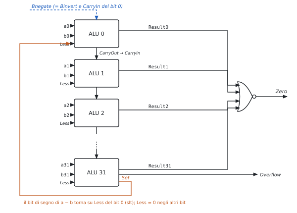
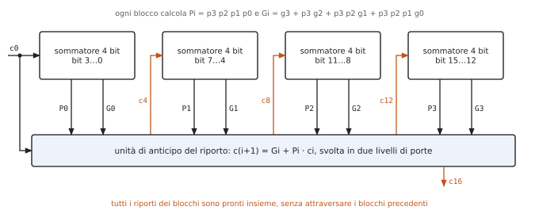
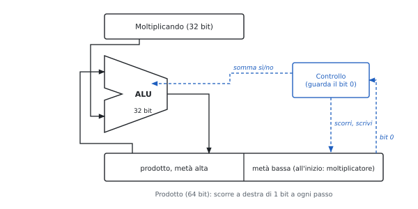
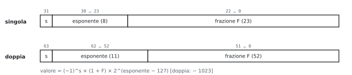
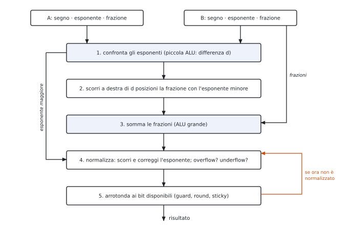

# 3 · L'ALU e l'aritmetica del calcolatore

**In questo modulo.** Prerequisiti: complemento a 2, sommatori e multiplexer (Reti Logiche). Si costruisce l'ALU di RISC-V a partire da un bit, la si rende veloce con l'anticipo del riporto, poi moltiplicazione (somma e scorri, Booth), divisione, virgola mobile e codici di Hamming. All'orale si disegnano l'ALU a un bit e a 32 bit (figure 3.1 e 3.2) spiegando ogni segnale.

## 3.1 L'ALU a un bit

| Parte | A che serve |
|---|---|
| AND, OR | operazioni logiche |
| full adder | somma: $s = a \oplus b \oplus c_{in}$, $c_{out} = ab + (a + b)c_{in}$ |
| multiplexer **Operation** (2 bit) | sceglie AND (0), OR (1), somma (2), Less (3) |
| **Binvert** | usa $\bar b$: $a - b = a + \bar b + 1$ (il +1 è il CarryIn del bit 0) |
| **Ainvert** | usa $\bar a$: con Binvert e AND dà la NOR ($\overline{a + b} = \bar a \cdot \bar b$) |
| **Less** | ingresso per `slt` (3.2) |

**Perché tutto in parallelo.** I tre risultati si calcolano sempre; il multiplexer sceglie alla fine. Il ritardo è quello del percorso più lento (la somma), non della somma dei percorsi.

## 3.2 L'ALU a 32 bit

**Ripple carry.** 32 ALU da un bit in fila, CarryOut del bit $i$ → CarryIn del bit $i + 1$.

**Le tre aggiunte.**

| Aggiunta | Come | Perché |
|---|---|---|
| `slt` | si calcola $a - b$; il bit di segno (uscita **Set** del bit 31) va su Less del bit 0; Less = 0 negli altri bit | il risultato è 0…01 o 0…00 |
| **Zero** | $\overline{r_{31} + \dots + r_0}$ | `beq`, `bne`: $a = b \iff a - b = 0$ |
| **Overflow** | $V = c_{31} \oplus c_{32}$ (riporto entrante ed uscente del bit di segno diversi) | solo sommando numeri dello stesso segno o sottraendo di segno opposto |

**Attenzione a `slt`.** Se $a - b$ va in overflow il segno è sbagliato: il valore giusto è $\text{Set} \oplus \text{Overflow}$.

**Il controllo dell'ALU** (4 bit: Ainvert, Bnegate, Operation):

| Controllo ALU | Funzione |
|---|---|
| 0000 | AND |
| 0001 | OR |
| 0010 | somma |
| 0110 | sottrazione |
| 0111 | `slt` |
| 1100 | NOR |

RISC-V non genera eccezioni per l'overflow: se serve, lo controlla il programma.

**All'orale.**

- *Perché Bnegate è un solo segnale?* Negare $b$ e mettere 1 nel riporto del bit 0 servono sempre insieme: è la sottrazione in complemento a 2.
- *Perché Set è un'uscita separata e non Result31?* Per `slt` Result31 vale Less = 0; il segno della sottrazione è l'uscita del sommatore, prima del multiplexer.
- *Che problema ha il ripple carry?* Il riporto attraversa 32 stadi: il ritardo cresce linearmente con i bit. Soluzione: 3.3.

## 3.3 L'anticipo del riporto (carry lookahead)

Dal full adder $c_{i+1} = a_i b_i + (a_i + b_i)c_i$. Si definiscono

$$g_i = a_i b_i \ \text{(il bit genera un riporto)}, \qquad p_i = a_i + b_i \ \text{(il bit propaga il riporto in arrivo)},$$

quindi $c_{i+1} = g_i + p_i c_i$, e svolgendo:
$$c_1 = g_0 + p_0 c_0, \qquad c_2 = g_1 + p_1 g_0 + p_1 p_0 c_0,$$
$$c_3 = g_2 + p_2 g_1 + p_2 p_1 g_0 + p_2 p_1 p_0 c_0, \qquad c_4 = g_3 + p_3 g_2 + p_3 p_2 g_1 + p_3 p_2 p_1 g_0 + p_3 p_2 p_1 p_0 c_0.$$

- Ogni riporto è una rete a **due livelli** in $g$, $p$, $c_0$: tutti pronti dopo lo stesso tempo.
- Le espressioni crescono in fretta → per 32 bit si lavora a **blocchi di 4** con $P$ e $G$ di blocco, e si ripete lo schema sui blocchi.

$$P_0 = p_3 p_2 p_1 p_0, \qquad G_0 = g_3 + p_3 g_2 + p_3 p_2 g_1 + p_3 p_2 p_1 g_0.$$

## 3.4 La moltiplicazione

**Somma e scorri** (*add and right shift*, versione delle slide):

1. Prodotto ← (0, moltiplicatore).
2. Se il bit 0 del prodotto è 1: metà alta ← metà alta + moltiplicando.
3. Prodotto scorre a destra di 1 (il riporto della somma entra in cima).
4. Ripetere $n$ volte.

Perché la metà bassa ospita il moltiplicatore: a ogni passo se ne consuma un bit e si libera un posto per un bit del prodotto. Un registro solo, un sommatore solo.

**Numeri con segno: algoritmo di Booth.** Una sequenza di 1 si sostituisce con una sottrazione e una somma ($0110 = 1000 - 0010$). Si guarda la coppia ($q_0$, $q_{-1}$), con $q_{-1} = 0$ all'inizio:

| $q_0\ q_{-1}$ | Operazione | Significato |
|---|---|---|
| 1 0 | $A = A - M$ | inizio di una sequenza di 1 |
| 1 1 | nessuna | dentro la sequenza |
| 0 1 | $A = A + M$ | fine della sequenza |
| 0 0 | nessuna | dentro una sequenza di 0 |

Dopo ogni passo: **shift aritmetico** a destra di $A$, $Q$, $q_{-1}$ (conserva il segno). Funziona direttamente in complemento a 2.

**In RISC-V** (estensione M): `mul` (32 bit bassi), `mulh` e `mulhu` (32 bit alti, con e senza segno). Il prodotto sta in 32 bit se la parte alta è l'estensione del segno di quella bassa.

## 3.5 La divisione

- $\text{dividendo} = \text{quoziente} \times \text{divisore} + \text{resto}$, $0 \le \text{resto} < \text{divisore}$.
- **Restoring**: a ogni passo si sottrae il divisore allineato; se il resto è $\ge 0$ il bit del quoziente è 1, altrimenti 0 e si ripristina il resto.
- In hardware: divisore nella metà alta di un registro da $2n$ bit che scorre a destra, quoziente che si forma a sinistra.
- Perché è lenta: ogni passo dipende dal segno del precedente, non si parallelizza.
- RISC-V: `div`, `divu`, `rem`, `remu`; la divisione per zero non dà eccezione (quoziente con tutti i bit a 1).

## 3.6 La virgola mobile

| | Segno | Esponente | Frazione | Eccesso |
|---|---|---|---|---|
| singola | 1 | 8 | 23 | 127 |
| doppia | 1 | 11 | 52 | 1023 |

$$x = (-1)^s \times (1 + F) \times 2^{E - 127}.$$

- **1 nascosto**: un numero normalizzato comincia sempre con 1, che non si scrive: un bit di precisione gratis.
- **Esponente in eccesso**: si confrontano due numeri positivi come interi.
- Esponente tutto a 0 e tutto a 1: riservati (zero, denormalizzati, infinito, NaN).
- **Overflow**: esponente oltre il massimo. **Underflow**: numero non nullo sotto il minimo normalizzato.

**Somma.**

**Prodotto.** (1) Esponenti sommati togliendo un eccesso: $(E_1 + 127) + (E_2 + 127) - 127$. (2) Mantisse moltiplicate. (3) Normalizzazione, overflow e underflow. (4) Arrotondamento. (5) Segno = XOR dei segni.

**Arrotondamento.** Due bit in più durante i calcoli (**guard**, **round**) e un bit **sticky** (1 se qualche bit scartato era 1). Modo standard: al più vicino, in caso di pareggio al pari.

## 3.7 I codici di Hamming

**Distanza di Hamming**: numero di posizioni diverse, $d(1011, 1110) = 2$. Un codice a distanza $d$ rileva $d - 1$ errori o ne corregge $\lfloor (d - 1)/2 \rfloor$.

| $d$ | Che cosa fa | Esempio |
|---|---|---|
| 2 | rileva 1 errore | bit di parità |
| 3 | corregge 1 errore | Hamming |
| 4 | corregge 1, rileva 2 | SECDED (memorie ECC) |

**Quanti bit di controllo.** Per correggere un errore su $M$ bit di dati con $K$ bit di controllo:
$$2^K \ge M + K + 1.$$

| $M$ | 4 | 8 | 16 | 32 | 64 |
|---|---|---|---|---|---|
| $K$ | 3 | 4 | 5 | 6 | 7 |

**Costruzione.**

- posizioni numerate da 1; controlli nelle potenze di 2 (1, 2, 4, 8, …), dati nelle altre;
- il controllo in $2^j$ è la parità pari delle posizioni con il bit $j$ a 1 nel loro numero (1: posizioni 1, 3, 5, 7…; 2: 2, 3, 6, 7…; 4: 4, 5, 6, 7…);
- chi riceve ricalcola le parità: la **sindrome** letta in binario vale 0 se non ci sono errori, altrimenti è la posizione del bit sbagliato;
- un bit di parità in più su tutta la parola → SECDED.

**All'orale.**

- *Perché i bit di controllo nelle potenze di 2?* Ognuno compare in una sola delle parità (la sua): così la sindrome è proprio la posizione dell'errore.
- *Che errore non vede il codice di Hamming semplice?* Due errori: la sindrome indica una terza posizione, e la "correzione" aggiunge un errore. Per questo SECDED aggiunge la parità globale.

## Esempi ed esercizi svolti

**Esercizio 1. I riporti anticipati di una somma a 4 bit.** $a = 1011$, $b = 0110$, $c_0 = 0$.

$g = a \cdot b$ bit per bit $= 0010$, $p = a + b = 1111$. Quindi $c_1 = g_0 = 0$; $c_2 = g_1 + p_1 g_0 = 1$; $c_3 = g_2 + p_2 g_1 + p_2 p_1 g_0 = 0 + 1 + 0 = 1$; $c_4 = g_3 + p_3 g_2 + p_3 p_2 g_1 + \dots = 0 + 0 + 1 = 1$. Le somme sono $s_i = a_i \oplus b_i \oplus c_i$: $s_0 = 1$, $s_1 = 0$, $s_2 = 0$, $s_3 = 0$, e il risultato è $1\,0001$, cioè $11 + 6 = 17$. Il riporto finale nasce in $g_1$ e viaggia attraverso $p_2$ e $p_3$: nel ripple impiegherebbe tre stadi, con il lookahead è pronto subito.

**Esercizio 2. Moltiplicazione con l'hardware add and right shift.** $6 \times 5$ con 4 bit: moltiplicando $M = 0110$, registro prodotto iniziale $0000\,0101$.

| Passo | Bit basso | Dopo l'eventuale somma | Dopo lo shift |
|---|---|---|---|
| 1 | 1 | $0110\,0101$ | $0011\,0010$ |
| 2 | 0 | – | $0001\,1001$ |
| 3 | 1 | $0111\,1001$ | $0011\,1100$ |
| 4 | 0 | – | $0001\,1110$ |

Il risultato è $0001\,1110 = 30$. A ogni passo il moltiplicatore "esce" a destra e il prodotto parziale "entra" da sinistra: lo stesso registro contiene entrambi.

**Esercizio 3. Booth con un moltiplicatore negativo.** $3 \times (-2)$ con 4 bit: $M = 0011$, $Q = 1110$, $q_{-1} = 0$, $A = 0000$.

| Passo | $q_0\,q_{-1}$ | Operazione | $A$ dopo lo shift | $Q$ dopo lo shift | $q_{-1}$ |
|---|---|---|---|---|---|
| 1 | 0 0 | nessuna | 0000 | 0111 | 0 |
| 2 | 1 0 | $A = A - M = 1101$ | 1110 | 1011 | 1 |
| 3 | 1 1 | nessuna | 1111 | 0101 | 1 |
| 4 | 1 1 | nessuna | 1111 | 1010 | 1 |

Il prodotto è $A\,Q = 1111\,1010 = -6$ in complemento a 2. Il moltiplicatore $1110$ è una sola sequenza di 1 che arriva fino al bit di segno: c'è una sola sottrazione e nessuna somma, perché la sequenza non "finisce".

**Esercizio 4. Divisione in binario.** $1011 \div 0011$ ($11 \div 3$).

Si procede come in colonna, abbassando un bit alla volta: $1 < 11$, quoziente 0; $10 < 11$, quoziente 0; $101 \ge 11$, quoziente 1 e resto $101 - 11 = 10$; si abbassa l'ultimo bit, $101 \ge 11$, quoziente 1 e resto $10$. Quoziente $0011 = 3$, resto $10 = 2$, e infatti $3 \cdot 3 + 2 = 11$.

**Esercizio 5. Somma in virgola mobile.** $1{,}75 + 0{,}3125$.

$1{,}75 = 1{,}11_2 \times 2^0$ e $0{,}3125 = 1{,}01_2 \times 2^{-2}$. (1) Si allinea il secondo all'esponente 0: $0{,}0101_2 \times 2^0$. (2) Somma: $1{,}1100 + 0{,}0101 = 10{,}0001_2$. (3) Normalizzazione: $1{,}00001_2 \times 2^1$. (4) Con 23 bit di frazione non serve arrotondare. Il risultato è $2 + \frac{2}{32} = 2{,}0625$.

**Esercizio 6. Prodotto in virgola mobile.** $1{,}5 \times (-2{,}25)$ in singola precisione.

$1{,}5 = 1{,}1_2 \times 2^0$ (campo esponente 127), $-2{,}25 = -1{,}001_2 \times 2^1$ (campo 128). (1) Esponente: $127 + 128 - 127 = 128$, cioè $E = 1$. (2) Mantisse: $1{,}1 \times 1{,}001 = 1{,}1011_2$. (3) Già normalizzata. (5) Segno: $0 \oplus 1 = 1$. Il risultato è $-1{,}1011_2 \times 2^1 = -3{,}375$.

**Esercizio 7. Un codice di Hamming (7, 4).** Codificare i dati $1011$ e correggere la parola ricevuta se il bit in posizione 6 si altera.

I dati vanno nelle posizioni 3, 5, 6, 7: $b_3 = 1$, $b_5 = 0$, $b_6 = 1$, $b_7 = 1$. Parità: $b_1 = b_3 \oplus b_5 \oplus b_7 = 0$, $b_2 = b_3 \oplus b_6 \oplus b_7 = 1$, $b_4 = b_5 \oplus b_6 \oplus b_7 = 0$. La parola trasmessa, dalla posizione 1 alla 7, è $0\,1\,1\,0\,0\,1\,1$. Se si altera $b_6$ si riceve $0\,1\,1\,0\,0\,0\,1$. Il ricevitore calcola $s_1 = b_1 \oplus b_3 \oplus b_5 \oplus b_7 = 0$, $s_2 = b_2 \oplus b_3 \oplus b_6 \oplus b_7 = 1$, $s_4 = b_4 \oplus b_5 \oplus b_6 \oplus b_7 = 1$: la sindrome $s_4 s_2 s_1 = 110 = 6$ indica la posizione sbagliata, e invertendo $b_6$ si ritrova la parola giusta.

## Esercizi guidati

Ogni esercizio è diviso in passi: si prova un passo alla volta e si confronta solo dopo.

**Guidato 1. L'overflow dell'ALU.** Con 8 bit, l'ALU calcola $100 + 50$ e $(-100) - 50$. In quali casi segnala overflow e che cosa dà `slt` per $a = 100$, $b = -100$?

*Passo 1.* $100 + 50 = 150 > 127$: il risultato $1001\,0110$ ha segno negativo; i riporti nel e dal bit di segno sono $c_7 = 1$, $c_8 = 0$, diversi: overflow.

*Passo 2.* $(-100) - 50 = -150 < -128$: overflow anche qui, con risultato $0110\,1010$ apparentemente positivo.

*Passo 3: `slt` di $100$ e $-100$.* $100 - (-100) = 200$ va in overflow, e il bit di segno della sottrazione è 1, come se $100 < -100$. Il valore giusto di Set è il bit di segno XOR overflow: $1 \oplus 1 = 0$, quindi `slt` dà 0, correttamente.

**Guidato 2. Quanti bit di controllo?** Si vuole correggere un errore singolo su parole di 32 bit, e rilevarne due.

*Passo 1: la disuguaglianza.* $2^K \ge 32 + K + 1$.

*Passo 2: provare.* $K = 5$: $32 \ge 38$, no. $K = 6$: $64 \ge 39$, sì.

*Passo 3: SECDED.* Per rilevare anche gli errori doppi si aggiunge un bit di parità globale: 7 bit di controllo su 32 di dati, una parola di 39 bit.

*Passo 4: il confronto.* Per 64 bit di dati bastano $K = 7$ più 1, cioè 8: è il formato delle memorie ECC, con 72 bit per ogni 64.

**Guidato 3. Somma in virgola mobile con numeri di segno diverso.** $0{,}5 + (-0{,}4375)$ con 4 bit di mantissa.

*Passo 1: i numeri.* $0{,}5 = 1{,}000_2 \times 2^{-1}$; $-0{,}4375 = -1{,}110_2 \times 2^{-2}$.

*Passo 2: allineare.* Il secondo diventa $-0{,}111_2 \times 2^{-1}$.

*Passo 3: sommare.* $1{,}000 - 0{,}111 = 0{,}001_2$, con esponente $-1$.

*Passo 4: normalizzare.* $0{,}001_2 \times 2^{-1} = 1{,}000_2 \times 2^{-4}$: lo shift è a sinistra di tre posti, e l'esponente scende di 3.

*Passo 5: risultato.* $2^{-4} = 0{,}0625$. La differenza di due numeri vicini perde cifre significative: è la **cancellazione**, il principale motivo di errore nei calcoli in virgola mobile.

## Riepilogo

L'ALU a un bit sceglie con un multiplexer fra AND, OR e somma; con Binvert e il riporto iniziale a 1 sottrae, con Ainvert fa la NOR. L'ALU a 32 bit aggiunge l'ingresso Less per `slt`, l'uscita Zero per i salti e il rilevamento dell'overflow con $c_{31} \oplus c_{32}$. Il calcolo anticipato del riporto rende i riporti reti a due livelli nei segnali di generazione e propagazione, e si applica a blocchi. La moltiplicazione si fa con somme e shift su un registro di $2n$ bit; l'algoritmo di Booth sostituisce le sequenze di 1 con una sottrazione e una somma e lavora in complemento a 2. La divisione si fa con sottrazioni di prova e ripristini, un passo alla volta. In virgola mobile la somma richiede allineamento, somma, normalizzazione e arrotondamento; il prodotto somma gli esponenti togliendo l'eccesso e moltiplica le mantisse. I codici di Hamming con distanza 3 correggono un errore con $K$ bit di controllo tali che $2^K \ge M + K + 1$, e la sindrome indica la posizione dell'errore.

## Formulario

### Interi

$$a - b = a + \bar b + 1, \qquad V = c_{n-1} \oplus c_n, \qquad \text{Zero} = \overline{r_{31} + \dots + r_0}, \qquad \text{Set}_{slt} = s_{31} \oplus V.$$

$$g_i = a_i b_i, \quad p_i = a_i + b_i, \quad c_{i+1} = g_i + p_i c_i, \quad P = p_3 p_2 p_1 p_0, \quad G = g_3 + p_3 g_2 + p_3 p_2 g_1 + p_3 p_2 p_1 g_0.$$

| Algoritmo | Regola del passo |
|---|---|
| Add and right shift | se il bit basso è 1, somma $M$ alla metà alta; poi shift a destra |
| Booth | $10$: $A - M$; $01$: $A + M$; $00$, $11$: niente; poi shift aritmetico a destra |
| Divisione restoring | sottrai; se negativo ripristina e il bit è 0, altrimenti il bit è 1 |

### Virgola mobile

$$N = (-1)^s (1 + F) 2^{E - bias}, \quad bias = 127 \text{ (32 bit)}, 1023 \text{ (64 bit)}; \qquad E_{prodotto} = E_1 + E_2 - bias.$$

Somma: allinea, somma, normalizza, arrotonda. Prodotto: esponenti, mantisse, normalizza, arrotonda, segno. Bit di arrotondamento: guard, round, sticky.

### Hamming

$d$ = distanza minima: rileva $d - 1$ errori, ne corregge $\lfloor (d - 1)/2 \rfloor$. Bit di controllo: $2^K \ge M + K + 1$ (SECDED: $K + 1$). Bit di controllo nelle posizioni $1, 2, 4, 8, \dots$; il bit $2^j$ è la parità delle posizioni con il bit $j$ a 1; la sindrome dà la posizione dell'errore.

### Termini per l'orale

| Termine | In una riga |
|---|---|
| Ripple carry | riporto che si propaga stadio per stadio |
| Carry lookahead | riporti calcolati in anticipo con generazione e propagazione |
| Algoritmo di Booth | moltiplicazione con somme e sottrazioni secondo le coppie di bit del moltiplicatore |
| Shift aritmetico | shift a destra che ripete il bit di segno |
| Normalizzazione | portare la mantissa nella forma $1{,}F$ |
| Guard, round, sticky | bit extra per arrotondare correttamente |
| Distanza di Hamming | numero di bit in cui differiscono due parole |
| Sindrome | risultato dei controlli di parità, posizione dell'errore |
| SECDED | corregge un errore singolo e rileva quelli doppi |

### Domande che tornano spesso

- Costruire l'ALU a un bit e poi a 32 bit; come si realizzano sottrazione, `slt`, Zero e overflow?
- Perché il ripple carry è lento? Ricavare le equazioni del carry lookahead.
- Descrivere l'hardware della moltiplicazione e l'algoritmo di Booth, con un esempio.
- Perché la divisione è più lenta della moltiplicazione?
- Algoritmi di somma e prodotto in virgola mobile; perché nel prodotto si toglie il bias?
- Codici di Hamming: distanza, numero di bit di controllo, sindrome; che cos'è il SECDED?
