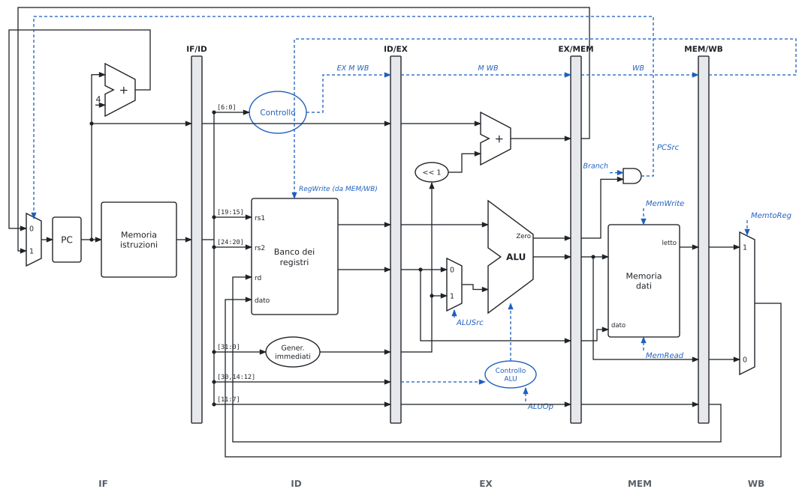
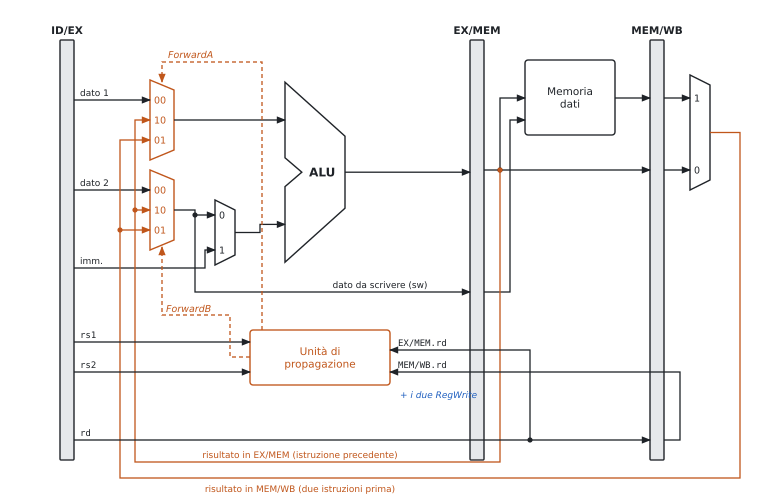
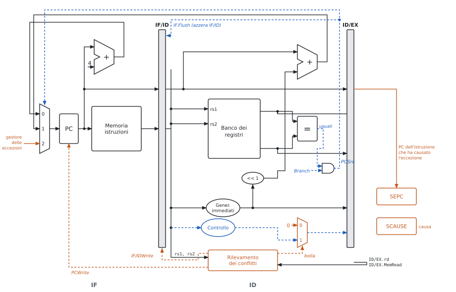
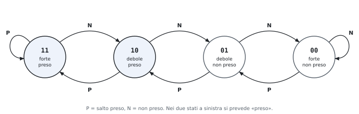
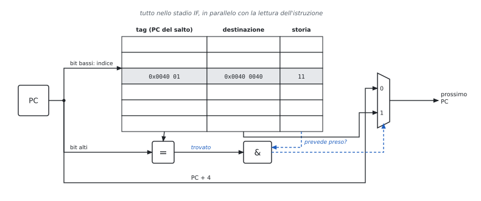
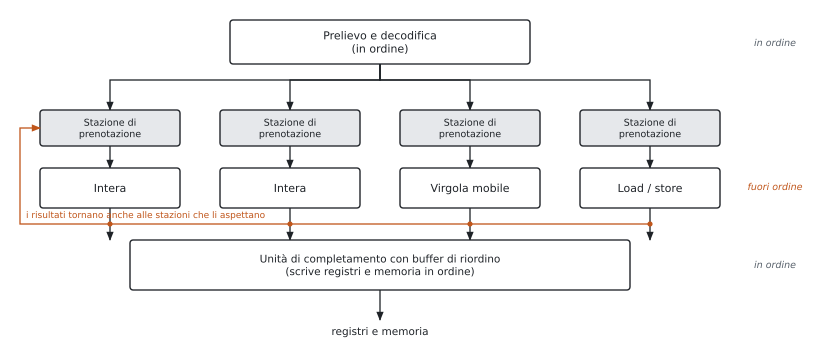

# 4 · Il processore, la pipeline e il parallelismo fra istruzioni

**In questo modulo.** Prerequisiti: formati e istruzioni (modulo 1), ALU (modulo 3), registri, multiplexer e memorie (Reti Logiche). Si costruisce il datapath a ciclo singolo con la sua unità di controllo, lo si spezza nella pipeline a cinque stadi e si risolvono i conflitti: propagazione, stallo load-use, salti decisi in ID, previsione statica e dinamica, eccezioni. Chiudono VLIW e superscalari. Ogni schema è accompagnato dalle domande che si fanno all'orale (perché un blocco sta lì, che errore evita, che problemi introduce). In fondo al capitolo, nel paragrafo 4.9, c'è la scaletta per ridisegnare il datapath a mano.

**Convenzioni degli schemi.** In nero i dati, in blu tratteggiato i segnali di controllo, in arancio le parti aggiunte rispetto allo schema precedente. Si usano i nomi dei segnali del Patterson-Hennessy, gli stessi delle slide del corso.

## 4.1 Il datapath a ciclo singolo


**Che cosa fa ogni istruzione.**

| Fase | Tipo R | `lw` | `sw` | `beq` |
|---|---|---|---|---|
| prelievo | istruzione da Mem[PC] | uguale | uguale | uguale |
| lettura registri | rs1, rs2 | rs1 | rs1, rs2 | rs1, rs2 |
| ALU | operazione | rs1 + imm | rs1 + imm | rs1 − rs2 (Zero?) |
| memoria dati | – | lettura | scrittura | – |
| scrittura registro | rd ← ALU | rd ← memoria | – | – |
| nuovo PC | PC + 4 | PC + 4 | PC + 4 | PC + imm·2 se Zero |

**I blocchi.**

| Blocco | A che serve | Perché è fatto così |
|---|---|---|
| PC | indirizzo dell'istruzione corrente | elemento di stato: si aggiorna sul fronte del clock |
| memoria istruzioni | legge l'istruzione | separata da quella dati: nello stesso ciclo servono entrambe |
| sommatore PC + 4 | istruzione successiva | le istruzioni sono tutte di 4 byte |
| banco dei registri | 2 letture e 1 scrittura per ciclo | due porte di lettura perché il tipo R ha due sorgenti |
| generatore degli immediati | estrae l'immediato e lo estende con il segno | l'immediato è in posizioni diverse in I, S, B |
| ALU | calcolo, indirizzo, confronto | la stessa per tre usi diversi |
| `<< 1` e sommatore del salto | destinazione PC + imm·2 | gli offset dei salti sono in mezze parole; serve un sommatore a parte perché l'ALU è occupata dal confronto |
| memoria dati | `lw` e `sw` | MemRead e MemWrite dicono se e come si usa |

**I tre multiplexer.** Si mette un multiplexer dove un ingresso può arrivare da due sorgenti.

| Multiplexer | Sceglie fra | Segnale | 1 per |
|---|---|---|---|
| secondo operando ALU | registro rs2 / immediato | ALUSrc | `lw`, `sw` |
| dato da scrivere | ALU / memoria | MemtoReg | `lw` |
| nuovo PC | PC + 4 / destinazione del salto | PCSrc = Branch · Zero | `beq` preso |

**Quanto dura un ciclo.** Il ciclo deve bastare all'istruzione più lenta. Tempi delle slide: memorie e ALU 200 ps, banco dei registri 100 ps.

| Istruzione | Mem. istr. | Lett. reg. | ALU | Mem. dati | Scritt. reg. | Totale |
|---|---|---|---|---|---|---|
| tipo R | 200 | 100 | 200 | – | 100 | 600 ps |
| `lw` | 200 | 100 | 200 | 200 | 100 | **800 ps** |
| `sw` | 200 | 100 | 200 | 200 | – | 700 ps |
| `beq` | 200 | 100 | 200 | – | – | 500 ps |

Clock da 800 ps per tutte, anche per `beq` che ne userebbe 500. Difetti del ciclo singolo:

- il caso lento detta il ritmo per tutti: un'istruzione lenta in più (una moltiplicazione, una load in virgola mobile) allungherebbe il ciclo di tutte;
- ogni blocco si usa una volta per ciclo: due memorie e tre sommatori invece di uno;
- la soluzione è la pipeline (4.3).

**All'orale.**

- *Perché due memorie?* Nello stesso ciclo `lw` legge un'istruzione e un dato: una memoria sola sarebbe una risorsa contesa. Nella realtà sono due cache (istruzioni e dati) davanti a una memoria unica.
- *Perché il dato da scrivere entra nel banco dei registri dal fondo dello schema?* Arriva dall'ultima fase (MemtoReg): è il filo che "chiude il cerchio". La scrittura avviene sul fronte del clock, quindi non si legge e scrive lo stesso registro "a metà" di un ciclo.
- *Perché `rs1` e `rs2` si collegano senza logica?* In tutti i formati stanno negli stessi bit (figura 1.1): si leggono i registri prima ancora di sapere che istruzione è. Se un'istruzione non li usa, i valori letti si ignorano.
- *Come si aggiunge `jal`?* Un terzo ingresso al multiplexer del dato da scrivere (PC + 4, per salvare l'indirizzo di ritorno) e il PC che diventa sempre PC + imm·2. Per `jalr` la destinazione è rs1 + imm, calcolata dall'ALU.

## 4.2 L'unità di controllo

L'unità di controllo è una rete combinatoria: dall'**opcode** (bit 6-0) genera i segnali in blu della figura 4.1.

| Istruzione | ALUSrc | MemtoReg | RegWrite | MemRead | MemWrite | Branch | ALUOp |
|---|---|---|---|---|---|---|---|
| tipo R | 0 | 0 | 1 | 0 | 0 | 0 | 10 |
| `lw` | 1 | 1 | 1 | 1 | 0 | 0 | 00 |
| `sw` | 1 | X | 0 | 0 | 1 | 0 | 00 |
| `beq` | 0 | X | 0 | 0 | 0 | 1 | 01 |

**Controllo dell'ALU a due livelli.** L'unità principale non guarda `funct`: produce ALUOp (2 bit), e una rete piccola lo combina con `funct7` (bit 30) e `funct3`.

| Istruzione | ALUOp | funct7 | funct3 | Operazione | Controllo ALU |
|---|---|---|---|---|---|
| `lw`, `sw` | 00 | X | X | somma (indirizzo) | 0010 |
| `beq` | 01 | X | X | sottrazione (confronto) | 0110 |
| `add` | 10 | 0000000 | 000 | somma | 0010 |
| `sub` | 10 | 0100000 | 000 | sottrazione | 0110 |
| `and` | 10 | 0000000 | 111 | AND | 0000 |
| `or` | 10 | 0000000 | 110 | OR | 0001 |

Perché due livelli: l'unità principale resta piccola (dipende solo dall'opcode), e la rete dell'ALU, che dipende da più bit, è separata e più veloce da progettare. Lo stesso schema nei processori più grandi si realizza come macchina a stati o con un microprogramma.

**All'orale.**

- *Perché MemtoReg può valere X in `sw` e `beq`?* Perché RegWrite = 0: qualunque cosa arrivi al banco dei registri non viene scritta. La X lascia libertà nella sintesi della rete.
- *E se in `sw` RegWrite fosse sbagliato a 1?* Si scriverebbe in un registro il valore dei bit 11-7 dell'istruzione (che in S sono un pezzo dell'immediato, non un rd): un registro qualsiasi verrebbe sporcato.
- *Perché PCSrc non esce direttamente dall'unità di controllo?* Dipende dal risultato del confronto, che si conosce solo dopo l'ALU: è l'AND fra Branch (dall'opcode) e Zero (dall'ALU).
- *Perché `beq` usa la sottrazione?* $a = b \iff a - b = 0$, e l'ALU ha già l'uscita Zero (NOR di tutti i bit, modulo 3).

## 4.3 La pipeline



**L'idea.** Catena di montaggio: l'istruzione $i + 1$ comincia prima che la $i$ finisca. Cinque stadi, uno per risorsa:

| Stadio | Che cosa | Blocchi | Registro dopo |
|---|---|---|---|
| IF | preleva l'istruzione, PC + 4 | PC, memoria istruzioni, sommatore | IF/ID: istruzione, PC |
| ID | decodifica, legge i registri, estende l'immediato | controllo, banco dei registri, gen. immediati | ID/EX: dati letti, imm, PC, rd, funct, controlli EX M WB |
| EX | ALU, destinazione del salto | ALU, ALUSrc, sommatore del salto | EX/MEM: risultato, Zero, destinazione, dato per `sw`, rd, controlli M WB |
| MEM | memoria dati, decisione del salto | memoria dati, AND Branch · Zero | MEM/WB: dato letto, risultato, rd, controlli WB |
| WB | scrittura nel banco | MemtoReg | – |

**Regole del datapath a pipeline.**

- Ogni stadio usa solo ciò che trova nel registro alla sua sinistra: il registro conserva tutto quello che servirà dopo.
- I controlli si generano in ID e viaggiano: ogni stadio consuma i suoi (EX: ALUSrc, ALUOp; MEM: MemRead, MemWrite, Branch; WB: MemtoReg, RegWrite).
- Anche **rd viaggia** fino a MEM/WB: quando l'istruzione arriva in WB, in IF/ID c'è già un'altra istruzione con un altro rd.
- Il ciclo è quello dello stadio più lento: 200 ps invece di 800.

**Latenza e throughput.** Con $k$ stadi, ciclo $T_c$ e $n$ istruzioni senza conflitti:
$$T_{pipeline} = (k + n - 1)\,T_c, \qquad \text{accelerazione} \xrightarrow{n \to \infty} \frac{T_{\text{ciclo singolo}}}{T_c}.$$

- La latenza di un'istruzione **cresce**: $5 \times 200 = 1000$ ps contro 800.
- Il throughput cresce: a regime un'istruzione per ciclo.
- L'accelerazione tende a $800/200 = 4$, non a 5: gli stadi non sono bilanciati (ID e WB usano 100 ps su 200).

**Perché RISC-V si presta alla pipeline.** Istruzioni tutte di 32 bit (IF sempre uguale); rs1 e rs2 sempre negli stessi bit (registri letti in ID mentre si decodifica); memoria solo con `lw` e `sw` (indirizzo in EX, accesso in MEM, mai un'ALU dopo la memoria); accessi allineati (un solo accesso per dato).

**All'orale.**

- *Perché il numero del registro di destinazione viaggia fino a WB?* Se il banco dei registri usasse i bit 11-7 di IF/ID, scriverebbe nel registro dell'istruzione arrivata quattro cicli dopo. È l'errore classico del primo disegno della pipeline.
- *Che cosa contiene IF/ID, e perché anche il PC?* L'istruzione e il suo PC: il PC serve in EX per la destinazione del salto, e in caso di eccezione per salvarne l'indirizzo.
- *Perché la pipeline non riduce il tempo di una singola istruzione?* Ogni istruzione attraversa tutti gli stadi, anche quelli che non usa, e i registri aggiungono il loro ritardo; si guadagna solo perché le istruzioni si sovrappongono.

## 4.4 I conflitti

Un **conflitto** (*hazard*) è un caso in cui l'istruzione successiva non può avanzare nel ciclo previsto.

| Conflitto | Causa | Esempio | Soluzione | Costo |
|---|---|---|---|---|
| strutturale | due istruzioni vogliono la stessa risorsa | `lw` in MEM e prelievo in IF con una memoria sola | memorie separate; banco dei registri scritto nella prima metà del ciclo e letto nella seconda | hardware in più |
| sui dati | serve un risultato non ancora scritto (RAW) | `add x1,…` seguita da `sub …, x1, …` | stallo; propagazione (4.5); riordino del codice | 0-2 cicli |
| sul controllo | non si sa quale istruzione prelevare dopo un salto | `beq` | decisione in ID; previsione (4.6) | 0-3 cicli |

**Dati senza propagazione.** Per l'istruzione che dipende da quella subito prima, 2 stalli; da quella due posti prima, 1; da tre posti prima, nessuno (il banco scrive nella prima metà del ciclo e legge nella seconda).

```text
add  x1, x2, x3      # scrive x1 in WB, ciclo 5
sub  x4, x1, x5      # leggerebbe x1 in ID al ciclo 3: valore vecchio
and  x6, x1, x7      # al ciclo 4: valore vecchio
or   x8, x1, x9      # al ciclo 5, seconda metà: valore giusto
```

**Stallo e bolla.** Fermare la pipeline vuol dire tenere ferme le istruzioni dietro (PC e IF/ID non si aggiornano) e far avanzare negli stadi successivi una **bolla**: un'istruzione con tutti i controlli a 0, che non scrive niente.

## 4.5 La propagazione e lo stallo load-use



**L'idea.** Il risultato di `add` esiste alla fine di EX, nel registro EX/MEM: lo si porta all'ALU dell'istruzione successiva senza aspettare il banco dei registri.

**Le condizioni dell'unità di propagazione** (per rs1 → ForwardA, uguale per rs2 → ForwardB):

| Caso | Condizione | ForwardA |
|---|---|---|
| dall'istruzione precedente | EX/MEM.RegWrite ∧ EX/MEM.rd ≠ 0 ∧ EX/MEM.rd = ID/EX.rs1 | 10 |
| da due istruzioni prima | MEM/WB.RegWrite ∧ MEM/WB.rd ≠ 0 ∧ MEM/WB.rd = ID/EX.rs1 ∧ **non** il caso precedente | 01 |
| altrimenti | – | 00 |

Perché ogni pezzo della condizione:

- **RegWrite**: `sw` e `beq` hanno un campo nei bit 11-7 ma non scrivono un registro; senza RegWrite si propagherebbe un valore inventato.
- **rd ≠ 0**: `x0` vale sempre 0; un'istruzione che "scrive" `x0` non deve passare il suo risultato.
- **"non il caso precedente"**: in `add x1,x1,x2 / add x1,x1,x3 / add x1,x1,x4` la terza trova `x1` sia in EX/MEM sia in MEM/WB: il valore giusto è il più recente, EX/MEM.
- Il dato della **`sw`** passa dal multiplexer ForwardB prima di andare in EX/MEM: così anche il dato da scrivere in memoria è quello aggiornato.

**Lo stallo load-use.** Il dato di `lw` esce dalla memoria alla fine di MEM; l'istruzione dopo lo vorrebbe all'inizio di EX dello stesso ciclo. Propagare all'indietro nel tempo non si può: serve **1 stallo**, poi il dato arriva da MEM/WB.


**L'unità di rilevamento dei conflitti** lavora in ID, un ciclo prima che il danno avvenga (figura 4.5):
$$\text{ID/EX.MemRead} \wedge \big(\text{ID/EX.rd} = \text{IF/ID.rs1} \vee \text{ID/EX.rd} = \text{IF/ID.rs2}\big) \Rightarrow \text{stallo}.$$

Che cosa fa per fermare la pipeline:

1. **PCWrite = 0**: il PC non cambia, si ripreleva la stessa istruzione;
2. **IF/IDWrite = 0**: l'istruzione in ID resta lì;
3. **bolla**: un multiplexer mette a 0 i controlli che entrano in ID/EX, così in EX passa un'istruzione che non scrive niente.

**Riordinare il codice.** Il compilatore mette fra la `lw` e l'istruzione che usa il dato un'istruzione indipendente (esercizio 3).

**All'orale.**

- *Perché la propagazione si controlla in EX e il rilevamento in ID?* La propagazione serve nel ciclo in cui l'ALU usa l'operando. Lo stallo invece va deciso prima: quando la `lw` è in EX e l'istruzione dipendente in ID, bisogna fermare quest'ultima prima che entri in EX.
- *Perché basta guardare MemRead?* Solo le load producono il dato in MEM invece che in EX; per tutte le altre la propagazione basta.
- *Che errore si introdurrebbe senza la bolla, fermando solo PC e IF/ID?* L'istruzione in ID verrebbe copiata in ID/EX e anche eseguita: la stessa istruzione passerebbe due volte in EX, scrivendo due volte.
- *La propagazione elimina tutti gli stalli sui dati?* No: resta il load-use (1 ciclo), e in ID i confronti dei salti (4.6).

## 4.6 I salti: decidere prima, prevedere

**Il problema.** Dopo una `beq` non si sa quale istruzione prelevare. Nella pipeline di base (figura 4.2) la decisione è in MEM: se il salto è preso, le 3 istruzioni prelevate nel frattempo vanno scartate (**flush**). Con un salto ogni 5-6 istruzioni, il costo è alto.



**Decidere in ID** (figura 4.5):

- sommatore della destinazione spostato in ID (PC e immediato ci sono già);
- comparatore di uguaglianza fra i due registri: XOR bit a bit e NOR, molto più veloce di una sottrazione;
- **IF.Flush**: se il salto è preso, IF/ID viene azzerato (l'istruzione prelevata diventa una `nop`);
- penalità di un salto preso: **1 ciclo** invece di 3.

Prezzo: il confronto in ID ha bisogno degli operandi un ciclo prima. Serve una propagazione verso ID e nuovi stalli:

| Il salto usa il risultato di | Stalli |
|---|---|
| un'istruzione aritmetica subito prima | 1 |
| una `lw` subito prima | 2 |
| un'istruzione due posti prima | 0 (propagazione) |

**Previsione statica.** Decisa una volta per tutte, senza storia.

- **"non preso"**: si continua a prelevare in sequenza; se il salto è preso si fa il flush. Hardware: solo IF.Flush. Bene per i salti in testa ai cicli, male per quelli in fondo (quasi sempre presi).
- **"indietro preso, avanti non preso"**: i salti all'indietro chiudono i cicli e di solito sono presi. Serve conoscere la direzione (il segno dell'offset) e la destinazione presto.
- **salto ritardato** (MIPS delle slide): l'istruzione dopo il salto si esegue sempre e il compilatore la riempie con qualcosa di utile. RISC-V non lo ha.

**Previsione dinamica.** Usa la storia di ogni salto, letta in IF.



- **Tabella della storia dei salti** (BHT): piccola memoria indirizzata dai bit bassi del PC, con l'esito recente. Più salti possono condividere la stessa riga (l'effetto è solo una previsione peggiore, mai un errore di esecuzione).
- **1 bit**: prevede l'ultimo esito. Un ciclo sbaglia 2 volte per esecuzione: all'uscita e alla prima iterazione della volta dopo.
- **2 bit** (contatore saturato, figura 4.6): il ciclo sbaglia solo all'uscita. Ciclo di 10 iterazioni: dall'80% al 90% di previsioni giuste.
- **Branch target buffer** (BTB, figura 4.7): una cache indirizzata dal PC che contiene, per i salti già visti, la **destinazione** e i bit di previsione. Se il PC è nel BTB e la previsione è "preso", il PC successivo è la destinazione già nel ciclo IF: un salto preso previsto bene costa 0 cicli.



**Statica e dinamica a confronto.**

| | Statica ("non preso") | Dinamica (BHT 2 bit + BTB) |
|---|---|---|
| chi decide la previsione | regola fissa (o il compilatore) | l'hardware, dalla storia del salto |
| dove si legge | – | IF, in parallelo con la memoria istruzioni |
| hardware nel datapath | flush di IF/ID, decisione in ID | in più: BHT/BTB in IF, un ingresso in più al multiplexer del PC, logica che in ID confronta previsione ed esito e aggiorna la tabella |
| salto non preso | 0 cicli | 0 se previsto bene |
| salto preso | 1 ciclo (sempre) | 0 se previsto bene e nel BTB |
| previsione sbagliata | 1 ciclo | 1 ciclo (flush e PC corretto: destinazione o PC + 4 del salto) |
| quando conviene | pipeline corte, hardware minimo | pipeline lunghe, superscalari: la penalità cresce con gli stadi prima della decisione |

**All'orale.**

- *Perché il comparatore in ID non è una sottrazione?* Per l'uguaglianza basta $\overline{\sum (a_i \oplus b_i)}$: due livelli di porte, senza propagazione del riporto. Ci sta nella seconda metà di ID, dopo la lettura dei registri.
- *Che errore copre IF.Flush e che rischio introduce?* Impedisce che l'istruzione prelevata per sbaglio scriva qualcosa. Deve azzerare IF/ID (cioè trasformarla in `nop`) e non ID/EX, altrimenti si annullerebbe il salto stesso.
- *Che cosa succede se due salti condividono una riga della BHT?* Si leggono i bit dell'altro: la previsione può essere sbagliata, ma il programma resta corretto, perché l'esito vero si controlla comunque in ID.
- *Perché a 2 bit e non a 3 o 4?* Il secondo bit toglie l'errore alla prima iterazione; bit in più servono poco. I processori moderni usano invece predittori che correlano più salti.

## 4.7 Le eccezioni

**Definizioni.** **Eccezione**: evento che cambia il flusso del programma, causato dall'istruzione stessa (sincrono). **Interruzione** (*interrupt*): richiesta dall'esterno, per esempio un dispositivo di I/O (asincrona).

| Evento | Stadio | Tipo |
|---|---|---|
| istruzione non definita | ID | eccezione |
| errore di accesso alla memoria, page fault | IF, MEM | eccezione |
| `ecall` (chiamata al sistema operativo) | ID | eccezione |
| overflow (solo nelle ISA che lo segnalano, come MIPS) | EX | eccezione |
| richiesta di un dispositivo | qualsiasi | interruzione |

**Che cosa fa l'hardware** (parti arancio della figura 4.5):

1. lascia completare le istruzioni **precedenti**;
2. scarta quella che ha causato l'eccezione e le successive: IF.Flush, e azzeramento dei controlli in ID ed EX (ID.Flush, EX.Flush, con multiplexer come quello della bolla);
3. salva l'indirizzo dell'istruzione in **SEPC** e la causa in **SCAUSE**;
4. carica nel PC l'indirizzo fisso del gestore del sistema operativo (terzo ingresso del multiplexer del PC);
5. il gestore, finito, torna all'indirizzo in SEPC (oppure termina il programma).

**Eccezione precisa**: tutte le istruzioni prima sono completate, nessuna dopo ha cambiato lo stato. Con più eccezioni nello stesso ciclo si serve quella dell'istruzione più avanti nella pipeline (la più vecchia).

> [!nota] Lo schema dell'appunto a mano
> L'appunto a mano dell'autore disegna il datapath completo di fine capitolo: i quattro registri di pipeline, il comparatore in ID con la sua propagazione, l'unità di propagazione in EX, l'unità di rilevamento in ID e, all'ingresso del multiplexer del PC, l'indirizzo fisso del gestore (nello schema quello MIPS delle slide, `8000 0180` esadecimale). Le figure 4.2, 4.3 e 4.5 insieme sono lo stesso schema, diviso in tre per leggerlo meglio.

**All'orale.**

- *Perché salvare il PC dell'istruzione e non PC + 4?* Dopo un page fault l'istruzione va rieseguita da capo; per una `ecall` il gestore aggiunge 4 lui.
- *Perché il PC arriva a SEPC da un registro di pipeline?* Quando l'eccezione si scopre (in ID, EX o MEM) il PC ha già prelevato altre istruzioni: serve il PC di quella che ha sbagliato, che viaggia nei registri di pipeline.
- *Perché precise?* Altrimenti il sistema operativo non saprebbe da dove ripartire, e un'istruzione successiva potrebbe aver già scritto un registro.

## 4.8 Più istruzioni per ciclo

La pipeline porta il CPI vicino a 1; per scendere sotto si avviano più istruzioni per ciclo (**multiple issue**) e si ragiona in **IPC** = 1/CPI.

| | Avvio multiplo statico (VLIW) | Avvio multiplo dinamico (superscalare) |
|---|---|---|
| chi sceglie cosa parte insieme | il compilatore, in **pacchetti** | l'hardware, durante l'esecuzione |
| esempio del corso | 2 posti: aritmetica o salto, `lw` o `sw` | più unità funzionali con stazioni di prenotazione |
| conflitti | evitati dal compilatore (`nop` se non trova niente) | risolti dall'hardware |
| ordine | in ordine | esecuzione **fuori ordine**, completamento in ordine |
| hardware in più | porte del banco dei registri, sommatore per gli indirizzi | stazioni, buffer di riordino, ridenominazione, previsione |

**Regole del VLIW a due vie.** Niente istruzioni dipendenti nello stesso pacchetto; un'aritmetica si usa dal pacchetto dopo; una `lw` due pacchetti dopo.

**Srotolamento dei cicli** (*loop unrolling*): si copia il corpo del ciclo, si aggiornano i puntatori una volta sola e si usano registri diversi per le copie. Meno istruzioni di controllo, più istruzioni indipendenti da accoppiare (esercizio 7).



**Le dipendenze** fra $i$ e $j$ ($i$ prima di $j$):

| Dipendenza | Che cosa | Si può togliere? |
|---|---|---|
| vera, RAW (*read after write*) | $j$ legge ciò che $i$ scrive | no: è il flusso dei dati |
| antidipendenza, WAR (*write after read*) | $j$ scrive ciò che $i$ legge | sì, con un altro registro |
| di uscita, WAW (*write after write*) | $i$ e $j$ scrivono lo stesso registro | sì, con un altro registro |

**Ridenominazione dei registri** (*register renaming*): l'hardware ha più registri fisici che architetturali e assegna a ogni nuova scrittura un registro fisico libero; WAR e WAW spariscono.

**Perché si completa in ordine.** Le eccezioni restano precise e le istruzioni eseguite dopo una previsione sbagliata (esecuzione **speculativa**) si possono annullare prima che scrivano lo stato.

**I limiti.** Dal Pentium 4 (fino a 31 stadi, 3,6 GHz, oltre 100 W) si è tornati a pipeline più corte e a più core: consumo e calore (*power wall*), poco parallelismo nei programmi, latenza della memoria.

## 4.9 All'orale: ridisegnare il datapath

La domanda tipica è "disegnami e spiegami il datapath con …". Conviene costruirlo per strati, spiegando a ogni passo perché si aggiunge il pezzo.

1. **IF**: PC, memoria istruzioni, sommatore + 4, multiplexer del PC. Due righe: "il PC è un registro; tutte le istruzioni sono di 4 byte".
2. **ID**: bus dell'istruzione con i campi [19:15], [24:20], [11:7], [6:0], [31:0]; banco dei registri con due letture; generatore degli immediati; unità di controllo.
3. **EX**: ALU con ALUSrc; `<< 1` e sommatore della destinazione; controllo dell'ALU con ALUOp e funct.
4. **MEM** e **WB**: memoria dati con MemRead e MemWrite; AND Branch · Zero → PCSrc; MemtoReg e il filo che torna al banco.
5. **Pipeline**: i quattro registri; i controlli che viaggiano (EX M WB → M WB → WB); rd che viaggia fino a WB e torna al banco; il PC che viaggia fino a EX.
6. **Propagazione**: due multiplexer a tre ingressi davanti all'ALU, l'unità di propagazione con rs1, rs2 da ID/EX e rd, RegWrite da EX/MEM e MEM/WB.
7. **Rilevamento**: unità in ID con ID/EX.MemRead, ID/EX.rd, IF/ID.rs1, rs2; uscite PCWrite, IF/IDWrite e il multiplexer della bolla.
8. **Salti**: comparatore e sommatore in ID, IF.Flush; per la previsione dinamica BHT e BTB in IF.
9. **Eccezioni**: SEPC, SCAUSE, ingresso del gestore sul multiplexer del PC, flush di ID ed EX.

**Le domande "perché" più frequenti**, con la risposta breve:

| Domanda | Risposta |
|---|---|
| perché i registri di pipeline? | ogni stadio lavora su un'istruzione diversa: serve conservare dati e controlli di ognuna |
| perché i controlli si generano in ID? | lì si conosce l'opcode; li si porta avanti invece di ricalcolarli |
| perché rd viaggia? | in WB l'istruzione in ID è un'altra |
| perché il banco scrive nella prima metà e legge nella seconda? | così l'istruzione in ID legge il valore scritto da quella in WB nello stesso ciclo: un conflitto in meno |
| perché due multiplexer prima dell'ALU e non uno? | gli operandi rs1 e rs2 possono arrivare da posti diversi in modo indipendente |
| perché ForwardB sta prima di ALUSrc? | il dato della `sw` (rs2) deve essere quello aggiornato anche se l'ALU usa l'immediato |
| che problema introduce spostare i salti in ID? | operandi richiesti un ciclo prima: propagazione verso ID e stalli in più dopo `lw` e aritmetiche |
| che problema introduce la previsione dinamica? | hardware e tabelle in IF, aggiornamento, e il recupero quando sbaglia |

## Esempi ed esercizi svolti

**Esercizio 1. Ciclo singolo o pipeline?** Memorie 250 ps, ALU 150 ps, register file 100 ps. Si confrontino il ciclo singolo e la pipeline a 5 stadi su 1000 istruzioni senza conflitti.

Ciclo singolo: l'istruzione più lunga è `lw`, $250 + 100 + 150 + 250 + 100 = 850$ ps; il programma dura $1000 \times 850 = 850$ ns. Pipeline: il ciclo è quello dello stadio più lento, 250 ps; il programma dura $(5 + 999) \times 250 = 251$ ns. L'accelerazione è $850/251 \approx 3{,}39$. Il limite per $n \to \infty$ è $850/250 = 3{,}4$, lontano da 5 perché gli stadi sono sbilanciati: ID, EX e WB lavorano 100 o 150 ps su 250.

**Esercizio 2. I segnali di controllo di `lw` e `beq`.** Perché ALUSrc vale 1 in `lw` e 0 in `beq`, e perché ALUOp è diverso?

`lw x5, 8(x10)` somma il registro `x10` e l'immediato 8: il secondo operando dell'ALU è l'immediato, ALUSrc = 1, e l'operazione è una somma, ALUOp = 00. `beq x5, x6, L` confronta due registri: il secondo operando è un registro, ALUSrc = 0, e il confronto si fa con una sottrazione che accende Zero se il risultato è nullo, ALUOp = 01. L'immediato di `beq` serve, ma al sommatore della destinazione, non all'ALU.

**Esercizio 3. Stalli e riordino.** Si contino i cicli del frammento, con e senza forwarding, e lo si riordini per togliere gli stalli.

```text
lw   t0, 0(a0)
lw   t1, 4(a0)
add  t2, t0, t1
sw   t2, 8(a0)
addi a0, a0, 12
```

*Senza forwarding.* `add` legge `t1` in ID e deve aspettare che la seconda `lw` lo scriva in WB: 2 stalli. `sw` legge `t2`, prodotto da `add` subito prima: altri 2 stalli. In tutto $5 + 4 + 4 = 13$ cicli.

*Con forwarding.* Resta solo lo stallo load-use fra la seconda `lw` e `add`: 10 cicli. Il diagramma:

| | 1 | 2 | 3 | 4 | 5 | 6 | 7 | 8 | 9 | 10 |
|---|---|---|---|---|---|---|---|---|---|---|
| `lw t0` | IF | ID | EX | MEM | WB | | | | | |
| `lw t1` | | IF | ID | EX | MEM | WB | | | | |
| `add` | | | IF | ID | ID | EX | MEM | WB | | |
| `sw` | | | | IF | IF | ID | EX | MEM | WB | |
| `addi` | | | | | | IF | ID | EX | MEM | WB |

Al ciclo 5 in EX passa una bolla; `t1` arriva all'ALU di `add` al ciclo 6 dal registro MEM/WB.

*Riordino.* `addi` non dipende da nessuna delle istruzioni precedenti tranne che per `a0`, che le due `lw` leggono prima. La si sposta fra la seconda `lw` e `add`, correggendo lo spiazzamento della `sw`, che ora vede `a0` già aumentato di 12:

```text
lw   t0, 0(a0)
lw   t1, 4(a0)
addi a0, a0, 12
add  t2, t0, t1
sw   t2, -4(a0)
```

Con il forwarding non ci sono più stalli: 9 cicli, il minimo per 5 istruzioni. Senza forwarding servono 12 cicli.

**Esercizio 4. Una catena di dipendenze.**

```text
add  s1, s2, s3
sub  s4, s1, s5
and  s6, s1, s4
or   s7, s6, s2
sw   s7, 0(a0)
```

Ogni istruzione dipende da quella immediatamente precedente. Senza forwarding: 2 stalli per ciascuna delle ultime quattro, $9 + 8 = 17$ cicli. Con il forwarding nessuno stallo, perché nessun dato viene da una `lw`: 9 cicli. Il guidato 1 mostra da dove arriva ogni operando.

**Esercizio 5. Salti decisi in ID.** Quanti stalli in queste due coppie, con forwarding e salti decisi in ID?

```text
lw   t0, 0(a0)          addi t1, t1, 1
beq  t0, zero, fine     bne  t1, t2, ciclo
```

La `beq` confronta in ID, un ciclo prima di quando un'istruzione aritmetica userebbe l'operando in EX. Il valore di `lw` è pronto alla fine di MEM: se `lw` è in MEM al ciclo $c$, la `beq` può essere in ID solo al ciclo $c + 1$, cioè 2 stalli. Il valore di `addi` è pronto alla fine di EX: 1 stallo. In un ciclo conviene quindi mettere fra l'aggiornamento del contatore e il salto un'istruzione indipendente.

**Esercizio 6. Il CPI con stalli e salti.** In un programma il 25% delle istruzioni sono `lw`, e il 40% di queste è seguito da un'istruzione che usa il dato; il 15% sono salti, presi nel 60% dei casi. La pipeline ha il forwarding e prevede "non preso". Calcolare il CPI con salti decisi in ID e in MEM, e con un predittore dinamico corretto nel 90% dei casi (e un BTB) con decisione in ID.

Ogni stallo load-use costa 1 ciclo: $0{,}25 \times 0{,}4 = 0{,}1$ cicli per istruzione. Decisione in ID: un salto preso costa 1 ciclo, $0{,}15 \times 0{,}6 \times 1 = 0{,}09$; $\text{CPI} = 1 + 0{,}1 + 0{,}09 = 1{,}19$. Decisione in MEM: un salto preso costa 3 cicli, $0{,}15 \times 0{,}6 \times 3 = 0{,}27$; $\text{CPI} = 1{,}37$. Predittore dinamico: si paga 1 ciclo solo sugli errori, $0{,}15 \times 0{,}1 = 0{,}015$; $\text{CPI} = 1{,}115$.

**Esercizio 7. VLIW e srotolamento.** Il ciclo `b[i] = 2 * a[i]` su $n$ elementi ($n$ pari), con `a0` = indirizzo di `a`, `a1` = indirizzo di `b`, `a2` = indirizzo di fine di `a`, va schedulato su un processore a due vie (aritmetica o salto | `lw` o `sw`).

```text
lp:  lw   t0, 0(a0)
     slli t0, t0, 1
     sw   t0, 0(a1)
     addi a0, a0, 4
     addi a1, a1, 4
     bne  a0, a2, lp
```

*Senza srotolamento.* `slli` usa il dato della `lw`: almeno due pacchetti dopo. `sw` usa `slli`: un pacchetto dopo. Le due `addi` si possono anticipare, correggendo lo spiazzamento della `sw`:

```text
lp:  addi a0, a0, 4     |  lw   t0, 0(a0)
     addi a1, a1, 4     |  nop
     slli t0, t0, 1     |  nop
     bne  a0, a2, lp    |  sw   t0, -4(a1)
```

Nel primo pacchetto `lw` legge `a0` insieme ad `addi`, quindi il valore vecchio. Sono 6 istruzioni in 4 cicli: IPC 1,5.

*Srotolando due volte* (copie con `t0` e `t1`, puntatori aggiornati di 8):

```text
lp:  addi a0, a0, 8     |  lw   t0, 0(a0)
     addi a1, a1, 8     |  lw   t1, -4(a0)
     slli t0, t0, 1     |  nop
     slli t1, t1, 1     |  sw   t0, -8(a1)
     bne  a0, a2, lp    |  sw   t1, -4(a1)
```

Sono 9 istruzioni in 5 cicli: IPC 1,8, cioè 2,5 cicli per elemento invece di 4. Il secondo `lw` vede `a0` già aumentato di 8, per questo il suo spiazzamento è −4 (cioè $+4$ rispetto al valore vecchio). Senza il secondo registro `t1` le due copie si pesterebbero i piedi: è la ridenominazione fatta dal compilatore.

**Esercizio 8. Dipendenze e ridenominazione.**

```text
mul  t0, t1, t2      # 1
add  t3, t0, t4      # 2
sub  t0, t5, t6      # 3
and  t4, t0, t3      # 4
```

Dipendenze vere: 1 → 2 su `t0`, 3 → 4 su `t0`, 2 → 4 su `t3`. Antidipendenze: 2 legge `t0` che 3 scrive (2 → 3); 2 legge `t4` che 4 scrive (2 → 4). Dipendenza di uscita: 1 e 3 scrivono `t0`. Ridenominando il `t0` scritto da 3 in un registro fisico nuovo `p1` (e il `t4` scritto da 4 in `p2`), la 3 diventa `sub p1, t5, t6` e la 4 `and p2, p1, t3`: la 3 può partire subito, in parallelo alla `mul`, che è lenta.

## Esercizi guidati

Ogni esercizio è diviso in passi: si prova un passo alla volta e si confronta solo dopo.

**Guidato 1. I segnali di forwarding.** Per il frammento dell'esercizio 4, dire per ogni istruzione che valori hanno ForwardA e ForwardB quando è in EX.

*Passo 1: che cosa c'è negli stadi.* Quando l'istruzione $i$ è in EX, la $i - 1$ è in MEM (il suo risultato è in EX/MEM) e la $i - 2$ in WB (il risultato è in MEM/WB).

*Passo 2: `sub s4, s1, s5`.* In EX/MEM c'è `add`, con rd = `s1` = rs1: ForwardA = 10. `s5` viene dal register file: ForwardB = 00.

*Passo 3: `and s6, s1, s4`.* In EX/MEM c'è `sub` (rd = `s4` = rs2): ForwardB = 10. In MEM/WB c'è `add` (rd = `s1` = rs1), e EX/MEM non scrive `s1`: ForwardA = 01.

*Passo 4: `or s7, s6, s2`.* In EX/MEM c'è `and` (rd = `s6` = rs1): ForwardA = 10. `s2` non è scritto da nessuna delle due: ForwardB = 00.

*Passo 5: `sw s7, 0(a0)`.* Il dato da scrivere `s7` (rs2) viene da `or` in EX/MEM: ForwardB = 10; `a0` (rs1) dal register file: ForwardA = 00.

**Guidato 2. Predittore a 1 e a 2 bit su un ciclo annidato.** Il ciclo interno ha 4 iterazioni e viene eseguito molte volte: il suo salto in fondo dà la sequenza preso, preso, preso, non preso, ripetuta. Che percentuale di previsioni corrette danno i due predittori a regime?

*Passo 1: un bit.* All'inizio di un'esecuzione il bit vale "non preso" (l'ultimo esito). Prima iterazione: previsto non preso, è preso, errore; il bit diventa "preso". Seconda e terza: giuste. Quarta: previsto preso, non preso, errore. Due errori su quattro: 50%.

*Passo 2: due bit.* A regime il contatore è a "fortemente preso" durante il ciclo; all'uscita sbaglia e scende a "debolmente preso". Alla prima iterazione successiva prevede ancora preso e indovina, tornando a "fortemente preso". Un errore su quattro: 75%.

*Passo 3: il confronto.* Più il ciclo è corto, più conta il secondo bit: per 10 iterazioni si passa da 80% a 90%, per 4 da 50% a 75%.

**Guidato 3. Diagramma con un salto preso.** Con forwarding, salti decisi in ID e previsione "non preso", quanti cicli impiega questo frammento se il salto è preso e la destinazione è `fine: sub t3, t0, t1`?

```text
     addi t1, t1, 1
     beq  t1, t2, fine
     add  t4, t4, t1
fine: sub  t3, t0, t1
```

*Passo 1: lo stallo.* `beq` usa `t1` da `addi` immediatamente prima, e la decide in ID: 1 stallo.

*Passo 2: il flush.* Mentre `beq` è in ID (al secondo tentativo, ciclo 4), in IF c'è `add`. Il salto è preso: `add` si scarta e al ciclo 5 si legge `sub`.

*Passo 3: il conto.* `sub` è in IF al ciclo 5 e in WB al ciclo 9. In tutto 9 cicli per 3 istruzioni utili: i cicli persi sono uno per lo stallo e uno per il flush.

## Riepilogo

Il datapath a ciclo singolo esegue ogni istruzione in un ciclo lungo quanto quella più lenta; l'unità di controllo genera dai campi dell'istruzione i segnali dei multiplexer, delle scritture e dell'ALU, con il controllo dell'ALU a due livelli. La pipeline a cinque stadi IF, ID, EX, MEM, WB, con i registri di pipeline, completa a regime un'istruzione per ciclo: aumenta il throughput, non riduce la latenza, e il ciclo è fissato dallo stadio più lento. I conflitti strutturali si evitano con memorie separate e con il register file che scrive e legge nelle due metà del ciclo. I conflitti sui dati si risolvono con il forwarding da EX/MEM e da MEM/WB; resta lo stallo load-use, inserito dall'unità di rilevamento dei conflitti e spesso evitabile riordinando il codice. I conflitti sul controllo si riducono decidendo i salti in ID e con la previsione statica o dinamica (BHT a uno o due bit, BTB). Le eccezioni sono conflitti sul controllo gestiti salvando l'indirizzo e la causa. Per avviare più istruzioni per ciclo ci sono il VLIW, in cui il compilatore forma i pacchetti aiutandosi con lo srotolamento dei cicli, e i processori superscalari, che eseguono fuori ordine, eliminano antidipendenze e dipendenze di uscita con la ridenominazione e scrivono i risultati in ordine.

## Formulario

### Tempi

$$T_{\text{ciclo singolo}} = n \cdot T_{\text{istr. più lenta}}, \qquad T_{pipeline} = (k + n - 1) T_c, \qquad T_c = \max(\text{stadi}), \qquad \text{accelerazione} \to \frac{T_{\text{ciclo singolo}}}{T_c}.$$

$$\text{CPI} = 1 + \sum (\text{frequenza} \times \text{cicli di stallo}), \qquad \text{IPC} = 1/\text{CPI}.$$

### Stalli nella pipeline a 5 stadi

| Situazione | Senza forwarding | Con forwarding |
|---|---|---|
| uso subito dopo un'istruzione aritmetica | 2 | 0 |
| uso due istruzioni dopo | 1 | 0 |
| uso subito dopo una `lw` | 2 | 1 |
| salto in ID subito dopo un'aritmetica | 2 | 1 |
| salto in ID subito dopo una `lw` | 2 | 2 |
| salto preso con previsione "non preso" | 1 (decisione in ID), 3 (in MEM) | uguale |

### Condizioni

Forwarding da EX/MEM: RegWrite ∧ rd ≠ 0 ∧ rd = rs1 (rs2) → 10. Da MEM/WB: RegWrite ∧ rd ≠ 0 ∧ rd = rs1 (rs2) ∧ non dal precedente → 01. Load-use: ID/EX.MemRead ∧ ID/EX.rd ∈ {IF/ID.rs1, IF/ID.rs2} → stallo (PC e IF/ID fermi, controlli azzerati).

### Segnali di controllo

| | ALUSrc | MemtoReg | RegWrite | MemRead | MemWrite | Branch | ALUOp |
|---|---|---|---|---|---|---|---|
| R | 0 | 0 | 1 | 0 | 0 | 0 | 10 |
| `lw` | 1 | 1 | 1 | 1 | 0 | 0 | 00 |
| `sw` | 1 | X | 0 | 0 | 1 | 0 | 00 |
| `beq` | 0 | X | 0 | 0 | 0 | 1 | 01 |

### Termini per l'orale

| Termine | In una riga |
|---|---|
| Throughput, latenza | istruzioni completate per unità di tempo; durata di una istruzione |
| Registro di pipeline | conserva dati e controlli fra due stadi |
| Hazard strutturale, sui dati, sul controllo | risorsa contesa; dato non pronto; PC non noto |
| Stallo, bolla | fermare le istruzioni dietro; istruzione nulla che avanza |
| Forwarding | portare un risultato all'ALU prima della scrittura nei registri |
| Load-use | uso del dato di una `lw` subito dopo: 1 stallo |
| Flush | scartare le istruzioni lette per errore |
| BHT, BTB | tabella degli esiti dei salti; tabella delle destinazioni |
| Eccezione precisa | prima completate, dopo nessun effetto |
| VLIW, superscalare | avvio multiplo deciso dal compilatore; dall'hardware |
| RAW, WAR, WAW | dipendenza vera, antidipendenza, di uscita |
| Register renaming | registri fisici in più per eliminare WAR e WAW |

### Domande che tornano spesso

- Disegnare il datapath a ciclo singolo e spiegare i segnali di controllo per `lw`, `sw`, `beq` e tipo R.
- Perché la pipeline aumenta il throughput ma non riduce la latenza? Formula dell'accelerazione.
- Tipi di conflitti e soluzioni; condizioni del forwarding e dello stallo load-use.
- Come si riducono i conflitti sul controllo? Predittori a uno e due bit.
- "Disegnami e spiegami il datapath con la previsione dei salti": statica e dinamica, differenze teoriche e differenze nel datapath (4.6, figure 4.5 e 4.7).
- Disegnare il datapath a pipeline con propagazione e rilevamento dei conflitti, spiegando ogni segnale (4.9).
- Come gestisce le eccezioni la pipeline?
- VLIW e superscalare: differenze; srotolamento dei cicli; dipendenze e ridenominazione.
