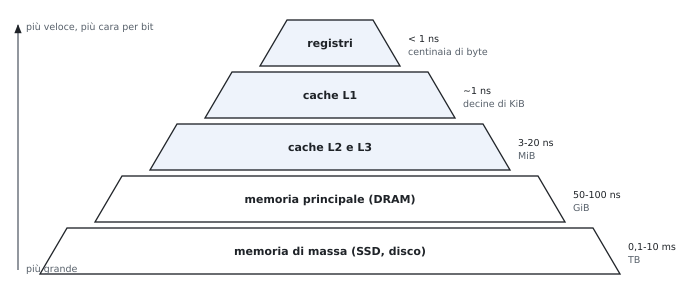
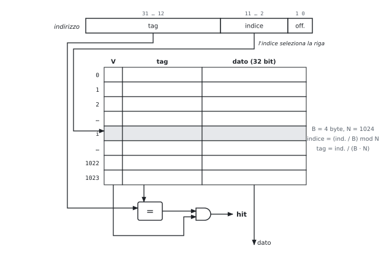
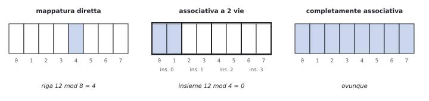
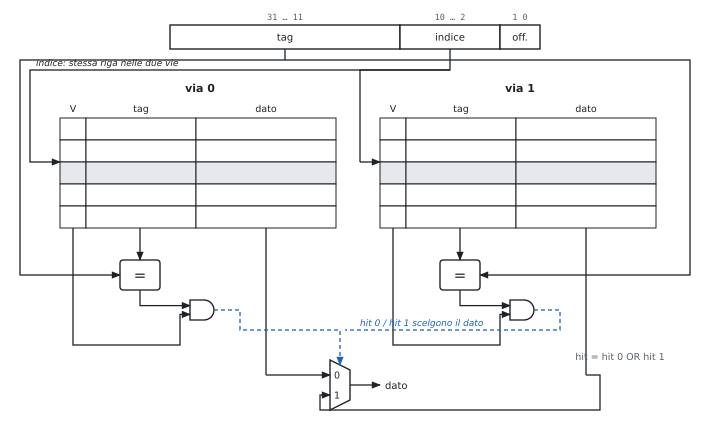
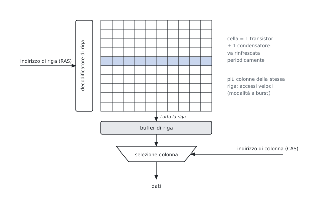
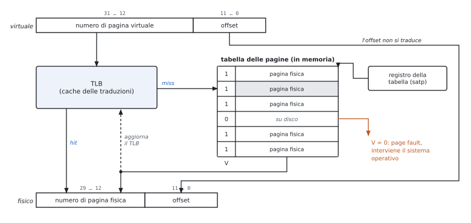

# 5 · La gerarchia di memoria, la cache e l'input/output

**In questo modulo.** Prerequisiti: CPI (modulo 1) e pipeline (modulo 4). Perché serve una gerarchia di memoria e perché funziona (località); la cache a mappatura diretta, associativa a insiemi e completamente associativa; scritture, cause dei miss, prestazioni, cache a più livelli, DRAM; un cenno alla memoria virtuale; l'input/output. Si impara a scomporre un indirizzo in tag, indice e offset, a simulare a mano una sequenza di accessi, a dimensionare una cache e a calcolare AMAT e CPI. All'orale si chiede di disegnare le strutture (figure 5.2, 5.3, 5.5, 5.6) e di spiegare il perché di ogni campo.

## 5.1 Perché una gerarchia

**Il problema.** I processori sono cresciuti per anni di circa il 55% all'anno, la DRAM di circa il 7%: un accesso alla memoria principale costa centinaia di cicli. Una memoria grande, veloce ed economica insieme non esiste.

| Tecnologia | Bit | Accesso | Uso | Nota |
|---|---|---|---|---|
| SRAM | 6 transistor | ~1 ns | cache | statica: tiene il dato finché è alimentata |
| DRAM | 1 transistor + 1 condensatore | decine di ns | memoria principale | dinamica: va rinfrescata ogni pochi ms |
| flash, disco | – | da µs a ms | memoria di massa | permanente, enorme |

**Perché funziona: la località.**

- **temporale**: un dato usato ora sarà probabilmente usato di nuovo presto (variabili e istruzioni di un ciclo) → tenere vicino al processore i dati recenti;
- **spaziale**: dopo un indirizzo si useranno probabilmente quelli vicini (istruzioni in sequenza, elementi di un array) → spostare blocchi interi di dati contigui.

**Chi sposta i dati.** Registri ↔ memoria: il compilatore. Cache ↔ memoria principale: l'hardware. Memoria principale ↔ disco: il sistema operativo (memoria virtuale, 5.8).

## 5.2 I termini

| Termine | Significato |
|---|---|
| blocco (linea) | unità trasferita fra due livelli |
| hit, miss | il dato c'è / non c'è nel livello superiore |
| hit rate, miss rate | frazione di hit; miss rate = 1 − hit rate |
| hit time | tempo per accedere al livello superiore, compreso capire se è un hit |
| miss penalty | tempo per portare il blocco dal livello inferiore e consegnare il dato |

$$\text{AMAT} = \text{hit time} + \text{miss rate} \times \text{miss penalty}.$$

## 5.3 La cache a mappatura diretta

Due domande: il dato c'è? Se sì, dove? A mappatura diretta ogni blocco di memoria ha **un solo posto**:
$$\text{indice} = (\text{indirizzo del blocco}) \bmod (\text{numero di blocchi}).$$

**I campi dell'indirizzo** (blocchi di $2^m$ parole da 4 byte, $2^n$ blocchi, indirizzi di 32 bit):

| Campo | Bit | A che serve |
|---|---|---|
| offset | $m + 2$ | sceglie parola e byte nel blocco |
| indice | $n$ | sceglie la riga |
| tag | $32 - n - m - 2$ | dice quale dei blocchi che condividono la riga c'è davvero |

**Ogni riga contiene** il bit di validità V (all'accensione la cache è vuota), il tag, i dati.

$$\text{bit totali} = 2^n \times (\text{bit del blocco} + \text{bit del tag} + 1).$$

Esempio delle slide: 16 KiB di dati in blocchi di 4 parole → $2^{10}$ blocchi, tag di 18 bit, $2^{10} \times (128 + 18 + 1) = 147$ Kibit ≈ 18,4 KiB.

**La dimensione del blocco.**

- blocco più grande → più località spaziale, miss rate più basso;
- ma a parità di capacità meno blocchi → più conflitti, il miss rate risale;
- e la miss penalty cresce (più dati da trasferire). Rimedi: ripartire appena arriva la parola cercata (*early restart*), o farla arrivare per prima (*requested word first*).

**All'orale.**

- *Perché l'indice sono i bit bassi e il tag quelli alti?* Con i bit bassi indirizzi vicini vanno in righe diverse: un array occupa tutta la cache invece di contendersi una riga. Con i bit alti come indice, blocchi vicini andrebbero tutti nella stessa riga.
- *Perché serve il bit di validità?* All'accensione le righe contengono bit casuali: un tag casuale potrebbe coincidere e dare un falso hit.
- *Perché non si memorizza anche l'indice?* È implicito nella posizione della riga.

## 5.4 Le scritture

| Politica | Che cosa fa | Pregi | Difetti | Aggiunte |
|---|---|---|---|---|
| **write-through** | scrive cache e memoria | memoria sempre aggiornata, semplice | una scrittura in memoria per ogni `sw` | **write buffer**: coda di scritture; il processore si ferma solo se è piena |
| **write-back** | scrive solo la cache; ricopia il blocco quando viene sostituito | poco traffico se un blocco è scritto più volte | memoria non aggiornata per un po'; sostituzione più lenta | **dirty bit**: solo i blocchi modificati si ricopiano |

**Miss in scrittura.** *Write allocate*: si porta il blocco in cache e lo si scrive (di solito con write-back). *No-write allocate*: si scrive solo nel livello sotto (di solito con write-through).

**Miss in lettura.** Si ferma la pipeline; se il blocco da sostituire è sporco lo si ricopia; si legge il blocco nuovo, lo si scrive in cache e si ripete l'accesso. Le cache **non bloccanti** servono altri hit durante un miss (*hit under miss*).

**All'orale.**

- *Che problema risolve il write buffer, e quale introduce?* Evita di aspettare la memoria a ogni `sw`. Introduce un caso nuovo: una `lw` che cerca un dato ancora nel buffer va servita dal buffer (o aspettare che si svuoti), altrimenti legge il valore vecchio.
- *Perché il dirty bit?* Senza, con il write-back si dovrebbe ricopiare ogni blocco sostituito, anche quelli solo letti.

## 5.5 Le cause dei miss e l'associatività

**Le tre C.**

| Miss | Causa | Si riduce con |
|---|---|---|
| obbligatori (*compulsory*) | primo accesso al blocco | blocchi più grandi |
| di capacità | la cache non contiene tutti i blocchi usati | cache più grande |
| di conflitto | blocchi usati insieme nella stessa posizione | più associatività |

| Organizzazione | Dove va un blocco | Confronti | Indice |
|---|---|---|---|
| mappatura diretta | una riga: blocco mod N | 1 | $\log_2 N$ bit |
| associativa a $n$ vie | un insieme: blocco mod (N/n), qualsiasi via | $n$ in parallelo | $\log_2 (N/n)$ bit |
| completamente associativa | ovunque | N (uno per blocco) | nessuno |

A parità di capacità, raddoppiando le vie l'indice perde un bit e il tag ne guadagna uno.

**Il prezzo.** $n$ comparatori, un multiplexer sul percorso del dato (hit time più lungo), e una politica di **sostituzione**:

- **LRU** (*least recently used*): si sostituisce il blocco non usato da più tempo; a 2 vie basta un bit per insieme;
- con molte vie LRU esatto costa: approssimazioni (NRU, *not recently used*) o scelta casuale.

**All'orale.**

- *Perché nella cache associativa il multiplexer peggiora l'hit time?* Nella mappatura diretta il dato si può usare mentre si controlla il tag (se non è hit lo si scarta); con più vie si sa quale dato usare solo dopo il confronto.
- *Perché la completamente associativa non si usa per cache grandi?* Un comparatore per blocco: migliaia di comparatori, area e consumo enormi. Si usa per strutture piccole come il TLB.

## 5.6 Le prestazioni della cache

$$\text{CPI} = \text{CPI}_{base} + \frac{\text{accessi}}{\text{istruzione}} \times \text{miss rate} \times \text{miss penalty},$$
con istruzioni (1 accesso per istruzione) e dati (1 per ogni `lw` o `sw`) calcolati a parte.

- Processore più veloce → la miss penalty in **cicli** cresce (la memoria non accelera): gli stalli pesano di più (guidato 3).
- Ridurre il CPI di base serve sempre meno: la parte dei miss resta.

**Cache a più livelli.**

| | L1 | L2 |
|---|---|---|
| obiettivo | hit time minimo | miss rate basso |
| com'è | piccola, poche vie, separata istruzioni/dati | grande, più vie, blocchi più grandi |

Miss rate **locale** della L2 = miss L2 / accessi alla L2 (cioè i miss della L1); **globale** = miss L2 / tutti gli accessi. Il locale è molto più alto: alla L2 arrivano solo gli accessi "difficili".
$$\text{AMAT} = \text{hit time}_{L1} + \text{miss rate}_{L1} \times (\text{hit time}_{L2} + \text{miss rate locale}_{L2} \times \text{miss penalty}_{L2}).$$

**Il software conta.** Una matrice C scorsa per righe sfrutta la località spaziale, per colonne no; gli algoritmi a blocchi (*blocking*) riusano i dati finché sono in cache.

## 5.7 La DRAM e il collegamento con la cache

- **SDRAM**: sincrona con il bus. **DDR**: un dato su entrambi i fronti del clock; DDR2, DDR3, DDR4 aumentano la velocità di trasferimento e il prefetch interno, abbassando la tensione.
- **Refresh**: il condensatore si scarica; il controllore rilegge e riscrive ogni riga periodicamente.

**Modello delle slide per un blocco di più parole** (bus largo una parola): 1 ciclo per l'indirizzo, alcuni cicli per ogni accesso alla DRAM, 1 ciclo per trasferire ogni parola.

| Organizzazione | Come si legge il blocco |
|---|---|
| un accesso per parola | ogni parola un accesso completo |
| stessa riga (burst) | dopo la prima parola basta l'accesso di colonna |
| interallacciata (*interleaved*) | parole in banchi diversi letti in parallelo, poi una per ciclo sul bus |

**Larghezza di banda** = byte trasferiti per ciclo di bus durante un miss (esercizio 6).

## 5.8 La memoria virtuale (cenno)

- Ogni processo usa indirizzi **virtuali**, divisi in pagine (tipicamente 4 KiB); il sistema operativo decide in quale pagina **fisica** sta ogni pagina, o se è sul disco.
- **Tabella delle pagine** (una per processo, in memoria): numero di pagina virtuale → numero di pagina fisica, con il bit di validità.
- **Page fault**: pagina non in memoria → eccezione, il sistema operativo la carica dal disco. Costa milioni di cicli, quindi: pagine grandi, posizionamento completamente associativo, sostituzione che approssima LRU, sempre write-back.
- **TLB**: piccola cache (spesso completamente associativa) delle traduzioni recenti, per non leggere la tabella in memoria a ogni accesso. Nelle slide: ITLB e DTLB accanto alle L1.
- **Protezione**: ogni processo vede solo le sue pagine. È la virtualizzazione del modulo 1 applicata alla memoria.

**All'orale.**

- *Perché l'offset non si traduce?* La pagina virtuale e quella fisica hanno la stessa dimensione: cambia solo dove comincia la pagina.
- *Perché write-back e non write-through?* Una scrittura sul disco costa milioni di cicli: impensabile per ogni `sw`.

## 5.9 L'input/output

**Misure.** Throughput (dati o operazioni per unità di tempo) e tempo di risposta (latenza di un'operazione, decisivo in tempo reale). Fra una tastiera e una scheda di rete ci sono circa otto ordini di grandezza di velocità.

**I bus.**

| Tipo | Come | Pro | Contro |
|---|---|---|---|
| sincrono | clock fra le linee, protocollo fisso | poca logica, veloce | tutti allo stesso clock; corto (*clock skew*) |
| asincrono | *handshaking*: richiesta, conferma, dato pronto | dispositivi di velocità diverse | più lento |

Bus processore-memoria (corto, veloce), di I/O (USB, SATA), di collegamento (PCI Express). Tendenza: da bus paralleli a collegamenti seriali punto a punto.

**Comandare i dispositivi.** Registri di stato, controllo e dati del dispositivo; in RISC-V **I/O mappato in memoria**: `lw` e `sw` su indirizzi riservati. Il sistema operativo fa da intermediario (protezione, condivisione).

**Sapere quando il dispositivo è pronto.**

| Metodo | Come | Pro | Contro |
|---|---|---|---|
| polling | il processore legge il registro di stato a intervalli | semplice | cicli sprecati con dispositivi lenti |
| interruzioni | il dispositivo segnala; servita fra due istruzioni come un'eccezione (4.7) | niente attese | servono identificazione e priorità |
| DMA | il controllore trasferisce un blocco intero da solo, poi una sola interruzione | adatto ai dispositivi veloci | si contende il bus; problemi di coerenza |

**Priorità delle interruzioni.** Il gestore maschera quelle di priorità uguale o minore, salva lo stato, riabilita le più urgenti, alla fine ripristina tutto.

**I problemi della DMA.**

- **Dati vecchi**: un ingresso DMA aggiorna la memoria ma non la cache; con write-back un'uscita DMA legge dalla memoria dati non ancora ricopiati. Rimedi: I/O attraverso la cache, invalidazione o ricopiatura da parte del sistema operativo (*cache flush*), invalidazione selettiva in hardware (*snooping*).
- **Memoria virtuale**: con indirizzi fisici un trasferimento non deve attraversare il confine di una pagina; con indirizzi virtuali il controllore deve tradurli. Il sistema operativo non deve spostare le pagine coinvolte durante il trasferimento.

## Esempi ed esercizi svolti

**Esercizio 1. Dimensionare una cache.** Indirizzi di 32 bit, 64 KB di dati, blocchi di 32 byte. Campi dell'indirizzo e bit totali, a corrispondenza diretta e a 4 vie.

Blocchi: $64\,\text{KB} / 32\,\text{B} = 2048 = 2^{11}$. Offset: 5 bit. *Diretta*: indice 11 bit, tag $32 - 11 - 5 = 16$ bit. Ogni blocco ha $256$ bit di dati, 16 di tag e 1 di validità: $2^{11} \times 273 = 559\,104$ bit, cioè $68{,}25$ KB (il 6,6% in più dei dati). *4 vie*: $2048 / 4 = 512 = 2^9$ insiemi, indice 9 bit, tag 18 bit; $2^{11} \times 275 = 563\,200$ bit, più i bit per l'LRU. Più vie, più bit di tag e più comparatori (4 invece di 1).

**Esercizio 2. Una sequenza di accessi in tre cache.** Cache di 8 blocchi da una parola. Indirizzi in byte: 0, 8, 32, 0, 40, 8, 64, 32. Hit e miss con corrispondenza diretta, a 2 vie (LRU) e completamente associativa (LRU).

Gli indirizzi delle parole sono 0, 2, 8, 0, 10, 2, 16, 8.

*Diretta* (posizione = parola mod 8): 0, 2, 0, 0, 2, 2, 0, 0. Le parole 0, 8 e 16 si contendono la posizione 0, le parole 2 e 10 la posizione 2: ogni accesso caccia il blocco che servirà dopo. Otto miss, nessun hit.

*2 vie, 4 insiemi* (insieme = parola mod 4): tutte le parole vanno negli insiemi 0 e 2.

| Accesso | 0 | 8 | 32 | 0 | 40 | 8 | 64 | 32 |
|---|---|---|---|---|---|---|---|---|
| Insieme | 0 | 2 | 0 | 0 | 2 | 2 | 0 | 0 |
| Esito | M | M | M | H | M | H | M | M |
| Insieme 0 dopo | 0 | 0 | 0, 32 | 32, 0 | 32, 0 | 32, 0 | 0, 64 | 64, 32 |

(nell'ultima riga il blocco più recente è a destra). L'accesso a 64 sostituisce 32, il meno usato di recente, che serve subito dopo: due hit.

*Completamente associativa*: gli indirizzi diversi sono 5 e la cache ne contiene 8, quindi gli unici miss sono i 5 obbligatori: tre hit (il secondo 0, il secondo 8, il secondo 32).

*Classificazione*: nella cache diretta 5 miss sono obbligatori e 3 di conflitto; nessuno è di capacità, perché la cache completamente associativa della stessa dimensione non li ha.

**Esercizio 3. La località spaziale.** Cache diretta di 4 blocchi da 16 byte; un programma legge in ordine le 16 parole di un array che parte dall'indirizzo 0.

Ogni blocco contiene 4 parole. La prima lettura di ogni blocco è un miss, le altre tre sono hit: M H H H M H H H … , 4 miss e 12 hit, hit rate del 75%. Con blocchi di una parola sarebbero 16 miss.

**Esercizio 4. Tempo medio di accesso con uno e due livelli.** L1: hit time 1 ciclo, miss rate 5%; memoria: 100 cicli. Poi si aggiunge una L2 con hit time 10 cicli e miss rate locale del 40%.

Un livello: $\text{AMAT} = 1 + 0{,}05 \times 100 = 6$ cicli. Due livelli: la miss penalty della L1 diventa $10 + 0{,}4 \times 100 = 50$ cicli, e $\text{AMAT} = 1 + 0{,}05 \times 50 = 3{,}5$ cicli. Il miss rate globale della L2 è $0{,}05 \times 0{,}4 = 2\%$.

**Esercizio 5. Il CPI con gli stalli di memoria.** CPI di base 1,5; miss rate della cache istruzioni 2%, della cache dati 5%; il 30% delle istruzioni sono `lw` o `sw`; miss penalty 120 cicli. Poi si aggiunge una L2 con hit time 20 cicli e miss rate globale dell'1% (per istruzioni e dati).

Senza L2: stalli per istruzione $0{,}02 \times 120 + 0{,}3 \times 0{,}05 \times 120 = 2{,}4 + 1{,}8 = 4{,}2$, e $\text{CPI} = 5{,}7$. Il processore passa quasi tre quarti del tempo ad aspettare la memoria. Con la L2: ogni miss della L1 costa 20 cicli, e quelli che mancano anche la L2 altri 120:
$$\text{CPI} = 1{,}5 + (0{,}02 + 0{,}3 \times 0{,}05) \times 20 + (0{,}01 + 0{,}3 \times 0{,}01) \times 120 = 1{,}5 + 0{,}7 + 1{,}56 = 3{,}76.$$
L'accelerazione dovuta alla L2 è $5{,}7 / 3{,}76 \approx 1{,}52$.

**Esercizio 6. La miss penalty e la DRAM.** Blocchi di 8 parole, bus largo una parola: 1 ciclo per l'indirizzo, 25 cicli per un accesso alla DRAM, 6 cicli per le parole successive nella stessa riga, 1 ciclo per trasferire una parola.

(a) Ogni parola con un accesso completo: $1 + 8 \times 25 + 1 = 202$ cicli; banda $32/202 \approx 0{,}16$ byte per ciclo. (b) Parole nella stessa riga: $1 + 25 + 7 \times 6 + 1 = 69$ cicli; banda $32/69 \approx 0{,}46$. (c) Memoria interallacciata in 8 banchi: $1 + 25 + 8 \times 1 = 34$ cicli; banda $32/34 \approx 0{,}94$. L'interallacciamento divide la miss penalty per sei.

**Esercizio 7. Write-through o write-back?** Un ciclo esegue 100 volte `sw` sulla stessa parola, poi il blocco viene sostituito. Quante scritture arrivano alla memoria?

Con il write-through ogni `sw` scrive anche in memoria: 100 scritture di una parola (smaltite dal write buffer, se tiene il passo). Con il write-back le 100 scritture restano in cache e il blocco, sporco, viene riscritto una sola volta alla sostituzione. Al contrario, per dati scritti una sola volta e mai riletti il write-back non risparmia nulla.

**Esercizio 8. Indirizzi virtuali.** Indirizzi virtuali di 32 bit, pagine di 4 KB, voci della tabella delle pagine di 4 byte. Quanto è grande la tabella di un processo?

Offset: $4\,\text{KB} = 2^{12}$, 12 bit. Numero di pagina virtuale: 20 bit, cioè $2^{20}$ pagine. Tabella: $2^{20} \times 4\,\text{B} = 4$ MB per processo; è per questo che nei sistemi reali le tabelle sono a più livelli e si caricano solo le parti usate.

**Esercizio 9. Il costo del polling e della DMA.** Processore a 1 GHz; ogni interrogazione costa 400 cicli. (a) Un mouse interrogato 30 volte al secondo. (b) Un disco che trasferisce 4 MB/s a blocchi di 16 byte, interrogato ogni volta che può avere un dato. (c) Lo stesso disco con DMA a blocchi di 16 KB, con 1000 cicli per programmare il trasferimento e 500 per l'interruzione finale (1 MB = $10^6$ byte, 1 KB = $10^3$ byte).

(a) $30 \times 400 = 12\,000$ cicli al secondo: lo $0{,}0012\%$ del processore, trascurabile. (b) $4 \cdot 10^6 / 16 = 250\,000$ interrogazioni al secondo, $250\,000 \times 400 = 10^8$ cicli: il 10% del processore, solo per il disco. (c) $4 \cdot 10^6 / 16\,000 = 250$ trasferimenti al secondo, $250 \times 1500 = 375\,000$ cicli: lo $0{,}0375\%$.

## Esercizi guidati

Ogni esercizio è diviso in passi: si prova un passo alla volta e si confronta solo dopo.

**Guidato 1. Da un indirizzo ai campi.** Nella cache diretta dell'esercizio 1, dove va l'indirizzo `0x1234ABCD`?

*Passo 1: i campi.* Tag 16 bit, indice 11, offset 5.

*Passo 2: in binario la parte bassa.* $\texttt{0xABCD} = 1010\,1011\,1100\,1101$.

*Passo 3: offset.* I 5 bit bassi, $01101 = 13$: è il byte 1 della parola 3 del blocco.

*Passo 4: indice.* I bit da 5 a 15, $10101011110_2 = 1374$ (`0x55E`).

*Passo 5: tag.* I 16 bit alti, `0x1234`. Il controllore guarda la posizione 1374, controlla il bit di validità e confronta il tag memorizzato con `0x1234`.

**Guidato 2. La stessa cache con blocchi più grandi.** Cache diretta da 32 byte. Accessi (indirizzi in byte): 0, 4, 16, 64, 68, 0, 20. Blocchi da 4 byte (8 blocchi) o da 16 byte (2 blocchi)?

*Passo 1: blocchi da 4 byte.* Parole 0, 1, 4, 16, 17, 0, 5; posizioni (mod 8) 0, 1, 4, 0, 1, 0, 5. Il 64 caccia lo 0, il 68 caccia il 4, il secondo 0 caccia il 64: tutti miss, 7 su 7.

*Passo 2: blocchi da 16 byte.* Blocchi di memoria 0, 0, 1, 4, 4, 0, 1; posizioni (mod 2) 0, 0, 1, 0, 0, 0, 1. Esiti: M, H (stesso blocco), M, M (il blocco 4 caccia lo 0), H, M (lo 0 caccia il 4), H (il blocco 1 è ancora lì). 4 miss e 3 hit.

*Passo 3: la morale.* Con blocchi più grandi la località spaziale (0 e 4, 64 e 68, 16 e 20) diventa hit; ma con soli 2 blocchi i conflitti fra 0 e 64 restano.

**Guidato 3. Un processore più veloce con la stessa memoria.** Il processore dell'esercizio 5 (senza L2) raddoppia la frequenza di clock; la memoria resta uguale. Di quanto migliora?

*Passo 1: la miss penalty in cicli.* La memoria impiega lo stesso tempo, quindi i cicli raddoppiano: 240.

*Passo 2: il nuovo CPI.* $1{,}5 + (0{,}02 + 0{,}3 \times 0{,}05) \times 240 = 1{,}5 + 8{,}4 = 9{,}9$.

*Passo 3: il confronto.* Tempo per istruzione: prima $5{,}7\,T$, ora $9{,}9 \times T/2 = 4{,}95\,T$. L'accelerazione è $5{,}7/4{,}95 \approx 1{,}15$, non 2: è la legge di Amdahl, perché la parte dovuta alla memoria non è accelerata.

## Riepilogo

La gerarchia di memoria sfrutta la località temporale e spaziale per dare l'illusione di una memoria grande come l'ultimo livello e veloce quasi come il primo: SRAM per le cache, DRAM per la memoria principale, dischi per la memoria secondaria. La cache a corrispondenza diretta mette ogni blocco in una sola posizione, data dall'indice; tag e bit di validità dicono se il blocco è presente. Le scritture si gestiscono con write-through e write buffer, o con write-back e dirty bit; nei miss in scrittura si sceglie fra write allocate e no-write allocate. I miss sono obbligatori, di capacità o di conflitto; i conflitti si riducono con le cache associative a $n$ vie, che richiedono più comparatori e una politica di sostituzione come LRU. Le prestazioni si misurano con il tempo medio di accesso e con gli stalli aggiunti al CPI; le cache a più livelli riducono la miss penalty, e l'organizzazione della DRAM e del bus (stessa riga, interallacciamento) la banda. La memoria virtuale traduce gli indirizzi a pagine con la tabella delle pagine e il TLB. L'I/O usa bus sincroni o asincroni, I/O mappato in memoria, polling, interruzioni e DMA, con i problemi di coerenza fra DMA e cache.

## Formulario

### Indirizzi e dimensioni

$$\text{offset} = \log_2(\text{byte per blocco}), \quad \text{indice} = \log_2(\text{insiemi}), \quad \text{tag} = 32 - \text{indice} - \text{offset}, \quad \text{insiemi} = \frac{\text{blocchi}}{\text{vie}}.$$

$$\text{posizione} = \text{blocco} \bmod \text{insiemi}, \qquad \text{bit totali} = \text{blocchi} \times (\text{bit del blocco} + \text{tag} + 1\ [+ 1\ \text{dirty}]).$$

### Prestazioni

$$\text{AMAT} = t_{hit} + m \cdot P, \qquad \text{AMAT}_2 = t_{L1} + m_{L1}(t_{L2} + m_{L2,loc} P_{mem}), \qquad m_{L2,glob} = m_{L1} \cdot m_{L2,loc}.$$

$$\text{CPI} = \text{CPI}_{base} + m_I \cdot P + f_{ld/st} \cdot m_D \cdot P.$$

Miss penalty con bus da una parola e blocchi di $k$ parole: $1 + k \cdot t_{DRAM} + 1$; stessa riga: $1 + t_{DRAM} + (k - 1) t_{col} + 1$; $k$ banchi: $1 + t_{DRAM} + k$. Banda = byte del blocco / miss penalty.

### Politiche

| Scelta | Opzioni |
|---|---|
| Posizionamento | diretta, $n$ vie, completamente associativa |
| Sostituzione | LRU, NRU, casuale |
| Scrittura (hit) | write-through (+ write buffer), write-back (+ dirty bit) |
| Scrittura (miss) | write allocate, no-write allocate |
| Miss | obbligatori, di capacità, di conflitto |
| I/O | polling, interruzioni, DMA |

### Termini per l'orale

| Termine | In una riga |
|---|---|
| Località temporale, spaziale | riuso dello stesso dato; uso dei dati vicini |
| Blocco (linea) | unità di trasferimento fra due livelli |
| Hit time, miss penalty | tempo di un hit; costo di un miss |
| Tag, indice, offset | bit alti di confronto; posizione; parola e byte nel blocco |
| Bit di validità, dirty bit | posizione piena; blocco modificato |
| Write buffer | coda delle scritture verso la memoria |
| Miss rate locale, globale | rispetto agli accessi al livello; rispetto a tutti |
| Interallacciamento | parole consecutive in banchi diversi |
| TLB | cache delle traduzioni degli indirizzi |
| I/O mappato in memoria | registri dei dispositivi come indirizzi di memoria |
| DMA | trasferimento di blocchi senza il processore |
| Snooping | controllore che osserva il bus e invalida i blocchi |

### Domande che tornano spesso

- Perché serve una gerarchia di memoria e perché funziona? SRAM e DRAM.
- Come si trova un dato in una cache diretta, associativa a insiemi e completamente associativa? Calcolo di tag, indice e offset. Disegnare la struttura (figure 5.2 e 5.4).
- Disegnare un chip DRAM e la traduzione di un indirizzo virtuale con il TLB (figure 5.5 e 5.6).
- Politiche di scrittura e di sostituzione; le tre cause dei miss.
- Formula dell'AMAT e del CPI con gli stalli; perché le cache a più livelli?
- Come si riduce la miss penalty con l'organizzazione della DRAM?
- Polling, interruzioni e DMA; i problemi della DMA con cache e memoria virtuale.
