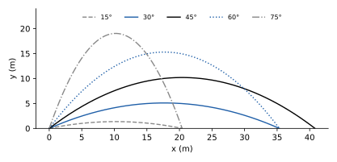
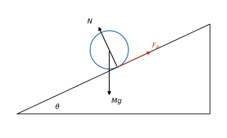

# Fisica Generale 1

**Appunti del corso · a.a. 2026/27 · Mobius**

Appunti personali e non ufficiali, rivisti e confrontati con il programma ufficiale del corso. Non sostituiscono le lezioni né i testi consigliati.

## Indice

1. Strumenti matematici e cinematica del punto
2. Dinamica del punto materiale
3. Lavoro, energia, quantità di moto e sistemi
4. Corpo rigido e momento angolare

## 1 · Strumenti matematici e cinematica del punto

**In questo modulo.** Servono le derivate e gli integrali di Analisi 1A e i vettori del piano e dello spazio (somma, prodotto per uno scalare, componenti). Si richiamano gli strumenti matematici usati in tutto il corso: grandezze scalari e vettoriali, derivata come velocità di variazione, integrale come somma, e le equazioni differenziali più semplici. Poi si descrive il moto di un punto materiale senza chiedersi che cosa lo causi: traiettoria e legge oraria, spostamento e distanza percorsa, velocità e accelerazione medie e istantanee, i moti rettilinei uniforme e uniformemente accelerato, il moto del proiettile, il moto circolare uniforme e la composizione delle velocità fra due sistemi di riferimento. Alla fine si sa scrivere e usare la legge oraria di un moto e ricavarne velocità e accelerazione.

### 1.1 Grandezze fisiche e strumenti matematici

La **meccanica** studia il moto dei corpi. Si divide in **cinematica**, che descrive come un corpo si muove (traiettorie, leggi orarie) senza occuparsi delle cause, e **dinamica**, che studia le forze che producono il moto. Il modello più semplice di corpo è il **punto materiale**: un oggetto di cui si trascurano le dimensioni, descritto da una sola posizione e da una massa.

Le grandezze fisiche si esprimono con un numero e un'unità di misura; nel Sistema Internazionale le unità di base della meccanica sono il metro (m), il kilogrammo (kg) e il secondo (s). Una grandezza è **scalare** se basta un numero (massa, tempo, energia), **vettoriale** se servono anche una direzione e un verso (spostamento, velocità, forza). In un sistema di assi cartesiani un vettore si scrive con le sue componenti, $v = (v_x, v_y, v_z) = v_x\hat\imath + v_y\hat\jmath + v_z\hat k$, dove $\hat\imath, \hat\jmath, \hat k$ sono i **versori** degli assi (vettori di lunghezza 1).

Tre strumenti di Analisi si usano continuamente:

- la **derivata** $\frac{df}{dt}$ misura quanto rapidamente varia $f$ nel tempo; per un vettore si deriva componente per componente;
- l'**integrale** $\int_{t_0}^{t_1} f(t)\, dt$ somma contributi infinitesimi, e permette di risalire a una grandezza conoscendone la velocità di variazione: se $\frac{dF}{dt} = f$, allora $F(t_1) - F(t_0) = \int_{t_0}^{t_1} f(t)\, dt$;
- le **equazioni differenziali**, in cui l'incognita è una funzione del tempo e compaiono le sue derivate. Le leggi del moto sono equazioni di questo tipo.

> [!esempio] Tre equazioni differenziali del corso
>
> - $\frac{dx}{dt} = v_0$ costante ha soluzioni $x(t) = v_0 t + x_0$: una retta, con la costante $x_0$ fissata dal valore iniziale.
> - $\frac{d^2x}{dt^2} = a_0$ costante si integra due volte: $x(t) = \frac12 a_0 t^2 + v_0 t + x_0$, con due costanti, la posizione e la velocità iniziali.
> - $\frac{d^2x}{dt^2} = -\omega^2 x$ (l'equazione dell'**oscillatore armonico**) ha soluzioni $x(t) = A\cos(\omega t + \phi)$: derivando due volte si ottiene $-A\omega^2\cos(\omega t + \phi) = -\omega^2 x$. Anche qui due costanti, l'ampiezza $A$ e la fase $\phi$, fissate dalle condizioni iniziali.

Un'equazione differenziale del secondo ordine ha in generale una famiglia di soluzioni con due costanti: per individuare il moto servono la posizione e la velocità iniziali.

### 1.2 Traiettoria, legge oraria, spostamento

Per descrivere il moto si fissa un **sistema di riferimento**: un'origine, tre assi e un orologio. La posizione del punto all'istante $t$ è il vettore $r(t) = (x(t), y(t), z(t))$.

> [!definizione] Traiettoria e legge oraria
> La **traiettoria** è la curva $\gamma$ formata dalle posizioni occupate dal punto durante il moto. La **legge oraria** è la funzione $t \mapsto r(t)$, cioè le tre funzioni $x(t)$, $y(t)$, $z(t)$, che dicono dove si trova il punto in ogni istante.

La traiettoria dice per dove passa il punto, la legge oraria anche quando. Fra due istanti $t_0$ e $t_1$ si distinguono:

- la **distanza percorsa**, uno scalare: la lunghezza dell'arco di traiettoria percorso;
- lo **spostamento**, un vettore: $\Delta r = r(t_1) - r(t_0) = (x_1 - x_0,\ y_1 - y_0,\ z_1 - z_0)$, che dipende solo dalle posizioni iniziale e finale.

Se il punto va e torna, lo spostamento può essere nullo mentre la distanza percorsa no. Nel moto unidimensionale (lungo l'asse $x$) la legge oraria si rappresenta con un grafico spazio-tempo $x(t)$.

### 1.3 Velocità e accelerazione

> [!definizione] Velocità media e istantanea
> La **velocità scalare media** è la distanza percorsa divisa per il tempo impiegato; la **velocità vettoriale media** è $\langle v\rangle = \frac{\Delta r}{\Delta t}$. La **velocità istantanea** è il limite per $\Delta t \to 0$:
> $$v(t) = \lim_{\Delta t \to 0} \frac{r(t + \Delta t) - r(t)}{\Delta t} = \frac{dr}{dt} = \left(\frac{dx}{dt}, \frac{dy}{dt}, \frac{dz}{dt}\right).$$

La velocità istantanea è tangente alla traiettoria e il suo modulo, la **celerità**, è la velocità con cui si percorre la traiettoria. Nel grafico $x(t)$ è la pendenza della tangente.

> [!definizione] Accelerazione
> L'**accelerazione media** è $\frac{\Delta v}{\Delta t}$, quella **istantanea** è
> $$a(t) = \frac{dv}{dt} = \frac{d^2 r}{dt^2}.$$

Le unità sono m/s per la velocità e m/s² per l'accelerazione. Viceversa, conoscendo l'accelerazione si risale alla velocità e alla posizione integrando: $v(t) = v(t_0) + \int_{t_0}^{t} a(s)\, ds$ e $r(t) = r(t_0) + \int_{t_0}^{t} v(s)\, ds$.

### 1.4 Moti rettilinei notevoli

> [!definizione] Moto rettilineo uniforme
> Il moto avviene lungo una retta con velocità costante $v_0$. Integrando $\frac{dx}{dt} = v_0$:
> $$x(t) = x_0 + v_0 t, \qquad x_0 = x(0).$$

Il grafico spazio-tempo è una retta di pendenza $v_0$, e il tempo per percorrere una distanza $d$ è $\frac{d}{v_0}$.

> [!definizione] Moto rettilineo uniformemente accelerato
> Il moto avviene lungo una retta con accelerazione costante $a_0$. Integrando due volte:
> $$v(t) = v_0 + a_0 t, \qquad x(t) = x_0 + v_0 t + \tfrac12 a_0 t^2.$$

Eliminando il tempo fra le due equazioni si ottiene una relazione utile quando il tempo non interessa:
$$v^2 = v_0^2 + 2a_0(x - x_0).$$
Per esempio, un'auto che viaggia a 30 m/s (108 km/h) e frena con decelerazione costante di 5 m/s² si ferma in $t = \frac{30}{5} = 6$ s, percorrendo $30 \cdot 6 - \frac12 \cdot 5 \cdot 36 = 90$ m; lo stesso risultato viene da $0 = 30^2 - 2 \cdot 5 \cdot d$. Un corpo in **caduta libera** vicino alla superficie terrestre ha accelerazione costante $g \approx 9{,}8$ m/s² verso il basso.

### 1.5 Moto in più dimensioni e moto del proiettile

Nel piano (o nello spazio) posizione, velocità e accelerazione sono vettori, e le loro componenti si trattano separatamente: $v = (v_x, v_y) = \left(\frac{dx}{dt}, \frac{dy}{dt}\right)$ e $a = \left(\frac{dv_x}{dt}, \frac{dv_y}{dt}\right)$. Se l'accelerazione è costante, ogni componente segue un moto rettilineo uniformemente accelerato.

> [!esempio] Moto del proiettile
> Un corpo lanciato vicino al suolo, trascurando l'aria, ha accelerazione $(0, -g)$, con l'asse $y$ verticale verso l'alto. Le leggi orarie sono disaccoppiate:
> $$x(t) = x_0 + v_{0x} t, \qquad y(t) = y_0 + v_{0y} t - \tfrac12 g t^2:$$
> moto uniforme in orizzontale, uniformemente accelerato in verticale. Ricavando $t = \frac{x - x_0}{v_{0x}}$ dalla prima e sostituendo nella seconda si trova la traiettoria
> $$y = y_0 + \frac{v_{0y}}{v_{0x}}(x - x_0) - \frac{g}{2v_{0x}^2}(x - x_0)^2,$$
> una parabola.

Per un lancio dal suolo con velocità $v_0$ e angolo $\theta$ sull'orizzontale ($v_{0x} = v_0\cos\theta$, $v_{0y} = v_0\sin\theta$), il corpo torna a terra quando $y = 0$, cioè dopo il **tempo di volo** $t_v = \frac{2v_0\sin\theta}{g}$; la **gittata** è $x(t_v) = \frac{v_0^2\sin 2\theta}{g}$, massima per $\theta = 45°$, e l'**altezza massima**, dove $v_y = 0$, è $\frac{v_0^2\sin^2\theta}{2g}$. Con $v_0 = 20$ m/s e $\theta = 30°$: tempo di volo $2{,}04$ s, gittata $35{,}3$ m, altezza massima $5{,}10$ m.

### 1.6 Moto circolare uniforme

Un punto percorre una circonferenza di raggio $R$ con celerità costante. Con l'origine nel centro e $\theta(t) = \omega t$, dove $\omega$ è la **velocità angolare** (in rad/s):
$$x(t) = R\cos(\omega t), \qquad y(t) = R\sin(\omega t).$$
Si verifica che $x^2 + y^2 = R^2$. Derivando:
$$v_x = -R\omega\sin(\omega t) = -\omega y, \qquad v_y = R\omega\cos(\omega t) = \omega x,$$
quindi la velocità è perpendicolare al raggio (tangente alla circonferenza) e ha modulo costante $v = \omega R$. Derivando ancora:
$$a_x = -\omega^2 x, \quad a_y = -\omega^2 y, \qquad \text{cioè} \quad a = -\omega^2 r.$$

> [!teorema] Accelerazione centripeta
> Nel moto circolare uniforme l'accelerazione è diretta verso il centro e ha modulo
> $$a_c = \omega^2 R = \frac{v^2}{R}.$$

Anche se la celerità è costante, la velocità cambia direzione, e quindi c'è accelerazione. Il **periodo**, il tempo di un giro, è $T = \frac{2\pi}{\omega}$, e la **frequenza** è $f = \frac1T$. Per esempio un punto a $0{,}5$ m dal centro di un disco che fa 2 giri al secondo ha $\omega = 4\pi \approx 12{,}6$ rad/s, $v = 2\pi \approx 6{,}28$ m/s e $a_c = \omega^2 R \approx 79$ m/s², circa $8g$.

### 1.7 Moti relativi

Lo stesso moto descritto da due osservatori diversi ha leggi orarie diverse. Siano $(O, x, y)$ un sistema considerato fisso e $(O', x', y')$ un sistema che trasla con velocità costante $v_0$ rispetto al primo, con gli assi paralleli e $O' = O$ all'istante 0. Le coordinate di un punto $P$ sono legate dalle **trasformazioni di Galileo**:
$$x_P = x'_P + v_{0x}t, \qquad y_P = y'_P + v_{0y}t.$$
Derivando si ottiene la **composizione delle velocità**
$$v_P = v'_P + v_0:$$
la velocità rispetto al sistema fisso è quella relativa più la velocità di trascinamento.

> [!teorema] Invarianza dell'accelerazione
> Se $v_0$ è costante, derivando $v_P = v'_P + v_0$ si trova $a_P = a'_P$: l'accelerazione è la stessa in due sistemi di riferimento che si muovono di moto rettilineo uniforme l'uno rispetto all'altro.

È il fatto che renderà le leggi della dinamica valide allo stesso modo in tutti i **sistemi inerziali** (modulo 2).

### Esempi ed esercizi svolti

**Esercizio 1 (attraversare un fiume).** Una barca attraversa un fiume largo 60 m puntando perpendicolarmente alla riva con velocità 3 m/s rispetto all'acqua; la corrente scorre a 4 m/s. Rispetto alla riva la velocità è la somma vettoriale $(4, 3)$ m/s, di modulo $\sqrt{16 + 9} = 5$ m/s. Il tempo di attraversamento dipende solo dalla componente perpendicolare alla riva: $\frac{60}{3} = 20$ s. In questo tempo la corrente trascina la barca di $4 \cdot 20 = 80$ m a valle.

**Esercizio 2 (dall'accelerazione alla legge oraria).** Un punto parte da fermo dall'origine con accelerazione $a(t) = 6t$ (in m/s², con $t$ in secondi). Integrando: $v(t) = \int_0^t 6s\, ds = 3t^2$ e $x(t) = \int_0^t 3s^2\, ds = t^3$. Dopo 2 s il punto è a 8 m con velocità 12 m/s. L'accelerazione non è costante, quindi le formule del moto uniformemente accelerato non valgono: si integra.

**Esercizio 3 (velocità e accelerazione nel moto circolare).** Nel moto circolare uniforme $r \cdot v = x v_x + y v_y = -\omega xy + \omega xy = 0$: la velocità è sempre perpendicolare al raggio. Allo stesso modo $v \cdot a = 0$: l'accelerazione è perpendicolare alla velocità, e infatti non cambia il modulo della velocità ma solo la direzione.

### Riepilogo

La cinematica descrive il moto con la legge oraria $r(t)$ in un sistema di riferimento; la traiettoria è la curva percorsa, lo spostamento è la differenza fra le posizioni finale e iniziale, diverso in generale dalla distanza percorsa. Velocità e accelerazione istantanee sono le derivate prima e seconda della posizione, e si risale da esse alla posizione integrando. Nel moto rettilineo uniforme $x = x_0 + v_0 t$; in quello uniformemente accelerato $x = x_0 + v_0 t + \frac12 a_0 t^2$ e $v^2 = v_0^2 + 2a_0\Delta x$. Il moto del proiettile è la composizione di un moto uniforme orizzontale e di uno uniformemente accelerato verticale, con traiettoria parabolica, gittata $\frac{v_0^2\sin 2\theta}{g}$ e altezza massima $\frac{v_0^2\sin^2\theta}{2g}$. Nel moto circolare uniforme la velocità è tangente con modulo $\omega R$ e l'accelerazione è centripeta con modulo $\omega^2 R = \frac{v^2}{R}$. Passando a un sistema che trasla con velocità costante, le velocità si compongono per somma e l'accelerazione non cambia.

## 2 · Dinamica del punto materiale

**In questo modulo.** Si usano la cinematica del modulo 1 (velocità, accelerazione, moto circolare) e le equazioni differenziali più semplici. Si passa dalla descrizione del moto alle sue cause: i tre principi di Newton, la definizione operativa di forza e di massa, la forza peso e la gravitazione, le reazioni vincolari, le tensioni delle funi e le forze di attrito statico e dinamico. Si impara il metodo del diagramma di corpo libero e lo si applica al piano inclinato, ai corpi collegati da funi e carrucole, al moto circolare (forza centripeta, giro della morte) e alle oscillazioni della molla e del pendolo. Alla fine si sa impostare e risolvere le equazioni del moto di uno o più corpi collegati.

### 2.1 I principi della dinamica

La **forza** si definisce operativamente con un **dinamometro**: una molla tarata, il cui allungamento è proporzionale alla forza applicata. La forza è un vettore; più forze applicate allo stesso punto si sommano come vettori, e la loro somma è la **risultante** $F$.

> [!definizione] Primo principio (principio d'inerzia)
> Un corpo su cui non agisce alcuna forza risultante resta in quiete o si muove di moto rettilineo uniforme.

I sistemi di riferimento in cui vale il primo principio si dicono **inerziali**; per il modulo 1 ogni sistema che trasla con velocità costante rispetto a un sistema inerziale è ancora inerziale, perché le accelerazioni sono le stesse.

> [!definizione] Secondo principio
> In un sistema inerziale l'accelerazione di un corpo è proporzionale alla forza risultante che agisce su di esso e inversamente proporzionale alla sua massa:
> $$F = m a.$$

La forza si misura in **newton**, $1\ \mathrm{N} = 1\ \mathrm{kg \cdot m/s^2}$. La **massa** (inerziale) misura la resistenza del corpo a cambiare il suo stato di moto: sottoponendo due corpi alla stessa forza si misurano accelerazioni $a_1 = \frac{F}{m_1}$ e $a_2 = \frac{F}{m_2}$, da cui $m_2 = m_1\frac{a_1}{a_2}$; scelto un campione di 1 kg, si può così misurare qualsiasi massa. Proiettando sugli assi, il secondo principio diventa un sistema di equazioni differenziali:
$$m\frac{d^2x}{dt^2} = F_x, \qquad m\frac{d^2y}{dt^2} = F_y, \qquad m\frac{d^2z}{dt^2} = F_z,$$
che, con la posizione e la velocità iniziali, determinano il moto.

> [!esempio] Accelerare un'automobile
> Per portare un'auto di 1500 kg da ferma a 100 km/h in 20 s con forza costante: $v = \frac{100}{3{,}6} \approx 27{,}8$ m/s, $a = \frac{27{,}8}{20} \approx 1{,}39$ m/s², quindi $F = ma \approx 2{,}08 \cdot 10^3$ N.

> [!definizione] Terzo principio (azione e reazione)
> Se un corpo 1 esercita una forza $F_{1 \to 2}$ su un corpo 2, il corpo 2 esercita sul corpo 1 una forza uguale e opposta: $F_{2 \to 1} = -F_{1 \to 2}$.

Le due forze agiscono su corpi diversi, quindi non si annullano a vicenda: si annullano solo quando si sommano le forze su un sistema che contiene entrambi i corpi (modulo 3).

### 2.2 Forza peso e reazioni vincolari

Due masse puntiformi $m_1$ e $m_2$ a distanza $r$ si attraggono con la forza di **gravitazione universale**
$$F = G\frac{m_1 m_2}{r^2}, \qquad G \approx 6{,}67 \cdot 10^{-11}\ \mathrm{N\,m^2/kg^2},$$
diretta lungo la congiungente. Vicino alla superficie terrestre l'attrazione della Terra su un corpo di massa $m$ è la **forza peso** $F_p = mg$, verticale verso il basso, con $g \approx 9{,}8$ m/s².

Quando un corpo è appoggiato a una superficie o vincolato in altro modo, il vincolo esercita una **reazione vincolare** che impedisce al corpo di attraversarlo. Se il contatto è liscio (senza attrito), la reazione è perpendicolare alla superficie e si chiama **reazione normale** $N$; il suo valore non è dato a priori, ma è quello che serve per rispettare il vincolo.

**Metodo del diagramma di corpo libero.** Per ogni problema di dinamica:

1. si individuano i corpi di cui studiare il moto;
2. per ciascuno si disegnano tutte le forze che agiscono su di esso (peso, reazioni, tensioni, attriti, forze applicate);
3. si scelgono assi comodi (per esempio uno parallelo al moto);
4. si scrive $F = ma$ in componenti, aggiungendo le relazioni imposte dai vincoli (accelerazioni nulle in una direzione, accelerazioni uguali per corpi legati da una fune).

### 2.3 Piano inclinato e tensioni

> [!esempio] Piano inclinato liscio
> Un blocco di massa $m$ è su un piano inclinato liscio di angolo $\theta$. Con l'asse $x$ lungo il piano (verso il basso) e $y$ perpendicolare, il peso ha componenti $mg\sin\theta$ e $-mg\cos\theta$. Il blocco non si stacca dal piano, quindi $a_y = 0$:
> $$ma_x = mg\sin\theta, \qquad N - mg\cos\theta = 0 \quad \Longrightarrow \quad a_x = g\sin\theta, \quad N = mg\cos\theta.$$
> Con $\theta = 30°$, $a = 4{,}9$ m/s². La reazione normale è minore del peso.

Una **fune ideale** è inestensibile e di massa trascurabile: trasmette una forza di trazione diretta lungo la fune, la **tensione** $T$, che ha lo stesso valore in ogni punto. Due corpi collegati da una fune tesa hanno accelerazioni di uguale modulo. Una **carrucola ideale** (senza massa e senza attrito) cambia la direzione della fune senza cambiare la tensione.

> [!esempio] Due scatole trascinate
> Due scatole A e B di masse $m_A$ e $m_B$, su un tavolo liscio, sono collegate da una fune; ad A si applica una forza orizzontale $F$. In verticale le normali bilanciano i pesi; in orizzontale le due scatole hanno la stessa accelerazione $a$:
> $$m_A a = F - T, \qquad m_B a = T.$$
> Sommando si elimina la tensione: $a = \frac{F}{m_A + m_B}$, e poi $T = \frac{m_B F}{m_A + m_B}$. Con $m_A = 2$ kg, $m_B = 3$ kg e $F = 10$ N: $a = 2$ m/s² e $T = 6$ N. La fune tira B con una forza minore di $F$, perché $F$ deve accelerare anche A.

### 2.4 Forze di attrito

Fra superfici ruvide la reazione del vincolo ha anche una componente parallela alla superficie, l'**attrito**.

> [!definizione] Attrito dinamico e statico
>
> - **Attrito dinamico**: se le superfici strisciano l'una sull'altra, la forza di attrito ha verso opposto alla velocità relativa e modulo $F_A = \mu_d N$, dove $\mu_d$ è il **coefficiente di attrito dinamico**.
> - **Attrito statico**: se le superfici sono in quiete relativa, l'attrito è la forza, parallela alla superficie, che serve a mantenerle ferme, fino a un valore massimo: $F_s \le \mu_s N$, con $\mu_s$ **coefficiente di attrito statico**.
>
> In generale $\mu_s > \mu_d$: è più faticoso mettere in moto un corpo che mantenerlo in moto.

La relazione $F_A = \mu_d N$ vale fra i moduli: i due vettori sono perpendicolari. L'attrito statico, come la reazione normale, si adatta alle altre forze; la disuguaglianza dice solo fino a dove può arrivare.

> [!esempio] Piano inclinato scabro
> Un blocco fermo su un piano inclinato di angolo $\theta$ resta fermo finché la componente del peso lungo il piano non supera l'attrito statico massimo:
> $$mg\sin\theta \le \mu_s mg\cos\theta \quad \Longleftrightarrow \quad \tan\theta \le \mu_s.$$
> L'**angolo di attrito** $\arctan\mu_s$ non dipende dalla massa: con $\mu_s = 0{,}5$ è circa $26{,}6°$. Quando il blocco scivola, lungo il piano agiscono $mg\sin\theta$ verso il basso e $\mu_d mg\cos\theta$ verso l'alto, quindi $a = g(\sin\theta - \mu_d\cos\theta)$: con $\theta = 30°$ e $\mu_d = 0{,}2$, $a \approx 3{,}20$ m/s².

### 2.5 Dinamica del moto circolare

Per il modulo 1, un corpo in moto circolare uniforme ha accelerazione centripeta $\frac{v^2}{R}$. Per il secondo principio deve quindi agire una forza risultante diretta verso il centro, la **forza centripeta**:
$$F_c = m\frac{v^2}{R} = m\omega^2 R.$$
Non è un nuovo tipo di forza: è la componente radiale della risultante delle forze presenti (una tensione, il peso, una reazione, l'attrito delle gomme in curva).

> [!esempio] Giro della morte con una fune
> Un corpo di massa $m$ ruota su una circonferenza verticale di raggio $R$ legato a una fune. Nel punto più alto sia il peso sia la tensione puntano verso il centro (in basso):
> $$m\frac{v^2}{R} = mg + T \quad \Longrightarrow \quad T = m\frac{v^2}{R} - mg.$$
> La fune resta tesa se $T \ge 0$, cioè se $v \ge \sqrt{gR}$. Con $R = 1$ m la velocità minima in cima è $\sqrt{9{,}8} \approx 3{,}13$ m/s; con $m = 0{,}5$ kg e $v = 4$ m/s la tensione è $0{,}5 \cdot 16 - 0{,}5 \cdot 9{,}8 = 3{,}1$ N.

### 2.6 Oscillazioni: molla e pendolo

Una molla di costante elastica $k$ (in N/m) esercita sul corpo attaccato all'estremo una forza di richiamo proporzionale all'allungamento rispetto alla lunghezza a riposo (**legge di Hooke**): $F = -kx$, con $x$ la deformazione.

> [!teorema] Oscillatore armonico
> Una massa $m$ attaccata a una molla, su un piano orizzontale liscio, ha equazione del moto $m\ddot x = -kx$, cioè $\ddot x = -\omega^2 x$ con $\omega = \sqrt{\frac{k}{m}}$. Le soluzioni sono
> $$x(t) = A\cos(\omega t + \phi), \qquad T = \frac{2\pi}{\omega} = 2\pi\sqrt{\frac{m}{k}}.$$

L'ampiezza $A$ e la fase $\phi$ dipendono dalle condizioni iniziali, la **pulsazione** $\omega$ e il periodo no. Con $k = 200$ N/m e $m = 0{,}5$ kg si ha $\omega = 20$ rad/s e $T \approx 0{,}314$ s.

> [!teorema] Pendolo semplice
> Una massa $m$ appesa a un filo ideale di lunghezza $L$, spostata di un angolo $\theta$ dalla verticale, ha accelerazione tangenziale $L\ddot\theta = -g\sin\theta$. Per **piccole oscillazioni** ($\sin\theta \approx \theta$) l'equazione diventa quella dell'oscillatore armonico, $\ddot\theta = -\frac{g}{L}\theta$, e
> $$\theta(t) = \theta_0\cos\left(\sqrt{\tfrac{g}{L}}\, t + \phi\right), \qquad T = 2\pi\sqrt{\frac{L}{g}}.$$

Il periodo non dipende né dalla massa né, per piccole oscillazioni, dall'ampiezza (isocronismo): un pendolo lungo 1 m ha periodo di circa 2 s. Lungo il filo, la tensione bilancia la componente radiale del peso e fornisce la forza centripeta.

### Esempi ed esercizi svolti

**Esercizio 1 (piano inclinato e massa appesa).** Un blocco $m_1 = 4$ kg su un piano inclinato di $30°$ con $\mu_d = 0{,}2$ è collegato con una fune, attraverso una carrucola in cima al piano, a una massa $m_2 = 3$ kg che pende in verticale. Se $m_2$ scende, il blocco sale lungo il piano e l'attrito è rivolto verso il basso. Le equazioni, con l'accelerazione comune $a$ positiva nel verso del moto, sono
$$m_2 a = m_2 g - T, \qquad m_1 a = T - m_1 g\sin\theta - \mu_d m_1 g\cos\theta.$$
Sommando: $a = \frac{m_2 g - m_1 g\sin\theta - \mu_d m_1 g\cos\theta}{m_1 + m_2} = \frac{29{,}4 - 19{,}6 - 6{,}79}{7} \approx 0{,}43$ m/s², positiva, quindi il moto avviene davvero nel verso supposto. La tensione è $T = m_2(g - a) \approx 28{,}1$ N.

**Esercizio 2 (peso apparente in ascensore).** Una persona di 70 kg è su una bilancia in un ascensore che accelera verso l'alto con $a = 2$ m/s². Sulla persona agiscono il peso e la reazione $N$ della bilancia: $N - mg = ma$, quindi $N = m(g + a) = 70 \cdot 11{,}8 = 826$ N. La bilancia, che misura $N$, segna circa 84 kg. In discesa accelerata segnerebbe meno, e in caduta libera zero.

**Esercizio 3 (curva piana).** Un'auto percorre una curva piana di raggio 50 m. La forza centripeta è l'attrito statico fra gomme e asfalto, al più $\mu_s mg$. Deve essere $m\frac{v^2}{R} \le \mu_s mg$, cioè $v \le \sqrt{\mu_s g R}$: con $\mu_s = 0{,}8$, $v \le \sqrt{0{,}8 \cdot 9{,}8 \cdot 50} \approx 19{,}8$ m/s (circa 71 km/h), indipendentemente dalla massa.

### Riepilogo

I principi di Newton dicono che senza forza risultante un corpo mantiene il suo stato di moto, che la forza risultante produce un'accelerazione $a = F/m$, e che le forze fra due corpi sono uguali e opposte. La massa misura l'inerzia, la forza si misura in newton e si definisce con il dinamometro. Vicino alla Terra il peso è $mg$; i vincoli esercitano reazioni normali e, se ruvidi, attriti: dinamico, $\mu_d N$ opposto al moto, e statico, fino a $\mu_s N$, che si adatta per impedire lo scivolamento (un corpo su un piano inclinato resta fermo se $\tan\theta \le \mu_s$). Le funi ideali trasmettono la stessa tensione e impongono la stessa accelerazione ai corpi collegati. Ogni problema si imposta con il diagramma di corpo libero e $F = ma$ in componenti. Un moto circolare richiede una forza centripeta $mv^2/R$ fornita dalle forze presenti. La forza elastica $-kx$ produce oscillazioni armoniche con periodo $2\pi\sqrt{m/k}$, e il pendolo semplice, per piccole oscillazioni, oscilla con periodo $2\pi\sqrt{L/g}$.

## 3 · Lavoro, energia, quantità di moto e sistemi

**In questo modulo.** Servono la dinamica del modulo 2, il prodotto scalare fra vettori e gli integrali; per le forze conservative anche il gradiente (Analisi 1B). Si introducono due modi di risolvere i problemi di dinamica senza integrare le equazioni del moto. Il primo è l'energia: lavoro di una forza, energia cinetica e teorema dell'energia cinetica, forze conservative ed energia potenziale, conservazione dell'energia meccanica, punti di equilibrio, forze dissipative e potenza. Il secondo è la quantità di moto: impulso, conservazione nei sistemi isolati, urti. Infine si passa dal punto ai sistemi di punti: forze interne ed esterne, prima equazione cardinale, centro di massa e teorema di König. Alla fine si sanno usare i teoremi di conservazione per risolvere problemi di cadute, molle, urti e sistemi.

### 3.1 Lavoro ed energia cinetica

> [!definizione] Lavoro
> Il **lavoro** di una forza $F$ su un punto che si sposta lungo una curva $\gamma$ è l'integrale di linea
> $$L_\gamma(F) = \int_\gamma F \cdot dl,$$
> dove $dl$ è lo spostamento infinitesimo. Per una forza costante e uno spostamento rettilineo $\Delta r$, $L = F \cdot \Delta r = F\,\lvert\Delta r\rvert\cos\theta$.

Il lavoro si misura in **joule**, $1\ \mathrm{J} = 1\ \mathrm{N \cdot m}$. Conta solo la componente della forza lungo lo spostamento: una forza perpendicolare al moto (la reazione normale di un piano, la forza centripeta) non compie lavoro.

> [!teorema] Teorema dell'energia cinetica
> Il lavoro della risultante delle forze che agiscono su un punto materiale è uguale alla variazione della sua **energia cinetica** $T = \frac12 mv^2$:
> $$L_\gamma(F) = T_f - T_i.$$

*Dimostrazione.* Con $F = m\frac{dv}{dt}$ e $dl = v\, dt$:
$$L = \int m\frac{dv}{dt} \cdot v\, dt = m\int_{v_i}^{v_f} v \cdot dv = m\int \tfrac12 d(v^2) = \tfrac12 mv_f^2 - \tfrac12 mv_i^2. \ \square$$

**Lavoro della forza peso.** Per $F = -mg\hat k$ e uno spostamento da quota $z_i$ a quota $z_f$, $F \cdot dl = -mg\, dz$, quindi $L = -mg(z_f - z_i)$: dipende solo dal dislivello, non dal percorso.

**Lavoro della forza elastica.** Per una molla di lunghezza a riposo $l_0$, $F = -k(x - l_0)$; da $x = l_0$ a $x = x_1$:
$$L_{el} = \int_{l_0}^{x_1} -k(x - l_0)\, dx = -\tfrac12 k(x_1 - l_0)^2.$$
Comprimere o allungare una molla di 10 cm con $k = 200$ N/m richiede un lavoro esterno di $\frac12 \cdot 200 \cdot 0{,}01 = 1$ J.

### 3.2 Forze conservative ed energia potenziale

> [!definizione] Forza conservativa
> Una forza (posizionale) è **conservativa** se il lavoro per andare da $A$ a $B$ non dipende dal percorso ma solo da $A$ e $B$. Equivalentemente, il lavoro lungo ogni percorso chiuso è nullo: $\oint F \cdot dl = 0$.

Le due definizioni sono equivalenti: un cammino chiuso si spezza in un ramo $\gamma_1$ da $A$ a $B$ e un ramo $\gamma_2$ da $B$ ad $A$, e il lavoro totale è nullo se e solo se $L_{\gamma_1} = -L_{\gamma_2} = L_{-\gamma_2}$, cioè se due percorsi qualsiasi da $A$ a $B$ danno lo stesso lavoro. Il peso e la forza elastica sono conservative; l'attrito no, perché lavora sempre contro il moto.

> [!definizione] Energia potenziale
> Per una forza conservativa, fissato un punto di riferimento $A$, l'**energia potenziale** in $B$ è l'opposto del lavoro della forza da $A$ a $B$:
> $$U(B) - U(A) = -L_{A \to B} = -\int_A^B F \cdot dl.$$

Hanno significato solo le differenze di energia potenziale; la scelta del riferimento aggiunge una costante. Per il peso $U = mgz$, per la molla $U = \frac12 k\,\Delta x^2$.

> [!teorema] Conservazione dell'energia meccanica
> Se su un punto agiscono solo forze conservative, l'**energia meccanica** $E = T + U$ si conserva.

*Dimostrazione.* Per il teorema dell'energia cinetica $L_{A \to B} = T_B - T_A$, e per la definizione di $U$ $L_{A \to B} = U_A - U_B$. Uguagliando, $T_A + U_A = T_B + U_B$. $\square$

Per esempio un corpo che cade da fermo da un'altezza $h = 5$ m arriva a terra con $\frac12 mv^2 = mgh$, cioè $v = \sqrt{2gh} \approx 9{,}9$ m/s, qualunque sia la forma del percorso se non c'è attrito.

**Forza ed energia potenziale.** In una dimensione $F = -\frac{dU}{dx}$; in tre dimensioni la forza è il gradiente cambiato di segno:
$$F = -\nabla U = -\left(\frac{\partial U}{\partial x}, \frac{\partial U}{\partial y}, \frac{\partial U}{\partial z}\right).$$
Nei punti in cui $\frac{dU}{dx} = 0$ la forza è nulla: sono le **posizioni di equilibrio**. Sviluppando con Taylor attorno a un equilibrio $x_0$,
$$U(x) \approx U(x_0) + \tfrac12 k(x - x_0)^2, \qquad k = U''(x_0):$$
se $k > 0$ (minimo di $U$) l'equilibrio è **stabile**, perché un piccolo spostamento produce una forza $-k(x - x_0)$ che riporta verso $x_0$, e il corpo oscilla come un oscillatore armonico; se $k < 0$ (massimo) è **instabile**. Per $U(x) = x^3 - 3x$ gli equilibri sono $x = \pm 1$; $U''(x) = 6x$, quindi $x = 1$ è stabile e $x = -1$ instabile.

### 3.3 Forze non conservative e potenza

In presenza di attriti o resistenze l'energia meccanica non si conserva: la sua variazione è il lavoro delle forze non conservative,
$$\Delta E = (T_f + U_f) - (T_i + U_i) = L_{nc},$$
che per l'attrito è negativo (l'energia si trasforma in calore).

> [!definizione] Potenza
> La **potenza** è il lavoro fatto nell'unità di tempo. Quella media è $\bar P = \frac{L}{\Delta t}$, quella istantanea
> $$P = \frac{dL}{dt} = F \cdot v.$$
> Si misura in **watt**, $1\ \mathrm{W} = 1\ \mathrm{J/s}$.

Un'auto che va a velocità costante di 20 m/s contro una resistenza totale di 500 N deve sviluppare $P = 500 \cdot 20 = 10$ kW.

### 3.4 Quantità di moto e urti

> [!definizione] Quantità di moto e impulso
> La **quantità di moto** di un punto è $p = mv$. Il secondo principio si scrive $F = \frac{dp}{dt}$, e integrando nel tempo si ottiene il **teorema dell'impulso**:
> $$I = \int_{t_1}^{t_2} F\, dt = p(t_2) - p(t_1).$$

La forma $F = \frac{dp}{dt}$ è la più generale del secondo principio. In un urto agiscono per tempi brevissimi forze molto intense, di cui interessa solo l'effetto complessivo, l'impulso.

> [!teorema] Conservazione della quantità di moto
> In un sistema **isolato** (la risultante delle forze esterne è nulla) la quantità di moto totale $P = \sum p_i$ si conserva.

È una conseguenza del terzo principio (paragrafo 3.5). Per esempio, un fucile di massa $M = 4$ kg, inizialmente fermo, spara un proiettile di 10 g a 400 m/s: $0 = mv_p + Mv_R$, quindi rincula con $v_R = -\frac{m}{M}v_p = -1$ m/s.

Durante un **urto** le forze interne sono così intense che le forze esterne sono trascurabili: la quantità di moto totale si conserva. Gli urti si classificano in base all'energia cinetica:

- **completamente anelastico**: i corpi restano attaccati e proseguono con la stessa velocità $v_f = \frac{m_1 v_1 + m_2 v_2}{m_1 + m_2}$; l'energia cinetica persa è la massima compatibile con la conservazione della quantità di moto;
- **elastico**: si conserva anche l'energia cinetica totale;
- **anelastico**: si conserva la quantità di moto, e si perde una parte dell'energia cinetica.

> [!esempio] Due urti in una dimensione
> Un carrello di 2 kg a 3 m/s urta un carrello di 1 kg fermo. Se restano agganciati, $v_f = \frac{2 \cdot 3}{3} = 2$ m/s, e l'energia cinetica passa da 9 J a $\frac12 \cdot 3 \cdot 4 = 6$ J: si perdono 3 J. Se l'urto è elastico, risolvendo le due conservazioni si ottiene
> $$v_1' = \frac{m_1 - m_2}{m_1 + m_2}v_1 = 1\ \mathrm{m/s}, \qquad v_2' = \frac{2m_1}{m_1 + m_2}v_1 = 4\ \mathrm{m/s},$$
> e si controlla che $\frac12 \cdot 2 \cdot 1 + \frac12 \cdot 1 \cdot 16 = 9$ J.

### 3.5 Sistemi di punti e centro di massa

Si consideri un sistema di $N$ punti materiali. Sul punto $i$ agiscono **forze interne**, esercitate dagli altri punti del sistema, e **forze esterne**. Scrivendo $\frac{dp_i}{dt} = F_i^{(int)} + F_i^{(est)}$ e sommando su tutti i punti, le forze interne si annullano a coppie per il terzo principio.

> [!teorema] Prima equazione cardinale
> La quantità di moto totale $P = \sum_i m_i v_i$ di un sistema varia solo per effetto delle forze esterne:
> $$\frac{dP}{dt} = F^{(est)}.$$

> [!definizione] Centro di massa
> Il **centro di massa** di un sistema di punti è il punto di posizione
> $$r_{CM} = \frac{1}{M}\sum_i m_i r_i, \qquad M = \sum_i m_i.$$
> Per un corpo continuo la somma diventa un integrale: $r_{CM} = \frac{1}{M}\int r\, dm$.

Derivando, $P = Mv_{CM}$, e la prima equazione cardinale diventa
$$Ma_{CM} = F^{(est)}:$$
il centro di massa si muove come un punto materiale con tutta la massa del sistema, soggetto alla risultante delle forze esterne. Se il sistema è isolato, il centro di massa si muove di moto rettilineo uniforme.

> [!esempio] Centro di massa di un'asta non omogenea
> Un'asta sottile fra $x = 0$ e $x = l$ ha densità lineare $\lambda(x) = \lambda_0(1 + \alpha x)$, con $[\lambda_0] = \mathrm{kg/m}$ e $[\alpha] = \mathrm{m^{-1}}$. Con $dm = \lambda(x)\, dx$:
> $$M = \int_0^l \lambda_0(1 + \alpha x)\, dx = \lambda_0\left(l + \frac{\alpha l^2}{2}\right), \qquad \int_0^l x\, dm = \lambda_0\left(\frac{l^2}{2} + \frac{\alpha l^3}{3}\right),$$
> $$x_{CM} = \frac{l}{2}\cdot\frac{1 + \frac23\alpha l}{1 + \frac12\alpha l}.$$
> Per $\alpha = 0$ (asta omogenea) è il punto medio $\frac l2$; per $\alpha > 0$ la massa è spostata verso $x = l$ e il centro di massa anche.

> [!teorema] Teorema di König
> L'energia cinetica di un sistema è la somma dell'energia cinetica del centro di massa, con tutta la massa, e dell'energia cinetica dei moti relativi al centro di massa:
> $$T = \tfrac12 Mv_{CM}^2 + \sum_i \tfrac12 m_i \lvert v_i^{rel}\rvert^2, \qquad v_i^{rel} = v_i - v_{CM}.$$

*Dimostrazione.* Con $v_i = v_{CM} + v_i^{rel}$,
$$T = \sum_i \tfrac12 m_i (v_{CM} + v_i^{rel}) \cdot (v_{CM} + v_i^{rel}) = \tfrac12 Mv_{CM}^2 + v_{CM} \cdot \sum_i m_i v_i^{rel} + \sum_i \tfrac12 m_i\lvert v_i^{rel}\rvert^2,$$
e il termine misto è nullo perché $\sum_i m_i v_i^{rel} = \sum_i m_i v_i - Mv_{CM} = 0$: nel sistema del centro di massa la quantità di moto totale è nulla. $\square$

### Esempi ed esercizi svolti

**Esercizio 1 (una molla che lancia un blocco).** Una molla con $k = 200$ N/m, compressa di 10 cm, lancia un blocco di $0{,}5$ kg su un piano liscio. L'energia elastica $\frac12 k\Delta x^2 = 1$ J diventa tutta cinetica: $\frac12 \cdot 0{,}5 \cdot v^2 = 1$, quindi $v = 2$ m/s. Se dopo la molla c'è un tratto con attrito $\mu_d = 0{,}2$, il blocco si ferma quando il lavoro dell'attrito $\mu_d mg\,d$ ha consumato quel joule: $d = \frac{1}{0{,}2 \cdot 0{,}5 \cdot 9{,}8} \approx 1{,}02$ m.

**Esercizio 2 (pendolo balistico).** Un proiettile di 10 g a 300 m/s si conficca in un blocco di 2 kg appeso a un filo. Nell'urto, completamente anelastico, si conserva la quantità di moto: $V = \frac{0{,}01 \cdot 300}{2{,}01} \approx 1{,}49$ m/s. Dopo l'urto si conserva l'energia meccanica, e il blocco sale fino a $h = \frac{V^2}{2g} \approx 11{,}4$ cm. Misurando $h$ si risale alla velocità del proiettile; non si può usare l'energia nell'urto, dove quasi tutta l'energia cinetica del proiettile si dissipa.

**Esercizio 3 (esplosione).** Un oggetto fermo esplode in due frammenti di masse $m$ e $2m$. La quantità di moto totale resta nulla, quindi i frammenti partono in versi opposti e il più leggero ha velocità doppia. Il centro di massa resta fermo (o, se l'oggetto era in volo, prosegue sulla sua parabola).

### Riepilogo

Il lavoro di una forza è l'integrale $\int F \cdot dl$, e il lavoro della risultante è uguale alla variazione dell'energia cinetica $\frac12 mv^2$. Una forza è conservativa se il suo lavoro dipende solo dagli estremi; allora si definisce un'energia potenziale ($mgz$ per il peso, $\frac12 k\Delta x^2$ per la molla) con $F = -\nabla U$, e l'energia meccanica $T + U$ si conserva. Gli equilibri sono i punti stazionari di $U$, stabili nei minimi. Le forze non conservative cambiano l'energia meccanica del loro lavoro; la potenza è $F \cdot v$. La quantità di moto $mv$ varia dell'impulso delle forze e si conserva nei sistemi isolati; negli urti si conserva sempre, mentre l'energia cinetica si conserva solo negli urti elastici e si perde al massimo in quelli completamente anelastici. Per un sistema di punti le forze interne si annullano: la quantità di moto totale varia per le sole forze esterne e il centro di massa si muove come un punto con tutta la massa. Per il teorema di König l'energia cinetica è quella del centro di massa più quella del moto relativo.

## 4 · Corpo rigido e momento angolare

**In questo modulo.** Servono il moto circolare del modulo 1, la dinamica del modulo 2, l'energia e i sistemi di punti del modulo 3, il prodotto vettoriale e gli integrali multipli. Si studia il corpo rigido: gradi di libertà, cinematica delle rotazioni attorno a un asse fisso, energia cinetica di rotazione e momento d'inerzia, con il teorema di Huygens-Steiner e il calcolo dei momenti d'inerzia di asta, anello, disco e sfera. Poi la dinamica: momento di una forza, seconda equazione cardinale, puro rotolamento, macchina di Atwood con carrucola massiva. Infine il momento angolare rispetto a un polo e la sua conservazione, le forze centrali con la legge delle aree, e le condizioni di equilibrio di un corpo rigido. Alla fine si sanno risolvere problemi di rotazione e rotolamento, con le equazioni cardinali e con l'energia.

### 4.1 Corpo rigido e rotazioni

> [!definizione] Corpo rigido
> Un **corpo rigido** è un sistema di punti materiali in cui le distanze fra due punti qualsiasi restano costanti nel tempo.

Un punto materiale libero ha 3 **gradi di libertà** (le tre coordinate). Un corpo rigido ne ha 6: la sua posizione è fissata da tre punti non allineati (9 coordinate) legati da 3 vincoli sulle distanze reciproche, $9 - 3 = 6$; si possono pensare come 3 coordinate del centro di massa e 3 angoli di orientamento.

Nella **rotazione attorno a un asse fisso** ogni punto del corpo descrive una circonferenza con centro sull'asse. Il moto è descritto da un solo angolo $\theta(t)$, con **velocità angolare** $\omega = \frac{d\theta}{dt}$ e **accelerazione angolare** $\alpha = \frac{d\omega}{dt} = \frac{d^2\theta}{dt^2}$, uguali per tutti i punti. Un punto a distanza $R$ dall'asse percorre l'arco $l = R\theta$ e ha velocità e accelerazione tangenziali
$$v = R\omega, \qquad a_t = R\alpha,$$
più l'accelerazione centripeta $\omega^2 R$. Come vettore, $\omega$ è diretto lungo l'asse, con verso dato dalla regola della mano destra (la rotazione appare antioraria guardando dalla punta del vettore).

### 4.2 Momento d'inerzia

Sommando l'energia cinetica dei punti di un corpo che ruota attorno a un asse fisso, con $v_i = R_i\omega$:
$$T = \sum_i \tfrac12 m_i v_i^2 = \tfrac12\Big(\sum_i m_i R_i^2\Big)\omega^2 = \tfrac12 I\omega^2.$$

> [!definizione] Momento d'inerzia
> Il **momento d'inerzia** rispetto a un asse è
> $$I = \sum_i m_i R_i^2 \qquad \text{oppure} \qquad I = \int R^2\, dm = \int \rho\, R^2\, dV,$$
> dove $R_i$ (o $R$) è la distanza dall'asse. Si misura in kg·m².

Il momento d'inerzia è per le rotazioni ciò che la massa è per le traslazioni, ma dipende dall'asse: la massa lontana dall'asse conta di più.

> [!teorema] Teorema di Huygens-Steiner (assi paralleli)
> Se $I_{CM}$ è il momento d'inerzia rispetto a un asse per il centro di massa, rispetto a un asse parallelo a distanza $d$ il momento d'inerzia è
> $$I = I_{CM} + Md^2.$$

> [!esempio] Momenti d'inerzia notevoli
>
> - **Due masse $m$ agli estremi di un'asta leggera** di lunghezza $l$, asse per il centro: $I_{CM} = 2m\left(\frac l2\right)^2 = \frac12 ml^2$. Rispetto a un estremo, per Steiner $\frac12 ml^2 + 2m\left(\frac l2\right)^2 = ml^2$, come dal calcolo diretto $m \cdot 0 + m l^2$.
> - **Asta omogenea** di massa $M$ e lunghezza $l$, con $dm = \frac Ml dx$: rispetto al centro $I_{CM} = \int_{-l/2}^{l/2}\frac Ml x^2\, dx = \frac{1}{12}Ml^2$; rispetto a un estremo $\frac13 Ml^2$.
> - **Anello sottile** di raggio $R$, asse centrale: tutta la massa è a distanza $R$, quindi $I = MR^2$.
> - **Disco omogeneo** di raggio $R$: si somma su anelli di raggio $r$ e massa $dm = \frac{M}{\pi R^2}2\pi r\, dr$, e $I = \int_0^R r^2\, dm = \frac{2M}{R^2}\cdot\frac{R^4}{4} = \frac12 MR^2$.
> - **Sfera omogenea** di raggio $R$: in coordinate sferiche la distanza dall'asse $z$ è $r\sin\theta$ e $dV = r^2\sin\theta\, dr\, d\theta\, d\varphi$; integrando con $\rho = \frac{M}{\frac43\pi R^3}$ si trova $I = \frac25 MR^2$.

### 4.3 Momento di una forza e seconda equazione cardinale

L'effetto di rotazione di una forza dipende da dove è applicata. Il **momento** (momento torcente) di una forza $F$ applicata a distanza $R$ dall'asse ha modulo
$$\tau = RF\sin\varphi,$$
dove $\varphi$ è l'angolo fra il raggio e la forza: conta solo la componente perpendicolare al raggio, e $R\sin\varphi$ si chiama **braccio**. Le forze che passano per l'asse hanno momento nullo.

> [!teorema] Seconda equazione cardinale per un asse fisso
> Per un corpo rigido che ruota attorno a un asse fisso, il momento risultante delle forze esterne rispetto all'asse è
> $$\tau = I\alpha = I\frac{d^2\theta}{dt^2}.$$

È l'analogo di $F = ma$: il momento al posto della forza, il momento d'inerzia al posto della massa, l'accelerazione angolare al posto di quella lineare.

> [!esempio] Carrucola con attrito al perno
> Una forza costante $F = 15$ N è applicata tangenzialmente al bordo di una carrucola di raggio $R_0 = 33$ cm, che parte da ferma e raggiunge $\omega = 30$ rad/s in 3 s; il perno esercita un momento d'attrito costante $\tau_A = 1{,}1$ N·m. L'accelerazione angolare è $\alpha = 10$ rad/s², e
> $$R_0 F - \tau_A = I\alpha \quad \Longrightarrow \quad I = \frac{0{,}33 \cdot 15 - 1{,}1}{10} = 0{,}385\ \mathrm{kg\,m^2}.$$

### 4.4 Energia nelle rotazioni e puro rotolamento

Anche per le rotazioni vale la conservazione dell'energia, con l'energia cinetica $\frac12 I\omega^2$ e, per il peso, l'energia potenziale $Mgz_{CM}$ calcolata nel centro di massa.

> [!esempio] Un palo che cade
> Un palo omogeneo di massa $M$ e lunghezza $l = 2{,}3$ m, incernierato alla base, cade dalla posizione verticale. All'inizio $E = Mg\frac l2$; quando tocca terra $E = \frac12 I_A\omega^2$ con $I_A = \frac13 Ml^2$. Uguagliando, $\omega = \sqrt{\frac{3g}{l}}$, e l'estremo libero arriva a $v = l\omega = \sqrt{3gl} \approx 8{,}2$ m/s, più di quanto avrebbe un sasso lasciato cadere dalla stessa altezza ($\sqrt{2gl} \approx 6{,}7$ m/s).

Un corpo a simmetria circolare (cilindro, sfera, anello) di raggio $R$ **rotola senza strisciare** se il punto di contatto ha velocità nulla. La condizione di puro rotolamento è
$$v_{CM} = \omega R, \qquad a_{CM} = \alpha R,$$
e per il teorema di König l'energia cinetica è $T = \frac12 Mv_{CM}^2 + \frac12 I_{CM}\omega^2 = \frac12\left(M + \frac{I_{CM}}{R^2}\right)v_{CM}^2$.

> [!esempio] Rotolamento lungo un piano inclinato
> Un corpo di massa $M$, raggio $R$ e momento d'inerzia $I_{CM}$ scende rotolando su un piano inclinato di angolo $\theta$. Peso e normale passano per il centro di massa e non danno momento: a far ruotare il corpo è l'attrito statico $F_A$, rivolto verso l'alto lungo il piano, nel punto di contatto. Le equazioni cardinali, con il vincolo $a_{CM} = \alpha R$, sono
> $$Mg\sin\theta - F_A = Ma_{CM}, \qquad F_A R = I_{CM}\alpha.$$
> Risolvendo,
> $$a_{CM} = \frac{g\sin\theta}{1 + \frac{I_{CM}}{MR^2}}, \qquad F_A = \frac{I_{CM}}{MR^2 + I_{CM}}Mg\sin\theta.$$
> Il corpo scende tanto più lentamente quanto più massa ha lontano dal centro: $a_{CM}$ vale $\frac12 g\sin\theta$ per un anello, $\frac23 g\sin\theta$ per un disco, $\frac57 g\sin\theta$ per una sfera. Perché non strisci deve essere $F_A \le \mu_s Mg\cos\theta$, cioè $\mu_s \ge \frac{I_{CM}}{MR^2 + I_{CM}}\tan\theta$: per un disco su un piano di $30°$, $\mu_s \ge \frac13\tan 30° \approx 0{,}19$.

### 4.5 Macchina di Atwood con carrucola massiva

Due masse $m_1 > m_2$ sono appese ai capi di una fune che passa senza strisciare su una carrucola di raggio $R$ e momento d'inerzia $I$. Se la carrucola ha massa, le tensioni nei due rami sono diverse: la loro differenza dà il momento che la fa ruotare. Con $a$ l'accelerazione ($m_1$ scende) e $\alpha = \frac aR$:
$$m_1 g - T_1 = m_1 a, \qquad T_2 - m_2 g = m_2 a, \qquad (T_1 - T_2)R = I\frac aR.$$
Sommando tutto si eliminano le tensioni:
$$a = \frac{(m_1 - m_2)g}{m_1 + m_2 + \frac{I}{R^2}}.$$
La carrucola si comporta come una massa aggiuntiva $\frac{I}{R^2}$. Con $m_1 = 3$ kg, $m_2 = 2$ kg e una carrucola a disco di 2 kg ($\frac{I}{R^2} = 1$ kg): $a = \frac{9{,}8}{6} \approx 1{,}63$ m/s².

### 4.6 Momento angolare

> [!definizione] Momento della forza e momento angolare rispetto a un polo
> Per un punto materiale in posizione $r$, con quantità di moto $p = mv$ e soggetto alla forza $F$, e un punto $\Omega$ (il **polo**) di posizione $r_\Omega$:
> $$\tau_\Omega = (r - r_\Omega) \times F, \qquad L_\Omega = (r - r_\Omega) \times p.$$
> Per un sistema si sommano i contributi dei singoli punti.

> [!teorema] Teorema del momento angolare
> $$\frac{dL_\Omega}{dt} = \tau_\Omega - v_\Omega \times p.$$
> Se il polo è fisso ($v_\Omega = 0$) o coincide con il centro di massa, il termine correttivo è nullo e $\frac{dL}{dt} = \tau$ (**seconda equazione cardinale**). Per un sistema conta solo il momento delle forze esterne.

*Dimostrazione.* Con la regola di derivazione del prodotto vettoriale,
$$\frac{dL_\Omega}{dt} = \left(\frac{dr}{dt} - \frac{dr_\Omega}{dt}\right) \times p + (r - r_\Omega) \times \frac{dp}{dt} = (v - v_\Omega) \times mv + (r - r_\Omega) \times F.$$
Poiché $v \times v = 0$, resta $-v_\Omega \times p + \tau_\Omega$. Se $\Omega$ è il centro di massa di un sistema, $v_\Omega = v_{CM}$ è parallela a $P = Mv_{CM}$ e il prodotto vettoriale è ancora nullo. $\square$

Per un corpo rigido che ruota attorno a un asse fisso di simmetria, $L = I\omega$, e la seconda equazione cardinale diventa $\frac{d}{dt}(I\omega) = \tau$, cioè $I\alpha = \tau$ se $I$ è costante.

> [!teorema] Conservazione del momento angolare
> Se il momento risultante delle forze esterne rispetto a un polo fisso (o al centro di massa) è nullo, il momento angolare rispetto a quel polo si conserva.

Una pattinatrice che ruota con le braccia aperte ($I_1 = 4$ kg·m², $\omega_1 = 2$ rad/s) e le chiude ($I_2 = 1{,}6$ kg·m²) passa a $\omega_2 = \frac{I_1\omega_1}{I_2} = 5$ rad/s. L'energia cinetica di rotazione $\frac12 I\omega^2$ invece aumenta, da 8 J a 20 J: la differenza è il lavoro dei muscoli che tirano le braccia verso l'asse.

### 4.7 Forze centrali

Un campo di forze è **centrale** se la forza è sempre diretta lungo la retta che congiunge il punto con un centro fisso $O$, con un'intensità che dipende solo dalla distanza: $F(r) = F(r)\,\hat u_r$, $r = \lvert r\rvert$. Esempi sono la gravitazione e la forza elettrostatica.

- **Sono conservative**: in coordinate polari $dl = dr\,\hat u_r + r\,d\theta\,\hat u_\theta$, quindi $F \cdot dl = F(r)\, dr$ e il lavoro $\int_{r_i}^{r_f}F(r)\, dr$ dipende solo dalle distanze iniziale e finale.
- **Conservano il momento angolare** rispetto a $O$: $\tau = r \times F(r)\hat u_r = 0$, perché i due vettori sono paralleli.

Dalla conservazione di $L = r \times mv$ seguono due fatti. Il moto è **piano**: $r$ e $v$ restano perpendicolari al vettore costante $L$. E, scrivendo $v = \dot r\,\hat u_r + r\dot\theta\,\hat u_\theta$, si ha $L = mr^2\dot\theta$, quindi
$$r^2\frac{d\theta}{dt} = \text{costante}.$$
La quantità $\frac12 r^2\dot\theta$ è la **velocità areolare**, l'area spazzata dal raggio vettore nell'unità di tempo: è costante per ogni forza centrale. Per la gravitazione è la seconda legge di Keplero (il raggio vettore di un pianeta spazza aree uguali in tempi uguali).

### 4.8 Equilibrio del corpo rigido

Un corpo rigido è in equilibrio (fermo) se sono nulle la risultante delle forze esterne e il loro momento risultante rispetto a un polo qualsiasi:
$$\sum F^{(est)} = 0, \qquad \sum \tau^{(est)} = 0.$$
Sono le due equazioni cardinali con le derivate nulle. Se la risultante è nulla, il momento risultante non dipende dal polo, e conviene scegliere il polo dove agiscono forze incognite, per eliminarle dall'equazione dei momenti.

> [!esempio] Trave appoggiata con un carico
> Una trave omogenea di 4 m e 20 kg è appoggiata ai due estremi; un carico di 30 kg è a 1 m dall'estremo sinistro. Con i momenti rispetto all'appoggio sinistro, la reazione destra $R_2$ deve bilanciare il peso della trave (applicato a 2 m) e il carico: $4R_2 = 20g \cdot 2 + 30g \cdot 1$, da cui $R_2 = 17{,}5g \approx 171{,}5$ N. La risultante nulla dà $R_1 = 50g - R_2 = 32{,}5g \approx 318{,}5$ N: l'appoggio più vicino al carico sostiene di più.

### Esempi ed esercizi svolti

**Esercizio 1 (un disco che parte da fermo).** Un disco di massa 2 kg e raggio 10 cm, libero di ruotare attorno al suo asse, è messo in rotazione da una fune avvolta sul bordo, tirata con forza costante di 4 N. Con $I = \frac12 MR^2 = 0{,}01$ kg·m², $\alpha = \frac{FR}{I} = \frac{0{,}4}{0{,}01} = 40$ rad/s². Dopo 2 s, $\omega = 80$ rad/s; l'energia cinetica $\frac12 I\omega^2 = 32$ J è uguale al lavoro della forza, $F$ per la fune svolta: $4 \cdot R\theta = 4 \cdot 0{,}1 \cdot \frac12 \cdot 40 \cdot 4 = 32$ J.

**Esercizio 2 (sfera e cilindro in gara).** Una sfera e un cilindro pieno, con qualsiasi massa e raggio, partono da fermi dalla stessa altezza $h$ su un piano inclinato, rotolando senza strisciare. Per la conservazione dell'energia $Mgh = \frac12\left(M + \frac{I}{R^2}\right)v^2$, quindi $v = \sqrt{\frac{2gh}{1 + I/(MR^2)}}$: $\sqrt{\frac{10}{7}gh}$ per la sfera, $\sqrt{\frac43 gh}$ per il cilindro. Arriva prima la sfera, e il risultato non dipende né dalla massa né dal raggio.

**Esercizio 3 (momento angolare di un punto in moto rettilineo).** Un punto che si muove di moto rettilineo uniforme ha, rispetto a un polo $O$ fuori dalla retta, momento angolare $L = mvd$, dove $d$ è la distanza di $O$ dalla retta: è costante, come deve essere perché la forza è nulla. È anche un caso (banale) della legge delle aree: il raggio vettore spazza triangoli di uguale area in tempi uguali.

### Riepilogo

Un corpo rigido ha 6 gradi di libertà; nella rotazione attorno a un asse fisso tutti i punti hanno la stessa $\omega$ e $\alpha$, con $v = R\omega$ e $a_t = R\alpha$. L'energia cinetica di rotazione è $\frac12 I\omega^2$, con il momento d'inerzia $I = \int R^2\, dm$ che dipende dall'asse e si trasporta con Huygens-Steiner ($I = I_{CM} + Md^2$): $\frac{1}{12}Ml^2$ per l'asta al centro, $MR^2$ per l'anello, $\frac12 MR^2$ per il disco, $\frac25 MR^2$ per la sfera. Il momento di una forza è $RF\sin\varphi$ e, per un asse fisso, $\tau = I\alpha$. Nel puro rotolamento $v_{CM} = \omega R$, l'attrito statico fornisce il momento e non compie lavoro, e i corpi con più massa lontana dall'asse accelerano meno. Una carrucola con massa equivale a una massa aggiuntiva $I/R^2$. Il momento angolare rispetto a un polo fisso o al centro di massa varia del momento delle forze esterne e si conserva se questo è nullo. Le forze centrali sono conservative e conservano il momento angolare: il moto è piano e la velocità areolare è costante. Un corpo rigido è in equilibrio se risultante e momento risultante delle forze esterne sono nulli.
