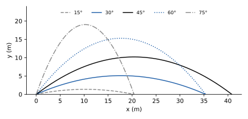

# 1 · Strumenti matematici e cinematica del punto

**In questo modulo.** Servono le derivate e gli integrali di Analisi 1A e i vettori del piano e dello spazio (somma, prodotto per uno scalare, componenti). Si richiamano gli strumenti matematici usati in tutto il corso: grandezze scalari e vettoriali, derivata come velocità di variazione, integrale come somma, e le equazioni differenziali più semplici. Poi si descrive il moto di un punto materiale senza chiedersi che cosa lo causi: traiettoria e legge oraria, spostamento e distanza percorsa, velocità e accelerazione medie e istantanee, i moti rettilinei uniforme e uniformemente accelerato, il moto del proiettile, il moto circolare uniforme e la composizione delle velocità fra due sistemi di riferimento. Alla fine si sa scrivere e usare la legge oraria di un moto e ricavarne velocità e accelerazione.

## 1.1 Grandezze fisiche e strumenti matematici

La **meccanica** studia il moto dei corpi. Si divide in **cinematica**, che descrive come un corpo si muove (traiettorie, leggi orarie) senza occuparsi delle cause, e **dinamica**, che studia le forze che producono il moto. Il modello più semplice di corpo è il **punto materiale**: un oggetto di cui si trascurano le dimensioni, descritto da una sola posizione e da una massa.

Le grandezze fisiche si esprimono con un numero e un'unità di misura; nel Sistema Internazionale le unità di base della meccanica sono il metro (m), il kilogrammo (kg) e il secondo (s). Una grandezza è **scalare** se basta un numero (massa, tempo, energia), **vettoriale** se servono anche una direzione e un verso (spostamento, velocità, forza). In un sistema di assi cartesiani un vettore si scrive con le sue componenti, $v = (v_x, v_y, v_z) = v_x\hat\imath + v_y\hat\jmath + v_z\hat k$, dove $\hat\imath, \hat\jmath, \hat k$ sono i **versori** degli assi (vettori di lunghezza 1).

Tre strumenti di Analisi si usano continuamente:

- la **derivata** $\frac{df}{dt}$ misura quanto rapidamente varia $f$ nel tempo; per un vettore si deriva componente per componente;
- l'**integrale** $\int_{t_0}^{t_1} f(t)\, dt$ somma contributi infinitesimi, e permette di risalire a una grandezza conoscendone la velocità di variazione: se $\frac{dF}{dt} = f$, allora $F(t_1) - F(t_0) = \int_{t_0}^{t_1} f(t)\, dt$;
- le **equazioni differenziali**, in cui l'incognita è una funzione del tempo e compaiono le sue derivate. Le leggi del moto sono equazioni di questo tipo.

> [!esempio] Tre equazioni differenziali del corso
>
> - $\frac{dx}{dt} = v_0$ costante ha soluzioni $x(t) = v_0 t + x_0$: una retta, con la costante $x_0$ fissata dal valore iniziale.
> - $\frac{d^2x}{dt^2} = a_0$ costante si integra due volte: $x(t) = \frac12 a_0 t^2 + v_0 t + x_0$, con due costanti, la posizione e la velocità iniziali.
> - $\frac{d^2x}{dt^2} = -\omega^2 x$ (l'equazione dell'**oscillatore armonico**) ha soluzioni $x(t) = A\cos(\omega t + \phi)$: derivando due volte si ottiene $-A\omega^2\cos(\omega t + \phi) = -\omega^2 x$. Anche qui due costanti, l'ampiezza $A$ e la fase $\phi$, fissate dalle condizioni iniziali.

Un'equazione differenziale del secondo ordine ha in generale una famiglia di soluzioni con due costanti: per individuare il moto servono la posizione e la velocità iniziali.

## 1.2 Traiettoria, legge oraria, spostamento

Per descrivere il moto si fissa un **sistema di riferimento**: un'origine, tre assi e un orologio. La posizione del punto all'istante $t$ è il vettore $r(t) = (x(t), y(t), z(t))$.

> [!definizione] Traiettoria e legge oraria
> La **traiettoria** è la curva $\gamma$ formata dalle posizioni occupate dal punto durante il moto. La **legge oraria** è la funzione $t \mapsto r(t)$, cioè le tre funzioni $x(t)$, $y(t)$, $z(t)$, che dicono dove si trova il punto in ogni istante.

La traiettoria dice per dove passa il punto, la legge oraria anche quando. Fra due istanti $t_0$ e $t_1$ si distinguono:

- la **distanza percorsa**, uno scalare: la lunghezza dell'arco di traiettoria percorso;
- lo **spostamento**, un vettore: $\Delta r = r(t_1) - r(t_0) = (x_1 - x_0,\ y_1 - y_0,\ z_1 - z_0)$, che dipende solo dalle posizioni iniziale e finale.

Se il punto va e torna, lo spostamento può essere nullo mentre la distanza percorsa no. Nel moto unidimensionale (lungo l'asse $x$) la legge oraria si rappresenta con un grafico spazio-tempo $x(t)$.

## 1.3 Velocità e accelerazione

> [!definizione] Velocità media e istantanea
> La **velocità scalare media** è la distanza percorsa divisa per il tempo impiegato; la **velocità vettoriale media** è $\langle v\rangle = \frac{\Delta r}{\Delta t}$. La **velocità istantanea** è il limite per $\Delta t \to 0$:
> $$v(t) = \lim_{\Delta t \to 0} \frac{r(t + \Delta t) - r(t)}{\Delta t} = \frac{dr}{dt} = \left(\frac{dx}{dt}, \frac{dy}{dt}, \frac{dz}{dt}\right).$$

La velocità istantanea è tangente alla traiettoria e il suo modulo, la **celerità**, è la velocità con cui si percorre la traiettoria. Nel grafico $x(t)$ è la pendenza della tangente.

> [!definizione] Accelerazione
> L'**accelerazione media** è $\frac{\Delta v}{\Delta t}$, quella **istantanea** è
> $$a(t) = \frac{dv}{dt} = \frac{d^2 r}{dt^2}.$$

Le unità sono m/s per la velocità e m/s² per l'accelerazione. Viceversa, conoscendo l'accelerazione si risale alla velocità e alla posizione integrando: $v(t) = v(t_0) + \int_{t_0}^{t} a(s)\, ds$ e $r(t) = r(t_0) + \int_{t_0}^{t} v(s)\, ds$.

## 1.4 Moti rettilinei notevoli

> [!definizione] Moto rettilineo uniforme
> Il moto avviene lungo una retta con velocità costante $v_0$. Integrando $\frac{dx}{dt} = v_0$:
> $$x(t) = x_0 + v_0 t, \qquad x_0 = x(0).$$

Il grafico spazio-tempo è una retta di pendenza $v_0$, e il tempo per percorrere una distanza $d$ è $\frac{d}{v_0}$.

> [!definizione] Moto rettilineo uniformemente accelerato
> Il moto avviene lungo una retta con accelerazione costante $a_0$. Integrando due volte:
> $$v(t) = v_0 + a_0 t, \qquad x(t) = x_0 + v_0 t + \tfrac12 a_0 t^2.$$

Eliminando il tempo fra le due equazioni si ottiene una relazione utile quando il tempo non interessa:
$$v^2 = v_0^2 + 2a_0(x - x_0).$$
Per esempio, un'auto che viaggia a 30 m/s (108 km/h) e frena con decelerazione costante di 5 m/s² si ferma in $t = \frac{30}{5} = 6$ s, percorrendo $30 \cdot 6 - \frac12 \cdot 5 \cdot 36 = 90$ m; lo stesso risultato viene da $0 = 30^2 - 2 \cdot 5 \cdot d$. Un corpo in **caduta libera** vicino alla superficie terrestre ha accelerazione costante $g \approx 9{,}8$ m/s² verso il basso.

## 1.5 Moto in più dimensioni e moto del proiettile

Nel piano (o nello spazio) posizione, velocità e accelerazione sono vettori, e le loro componenti si trattano separatamente: $v = (v_x, v_y) = \left(\frac{dx}{dt}, \frac{dy}{dt}\right)$ e $a = \left(\frac{dv_x}{dt}, \frac{dv_y}{dt}\right)$. Se l'accelerazione è costante, ogni componente segue un moto rettilineo uniformemente accelerato.

> [!esempio] Moto del proiettile
> Un corpo lanciato vicino al suolo, trascurando l'aria, ha accelerazione $(0, -g)$, con l'asse $y$ verticale verso l'alto. Le leggi orarie sono disaccoppiate:
> $$x(t) = x_0 + v_{0x} t, \qquad y(t) = y_0 + v_{0y} t - \tfrac12 g t^2:$$
> moto uniforme in orizzontale, uniformemente accelerato in verticale. Ricavando $t = \frac{x - x_0}{v_{0x}}$ dalla prima e sostituendo nella seconda si trova la traiettoria
> $$y = y_0 + \frac{v_{0y}}{v_{0x}}(x - x_0) - \frac{g}{2v_{0x}^2}(x - x_0)^2,$$
> una parabola.

Per un lancio dal suolo con velocità $v_0$ e angolo $\theta$ sull'orizzontale ($v_{0x} = v_0\cos\theta$, $v_{0y} = v_0\sin\theta$), il corpo torna a terra quando $y = 0$, cioè dopo il **tempo di volo** $t_v = \frac{2v_0\sin\theta}{g}$; la **gittata** è $x(t_v) = \frac{v_0^2\sin 2\theta}{g}$, massima per $\theta = 45°$, e l'**altezza massima**, dove $v_y = 0$, è $\frac{v_0^2\sin^2\theta}{2g}$. Con $v_0 = 20$ m/s e $\theta = 30°$: tempo di volo $2{,}04$ s, gittata $35{,}3$ m, altezza massima $5{,}10$ m.

## 1.6 Moto circolare uniforme

Un punto percorre una circonferenza di raggio $R$ con celerità costante. Con l'origine nel centro e $\theta(t) = \omega t$, dove $\omega$ è la **velocità angolare** (in rad/s):
$$x(t) = R\cos(\omega t), \qquad y(t) = R\sin(\omega t).$$
Si verifica che $x^2 + y^2 = R^2$. Derivando:
$$v_x = -R\omega\sin(\omega t) = -\omega y, \qquad v_y = R\omega\cos(\omega t) = \omega x,$$
quindi la velocità è perpendicolare al raggio (tangente alla circonferenza) e ha modulo costante $v = \omega R$. Derivando ancora:
$$a_x = -\omega^2 x, \quad a_y = -\omega^2 y, \qquad \text{cioè} \quad a = -\omega^2 r.$$

> [!teorema] Accelerazione centripeta
> Nel moto circolare uniforme l'accelerazione è diretta verso il centro e ha modulo
> $$a_c = \omega^2 R = \frac{v^2}{R}.$$

Anche se la celerità è costante, la velocità cambia direzione, e quindi c'è accelerazione. Il **periodo**, il tempo di un giro, è $T = \frac{2\pi}{\omega}$, e la **frequenza** è $f = \frac1T$. Per esempio un punto a $0{,}5$ m dal centro di un disco che fa 2 giri al secondo ha $\omega = 4\pi \approx 12{,}6$ rad/s, $v = 2\pi \approx 6{,}28$ m/s e $a_c = \omega^2 R \approx 79$ m/s², circa $8g$.

## 1.7 Moti relativi

Lo stesso moto descritto da due osservatori diversi ha leggi orarie diverse. Siano $(O, x, y)$ un sistema considerato fisso e $(O', x', y')$ un sistema che trasla con velocità costante $v_0$ rispetto al primo, con gli assi paralleli e $O' = O$ all'istante 0. Le coordinate di un punto $P$ sono legate dalle **trasformazioni di Galileo**:
$$x_P = x'_P + v_{0x}t, \qquad y_P = y'_P + v_{0y}t.$$
Derivando si ottiene la **composizione delle velocità**
$$v_P = v'_P + v_0:$$
la velocità rispetto al sistema fisso è quella relativa più la velocità di trascinamento.

> [!teorema] Invarianza dell'accelerazione
> Se $v_0$ è costante, derivando $v_P = v'_P + v_0$ si trova $a_P = a'_P$: l'accelerazione è la stessa in due sistemi di riferimento che si muovono di moto rettilineo uniforme l'uno rispetto all'altro.

È il fatto che renderà le leggi della dinamica valide allo stesso modo in tutti i **sistemi inerziali** (modulo 2).

## Esempi ed esercizi svolti

**Esercizio 1 (attraversare un fiume).** Una barca attraversa un fiume largo 60 m puntando perpendicolarmente alla riva con velocità 3 m/s rispetto all'acqua; la corrente scorre a 4 m/s. Rispetto alla riva la velocità è la somma vettoriale $(4, 3)$ m/s, di modulo $\sqrt{16 + 9} = 5$ m/s. Il tempo di attraversamento dipende solo dalla componente perpendicolare alla riva: $\frac{60}{3} = 20$ s. In questo tempo la corrente trascina la barca di $4 \cdot 20 = 80$ m a valle.

**Esercizio 2 (dall'accelerazione alla legge oraria).** Un punto parte da fermo dall'origine con accelerazione $a(t) = 6t$ (in m/s², con $t$ in secondi). Integrando: $v(t) = \int_0^t 6s\, ds = 3t^2$ e $x(t) = \int_0^t 3s^2\, ds = t^3$. Dopo 2 s il punto è a 8 m con velocità 12 m/s. L'accelerazione non è costante, quindi le formule del moto uniformemente accelerato non valgono: si integra.

**Esercizio 3 (velocità e accelerazione nel moto circolare).** Nel moto circolare uniforme $r \cdot v = x v_x + y v_y = -\omega xy + \omega xy = 0$: la velocità è sempre perpendicolare al raggio. Allo stesso modo $v \cdot a = 0$: l'accelerazione è perpendicolare alla velocità, e infatti non cambia il modulo della velocità ma solo la direzione.

### Esercizi dalle esercitazioni

Il metodo è sempre lo stesso: si fissa un sistema di riferimento con l'origine e il verso positivo, si scrive la legge oraria di ogni corpo, e si traduce la domanda in un'equazione ("si incontrano" vuol dire stessa posizione nello stesso istante).

**Esercizio 4. Prendere al volo un corpo che cade.** Un corpo B viene lasciato cadere da fermo da 120 m; nello stesso istante un corpo A, a 7 m dalla verticale di B, parte in moto rettilineo uniforme sul piano orizzontale. Con che velocità deve muoversi A per trovarsi sotto B quando B tocca terra?

B arriva a terra dopo $t = \sqrt{\frac{2h}{g}} = \sqrt{\frac{240}{9{,}81}} = 4{,}95$ s. In questo tempo A deve percorrere 7 m: $v = \frac{7}{4{,}95} = 1{,}4$ m/s. I due moti sono indipendenti: li lega solo il tempo.

**Esercizio 5. Quanto è profondo il pozzo?** Si lascia cadere un sasso in un pozzo e si sente il tonfo dopo $T = 4{,}8$ s. La velocità del suono è 340 m/s.

Il tempo totale è la caduta più il ritorno del suono: $T = \sqrt{\frac{2h}{g}} + \frac{h}{v_s}$. Con $u = \sqrt{h}$ diventa un'equazione di secondo grado, $\frac{u^2}{v_s} + \sqrt{\frac{2}{g}}\,u - T = 0$, con la soluzione positiva $u = 9{,}98$, cioè $h = 99{,}6$ m. Trascurando il tempo del suono si troverebbe $h = \frac12 g T^2 = 113$ m, un errore del 13%.

**Esercizio 6. Il tempo minimo su un rettilineo.** Un'auto deve percorrere 2 km partendo e arrivando ferma, accelerando con $a_1 = 2$ m/s² e poi frenando con $|a_2| = 3$ m/s², senza tratti a velocità costante. Quale frazione del percorso fa accelerando, e in quanto tempo arriva?

La velocità massima $v$ si raggiunge al cambio. Accelerando si percorre $x_1 = \frac{v^2}{2a_1}$, frenando $x_2 = \frac{v^2}{2|a_2|}$: il rapporto è $\frac{x_1}{x_2} = \frac{|a_2|}{a_1} = \frac32$, quindi $x_1 = \frac35 L = 1200$ m, il 60%. Poi $v = \sqrt{2a_1 x_1} = 69{,}3$ m/s e il tempo è $\frac{v}{a_1} + \frac{v}{|a_2|} = 34{,}6 + 23{,}1 = 57{,}7$ s.

**Esercizio 7. La distanza minima per non tamponare.** L'auto A a 130 km/h è a distanza $d$ dietro l'auto B a 70 km/h, e frena con $|a| = 4$ m/s². Quanto deve valere almeno $d$?

Conviene mettersi nel riferimento di B, che si muove di moto uniforme ed è quindi inerziale rispetto alla strada: lì A ha velocità iniziale $\Delta v = 60$ km/h $= 16{,}7$ m/s e decelera con 4 m/s². Si ferma rispetto a B dopo $\frac{\Delta v^2}{2|a|} = 34{,}7$ m: è la distanza minima. Nel riferimento della strada si arriva allo stesso risultato imponendo che le posizioni coincidano quando le velocità diventano uguali, ma con più conti.

**Esercizio 8. Una legge oraria complicata.** Una particella si muove su una retta con $x(t) = ut(1 - 2\sin\omega t)$, $u = 3$ m/s, $\omega = 4$ s⁻¹. (a) Quando passa per l'origine? (b) Velocità media fra 0,5 s e 1 s e velocità istantanea nel punto medio. (c) Accelerazione al primo ritorno nell'origine.

(a) $x = 0$ per $t = 0$ oppure $\sin\omega t = \frac12$, cioè $\omega t = \frac{\pi}{6} + 2k\pi$ o $\frac{5\pi}{6} + 2k\pi$. Il primo ritorno è $t_1 = \frac{\pi}{24} = 0{,}131$ s.

(b) $x(1) = 3(1 - 2\sin 4) = 7{,}54$ m e $x(0{,}5) = 1{,}5(1 - 2\sin 2) = -1{,}23$ m (gli angoli in radianti), quindi $v_m = \frac{7{,}54 + 1{,}23}{0{,}5} = 17{,}5$ m/s. La velocità istantanea è $v(t) = u(1 - 2\sin\omega t) - 2u\omega t\cos\omega t$, e $v(0{,}75) = 20{,}0$ m/s: vicina ma diversa, perché il moto non è uniformemente accelerato.

(c) Derivando ancora, $a(t) = -4u\omega\cos\omega t + 2u\omega^2 t\sin\omega t$. In $t_1$, con $\cos\omega t_1 = \frac{\sqrt3}{2}$ e $\sin\omega t_1 = \frac12$: $a = -24\sqrt3 + 2\pi = -35{,}3$ m/s².

### Esercizi sul modello delle prove d'esame

**Esercizio 9. Due leggi orarie.** Due punti su una retta hanno $x_1 = 3t$ e $x_2 = t^2 + 2$ (unità SI, $t \ge 0$). Quando sono nello stesso punto? Quando hanno la stessa velocità? E la stessa accelerazione?

Stesso punto: $t^2 - 3t + 2 = 0$, cioè $t = 1$ s e $t = 2$ s (il secondo punto supera il primo e poi viene superato). Stessa velocità: $3 = 2t$, $t = 1{,}5$ s, proprio a metà fra i due incontri, quando la distanza fra i due è massima. Stessa accelerazione: mai, perché $a_1 = 0$ e $a_2 = 2$ m/s².

**Esercizio 10. Due oscillatori che si scontrano.** Due punti si muovono su una retta con $x_1 = A\sin\omega t$ e $x_2 = A\cos\omega t$, $A = 1$ m, $\omega = 1$ s⁻¹. Descrivere i moti e trovare il primo istante $t > 0$ in cui si scontrano.

Sono due moti armonici con la stessa ampiezza e la stessa pulsazione, sfasati di un quarto di periodo: il primo parte dal centro, il secondo da un estremo. Si incontrano quando $\sin\omega t = \cos\omega t$, cioè $\tan\omega t = 1$: la prima volta per $\omega t = \frac{\pi}{4}$, $t = 0{,}785$ s, nel punto $x = \frac{\sqrt2}{2}$ m.

## Esercizi guidati

Ogni esercizio è diviso in passi: si prova un passo alla volta e si confronta solo dopo.

**Guidato 1. Un proiettile lanciato da una terrazza.** Una palla è lanciata da 20 m di altezza con velocità 15 m/s a 30° sopra l'orizzontale. Dove cade e con che velocità?

*Passo 1: il riferimento.* Origine a terra sotto il punto di lancio, $x$ orizzontale, $y$ verso l'alto. Componenti iniziali: $v_{0x} = 15\cos 30° = 13{,}0$ m/s, $v_{0y} = 15\sin 30° = 7{,}5$ m/s.

*Passo 2: le leggi orarie.* $x = 13{,}0\,t$, $y = 20 + 7{,}5\,t - 4{,}905\,t^2$.

*Passo 3: il tempo di volo.* $y = 0$: $4{,}905t^2 - 7{,}5t - 20 = 0$, soluzione positiva $t = 2{,}92$ s.

*Passo 4: dove cade.* $x = 13{,}0 \cdot 2{,}92 = 38{,}0$ m.

*Passo 5: la velocità d'impatto.* $v_x = 13{,}0$ m/s, $v_y = 7{,}5 - 9{,}81 \cdot 2{,}92 = -21{,}1$ m/s, modulo 24,8 m/s. Con l'energia (modulo 3) si fa prima: $v = \sqrt{v_0^2 + 2gh} = \sqrt{225 + 392} = 24{,}8$ m/s.

**Guidato 2. Il moto circolare non uniforme.** Un punto parte da fermo su una circonferenza di raggio 2 m con accelerazione tangenziale costante $1$ m/s². Dopo quanto tempo l'accelerazione forma 45° con la velocità?

*Passo 1: le due componenti.* $a_t = 1$ m/s² costante; $a_n = \frac{v^2}{R}$ con $v = a_t t$.

*Passo 2: la condizione.* L'angolo con la velocità è 45° quando $a_n = a_t$: $\frac{t^2}{2} = 1$.

*Passo 3: risultato.* $t = \sqrt2 = 1{,}41$ s, con $v = 1{,}41$ m/s e $|a| = \sqrt2$ m/s².

**Guidato 3. Pioggia vista dal treno.** La pioggia cade verticale a 8 m/s. Un treno viaggia a 72 km/h. Che angolo fanno le gocce con la verticale, viste dal finestrino?

*Passo 1.* $v_{goccia,suolo} = (0, -8)$ m/s; $v_{treno} = (20, 0)$ m/s.

*Passo 2: la composizione.* $v_{goccia,treno} = v_{goccia,suolo} - v_{treno} = (-20, -8)$ m/s.

*Passo 3: l'angolo.* $\tan\varphi = \frac{20}{8}$, $\varphi = 68°$ dalla verticale, inclinate all'indietro.

## Riepilogo

La cinematica descrive il moto con la legge oraria $r(t)$ in un sistema di riferimento; la traiettoria è la curva percorsa, lo spostamento è la differenza fra le posizioni finale e iniziale, diverso in generale dalla distanza percorsa. Velocità e accelerazione istantanee sono le derivate prima e seconda della posizione, e si risale da esse alla posizione integrando. Nel moto rettilineo uniforme $x = x_0 + v_0 t$; in quello uniformemente accelerato $x = x_0 + v_0 t + \frac12 a_0 t^2$ e $v^2 = v_0^2 + 2a_0\Delta x$. Il moto del proiettile è la composizione di un moto uniforme orizzontale e di uno uniformemente accelerato verticale, con traiettoria parabolica, gittata $\frac{v_0^2\sin 2\theta}{g}$ e altezza massima $\frac{v_0^2\sin^2\theta}{2g}$. Nel moto circolare uniforme la velocità è tangente con modulo $\omega R$ e l'accelerazione è centripeta con modulo $\omega^2 R = \frac{v^2}{R}$. Passando a un sistema che trasla con velocità costante, le velocità si compongono per somma e l'accelerazione non cambia.

## Formulario

Le formule della cinematica, con i termini per l'orale.

### Definizioni

$$\vec v = \frac{d\vec r}{dt}, \qquad \vec a = \frac{d\vec v}{dt}, \qquad v_m = \frac{\Delta x}{\Delta t}, \qquad x(t) = x_0 + \int_0^t v\,dt', \qquad v\,dv = a\,dx.$$

### Moti notevoli

| Moto | Leggi |
|---|---|
| Rettilineo uniforme | $x = x_0 + vt$ |
| Uniformemente accelerato | $x = x_0 + v_0 t + \frac12 at^2$, $v = v_0 + at$, $v^2 = v_0^2 + 2a(x - x_0)$ |
| Caduta libera da fermo | $t = \sqrt{2h/g}$, $v = \sqrt{2gh}$ |
| Proiettile | $x = v_0\cos\theta\,t$, $y = v_0\sin\theta\,t - \frac12 gt^2$; gittata $\frac{v_0^2\sin 2\theta}{g}$, altezza massima $\frac{v_0^2\sin^2\theta}{2g}$ |
| Circolare uniforme | $v = \omega R$, $a_c = \frac{v^2}{R} = \omega^2 R$, $T = \frac{2\pi}{\omega}$ |
| Circolare vario | $a_t = \frac{dv}{dt} = \alpha R$, $a_n = \frac{v^2}{R}$ |
| Armonico | $x = A\cos(\omega t + \varphi)$, $a = -\omega^2 x$ |
| Moti relativi | $\vec v = \vec v' + \vec v_O$ (traslazione), $\vec a = \vec a' + \vec a_O$ |

### Termini per l'orale

| Termine | In una riga |
|---|---|
| Punto materiale | corpo di cui si trascurano le dimensioni |
| Sistema di riferimento | origine, assi e orologio rispetto a cui si descrive il moto |
| Traiettoria, legge oraria | curva percorsa; posizione in funzione del tempo |
| Spostamento | differenza fra posizione finale e iniziale, vettore |
| Velocità media, istantanea | rapporto incrementale; derivata della posizione |
| Accelerazione tangenziale, centripeta | cambia il modulo della velocità; cambia la direzione |
| Moto armonico | moto con $a = -\omega^2 x$, proiezione di un moto circolare uniforme |
| Composizione delle velocità | velocità assoluta = relativa + di trascinamento |

### Domande che tornano spesso

- Definire velocità e accelerazione; come si passa dalla legge oraria all'accelerazione e viceversa?
- Ricavare le leggi del moto uniformemente accelerato e la relazione $v^2 = v_0^2 + 2a\Delta x$.
- Moto del proiettile: traiettoria parabolica, gittata, angolo di gittata massima.
- Accelerazione nel moto circolare: componenti tangenziale e normale.
- Moti relativi: composizione delle velocità per un riferimento in traslazione.
