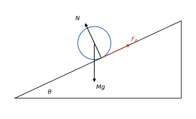

# 4 · Corpo rigido e momento angolare

**In questo modulo.** Servono il moto circolare del modulo 1, la dinamica del modulo 2, l'energia e i sistemi di punti del modulo 3, il prodotto vettoriale e gli integrali multipli. Si studia il corpo rigido: gradi di libertà, cinematica delle rotazioni attorno a un asse fisso, energia cinetica di rotazione e momento d'inerzia, con il teorema di Huygens-Steiner e il calcolo dei momenti d'inerzia di asta, anello, disco e sfera. Poi la dinamica: momento di una forza, seconda equazione cardinale, puro rotolamento, macchina di Atwood con carrucola massiva. Infine il momento angolare rispetto a un polo e la sua conservazione, le forze centrali con la legge delle aree, e le condizioni di equilibrio di un corpo rigido. Alla fine si sanno risolvere problemi di rotazione e rotolamento, con le equazioni cardinali e con l'energia.

## 4.1 Corpo rigido e rotazioni

> [!definizione] Corpo rigido
> Un **corpo rigido** è un sistema di punti materiali in cui le distanze fra due punti qualsiasi restano costanti nel tempo.

Un punto materiale libero ha 3 **gradi di libertà** (le tre coordinate). Un corpo rigido ne ha 6: la sua posizione è fissata da tre punti non allineati (9 coordinate) legati da 3 vincoli sulle distanze reciproche, $9 - 3 = 6$; si possono pensare come 3 coordinate del centro di massa e 3 angoli di orientamento.

Nella **rotazione attorno a un asse fisso** ogni punto del corpo descrive una circonferenza con centro sull'asse. Il moto è descritto da un solo angolo $\theta(t)$, con **velocità angolare** $\omega = \frac{d\theta}{dt}$ e **accelerazione angolare** $\alpha = \frac{d\omega}{dt} = \frac{d^2\theta}{dt^2}$, uguali per tutti i punti. Un punto a distanza $R$ dall'asse percorre l'arco $l = R\theta$ e ha velocità e accelerazione tangenziali
$$v = R\omega, \qquad a_t = R\alpha,$$
più l'accelerazione centripeta $\omega^2 R$. Come vettore, $\omega$ è diretto lungo l'asse, con verso dato dalla regola della mano destra (la rotazione appare antioraria guardando dalla punta del vettore).

## 4.2 Momento d'inerzia

Sommando l'energia cinetica dei punti di un corpo che ruota attorno a un asse fisso, con $v_i = R_i\omega$:
$$T = \sum_i \tfrac12 m_i v_i^2 = \tfrac12\Big(\sum_i m_i R_i^2\Big)\omega^2 = \tfrac12 I\omega^2.$$

> [!definizione] Momento d'inerzia
> Il **momento d'inerzia** rispetto a un asse è
> $$I = \sum_i m_i R_i^2 \qquad \text{oppure} \qquad I = \int R^2\, dm = \int \rho\, R^2\, dV,$$
> dove $R_i$ (o $R$) è la distanza dall'asse. Si misura in kg·m².

Il momento d'inerzia è per le rotazioni ciò che la massa è per le traslazioni, ma dipende dall'asse: la massa lontana dall'asse conta di più.

> [!teorema] Teorema di Huygens-Steiner (assi paralleli)
> Se $I_{CM}$ è il momento d'inerzia rispetto a un asse per il centro di massa, rispetto a un asse parallelo a distanza $d$ il momento d'inerzia è
> $$I = I_{CM} + Md^2.$$

> [!esempio] Momenti d'inerzia notevoli
>
> - **Due masse $m$ agli estremi di un'asta leggera** di lunghezza $l$, asse per il centro: $I_{CM} = 2m\left(\frac l2\right)^2 = \frac12 ml^2$. Rispetto a un estremo, per Steiner $\frac12 ml^2 + 2m\left(\frac l2\right)^2 = ml^2$, come dal calcolo diretto $m \cdot 0 + m l^2$.
> - **Asta omogenea** di massa $M$ e lunghezza $l$, con $dm = \frac Ml dx$: rispetto al centro $I_{CM} = \int_{-l/2}^{l/2}\frac Ml x^2\, dx = \frac{1}{12}Ml^2$; rispetto a un estremo $\frac13 Ml^2$.
> - **Anello sottile** di raggio $R$, asse centrale: tutta la massa è a distanza $R$, quindi $I = MR^2$.
> - **Disco omogeneo** di raggio $R$: si somma su anelli di raggio $r$ e massa $dm = \frac{M}{\pi R^2}2\pi r\, dr$, e $I = \int_0^R r^2\, dm = \frac{2M}{R^2}\cdot\frac{R^4}{4} = \frac12 MR^2$.
> - **Sfera omogenea** di raggio $R$: in coordinate sferiche la distanza dall'asse $z$ è $r\sin\theta$ e $dV = r^2\sin\theta\, dr\, d\theta\, d\varphi$; integrando con $\rho = \frac{M}{\frac43\pi R^3}$ si trova $I = \frac25 MR^2$.

## 4.3 Momento di una forza e seconda equazione cardinale

L'effetto di rotazione di una forza dipende da dove è applicata. Il **momento** (momento torcente) di una forza $F$ applicata a distanza $R$ dall'asse ha modulo
$$\tau = RF\sin\varphi,$$
dove $\varphi$ è l'angolo fra il raggio e la forza: conta solo la componente perpendicolare al raggio, e $R\sin\varphi$ si chiama **braccio**. Le forze che passano per l'asse hanno momento nullo.

> [!teorema] Seconda equazione cardinale per un asse fisso
> Per un corpo rigido che ruota attorno a un asse fisso, il momento risultante delle forze esterne rispetto all'asse è
> $$\tau = I\alpha = I\frac{d^2\theta}{dt^2}.$$

È l'analogo di $F = ma$: il momento al posto della forza, il momento d'inerzia al posto della massa, l'accelerazione angolare al posto di quella lineare.

> [!esempio] Carrucola con attrito al perno
> Una forza costante $F = 15$ N è applicata tangenzialmente al bordo di una carrucola di raggio $R_0 = 33$ cm, che parte da ferma e raggiunge $\omega = 30$ rad/s in 3 s; il perno esercita un momento d'attrito costante $\tau_A = 1{,}1$ N·m. L'accelerazione angolare è $\alpha = 10$ rad/s², e
> $$R_0 F - \tau_A = I\alpha \quad \Longrightarrow \quad I = \frac{0{,}33 \cdot 15 - 1{,}1}{10} = 0{,}385\ \mathrm{kg\,m^2}.$$

## 4.4 Energia nelle rotazioni e puro rotolamento

Anche per le rotazioni vale la conservazione dell'energia, con l'energia cinetica $\frac12 I\omega^2$ e, per il peso, l'energia potenziale $Mgz_{CM}$ calcolata nel centro di massa.

> [!esempio] Un palo che cade
> Un palo omogeneo di massa $M$ e lunghezza $l = 2{,}3$ m, incernierato alla base, cade dalla posizione verticale. All'inizio $E = Mg\frac l2$; quando tocca terra $E = \frac12 I_A\omega^2$ con $I_A = \frac13 Ml^2$. Uguagliando, $\omega = \sqrt{\frac{3g}{l}}$, e l'estremo libero arriva a $v = l\omega = \sqrt{3gl} \approx 8{,}2$ m/s, più di quanto avrebbe un sasso lasciato cadere dalla stessa altezza ($\sqrt{2gl} \approx 6{,}7$ m/s).

Un corpo a simmetria circolare (cilindro, sfera, anello) di raggio $R$ **rotola senza strisciare** se il punto di contatto ha velocità nulla. La condizione di puro rotolamento è
$$v_{CM} = \omega R, \qquad a_{CM} = \alpha R,$$
e per il teorema di König l'energia cinetica è $T = \frac12 Mv_{CM}^2 + \frac12 I_{CM}\omega^2 = \frac12\left(M + \frac{I_{CM}}{R^2}\right)v_{CM}^2$.

> [!esempio] Rotolamento lungo un piano inclinato
> Un corpo di massa $M$, raggio $R$ e momento d'inerzia $I_{CM}$ scende rotolando su un piano inclinato di angolo $\theta$. Peso e normale passano per il centro di massa e non danno momento: a far ruotare il corpo è l'attrito statico $F_A$, rivolto verso l'alto lungo il piano, nel punto di contatto. Le equazioni cardinali, con il vincolo $a_{CM} = \alpha R$, sono
> $$Mg\sin\theta - F_A = Ma_{CM}, \qquad F_A R = I_{CM}\alpha.$$
> Risolvendo,
> $$a_{CM} = \frac{g\sin\theta}{1 + \frac{I_{CM}}{MR^2}}, \qquad F_A = \frac{I_{CM}}{MR^2 + I_{CM}}Mg\sin\theta.$$
> Il corpo scende tanto più lentamente quanto più massa ha lontano dal centro: $a_{CM}$ vale $\frac12 g\sin\theta$ per un anello, $\frac23 g\sin\theta$ per un disco, $\frac57 g\sin\theta$ per una sfera. Perché non strisci deve essere $F_A \le \mu_s Mg\cos\theta$, cioè $\mu_s \ge \frac{I_{CM}}{MR^2 + I_{CM}}\tan\theta$: per un disco su un piano di $30°$, $\mu_s \ge \frac13\tan 30° \approx 0{,}19$.

## 4.5 Macchina di Atwood con carrucola massiva

Due masse $m_1 > m_2$ sono appese ai capi di una fune che passa senza strisciare su una carrucola di raggio $R$ e momento d'inerzia $I$. Se la carrucola ha massa, le tensioni nei due rami sono diverse: la loro differenza dà il momento che la fa ruotare. Con $a$ l'accelerazione ($m_1$ scende) e $\alpha = \frac aR$:
$$m_1 g - T_1 = m_1 a, \qquad T_2 - m_2 g = m_2 a, \qquad (T_1 - T_2)R = I\frac aR.$$
Sommando tutto si eliminano le tensioni:
$$a = \frac{(m_1 - m_2)g}{m_1 + m_2 + \frac{I}{R^2}}.$$
La carrucola si comporta come una massa aggiuntiva $\frac{I}{R^2}$. Con $m_1 = 3$ kg, $m_2 = 2$ kg e una carrucola a disco di 2 kg ($\frac{I}{R^2} = 1$ kg): $a = \frac{9{,}8}{6} \approx 1{,}63$ m/s².

## 4.6 Momento angolare

> [!definizione] Momento della forza e momento angolare rispetto a un polo
> Per un punto materiale in posizione $r$, con quantità di moto $p = mv$ e soggetto alla forza $F$, e un punto $\Omega$ (il **polo**) di posizione $r_\Omega$:
> $$\tau_\Omega = (r - r_\Omega) \times F, \qquad L_\Omega = (r - r_\Omega) \times p.$$
> Per un sistema si sommano i contributi dei singoli punti.

> [!teorema] Teorema del momento angolare
> $$\frac{dL_\Omega}{dt} = \tau_\Omega - v_\Omega \times p.$$
> Se il polo è fisso ($v_\Omega = 0$) o coincide con il centro di massa, il termine correttivo è nullo e $\frac{dL}{dt} = \tau$ (**seconda equazione cardinale**). Per un sistema conta solo il momento delle forze esterne.

*Dimostrazione.* Con la regola di derivazione del prodotto vettoriale,
$$\frac{dL_\Omega}{dt} = \left(\frac{dr}{dt} - \frac{dr_\Omega}{dt}\right) \times p + (r - r_\Omega) \times \frac{dp}{dt} = (v - v_\Omega) \times mv + (r - r_\Omega) \times F.$$
Poiché $v \times v = 0$, resta $-v_\Omega \times p + \tau_\Omega$. Se $\Omega$ è il centro di massa di un sistema, $v_\Omega = v_{CM}$ è parallela a $P = Mv_{CM}$ e il prodotto vettoriale è ancora nullo. $\square$

Per un corpo rigido che ruota attorno a un asse fisso di simmetria, $L = I\omega$, e la seconda equazione cardinale diventa $\frac{d}{dt}(I\omega) = \tau$, cioè $I\alpha = \tau$ se $I$ è costante.

> [!teorema] Conservazione del momento angolare
> Se il momento risultante delle forze esterne rispetto a un polo fisso (o al centro di massa) è nullo, il momento angolare rispetto a quel polo si conserva.

Una pattinatrice che ruota con le braccia aperte ($I_1 = 4$ kg·m², $\omega_1 = 2$ rad/s) e le chiude ($I_2 = 1{,}6$ kg·m²) passa a $\omega_2 = \frac{I_1\omega_1}{I_2} = 5$ rad/s. L'energia cinetica di rotazione $\frac12 I\omega^2$ invece aumenta, da 8 J a 20 J: la differenza è il lavoro dei muscoli che tirano le braccia verso l'asse.

## 4.7 Forze centrali

Un campo di forze è **centrale** se la forza è sempre diretta lungo la retta che congiunge il punto con un centro fisso $O$, con un'intensità che dipende solo dalla distanza: $F(r) = F(r)\,\hat u_r$, $r = \lvert r\rvert$. Esempi sono la gravitazione e la forza elettrostatica.

- **Sono conservative**: in coordinate polari $dl = dr\,\hat u_r + r\,d\theta\,\hat u_\theta$, quindi $F \cdot dl = F(r)\, dr$ e il lavoro $\int_{r_i}^{r_f}F(r)\, dr$ dipende solo dalle distanze iniziale e finale.
- **Conservano il momento angolare** rispetto a $O$: $\tau = r \times F(r)\hat u_r = 0$, perché i due vettori sono paralleli.

Dalla conservazione di $L = r \times mv$ seguono due fatti. Il moto è **piano**: $r$ e $v$ restano perpendicolari al vettore costante $L$. E, scrivendo $v = \dot r\,\hat u_r + r\dot\theta\,\hat u_\theta$, si ha $L = mr^2\dot\theta$, quindi
$$r^2\frac{d\theta}{dt} = \text{costante}.$$
La quantità $\frac12 r^2\dot\theta$ è la **velocità areolare**, l'area spazzata dal raggio vettore nell'unità di tempo: è costante per ogni forza centrale. Per la gravitazione è la seconda legge di Keplero (il raggio vettore di un pianeta spazza aree uguali in tempi uguali).

## 4.8 Equilibrio del corpo rigido

Un corpo rigido è in equilibrio (fermo) se sono nulle la risultante delle forze esterne e il loro momento risultante rispetto a un polo qualsiasi:
$$\sum F^{(est)} = 0, \qquad \sum \tau^{(est)} = 0.$$
Sono le due equazioni cardinali con le derivate nulle. Se la risultante è nulla, il momento risultante non dipende dal polo, e conviene scegliere il polo dove agiscono forze incognite, per eliminarle dall'equazione dei momenti.

> [!esempio] Trave appoggiata con un carico
> Una trave omogenea di 4 m e 20 kg è appoggiata ai due estremi; un carico di 30 kg è a 1 m dall'estremo sinistro. Con i momenti rispetto all'appoggio sinistro, la reazione destra $R_2$ deve bilanciare il peso della trave (applicato a 2 m) e il carico: $4R_2 = 20g \cdot 2 + 30g \cdot 1$, da cui $R_2 = 17{,}5g \approx 171{,}5$ N. La risultante nulla dà $R_1 = 50g - R_2 = 32{,}5g \approx 318{,}5$ N: l'appoggio più vicino al carico sostiene di più.

## Esempi ed esercizi svolti

**Esercizio 1 (un disco che parte da fermo).** Un disco di massa 2 kg e raggio 10 cm, libero di ruotare attorno al suo asse, è messo in rotazione da una fune avvolta sul bordo, tirata con forza costante di 4 N. Con $I = \frac12 MR^2 = 0{,}01$ kg·m², $\alpha = \frac{FR}{I} = \frac{0{,}4}{0{,}01} = 40$ rad/s². Dopo 2 s, $\omega = 80$ rad/s; l'energia cinetica $\frac12 I\omega^2 = 32$ J è uguale al lavoro della forza, $F$ per la fune svolta: $4 \cdot R\theta = 4 \cdot 0{,}1 \cdot \frac12 \cdot 40 \cdot 4 = 32$ J.

**Esercizio 2 (sfera e cilindro in gara).** Una sfera e un cilindro pieno, con qualsiasi massa e raggio, partono da fermi dalla stessa altezza $h$ su un piano inclinato, rotolando senza strisciare. Per la conservazione dell'energia $Mgh = \frac12\left(M + \frac{I}{R^2}\right)v^2$, quindi $v = \sqrt{\frac{2gh}{1 + I/(MR^2)}}$: $\sqrt{\frac{10}{7}gh}$ per la sfera, $\sqrt{\frac43 gh}$ per il cilindro. Arriva prima la sfera, e il risultato non dipende né dalla massa né dal raggio.

**Esercizio 3 (momento angolare di un punto in moto rettilineo).** Un punto che si muove di moto rettilineo uniforme ha, rispetto a un polo $O$ fuori dalla retta, momento angolare $L = mvd$, dove $d$ è la distanza di $O$ dalla retta: è costante, come deve essere perché la forza è nulla. È anche un caso (banale) della legge delle aree: il raggio vettore spazza triangoli di uguale area in tempi uguali.

### Esercizi dalle esercitazioni

Per il corpo rigido le equazioni sono due: $\vec F_{ext} = M\vec a_{CM}$ e $\vec\tau_{ext} = I\vec\alpha$ (rispetto a un asse fisso o al centro di massa). In statica si annullano entrambe, e conviene calcolare i momenti rispetto al punto in cui agiscono più forze incognite: i loro momenti sono nulli.

**Esercizio 4. Una trave su due appoggi.** Una trave omogenea di 1 m e 2 kg poggia orizzontale su due appoggi agli estremi $A$ e $B$; una massa di 0,5 kg è appoggiata a $\frac{L}{3}$ da $A$. Reazioni degli appoggi.

Equilibrio delle forze: $R_A + R_B = (M + m)g = 24{,}5$ N. Momenti rispetto ad $A$: $R_B L = Mg\frac{L}{2} + mg\frac{L}{3}$, quindi $R_B = 9{,}81 + 1{,}64 = 11{,}45$ N e $R_A = 13{,}08$ N. L'appoggio più vicino alla massa regge di più, come ci si aspetta.

**Esercizio 5. La scala appoggiata al muro.** Una scala omogenea poggia su un muro verticale liscio e su un pavimento con $\mu_s = 0{,}1$. Angolo massimo con il muro?

Forze: peso $Mg$ nel centro, reazione del muro $N_m$ orizzontale (muro liscio), reazione del pavimento $N_p$ verticale e attrito $f$ orizzontale. Traslazione: $N_p = Mg$, $f = N_m$. Momenti rispetto al piede della scala, con $\theta$ l'angolo con il muro: $N_m L\cos\theta = Mg\frac{L}{2}\sin\theta$, quindi $f = \frac{Mg}{2}\tan\theta$. La condizione $f \le \mu_s N_p$ dà $\tan\theta \le 2\mu_s = 0{,}2$: $\theta_{max} = 11{,}3°$. Con un pavimento così scivoloso la scala deve stare quasi verticale.

**Esercizio 6. Momenti d'inerzia di corpi pieni.** (a) Parallelepipedo omogeneo di lati $a$, $b$, $c$ e massa $M$, rispetto all'asse per il centro parallelo a $c$. (b) Asta di lunghezza $L$ rispetto a un estremo.

(a) Il corpo si divide in sottili lastre perpendicolari all'asse, ognuna con il momento di una lastra rettangolare, e il risultato non dipende da $c$: $I = \frac{M}{12}(a^2 + b^2)$. (b) Per un'asta rispetto al centro $I_{CM} = \frac{ML^2}{12}$; per il teorema di Steiner, rispetto all'estremo, a distanza $\frac{L}{2}$, $I = \frac{ML^2}{12} + M\frac{L^2}{4} = \frac{ML^2}{3}$.

**Esercizio 7. La puleggia che continua a girare.** Una massa di 2 kg appesa a una fune avvolta su una puleggia (disco) di 10 kg e raggio 0,5 m scende da ferma e si sgancia dopo 2 m. Velocità angolare della puleggia dopo lo sgancio.

Finché la fune è tesa: $ma = mg - T$ e $TR = I\alpha = \frac12 MR^2\frac{a}{R}$, cioè $T = \frac12 Ma$. Quindi $a = \frac{mg}{m + M/2} = 2{,}80$ m/s². Dopo 2 m, $v = \sqrt{2ah} = 3{,}35$ m/s e $\omega = \frac{v}{R} = 6{,}70$ rad/s. Dopo lo sgancio nessuna forza fa momento sulla puleggia (l'asse è senza attrito) e $\omega$ resta 6,70 rad/s.

**Esercizio 8. L'asta incernierata che cade.** Un'asta omogenea di lunghezza $L$, incernierata a un estremo, parte da ferma dalla posizione verticale in alto. Velocità angolare quando passa per la verticale in basso.

Il centro scende di $L$ (da $\frac{L}{2}$ sopra la cerniera a $\frac{L}{2}$ sotto). Conservazione dell'energia con $I = \frac{ML^2}{3}$: $MgL = \frac12 \cdot \frac{ML^2}{3}\omega^2$, quindi $\omega = \sqrt{\frac{6g}{L}}$. La reazione della cerniera non fa lavoro perché il suo punto di applicazione è fermo.

**Esercizio 9. Un disco che rotola su un piano a 45°.** Disco pieno di 2 kg e raggio 0,5 m, $\mu_s = 0{,}5$. (a) Accelerazione angolare. (b) Attrito. (c) Angolo oltre il quale striscia.

Puro rotolamento: $a = \alpha R$. Traslazione: $Ma = Mg\sin\theta - f$; rotazione attorno al centro: $fR = \frac12 MR^2\alpha$, cioè $f = \frac12 Ma$. Quindi $a = \frac23 g\sin\theta = 4{,}62$ m/s², $\alpha = \frac{a}{R} = 9{,}25$ rad/s², $f = \frac13 Mg\sin\theta = 4{,}62$ N. Il rotolamento regge finché $f \le \mu_s Mg\cos\theta$, cioè $\tan\theta \le 3\mu_s = 1{,}5$: $\theta_{max} = 56{,}3°$. L'attrito statico nel rotolamento non dissipa energia, perché il punto di contatto è fermo.

**Esercizio 10. Molla, fune e carrucola: il periodo.** Una massa di 1 kg è appesa a una fune che passa su una carrucola (disco di 10 kg, raggio 0,5 m) ed è legata dall'altra parte a una molla ($k = 30$ N/m). (a) Allungamento all'equilibrio. (b) Periodo delle piccole oscillazioni.

(a) All'equilibrio la tensione è la stessa da entrambe le parti (la carrucola non accelera): $k\Delta l = mg$, $\Delta l = 0{,}327$ m. (b) Spostando la massa di $x$, le equazioni danno $\left(m + \frac{M}{2}\right)\ddot x = -kx$: la carrucola si comporta come una massa aggiunta $\frac{I}{R^2} = \frac{M}{2}$. Il periodo è $2\pi\sqrt{\frac{m + M/2}{k}} = 2\pi\sqrt{\frac{6}{30}} = 2{,}81$ s.

### Esercizi sul modello delle prove d'esame

**Esercizio 11. La biglia colpita dalla stecca.** Una biglia di 170 g e raggio 2,85 cm, ferma, riceve un colpo centrale con impulso $J = 1{,}5$ N·s. (a) Velocità iniziale. (b) Velocità angolare quando smette di strisciare. (c) Lavoro dell'attrito fino a quel momento.

(a) $v_0 = \frac{J}{m} = 8{,}82$ m/s; il colpo è centrale e non dà rotazione: $\omega_0 = 0$.

(b) All'inizio la biglia striscia: l'attrito dinamico la frena e le dà un momento che la fa girare, finché $v = \omega R$. Il momento angolare rispetto al punto di contatto con il piano si conserva (l'attrito passa per quel punto, peso e normale sono allineati): $mv_0 R = mvR + \frac25 mR^2\omega = \frac75 mvR$. Quindi $v = \frac57 v_0 = 6{,}30$ m/s e $\omega = \frac{v}{R} = 221$ rad/s.

(c) $W_a = \Delta K = \frac12 mv^2 + \frac12 \cdot \frac25 mR^2\omega^2 - \frac12 mv_0^2 = \frac{7}{10}mv^2 - \frac12 mv_0^2 = -1{,}89$ J: due settimi dell'energia iniziale. Non serve conoscere il coefficiente d'attrito: decide solo quanto dura lo strisciamento.

**Esercizio 12. L'asta che cade e urta una massa.** Un'asta di 1 kg e 1 m, incernierata in un estremo $O$, è lasciata da ferma in orizzontale. Quando passa per la verticale urta una massa puntiforme di 0,5 kg appesa a un filo lungo 1 m fissato in $O$, che resta attaccata alla punta dell'asta. (a) $\omega$ prima dell'urto. (b) $\omega$ subito dopo. (c) Angolo massimo raggiunto dopo l'urto.

(a) Energia: $Mg\frac{L}{2} = \frac12 \cdot \frac{ML^2}{3}\omega^2$, $\omega = \sqrt{\frac{3g}{L}} = 5{,}42$ rad/s.

(b) Nell'urto la cerniera esercita forze impulsive, quindi la quantità di moto non si conserva; si conserva però il momento angolare rispetto a $O$, perché quelle forze passano per $O$. $\frac{ML^2}{3}\omega = \left(\frac{ML^2}{3} + mL^2\right)\omega'$, quindi $\omega' = \frac{1/3}{1/3 + 1/2}\omega = 0{,}4\,\omega = 2{,}17$ rad/s.

(c) Dopo l'urto si conserva l'energia: $\frac12\left(\frac13 + \frac12\right)\omega'^2 = 1{,}96$ J deve diventare l'energia potenziale del centro dell'asta (che sale di $\frac{L}{2}(1 - \cos\theta)$) e della massa (che sale di $L(1 - \cos\theta)$): $\left(Mg\frac{L}{2} + mgL\right)(1 - \cos\theta) = 9{,}81(1 - \cos\theta)$. Quindi $\cos\theta = 0{,}8$, $\theta = 36{,}9°$.

### Altri esercizi delle esercitazioni, con le soluzioni degli appunti a mano

**Esercizio 13. Il cono e il disco forato.** (a) Momento d'inerzia di un cono pieno (raggio $R$, massa $M$) rispetto al suo asse. (b) Un disco di raggio $R$ ha un foro circolare di raggio $R/2$ tangente al bordo; massa del disco forato $m$. Centro di massa e momento d'inerzia rispetto all'asse per il CM perpendicolare al disco.

(a) Il cono è una pila di dischi di raggio $r = \frac Rhz$ e spessore $dz$, ognuno con $dI = \frac12dm\,r^2$ e $dm = \rho\pi r^2dz$, $\rho = \frac{M}{\frac13\pi R^2h}$: $I = \int_0^h\frac32\frac{M}{R^2h}\frac{R^4}{h^4}z^4\,dz = \frac3{10}MR^2$. Lo stesso in coordinate cilindriche integrando $r^2\rho\,r\,dr\,d\theta\,dz$. (b) Si tratta il disco forato come disco pieno meno il foro. Con la stessa densità superficiale $M_{foro} = \frac14M_{disco}$, quindi $m = \frac34M_{disco}$. Il CM si calcola trattando i due pezzi come punti nei loro centri, con il foro a massa negativa: $x_{CM} = \frac{M_{foro}\frac R2}{m} = \frac R6$, dalla parte opposta al foro. Rispetto al centro del disco $I_{pieno} = \frac12M_{disco}R^2 = \frac23mR^2$ e, con Steiner, $I_{foro} = \frac12M_{foro}\frac{R^2}{4} + M_{foro}\frac{R^2}{4} = \frac18mR^2$; per differenza $\frac{13}{24}mR^2$, e spostando l'asse nel CM (Steiner al contrario) $I = \frac{13}{24}mR^2 - m\frac{R^2}{36} = \frac{37}{72}mR^2$.

**Esercizio 14. Quando si ribalta il cubo?** Un cubo di lato $L$ e massa $M$ sale su un piano inclinato di $\theta$ tirato da una forza parallela al piano applicata ad altezza $d$, con $\frac L2 < d < L$. Forza massima senza ribaltamento e accelerazione in quel caso.

Una forza applicata sopra la metà del lato tende a far ruotare il cubo in avanti: per compensare, il punto d'applicazione della normale si sposta verso lo spigolo anteriore, a distanza $b$ dal centro della base. Con il polo nel CM e nessuna rotazione: $F - Mg\sin\theta = Ma$, $N = Mg\cos\theta$, $Nb - F\left(d - \frac L2\right) = 0$, quindi $b = \frac{F}{Mg\cos\theta}\left(d - \frac L2\right)$. Il cubo non si ribalta finché la normale cade dentro la base, $b \le \frac L2$: $F \le \frac{MgL\cos\theta}{2d - L}$. Nel caso limite $a = g\cos\theta\frac{L}{2d - L} - g\sin\theta$.

**Esercizio 15. Una sbarra su due ruote che girano in versi opposti** (prova di gennaio 2019). Una sbarra di 10 kg e 1 m poggia su due ruote a distanza $d = 60$ cm che girano in versi opposti, con $\mu_d = 0{,}5$; il centro della sbarra è spostato di $x_0 = 20$ cm a destra. Normali, attriti, accelerazione, moto.

Equilibrio verticale e dei momenti rispetto al CM: $N_D + N_S = Mg$ e $N_S\left(\frac d2 + x_0\right) = N_D\left(\frac d2 - x_0\right)$, da cui $N_D = Mg\frac{d/2 + x_0}{d} = 81{,}75$ N e $N_S = 16{,}35$ N (con $g = 9{,}81$). Gli attriti sono $\mu_dN$, cioè 40,87 N e 8,17 N, e spingono verso il centro, quindi $a_{CM} = \frac{F_D - F_S}{M} = 3{,}27$ m/s² verso sinistra. Per una posizione generica $x$ del centro la stessa formula dà $F_D - F_S = \mu_dMg\frac{2x}{d}$, una forza di richiamo proporzionale a $x$: la sbarra oscilla con $\omega = \sqrt{\frac{2\mu_dg}{d}}$ e $T = 1{,}55$ s.

**Esercizio 16. Macchina di Atwood con una molla** (prova di settembre 2017). $M_1 = 1$ kg è tenuta a terra da una molla ($k = 100$ N/m) e collegata da una fune su una carrucola ($I = 0{,}1$ kg m², $R = 0{,}1$ m) a $M_2 = 5$ kg. Allungamento della molla e accelerazione di $M_2$ appena la molla si sgancia.

All'equilibrio la carrucola è ferma, quindi le due tensioni sono uguali: $T = M_2g$ e $T = M_1g + k\Delta l$, da cui $\Delta l = \frac{(M_2 - M_1)g}{k} = 0{,}39$ m. Dopo lo sgancio: $T_1 - M_1g = M_1a$, $M_2g - T_2 = M_2a$, $(T_2 - T_1)R = I\frac aR$; sommando, $a = \frac{(M_2 - M_1)g}{M_1 + M_2 + I/R^2} = 2{,}45$ m/s² ($a_2 = -2{,}5$ m/s² con l'asse verso l'alto). La carrucola pesa come una massa aggiunta $I/R^2 = 10$ kg.

**Esercizio 17. Un disco, un cuneo che si conficca e un freno** (prova di luglio 2024). Un disco di 10 kg e raggio 50 cm ruota a 3 rad/s; un cuneo di 2 kg cade e si conficca a 40 cm dal centro. Poi un blocchetto premuto sul bordo con $F = 1$ N ($\mu_d = 0{,}8$) lo frena. Velocità dopo l'urto, tempo di arresto, giri.

Il momento angolare rispetto all'asse si conserva: $I_0\omega_0 = (I_0 + mr^2)\omega_1$ con $I_0 = \frac12MR^2 = 1{,}25$ kg m², quindi $\omega_1 = 2{,}39$ rad/s. Il freno dà un momento $\mu_dFR$, decelerazione angolare costante $\frac{\mu_dFR}{I_1}$, e $t = \frac{I_1\omega_1}{\mu_dFR} = 9{,}37$ s. Nel moto uniformemente decelerato $\theta = \frac12\omega_1t = 11{,}2$ rad, cioè 1,78 giri (1,76 nei risultati dell'esercitazione).

## Esercizi guidati

Ogni esercizio è diviso in passi: si prova un passo alla volta e si confronta solo dopo.

**Guidato 1. La sfera che rotola giù.** Una sfera piena parte da ferma e rotola senza strisciare giù da un'altezza di 1 m. Velocità in fondo.

*Passo 1: l'energia cinetica di un corpo che rotola.* $K = \frac12 Mv^2 + \frac12 I\omega^2$ con $\omega = \frac{v}{R}$ e $I = \frac25 MR^2$: $K = \frac{7}{10}Mv^2$.

*Passo 2: la conservazione.* L'attrito statico non lavora: $Mgh = \frac{7}{10}Mv^2$.

*Passo 3: risultato.* $v = \sqrt{\frac{10}{7}gh} = 3{,}74$ m/s, contro i 4,43 m/s di un corpo che scivola senza attrito: una parte dell'energia va nella rotazione.

**Guidato 2. L'asta tenuta da una fune orizzontale.** Un'asta di 2 kg, incernierata in basso in $O$, forma 40° con la verticale ed è tenuta da una fune orizzontale attaccata all'altro estremo. Tensione della fune.

*Passo 1: dove calcolare i momenti.* Rispetto a $O$, così la reazione della cerniera (incognita) non compare.

*Passo 2: i bracci.* Il peso, applicato al centro, ha braccio $\frac{L}{2}\sin 40°$; la tensione, orizzontale, applicata all'estremo, ha braccio $L\cos 40°$.

*Passo 3: l'equilibrio dei momenti.* $TL\cos 40° = Mg\frac{L}{2}\sin 40°$, quindi $T = \frac{Mg}{2}\tan 40° = 8{,}23$ N.

*Passo 4: la cerniera.* Dall'equilibrio delle forze, la cerniera dà una componente orizzontale uguale e opposta a $T$ e una verticale uguale a $Mg$.

**Guidato 3. Steiner per un disco forato.** Un disco omogeneo di raggio $R$ e massa (prima del foro) $M$ ha un foro circolare di raggio $\frac{R}{2}$ con il centro a $\frac{R}{2}$ dal centro del disco. Momento d'inerzia rispetto all'asse per il centro del disco.

*Passo 1: la massa del foro.* L'area del foro è un quarto di quella del disco: $m_f = \frac{M}{4}$.

*Passo 2: il momento del disco pieno.* $\frac12 MR^2$.

*Passo 3: il momento del foro con Steiner.* Rispetto al proprio centro $\frac12 m_f\left(\frac{R}{2}\right)^2 = \frac{MR^2}{32}$; spostato a distanza $\frac{R}{2}$: $\frac{MR^2}{32} + \frac{M}{4}\cdot\frac{R^2}{4} = \frac{3MR^2}{32}$.

*Passo 4: sottrarre.* $I = \frac12 MR^2 - \frac{3}{32}MR^2 = \frac{13}{32}MR^2$. I momenti d'inerzia rispetto allo stesso asse si sommano e si sottraggono come le masse.

## Riepilogo

Un corpo rigido ha 6 gradi di libertà; nella rotazione attorno a un asse fisso tutti i punti hanno la stessa $\omega$ e $\alpha$, con $v = R\omega$ e $a_t = R\alpha$. L'energia cinetica di rotazione è $\frac12 I\omega^2$, con il momento d'inerzia $I = \int R^2\, dm$ che dipende dall'asse e si trasporta con Huygens-Steiner ($I = I_{CM} + Md^2$): $\frac{1}{12}Ml^2$ per l'asta al centro, $MR^2$ per l'anello, $\frac12 MR^2$ per il disco, $\frac25 MR^2$ per la sfera. Il momento di una forza è $RF\sin\varphi$ e, per un asse fisso, $\tau = I\alpha$. Nel puro rotolamento $v_{CM} = \omega R$, l'attrito statico fornisce il momento e non compie lavoro, e i corpi con più massa lontana dall'asse accelerano meno. Una carrucola con massa equivale a una massa aggiuntiva $I/R^2$. Il momento angolare rispetto a un polo fisso o al centro di massa varia del momento delle forze esterne e si conserva se questo è nullo. Le forze centrali sono conservative e conservano il momento angolare: il moto è piano e la velocità areolare è costante. Un corpo rigido è in equilibrio se risultante e momento risultante delle forze esterne sono nulli.

## Formulario

Rotazioni, momenti d'inerzia, equazioni cardinali e momento angolare, con i termini per l'orale.

### Rotazioni

$$v = \omega r, \quad a_t = \alpha r, \quad K_{rot} = \frac12 I\omega^2, \quad \vec\tau = \vec r \times \vec F, \quad \tau = I\alpha, \quad \vec L = I\vec\omega, \quad \vec\tau_{ext} = \frac{d\vec L}{dt}.$$

### Momenti d'inerzia ($I_{CM}$)

| Corpo | Asse | $I$ |
|---|---|---|
| Anello, guscio cilindrico | asse di simmetria | $MR^2$ |
| Disco, cilindro pieno | asse di simmetria | $\frac12 MR^2$ |
| Sfera piena | diametro | $\frac25 MR^2$ |
| Guscio sferico | diametro | $\frac23 MR^2$ |
| Asta | perpendicolare per il centro | $\frac{1}{12}ML^2$ |
| Asta | perpendicolare per un estremo | $\frac13 ML^2$ |
| Lastra rettangolare $a \times b$ | perpendicolare per il centro | $\frac{1}{12}M(a^2 + b^2)$ |

Steiner: $I = I_{CM} + Md^2$.

### Equazioni cardinali e rotolamento

$\vec F_{ext} = M\vec a_{CM}$, $\vec\tau_{ext} = \frac{d\vec L}{dt}$. Equilibrio: entrambe nulle. Puro rotolamento: $v_{CM} = \omega R$; $K = \frac12 Mv^2\left(1 + \frac{I}{MR^2}\right)$; su un piano inclinato $a = \frac{g\sin\theta}{1 + I/(MR^2)}$, limite $\tan\theta \le \mu_s\left(1 + \frac{MR^2}{I}\right)$.

### Momento angolare

Si conserva rispetto a un polo se il momento delle forze esterne rispetto a quel polo è nullo: in un urto con una cerniera, rispetto alla cerniera. Forze centrali: $\vec L$ costante, moto piano, velocità areolare costante.

### Termini per l'orale

| Termine | In una riga |
|---|---|
| Corpo rigido | sistema in cui le distanze fra i punti non cambiano |
| Momento d'inerzia | $\sum m_i r_i^2$: resistenza a cambiare velocità angolare |
| Momento di una forza | $\vec r \times \vec F$, capacità di far ruotare |
| Coppia | due forze opposte non allineate: risultante nulla, momento non nullo |
| Puro rotolamento | il punto di contatto ha velocità nulla |
| Momento angolare | $\vec r \times \vec p$; per un corpo rigido attorno a un asse fisso, $I\omega$ |
| Forza centrale | diretta sempre verso un punto fisso, con modulo che dipende dalla distanza |

### Domande che tornano spesso

- Definire il momento d'inerzia e ricavarlo per l'asta e per il disco; dimostrare Steiner.
- Seconda equazione cardinale e sua forma per un asse fisso.
- Energia cinetica di un corpo che rotola; perché l'attrito statico non lavora?
- Condizioni di equilibrio di un corpo rigido, con un esempio (scala, trave).
- Conservazione del momento angolare: quando vale? Esempi (pattinatore, urto con cerniera).
- Forze centrali e seconda legge di Keplero.
