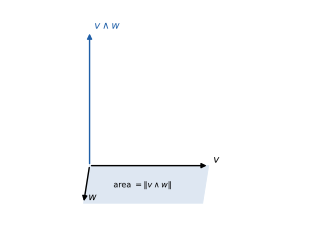

# Geometria

**Appunti del corso · a.a. 2026/27 · Mobius**

Appunti personali e non ufficiali, rivisti e confrontati con il programma ufficiale del corso. Non sostituiscono le lezioni né i testi consigliati.

## Indice

1. Numeri complessi, polinomi e geometria analitica
2. Matrici, sistemi lineari e determinanti
3. Spazi vettoriali e applicazioni lineari
4. Autovalori, diagonalizzazione e teorema spettrale

## 1 · Numeri complessi, polinomi e geometria analitica

**In questo modulo.** Servono l'algebra e la trigonometria delle scuole superiori (formule di addizione, equazioni di secondo grado) e il piano cartesiano. Si parte dagli insiemi numerici e si costruisce il campo dei numeri complessi: forma algebrica, coniugato e modulo, forma trigonometrica ed esponenziale, potenze con la formula di De Moivre e radici $n$-esime. Si studiano poi i polinomi: divisione con resto, teorema di Ruffini, teorema fondamentale dell'algebra e radici coniugate dei polinomi reali. La seconda parte è la geometria analitica dello spazio: vettori di $\mathbb{R}^3$, prodotto scalare, vettoriale e misto, equazioni di piani e rette, posizioni reciproche, distanze, sfere. Alla fine del modulo si sa calcolare con i numeri complessi in tutte le forme, fattorizzare un polinomio di cui si conosce una radice complessa e risolvere i problemi di posizione e di distanza fra punti, rette e piani.

### 1.1 Insiemi numerici

Gli insiemi numerici si costruiscono uno dentro l'altro, ciascuno per risolvere equazioni che nel precedente non hanno soluzione:
$$\mathbb{N} \subset \mathbb{Z} \subset \mathbb{Q} \subset \mathbb{R} \subset \mathbb{C}.$$
In $\mathbb{N} = \{0, 1, 2, \dots\}$ l'equazione $x + 1 = 0$ non ha soluzione, e si aggiungono gli opposti ottenendo gli interi $\mathbb{Z}$; in $\mathbb{Z}$ non si risolve $2x = 1$, e si passa ai razionali $\mathbb{Q}$, frazioni $\frac{p}{q}$ con $q \neq 0$; in $\mathbb{Q}$ non si risolve $x^2 = 2$ (perché $\sqrt 2$ è irrazionale), e i reali $\mathbb{R}$ colmano i "buchi" della retta. Ma anche in $\mathbb{R}$ l'equazione $x^2 + 1 = 0$ non ha soluzione, perché un quadrato reale non è mai negativo: per questo si introducono i numeri complessi.

Gli insiemi $\mathbb{Q}$, $\mathbb{R}$ e $\mathbb{C}$ sono **campi**: hanno una somma e un prodotto associativi e commutativi, con elementi neutri $0 \neq 1$, opposti, inversi di ogni elemento non nullo, e la proprietà distributiva. In tutto il corso si indica con $\mathbb{K}$ un campo che può essere $\mathbb{R}$ o $\mathbb{C}$.

### 1.2 Numeri complessi in forma algebrica

> [!definizione] Numero complesso
> Un **numero complesso** è un'espressione $z = a + ib$ con $a, b \in \mathbb{R}$, dove l'**unità immaginaria** $i$ verifica $i^2 = -1$. Il numero $a = \mathrm{Re}(z)$ è la **parte reale**, $b = \mathrm{Im}(z)$ la **parte immaginaria**. L'insieme dei numeri complessi si indica con $\mathbb{C}$.

I reali sono i complessi con $b = 0$; i numeri $ib$ con $b \neq 0$ si dicono **immaginari puri**. Poiché $z$ è determinato dalla coppia $(a, b)$, lo si rappresenta come punto del **piano di Gauss**, con la parte reale sull'asse orizzontale e quella immaginaria su quello verticale.

Le operazioni seguono le regole del calcolo letterale, con $i^2 = -1$:
$$(a + ib) + (c + id) = (a + c) + i(b + d), \qquad (a + ib)(c + id) = (ac - bd) + i(ad + bc).$$
La somma corrisponde alla somma di vettori con la regola del parallelogramma. Per esempio, con $z_1 = 2 + 3i$ e $z_2 = 1 - 4i$: $z_1 + z_2 = 3 - i$ e $z_1 z_2 = 2 - 8i + 3i - 12i^2 = 14 - 5i$. Le potenze di $i$ si ripetono con periodo 4: $i^2 = -1$, $i^3 = -i$, $i^4 = 1$, quindi per esempio $i^{2025} = i^{4 \cdot 506 + 1} = i$.

> [!definizione] Coniugato e modulo
> Il **coniugato** di $z = a + ib$ è $\bar z = a - ib$ (il simmetrico rispetto all'asse reale). Il **modulo** è $\lvert z\rvert = \sqrt{a^2 + b^2}$, la distanza di $z$ dall'origine.

Il coniugato rispetta le operazioni: $\overline{z_1 + z_2} = \bar z_1 + \bar z_2$, $\overline{z_1 z_2} = \bar z_1\, \bar z_2$, $\bar{\bar z} = z$; inoltre $z + \bar z = 2\,\mathrm{Re}(z)$, $z - \bar z = 2i\,\mathrm{Im}(z)$, e $z$ è reale se e solo se $z = \bar z$. La relazione fondamentale è
$$z \bar z = (a + ib)(a - ib) = a^2 + b^2 = \lvert z\rvert^2.$$
Ne viene l'inverso di un numero non nullo e la regola per dividere: si moltiplica per il coniugato del denominatore.
$$\frac{1}{z} = \frac{\bar z}{\lvert z\rvert^2} = \frac{a}{a^2 + b^2} - i\frac{b}{a^2 + b^2}, \qquad \frac{z_1}{z_2} = \frac{z_1 \bar z_2}{\lvert z_2\rvert^2}.$$
Per esempio
$$\frac{1 - i}{2 + i} = \frac{(1 - i)(2 - i)}{4 + 1} = \frac{2 - i - 2i + i^2}{5} = \frac{1 - 3i}{5} = \frac15 - \frac35 i.$$
Con queste operazioni $\mathbb{C}$ è un campo.

### 1.3 Forma trigonometrica ed esponenziale

Un numero $z \neq 0$ si individua anche con la distanza $r = \lvert z\rvert$ dall'origine e con l'angolo $\theta$ che il vettore forma con il semiasse reale positivo, l'**argomento** $\theta = \arg z$, definito a meno di multipli di $2\pi$. Poiché $a = r\cos\theta$ e $b = r\sin\theta$:
$$z = r(\cos\theta + i\sin\theta) \qquad (\text{forma trigonometrica}).$$
Per trovare $\theta$ da $a$ e $b$ si usa $\tan\theta = \frac{b}{a}$, facendo attenzione al quadrante: $\theta = \arctan\frac{b}{a}$ se $a > 0$, $\theta = \arctan\frac{b}{a} + \pi$ se $a < 0$, $\theta = \pm\frac{\pi}{2}$ se $a = 0$ e $b \gtrless 0$. Per esempio $\sqrt3 + i$ ha modulo $\sqrt{3 + 1} = 2$ e argomento $\arctan\frac{1}{\sqrt3} = \frac{\pi}{6}$: $\sqrt3 + i = 2\left(\cos\frac\pi6 + i\sin\frac\pi6\right)$.

La forma trigonometrica rende semplice il prodotto. Moltiplicando $z_1 = r_1(\cos\theta_1 + i\sin\theta_1)$ e $z_2 = r_2(\cos\theta_2 + i\sin\theta_2)$ e usando le formule di addizione:
$$z_1 z_2 = r_1 r_2\big[\cos(\theta_1 + \theta_2) + i\sin(\theta_1 + \theta_2)\big].$$
I moduli si moltiplicano e gli argomenti si sommano: moltiplicare per $z$ vuol dire ruotare di $\arg z$ e dilatare di $\lvert z\rvert$. Moltiplicare per $i$ è una rotazione di $90°$ in senso antiorario.

> [!definizione] Formula di Eulero e forma esponenziale
> Per $\theta \in \mathbb{R}$ si pone $e^{i\theta} = \cos\theta + i\sin\theta$, e per $w = a + ib$, $e^{w} = e^a(\cos b + i\sin b)$. Ogni $z \neq 0$ si scrive $z = r e^{i\theta}$.

Con questa notazione le regole diventano quelle delle potenze: $r_1 e^{i\theta_1} \cdot r_2 e^{i\theta_2} = r_1 r_2 e^{i(\theta_1 + \theta_2)}$, $\frac{r_1 e^{i\theta_1}}{r_2 e^{i\theta_2}} = \frac{r_1}{r_2} e^{i(\theta_1 - \theta_2)}$, e si verifica che $e^{z_1 + z_2} = e^{z_1} e^{z_2}$ per ogni $z_1, z_2 \in \mathbb{C}$ con le formule di addizione. Sommando e sottraendo $e^{ix}$ ed $e^{-ix}$ si ottengono le **formule di Eulero**
$$\cos x = \frac{e^{ix} + e^{-ix}}{2}, \qquad \sin x = \frac{e^{ix} - e^{-ix}}{2i},$$
da cui, per esempio, $\sin 2x = \frac{(e^{ix})^2 - (e^{-ix})^2}{2i} = 2\cdot\frac{e^{ix} - e^{-ix}}{2i}\cdot\frac{e^{ix} + e^{-ix}}{2} = 2\sin x\cos x$.

### 1.4 Potenze e radici

> [!teorema] Formula di De Moivre
> Per ogni $n \in \mathbb{N}$, $\big[r(\cos\theta + i\sin\theta)\big]^n = r^n\big(\cos(n\theta) + i\sin(n\theta)\big)$, cioè $(re^{i\theta})^n = r^n e^{in\theta}$.

Per esempio, $2 + 2i$ ha modulo $2\sqrt2 = 2^{3/2}$ e argomento $\frac\pi4$, quindi
$$(2 + 2i)^{100} = 2^{150}\left(\cos 25\pi + i\sin 25\pi\right) = 2^{150}(\cos\pi + i\sin\pi) = -2^{150}.$$

Il problema inverso è trovare i $w$ tali che $w^n = z$. Scrivendo $z = re^{i\theta}$ e $w = \rho e^{i\varphi}$, per De Moivre deve essere $\rho^n = r$ e $n\varphi = \theta + 2k\pi$ con $k \in \mathbb{Z}$; gli angoli distinti (a meno di $2\pi$) si ottengono per $k = 0, \dots, n - 1$.

> [!teorema] Radici $n$-esime
> Ogni $z = re^{i\theta} \neq 0$ ha esattamente $n$ radici $n$-esime complesse distinte:
> $$w_k = \sqrt[n]{r}\, e^{i\frac{\theta + 2k\pi}{n}}, \qquad k = 0, 1, \dots, n - 1.$$
> Stanno sulla circonferenza di centro 0 e raggio $\sqrt[n]{r}$ e sono i vertici di un poligono regolare di $n$ lati.

![Figura 1.1 · Le sei radici seste di $-4i$: modulo $\sqrt[3]{2}$, argomenti $\frac\pi4 + k\frac\pi3$.](figure/1-1.svg)

> [!esempio] Radici seste di $-4i$
> Si ha $\lvert -4i\rvert = 4$ e $\arg(-4i) = \frac{3\pi}{2}$. Le radici hanno modulo $\sqrt[6]{4} = \sqrt[3]{2}$ e argomenti $\frac{3\pi/2 + 2k\pi}{6} = \frac{\pi}{4} + k\frac{\pi}{3}$ per $k = 0, \dots, 5$: formano un esagono regolare (figura 1.1).

Per le radici quadrate c'è anche un metodo algebrico. Se $w = x + iy$ e $w^2 = a + ib$, uguagliando parti reali e immaginarie si trova $x^2 - y^2 = a$ e $2xy = b$; insieme a $x^2 + y^2 = \lvert z\rvert = \sqrt{a^2 + b^2}$ si ricava
$$w = \pm\left(\sqrt{\frac{\sqrt{a^2 + b^2} + a}{2}} + i\,\mathrm{sgn}(b)\sqrt{\frac{\sqrt{a^2 + b^2} - a}{2}}\right).$$
Per $z = 3 + 4i$: $\lvert z\rvert = 5$, quindi $w = \pm(2 + i)$, e infatti $(2 + i)^2 = 3 + 4i$.

### 1.5 Polinomi

Un polinomio a coefficienti in $\mathbb{K}$ è $F(x) = a_n x^n + \dots + a_1 x + a_0$ con $a_i \in \mathbb{K}$; se $a_n \neq 0$, $n = \deg F$ è il suo **grado**. L'insieme dei polinomi si indica con $\mathbb{K}[x]$.

> [!teorema] Divisione con resto
> Se $F, G \in \mathbb{K}[x]$ e $G \neq 0$, esistono e sono unici due polinomi $Q$ (quoziente) e $R$ (resto) tali che
> $$F(x) = Q(x)\, G(x) + R(x), \qquad R = 0 \ \text{oppure} \ \deg R < \deg G.$$

Quoziente e resto si calcolano con la divisione in colonna, come per i numeri. Dividendo per $G(x) = x - \alpha$ il resto è una costante, ed è $F(\alpha)$: ne segue il **teorema di Ruffini**, $\alpha$ è radice di $F$ (cioè $F(\alpha) = 0$) se e solo se $x - \alpha$ divide $F(x)$.

> [!teorema] Teorema fondamentale dell'algebra
> Ogni polinomio $F \in \mathbb{C}[x]$ di grado $n \ge 1$ ha almeno una radice in $\mathbb{C}$. Di conseguenza si fattorizza come $F(x) = a_n(x - z_1)\cdots(x - z_n)$: ha esattamente $n$ radici complesse, contate con la loro molteplicità.

La seconda parte segue dalla prima e da Ruffini, per induzione sul grado. In $\mathbb{R}$ il teorema è falso ($x^2 + 1$ non ha radici reali), ma per i polinomi reali le radici complesse vengono a coppie.

> [!teorema] Radici coniugate
> Se $F \in \mathbb{R}[x]$ e $\alpha \in \mathbb{C}$ è una radice di $F$, anche $\bar\alpha$ è una radice di $F$.

*Dimostrazione.* Se $F(x) = \sum_j a_j x^j$ con $a_j$ reali, allora $a_j = \bar a_j$ e, per le proprietà del coniugato, $F(\bar\alpha) = \sum_j a_j \bar\alpha^j = \overline{\sum_j a_j \alpha^j} = \overline{F(\alpha)} = \bar 0 = 0$. $\square$

Quindi un polinomio reale si fattorizza in $\mathbb{R}[x]$ in fattori di primo grado (per le radici reali) e di secondo grado senza radici reali (per ogni coppia $\alpha$, $\bar\alpha$, il fattore $(x - \alpha)(x - \bar\alpha) = x^2 - 2\,\mathrm{Re}(\alpha)\,x + \lvert\alpha\rvert^2$).

> [!esempio] Fattorizzare sapendo una radice
> Le radici di $P(x) = x^5 - 2x^4 + 2x^3 - 2x^2 + 4x - 4$, sapendo che $P(1 + i) = 0$. Poiché $P$ è reale, anche $1 - i$ è radice, e $P$ è divisibile per $(x - 1 - i)(x - 1 + i) = (x - 1)^2 + 1 = x^2 - 2x + 2$. La divisione in colonna dà quoziente $x^3 - 2$ e resto zero:
> $$P(x) = (x^2 - 2x + 2)(x^3 - 2).$$
> Le altre tre radici sono le radici cubiche di 2: $\sqrt[3]{2}\, e^{2k\pi i/3}$ per $k = 0, 1, 2$, cioè $\sqrt[3]2$ e $\sqrt[3]2\left(-\frac12 \pm i\frac{\sqrt3}{2}\right)$.

### 1.6 Vettori nello spazio, prodotto scalare

Un vettore di $\mathbb{R}^3$ è una terna $v = (v_1, v_2, v_3)$; geometricamente lo si pensa come una freccia che parte dall'origine (o da un punto qualsiasi, con la stessa direzione, verso e lunghezza). Si sommano componente per componente e si moltiplicano per uno scalare $\lambda \in \mathbb{R}$ moltiplicando ogni componente. La **norma** (modulo) è $\lVert v\rVert = \sqrt{v_1^2 + v_2^2 + v_3^2}$, la lunghezza della freccia; il vettore che va dal punto $A$ al punto $B$ è $B - A$, e la **distanza** fra i due punti è $d(A, B) = \lVert B - A\rVert$.

> [!definizione] Prodotto scalare
> $v \cdot w = v_1 w_1 + v_2 w_2 + v_3 w_3$. Vale $v \cdot w = \lVert v\rVert\, \lVert w\rVert \cos\theta$, dove $\theta \in [0, \pi]$ è l'angolo fra i due vettori.

L'uguaglianza fra la forma algebrica e quella geometrica si vede nel piano scrivendo $v = \lVert v\rVert(\cos\alpha, \sin\alpha)$ e $w = \lVert w\rVert(\cos\beta, \sin\beta)$: allora $v \cdot w = \lVert v\rVert\lVert w\rVert(\cos\alpha\cos\beta + \sin\alpha\sin\beta) = \lVert v\rVert\lVert w\rVert\cos(\alpha - \beta)$. Il prodotto scalare è simmetrico, lineare in ciascun argomento e $v \cdot v = \lVert v\rVert^2$. Due vettori sono **ortogonali** se $v \cdot w = 0$.

Per esempio l'angolo fra $v = (2, -2, 1)$ e $w = (0, 1, -1)$: $v \cdot w = 0 - 2 - 1 = -3$, $\lVert v\rVert = 3$, $\lVert w\rVert = \sqrt2$, quindi $\cos\theta = -\frac{1}{\sqrt2}$ e $\theta = \frac{3\pi}{4}$.

### 1.7 Prodotto vettoriale e prodotto misto

> [!definizione] Prodotto vettoriale
> $$v \wedge w = \begin{vmatrix} \mathbf{i} & \mathbf{j} & \mathbf{k} \\ v_1 & v_2 & v_3 \\ w_1 & w_2 & w_3 \end{vmatrix} = (v_2 w_3 - v_3 w_2,\ v_3 w_1 - v_1 w_3,\ v_1 w_2 - v_2 w_1).$$

Il determinante "formale" si sviluppa lungo la prima riga (modulo 2). Proprietà:

- $v \wedge w$ è ortogonale sia a $v$ sia a $w$, e il suo verso segue la regola della mano destra;
- $w \wedge v = -v \wedge w$, quindi $v \wedge v = 0$; più in generale $v \wedge w = 0$ se e solo se $v$ e $w$ sono paralleli;
- è lineare in ciascun argomento: $v \wedge (\lambda w + \mu u) = \lambda\, v \wedge w + \mu\, v \wedge u$;
- $\lVert v \wedge w\rVert = \lVert v\rVert\,\lVert w\rVert \sin\theta$, l'area del parallelogramma costruito su $v$ e $w$; equivalentemente vale l'**identità di Lagrange** $\lVert v \wedge w\rVert^2 = \lVert v\rVert^2\lVert w\rVert^2 - (v \cdot w)^2$.

Quindi l'area del triangolo di vertici $A$, $B$, $C$ è $\frac12\lVert (B - A) \wedge (C - A)\rVert$.

> [!definizione] Prodotto misto
> Il **prodotto misto** di $u, v, w$ è $u \cdot (v \wedge w)$, che è il determinante della matrice con righe $u$, $v$, $w$. Il suo valore assoluto è il volume del parallelepipedo costruito sui tre vettori.

Tre vettori sono **complanari** se e solo se il prodotto misto è nullo; quattro punti $A, B, C, D$ stanno su un piano se e solo se $(B - A) \cdot \big((C - A) \wedge (D - A)\big) = 0$.

> [!esempio] Vettori ortogonali a due vettori dati
> I vettori di norma 2 ortogonali sia a $v = (1, 1, 1)$ sia a $w = (2, 1, 1)$ sono paralleli a $v \wedge w = (1 - 1,\ 2 - 1,\ 1 - 2) = (0, 1, -1)$, che ha norma $\sqrt2$. Moltiplicando per $\pm\frac{2}{\sqrt2} = \pm\sqrt2$ si ottengono $\pm(0, \sqrt2, -\sqrt2)$.

### 1.8 Piani e rette nello spazio

> [!definizione] Equazioni del piano
> Il piano per il punto $P_0$ ortogonale al vettore non nullo $n = (a, b, c)$ è l'insieme dei $P$ con $n \cdot (P - P_0) = 0$, cioè ha **equazione cartesiana** $ax + by + cz + d = 0$. Il piano per $P_0$ parallelo a due vettori non paralleli $v_1$, $v_2$ ha **equazioni parametriche** $P = P_0 + s v_1 + t v_2$, con $s, t \in \mathbb{R}$, e vettore normale $n = v_1 \wedge v_2$.

Per esempio, il piano per l'origine parallelo a $v_1 = (-2, -7, -4)$ e $v_2 = (-1, -1, 2)$ ha normale $v_1 \wedge v_2 = (-14 - 4,\ 4 + 4,\ 2 - 7) = (-18, 8, -5)$ ed equazione $18x - 8y + 5z = 0$.

Una **retta** si dà in forma parametrica, $P = P_0 + t\, v$ con $t \in \mathbb{R}$ e $v \neq 0$ **vettore direttore**, oppure in forma cartesiana come intersezione di due piani non paralleli:
$$r : \begin{cases} a_1 x + b_1 y + c_1 z + d_1 = 0 \\ a_2 x + b_2 y + c_2 z + d_2 = 0 \end{cases} \qquad v = n_1 \wedge n_2.$$
Si passa dalla forma cartesiana a quella parametrica risolvendo il sistema (modulo 2), e viceversa eliminando il parametro.

**Posizioni reciproche.** Due piani sono paralleli se le normali sono parallele, altrimenti si intersecano in una retta. Una retta di direzione $v$ e un piano di normale $n$ sono paralleli se $v \cdot n = 0$ (e la retta sta nel piano se in più ne ha un punto), altrimenti si intersecano in un punto. Due rette nello spazio possono essere:

- **parallele**, se i vettori direttori sono paralleli;
- **incidenti**, se si incontrano in un punto;
- **sghembe**, se non sono né parallele né incidenti: allora non stanno su uno stesso piano.

Con $r = P_0 + t v_1$ e $s = Q_0 + u v_2$ non parallele, le rette sono complanari (quindi incidenti) se e solo se $(Q_0 - P_0) \cdot (v_1 \wedge v_2) = 0$.

**Fascio di piani.** I piani che contengono la retta $r$ data come intersezione di $\pi_1 : f_1 = 0$ e $\pi_2 : f_2 = 0$ sono i piani $\lambda f_1 + \mu f_2 = 0$ con $(\lambda, \mu) \neq (0, 0)$. Si sceglie il piano voluto imponendo una condizione.

> [!esempio] Un piano del fascio
> Sia $r$ l'intersezione di $x + y + z - 3 = 0$ e $x - y - z - 2 = 0$. Il piano del fascio $\lambda(x + y + z - 3) + \mu(x - y - z - 2) = 0$ ha normale $(\lambda + \mu,\ \lambda - \mu,\ \lambda - \mu)$. Perché sia parallelo al vettore $(1, 2, 3)$ la normale deve essergli ortogonale: $(\lambda + \mu) + 2(\lambda - \mu) + 3(\lambda - \mu) = 6\lambda - 4\mu = 0$. Con $\lambda = 2$, $\mu = 3$ si ottiene il piano $5x - y - z - 12 = 0$.

### 1.9 Distanze e sfere

> [!teorema] Distanza di un punto da un piano
> La distanza del punto $P_0 = (x_0, y_0, z_0)$ dal piano $ax + by + cz + d = 0$ è
> $$d(P_0, \pi) = \frac{\lvert a x_0 + b y_0 + c z_0 + d\rvert}{\sqrt{a^2 + b^2 + c^2}}.$$

Si ottiene proiettando: la retta per $P_0$ ortogonale al piano è $P_0 + t\,n$, incontra il piano nel punto $P' = P_0 - \frac{n \cdot P_0 + d}{\lVert n\rVert^2}n$, e la distanza è $\lVert P_0 - P'\rVert$. Per esempio, il punto $(1, 1, 3)$ dista $\frac{\lvert 2 - 1 + 6 - 1\rvert}{3} = 2$ dal piano $2x - y + 2z - 1 = 0$.

La distanza fra due rette sghembe $r = P_0 + t v_1$ e $s = Q_0 + u v_2$ è la lunghezza del segmento di perpendicolare comune, e vale
$$d(r, s) = \frac{\lvert (Q_0 - P_0) \cdot (v_1 \wedge v_2)\rvert}{\lVert v_1 \wedge v_2\rVert},$$
cioè il volume del parallelepipedo costruito su $Q_0 - P_0$, $v_1$, $v_2$ diviso per l'area della base. Per $r = (1, 0, 0) + t(1, 1, 0)$ e $s = (0, 0, 3) + u(0, 1, 1)$: $v_1 \wedge v_2 = (1, -1, 1)$, $(Q_0 - P_0) \cdot (1, -1, 1) = (-1, 0, 3) \cdot (1, -1, 1) = 2 \neq 0$, quindi le rette sono sghembe e distano $\frac{2}{\sqrt3}$.

> [!definizione] Sfera
> La sfera di centro $C = (x_C, y_C, z_C)$ e raggio $R > 0$ è l'insieme dei punti a distanza $R$ da $C$:
> $$(x - x_C)^2 + (y - y_C)^2 + (z - z_C)^2 = R^2.$$

Un'equazione $x^2 + y^2 + z^2 + \alpha x + \beta y + \gamma z + \delta = 0$ si riconduce a questa forma completando i quadrati. Un piano a distanza $d$ dal centro taglia la sfera in una circonferenza di raggio $\sqrt{R^2 - d^2}$ se $d < R$, è tangente se $d = R$, non la incontra se $d > R$.

### Esempi ed esercizi svolti

**Esercizio 1 (un vertice dato l'area).** Dati $A = (1, 0, 2)$ e $B = (3, 1, 0)$, trovare i punti $C$ sull'asse $z$ tali che il triangolo $ABC$ abbia area 10. Con $C = (0, 0, t)$: $B - A = (2, 1, -2)$, $C - A = (-1, 0, t - 2)$ e
$$(B - A) \wedge (C - A) = \big(t - 2,\ 6 - 2t,\ 1\big).$$
L'area è la metà della norma: $\frac12\sqrt{(t - 2)^2 + (6 - 2t)^2 + 1} = 10$, cioè $5t^2 - 28t + 41 = 400$, $5t^2 - 28t - 359 = 0$, da cui $t = \frac{14 \pm \sqrt{1991}}{5}$ ($t \approx 11{,}72$ oppure $t \approx -6{,}12$).

**Esercizio 2 (sfera e piano).** La sfera $x^2 + y^2 + z^2 - 2x + 4y - 6z + 5 = 0$ si riscrive completando i quadrati come $(x - 1)^2 + (y + 2)^2 + (z - 3)^2 = 1 + 4 + 9 - 5 = 9$: centro $C = (1, -2, 3)$, raggio 3. Il piano $x + 2y + 2z = 7$ dista dal centro $\frac{\lvert 1 - 4 + 6 - 7\rvert}{3} = \frac43 < 3$, quindi taglia la sfera in una circonferenza di raggio $\sqrt{9 - \frac{16}{9}} = \frac{\sqrt{65}}{3}$, il cui centro è la proiezione di $C$ sul piano.

**Esercizio 3 (radici dell'unità).** Le radici cubiche di 1 sono $e^{2k\pi i/3}$, cioè $1$ e $-\frac12 \pm i\frac{\sqrt3}{2}$: si verifica che $\left(-\frac12 + i\frac{\sqrt3}{2}\right)^3 = e^{2\pi i} = 1$. Sono le radici di $x^3 - 1 = (x - 1)(x^2 + x + 1)$; le due non reali sono coniugate, come deve essere per un polinomio reale.

#### Esercizi sul modello delle prove d'esame

> [!aggiunta] Aggiunta in revisione · fonte: esercizi nuovi sul modello delle 13 prove scritte dal gennaio 2024 al giugno 2026 e dei fogli di esercizi del corso; soluzioni verificate con `strumenti/verifica_ampliamento.py` (GEO-02, GEO-03)
> In ogni prova c'è un esercizio sui numeri complessi o sui polinomi e uno di geometria analitica nello spazio: piano per una retta e un punto, proiezioni e simmetrici, sfera e circonferenza.

**Esercizio 3. Forma esponenziale, potenze e radici.** Sia $w = 1 - \sqrt{3}\,i$. (a) Forma esponenziale. (b) $w^6$ in forma algebrica. (c) Soluzioni di $z^3 = w$.

(a) $|w| = \sqrt{1 + 3} = 2$; il punto $(1, -\sqrt3)$ sta nel quarto quadrante con $\tan\vartheta = -\sqrt3$, quindi $\vartheta = -\frac{\pi}{3}$: $w = 2e^{-i\pi/3}$.

(b) Per De Moivre $w^6 = 2^6 e^{-2\pi i} = 64$. Il risultato è reale perché $6 \cdot \frac{\pi}{3}$ è un multiplo di $2\pi$.

(c) Le radici cubiche hanno modulo $\sqrt[3]{2}$ e argomenti $\frac{-\pi/3 + 2k\pi}{3}$, $k = 0, 1, 2$:
$$z_k = \sqrt[3]{2}\,e^{i\left(-\frac{\pi}{9} + \frac{2k\pi}{3}\right)}, \qquad \text{argomenti } -\frac{\pi}{9},\ \frac{5\pi}{9},\ \frac{11\pi}{9}.$$
Nel piano complesso sono i vertici di un triangolo equilatero inscritto nella circonferenza di raggio $\sqrt[3]{2}$.

**Esercizio 4. Un'equazione di secondo grado a coefficienti complessi.** Risolvere $z^2 - 2iz - 2 = 0$.

La formula risolutiva vale anche in $\mathbb{C}$: $\Delta = (-2i)^2 - 4 \cdot (-2) = -4 + 8 = 4$, con radici quadrate $\pm 2$. Quindi $z = \frac{2i \pm 2}{2} = i \pm 1$. Controllo: $(1 + i)^2 - 2i(1 + i) - 2 = 2i - 2i + 2 - 2 = 0$. Le soluzioni non sono coniugate: lo sono solo quando i coefficienti sono reali.

**Esercizio 5. Fattorizzare in $\mathbb{R}$ e in $\mathbb{C}$.** Fattorizzare $p(x) = x^4 + 4$.

Le radici sono le radici quarte di $-4 = 4e^{i\pi}$: modulo $\sqrt2$ e argomenti $\frac{\pi}{4} + \frac{k\pi}{2}$, cioè $\pm 1 \pm i$. In $\mathbb{C}$, $p = (x - 1 - i)(x - 1 + i)(x + 1 - i)(x + 1 + i)$. In $\mathbb{R}$ si moltiplicano le coppie coniugate: $(x - 1 - i)(x - 1 + i) = (x - 1)^2 + 1$, e
$$x^4 + 4 = (x^2 - 2x + 2)(x^2 + 2x + 2).$$
Un polinomio reale senza radici reali si può comunque fattorizzare in fattori di secondo grado: è la conseguenza del teorema fondamentale dell'algebra per i polinomi reali.

**Esercizio 6. Piano per una retta e un punto, proiezione e simmetrico.** Siano $r: (x, y, z) = (0, 1, 2) + t(1, -1, 2)$, il punto $P = (1, 2, 0)$ e il piano $\pi: x - y + 2z - 1 = 0$. (a) Piano $\sigma$ che contiene $r$ e $P$. (b) Proiezione ortogonale di $Q = (1, 2, 3)$ su $\pi$ e simmetrico di $Q$ rispetto a $\pi$.

(a) $\sigma$ contiene il punto $R_0 = (0, 1, 2)$ di $r$, la direzione $d = (1, -1, 2)$ e il vettore $P - R_0 = (1, 1, -2)$. Un vettore normale è $d \times (P - R_0) = (0, 4, 2)$, cioè $(0, 2, 1)$. Il piano è $2y + z = c$, e passando per $P$: $c = 4$. Quindi $\sigma: 2y + z - 4 = 0$. Controllo: $R_0$ dà $2 + 2 = 4$ e la direzione dà $2 \cdot (-1) + 2 = 0$.

(b) La retta per $Q$ perpendicolare a $\pi$ è $Q + s(1, -1, 2)$. Sostituendo nel piano: $(1 + s) - (2 - s) + 2(3 + 2s) - 1 = 0$, cioè $4 + 6s = 0$, $s = -\frac23$. La proiezione è $H = \left(\frac13, \frac83, \frac53\right)$, e il simmetrico è $Q' = 2H - Q = \left(-\frac13, \frac{10}{3}, \frac13\right)$: $H$ è il punto medio fra $Q$ e $Q'$.

**Esercizio 7. Sfera tagliata da un piano.** $S: x^2 + y^2 + z^2 - 4x + 2y - 4 = 0$ e $\pi: x + 2y + 2z - 3 = 0$. Centro e raggio di $S$; mostrare che $S \cap \pi$ è una circonferenza e trovarne centro e raggio.

Completando i quadrati, $(x - 2)^2 + (y + 1)^2 + z^2 = 4 + 1 + 4 = 9$: centro $C = (2, -1, 0)$, raggio 3. La distanza di $C$ da $\pi$ è $\frac{|2 - 2 + 0 - 3|}{\sqrt{1 + 4 + 4}} = 1 < 3$: il piano taglia la sfera in una circonferenza di raggio $\sqrt{9 - 1} = 2\sqrt2$ (Pitagora sul triangolo centro della sfera, centro della circonferenza, punto della circonferenza). Il centro è la proiezione di $C$ su $\pi$: $C + s(1, 2, 2)$ con $9s - 3 = 0$, $s = \frac13$, quindi $\left(\frac73, -\frac13, \frac23\right)$.

**Esercizio 8. Rette sghembe e loro distanza.** $r: (1, 0, 0) + t(1, 1, 0)$ e $s: (0, 0, 2) + u(0, 1, 1)$.

Le direzioni non sono parallele. $d_r \times d_s = (1, -1, 1)$; il vettore fra due punti è $(0, 0, 2) - (1, 0, 0) = (-1, 0, 2)$. La distanza è
$$\frac{|(-1, 0, 2) \cdot (1, -1, 1)|}{\|(1, -1, 1)\|} = \frac{1}{\sqrt3} > 0,$$
quindi le rette non si incontrano: sono sghembe. Se il prodotto misto fosse stato 0 le rette sarebbero state complanari e, non essendo parallele, incidenti.

### Esercizi guidati

> [!aggiunta] Aggiunta in revisione · fonte: esercizi nuovi; soluzioni verificate con `strumenti/verifica_ampliamento.py` (GEO-02, GEO-03)
> Ogni esercizio è diviso in passi: si prova un passo alla volta e si confronta solo dopo.

**Guidato 1. Le radici quarte di $-16$.**

*Passo 1: forma esponenziale.* $-16 = 16e^{i\pi}$.

*Passo 2: modulo delle radici.* $\sqrt[4]{16} = 2$.

*Passo 3: argomenti.* $\frac{\pi + 2k\pi}{4}$ per $k = 0, 1, 2, 3$: $\frac{\pi}{4}, \frac{3\pi}{4}, \frac{5\pi}{4}, \frac{7\pi}{4}$.

*Passo 4: forma algebrica.* $2e^{i\pi/4} = \sqrt2 + i\sqrt2$, e le altre si ottengono cambiando i segni: $\pm\sqrt2 \pm i\sqrt2$, i vertici di un quadrato.

**Guidato 2. Il piano per tre punti e l'area del triangolo.** $A = (1, 0, 1)$, $B = (2, 1, 1)$, $C = (1, 2, 3)$.

*Passo 1: due vettori del piano.* $B - A = (1, 1, 0)$, $C - A = (0, 2, 2)$.

*Passo 2: il normale.* $(1, 1, 0) \times (0, 2, 2) = (2, -2, 2)$, cioè $(1, -1, 1)$.

*Passo 3: l'equazione.* $x - y + z = c$, con $A$: $c = 2$. Il piano è $x - y + z - 2 = 0$; si controlla con $B$ ($2 - 1 + 1 = 2$) e con $C$ ($1 - 2 + 3 = 2$).

*Passo 4: l'area.* È metà della norma del prodotto vettoriale: $\frac12\|(2, -2, 2)\| = \frac12 \cdot 2\sqrt3 = \sqrt3$.

**Guidato 3. Retta come intersezione di due piani.** Scrivere in forma parametrica $r: x + y + z = 0,\ x - y = 0$.

*Passo 1: la direzione.* È perpendicolare a entrambi i normali: $(1, 1, 1) \times (1, -1, 0) = (1, 1, -2)$.

*Passo 2: un punto.* L'origine soddisfa entrambe le equazioni.

*Passo 3: la parametrica.* $r: (x, y, z) = t(1, 1, -2)$.

*Passo 4: il controllo.* $t + t - 2t = 0$ e $t - t = 0$ per ogni $t$.

### Riepilogo

Gli insiemi numerici si estendono fino a $\mathbb{C}$, dove ogni equazione polinomiale ha soluzione. Un complesso si scrive in forma algebrica $a + ib$, in cui si sommano e si moltiplicano con $i^2 = -1$ e si divide moltiplicando per il coniugato ($z\bar z = \lvert z\rvert^2$), oppure in forma trigonometrica ed esponenziale $re^{i\theta}$, in cui i moduli si moltiplicano e gli argomenti si sommano. De Moivre dà le potenze, e ogni numero non nullo ha $n$ radici $n$-esime sui vertici di un poligono regolare. Per i polinomi valgono la divisione con resto, il teorema di Ruffini e il teorema fondamentale dell'algebra; le radici complesse di un polinomio reale sono a coppie coniugate. Nello spazio, il prodotto scalare misura lunghezze e angoli, il prodotto vettoriale dà un vettore ortogonale ai due fattori con norma uguale all'area del parallelogramma, il prodotto misto dà il volume e decide la complanarità. Un piano ha equazione $ax + by + cz + d = 0$ con normale $(a, b, c)$; una retta si dà in forma parametrica o come intersezione di due piani; le posizioni reciproche si decidono con prodotti scalari e vettoriali, le distanze con le formule di proiezione, e le sfere completando i quadrati.

### Formulario

> [!aggiunta] Aggiunta in revisione · fonte: sintesi del modulo (GEO-01 … GEO-03)
> Formule dei numeri complessi e della geometria analitica, con i termini per l'orale.

#### Numeri complessi

$$z = a + ib = \rho(\cos\vartheta + i\sin\vartheta) = \rho e^{i\vartheta}, \quad \rho = |z| = \sqrt{a^2 + b^2}, \quad \bar z = a - ib, \quad z\bar z = |z|^2, \quad \frac{1}{z} = \frac{\bar z}{|z|^2}.$$

$$z_1 z_2 = \rho_1\rho_2 e^{i(\vartheta_1 + \vartheta_2)}, \qquad z^n = \rho^n e^{in\vartheta} \ \text{(De Moivre)}, \qquad \sqrt[n]{z} = \sqrt[n]{\rho}\,e^{i\frac{\vartheta + 2k\pi}{n}},\ k = 0, \dots, n - 1.$$

Eulero: $e^{i\vartheta} = \cos\vartheta + i\sin\vartheta$. Teorema fondamentale dell'algebra: un polinomio di grado $n$ ha $n$ radici in $\mathbb{C}$ contate con molteplicità; se i coefficienti sono reali le radici non reali vengono a coppie coniugate. Ruffini: $p(a) = 0 \iff (x - a) \mid p(x)$.

#### Vettori

$$u \cdot v = \sum u_i v_i = \|u\|\|v\|\cos\vartheta, \qquad \|u \times v\| = \|u\|\|v\|\sin\vartheta = \text{area del parallelogramma}, \qquad |u \cdot (v \times w)| = \text{volume}.$$

Allineati: $u \times v = 0$. Complanari: $u \cdot (v \times w) = 0$. Proiezione di $v$ su $u$: $\frac{u \cdot v}{u \cdot u}u$.

#### Rette, piani, distanze, sfere

| Oggetto | Equazioni |
|---|---|
| Piano | $ax + by + cz + d = 0$, normale $(a, b, c)$; parametrico $P_0 + su + tv$ |
| Retta | $P_0 + td$; oppure intersezione di due piani, con direzione $n_1 \times n_2$ |
| Distanza punto-piano | $\frac{\lvert ax_0 + by_0 + cz_0 + d\rvert }{\sqrt{a^2 + b^2 + c^2}}$ |
| Distanza fra rette sghembe | $\frac{|(Q - P) \cdot (d_r \times d_s)|}{\|d_r \times d_s\|}$ |
| Sfera | $(x - x_C)^2 + (y - y_C)^2 + (z - z_C)^2 = R^2$ |
| Circonferenza $S \cap \pi$ | raggio $\sqrt{R^2 - d(C, \pi)^2}$, centro la proiezione di $C$ su $\pi$ |

Parallelismo e perpendicolarità: retta e piano paralleli se $d \cdot n = 0$; perpendicolari se $d \parallel n$; due piani paralleli se i normali sono paralleli. Simmetrico di $Q$ rispetto a un piano: $2H - Q$, con $H$ proiezione.

#### Termini per l'orale

| Termine | In una riga |
|---|---|
| Campo | insieme con somma e prodotto con le proprietà dei razionali |
| Modulo, argomento | distanza dall'origine e angolo nel piano di Gauss |
| Radice di molteplicità $m$ | $(x - a)^m$ divide il polinomio, $(x - a)^{m+1}$ no |
| Prodotto scalare, vettoriale, misto | numero; vettore perpendicolare; numero (volume con segno) |
| Rette sghembe | non parallele e non incidenti |
| Proiezione ortogonale | piede della perpendicolare da un punto |

#### Domande che tornano spesso

- Definire $\mathbb{C}$ e le sue operazioni; perché non è ordinato?
- Ricavare le formule di De Moivre e quelle delle radici $n$-esime; dove stanno le radici nel piano?
- Enunciare il teorema fondamentale dell'algebra e la fattorizzazione dei polinomi reali.
- Proprietà del prodotto vettoriale e suo significato geometrico.
- Posizioni reciproche di due rette nello spazio; distanza fra rette sghembe.

## 2 · Matrici, sistemi lineari e determinanti

**In questo modulo.** Si usa solo il calcolo con i numeri reali e complessi del modulo 1. Si introducono le matrici e le loro operazioni, con le proprietà che valgono e quelle che non valgono (il prodotto non è commutativo), le matrici invertibili, le operazioni elementari e la riduzione a scala con l'algoritmo di Gauss. Con questi strumenti si risolvono i sistemi lineari e si calcola l'inversa di una matrice. Poi si definisce il determinante, con lo sviluppo di Laplace, la regola di Sarrus e il teorema di Binet, e lo si usa per l'inversa e per la regola di Cramer. Il modulo si chiude con il rango e il teorema di Rouché-Capelli, che dice quando un sistema ha soluzioni e quante. Alla fine si sa risolvere un sistema lineare, anche con un parametro, e calcolare inverse, determinanti e ranghi.

### 2.1 Matrici e operazioni

Una **matrice** $m \times n$ a coefficienti nel campo $\mathbb{K}$ è una tabella di $m$ righe e $n$ colonne, $A = (a_{ij})$ con $i = 1, \dots, m$ e $j = 1, \dots, n$; $a_{ij}$ è il coefficiente nella riga $i$ e nella colonna $j$. L'insieme si indica con $\mathrm{Mat}_{m \times n}(\mathbb{K})$, e con $\mathrm{Mat}_n(\mathbb{K})$ quello delle matrici **quadrate** $n \times n$. Le matrici $1 \times n$ e $m \times 1$ sono i vettori riga e colonna.

In una matrice quadrata gli elementi $a_{11}, \dots, a_{nn}$ formano la **diagonale**. La matrice è **diagonale** se ha zeri fuori dalla diagonale, **triangolare superiore** se $a_{ij} = 0$ per $i > j$ (zeri sotto la diagonale), triangolare inferiore nel caso opposto. La **matrice identità** $I_n$ è la diagonale con tutti 1, la **matrice nulla** ha tutti i coefficienti nulli.

Le matrici della stessa forma si sommano coefficiente per coefficiente, e si moltiplicano per uno scalare moltiplicando ogni coefficiente: con queste operazioni valgono le solite proprietà (associativa, commutativa, elemento neutro la matrice nulla, opposto).

> [!definizione] Prodotto righe per colonne
> Se $A \in \mathrm{Mat}_{m \times n}$ e $B \in \mathrm{Mat}_{n \times p}$, il prodotto $AB \in \mathrm{Mat}_{m \times p}$ ha coefficienti
> $$(AB)_{ik} = \sum_{j=1}^{n} a_{ij} b_{jk} = a_{i1}b_{1k} + \dots + a_{in}b_{nk},$$
> il prodotto della riga $i$ di $A$ per la colonna $k$ di $B$. Si può fare solo se il numero di colonne di $A$ è uguale al numero di righe di $B$.

Il prodotto è associativo, $(AB)C = A(BC)$, distributivo rispetto alla somma, e $AI_n = A$, $I_m A = A$. Due proprietà dei numeri invece **non** valgono:

- il prodotto **non è commutativo**: anche quando $AB$ e $BA$ esistono e hanno la stessa forma, in generale sono diversi. Per esempio
$$\begin{pmatrix} 1 & 1 \\ 0 & 1 \end{pmatrix}\begin{pmatrix} 1 & 0 \\ 1 & 1 \end{pmatrix} = \begin{pmatrix} 2 & 1 \\ 1 & 1 \end{pmatrix}, \qquad \begin{pmatrix} 1 & 0 \\ 1 & 1 \end{pmatrix}\begin{pmatrix} 1 & 1 \\ 0 & 1 \end{pmatrix} = \begin{pmatrix} 1 & 1 \\ 1 & 2 \end{pmatrix}.$$
Di conseguenza $(A + B)^2 = A^2 + AB + BA + B^2$, che è diverso da $A^2 + 2AB + B^2$;

- **non vale la legge di annullamento del prodotto**: $AB = 0$ non implica $A = 0$ o $B = 0$. Per esempio $\begin{pmatrix} 1 & -1 \\ -1 & 1 \end{pmatrix}\begin{pmatrix} 1 & 1 \\ 1 & 1 \end{pmatrix} = 0$.

La **trasposta** $A^T$ di $A \in \mathrm{Mat}_{m \times n}$ si ottiene scambiando righe e colonne, $(A^T)_{ij} = a_{ji}$. Vale $(A^T)^T = A$, $(A + B)^T = A^T + B^T$ e, con l'ordine rovesciato, $(AB)^T = B^T A^T$. Una matrice quadrata è **simmetrica** se $A^T = A$, **antisimmetrica** se $A^T = -A$.

> [!definizione] Matrice invertibile
> $A \in \mathrm{Mat}_n(\mathbb{K})$ è **invertibile** se esiste $B \in \mathrm{Mat}_n(\mathbb{K})$ con $AB = BA = I_n$. La matrice $B$ è unica, si chiama **inversa** e si indica con $A^{-1}$. L'insieme delle matrici invertibili si indica con $\mathrm{GL}_n(\mathbb{K})$.

Il prodotto di matrici invertibili è invertibile, con $(AB)^{-1} = B^{-1}A^{-1}$ (ancora con l'ordine rovesciato). Una matrice con una riga o una colonna nulla non è invertibile, e nemmeno un divisore dello zero: se $AB = 0$ con $B \neq 0$ e $A$ fosse invertibile, si avrebbe $B = A^{-1}AB = 0$.

### 2.2 Operazioni elementari e riduzione di Gauss

> [!definizione] Operazioni elementari sulle righe
>
> 1. scambiare due righe, $R_i \leftrightarrow R_j$;
> 2. sommare a una riga un multiplo di un'altra, $R_i \to R_i + c R_j$ con $j \neq i$;
> 3. moltiplicare una riga per uno scalare non nullo, $R_i \to c R_i$ con $c \neq 0$.

Ogni operazione elementare si ottiene moltiplicando a sinistra per una **matrice elementare**, cioè la matrice che si ottiene facendo la stessa operazione sull'identità. Per esempio in $\mathrm{Mat}_3$ la matrice $E$ che somma alla seconda riga due volte la prima è l'identità con un 2 in posizione $(2, 1)$, e $EA$ è $A$ con $R_2 \to R_2 + 2R_1$. Le matrici elementari sono invertibili, e l'inversa è la matrice dell'operazione opposta ($R_2 \to R_2 - 2R_1$).

> [!definizione] Forma a scala
> Una matrice è **a scala** se ogni riga non nulla comincia con più zeri della precedente e le righe nulle sono in fondo. Il primo coefficiente non nullo di ogni riga si chiama **pivot**. La forma è **totalmente ridotta** se inoltre ogni pivot vale 1 ed è l'unico elemento non nullo della sua colonna.

> [!teorema] Algoritmo di Gauss
> Ogni matrice si riduce a una forma a scala, e poi a una forma totalmente ridotta, con un numero finito di operazioni elementari sulle righe.

Il procedimento: si cerca la prima colonna non nulla, si porta in prima riga (con uno scambio) una riga che ha un elemento non nullo in quella colonna, il pivot, e con operazioni del tipo 2 si annullano gli elementi sotto di esso; poi si ripete sulla sottomatrice che resta togliendo la prima riga. Per la forma totalmente ridotta si dividono le righe per i pivot e si annullano anche gli elementi sopra ogni pivot, risalendo dall'ultimo.

**Calcolo dell'inversa.** Se $A$ è quadrata, si riduce la matrice affiancata $(A \mid I_n)$. Se la forma totalmente ridotta della parte sinistra è $I_n$, la matrice è invertibile e a destra compare $A^{-1}$: infatti le operazioni fatte sono il prodotto per matrici elementari $E_k \cdots E_1$ con $E_k \cdots E_1 A = I_n$, quindi $E_k \cdots E_1 = A^{-1}$, e questo è ciò che compare al posto di $I_n$. Se invece nella parte sinistra compare una riga nulla, $A$ non è invertibile. Ne segue anche che ogni matrice invertibile è un prodotto di matrici elementari.

> [!esempio] Inverse con l'algoritmo di Gauss
> Per $A = \begin{pmatrix} 3 & -1 \\ -5 & 2 \end{pmatrix}$:
> $$\left(\begin{array}{cc|cc} 3 & -1 & 1 & 0 \\ -5 & 2 & 0 & 1 \end{array}\right) \xrightarrow{R_1 \to \frac13 R_1} \left(\begin{array}{cc|cc} 1 & -\frac13 & \frac13 & 0 \\ -5 & 2 & 0 & 1 \end{array}\right) \xrightarrow{R_2 \to R_2 + 5R_1} \left(\begin{array}{cc|cc} 1 & -\frac13 & \frac13 & 0 \\ 0 & \frac13 & \frac53 & 1 \end{array}\right)$$
> e poi, con $R_1 \to R_1 + R_2$ e $R_2 \to 3R_2$, si arriva a $\left(\begin{array}{cc|cc} 1 & 0 & 2 & 1 \\ 0 & 1 & 5 & 3 \end{array}\right)$: $A^{-1} = \begin{pmatrix} 2 & 1 \\ 5 & 3 \end{pmatrix}$, e si verifica che $AA^{-1} = I_2$.
>
> Per $\begin{pmatrix} 1 & 2 \\ -1 & -2 \end{pmatrix}$ l'operazione $R_2 \to R_2 + R_1$ produce una riga nulla a sinistra: la matrice non è invertibile.

### 2.3 Sistemi lineari

Un **sistema lineare** di $m$ equazioni in $n$ incognite è
$$\begin{cases} a_{11}x_1 + \dots + a_{1n}x_n = b_1 \\ \quad\vdots \\ a_{m1}x_1 + \dots + a_{mn}x_n = b_m \end{cases} \qquad \text{cioè} \qquad AX = B,$$
con $A = (a_{ij})$ la **matrice dei coefficienti**, $X$ la colonna delle incognite e $B$ quella dei termini noti. Il sistema è **omogeneo** se $B = 0$. La matrice $(A \mid B)$ è la **matrice completa**. Una soluzione è una $n$-upla di $\mathbb{K}^n$ che verifica tutte le equazioni; il sistema è **compatibile** (risolubile) se ne ha almeno una.

Le operazioni elementari sulle righe della matrice completa trasformano il sistema in uno **equivalente** (con le stesse soluzioni), perché sono invertibili. Quindi si riduce $(A \mid B)$ a scala e si legge la risposta:

> [!teorema] Soluzioni di un sistema ridotto a scala
> Sia $(A' \mid B')$ una forma a scala della matrice completa.
>
> 1. Il sistema è compatibile se e solo se non c'è un pivot nell'ultima colonna, cioè nessuna riga del tipo $(0 \ \cdots \ 0 \mid c)$ con $c \neq 0$ (che corrisponde all'equazione impossibile $0 = c$).
> 2. Se è compatibile e $p$ è il numero di pivot: con $p = n$ la soluzione è unica; con $p < n$ le soluzioni sono infinite e dipendono da $n - p$ **parametri** liberi, le incognite delle colonne senza pivot.

Il sistema omogeneo è sempre compatibile (ha almeno la soluzione nulla). Si risolve "all'indietro": dall'ultima equazione si ricava l'ultima incognita con pivot in funzione dei parametri, e si sostituisce nelle precedenti; oppure si arriva alla forma totalmente ridotta, dove ogni incognita con pivot è già espressa con i parametri.

> [!esempio] Un sistema con infinite soluzioni
> $$\begin{cases} x_3 + x_4 = 1 \\ 2x_1 + 2x_2 + x_3 - 5x_4 = 5 \\ 3x_1 + 3x_2 - x_3 = 0 \\ x_1 + x_2 - x_4 = 1 \end{cases}$$
> Si porta in prima riga l'ultima equazione e si riduce: $R_2 \to R_2 - 2R_1$, $R_3 \to R_3 - 3R_1$, poi si usano le righe con pivot nella terza colonna. La forma totalmente ridotta è
> $$\left(\begin{array}{cccc|c} 1 & 1 & 0 & 0 & \frac12 \\ 0 & 0 & 1 & 0 & \frac32 \\ 0 & 0 & 0 & 1 & -\frac12 \\ 0 & 0 & 0 & 0 & 0 \end{array}\right):$$
> tre pivot su quattro incognite, quindi $4 - 3 = 1$ parametro, $x_2$. Le soluzioni sono
> $$\left\{\left(\tfrac12 - x_2,\ x_2,\ \tfrac32,\ -\tfrac12\right) \;\middle|\; x_2 \in \mathbb{R}\right\}.$$

### 2.4 Determinante

Il determinante è un numero associato a una matrice quadrata che dice se è invertibile.

> [!definizione] Determinante (sviluppo di Laplace)
> Per $n = 1$, $\det(a) = a$. Per $n \ge 2$, detta $A_{ij}$ la sottomatrice $(n-1) \times (n-1)$ ottenuta togliendo la riga $i$ e la colonna $j$, si sviluppa lungo la prima riga:
> $$\det A = \sum_{j=1}^{n} (-1)^{1+j}\, a_{1j}\, \det A_{1j}.$$
> Il numero $(-1)^{i+j}\det A_{ij}$ si chiama **cofattore** (o complemento algebrico) di $a_{ij}$.

Per $n = 2$: $\det\begin{pmatrix} a & b \\ c & d \end{pmatrix} = ad - bc$. Per $n = 3$ lo sviluppo dà sei termini, che si ricordano con la **regola di Sarrus**: si riscrivono a destra le prime due colonne, si sommano i prodotti delle tre diagonali che scendono verso destra e si sottraggono quelli delle tre che salgono:
$$\det A = a_{11}a_{22}a_{33} + a_{12}a_{23}a_{31} + a_{13}a_{21}a_{32} - a_{13}a_{22}a_{31} - a_{11}a_{23}a_{32} - a_{12}a_{21}a_{33}.$$
Sarrus vale solo per $n = 3$. In generale il determinante è la somma, su tutte le permutazioni $\sigma$ di $\{1, \dots, n\}$, dei prodotti $a_{1\sigma(1)} \cdots a_{n\sigma(n)}$ con il segno della permutazione (formula di Leibniz): $n!$ termini, troppi per calcolarlo così.

> [!teorema] Proprietà del determinante
>
> 1. Si può sviluppare lungo una riga o una colonna qualsiasi: $\det A = \sum_j (-1)^{i+j} a_{ij} \det A_{ij}$ per ogni $i$, e lo stesso per colonne. Quindi $\det A^T = \det A$.
> 2. Il determinante di una matrice triangolare (o diagonale) è il prodotto degli elementi della diagonale; $\det I_n = 1$.
> 3. Operazioni elementari: scambiare due righe cambia il segno; sommare a una riga un multiplo di un'altra non cambia il determinante; moltiplicare una riga per $c$ moltiplica il determinante per $c$.
> 4. Se due righe sono uguali o proporzionali, o una riga è nulla, $\det A = 0$.
> 5. **Teorema di Binet**: $\det(AB) = \det A \cdot \det B$.
> 6. $A$ è invertibile se e solo se $\det A \neq 0$, e in tal caso $\det(A^{-1}) = \frac{1}{\det A}$.

Le proprietà 2 e 3 danno il modo più veloce per calcolare un determinante grande: si riduce a scala, tenendo conto dei cambi di segno, e si moltiplicano i pivot. Conviene anche sviluppare lungo la riga o la colonna con più zeri.

> [!esempio] Un determinante $4 \times 4$
> $$\begin{vmatrix} 0 & 1 & 2 & 4 \\ -1 & 1 & 2 & 0 \\ 3 & 1 & 0 & 4 \\ 0 & 1 & 1 & 1 \end{vmatrix} = \begin{vmatrix} 1 & -1 & -2 & 0 \\ 0 & 1 & 2 & 4 \\ 3 & 1 & 0 & 4 \\ 0 & 1 & 1 & 1 \end{vmatrix} = \begin{vmatrix} 1 & -1 & -2 & 0 \\ 0 & 1 & 2 & 4 \\ 0 & 4 & 6 & 4 \\ 0 & 1 & 1 & 1 \end{vmatrix} = \begin{vmatrix} 1 & -1 & -2 & 0 \\ 0 & 1 & 2 & 4 \\ 0 & 0 & -2 & -12 \\ 0 & 0 & -1 & -3 \end{vmatrix}.$$
> Nel primo passaggio si scambiano le prime due righe e si cambia segno alla nuova prima riga: due cambi di segno, il determinante non cambia. Poi $R_3 \to R_3 - 3R_1$ e, con la seconda riga, $R_3 \to R_3 - 4R_2$, $R_4 \to R_4 - R_2$. Sviluppando lungo la prima colonna due volte resta $\begin{vmatrix} -2 & -12 \\ -1 & -3 \end{vmatrix} = 6 - 12 = -6$.

**Inversa con i cofattori.** Si dimostra con lo sviluppo di Laplace che la trasposta della matrice dei cofattori, la **matrice aggiunta** $A^* = \big((-1)^{i+j}\det A_{ij}\big)^T$, verifica $A^* A = A A^* = (\det A) I_n$. Quindi, se $\det A \neq 0$,
$$A^{-1} = \frac{1}{\det A} A^*, \qquad \text{in particolare} \quad \begin{pmatrix} a & b \\ c & d \end{pmatrix}^{-1} = \frac{1}{ad - bc}\begin{pmatrix} d & -b \\ -c & a \end{pmatrix}.$$

> [!esempio] Inversa con la matrice aggiunta
> Per $A = \begin{pmatrix} -1 & 2 & 3 \\ 0 & 0 & 1 \\ 1 & 1 & 4 \end{pmatrix}$, sviluppando lungo la seconda riga $\det A = (-1)^{2+3}\cdot 1 \cdot \begin{vmatrix} -1 & 2 \\ 1 & 1 \end{vmatrix} = -(-3) = 3$. I cofattori, riga per riga, sono $(-1, 1, 0)$, $(-5, -7, 3)$, $(2, 1, 0)$; trasponendo e dividendo per 3:
> $$A^{-1} = \frac13\begin{pmatrix} -1 & -5 & 2 \\ 1 & -7 & 1 \\ 0 & 3 & 0 \end{pmatrix}.$$

> [!teorema] Regola di Cramer
> Se $A \in \mathrm{Mat}_n(\mathbb{K})$ e $\det A \neq 0$, il sistema $AX = B$ ha un'unica soluzione $X = A^{-1}B$, e
> $$x_i = \frac{\det A_i}{\det A},$$
> dove $A_i$ è la matrice $A$ con la colonna $i$ sostituita dalla colonna $B$.

La formula segue da $X = \frac{1}{\det A}A^*B$: la componente $i$ di $A^*B$ è lo sviluppo di $\det A_i$ lungo la colonna $i$. È comoda per sistemi piccoli o per trovare una sola incognita.

> [!esempio] Cramer per un sistema $3 \times 3$
> $$\begin{cases} 2x_1 - x_3 = 1 \\ x_1 + x_2 - x_3 = 2 \\ x_1 + 2x_2 + x_3 = 5 \end{cases} \qquad \det A = \begin{vmatrix} 2 & 0 & -1 \\ 1 & 1 & -1 \\ 1 & 2 & 1 \end{vmatrix} = 2(1 + 2) - 0 - (2 - 1) = 5.$$
> Allora $x_1 = \frac15\begin{vmatrix} 1 & 0 & -1 \\ 2 & 1 & -1 \\ 5 & 2 & 1 \end{vmatrix} = \frac15\big(1 \cdot 3 - 0 - (4 - 5)\big) = \frac45$, e allo stesso modo $x_2 = \frac95$, $x_3 = \frac35$.

### 2.5 Rango e teorema di Rouché-Capelli

> [!definizione] Rango
> Il **rango** $\mathrm{rk}(A)$ di una matrice $A \in \mathrm{Mat}_{m \times n}$ è il numero di pivot di una sua forma a scala.

Il numero di pivot non dipende dalla forma a scala scelta (lo si vedrà nel modulo 3: è la dimensione dello spazio generato dalle righe, o dalle colonne). Il rango non cambia con le operazioni elementari e con la trasposizione, e $\mathrm{rk}(A) \le \min(m, n)$. Una matrice quadrata $n \times n$ ha rango $n$ se e solo se è invertibile.

> [!esempio] Una matrice di rango 2
> $$\begin{pmatrix} 1 & 2 & 0 & -1 \\ 0 & 1 & 1 & -1 \\ 1 & 1 & -1 & 0 \\ 1 & 0 & -2 & 1 \end{pmatrix} \to \begin{pmatrix} 1 & 2 & 0 & -1 \\ 0 & 1 & 1 & -1 \\ 0 & -1 & -1 & 1 \\ 0 & -2 & -2 & 2 \end{pmatrix} \to \begin{pmatrix} 1 & 2 & 0 & -1 \\ 0 & 1 & 1 & -1 \\ 0 & 0 & 0 & 0 \\ 0 & 0 & 0 & 0 \end{pmatrix}:$$
> due pivot, rango 2.

Il rango si legge anche con i determinanti. Un **minore** di ordine $k$ di $A$ è il determinante di una sottomatrice $k \times k$ (scegliendo $k$ righe e $k$ colonne).

> [!teorema] Rango e minori (teorema degli orlati di Kronecker)
> $\mathrm{rk}(A)$ è il massimo ordine di un minore non nullo di $A$. Inoltre $\mathrm{rk}(A) = r$ se e solo se esiste un minore $M$ di ordine $r$ non nullo e tutti i minori di ordine $r + 1$ che lo contengono (gli **orlati** di $M$) sono nulli.

Il teorema degli orlati riduce il lavoro: trovato un minore non nullo di ordine $r$, basta controllare i suoi $(m - r)(n - r)$ orlati invece di tutti i minori di ordine $r + 1$.

> [!teorema] Teorema di Rouché-Capelli
> Il sistema $AX = B$ in $n$ incognite è compatibile se e solo se $\mathrm{rk}(A) = \mathrm{rk}(A \mid B)$. In tal caso, se $r$ è il rango comune: con $r = n$ la soluzione è unica; con $r < n$ le soluzioni sono infinite e dipendono da $n - r$ parametri.

È la versione con il rango del teorema del paragrafo 2.3: un pivot nell'ultima colonna vuol dire proprio che la matrice completa ha un rango in più di quella dei coefficienti.

### Esempi ed esercizi svolti

**Esercizio 1 (un sistema con un parametro).** Al variare di $\lambda \in \mathbb{R}$, discutere
$$\begin{cases} x + \lambda y = 1 \\ x + 2y = \lambda - 1 \\ 2x + \lambda^2 y = \lambda \end{cases}$$
La matrice $A$ dei coefficienti è $3 \times 2$, quindi $\mathrm{rk}(A) \le 2$, mentre la completa è $3 \times 3$. Il suo determinante, con Sarrus, è
$$\begin{vmatrix} 1 & \lambda & 1 \\ 1 & 2 & \lambda - 1 \\ 2 & \lambda^2 & \lambda \end{vmatrix} = -\lambda^3 + 3\lambda^2 - 4 = -(\lambda + 1)(\lambda - 2)^2.$$
Per $\lambda \neq -1, 2$ la completa ha rango 3 e $A$ al più 2: per Rouché-Capelli il sistema non ha soluzioni. Per $\lambda = -1$ il minore $\begin{vmatrix} 1 & -1 \\ 1 & 2 \end{vmatrix} = 3 \neq 0$ dà $\mathrm{rk}(A) = 2 = \mathrm{rk}(A \mid B)$ e $n = 2$: una sola soluzione, che dalle prime due equazioni $x - y = 1$, $x + 2y = -2$ è $(x, y) = (0, -1)$ (e verifica anche la terza). Per $\lambda = 2$ le tre righe della completa diventano $(1, 2 \mid 1)$, $(1, 2 \mid 1)$, $(2, 4 \mid 2)$, tutte proporzionali: rango 1 per entrambe, quindi infinite soluzioni con $2 - 1 = 1$ parametro, $x = 1 - 2y$.

**Esercizio 2 (inversa di una matrice $3 \times 3$).** Per $A = \begin{pmatrix} 0 & 1 & -1 \\ 1 & 3 & 2 \\ 1 & -4 & 1 \end{pmatrix}$ si riduce $(A \mid I_3)$: si scambiano le prime due righe, poi $R_3 \to R_3 - R_1$ e $R_3 \to R_3 + 7R_2$, che lascia la terza riga $(0, 0, -8 \mid 7, -1, 1)$. Dividendo per $-8$ e risalendo si ottiene
$$A^{-1} = \frac18\begin{pmatrix} 11 & 3 & 5 \\ 1 & 1 & -1 \\ -7 & 1 & -1 \end{pmatrix},$$
coerente con $\det A = 8$ (il pivot $-8$ moltiplicato per $-1$ dello scambio e per i pivot 1).

**Esercizio 3 (prodotto e trasposta).** Se $A$ è una qualsiasi matrice $m \times n$, le matrici $AA^T$ (di ordine $m$) e $A^TA$ (di ordine $n$) sono simmetriche: $(AA^T)^T = (A^T)^T A^T = AA^T$. Ogni matrice quadrata si scrive come somma di una simmetrica e di una antisimmetrica: $A = \frac{A + A^T}{2} + \frac{A - A^T}{2}$.

#### Esercizi sul modello delle prove d'esame

> [!aggiunta] Aggiunta in revisione · fonte: esercizi nuovi sul modello delle prove scritte 2024-2026 e dei fogli "Matrici e sistemi lineari"; soluzioni verificate con `strumenti/verifica_ampliamento.py` (GEO-04)
> L'esercizio tipico è un sistema con un parametro: per quali valori è risolubile, quando la soluzione è unica, e la soluzione per un valore fissato.

**Esercizio 4. Un sistema con un parametro.** Discutere al variare di $a \in \mathbb{R}$ e risolvere
$$\begin{cases} x + y + z = 1 \\ x + ay + z = a \\ x + y + az = a^2 \end{cases}$$

*Determinante.* Sottraendo la prima riga dalle altre, la matrice dei coefficienti diventa triangolare con diagonale $1, a - 1, a - 1$: $\det A = (a - 1)^2$.

*$a \ne 1$.* $\det A \ne 0$: per Cramer (o Rouché-Capelli) la soluzione esiste ed è unica. Sottraendo la prima equazione dalla seconda, $(a - 1)y = a - 1$, cioè $y = 1$; dalla terza, $(a - 1)z = a^2 - 1$, cioè $z = a + 1$; infine $x = 1 - y - z = -a - 1$. Controllo nella terza: $-a - 1 + 1 + a(a + 1) = a^2$.

*$a = 1$.* Le tre equazioni diventano tutte $x + y + z = 1$: rango della matrice e della completa uguale a 1, il sistema è risolubile con $3 - 1 = 2$ parametri liberi: $(x, y, z) = (1 - s - t, s, t)$.

**Esercizio 5. Invertibilità con un parametro.** Per quali $h$ è invertibile $A_h = \begin{pmatrix} 1 & h & 0 \\ 0 & 1 & h \\ h & 0 & 1 \end{pmatrix}$? Calcolare l'inversa per $h = 1$.

Con Laplace sulla prima colonna: $\det A_h = 1 \cdot (1 - 0) + h \cdot (h^2 - 0) = 1 + h^3$. È nullo solo per $h = -1$ (unica radice reale di $h^3 = -1$). Per $h = 1$, $\det = 2$, e con Gauss-Jordan su $(A \mid I)$ o con la matrice dei complementi algebrici:
$$A_1^{-1} = \frac12\begin{pmatrix} 1 & -1 & 1 \\ 1 & 1 & -1 \\ -1 & 1 & 1 \end{pmatrix}.$$
Controllo della prima riga di $A_1 A_1^{-1}$: $(1, 1, 0) \cdot$ colonne $= \frac12(1 + 1,\ -1 + 1,\ 1 - 1) = (1, 0, 0)$.

**Esercizio 6. Rango con un parametro.** Rango di $C_k = \begin{pmatrix} 1 & 2 & k \\ 2 & 4 & 2 \\ k & 2 & 1 \end{pmatrix}$ al variare di $k$.

$\det C_k = 1(4 - 4) - 2(2 - 2k) + k(4 - 4k) = -4 + 4k + 4k - 4k^2 = -4(k - 1)^2$. Per $k \ne 1$ il rango è 3. Per $k = 1$ tutte le righe sono multiple di $(1, 2, 1)$: rango 1. Non c'è nessun valore con rango 2: lo si vede anche dal minore $\begin{vmatrix} 2 & k \\ 4 & 2 \end{vmatrix} = 4 - 4k$, nullo proprio per $k = 1$.

**Esercizio 7. Una matrice che è la propria inversa.** Sia $B = \begin{pmatrix} 1 & 0 & 0 \\ 2 & -1 & 0 \\ 3 & 0 & -1 \end{pmatrix}$. Mostrare che $B^2 = I$ e dedurre $B^{-1}$.

Riga per colonna: la prima riga di $B^2$ è $(1, 0, 0)$; la seconda è $(2 \cdot 1 + (-1) \cdot 2,\ (-1)^2,\ 0) = (0, 1, 0)$; la terza è $(3 \cdot 1 + (-1) \cdot 3,\ 0,\ (-1)^2) = (0, 0, 1)$. Quindi $B^2 = I$ e $B^{-1} = B$. Come applicazione, $f(x) = Bx$ soddisfa $f(f(x)) = x$: è un'**involuzione**. Il determinante deve valere $\pm 1$, perché $\det(B)^2 = \det(B^2) = 1$ (Binet); qui è triangolare e vale $1 \cdot (-1) \cdot (-1) = 1$.

### Esercizi guidati

> [!aggiunta] Aggiunta in revisione · fonte: esercizi nuovi; soluzioni verificate con `strumenti/verifica_ampliamento.py` (GEO-04)
> Ogni esercizio è diviso in passi: si prova un passo alla volta e si confronta solo dopo.

**Guidato 1. Rouché-Capelli passo per passo.** Discutere $\begin{cases} x + 2y = 3 \\ 2x + ky = 6 \end{cases}$ al variare di $k$.

*Passo 1: il determinante.* $\det A = k - 4$.

*Passo 2: $k \ne 4$.* Soluzione unica: dalla seconda meno due volte la prima, $(k - 4)y = 0$, quindi $y = 0$ e $x = 3$.

*Passo 3: $k = 4$, i ranghi.* $A = \begin{pmatrix} 1 & 2 \\ 2 & 4 \end{pmatrix}$ ha rango 1; la completa $\begin{pmatrix} 1 & 2 & 3 \\ 2 & 4 & 6 \end{pmatrix}$ ha rango 1 (la seconda riga è il doppio della prima).

*Passo 4: conclusione per $k = 4$.* Ranghi uguali: risolubile, con $2 - 1 = 1$ parametro: $(3 - 2t, t)$. Se il termine noto della seconda equazione fosse stato diverso da 6, la completa avrebbe avuto rango 2 e il sistema sarebbe stato impossibile.

**Guidato 2. L'inversa con Gauss-Jordan.** Invertire $A = \begin{pmatrix} 2 & 1 \\ 5 & 3 \end{pmatrix}$.

*Passo 1.* Si scrive $(A \mid I) = \left(\begin{smallmatrix} 2 & 1 & | & 1 & 0 \\ 5 & 3 & | & 0 & 1 \end{smallmatrix}\right)$.

*Passo 2.* $R_2 \to 2R_2 - 5R_1$: $\left(\begin{smallmatrix} 2 & 1 & | & 1 & 0 \\ 0 & 1 & | & -5 & 2 \end{smallmatrix}\right)$.

*Passo 3.* $R_1 \to R_1 - R_2$, poi $R_1 \to \frac12 R_1$: $\left(\begin{smallmatrix} 1 & 0 & | & 3 & -1 \\ 0 & 1 & | & -5 & 2 \end{smallmatrix}\right)$.

*Passo 4.* $A^{-1} = \begin{pmatrix} 3 & -1 \\ -5 & 2 \end{pmatrix}$. Con la formula delle $2 \times 2$, $\frac{1}{\det A}\begin{pmatrix} d & -b \\ -c & a \end{pmatrix}$ con $\det A = 1$, si ritrova lo stesso risultato.

**Guidato 3. Un determinante $4 \times 4$ con le proprietà.** Calcolare $\det\begin{pmatrix} 1 & 2 & 0 & 1 \\ 2 & 4 & 1 & 3 \\ 0 & 1 & 1 & 0 \\ 1 & 2 & 0 & 2 \end{pmatrix}$.

*Passo 1: fare zeri.* $R_2 \to R_2 - 2R_1$ dà $(0, 0, 1, 1)$; $R_4 \to R_4 - R_1$ dà $(0, 0, 0, 1)$. Il determinante non cambia.

*Passo 2: Laplace sulla prima colonna.* Resta un solo elemento non nullo, l'1 in alto a sinistra: il determinante è quello della $3 \times 3$ con righe $(0, 1, 1)$, $(1, 1, 0)$, $(0, 0, 1)$.

*Passo 3: Laplace sull'ultima riga.* $1 \cdot \begin{vmatrix} 0 & 1 \\ 1 & 1 \end{vmatrix} = -1$.

*Passo 4: risultato.* $\det = -1$. Senza le operazioni di riga lo sviluppo di Laplace avrebbe richiesto quattro determinanti $3 \times 3$.

### Riepilogo

Le matrici si sommano coefficiente per coefficiente e si moltiplicano righe per colonne; il prodotto è associativo e distributivo ma non commutativo, e ammette divisori dello zero. La trasposta rovescia l'ordine dei prodotti; una matrice quadrata è invertibile se ha un'inversa da entrambi i lati, e le invertibili formano $\mathrm{GL}_n$. Le operazioni elementari sulle righe corrispondono al prodotto per matrici elementari, e con l'algoritmo di Gauss portano ogni matrice a scala e poi in forma totalmente ridotta: riducendo $(A \mid I)$ si trova l'inversa, riducendo $(A \mid B)$ si risolve il sistema, che è compatibile se non c'è un pivot nell'ultima colonna e ha $n - p$ parametri liberi. Il determinante si calcola con Laplace lungo una riga o una colonna, con Sarrus per $n = 3$, o riducendo a scala; cambia segno con gli scambi, è multiplicativo (Binet) e non nullo esattamente per le matrici invertibili, la cui inversa è l'aggiunta divisa per il determinante. Ne seguono la regola di Cramer e il rango come ordine massimo di un minore non nullo (orlati di Kronecker); per Rouché-Capelli un sistema è compatibile se e solo se $A$ e $(A \mid B)$ hanno lo stesso rango $r$, e allora le soluzioni dipendono da $n - r$ parametri.

### Formulario

> [!aggiunta] Aggiunta in revisione · fonte: sintesi del modulo (GEO-04)
> Operazioni, determinante, rango e sistemi, con i termini per l'orale.

#### Matrici

$$(AB)^T = B^T A^T, \quad (AB)^{-1} = B^{-1}A^{-1}, \quad \begin{pmatrix} a & b \\ c & d \end{pmatrix}^{-1} = \frac{1}{ad - bc}\begin{pmatrix} d & -b \\ -c & a \end{pmatrix}, \quad A^{-1} = \frac{1}{\det A}\operatorname{adj}(A).$$

Il prodotto non è commutativo; $AB = 0$ non implica $A = 0$ o $B = 0$.

#### Determinante

- Laplace lungo la riga $i$: $\det A = \sum_j (-1)^{i+j}a_{ij}\det A_{ij}$.
- Scambiare due righe cambia il segno; moltiplicare una riga per $c$ moltiplica per $c$; sommare a una riga un multiplo di un'altra non cambia nulla.
- $\det(AB) = \det A \det B$ (Binet), $\det A^T = \det A$, $\det A^{-1} = \frac{1}{\det A}$, $\det(cA) = c^n\det A$.
- Triangolare: prodotto della diagonale. $\det A \ne 0 \iff A$ invertibile $\iff$ righe indipendenti.

#### Rango e sistemi

Il rango è il numero di pivot dopo la riduzione, cioè il massimo ordine di un minore non nullo. **Rouché-Capelli**: $AX = B$ è risolubile se e solo se $\operatorname{rk} A = \operatorname{rk}(A \mid B)$; allora le soluzioni dipendono da $n - \operatorname{rk} A$ parametri. **Cramer**: se $A$ è quadrata e invertibile, $x_i = \frac{\det A_i}{\det A}$, con $A_i$ ottenuta mettendo $B$ al posto della colonna $i$.

#### Termini per l'orale

| Termine | In una riga |
|---|---|
| Matrice ridotta per righe | il primo elemento non nullo di ogni riga sta a destra di quello sopra |
| Matrice totalmente ridotta | ridotta, con pivot 1 e zeri sopra e sotto ogni pivot |
| Matrice elementare | ottenuta dall'identità con una sola operazione elementare |
| Matrice invertibile | esiste $A^{-1}$ con $AA^{-1} = A^{-1}A = I$ |
| Rango | dimensione dello spazio delle righe (o delle colonne) |
| Sistema omogeneo | termini noti nulli: ha sempre la soluzione nulla |
| Complemento algebrico | $(-1)^{i+j}\det A_{ij}$ |

#### Domande che tornano spesso

- Che cosa sono le operazioni elementari e perché non cambiano le soluzioni di un sistema?
- Caratterizzazioni delle matrici invertibili.
- Proprietà del determinante; enunciare Binet e Laplace.
- Enunciare e dimostrare Rouché-Capelli; struttura delle soluzioni (soluzione particolare più omogeneo).
- Enunciare Cramer.

## 3 · Spazi vettoriali e applicazioni lineari

**In questo modulo.** Servono le matrici, la riduzione di Gauss, il determinante e il rango del modulo 2. Si astraggono le proprietà della somma di vettori e del prodotto per uno scalare nella nozione di spazio vettoriale, che comprende $\mathbb{R}^n$, i polinomi, le matrici, le soluzioni di un sistema omogeneo. Si studiano i sottospazi, le combinazioni lineari, l'indipendenza lineare, le basi e la dimensione, le coordinate, l'intersezione e la somma di sottospazi con la formula di Grassmann. Poi si passa alle applicazioni lineari: matrice associata, nucleo e immagine, teorema della dimensione, isomorfismi, cambiamenti di base e matrici simili. Alla fine si sa verificare se un insieme è un sottospazio, trovarne una base e la dimensione, e studiare un'applicazione lineare con la sua matrice.

### 3.1 Spazi vettoriali

> [!definizione] Spazio vettoriale
> Uno **spazio vettoriale** sul campo $\mathbb{K}$ è un insieme $V$ con una somma $V \times V \to V$ e un prodotto per scalari $\mathbb{K} \times V \to V$ tali che, per ogni $u, v, w \in V$ e $\lambda, \mu \in \mathbb{K}$:
>
> 1. la somma è associativa e commutativa, ha un elemento neutro $0_V$ e ogni $v$ ha un opposto $-v$;
> 2. $\lambda(\mu v) = (\lambda\mu)v$ e $1 \cdot v = v$;
> 3. $(\lambda + \mu)v = \lambda v + \mu v$ e $\lambda(v + w) = \lambda v + \lambda w$.
>
> Gli elementi di $V$ si chiamano **vettori**, quelli di $\mathbb{K}$ **scalari**.

Dagli assiomi seguono le regole di calcolo attese: $0 \cdot v = 0_V$, $\lambda \cdot 0_V = 0_V$, $(-1)v = -v$, e $\lambda v = 0_V$ solo se $\lambda = 0$ o $v = 0_V$.

Esempi fondamentali:

- $\mathbb{K}^n$, le $n$-uple di scalari, con le operazioni componente per componente; per esempio in $\mathbb{R}^4$, con $v = (1, 2, 4, 2)$ e $w = (1, 1, 1, 1)$, $v + 3w = (4, 5, 7, 5)$;
- $\mathrm{Mat}_{m \times n}(\mathbb{K})$ con la somma di matrici e il prodotto per scalari;
- $\mathbb{K}[x]$, i polinomi, con la somma di polinomi e il prodotto per costanti; e $\mathbb{K}_n[x]$, i polinomi di grado al più $n$;
- le funzioni da un insieme a $\mathbb{R}$, con le operazioni punto per punto.

### 3.2 Sottospazi

> [!definizione] Sottospazio vettoriale
> Un sottoinsieme $W \subseteq V$ è un **sottospazio** se, con le operazioni di $V$, è a sua volta uno spazio vettoriale. Basta verificare che $0_V \in W$ e che $W$ sia **chiuso** rispetto alle operazioni: $v, w \in W \Rightarrow v + w \in W$ e $\lambda \in \mathbb{K}, v \in W \Rightarrow \lambda v \in W$ (o, in una sola condizione, $\lambda v + \mu w \in W$).

> [!esempio] Sottospazi e non sottospazi
>
> - $V = \{(x, y) \in \mathbb{R}^2 \mid xy = 0\}$, l'unione dei due assi, non è un sottospazio: $(1, 0)$ e $(0, 1)$ ci stanno, ma la loro somma $(1, 1)$ no.
> - $\{(x, y, z) \mid x + 2y + z = 1\}$ non è un sottospazio, perché non contiene $(0, 0, 0)$: è un piano che non passa per l'origine.
> - $W = \{p \in \mathbb{R}[x] \mid p(1) = 0\}$ è un sottospazio: contiene il polinomio nullo e, se $p(1) = q(1) = 0$, allora $(\lambda p + \mu q)(1) = \lambda p(1) + \mu q(1) = 0$.
> - L'insieme $S = \{X \in \mathbb{K}^n \mid AX = 0\}$ delle soluzioni di un sistema **omogeneo** è un sottospazio, perché $A(\lambda X + \mu Y) = \lambda AX + \mu AY = 0$. Le soluzioni di un sistema non omogeneo $AX = B$, se esistono, sono invece della forma $X_0 + S$, con $X_0$ una soluzione particolare: un sottospazio traslato, cioè uno **spazio affine**.

L'intersezione di due sottospazi è un sottospazio. L'unione invece in generale non lo è (lo mostra il primo esempio, unione di due rette): il sottospazio "più piccolo" che contiene entrambi è la somma, paragrafo 3.5.

### 3.3 Combinazioni lineari, generatori, indipendenza

Una **combinazione lineare** dei vettori $v_1, \dots, v_k \in V$ è un vettore $\lambda_1 v_1 + \dots + \lambda_k v_k$ con $\lambda_i \in \mathbb{K}$. L'insieme di tutte le combinazioni lineari,
$$\langle v_1, \dots, v_k \rangle = \{\lambda_1 v_1 + \dots + \lambda_k v_k \mid \lambda_i \in \mathbb{K}\},$$
è un sottospazio, il **sottospazio generato** (*span*), ed è il più piccolo che contiene i $v_i$. Se $\langle v_1, \dots, v_k\rangle = V$, i vettori sono un **sistema di generatori** di $V$. Per esempio $e_1 = (1, 0)$ ed $e_2 = (0, 1)$ generano $\mathbb{R}^2$, perché $(a, b) = a e_1 + b e_2$.

> [!definizione] Indipendenza lineare
> I vettori $v_1, \dots, v_k$ sono **linearmente indipendenti** se l'unica combinazione lineare nulla è quella con tutti i coefficienti nulli:
> $$\lambda_1 v_1 + \dots + \lambda_k v_k = 0 \implies \lambda_1 = \dots = \lambda_k = 0.$$
> Altrimenti sono **linearmente dipendenti**.

I vettori sono dipendenti se e solo se uno di essi è combinazione lineare degli altri: se $\lambda_1 v_1 + \dots + \lambda_k v_k = 0$ con $\lambda_1 \neq 0$, allora $v_1 = -\frac{1}{\lambda_1}(\lambda_2 v_2 + \dots + \lambda_k v_k)$. Un vettore da solo è indipendente se e solo se non è nullo; due vettori sono dipendenti se e solo se sono proporzionali.

In $\mathbb{K}^n$ la verifica si fa con le matrici: messi i vettori in colonna in una matrice $M$, sono indipendenti se e solo se il sistema omogeneo $M\lambda = 0$ ha solo la soluzione nulla, cioè se e solo se $\mathrm{rk}(M)$ è uguale al numero dei vettori. Se i vettori sono $n$, basta che $\det M \neq 0$.

> [!esempio] Tre vettori del piano
> $v_1 = (1, 1)$, $v_2 = (2, 1)$, $v_3 = (1, 2)$ in $\mathbb{R}^2$: tre vettori in uno spazio di dimensione 2 sono dipendenti (paragrafo 3.4). Le combinazioni nulle $av_1 + bv_2 + cv_3 = 0$ sono le soluzioni di $a + 2b + c = 0$, $a + b + 2c = 0$: sottraendo, $b = c$, e poi $a = -3c$. Sono le terne $(-3c, c, c)$ con $c \in \mathbb{R}$, per esempio $-3v_1 + v_2 + v_3 = 0$.

### 3.4 Basi, dimensione, coordinate

> [!definizione] Base
> Una **base** di $V$ è un sistema di generatori linearmente indipendente.

> [!teorema] Basi e dimensione
>
> 1. Se $v_1, \dots, v_k$ sono indipendenti e $v_{k+1} \notin \langle v_1, \dots, v_k\rangle$, allora $v_1, \dots, v_{k+1}$ sono indipendenti.
> 2. Da ogni sistema finito di generatori si può estrarre una base; ogni insieme indipendente si può completare a una base.
> 3. Tutte le basi di $V$ hanno lo stesso numero di elementi, la **dimensione** $\dim V$.
> 4. Se $\dim V = n$, $n$ vettori indipendenti sono una base, e $n$ generatori sono una base; più di $n$ vettori sono dipendenti.

La dimensione di $\mathbb{K}^n$ è $n$, con la **base canonica** $e_1, \dots, e_n$; quella di $\mathbb{K}_n[x]$ è $n + 1$, con base $1, x, \dots, x^n$; quella di $\mathrm{Mat}_{m \times n}$ è $mn$. $\mathbb{K}[x]$ non ha dimensione finita. Lo spazio delle soluzioni di un sistema omogeneo $AX = 0$ in $n$ incognite ha dimensione $n - \mathrm{rk}(A)$, il numero di parametri liberi. Un sottospazio $W \subseteq V$ ha $\dim W \le \dim V$, con l'uguaglianza solo se $W = V$.

Il rango di una matrice è la dimensione del sottospazio generato dalle sue righe, e anche di quello generato dalle colonne: le operazioni elementari non cambiano lo spazio delle righe, e in una forma a scala le righe non nulle sono indipendenti.

> [!teorema] Coordinate
> Se $\mathcal{B} = (v_1, \dots, v_n)$ è una base di $V$, ogni $v \in V$ si scrive in **un solo modo** come $v = x_1 v_1 + \dots + x_n v_n$. Gli scalari $(x_1, \dots, x_n)$ sono le **coordinate** di $v$ rispetto a $\mathcal{B}$.

*Dimostrazione.* L'esistenza viene dal fatto che i $v_i$ generano. Se $v = \sum x_i v_i = \sum y_i v_i$, allora $\sum (x_i - y_i)v_i = 0$ e, per l'indipendenza, $x_i = y_i$ per ogni $i$. $\square$

Le coordinate trasformano ogni spazio di dimensione $n$ in $\mathbb{K}^n$: si lavora sulle colonne delle coordinate con le matrici.

> [!esempio] Una base di $\mathbb{R}^3$ e le coordinate di un vettore
> $v_1 = (1, 0, 1)$, $v_2 = (-1, 1, 1)$, $v_3 = (0, 1, 1)$: la matrice con queste colonne ha determinante $\begin{vmatrix} 1 & -1 & 0 \\ 0 & 1 & 1 \\ 1 & 1 & 1 \end{vmatrix} = -1 \neq 0$, quindi sono tre vettori indipendenti in $\mathbb{R}^3$, cioè una base. Le coordinate di $u = (1, 1, -1)$ si trovano risolvendo $x_1 v_1 + x_2 v_2 + x_3 v_3 = u$, che dà $(x_1, x_2, x_3) = (-2, -3, 4)$: infatti $-2(1, 0, 1) - 3(-1, 1, 1) + 4(0, 1, 1) = (1, 1, -1)$.

> [!esempio] Una base di polinomi
> In $\mathbb{R}_1[x] = \{a + bx\}$, i polinomi $p_1 = 2 + x$ e $p_2 = 3 + 2x$ hanno coordinate $(2, 1)$ e $(3, 2)$ rispetto alla base $1, x$, e $\begin{vmatrix} 2 & 3 \\ 1 & 2 \end{vmatrix} = 1 \neq 0$: sono una base. Il polinomio $1 + x$ ha coordinate $(-1, 1)$ rispetto a $p_1, p_2$, perché $-(2 + x) + (3 + 2x) = 1 + x$.

### 3.5 Intersezione, somma, formula di Grassmann

> [!definizione] Somma e somma diretta
> Se $W_1, W_2$ sono sottospazi di $V$, la loro **somma** è $W_1 + W_2 = \{w_1 + w_2 \mid w_1 \in W_1,\ w_2 \in W_2\}$, il più piccolo sottospazio che contiene entrambi. Se $W_1 = \langle u_1, \dots, u_k\rangle$ e $W_2 = \langle w_1, \dots, w_h\rangle$, allora $W_1 + W_2 = \langle u_1, \dots, u_k, w_1, \dots, w_h\rangle$. La somma è **diretta**, $W_1 \oplus W_2$, se $W_1 \cap W_2 = \{0\}$: allora ogni vettore della somma si scrive in un solo modo come $w_1 + w_2$.

> [!teorema] Formula di Grassmann
> Se $V$ ha dimensione finita, $\dim(W_1 + W_2) = \dim W_1 + \dim W_2 - \dim(W_1 \cap W_2)$.

*Idea della dimostrazione.* Si prende una base $u_1, \dots, u_r$ di $W_1 \cap W_2$ e la si completa a una base di $W_1$ con $v_1, \dots, v_s$ e a una base di $W_2$ con $w_1, \dots, w_t$. Si verifica che $u_1, \dots, u_r, v_1, \dots, v_s, w_1, \dots, w_t$ è una base di $W_1 + W_2$: genera per costruzione, ed è indipendente perché una combinazione nulla porterebbe un vettore di $W_2$ a stare anche in $W_1$, quindi nell'intersezione. Contando, $r + s + t = (r + s) + (r + t) - r$. $\square$

Per calcolare l'intersezione di due sottospazi dati con dei generatori si cercano i vettori che si scrivono in entrambi i modi; se sono dati con equazioni cartesiane, basta mettere insieme le equazioni.

> [!esempio] Intersezione in $\mathbb{R}^4$
> $W_1 = \langle (1, 1, 0, 1), (1, 0, 0, 0), (2, 1, 0, -1)\rangle$ e $W_2 = \langle (1, 1, 1, 4), (1, 2, 1, 2)\rangle$. I generatori di $W_1$ sono indipendenti (rango 3), quelli di $W_2$ anche (rango 2), e i cinque vettori insieme hanno rango 4: $W_1 + W_2 = \mathbb{R}^4$. Per Grassmann $\dim(W_1 \cap W_2) = 3 + 2 - 4 = 1$. Si osserva che i vettori di $W_1$ hanno tutti terza coordinata nulla (e $W_1$ è proprio l'iperpiano $z = 0$, perché ha dimensione 3); un vettore $d(1, 1, 1, 4) + e(1, 2, 1, 2)$ di $W_2$ sta in $W_1$ se $d + e = 0$, cioè per $d = -1$, $e = 1$: $W_1 \cap W_2 = \langle (0, 1, 0, -2)\rangle$.

### 3.6 Applicazioni lineari

> [!definizione] Applicazione lineare
> Siano $V, W$ spazi vettoriali su $\mathbb{K}$. Una funzione $f : V \to W$ è **lineare** se $f(\lambda v + \mu w) = \lambda f(v) + \mu f(w)$ per ogni $v, w \in V$ e $\lambda, \mu \in \mathbb{K}$. Se $V = W$ si chiama **endomorfismo**; l'insieme degli endomorfismi si indica con $\mathrm{End}(V)$.

Una applicazione lineare manda lo zero nello zero, $f(0_V) = 0_W$: una traslazione $v \mapsto v + v_0$ con $v_0 \neq 0$ non è lineare. Esempi: $f(x, y) = (2x + y, -y)$ su $\mathbb{R}^2$; la derivata $D : \mathbb{R}_n[x] \to \mathbb{R}_{n-1}[x]$; la moltiplicazione per una matrice.

> [!teorema] Applicazioni lineari e matrici
>
> 1. Per ogni $A \in \mathrm{Mat}_{m \times n}(\mathbb{K})$, $f_A(X) = AX$ è lineare da $\mathbb{K}^n$ a $\mathbb{K}^m$.
> 2. Ogni applicazione lineare $f : \mathbb{K}^n \to \mathbb{K}^m$ è di questa forma, con $A$ la matrice che ha per colonne $f(e_1), \dots, f(e_n)$.
> 3. Più in generale un'applicazione lineare è determinata dai valori su una base, e questi si possono scegliere ad arbitrio.

La 2 viene dalla linearità: $f(x_1 e_1 + \dots + x_n e_n) = x_1 f(e_1) + \dots + x_n f(e_n) = AX$. Per esempio $f(x, y) = (2x + y, -y)$ ha matrice $\begin{pmatrix} 2 & 1 \\ 0 & -1 \end{pmatrix}$. La composizione di applicazioni lineari corrisponde al prodotto delle matrici: $f_A \circ f_B = f_{AB}$, e questo è il motivo della definizione del prodotto righe per colonne.

### 3.7 Nucleo, immagine, teorema della dimensione

> [!definizione] Nucleo e immagine
> Il **nucleo** di $f : V \to W$ è $\ker f = \{v \in V \mid f(v) = 0_W\}$, l'**immagine** è $\mathrm{Im} f = \{f(v) \mid v \in V\}$. Sono sottospazi di $V$ e di $W$.

Per $f_A$ il nucleo è lo spazio delle soluzioni del sistema omogeneo $AX = 0$, e l'immagine è lo spazio generato dalle colonne di $A$, quindi $\dim \mathrm{Im} f_A = \mathrm{rk}(A)$. In generale, se $v_1, \dots, v_n$ generano $V$, allora $f(v_1), \dots, f(v_n)$ generano $\mathrm{Im} f$.

> [!teorema] Iniettività e nucleo
> $f$ è iniettiva se e solo se $\ker f = \{0\}$.

*Dimostrazione.* Se $f$ è iniettiva e $f(v) = 0 = f(0)$, allora $v = 0$. Viceversa, se $\ker f = \{0\}$ e $f(v) = f(w)$, allora $f(v - w) = 0$, quindi $v - w = 0$. $\square$

> [!teorema] Teorema della dimensione (rango-nullità)
> Se $V$ ha dimensione finita e $f : V \to W$ è lineare, $\dim V = \dim \ker f + \dim \mathrm{Im} f$.

*Dimostrazione.* Sia $u_1, \dots, u_k$ una base di $\ker f$, completata a una base $u_1, \dots, u_k, w_1, \dots, w_r$ di $V$. Le immagini $f(w_1), \dots, f(w_r)$ generano $\mathrm{Im} f$ (le $f(u_i)$ sono nulle) e sono indipendenti: se $\sum \lambda_j f(w_j) = 0$, allora $\sum \lambda_j w_j \in \ker f$, quindi è combinazione delle $u_i$, e per l'indipendenza della base di $V$ tutti i coefficienti sono nulli. Quindi $\dim \mathrm{Im} f = r = \dim V - k$. $\square$

Conseguenze: un'applicazione lineare fra spazi della **stessa dimensione** è iniettiva se e solo se è suriettiva, e se e solo se la sua matrice ha determinante non nullo. In questo caso è un **isomorfismo**, cioè ha un'inversa lineare. Due spazi di dimensione finita sono isomorfi se e solo se hanno la stessa dimensione: le coordinate rispetto a una base sono un isomorfismo $V \to \mathbb{K}^n$.

> [!esempio] Nucleo e immagine
> $f : \mathbb{R}^2 \to \mathbb{R}^3$, $f(x, y) = (x - 2y,\ 2x - 4y,\ y)$, ha matrice $\begin{pmatrix} 1 & -2 \\ 2 & -4 \\ 0 & 1 \end{pmatrix}$ di rango 2. Quindi $\dim \mathrm{Im} f = 2$ e $\dim \ker f = 2 - 2 = 0$: $f$ è iniettiva (lo si vede anche direttamente: $y = 0$ e $x - 2y = 0$ danno $x = y = 0$), ma non suriettiva, perché l'immagine è un piano di $\mathbb{R}^3$.
>
> La derivata $D : \mathbb{R}_2[x] \to \mathbb{R}_2[x]$ ha nucleo le costanti (dimensione 1) e immagine $\mathbb{R}_1[x]$ (dimensione 2): $1 + 2 = 3 = \dim \mathbb{R}_2[x]$. Nella base $1, x, x^2$ ha matrice $\begin{pmatrix} 0 & 1 & 0 \\ 0 & 0 & 2 \\ 0 & 0 & 0 \end{pmatrix}$, perché $D(1) = 0$, $D(x) = 1$, $D(x^2) = 2x$.

### 3.8 Matrice associata e cambiamenti di base

Siano $\mathcal{B} = (v_1, \dots, v_n)$ una base di $V$ e $\mathcal{C} = (w_1, \dots, w_m)$ una base di $W$. La **matrice associata** a $f : V \to W$ rispetto a $\mathcal{B}$ e $\mathcal{C}$ è la matrice $M^{\mathcal{B}}_{\mathcal{C}}(f) \in \mathrm{Mat}_{m \times n}$ che ha nella colonna $j$ le coordinate di $f(v_j)$ rispetto a $\mathcal{C}$. Con questa matrice, se $X$ sono le coordinate di $v$, le coordinate di $f(v)$ sono $M^{\mathcal{B}}_{\mathcal{C}}(f)\, X$: l'applicazione diventa una moltiplicazione per matrice, e nucleo e immagine si calcolano come nel caso di $\mathbb{K}^n$.

La **matrice di cambiamento di base** da $\mathcal{B}'$ a $\mathcal{B}$ è la matrice $P$ che ha nelle colonne le coordinate dei vettori di $\mathcal{B}'$ rispetto a $\mathcal{B}$: è la matrice associata all'identità $V \to V$ con base $\mathcal{B}'$ in partenza e $\mathcal{B}$ in arrivo. È invertibile, e se $X'$ sono le coordinate di un vettore rispetto a $\mathcal{B}'$, quelle rispetto a $\mathcal{B}$ sono $X = PX'$.

> [!teorema] Cambiamento di base per un endomorfismo
> Se $f \in \mathrm{End}(V)$ ha matrice $A$ rispetto a $\mathcal{B}$ e $P$ è la matrice di cambiamento di base da $\mathcal{B}'$ a $\mathcal{B}$, la matrice di $f$ rispetto a $\mathcal{B}'$ è $A' = P^{-1}AP$.

Si legge da destra: $P$ porta le coordinate rispetto a $\mathcal{B}'$ in quelle rispetto a $\mathcal{B}$, $A$ applica $f$, $P^{-1}$ riporta in $\mathcal{B}'$.

> [!definizione] Matrici simili
> $A, B \in \mathrm{Mat}_n(\mathbb{K})$ sono **simili** se esiste $P \in \mathrm{GL}_n(\mathbb{K})$ con $B = P^{-1}AP$.

Matrici simili rappresentano lo stesso endomorfismo in basi diverse, e quindi hanno le stesse proprietà che non dipendono dalla base: stesso rango, stesso determinante ($\det(P^{-1}AP) = \det P^{-1}\det A\det P = \det A$ per Binet) e, come si vedrà, stesso polinomio caratteristico. Il problema del modulo 4 è trovare una base in cui la matrice sia la più semplice possibile, cioè diagonale.

### Esempi ed esercizi svolti

**Esercizio 1 (un'applicazione con un parametro).** Sia $\varphi_\lambda : \mathbb{R}^3 \to \mathbb{R}^3$, $\varphi_\lambda(x, y, z) = (x + \lambda y,\ y + \lambda z,\ z + \lambda x)$. a) Per quali $\lambda$ è suriettiva? La matrice nella base canonica è
$$A_\lambda = \begin{pmatrix} 1 & \lambda & 0 \\ 0 & 1 & \lambda \\ \lambda & 0 & 1 \end{pmatrix}, \qquad \det A_\lambda = 1 + \lambda^3.$$
Fra spazi della stessa dimensione, suriettiva vuol dire invertibile, cioè $\det A_\lambda \neq 0$: $\varphi_\lambda$ è suriettiva per ogni $\lambda \neq -1$. Per $\lambda = -1$ ha rango 2 e nucleo $\langle (1, 1, 1)\rangle$. b) La controimmagine $\varphi_2^{-1}(1, 1, 1)$ è la soluzione di $x + 2y = 1$, $y + 2z = 1$, $z + 2x = 1$: per simmetria si prova $x = y = z$, che dà $3x = 1$; poiché $\det A_2 = 9 \neq 0$ la soluzione è unica, $\left(\frac13, \frac13, \frac13\right)$.

**Esercizio 2 (verificare un sottospazio di matrici).** Le matrici simmetriche $2 \times 2$ formano un sottospazio di $\mathrm{Mat}_2(\mathbb{R})$: la somma di simmetriche e un multiplo di una simmetrica sono simmetriche, e la matrice nulla lo è. Una simmetrica si scrive $\begin{pmatrix} a & b \\ b & c \end{pmatrix} = a\begin{pmatrix} 1 & 0 \\ 0 & 0 \end{pmatrix} + b\begin{pmatrix} 0 & 1 \\ 1 & 0 \end{pmatrix} + c\begin{pmatrix} 0 & 0 \\ 0 & 1 \end{pmatrix}$, e le tre matrici sono indipendenti: il sottospazio ha dimensione 3.

**Esercizio 3 (equazioni di uno span).** Trovare un'equazione cartesiana di $W = \langle (1, 0, 1), (0, 1, 1)\rangle \subseteq \mathbb{R}^3$. Un vettore $(x, y, z)$ sta in $W$ se la matrice con colonne $(1, 0, 1)$, $(0, 1, 1)$, $(x, y, z)$ ha rango 2, cioè determinante nullo: $\begin{vmatrix} 1 & 0 & x \\ 0 & 1 & y \\ 1 & 1 & z \end{vmatrix} = z - x - y = 0$. Quindi $W$ è il piano $x + y - z = 0$.

#### Esercizi sul modello delle prove d'esame

> [!aggiunta] Aggiunta in revisione · fonte: esercizi nuovi sul modello delle prove scritte 2024-2026 e dei fogli "Spazi vettoriali", "Applicazioni lineari", "Matrici associate"; soluzioni verificate con `strumenti/verifica_ampliamento.py` (GEO-05)
> Due esercizi su cinque, in ogni prova, sono di questo modulo: sottospazi di $\mathbb{R}^4$ (basi, intersezione, somma, equazioni) e un'applicazione lineare (matrice associata, nucleo, immagine, spesso con un parametro).

**Esercizio 4. Intersezione e somma in $\mathbb{R}^4$.** $V = \{(x, y, z, t) : x + y - z = 0,\ y + t = 0\}$ e $W = \langle (1, 0, 1, 0), (1, 1, 0, 0) \rangle$. (a) Basi e dimensioni di $V$ e $W$. (b) $V \cap W$ e $V + W$, con un'equazione cartesiana di $V + W$. (c) $(1, 0, 1, 3) \in V + W$?

(a) $V$ è dato da due equazioni indipendenti in 4 incognite: $\dim V = 2$. Con $y = s$ e $x = u$ liberi, $t = -s$ e $z = u + s$: $V = \langle (1, 0, 1, 0), (0, 1, 1, -1) \rangle$. I due generatori di $W$ non sono proporzionali: $\dim W = 2$.

(b) Un vettore di $W$ è $a(1, 0, 1, 0) + b(1, 1, 0, 0) = (a + b, b, a, 0)$; sta in $V$ se $(a + b) + b - a = 2b = 0$ e $b + 0 = 0$: quindi $b = 0$, e $V \cap W = \langle (1, 0, 1, 0) \rangle$, di dimensione 1. Per Grassmann $\dim(V + W) = 2 + 2 - 1 = 3$, con base $(1, 0, 1, 0)$, $(0, 1, 1, -1)$, $(1, 1, 0, 0)$. Un iperpiano di $\mathbb{R}^4$ ha una sola equazione $ax + by + cz + dt = 0$; imponendo il passaggio per i tre vettori: $a + c = 0$, $b + c - d = 0$, $a + b = 0$. Con $b = 1$: $a = -1$, $c = 1$, $d = 2$, e
$$V + W:\ -x + y + z + 2t = 0.$$
(c) $-1 + 0 + 1 + 6 = 6 \ne 0$: no.

**Esercizio 5. Matrice associata in due basi.** Sia $f(x, y, z) = (x + y,\ y - z,\ x + z)$ e $\mathcal{F} = ((1, 1, 0), (1, 0, 1), (0, 1, 1))$. (a) $M^{\mathcal{E}}_{\mathcal{F}}(f)$, con $\mathcal{E}$ base canonica in partenza. (b) Nucleo e immagine.

(a) Nella colonna $j$ vanno le coordinate di $f(e_j)$ rispetto a $\mathcal{F}$. $f(e_1) = (1, 0, 1) = f_2$: coordinate $(0, 1, 0)$. $f(e_2) = (1, 1, 0) = f_1$: $(1, 0, 0)$. $f(e_3) = (0, -1, 1)$: si risolve $af_1 + bf_2 + cf_3 = (0, -1, 1)$, cioè $a + b = 0$, $a + c = -1$, $b + c = 1$, con soluzione $a = -1$, $b = 1$, $c = 0$. Quindi
$$M^{\mathcal{E}}_{\mathcal{F}}(f) = \begin{pmatrix} 0 & 1 & -1 \\ 1 & 0 & 1 \\ 0 & 0 & 0 \end{pmatrix}.$$
In alternativa, con $P$ la matrice che ha per colonne i vettori di $\mathcal{F}$, si calcola $P^{-1}A$, dove $A$ è la matrice di $f$ nella base canonica.

(b) La matrice ha rango 2, quindi $\dim\operatorname{Im} f = 2$ e, per il teorema della dimensione, $\dim\ker f = 1$. Il nucleo: $x + y = 0$, $y - z = 0$, $x + z = 0$ danno $\ker f = \langle (-1, 1, 1) \rangle$. L'immagine è generata da $f_1$ e $f_2$, cioè $\operatorname{Im} f = \langle (1, 1, 0), (1, 0, 1) \rangle$, il piano $x - y - z = 0$.

**Esercizio 6. Un'applicazione definita su una base.** $f : \mathbb{R}^3 \to \mathbb{R}^3$ è lineare con $f(1, 1, 0) = (2, 1, 1)$, $f(1, 0, 1) = (1, 1, 0)$, $f(0, 0, 1) = (1, 0, 1)$. Trovare $f(x, y, z)$ e il nucleo.

Si scrivono i vettori della base canonica come combinazioni dei tre dati: $e_3 = (0, 0, 1)$, $e_1 = (1, 0, 1) - e_3$, $e_2 = (1, 1, 0) - e_1$. Per linearità $f(e_3) = (1, 0, 1)$, $f(e_1) = (1, 1, 0) - (1, 0, 1) = (0, 1, -1)$, $f(e_2) = (2, 1, 1) - (0, 1, -1) = (2, 0, 2)$. Quindi
$$f(x, y, z) = x(0, 1, -1) + y(2, 0, 2) + z(1, 0, 1) = (2y + z,\ x,\ -x + 2y + z).$$
La seconda e la terza colonna sono proporzionali: rango 2, $\ker f = \langle (0, 1, -2) \rangle$ (infatti $f(e_2) - 2f(e_3) = 0$).

**Esercizio 7. Nucleo con un parametro.** $f_a$ ha matrice $\begin{pmatrix} 1 & 2 & 1 \\ 0 & a & 1 \\ 1 & 2 & a \end{pmatrix}$ nella base canonica. Per quali $a$ è $\ker f_a \ne \{0\}$? Basi di nucleo e immagine per $a = 0$.

$\det = 1(a^2 - 2) - 2(0 - 1) + 1(0 - a) = a^2 - a = a(a - 1)$: il nucleo non è banale per $a = 0$ e $a = 1$. Per $a = 0$ il sistema $x + 2y + z = 0$, $z = 0$, $x + 2y = 0$ dà $\ker f_0 = \langle (-2, 1, 0) \rangle$. L'immagine ha dimensione $3 - 1 = 2$ ed è generata da due colonne indipendenti, per esempio la prima e la terza: $\operatorname{Im} f_0 = \langle (1, 0, 1), (1, 1, 0) \rangle$.

**Esercizio 8. Un complemento diretto.** Sia $W = \{x_4 = 0\} \subset \mathbb{R}^4$. Trovare $S$ con $S \oplus W = \mathbb{R}^4$. È unico?

$\dim W = 3$, quindi $S$ deve avere dimensione 1 e intersecare $W$ solo nello 0: basta un vettore fuori da $W$, per esempio $S = \langle e_4 \rangle$. Non è unico: va bene $\langle (1, 2, 3, 1) \rangle$, o qualsiasi vettore con $x_4 \ne 0$. Il complemento diretto di un sottospazio esiste sempre ma non è unico (lo è il complemento ortogonale, del modulo 4).

### Esercizi guidati

> [!aggiunta] Aggiunta in revisione · fonte: esercizi nuovi; soluzioni verificate con `strumenti/verifica_ampliamento.py` (GEO-05)
> Ogni esercizio è diviso in passi: si prova un passo alla volta e si confronta solo dopo.

**Guidato 1. Da un sottospazio generato alle equazioni cartesiane.** Trovare le equazioni di $U = \langle (1, 1, 0, 1), (0, 1, 1, 0) \rangle$ in $\mathbb{R}^4$.

*Passo 1: quante equazioni.* $\dim U = 2$ in $\mathbb{R}^4$: servono $4 - 2 = 2$ equazioni indipendenti.

*Passo 2: la condizione.* $(x, y, z, t) \in U$ se la matrice con righe i due generatori e il vettore ha rango 2.

*Passo 3: ridurre.* Un vettore di $U$ è $a(1, 1, 0, 1) + b(0, 1, 1, 0) = (a, a + b, b, a)$: quindi $x = a$, $z = b$, e le altre coordinate devono essere $y = x + z$ e $t = x$.

*Passo 4: le equazioni.* $U: x - y + z = 0,\ x - t = 0$. Controllo sui generatori: $(1, 1, 0, 1)$ dà $0$ e $0$; $(0, 1, 1, 0)$ dà $0$ e $0$.

**Guidato 2. Cambiamento di base per un endomorfismo.** $f$ ha matrice $A = \begin{pmatrix} 2 & 1 \\ 0 & 3 \end{pmatrix}$ nella base canonica di $\mathbb{R}^2$. Trovare la matrice rispetto a $\mathcal{B}' = ((1, 0), (1, 1))$.

*Passo 1: la matrice di passaggio.* $P$ ha per colonne i vettori di $\mathcal{B}'$: $P = \begin{pmatrix} 1 & 1 \\ 0 & 1 \end{pmatrix}$, $P^{-1} = \begin{pmatrix} 1 & -1 \\ 0 & 1 \end{pmatrix}$.

*Passo 2: $AP$.* $\begin{pmatrix} 2 & 3 \\ 0 & 3 \end{pmatrix}$.

*Passo 3: $P^{-1}AP$.* $\begin{pmatrix} 2 & 0 \\ 0 & 3 \end{pmatrix}$.

*Passo 4: la lettura.* Nella nuova base la matrice è diagonale: $(1, 0)$ e $(1, 1)$ sono autovettori di autovalori 2 e 3. È esattamente il problema del modulo 4.

**Guidato 3. Il teorema della dimensione come controllo.** $f : \mathbb{R}^4 \to \mathbb{R}^3$ ha matrice $\begin{pmatrix} 1 & 0 & 1 & 2 \\ 0 & 1 & 1 & 1 \\ 1 & 1 & 2 & 3 \end{pmatrix}$. Dimensioni di nucleo e immagine; $f$ è suriettiva?

*Passo 1: il rango.* La terza riga è la somma delle prime due: rango 2.

*Passo 2: l'immagine.* $\dim\operatorname{Im} f = 2 < 3$: non è suriettiva.

*Passo 3: il nucleo.* $\dim\ker f = 4 - 2 = 2$. Dalle prime due righe: $x = -z - 2t$, $y = -z - t$, quindi $\ker f = \langle (-1, -1, 1, 0), (-2, -1, 0, 1) \rangle$.

*Passo 4: controllo.* $2 + 2 = 4$, la dimensione del dominio.

### Riepilogo

Uno spazio vettoriale è un insieme con somma e prodotto per scalari che verificano gli assiomi; esempi sono $\mathbb{K}^n$, le matrici, i polinomi. Un sottospazio contiene lo zero ed è chiuso per le operazioni; le soluzioni di un sistema omogeneo ne sono un esempio, quelle di un sistema non omogeneo un sottospazio traslato. Lo span di alcuni vettori è l'insieme delle loro combinazioni lineari; i vettori sono indipendenti se l'unica combinazione nulla è quella banale, cosa che in $\mathbb{K}^n$ si controlla con il rango o il determinante. Una base è un sistema di generatori indipendente, tutte le basi hanno lo stesso numero di elementi, la dimensione, e ogni vettore ha coordinate uniche rispetto a una base. Intersezione e somma di sottospazi sono sottospazi, legati dalla formula di Grassmann. Un'applicazione lineare è determinata dai valori su una base e corrisponde a una matrice (le cui colonne sono le immagini dei vettori della base); il nucleo è un sottospazio che decide l'iniettività, l'immagine ha dimensione uguale al rango, e $\dim V = \dim\ker f + \dim\mathrm{Im} f$. Cambiando base la matrice di un endomorfismo diventa $P^{-1}AP$: matrici simili hanno rango e determinante uguali.

### Formulario

> [!aggiunta] Aggiunta in revisione · fonte: sintesi del modulo (GEO-05)
> Definizioni, teoremi e procedure su spazi vettoriali e applicazioni lineari, con i termini per l'orale.

#### Sottospazi

- $U \subseteq V$ è un sottospazio se contiene 0 ed è chiuso per somma e prodotto per scalari. Le soluzioni di un sistema omogeneo formano un sottospazio; quelle di un sistema non omogeneo no.
- In $\mathbb{R}^n$: $\dim U$ = numero di generatori indipendenti = $n$ − numero di equazioni cartesiane indipendenti.
- **Grassmann:** $\dim(U + W) = \dim U + \dim W - \dim(U \cap W)$. Somma diretta $U \oplus W$: $U \cap W = \{0\}$.
- Per $U \cap W$: si mettono a sistema le equazioni, o si impone a una combinazione dei generatori di uno di soddisfare le equazioni dell'altro. Per $U + W$: si uniscono i generatori e si tolgono quelli dipendenti.

#### Applicazioni lineari

$$f(\lambda u + \mu v) = \lambda f(u) + \mu f(v), \qquad \dim V = \dim\ker f + \dim\operatorname{Im} f, \qquad \operatorname{Im} f = \langle f(v_1), \dots, f(v_n) \rangle.$$

$f$ è iniettiva $\iff \ker f = \{0\}$; suriettiva $\iff \operatorname{rk} = \dim W$; un endomorfismo è iniettivo se e solo se è suriettivo. Un'applicazione lineare è determinata dai valori su una base.

#### Matrici associate

Colonna $j$ di $M^{\mathcal{B}}_{\mathcal{C}}(f)$ = coordinate di $f(v_j)$ rispetto a $\mathcal{C}$. $M^{\mathcal{B}}_{\mathcal{D}}(g \circ f) = M^{\mathcal{C}}_{\mathcal{D}}(g)\,M^{\mathcal{B}}_{\mathcal{C}}(f)$. Cambiamento di base: $A' = P^{-1}AP$, con $P$ che ha per colonne i vettori della nuova base scritti nella vecchia.

#### Termini per l'orale

| Termine | In una riga |
|---|---|
| Spazio vettoriale | insieme con somma e prodotto per scalari che rispettano gli assiomi |
| Combinazione lineare, span | somma di multipli; insieme di tutte le combinazioni |
| Linearmente indipendenti | nessuno è combinazione degli altri; l'unica combinazione nulla è quella banale |
| Base, dimensione | generatori indipendenti; numero di vettori di una base (lo stesso per tutte) |
| Coordinate | coefficienti di un vettore rispetto a una base |
| Somma diretta | somma con intersezione nulla: ogni vettore si scrive in un solo modo |
| Nucleo, immagine | vettori mandati in 0; vettori raggiunti |
| Isomorfismo | applicazione lineare biiettiva |
| Matrici simili | $B = P^{-1}AP$: stesso endomorfismo in basi diverse |

#### Domande che tornano spesso

- Definire base e dimensione; perché tutte le basi hanno lo stesso numero di vettori?
- Enunciare e dimostrare la formula di Grassmann.
- Nucleo e immagine sono sottospazi: dimostrarlo. Enunciare e dimostrare il teorema della dimensione.
- Come si costruisce la matrice associata, e come cambia cambiando base?
- Proprietà invarianti per similitudine.

## 4 · Autovalori, diagonalizzazione e teorema spettrale

**In questo modulo.** Servono le applicazioni lineari, le matrici associate e le matrici simili del modulo 3, il determinante del modulo 2 e i numeri complessi e le radici dei polinomi del modulo 1. Si cerca una base in cui un endomorfismo abbia matrice diagonale: si definiscono autovalori, autovettori e autospazi, il polinomio caratteristico, le molteplicità algebrica e geometrica, e si dimostra il criterio di diagonalizzabilità. Poi si generalizza il prodotto scalare di $\mathbb{R}^3$: prodotti scalari e hermitiani, basi ortonormali, matrici ortogonali, il procedimento di Gram-Schmidt e il complemento ortogonale. Il modulo si chiude con il teorema spettrale, per cui ogni matrice simmetrica reale si diagonalizza con una matrice ortogonale, e con gli autovalori complessi delle matrici reali. Alla fine si sa stabilire se una matrice è diagonalizzabile, trovare una base di autovettori, ortonormalizzare una base e diagonalizzare ortogonalmente una matrice simmetrica.

### 4.1 Autovalori e autovettori

> [!definizione] Autovalore, autovettore, autospazio
> Sia $f \in \mathrm{End}(V)$. Uno scalare $\lambda \in \mathbb{K}$ è un **autovalore** di $f$ se esiste un vettore $v \neq 0$ con $f(v) = \lambda v$; un tale $v$ è un **autovettore** relativo a $\lambda$. L'**autospazio** di $\lambda$ è $V_\lambda = \{v \in V \mid f(v) = \lambda v\} = \ker(f - \lambda\,\mathrm{id})$, e l'insieme degli autovalori si chiama **spettro**, $\mathrm{Sp}(f)$.

Un autovettore è una direzione che $f$ non cambia: la allunga, accorcia o rovescia del fattore $\lambda$. L'autospazio è un sottospazio (un nucleo), e contiene gli autovettori più il vettore nullo. Per una matrice $A \in \mathrm{Mat}_n(\mathbb{K})$ si parla di autovalori e autovettori di $f_A$.

Se $V$ ha una base $\mathcal{B} = (v_1, \dots, v_n)$ fatta di autovettori, con $f(v_i) = \lambda_i v_i$, la matrice di $f$ in quella base è diagonale, con $\lambda_1, \dots, \lambda_n$ sulla diagonale. È questo il motivo per cui si cercano.

> [!definizione] Endomorfismo diagonalizzabile
> $f$ è **diagonalizzabile** se esiste una base di $V$ formata da autovettori di $f$. Una matrice $A$ è diagonalizzabile se è simile a una matrice diagonale: $P^{-1}AP = D$ con $P$ invertibile, e allora le colonne di $P$ sono una base di autovettori e $D$ ha sulla diagonale i relativi autovalori.

### 4.2 Polinomio caratteristico

$\lambda$ è un autovalore di $A$ se e solo se il sistema omogeneo $(A - \lambda I_n)X = 0$ ha soluzioni non nulle, cioè se e solo se $\det(A - \lambda I_n) = 0$.

> [!definizione] Polinomio caratteristico
> Il **polinomio caratteristico** di $A \in \mathrm{Mat}_n(\mathbb{K})$ è $p_A(t) = \det(A - t I_n)$, un polinomio di grado $n$ in $t$. Gli autovalori di $A$ sono le sue radici in $\mathbb{K}$.

Matrici simili hanno lo stesso polinomio caratteristico, per Binet: $\det(P^{-1}AP - tI) = \det\big(P^{-1}(A - tI)P\big) = \det(A - tI)$. Quindi il polinomio caratteristico di un endomorfismo non dipende dalla base in cui lo si scrive. Per una matrice triangolare gli autovalori sono gli elementi della diagonale, perché $A - tI$ è ancora triangolare.

> [!definizione] Molteplicità
> Sia $\lambda$ un autovalore. La **molteplicità algebrica** $m_a(\lambda)$ è la sua molteplicità come radice di $p_A$ (l'esponente di $(t - \lambda)$ nella fattorizzazione). La **molteplicità geometrica** $m_g(\lambda) = \dim V_\lambda = n - \mathrm{rk}(A - \lambda I)$ è la dimensione dell'autospazio.

> [!teorema] Proprietà di autovettori e molteplicità
>
> 1. Autovettori relativi ad autovalori distinti sono linearmente indipendenti; quindi la somma degli autospazi è diretta.
> 2. Per ogni autovalore $1 \le m_g(\lambda) \le m_a(\lambda)$.

*Dimostrazione della 2.* Sia $k = m_g(\lambda)$ e $v_1, \dots, v_k$ una base di $V_\lambda$, completata a una base $\mathcal{B}$ di $V$. Nella base $\mathcal{B}$ la matrice di $f$ ha le prime $k$ colonne uguali a $\lambda e_1, \dots, \lambda e_k$, cioè è a blocchi $\begin{pmatrix} \lambda I_k & * \\ 0 & B \end{pmatrix}$. Il suo polinomio caratteristico è $(\lambda - t)^k \det(B - tI)$, quindi $(t - \lambda)^k$ divide $p_f$ e $m_a(\lambda) \ge k$. $\square$

### 4.3 Criterio di diagonalizzabilità

> [!teorema] Criterio di diagonalizzabilità
> $f \in \mathrm{End}(V)$, con $\dim V = n$, è diagonalizzabile se e solo se
>
> 1. $p_f$ ha tutte le radici in $\mathbb{K}$, cioè $\sum_{\lambda \in \mathrm{Sp}(f)} m_a(\lambda) = n$, e
> 2. per ogni autovalore $m_g(\lambda) = m_a(\lambda)$.
>
> In tal caso $V = V_{\lambda_1} \oplus \dots \oplus V_{\lambda_k}$, e unendo basi degli autospazi si ottiene una base di autovettori.

Infatti la somma degli autospazi è diretta e ha dimensione $\sum m_g(\lambda) \le \sum m_a(\lambda) \le n$: c'è una base di autovettori esattamente quando tutte le disuguaglianze sono uguaglianze. Un caso particolare frequente: se $A$ ha $n$ autovalori **distinti** in $\mathbb{K}$, è diagonalizzabile (ogni molteplicità algebrica è 1, e $1 \le m_g \le m_a$ forza $m_g = 1$). Basta quindi controllare la condizione 2 solo per gli autovalori con $m_a \ge 2$.

> [!esempio] Una matrice non diagonalizzabile
> $A = \begin{pmatrix} 2 & 1 & -1 \\ 0 & 2 & 1 \\ 0 & 0 & 1 \end{pmatrix}$ è triangolare: $p_A(t) = (2 - t)^2(1 - t)$, con $m_a(2) = 2$ e $m_a(1) = 1$. Per $\lambda = 2$:
> $$A - 2I = \begin{pmatrix} 0 & 1 & -1 \\ 0 & 0 & 1 \\ 0 & 0 & -1 \end{pmatrix}$$
> ha rango 2, quindi $m_g(2) = 3 - 2 = 1 < 2$. La matrice non è diagonalizzabile: non c'è una base di autovettori.

> [!esempio] Una matrice diagonalizzabile
> $A = \begin{pmatrix} 2 & 0 & 0 \\ 1 & 1 & 0 \\ 1 & 0 & 1 \end{pmatrix}$ è triangolare inferiore, con $p_A(t) = (2 - t)(1 - t)^2$. Per $\lambda = 1$, $A - I = \begin{pmatrix} 1 & 0 & 0 \\ 1 & 0 & 0 \\ 1 & 0 & 0 \end{pmatrix}$ ha rango 1, quindi $m_g(1) = 2 = m_a(1)$ e $V_1 = \langle (0, 1, 0), (0, 0, 1)\rangle$. Per $\lambda = 2$, il nucleo di $A - 2I$ è $V_2 = \langle (1, 1, 1)\rangle$. Con $P$ che ha per colonne $(0, 1, 0)$, $(0, 0, 1)$, $(1, 1, 1)$:
> $$P^{-1}AP = \begin{pmatrix} 1 & 0 & 0 \\ 0 & 1 & 0 \\ 0 & 0 & 2 \end{pmatrix}.$$

Il criterio dipende dal campo: una matrice reale può non essere diagonalizzabile su $\mathbb{R}$ perché il polinomio caratteristico ha radici non reali, ed esserlo su $\mathbb{C}$ (paragrafo 4.7).

### 4.4 Prodotti scalari e hermitiani

> [!definizione] Prodotto scalare
> Un **prodotto scalare** su uno spazio reale $V$ è una funzione $\langle \cdot, \cdot\rangle : V \times V \to \mathbb{R}$ bilineare (lineare in ciascun argomento) e simmetrica, $\langle v, w\rangle = \langle w, v\rangle$. È **definito positivo** se $\langle v, v\rangle > 0$ per ogni $v \neq 0$.

Su $\mathbb{R}^n$ il **prodotto scalare standard** è $\langle X, Y\rangle = X^T Y = x_1 y_1 + \dots + x_n y_n$, definito positivo, che per $n = 3$ è quello del modulo 1. Più in generale, ogni matrice simmetrica $M$ dà il prodotto scalare $\langle X, Y\rangle_M = X^T M Y$ (simmetrico perché $(X^TMY)^T = Y^T M^T X = Y^T M X$), e ogni prodotto scalare su $\mathbb{R}^n$ è di questa forma. Per esempio $M = \begin{pmatrix} 2 & 1 \\ 1 & 2 \end{pmatrix}$ dà $\langle X, X\rangle_M = 2x_1^2 + 2x_1 x_2 + 2x_2^2 = x_1^2 + x_2^2 + (x_1 + x_2)^2$, definito positivo.

Su uno spazio complesso la simmetria non basta (con la bilinearità si avrebbe $\langle iv, iv\rangle = -\langle v, v\rangle$, e non si potrebbe avere positività). Un **prodotto hermitiano** è lineare nel secondo argomento, **antilineare** nel primo ($\langle \lambda v, w\rangle = \bar\lambda \langle v, w\rangle$) e verifica $\langle w, v\rangle = \overline{\langle v, w\rangle}$; quello standard su $\mathbb{C}^n$ è $\langle X, Y\rangle = \bar X^T Y = \sum \bar x_i y_i$, e $\langle X, X\rangle = \sum \lvert x_i\rvert^2 > 0$ per $X \neq 0$.

Con un prodotto definito positivo si definiscono la **norma** $\lVert v\rVert = \sqrt{\langle v, v\rangle}$, l'ortogonalità ($\langle v, w\rangle = 0$) e, nel caso reale, l'angolo. Vale la disuguaglianza di Cauchy-Schwarz $\lvert\langle v, w\rangle\rvert \le \lVert v\rVert\,\lVert w\rVert$.

### 4.5 Basi ortonormali, matrici ortogonali, Gram-Schmidt

Una base $(u_1, \dots, u_n)$ è **ortonormale** se $\langle u_i, u_j\rangle = 0$ per $i \neq j$ e $\lVert u_i\rVert = 1$. In una base ortonormale le coordinate si calcolano con i prodotti scalari, senza risolvere sistemi:
$$v = \langle u_1, v\rangle u_1 + \dots + \langle u_n, v\rangle u_n.$$
Infatti, se $v = \sum x_j u_j$, il prodotto con $u_i$ dà $\langle u_i, v\rangle = \sum x_j \langle u_i, u_j\rangle = x_i$. Vettori non nulli a due a due ortogonali sono sempre indipendenti, per lo stesso conto.

> [!definizione] Matrice ortogonale
> $Q \in \mathrm{Mat}_n(\mathbb{R})$ è **ortogonale** se $Q^T Q = I_n$, cioè $Q^{-1} = Q^T$. L'insieme delle matrici ortogonali si indica con $\mathrm{O}(n)$.

$Q$ è ortogonale se e solo se le sue colonne sono una base ortonormale di $\mathbb{R}^n$ (il coefficiente $(i, j)$ di $Q^TQ$ è il prodotto scalare delle colonne $i$ e $j$), e se e solo se conserva il prodotto scalare: $\langle QX, QY\rangle = X^TQ^TQY = \langle X, Y\rangle$. Per Binet $\det Q = \pm 1$; le ortogonali con determinante 1 sono le rotazioni, e formano $\mathrm{SO}(n)$. Il corrispondente complesso sono le matrici **unitarie**, con $\bar U^T U = I$, che formano $\mathrm{U}(n)$.

> [!teorema] Procedimento di Gram-Schmidt
> Se $v_1, \dots, v_n$ è una base di $V$ con un prodotto definito positivo, i vettori
> $$u_1 = \frac{v_1}{\lVert v_1\rVert}, \qquad u_k = \frac{w_k}{\lVert w_k\rVert}, \quad w_k = v_k - \sum_{i=1}^{k-1}\langle u_i, v_k\rangle\, u_i \quad (k = 2, \dots, n),$$
> formano una base ortonormale di $V$, e $\langle u_1, \dots, u_k\rangle = \langle v_1, \dots, v_k\rangle$ per ogni $k$.

A ogni passo si toglie a $v_k$ la sua proiezione sullo spazio generato dai vettori già costruiti, e si normalizza ciò che resta, che è ortogonale a tutti i precedenti. In particolare ogni spazio di dimensione finita con un prodotto definito positivo ha una base ortonormale.

> [!definizione] Complemento ortogonale
> Se $W \subseteq V$ è un sottospazio, il suo **complemento ortogonale** è $W^\perp = \{v \in V \mid \langle w, v\rangle = 0 \ \text{per ogni} \ w \in W\}$.

$W^\perp$ è un sottospazio e, per un prodotto definito positivo in dimensione finita, $V = W \oplus W^\perp$ e $\dim W^\perp = \dim V - \dim W$: completando con Gram-Schmidt una base ortonormale di $W$ a una di $V$, i vettori aggiunti sono una base di $W^\perp$. Per esempio, in $\mathbb{R}^3$ il complemento ortogonale di un piano per l'origine è la retta della sua normale.

### 4.6 Teorema spettrale

> [!definizione] Operatore autoaggiunto
> Un endomorfismo $f$ di uno spazio con prodotto scalare (o hermitiano) è **autoaggiunto** se $\langle f(v), w\rangle = \langle v, f(w)\rangle$ per ogni $v, w$.

In $\mathbb{R}^n$ con il prodotto standard, $f_A$ è autoaggiunto se e solo se $A$ è **simmetrica**: $\langle AX, Y\rangle = X^TA^TY$ e $\langle X, AY\rangle = X^TAY$. Nel caso complesso, se e solo se $A$ è **hermitiana**, $\bar A^T = A$. Più in generale, $f$ è autoaggiunto se e solo se la sua matrice in una base ortonormale è simmetrica (o hermitiana).

> [!teorema] Autovalori delle matrici simmetriche
> Gli autovalori di una matrice simmetrica reale (o hermitiana) sono tutti reali, e autovettori relativi ad autovalori distinti sono ortogonali.

*Dimostrazione.* Sia $AX = \lambda X$ con $X \in \mathbb{C}^n$ non nullo. Con il prodotto hermitiano, $\langle X, AX\rangle = \lambda\lVert X\rVert^2$ e, poiché $A$ è hermitiana, anche $\langle X, AX\rangle = \langle AX, X\rangle = \bar\lambda\lVert X\rVert^2$. Quindi $\lambda = \bar\lambda$ è reale. Se poi $AX = \lambda X$ e $AY = \mu Y$ con $\lambda \neq \mu$ reali, $\lambda\langle X, Y\rangle = \langle AX, Y\rangle = \langle X, AY\rangle = \mu\langle X, Y\rangle$, quindi $\langle X, Y\rangle = 0$. $\square$

> [!teorema] Teorema spettrale
> Sia $f$ un endomorfismo autoaggiunto di uno spazio reale con prodotto scalare definito positivo (o complesso con prodotto hermitiano definito positivo), di dimensione finita. Allora esiste una base ortonormale di $V$ formata da autovettori di $f$, e tutti gli autovalori sono reali.
>
> In forma matriciale: per ogni $A \in \mathrm{Mat}_n(\mathbb{R})$ simmetrica esistono $Q \in \mathrm{O}(n)$ e $D$ diagonale reale con $A = QDQ^T$ (cioè $Q^TAQ = D$); per ogni $A \in \mathrm{Mat}_n(\mathbb{C})$ hermitiana esistono $U \in \mathrm{U}(n)$ e $D$ diagonale reale con $A = UD\bar U^T$.

In pratica: si trovano gli autovalori, si prende una base di ciascun autospazio e la si ortonormalizza con Gram-Schmidt (autospazi diversi sono già ortogonali fra loro), e si mettono i vettori ottenuti nelle colonne di $Q$. Cambiando il segno di una colonna si può sempre avere $\det Q = 1$, cioè $Q \in \mathrm{SO}(n)$.

> [!esempio] Diagonalizzazione ortogonale
> $A = \begin{pmatrix} 0 & 1 & 1 \\ 1 & 0 & 1 \\ 1 & 1 & 0 \end{pmatrix}$ è simmetrica. Il polinomio caratteristico è $-t^3 + 3t + 2 = -(t - 2)(t + 1)^2$: autovalori $2$ (semplice) e $-1$ (doppio). L'autospazio $V_2$ è generato da $(1, 1, 1)$; l'autospazio $V_{-1}$ è il nucleo di $A + I$, che ha tutte le righe $(1, 1, 1)$: è il piano $x + y + z = 0$, ortogonale a $V_2$ come previsto. Una base ortonormale di $V_{-1}$ si ottiene da $(1, -1, 0)$ e dalla sua ortogonale nel piano, $(1, 1, -2)$. Quindi
> $$Q = \begin{pmatrix} \frac{1}{\sqrt3} & \frac{1}{\sqrt2} & \frac{1}{\sqrt6} \\ \frac{1}{\sqrt3} & -\frac{1}{\sqrt2} & \frac{1}{\sqrt6} \\ \frac{1}{\sqrt3} & 0 & -\frac{2}{\sqrt6} \end{pmatrix}, \qquad Q^TAQ = \begin{pmatrix} 2 & 0 & 0 \\ 0 & -1 & 0 \\ 0 & 0 & -1 \end{pmatrix},$$
> con $\det Q = 1$.

### 4.7 Autovalori complessi delle matrici reali

Una matrice reale ha polinomio caratteristico reale, quindi le sue radici non reali vengono a coppie coniugate (modulo 1). Inoltre, se $AX = \lambda X$ con $X \in \mathbb{C}^n$, coniugando si ottiene $A\bar X = \bar\lambda\bar X$: gli autovettori di $\bar\lambda$ sono i coniugati di quelli di $\lambda$. Una matrice reale senza autovalori reali non è diagonalizzabile su $\mathbb{R}$, ma può esserlo su $\mathbb{C}$.

L'esempio tipico è la **rotazione** di un angolo $\theta$ nel piano,
$$R_\theta = \begin{pmatrix} \cos\theta & -\sin\theta \\ \sin\theta & \cos\theta \end{pmatrix}, \qquad p(t) = t^2 - 2\cos\theta\, t + 1,$$
con radici $\cos\theta \pm i\sin\theta = e^{\pm i\theta}$. Per $\theta \neq 0, \pi$ non sono reali: nessuna direzione del piano resta fissa sotto una rotazione, come ci si aspetta. Su $\mathbb{C}$ invece gli autovalori sono distinti e $R_\theta$ è diagonalizzabile, con autovettori $(1, \mp i)$. È anche il motivo geometrico della moltiplicazione per $e^{i\theta}$ del modulo 1: in coordinate reali è proprio $R_\theta$.

### 4.8 Forme quadratiche e classificazione delle coniche

> [!aggiunta] Aggiunta in revisione · fonte: programma del corso 2025/26 ("Forme quadratiche. Applicazione alla classificazione affine delle coniche"); foglio "Matrici simmetriche e coniche" (GEO-05, GEO-06)
> **Forme quadratiche.** Una **forma quadratica** su $\mathbb{R}^n$ è un polinomio omogeneo di secondo grado, $q(x) = x^T A x$ con $A$ simmetrica: per esempio $q(x, y) = 5x^2 + 4xy + 2y^2$ ha $A = \begin{pmatrix} 5 & 2 \\ 2 & 2 \end{pmatrix}$ (il coefficiente del termine misto si divide a metà fra i due posti fuori diagonale). Per il teorema spettrale esiste una matrice ortogonale $P$ con $P^T A P = D = \operatorname{diag}(\lambda_1, \dots, \lambda_n)$; con il cambio di coordinate $x = PX$, che è una rotazione (eventualmente con una simmetria), la forma diventa
> $$q = \lambda_1 X_1^2 + \dots + \lambda_n X_n^2,$$
> senza termini misti. La forma è **definita positiva** se tutti gli autovalori sono positivi ($q > 0$ per $x \ne 0$), **definita negativa** se sono tutti negativi, **indefinita** se ce ne sono di segni opposti, **semidefinita** se qualcuno è nullo e gli altri hanno lo stesso segno. In due variabili basta il determinante: $\det A > 0$ dice che gli autovalori hanno lo stesso segno (quello di $a_{11}$), $\det A < 0$ che hanno segni opposti. È lo stesso criterio dell'Hessiana per i massimi e i minimi in Analisi 1B.
>
> **Coniche.** Una **conica** è il luogo dei punti del piano che soddisfano un'equazione di secondo grado
> $$a_{11}x^2 + 2a_{12}xy + a_{22}y^2 + 2a_{13}x + 2a_{23}y + a_{33} = 0,$$
> che si scrive con la matrice simmetrica $3 \times 3$
> $$\bar A = \begin{pmatrix} a_{11} & a_{12} & a_{13} \\ a_{12} & a_{22} & a_{23} \\ a_{13} & a_{23} & a_{33} \end{pmatrix}$$
> e con il suo blocco $2 \times 2$ in alto a sinistra $A$, la matrice della parte quadratica. Il tipo della conica non cambia con le rotazioni e le traslazioni, e si legge da $\det\bar A$ e da $\det A$:
>
> | $\det\bar A$ | $\det A$ | Conica |
> |---|---|---|
> | $\ne 0$ | $> 0$ | ellisse (reale se $(a_{11} + a_{22})\det\bar A < 0$, altrimenti senza punti reali) |
> | $\ne 0$ | $< 0$ | iperbole |
> | $\ne 0$ | $= 0$ | parabola |
> | $= 0$ | $> 0$ | un solo punto (due rette complesse coniugate) |
> | $= 0$ | $< 0$ | due rette incidenti |
> | $= 0$ | $= 0$ | due rette parallele o coincidenti (o nessun punto reale) |
>
> Se $\det\bar A \ne 0$ la conica è **non degenere**; se $\det\bar A = 0$ è **degenere**, e si spezza in rette. Gli autovalori di $A$ danno anche le direzioni degli assi (gli autovettori) e, per le coniche a centro, le lunghezze dei semiassi.
>
> **Esempio: riduzione a forma canonica.** $5x^2 + 4xy + 2y^2 = 6$. La parte quadratica ha autovalori 1 e 6, con autovettori $(-1, 2)$ e $(2, 1)$, ortogonali. Nelle coordinate $X, Y$ lungo questi due assi (normalizzati, $P = \frac{1}{\sqrt5}\begin{pmatrix} -1 & 2 \\ 2 & 1 \end{pmatrix}$) l'equazione diventa $X^2 + 6Y^2 = 6$, cioè
> $$\frac{X^2}{6} + Y^2 = 1:$$
> un'ellisse di semiassi $\sqrt6$ e 1, con l'asse maggiore lungo $(-1, 2)$. Con la tabella: $\det A = 6 > 0$, $\det\bar A = -36 \ne 0$ e $(5 + 2)(-36) < 0$, ellisse reale.

### Esempi ed esercizi svolti

**Esercizio 1 (Gram-Schmidt).** Ortonormalizzare $v_1 = (1, 1, 0)$, $v_2 = (1, 0, 1)$, $v_3 = (0, 1, 1)$ in $\mathbb{R}^3$. Si ha $u_1 = \frac{1}{\sqrt2}(1, 1, 0)$. Poi $\langle u_1, v_2\rangle = \frac{1}{\sqrt2}$, $w_2 = v_2 - \frac12(1, 1, 0) = \left(\frac12, -\frac12, 1\right)$, di norma $\sqrt{\frac32}$, quindi $u_2 = \frac{1}{\sqrt6}(1, -1, 2)$. Infine $\langle u_1, v_3\rangle = \frac{1}{\sqrt2}$, $\langle u_2, v_3\rangle = \frac{1}{\sqrt6}$, e
$$w_3 = (0, 1, 1) - \tfrac12(1, 1, 0) - \tfrac16(1, -1, 2) = \left(-\tfrac23, \tfrac23, \tfrac23\right), \qquad u_3 = \tfrac{1}{\sqrt3}(-1, 1, 1).$$
Si controlla che i tre vettori hanno norma 1 e prodotti scalari nulli.

**Esercizio 2 (i numeri di Fibonacci).** La successione $F_0 = 0$, $F_1 = 1$, $F_{n+1} = F_n + F_{n-1}$ si scrive in forma matriciale:
$$\begin{pmatrix} F_{n+1} \\ F_n \end{pmatrix} = A\begin{pmatrix} F_n \\ F_{n-1} \end{pmatrix}, \qquad A = \begin{pmatrix} 1 & 1 \\ 1 & 0 \end{pmatrix}, \qquad \text{quindi} \quad \begin{pmatrix} F_{n+1} \\ F_n \end{pmatrix} = A^n\begin{pmatrix} 1 \\ 0 \end{pmatrix}.$$
Il polinomio caratteristico è $t^2 - t - 1$, con radici distinte $\varphi_\pm = \frac{1 \pm \sqrt5}{2}$: $A$ è diagonalizzabile (è anche simmetrica), $A = PDP^{-1}$, e $A^n = PD^nP^{-1}$ si calcola elevando alla $n$ i due autovalori. Si ottiene la formula di Binet
$$F_n = \frac{\varphi_+^n - \varphi_-^n}{\sqrt5},$$
che per $n = 10$ dà $F_{10} = 55$. La diagonalizzazione serve proprio a calcolare le potenze di una matrice.

**Esercizio 3 (diagonalizzabilità con un parametro).** Per quali $k \in \mathbb{R}$ la matrice $A_k = \begin{pmatrix} 1 & k \\ 0 & 1 \end{pmatrix}$ è diagonalizzabile? L'unico autovalore è 1, con $m_a(1) = 2$, e $A_k - I = \begin{pmatrix} 0 & k \\ 0 & 0 \end{pmatrix}$ ha rango 1 se $k \neq 0$: allora $m_g(1) = 1$ e $A_k$ non è diagonalizzabile. Per $k = 0$ è già l'identità.

#### Esercizi sul modello delle prove d'esame

> [!aggiunta] Aggiunta in revisione · fonte: esercizi nuovi sul modello delle prove scritte 2024-2026 e dei fogli "Diagonalizzazione" e "Matrici simmetriche e coniche"; soluzioni verificate con `strumenti/verifica_ampliamento.py` (GEO-05 … GEO-07)
> L'ultimo esercizio di ogni prova è quasi sempre una diagonalizzazione: dire se una matrice è diagonalizzabile su $\mathbb{R}$ (e su $\mathbb{C}$) e trovare $D$ e $P$.

**Esercizio 4. Diagonalizzazione ortogonale di una matrice simmetrica $3 \times 3$.** $A = \begin{pmatrix} 3 & 1 & 1 \\ 1 & 3 & 1 \\ 1 & 1 & 3 \end{pmatrix}$.

$A = 2I + J$, con $J$ la matrice di tutti 1, che ha autovalori 3 (autovettore $(1, 1, 1)$) e 0 (doppio, sul piano $x + y + z = 0$). Quindi $A$ ha autovalori $5$ e $2$ (doppio). $V_5 = \langle (1, 1, 1) \rangle$; $V_2 = \{x + y + z = 0\} = \langle (-1, 1, 0), (-1, 0, 1) \rangle$, di dimensione 2 = molteplicità algebrica: $A$ è diagonalizzabile, come garantisce il teorema spettrale. Per avere $P$ ortogonale si ortonormalizza $V_2$ con Gram-Schmidt: $u_1 = \frac{1}{\sqrt2}(-1, 1, 0)$; $(-1, 0, 1) - \frac12(-1, 1, 0) = \left(-\frac12, -\frac12, 1\right)$, cioè $u_2 = \frac{1}{\sqrt6}(-1, -1, 2)$; infine $u_3 = \frac{1}{\sqrt3}(1, 1, 1)$, già ortogonale agli altri perché autospazi di autovalori diversi di una matrice simmetrica sono ortogonali. Con $P = (u_1 \mid u_2 \mid u_3)$, $P^T A P = \operatorname{diag}(2, 2, 5)$.

**Esercizio 5. Diagonalizzabile su $\mathbb{C}$ ma non su $\mathbb{R}$.** $B = \begin{pmatrix} 0 & -1 & 0 \\ 1 & 0 & 0 \\ 0 & 0 & 2 \end{pmatrix}$.

Il polinomio caratteristico è $(\lambda^2 + 1)(2 - \lambda)$ a meno del segno: in $\mathbb{R}$ c'è solo la radice 2, e la somma delle molteplicità (1) è minore di 3, quindi $B$ non è diagonalizzabile su $\mathbb{R}$. In $\mathbb{C}$ le radici $i$, $-i$, $2$ sono distinte: diagonalizzabile. Un autovettore reale esiste: $(0, 0, 1)$, di autovalore 2. Il blocco in alto è la rotazione di $90°$ del piano $xy$, che non manda nessuna retta in sé.

**Esercizio 6. Un parametro che decide.** Per quali $k$ è diagonalizzabile $C_k = \begin{pmatrix} 1 & k & 1 \\ 0 & 1 & 0 \\ 0 & 0 & 2 \end{pmatrix}$?

Triangolare: autovalori 1 (doppio) e 2. L'autovalore 2 è semplice e non dà problemi. Per 1: $C_k - I = \begin{pmatrix} 0 & k & 1 \\ 0 & 0 & 0 \\ 0 & 0 & 1 \end{pmatrix}$ ha rango 2 se $k \ne 0$ e rango 1 se $k = 0$. La molteplicità geometrica è $3 - \operatorname{rk}$: vale 2 = molteplicità algebrica solo per $k = 0$. $C_k$ è diagonalizzabile se e solo se $k = 0$.

**Esercizio 7. Classificare una conica.** Che conica è $x^2 - 4xy + y^2 + 2x + 2y = 0$?

$\bar A = \begin{pmatrix} 1 & -2 & 1 \\ -2 & 1 & 1 \\ 1 & 1 & 0 \end{pmatrix}$ (i coefficienti dei termini $xy$, $x$, $y$ si dividono a metà). $\det A = 1 - 4 = -3 < 0$ e $\det\bar A = -6 \ne 0$: iperbole non degenere. Passa per l'origine, che soddisfa l'equazione.

### Esercizi guidati

> [!aggiunta] Aggiunta in revisione · fonte: esercizi nuovi; soluzioni verificate con `strumenti/verifica_ampliamento.py` (GEO-05 … GEO-07)
> Ogni esercizio è diviso in passi: si prova un passo alla volta e si confronta solo dopo.

**Guidato 1. Diagonalizzare e controllare.** $A = \begin{pmatrix} 4 & 1 \\ 2 & 3 \end{pmatrix}$.

*Passo 1: polinomio caratteristico.* $\det(A - \lambda I) = (4 - \lambda)(3 - \lambda) - 2 = \lambda^2 - 7\lambda + 10 = (\lambda - 2)(\lambda - 5)$.

*Passo 2: autovettori.* Per 2: $(A - 2I)v = 0$ con $A - 2I = \begin{pmatrix} 2 & 1 \\ 2 & 1 \end{pmatrix}$, $v = (1, -2)$. Per 5: $A - 5I = \begin{pmatrix} -1 & 1 \\ 2 & -2 \end{pmatrix}$, $v = (1, 1)$.

*Passo 3: $P$ e $D$.* $P = \begin{pmatrix} 1 & 1 \\ -2 & 1 \end{pmatrix}$, $D = \begin{pmatrix} 2 & 0 \\ 0 & 5 \end{pmatrix}$, nello stesso ordine.

*Passo 4: controllo senza invertire.* Basta verificare $AP = PD$: $AP = \begin{pmatrix} 2 & 5 \\ -4 & 5 \end{pmatrix}$ e $PD = \begin{pmatrix} 2 & 5 \\ -4 & 5 \end{pmatrix}$. La traccia ($7 = 2 + 5$) e il determinante ($10 = 2 \cdot 5$) tornano.

**Guidato 2. Una famiglia di coniche.** Classificare $x^2 + 2txy + y^2 = 1$ al variare di $t \in \mathbb{R}$.

*Passo 1: le matrici.* $A = \begin{pmatrix} 1 & t \\ t & 1 \end{pmatrix}$, $\bar A = \operatorname{diag}$ a blocchi con $A$ e $-1$: $\det\bar A = -\det A = -(1 - t^2)$.

*Passo 2: $|t| < 1$.* $\det A > 0$ e $\det\bar A \ne 0$; $(1 + 1)\det\bar A < 0$: ellisse reale (per $t = 0$ la circonferenza unitaria).

*Passo 3: $|t| > 1$.* $\det A < 0$: iperbole.

*Passo 4: $t = \pm 1$.* $\det\bar A = 0$ e $\det A = 0$: degenere. Infatti $x^2 \pm 2xy + y^2 = (x \pm y)^2 = 1$ dà le due rette parallele $x \pm y = 1$ e $x \pm y = -1$.

*Passo 5: gli assi.* Gli autovalori di $A$ sono $1 + t$ e $1 - t$, con autovettori $(1, 1)$ e $(1, -1)$ per ogni $t$: gli assi sono sempre le bisettrici, e la forma canonica è $(1 + t)X^2 + (1 - t)Y^2 = 1$.

### Riepilogo

Un autovettore di $f$ è un vettore non nullo mandato in un suo multiplo $\lambda v$; gli autovalori sono le radici del polinomio caratteristico $\det(A - tI)$, che è lo stesso per matrici simili, e gli autospazi sono i nuclei di $A - \lambda I$. Autovettori di autovalori distinti sono indipendenti, e per ogni autovalore $1 \le m_g \le m_a$. Un endomorfismo è diagonalizzabile, cioè ha una base di autovettori in cui la matrice è diagonale ($P^{-1}AP = D$), se e solo se il polinomio caratteristico si spezza nel campo e ogni molteplicità geometrica è uguale a quella algebrica; $n$ autovalori distinti bastano. Un prodotto scalare (o hermitiano, nel caso complesso) definito positivo dà norme e ortogonalità; ogni spazio ha basi ortonormali, costruite con Gram-Schmidt, in cui le coordinate sono prodotti scalari, e le matrici di cambiamento di base fra basi ortonormali sono ortogonali (o unitarie). Ogni sottospazio ha un complemento ortogonale supplementare. Per il teorema spettrale un operatore autoaggiunto, cioè una matrice simmetrica reale o hermitiana, ha autovalori reali e una base ortonormale di autovettori: $Q^TAQ = D$ con $Q$ ortogonale. Una matrice reale può avere autovalori complessi coniugati, come le rotazioni, ed essere diagonalizzabile solo su $\mathbb{C}$.

### Formulario

> [!aggiunta] Aggiunta in revisione · fonte: sintesi del modulo (GEO-05 … GEO-07)
> Autovalori, diagonalizzazione, prodotti scalari, teorema spettrale e coniche, con i termini per l'orale.

#### Autovalori e diagonalizzazione

$$Av = \lambda v,\ v \ne 0 \qquad p_A(\lambda) = \det(A - \lambda I), \qquad \operatorname{tr} A = \sum \lambda_i, \qquad \det A = \prod \lambda_i.$$

$1 \le m_g(\lambda) = n - \operatorname{rk}(A - \lambda I) \le m_a(\lambda)$. **Criterio:** $A$ è diagonalizzabile su $\mathbb{K}$ se e solo se $p_A$ ha tutte le radici in $\mathbb{K}$ e $m_g = m_a$ per ognuna. Autovalori distinti bastano. Se $P^{-1}AP = D$, le colonne di $P$ sono autovettori nello stesso ordine degli autovalori in $D$, e $A^n = PD^nP^{-1}$.

#### Prodotti scalari e ortogonalità

$$\text{Gram-Schmidt: } w_k = v_k - \sum_{j < k} \langle v_k, u_j\rangle u_j, \quad u_k = \frac{w_k}{\|w_k\|}; \qquad P \text{ ortogonale} \iff P^T P = I \iff P^{-1} = P^T.$$

#### Teorema spettrale

Una matrice reale simmetrica ha autovalori reali, autospazi ortogonali fra loro, ed è diagonalizzabile con una matrice ortogonale: $P^T A P = D$. (Per le hermitiane vale lo stesso con le unitarie.)

#### Coniche e forme quadratiche

Forma $q = x^T A x$: definita positiva se tutti gli autovalori sono $> 0$; in due variabili, $\det A > 0$ e $a_{11} > 0$. Conica con matrice $\bar A$ e parte quadratica $A$: non degenere se $\det\bar A \ne 0$, e allora ellisse, iperbole o parabola secondo che $\det A$ sia positivo, negativo o nullo (tabella del paragrafo 4.8).

#### Termini per l'orale

| Termine | In una riga |
|---|---|
| Autovalore, autovettore, autospazio | $\lambda$ con $Av = \lambda v$ per qualche $v \ne 0$; il $v$; l'insieme dei $v$ con lo 0 |
| Molteplicità algebrica, geometrica | come radice di $p_A$; $\dim V_\lambda$ |
| Matrice diagonalizzabile | simile a una diagonale; esiste una base di autovettori |
| Prodotto scalare definito positivo | bilineare simmetrico con $\langle v, v\rangle > 0$ per $v \ne 0$ |
| Base ortonormale | vettori di norma 1 a due a due ortogonali |
| Matrice ortogonale | colonne ortonormali; rappresenta rotazioni e simmetrie |
| Forma quadratica | polinomio omogeneo di grado 2, $x^T A x$ |
| Conica degenere | si spezza in rette (o in un punto) |

#### Domande che tornano spesso

- Autovettori di autovalori distinti sono indipendenti: dimostrarlo.
- Perché il polinomio caratteristico è invariante per similitudine?
- Enunciare il criterio di diagonalizzabilità; un esempio non diagonalizzabile ($\begin{pmatrix} 1 & 1 \\ 0 & 1 \end{pmatrix}$).
- Descrivere il procedimento di Gram-Schmidt.
- Enunciare il teorema spettrale; perché gli autovalori di una matrice simmetrica reale sono reali?
- Come si classifica una conica con gli invarianti, e come si trovano gli assi?
