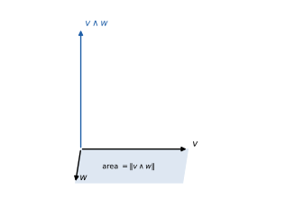

# 1 · Numeri complessi, polinomi e geometria analitica

**In questo modulo.** Servono l'algebra e la trigonometria delle scuole superiori (formule di addizione, equazioni di secondo grado) e il piano cartesiano. Si parte dagli insiemi numerici e si costruisce il campo dei numeri complessi: forma algebrica, coniugato e modulo, forma trigonometrica ed esponenziale, potenze con la formula di De Moivre e radici $n$-esime. Si studiano poi i polinomi: divisione con resto, teorema di Ruffini, teorema fondamentale dell'algebra e radici coniugate dei polinomi reali. La seconda parte è la geometria analitica dello spazio: vettori di $\mathbb{R}^3$, prodotto scalare, vettoriale e misto, equazioni di piani e rette, posizioni reciproche, distanze, sfere. Alla fine del modulo si sa calcolare con i numeri complessi in tutte le forme, fattorizzare un polinomio di cui si conosce una radice complessa e risolvere i problemi di posizione e di distanza fra punti, rette e piani.

## 1.1 Insiemi numerici

Gli insiemi numerici si costruiscono uno dentro l'altro, ciascuno per risolvere equazioni che nel precedente non hanno soluzione:
$$\mathbb{N} \subset \mathbb{Z} \subset \mathbb{Q} \subset \mathbb{R} \subset \mathbb{C}.$$
In $\mathbb{N} = \{0, 1, 2, \dots\}$ l'equazione $x + 1 = 0$ non ha soluzione, e si aggiungono gli opposti ottenendo gli interi $\mathbb{Z}$; in $\mathbb{Z}$ non si risolve $2x = 1$, e si passa ai razionali $\mathbb{Q}$, frazioni $\frac{p}{q}$ con $q \neq 0$; in $\mathbb{Q}$ non si risolve $x^2 = 2$ (perché $\sqrt 2$ è irrazionale), e i reali $\mathbb{R}$ colmano i "buchi" della retta. Ma anche in $\mathbb{R}$ l'equazione $x^2 + 1 = 0$ non ha soluzione, perché un quadrato reale non è mai negativo: per questo si introducono i numeri complessi.

Gli insiemi $\mathbb{Q}$, $\mathbb{R}$ e $\mathbb{C}$ sono **campi**: hanno una somma e un prodotto associativi e commutativi, con elementi neutri $0 \neq 1$, opposti, inversi di ogni elemento non nullo, e la proprietà distributiva. In tutto il corso si indica con $\mathbb{K}$ un campo che può essere $\mathbb{R}$ o $\mathbb{C}$.

## 1.2 Numeri complessi in forma algebrica

> [!definizione] Numero complesso
> Un **numero complesso** è un'espressione $z = a + ib$ con $a, b \in \mathbb{R}$, dove l'**unità immaginaria** $i$ verifica $i^2 = -1$. Il numero $a = \mathrm{Re}(z)$ è la **parte reale**, $b = \mathrm{Im}(z)$ la **parte immaginaria**. L'insieme dei numeri complessi si indica con $\mathbb{C}$.

I reali sono i complessi con $b = 0$; i numeri $ib$ con $b \neq 0$ si dicono **immaginari puri**. Poiché $z$ è determinato dalla coppia $(a, b)$, lo si rappresenta come punto del **piano di Gauss**, con la parte reale sull'asse orizzontale e quella immaginaria su quello verticale.

Le operazioni seguono le regole del calcolo letterale, con $i^2 = -1$:
$$(a + ib) + (c + id) = (a + c) + i(b + d), \qquad (a + ib)(c + id) = (ac - bd) + i(ad + bc).$$
La somma corrisponde alla somma di vettori con la regola del parallelogramma. Per esempio, con $z_1 = 2 + 3i$ e $z_2 = 1 - 4i$: $z_1 + z_2 = 3 - i$ e $z_1 z_2 = 2 - 8i + 3i - 12i^2 = 14 - 5i$. Le potenze di $i$ si ripetono con periodo 4: $i^2 = -1$, $i^3 = -i$, $i^4 = 1$, quindi per esempio $i^{2025} = i^{4 \cdot 506 + 1} = i$.

> [!definizione] Coniugato e modulo
> Il **coniugato** di $z = a + ib$ è $\bar z = a - ib$ (il simmetrico rispetto all'asse reale). Il **modulo** è $\lvert z\rvert = \sqrt{a^2 + b^2}$, la distanza di $z$ dall'origine.

Il coniugato rispetta le operazioni: $\overline{z_1 + z_2} = \bar z_1 + \bar z_2$, $\overline{z_1 z_2} = \bar z_1\, \bar z_2$, $\bar{\bar z} = z$; inoltre $z + \bar z = 2\,\mathrm{Re}(z)$, $z - \bar z = 2i\,\mathrm{Im}(z)$, e $z$ è reale se e solo se $z = \bar z$. La relazione fondamentale è
$$z \bar z = (a + ib)(a - ib) = a^2 + b^2 = \lvert z\rvert^2.$$
Ne viene l'inverso di un numero non nullo e la regola per dividere: si moltiplica per il coniugato del denominatore.
$$\frac{1}{z} = \frac{\bar z}{\lvert z\rvert^2} = \frac{a}{a^2 + b^2} - i\frac{b}{a^2 + b^2}, \qquad \frac{z_1}{z_2} = \frac{z_1 \bar z_2}{\lvert z_2\rvert^2}.$$
Per esempio
$$\frac{1 - i}{2 + i} = \frac{(1 - i)(2 - i)}{4 + 1} = \frac{2 - i - 2i + i^2}{5} = \frac{1 - 3i}{5} = \frac15 - \frac35 i.$$
Con queste operazioni $\mathbb{C}$ è un campo.

## 1.3 Forma trigonometrica ed esponenziale

Un numero $z \neq 0$ si individua anche con la distanza $r = \lvert z\rvert$ dall'origine e con l'angolo $\theta$ che il vettore forma con il semiasse reale positivo, l'**argomento** $\theta = \arg z$, definito a meno di multipli di $2\pi$. Poiché $a = r\cos\theta$ e $b = r\sin\theta$:
$$z = r(\cos\theta + i\sin\theta) \qquad (\text{forma trigonometrica}).$$
Per trovare $\theta$ da $a$ e $b$ si usa $\tan\theta = \frac{b}{a}$, facendo attenzione al quadrante: $\theta = \arctan\frac{b}{a}$ se $a > 0$, $\theta = \arctan\frac{b}{a} + \pi$ se $a < 0$, $\theta = \pm\frac{\pi}{2}$ se $a = 0$ e $b \gtrless 0$. Per esempio $\sqrt3 + i$ ha modulo $\sqrt{3 + 1} = 2$ e argomento $\arctan\frac{1}{\sqrt3} = \frac{\pi}{6}$: $\sqrt3 + i = 2\left(\cos\frac\pi6 + i\sin\frac\pi6\right)$.

La forma trigonometrica rende semplice il prodotto. Moltiplicando $z_1 = r_1(\cos\theta_1 + i\sin\theta_1)$ e $z_2 = r_2(\cos\theta_2 + i\sin\theta_2)$ e usando le formule di addizione:
$$z_1 z_2 = r_1 r_2\big[\cos(\theta_1 + \theta_2) + i\sin(\theta_1 + \theta_2)\big].$$
I moduli si moltiplicano e gli argomenti si sommano: moltiplicare per $z$ vuol dire ruotare di $\arg z$ e dilatare di $\lvert z\rvert$. Moltiplicare per $i$ è una rotazione di $90°$ in senso antiorario.

> [!definizione] Formula di Eulero e forma esponenziale
> Per $\theta \in \mathbb{R}$ si pone $e^{i\theta} = \cos\theta + i\sin\theta$, e per $w = a + ib$, $e^{w} = e^a(\cos b + i\sin b)$. Ogni $z \neq 0$ si scrive $z = r e^{i\theta}$.

Con questa notazione le regole diventano quelle delle potenze: $r_1 e^{i\theta_1} \cdot r_2 e^{i\theta_2} = r_1 r_2 e^{i(\theta_1 + \theta_2)}$, $\frac{r_1 e^{i\theta_1}}{r_2 e^{i\theta_2}} = \frac{r_1}{r_2} e^{i(\theta_1 - \theta_2)}$, e si verifica che $e^{z_1 + z_2} = e^{z_1} e^{z_2}$ per ogni $z_1, z_2 \in \mathbb{C}$ con le formule di addizione. Sommando e sottraendo $e^{ix}$ ed $e^{-ix}$ si ottengono le **formule di Eulero**
$$\cos x = \frac{e^{ix} + e^{-ix}}{2}, \qquad \sin x = \frac{e^{ix} - e^{-ix}}{2i},$$
da cui, per esempio, $\sin 2x = \frac{(e^{ix})^2 - (e^{-ix})^2}{2i} = 2\cdot\frac{e^{ix} - e^{-ix}}{2i}\cdot\frac{e^{ix} + e^{-ix}}{2} = 2\sin x\cos x$.

## 1.4 Potenze e radici

> [!teorema] Formula di De Moivre
> Per ogni $n \in \mathbb{N}$, $\big[r(\cos\theta + i\sin\theta)\big]^n = r^n\big(\cos(n\theta) + i\sin(n\theta)\big)$, cioè $(re^{i\theta})^n = r^n e^{in\theta}$.

Per esempio, $2 + 2i$ ha modulo $2\sqrt2 = 2^{3/2}$ e argomento $\frac\pi4$, quindi
$$(2 + 2i)^{100} = 2^{150}\left(\cos 25\pi + i\sin 25\pi\right) = 2^{150}(\cos\pi + i\sin\pi) = -2^{150}.$$

Il problema inverso è trovare i $w$ tali che $w^n = z$. Scrivendo $z = re^{i\theta}$ e $w = \rho e^{i\varphi}$, per De Moivre deve essere $\rho^n = r$ e $n\varphi = \theta + 2k\pi$ con $k \in \mathbb{Z}$; gli angoli distinti (a meno di $2\pi$) si ottengono per $k = 0, \dots, n - 1$.

> [!teorema] Radici $n$-esime
> Ogni $z = re^{i\theta} \neq 0$ ha esattamente $n$ radici $n$-esime complesse distinte:
> $$w_k = \sqrt[n]{r}\, e^{i\frac{\theta + 2k\pi}{n}}, \qquad k = 0, 1, \dots, n - 1.$$
> Stanno sulla circonferenza di centro 0 e raggio $\sqrt[n]{r}$ e sono i vertici di un poligono regolare di $n$ lati.

![Figura 1.1 · Le sei radici seste di $-4i$: modulo $\sqrt[3]{2}$, argomenti $\frac\pi4 + k\frac\pi3$.](../figure/1-1.svg)

> [!esempio] Radici seste di $-4i$
> Si ha $\lvert -4i\rvert = 4$ e $\arg(-4i) = \frac{3\pi}{2}$. Le radici hanno modulo $\sqrt[6]{4} = \sqrt[3]{2}$ e argomenti $\frac{3\pi/2 + 2k\pi}{6} = \frac{\pi}{4} + k\frac{\pi}{3}$ per $k = 0, \dots, 5$: formano un esagono regolare (figura 1.1).

Per le radici quadrate c'è anche un metodo algebrico. Se $w = x + iy$ e $w^2 = a + ib$, uguagliando parti reali e immaginarie si trova $x^2 - y^2 = a$ e $2xy = b$; insieme a $x^2 + y^2 = \lvert z\rvert = \sqrt{a^2 + b^2}$ si ricava
$$w = \pm\left(\sqrt{\frac{\sqrt{a^2 + b^2} + a}{2}} + i\,\mathrm{sgn}(b)\sqrt{\frac{\sqrt{a^2 + b^2} - a}{2}}\right).$$
Per $z = 3 + 4i$: $\lvert z\rvert = 5$, quindi $w = \pm(2 + i)$, e infatti $(2 + i)^2 = 3 + 4i$.

## 1.5 Polinomi

Un polinomio a coefficienti in $\mathbb{K}$ è $F(x) = a_n x^n + \dots + a_1 x + a_0$ con $a_i \in \mathbb{K}$; se $a_n \neq 0$, $n = \deg F$ è il suo **grado**. L'insieme dei polinomi si indica con $\mathbb{K}[x]$.

> [!teorema] Divisione con resto
> Se $F, G \in \mathbb{K}[x]$ e $G \neq 0$, esistono e sono unici due polinomi $Q$ (quoziente) e $R$ (resto) tali che
> $$F(x) = Q(x)\, G(x) + R(x), \qquad R = 0 \ \text{oppure} \ \deg R < \deg G.$$

Quoziente e resto si calcolano con la divisione in colonna, come per i numeri. Dividendo per $G(x) = x - \alpha$ il resto è una costante, ed è $F(\alpha)$: ne segue il **teorema di Ruffini**, $\alpha$ è radice di $F$ (cioè $F(\alpha) = 0$) se e solo se $x - \alpha$ divide $F(x)$.

> [!teorema] Teorema fondamentale dell'algebra
> Ogni polinomio $F \in \mathbb{C}[x]$ di grado $n \ge 1$ ha almeno una radice in $\mathbb{C}$. Di conseguenza si fattorizza come $F(x) = a_n(x - z_1)\cdots(x - z_n)$: ha esattamente $n$ radici complesse, contate con la loro molteplicità.

La seconda parte segue dalla prima e da Ruffini, per induzione sul grado. In $\mathbb{R}$ il teorema è falso ($x^2 + 1$ non ha radici reali), ma per i polinomi reali le radici complesse vengono a coppie.

> [!teorema] Radici coniugate
> Se $F \in \mathbb{R}[x]$ e $\alpha \in \mathbb{C}$ è una radice di $F$, anche $\bar\alpha$ è una radice di $F$.

*Dimostrazione.* Se $F(x) = \sum_j a_j x^j$ con $a_j$ reali, allora $a_j = \bar a_j$ e, per le proprietà del coniugato, $F(\bar\alpha) = \sum_j a_j \bar\alpha^j = \overline{\sum_j a_j \alpha^j} = \overline{F(\alpha)} = \bar 0 = 0$. $\square$

Quindi un polinomio reale si fattorizza in $\mathbb{R}[x]$ in fattori di primo grado (per le radici reali) e di secondo grado senza radici reali (per ogni coppia $\alpha$, $\bar\alpha$, il fattore $(x - \alpha)(x - \bar\alpha) = x^2 - 2\,\mathrm{Re}(\alpha)\,x + \lvert\alpha\rvert^2$).

> [!esempio] Fattorizzare sapendo una radice
> Le radici di $P(x) = x^5 - 2x^4 + 2x^3 - 2x^2 + 4x - 4$, sapendo che $P(1 + i) = 0$. Poiché $P$ è reale, anche $1 - i$ è radice, e $P$ è divisibile per $(x - 1 - i)(x - 1 + i) = (x - 1)^2 + 1 = x^2 - 2x + 2$. La divisione in colonna dà quoziente $x^3 - 2$ e resto zero:
> $$P(x) = (x^2 - 2x + 2)(x^3 - 2).$$
> Le altre tre radici sono le radici cubiche di 2: $\sqrt[3]{2}\, e^{2k\pi i/3}$ per $k = 0, 1, 2$, cioè $\sqrt[3]2$ e $\sqrt[3]2\left(-\frac12 \pm i\frac{\sqrt3}{2}\right)$.

## 1.6 Vettori nello spazio, prodotto scalare

Un vettore di $\mathbb{R}^3$ è una terna $v = (v_1, v_2, v_3)$; geometricamente lo si pensa come una freccia che parte dall'origine (o da un punto qualsiasi, con la stessa direzione, verso e lunghezza). Si sommano componente per componente e si moltiplicano per uno scalare $\lambda \in \mathbb{R}$ moltiplicando ogni componente. La **norma** (modulo) è $\lVert v\rVert = \sqrt{v_1^2 + v_2^2 + v_3^2}$, la lunghezza della freccia; il vettore che va dal punto $A$ al punto $B$ è $B - A$, e la **distanza** fra i due punti è $d(A, B) = \lVert B - A\rVert$.

> [!definizione] Prodotto scalare
> $v \cdot w = v_1 w_1 + v_2 w_2 + v_3 w_3$. Vale $v \cdot w = \lVert v\rVert\, \lVert w\rVert \cos\theta$, dove $\theta \in [0, \pi]$ è l'angolo fra i due vettori.

L'uguaglianza fra la forma algebrica e quella geometrica si vede nel piano scrivendo $v = \lVert v\rVert(\cos\alpha, \sin\alpha)$ e $w = \lVert w\rVert(\cos\beta, \sin\beta)$: allora $v \cdot w = \lVert v\rVert\lVert w\rVert(\cos\alpha\cos\beta + \sin\alpha\sin\beta) = \lVert v\rVert\lVert w\rVert\cos(\alpha - \beta)$. Il prodotto scalare è simmetrico, lineare in ciascun argomento e $v \cdot v = \lVert v\rVert^2$. Due vettori sono **ortogonali** se $v \cdot w = 0$.

Per esempio l'angolo fra $v = (2, -2, 1)$ e $w = (0, 1, -1)$: $v \cdot w = 0 - 2 - 1 = -3$, $\lVert v\rVert = 3$, $\lVert w\rVert = \sqrt2$, quindi $\cos\theta = -\frac{1}{\sqrt2}$ e $\theta = \frac{3\pi}{4}$.

## 1.7 Prodotto vettoriale e prodotto misto

> [!definizione] Prodotto vettoriale
> $$v \wedge w = \begin{vmatrix} \mathbf{i} & \mathbf{j} & \mathbf{k} \\ v_1 & v_2 & v_3 \\ w_1 & w_2 & w_3 \end{vmatrix} = (v_2 w_3 - v_3 w_2,\ v_3 w_1 - v_1 w_3,\ v_1 w_2 - v_2 w_1).$$

Il determinante "formale" si sviluppa lungo la prima riga (modulo 2). Proprietà:

- $v \wedge w$ è ortogonale sia a $v$ sia a $w$, e il suo verso segue la regola della mano destra;
- $w \wedge v = -v \wedge w$, quindi $v \wedge v = 0$; più in generale $v \wedge w = 0$ se e solo se $v$ e $w$ sono paralleli;
- è lineare in ciascun argomento: $v \wedge (\lambda w + \mu u) = \lambda\, v \wedge w + \mu\, v \wedge u$;
- $\lVert v \wedge w\rVert = \lVert v\rVert\,\lVert w\rVert \sin\theta$, l'area del parallelogramma costruito su $v$ e $w$; equivalentemente vale l'**identità di Lagrange** $\lVert v \wedge w\rVert^2 = \lVert v\rVert^2\lVert w\rVert^2 - (v \cdot w)^2$.

Quindi l'area del triangolo di vertici $A$, $B$, $C$ è $\frac12\lVert (B - A) \wedge (C - A)\rVert$.

> [!definizione] Prodotto misto
> Il **prodotto misto** di $u, v, w$ è $u \cdot (v \wedge w)$, che è il determinante della matrice con righe $u$, $v$, $w$. Il suo valore assoluto è il volume del parallelepipedo costruito sui tre vettori.

Tre vettori sono **complanari** se e solo se il prodotto misto è nullo; quattro punti $A, B, C, D$ stanno su un piano se e solo se $(B - A) \cdot \big((C - A) \wedge (D - A)\big) = 0$.

> [!esempio] Vettori ortogonali a due vettori dati
> I vettori di norma 2 ortogonali sia a $v = (1, 1, 1)$ sia a $w = (2, 1, 1)$ sono paralleli a $v \wedge w = (1 - 1,\ 2 - 1,\ 1 - 2) = (0, 1, -1)$, che ha norma $\sqrt2$. Moltiplicando per $\pm\frac{2}{\sqrt2} = \pm\sqrt2$ si ottengono $\pm(0, \sqrt2, -\sqrt2)$.

## 1.8 Piani e rette nello spazio

> [!definizione] Equazioni del piano
> Il piano per il punto $P_0$ ortogonale al vettore non nullo $n = (a, b, c)$ è l'insieme dei $P$ con $n \cdot (P - P_0) = 0$, cioè ha **equazione cartesiana** $ax + by + cz + d = 0$. Il piano per $P_0$ parallelo a due vettori non paralleli $v_1$, $v_2$ ha **equazioni parametriche** $P = P_0 + s v_1 + t v_2$, con $s, t \in \mathbb{R}$, e vettore normale $n = v_1 \wedge v_2$.

Per esempio, il piano per l'origine parallelo a $v_1 = (-2, -7, -4)$ e $v_2 = (-1, -1, 2)$ ha normale $v_1 \wedge v_2 = (-14 - 4,\ 4 + 4,\ 2 - 7) = (-18, 8, -5)$ ed equazione $18x - 8y + 5z = 0$.

Una **retta** si dà in forma parametrica, $P = P_0 + t\, v$ con $t \in \mathbb{R}$ e $v \neq 0$ **vettore direttore**, oppure in forma cartesiana come intersezione di due piani non paralleli:
$$r : \begin{cases} a_1 x + b_1 y + c_1 z + d_1 = 0 \\ a_2 x + b_2 y + c_2 z + d_2 = 0 \end{cases} \qquad v = n_1 \wedge n_2.$$
Si passa dalla forma cartesiana a quella parametrica risolvendo il sistema (modulo 2), e viceversa eliminando il parametro.

**Posizioni reciproche.** Due piani sono paralleli se le normali sono parallele, altrimenti si intersecano in una retta. Una retta di direzione $v$ e un piano di normale $n$ sono paralleli se $v \cdot n = 0$ (e la retta sta nel piano se in più ne ha un punto), altrimenti si intersecano in un punto. Due rette nello spazio possono essere:

- **parallele**, se i vettori direttori sono paralleli;
- **incidenti**, se si incontrano in un punto;
- **sghembe**, se non sono né parallele né incidenti: allora non stanno su uno stesso piano.

Con $r = P_0 + t v_1$ e $s = Q_0 + u v_2$ non parallele, le rette sono complanari (quindi incidenti) se e solo se $(Q_0 - P_0) \cdot (v_1 \wedge v_2) = 0$.

**Fascio di piani.** I piani che contengono la retta $r$ data come intersezione di $\pi_1 : f_1 = 0$ e $\pi_2 : f_2 = 0$ sono i piani $\lambda f_1 + \mu f_2 = 0$ con $(\lambda, \mu) \neq (0, 0)$. Si sceglie il piano voluto imponendo una condizione.

> [!esempio] Un piano del fascio
> Sia $r$ l'intersezione di $x + y + z - 3 = 0$ e $x - y - z - 2 = 0$. Il piano del fascio $\lambda(x + y + z - 3) + \mu(x - y - z - 2) = 0$ ha normale $(\lambda + \mu,\ \lambda - \mu,\ \lambda - \mu)$. Perché sia parallelo al vettore $(1, 2, 3)$ la normale deve essergli ortogonale: $(\lambda + \mu) + 2(\lambda - \mu) + 3(\lambda - \mu) = 6\lambda - 4\mu = 0$. Con $\lambda = 2$, $\mu = 3$ si ottiene il piano $5x - y - z - 12 = 0$.

## 1.9 Distanze e sfere

> [!teorema] Distanza di un punto da un piano
> La distanza del punto $P_0 = (x_0, y_0, z_0)$ dal piano $ax + by + cz + d = 0$ è
> $$d(P_0, \pi) = \frac{\lvert a x_0 + b y_0 + c z_0 + d\rvert}{\sqrt{a^2 + b^2 + c^2}}.$$

Si ottiene proiettando: la retta per $P_0$ ortogonale al piano è $P_0 + t\,n$, incontra il piano nel punto $P' = P_0 - \frac{n \cdot P_0 + d}{\lVert n\rVert^2}n$, e la distanza è $\lVert P_0 - P'\rVert$. Per esempio, il punto $(1, 1, 3)$ dista $\frac{\lvert 2 - 1 + 6 - 1\rvert}{3} = 2$ dal piano $2x - y + 2z - 1 = 0$.

La distanza fra due rette sghembe $r = P_0 + t v_1$ e $s = Q_0 + u v_2$ è la lunghezza del segmento di perpendicolare comune, e vale
$$d(r, s) = \frac{\lvert (Q_0 - P_0) \cdot (v_1 \wedge v_2)\rvert}{\lVert v_1 \wedge v_2\rVert},$$
cioè il volume del parallelepipedo costruito su $Q_0 - P_0$, $v_1$, $v_2$ diviso per l'area della base. Per $r = (1, 0, 0) + t(1, 1, 0)$ e $s = (0, 0, 3) + u(0, 1, 1)$: $v_1 \wedge v_2 = (1, -1, 1)$, $(Q_0 - P_0) \cdot (1, -1, 1) = (-1, 0, 3) \cdot (1, -1, 1) = 2 \neq 0$, quindi le rette sono sghembe e distano $\frac{2}{\sqrt3}$.

> [!definizione] Sfera
> La sfera di centro $C = (x_C, y_C, z_C)$ e raggio $R > 0$ è l'insieme dei punti a distanza $R$ da $C$:
> $$(x - x_C)^2 + (y - y_C)^2 + (z - z_C)^2 = R^2.$$

Un'equazione $x^2 + y^2 + z^2 + \alpha x + \beta y + \gamma z + \delta = 0$ si riconduce a questa forma completando i quadrati. Un piano a distanza $d$ dal centro taglia la sfera in una circonferenza di raggio $\sqrt{R^2 - d^2}$ se $d < R$, è tangente se $d = R$, non la incontra se $d > R$.

## Esempi ed esercizi svolti

**Esercizio 1 (un vertice dato l'area).** Dati $A = (1, 0, 2)$ e $B = (3, 1, 0)$, trovare i punti $C$ sull'asse $z$ tali che il triangolo $ABC$ abbia area 10. Con $C = (0, 0, t)$: $B - A = (2, 1, -2)$, $C - A = (-1, 0, t - 2)$ e
$$(B - A) \wedge (C - A) = \big(t - 2,\ 6 - 2t,\ 1\big).$$
L'area è la metà della norma: $\frac12\sqrt{(t - 2)^2 + (6 - 2t)^2 + 1} = 10$, cioè $5t^2 - 28t + 41 = 400$, $5t^2 - 28t - 359 = 0$, da cui $t = \frac{14 \pm \sqrt{1991}}{5}$ ($t \approx 11{,}72$ oppure $t \approx -6{,}12$).

**Esercizio 2 (sfera e piano).** La sfera $x^2 + y^2 + z^2 - 2x + 4y - 6z + 5 = 0$ si riscrive completando i quadrati come $(x - 1)^2 + (y + 2)^2 + (z - 3)^2 = 1 + 4 + 9 - 5 = 9$: centro $C = (1, -2, 3)$, raggio 3. Il piano $x + 2y + 2z = 7$ dista dal centro $\frac{\lvert 1 - 4 + 6 - 7\rvert}{3} = \frac43 < 3$, quindi taglia la sfera in una circonferenza di raggio $\sqrt{9 - \frac{16}{9}} = \frac{\sqrt{65}}{3}$, il cui centro è la proiezione di $C$ sul piano.

**Esercizio 3 (radici dell'unità).** Le radici cubiche di 1 sono $e^{2k\pi i/3}$, cioè $1$ e $-\frac12 \pm i\frac{\sqrt3}{2}$: si verifica che $\left(-\frac12 + i\frac{\sqrt3}{2}\right)^3 = e^{2\pi i} = 1$. Sono le radici di $x^3 - 1 = (x - 1)(x^2 + x + 1)$; le due non reali sono coniugate, come deve essere per un polinomio reale.

### Esercizi sul modello delle prove d'esame

> [!aggiunta] Aggiunta in revisione · fonte: esercizi nuovi sul modello delle 13 prove scritte dal gennaio 2024 al giugno 2026 e dei fogli di esercizi del corso; soluzioni verificate con `strumenti/verifica_ampliamento.py` (GEO-02, GEO-03)
> In ogni prova c'è un esercizio sui numeri complessi o sui polinomi e uno di geometria analitica nello spazio: piano per una retta e un punto, proiezioni e simmetrici, sfera e circonferenza.

**Esercizio 3. Forma esponenziale, potenze e radici.** Sia $w = 1 - \sqrt{3}\,i$. (a) Forma esponenziale. (b) $w^6$ in forma algebrica. (c) Soluzioni di $z^3 = w$.

(a) $|w| = \sqrt{1 + 3} = 2$; il punto $(1, -\sqrt3)$ sta nel quarto quadrante con $\tan\vartheta = -\sqrt3$, quindi $\vartheta = -\frac{\pi}{3}$: $w = 2e^{-i\pi/3}$.

(b) Per De Moivre $w^6 = 2^6 e^{-2\pi i} = 64$. Il risultato è reale perché $6 \cdot \frac{\pi}{3}$ è un multiplo di $2\pi$.

(c) Le radici cubiche hanno modulo $\sqrt[3]{2}$ e argomenti $\frac{-\pi/3 + 2k\pi}{3}$, $k = 0, 1, 2$:
$$z_k = \sqrt[3]{2}\,e^{i\left(-\frac{\pi}{9} + \frac{2k\pi}{3}\right)}, \qquad \text{argomenti } -\frac{\pi}{9},\ \frac{5\pi}{9},\ \frac{11\pi}{9}.$$
Nel piano complesso sono i vertici di un triangolo equilatero inscritto nella circonferenza di raggio $\sqrt[3]{2}$.

**Esercizio 4. Un'equazione di secondo grado a coefficienti complessi.** Risolvere $z^2 - 2iz - 2 = 0$.

La formula risolutiva vale anche in $\mathbb{C}$: $\Delta = (-2i)^2 - 4 \cdot (-2) = -4 + 8 = 4$, con radici quadrate $\pm 2$. Quindi $z = \frac{2i \pm 2}{2} = i \pm 1$. Controllo: $(1 + i)^2 - 2i(1 + i) - 2 = 2i - 2i + 2 - 2 = 0$. Le soluzioni non sono coniugate: lo sono solo quando i coefficienti sono reali.

**Esercizio 5. Fattorizzare in $\mathbb{R}$ e in $\mathbb{C}$.** Fattorizzare $p(x) = x^4 + 4$.

Le radici sono le radici quarte di $-4 = 4e^{i\pi}$: modulo $\sqrt2$ e argomenti $\frac{\pi}{4} + \frac{k\pi}{2}$, cioè $\pm 1 \pm i$. In $\mathbb{C}$, $p = (x - 1 - i)(x - 1 + i)(x + 1 - i)(x + 1 + i)$. In $\mathbb{R}$ si moltiplicano le coppie coniugate: $(x - 1 - i)(x - 1 + i) = (x - 1)^2 + 1$, e
$$x^4 + 4 = (x^2 - 2x + 2)(x^2 + 2x + 2).$$
Un polinomio reale senza radici reali si può comunque fattorizzare in fattori di secondo grado: è la conseguenza del teorema fondamentale dell'algebra per i polinomi reali.

**Esercizio 6. Piano per una retta e un punto, proiezione e simmetrico.** Siano $r: (x, y, z) = (0, 1, 2) + t(1, -1, 2)$, il punto $P = (1, 2, 0)$ e il piano $\pi: x - y + 2z - 1 = 0$. (a) Piano $\sigma$ che contiene $r$ e $P$. (b) Proiezione ortogonale di $Q = (1, 2, 3)$ su $\pi$ e simmetrico di $Q$ rispetto a $\pi$.

(a) $\sigma$ contiene il punto $R_0 = (0, 1, 2)$ di $r$, la direzione $d = (1, -1, 2)$ e il vettore $P - R_0 = (1, 1, -2)$. Un vettore normale è $d \times (P - R_0) = (0, 4, 2)$, cioè $(0, 2, 1)$. Il piano è $2y + z = c$, e passando per $P$: $c = 4$. Quindi $\sigma: 2y + z - 4 = 0$. Controllo: $R_0$ dà $2 + 2 = 4$ e la direzione dà $2 \cdot (-1) + 2 = 0$.

(b) La retta per $Q$ perpendicolare a $\pi$ è $Q + s(1, -1, 2)$. Sostituendo nel piano: $(1 + s) - (2 - s) + 2(3 + 2s) - 1 = 0$, cioè $4 + 6s = 0$, $s = -\frac23$. La proiezione è $H = \left(\frac13, \frac83, \frac53\right)$, e il simmetrico è $Q' = 2H - Q = \left(-\frac13, \frac{10}{3}, \frac13\right)$: $H$ è il punto medio fra $Q$ e $Q'$.

**Esercizio 7. Sfera tagliata da un piano.** $S: x^2 + y^2 + z^2 - 4x + 2y - 4 = 0$ e $\pi: x + 2y + 2z - 3 = 0$. Centro e raggio di $S$; mostrare che $S \cap \pi$ è una circonferenza e trovarne centro e raggio.

Completando i quadrati, $(x - 2)^2 + (y + 1)^2 + z^2 = 4 + 1 + 4 = 9$: centro $C = (2, -1, 0)$, raggio 3. La distanza di $C$ da $\pi$ è $\frac{|2 - 2 + 0 - 3|}{\sqrt{1 + 4 + 4}} = 1 < 3$: il piano taglia la sfera in una circonferenza di raggio $\sqrt{9 - 1} = 2\sqrt2$ (Pitagora sul triangolo centro della sfera, centro della circonferenza, punto della circonferenza). Il centro è la proiezione di $C$ su $\pi$: $C + s(1, 2, 2)$ con $9s - 3 = 0$, $s = \frac13$, quindi $\left(\frac73, -\frac13, \frac23\right)$.

**Esercizio 8. Rette sghembe e loro distanza.** $r: (1, 0, 0) + t(1, 1, 0)$ e $s: (0, 0, 2) + u(0, 1, 1)$.

Le direzioni non sono parallele. $d_r \times d_s = (1, -1, 1)$; il vettore fra due punti è $(0, 0, 2) - (1, 0, 0) = (-1, 0, 2)$. La distanza è
$$\frac{|(-1, 0, 2) \cdot (1, -1, 1)|}{\|(1, -1, 1)\|} = \frac{1}{\sqrt3} > 0,$$
quindi le rette non si incontrano: sono sghembe. Se il prodotto misto fosse stato 0 le rette sarebbero state complanari e, non essendo parallele, incidenti.

## Esercizi guidati

> [!aggiunta] Aggiunta in revisione · fonte: esercizi nuovi; soluzioni verificate con `strumenti/verifica_ampliamento.py` (GEO-02, GEO-03)
> Ogni esercizio è diviso in passi: si prova un passo alla volta e si confronta solo dopo.

**Guidato 1. Le radici quarte di $-16$.**

*Passo 1: forma esponenziale.* $-16 = 16e^{i\pi}$.

*Passo 2: modulo delle radici.* $\sqrt[4]{16} = 2$.

*Passo 3: argomenti.* $\frac{\pi + 2k\pi}{4}$ per $k = 0, 1, 2, 3$: $\frac{\pi}{4}, \frac{3\pi}{4}, \frac{5\pi}{4}, \frac{7\pi}{4}$.

*Passo 4: forma algebrica.* $2e^{i\pi/4} = \sqrt2 + i\sqrt2$, e le altre si ottengono cambiando i segni: $\pm\sqrt2 \pm i\sqrt2$, i vertici di un quadrato.

**Guidato 2. Il piano per tre punti e l'area del triangolo.** $A = (1, 0, 1)$, $B = (2, 1, 1)$, $C = (1, 2, 3)$.

*Passo 1: due vettori del piano.* $B - A = (1, 1, 0)$, $C - A = (0, 2, 2)$.

*Passo 2: il normale.* $(1, 1, 0) \times (0, 2, 2) = (2, -2, 2)$, cioè $(1, -1, 1)$.

*Passo 3: l'equazione.* $x - y + z = c$, con $A$: $c = 2$. Il piano è $x - y + z - 2 = 0$; si controlla con $B$ ($2 - 1 + 1 = 2$) e con $C$ ($1 - 2 + 3 = 2$).

*Passo 4: l'area.* È metà della norma del prodotto vettoriale: $\frac12\|(2, -2, 2)\| = \frac12 \cdot 2\sqrt3 = \sqrt3$.

**Guidato 3. Retta come intersezione di due piani.** Scrivere in forma parametrica $r: x + y + z = 0,\ x - y = 0$.

*Passo 1: la direzione.* È perpendicolare a entrambi i normali: $(1, 1, 1) \times (1, -1, 0) = (1, 1, -2)$.

*Passo 2: un punto.* L'origine soddisfa entrambe le equazioni.

*Passo 3: la parametrica.* $r: (x, y, z) = t(1, 1, -2)$.

*Passo 4: il controllo.* $t + t - 2t = 0$ e $t - t = 0$ per ogni $t$.

## Riepilogo

Gli insiemi numerici si estendono fino a $\mathbb{C}$, dove ogni equazione polinomiale ha soluzione. Un complesso si scrive in forma algebrica $a + ib$, in cui si sommano e si moltiplicano con $i^2 = -1$ e si divide moltiplicando per il coniugato ($z\bar z = \lvert z\rvert^2$), oppure in forma trigonometrica ed esponenziale $re^{i\theta}$, in cui i moduli si moltiplicano e gli argomenti si sommano. De Moivre dà le potenze, e ogni numero non nullo ha $n$ radici $n$-esime sui vertici di un poligono regolare. Per i polinomi valgono la divisione con resto, il teorema di Ruffini e il teorema fondamentale dell'algebra; le radici complesse di un polinomio reale sono a coppie coniugate. Nello spazio, il prodotto scalare misura lunghezze e angoli, il prodotto vettoriale dà un vettore ortogonale ai due fattori con norma uguale all'area del parallelogramma, il prodotto misto dà il volume e decide la complanarità. Un piano ha equazione $ax + by + cz + d = 0$ con normale $(a, b, c)$; una retta si dà in forma parametrica o come intersezione di due piani; le posizioni reciproche si decidono con prodotti scalari e vettoriali, le distanze con le formule di proiezione, e le sfere completando i quadrati.

## Formulario

> [!aggiunta] Aggiunta in revisione · fonte: sintesi del modulo (GEO-01 … GEO-03)
> Formule dei numeri complessi e della geometria analitica, con i termini per l'orale.

### Numeri complessi

$$z = a + ib = \rho(\cos\vartheta + i\sin\vartheta) = \rho e^{i\vartheta}, \quad \rho = |z| = \sqrt{a^2 + b^2}, \quad \bar z = a - ib, \quad z\bar z = |z|^2, \quad \frac{1}{z} = \frac{\bar z}{|z|^2}.$$

$$z_1 z_2 = \rho_1\rho_2 e^{i(\vartheta_1 + \vartheta_2)}, \qquad z^n = \rho^n e^{in\vartheta} \ \text{(De Moivre)}, \qquad \sqrt[n]{z} = \sqrt[n]{\rho}\,e^{i\frac{\vartheta + 2k\pi}{n}},\ k = 0, \dots, n - 1.$$

Eulero: $e^{i\vartheta} = \cos\vartheta + i\sin\vartheta$. Teorema fondamentale dell'algebra: un polinomio di grado $n$ ha $n$ radici in $\mathbb{C}$ contate con molteplicità; se i coefficienti sono reali le radici non reali vengono a coppie coniugate. Ruffini: $p(a) = 0 \iff (x - a) \mid p(x)$.

### Vettori

$$u \cdot v = \sum u_i v_i = \|u\|\|v\|\cos\vartheta, \qquad \|u \times v\| = \|u\|\|v\|\sin\vartheta = \text{area del parallelogramma}, \qquad |u \cdot (v \times w)| = \text{volume}.$$

Allineati: $u \times v = 0$. Complanari: $u \cdot (v \times w) = 0$. Proiezione di $v$ su $u$: $\frac{u \cdot v}{u \cdot u}u$.

### Rette, piani, distanze, sfere

| Oggetto | Equazioni |
|---|---|
| Piano | $ax + by + cz + d = 0$, normale $(a, b, c)$; parametrico $P_0 + su + tv$ |
| Retta | $P_0 + td$; oppure intersezione di due piani, con direzione $n_1 \times n_2$ |
| Distanza punto-piano | $\frac{\lvert ax_0 + by_0 + cz_0 + d\rvert }{\sqrt{a^2 + b^2 + c^2}}$ |
| Distanza fra rette sghembe | $\frac{|(Q - P) \cdot (d_r \times d_s)|}{\|d_r \times d_s\|}$ |
| Sfera | $(x - x_C)^2 + (y - y_C)^2 + (z - z_C)^2 = R^2$ |
| Circonferenza $S \cap \pi$ | raggio $\sqrt{R^2 - d(C, \pi)^2}$, centro la proiezione di $C$ su $\pi$ |

Parallelismo e perpendicolarità: retta e piano paralleli se $d \cdot n = 0$; perpendicolari se $d \parallel n$; due piani paralleli se i normali sono paralleli. Simmetrico di $Q$ rispetto a un piano: $2H - Q$, con $H$ proiezione.

### Termini per l'orale

| Termine | In una riga |
|---|---|
| Campo | insieme con somma e prodotto con le proprietà dei razionali |
| Modulo, argomento | distanza dall'origine e angolo nel piano di Gauss |
| Radice di molteplicità $m$ | $(x - a)^m$ divide il polinomio, $(x - a)^{m+1}$ no |
| Prodotto scalare, vettoriale, misto | numero; vettore perpendicolare; numero (volume con segno) |
| Rette sghembe | non parallele e non incidenti |
| Proiezione ortogonale | piede della perpendicolare da un punto |

### Domande che tornano spesso

- Definire $\mathbb{C}$ e le sue operazioni; perché non è ordinato?
- Ricavare le formule di De Moivre e quelle delle radici $n$-esime; dove stanno le radici nel piano?
- Enunciare il teorema fondamentale dell'algebra e la fattorizzazione dei polinomi reali.
- Proprietà del prodotto vettoriale e suo significato geometrico.
- Posizioni reciproche di due rette nello spazio; distanza fra rette sghembe.
