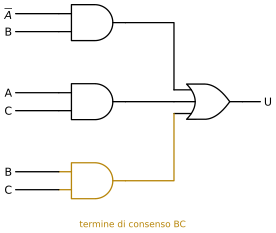
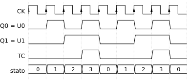

# Reti Logiche

**Appunti del corso · a.a. 2026/27 · Mobius**

Appunti personali e non ufficiali, rivisti e confrontati con il programma ufficiale del corso. Non sostituiscono le lezioni né i testi consigliati.

## Indice

1. Algebra booleana e sintesi delle reti combinatorie
2. Reti combinatorie standard, ritardi e aritmetica
3. Flip-flop, registri e contatori
4. Macchine a stati finiti e progetto con ASM

## 1 · Algebra booleana e sintesi delle reti combinatorie

**In questo modulo.** Non servono prerequisiti oltre all'algebra delle superiori. Si introducono le variabili e le funzioni booleane, le porte logiche che le realizzano e l'algebra che permette di trasformare un'espressione in un'altra equivalente. Poi si passa al problema centrale delle reti combinatorie: data una specifica, scritta come tabella di verità, trovare un circuito che la realizzi con il minor numero di porte. Gli strumenti sono le forme canoniche del teorema di Shannon e le mappe di Karnaugh, con le indifferenze e le variabili riportate. Alla fine del modulo si sa passare da una specifica a una sintesi minima a due livelli, nelle due forme AND-OR e OR-AND, e realizzarla anche con sole porte NAND o NOR.

### 1.1 Variabili e funzioni booleane

Nella matematica classica una funzione $y = f(x)$ associa a un numero reale $x$ un numero reale $y$. Nelle reti logiche le variabili possono assumere solo due valori, 0 e 1, che si leggono anche come *falso* e *vero*. Due valori sono la quantità minima per portare un'informazione: una variabile di questo tipo si chiama **variabile booleana**, e il suo valore è un **bit**.

> [!definizione] Funzione booleana
> Sia $\mathbb{B} = \{0, 1\}$. Una **funzione booleana** di $n$ variabili è una funzione $f : \mathbb{B}^n \to \mathbb{B}$, che associa a ogni $n$-upla $(x_1, \dots, x_n)$ di bit un bit $y = f(x_1, \dots, x_n)$. Una funzione con $p$ uscite, $f : \mathbb{B}^n \to \mathbb{B}^p$, è un vettore di $p$ funzioni booleane $y_k = f_k(x_1, \dots, x_n)$, che si studiano una alla volta.

Poiché ogni variabile ha due valori, le combinazioni degli ingressi sono $2^n$ (**principio di enumerazione**): una funzione si descrive completamente elencando il valore di uscita per ciascuna di esse, cioè con la sua **tabella di verità**, che ha $2^n$ righe. Ogni riga può contenere 0 o 1 indipendentemente dalle altre, quindi le funzioni distinte di $n$ variabili sono $2^{2^n}$: 4 per $n = 1$, 16 per $n = 2$, 256 per $n = 3$. Sono in numero finito, e per $n$ piccolo anche pochissime.

Una **rete combinatoria** è un circuito digitale le cui uscite, in ogni istante, dipendono solo dai valori degli ingressi in quello stesso istante (a meno dei ritardi, che si vedono nel modulo 2). Una rete combinatoria realizza quindi una funzione booleana, e la si può descrivere in quattro modi equivalenti: con la **tabella di verità** (la specifica), con un'**espressione** booleana (la rappresentazione matematica), con lo **schema** delle porte (la rappresentazione circuitale) e con il **diagramma temporale**, che mostra l'andamento nel tempo degli ingressi e delle uscite.

### 1.2 Le porte logiche

Le funzioni di una variabile sono quattro: le costanti $y = 0$ e $y = 1$, l'**identità** $y = x$, che nel circuito è un filo o un *buffer*, e la **negazione** $y = \bar{x}$ (NOT), che nei simboli si indica con un pallino.

Le funzioni di due variabili sono sedici. La tabella le elenca tutte, con i valori $f(0,0)$, $f(0,1)$, $f(1,0)$, $f(1,1)$ nella prima colonna.

| $f(00)\,f(01)\,f(10)\,f(11)$ | Espressione | Nome |
|---|---|---|
| 0 0 0 0 | $0$ | costante 0 |
| 0 0 0 1 | $x_1 x_2$ | AND |
| 0 0 1 0 | $x_1 \bar{x}_2$ | – |
| 0 0 1 1 | $x_1$ | identità di $x_1$ |
| 0 1 0 0 | $\bar{x}_1 x_2$ | – |
| 0 1 0 1 | $x_2$ | identità di $x_2$ |
| 0 1 1 0 | $x_1 \oplus x_2$ | XOR |
| 0 1 1 1 | $x_1 + x_2$ | OR |
| 1 0 0 0 | $\overline{x_1 + x_2}$ | NOR |
| 1 0 0 1 | $\overline{x_1 \oplus x_2}$ | XNOR |
| 1 0 1 0 | $\bar{x}_2$ | NOT $x_2$ |
| 1 0 1 1 | $x_1 + \bar{x}_2$ | – |
| 1 1 0 0 | $\bar{x}_1$ | NOT $x_1$ |
| 1 1 0 1 | $\bar{x}_1 + x_2$ | – |
| 1 1 1 0 | $\overline{x_1 x_2}$ | NAND |
| 1 1 1 1 | $1$ | costante 1 |

Le funzioni con un nome sono quelle che si realizzano con una sola porta (figura 1.1). L'**AND** vale 1 solo se entrambi gli ingressi valgono 1; l'**OR** vale 1 se almeno uno vale 1; lo **XOR** (*or esclusivo*) vale 1 se gli ingressi sono diversi, cioè se esattamente uno dei due vale 1. NAND, NOR e XNOR sono le loro negazioni. Le porte AND, OR, XOR e le loro negate si estendono a più ingressi: l'AND a $n$ ingressi vale 1 se tutti valgono 1, l'OR se almeno uno vale 1, lo XOR se il numero di ingressi a 1 è dispari.

Lo XOR risolve subito la specifica "$w$ vale 1 se uno solo dei due ingressi vale 1": la tabella è proprio quella di $w = x \oplus y$. Con tre ingressi la stessa specifica ("$w$ vale 1 se uno solo fra $x$, $y$, $t$ vale 1") non è più uno XOR, perché lo XOR a tre ingressi vale 1 anche quando tutti e tre sono a 1. Per scrivere un'espressione a partire da una tabella qualsiasi servono le forme canoniche del paragrafo 1.4.

### 1.3 Algebra di Boole

Le espressioni booleane si manipolano con regole simili a quelle dell'algebra dei numeri, ma non identiche. Ogni identità si dimostra per **induzione perfetta**: si controlla sulla tabella di verità che i due membri valgano lo stesso per tutte le combinazioni delle variabili, che sono in numero finito.

**Proprietà dell'algebra di Boole.** Ogni riga è scritta nella forma per l'OR e nella forma duale per l'AND.

| Proprietà | Forma OR | Forma AND |
|---|---|---|
| Elemento neutro | $A + 0 = A$ | $A \cdot 1 = A$ |
| Elemento nullo | $A + 1 = 1$ | $A \cdot 0 = 0$ |
| Idempotenza | $A + A = A$ | $A \cdot A = A$ |
| Complemento | $A + \bar{A} = 1$ | $A \cdot \bar{A} = 0$ |
| Involuzione | $\bar{\bar{A}} = A$ | $\bar{\bar{A}} = A$ |
| Commutativa | $A + B = B + A$ | $AB = BA$ |
| Associativa | $(A + B) + C = A + (B + C)$ | $(AB)C = A(BC)$ |
| Distributiva | $A + BC = (A + B)(A + C)$ | $A(B + C) = AB + AC$ |
| Assorbimento | $A + AB = A$ | $A(A + B) = A$ |
| Assorbimento del complemento | $A + \bar{A}B = A + B$ | $A(\bar{A} + B) = AB$ |
| De Morgan | $\overline{A + B} = \bar{A}\,\bar{B}$ | $\overline{AB} = \bar{A} + \bar{B}$ |
| Consenso | $AB + \bar{A}C + BC = AB + \bar{A}C$ | $(A + B)(\bar{A} + C)(B + C) = (A + B)(\bar{A} + C)$ |

Due proprietà non hanno corrispondente nell'algebra dei numeri: l'idempotenza e la distributiva della somma rispetto al prodotto, $A + BC = (A + B)(A + C)$.

**Principio di dualità.** Se un'identità è vera, resta vera scambiando ovunque $+$ con $\cdot$ e 0 con 1 (le variabili e le negazioni restano). Per questo ogni proprietà della tabella compare in coppia, e i teoremi di questo modulo hanno sempre una versione AND-OR e una OR-AND.

Le leggi di **De Morgan** valgono con un numero qualsiasi di variabili: la negazione di una somma è il prodotto delle negazioni, e la negazione di un prodotto è la somma delle negazioni. Sono lo strumento per portare le negazioni dentro le parentesi e, nel paragrafo 1.7, per passare da porte AND e OR a sole NAND o NOR.

Il **termine di consenso** $BC$ della proprietà omonima si ottiene dai due termini $AB$ e $\bar{A}C$ che contengono una variabile in forma diretta e negata, togliendola: è ridondante, perché quando vale 1 vale 1 anche uno degli altri due. Nel modulo 2 si vedrà che, nel circuito reale, proprio questo termine ridondante può servire.

> [!esempio] Due semplificazioni
> Sia $Y = \bar{A}\bar{B}\bar{C} + \bar{A}B\bar{C} + AB\bar{C}$. Per l'idempotenza si può duplicare il termine centrale, poi si raccoglie:
> $$Y = \bar{A}\bar{B}\bar{C} + \bar{A}B\bar{C} + \bar{A}B\bar{C} + AB\bar{C} = \bar{A}\bar{C}(\bar{B} + B) + B\bar{C}(\bar{A} + A) = \bar{A}\bar{C} + B\bar{C} = \bar{C}(\bar{A} + B).$$
> Sia ora $Y = \bar{A}\bar{B}\bar{C} + \bar{A}B\bar{C} + \overline{AB\bar{C}}$. Con De Morgan l'ultimo termine diventa $\bar{A} + \bar{B} + C$; i primi due si raccolgono in $\bar{A}\bar{C}$, che è assorbito da $\bar{A}$:
> $$Y = \bar{A}\bar{C} + \bar{A} + \bar{B} + C = \bar{A}(\bar{C} + 1) + \bar{B} + C = \bar{A} + \bar{B} + C.$$
> La funzione vale 0 solo per $ABC = 110$, come si vede dalla tabella.

### 1.4 Forme canoniche e teorema di Shannon

Il teorema di Shannon dice come scrivere un'espressione per una funzione qualsiasi a partire dalla sua tabella.

**Mintermini e maxtermini.** Un **mintermine** di $n$ variabili è un prodotto in cui compaiono tutte le variabili, ciascuna in forma diretta o negata: vale 1 per una sola combinazione degli ingressi. Per $ABC = 101$ il mintermine è $A\bar{B}C$ (la variabile è negata dove vale 0). Un **maxtermine** è una somma in cui compaiono tutte le variabili: vale 0 per una sola combinazione. Per $ABC = 101$ il maxtermine è $\bar{A} + B + \bar{C}$ (la variabile è negata dove vale 1).

> [!teorema] Teorema di espansione di Shannon
> Per ogni funzione booleana $f$ e ogni sua variabile $x_1$:
> $$f(x_1, x_2, \dots, x_n) = \bar{x}_1 \cdot f(0, x_2, \dots, x_n) + x_1 \cdot f(1, x_2, \dots, x_n)$$
> e, nella forma duale,
> $$f(x_1, x_2, \dots, x_n) = \big(x_1 + f(0, x_2, \dots, x_n)\big) \cdot \big(\bar{x}_1 + f(1, x_2, \dots, x_n)\big).$$
> Applicando il teorema a tutte le variabili si ottengono le due **forme canoniche**: $f$ è la somma dei mintermini delle combinazioni in cui vale 1 (**prima forma**, somma di prodotti, SOP) e il prodotto dei maxtermini delle combinazioni in cui vale 0 (**seconda forma**, prodotto di somme, POS).

La dimostrazione è immediata: per $x_1 = 0$ il membro destro della prima forma vale $f(0, x_2, \dots)$, per $x_1 = 1$ vale $f(1, x_2, \dots)$. Per due variabili le due forme sono

$$f(x_1, x_2) = \bar{x}_1\bar{x}_2\, f(0,0) + \bar{x}_1 x_2\, f(0,1) + x_1\bar{x}_2\, f(1,0) + x_1 x_2\, f(1,1)$$

$$f(x_1, x_2) = \big(x_1 + x_2 + f(0,0)\big)\big(x_1 + \bar{x}_2 + f(0,1)\big)\big(\bar{x}_1 + x_2 + f(1,0)\big)\big(\bar{x}_1 + \bar{x}_2 + f(1,1)\big).$$

Nella prima i termini con $f = 0$ spariscono, e restano i mintermini degli 1; nella seconda spariscono i fattori con $f = 1$, e restano i maxtermini degli 0.

> [!esempio] Le due forme di una funzione di tre variabili
> Sia $y$ la funzione che vale 1 per $ABC = 000, 001, 100, 110$ e 0 altrove. La prima forma prende gli 1:
> $$y = \bar{A}\bar{B}\bar{C} + \bar{A}\bar{B}C + A\bar{B}\bar{C} + AB\bar{C} = \bar{A}\bar{B}(\bar{C} + C) + A\bar{C}(\bar{B} + B) = \bar{A}\bar{B} + A\bar{C}.$$
> La seconda prende gli 0, cioè $010, 011, 101, 111$:
> $$y = (A + \bar{B} + C)(A + \bar{B} + \bar{C})(\bar{A} + B + \bar{C})(\bar{A} + \bar{B} + \bar{C}).$$
> Posto $P = A + \bar{B}$, i primi due fattori danno $(P + C)(P + \bar{C}) = P + C\bar{C} = P$ per la distributiva; allo stesso modo gli ultimi due danno $\bar{A} + \bar{C}$. Quindi $y = (A + \bar{B})(\bar{A} + \bar{C})$.

La forma SOP si realizza con una **rete a due livelli** AND-OR: un livello di porte AND, una per ogni prodotto, e una porta OR che li somma. La forma POS dà la rete OR-AND. Nel contare i livelli non si contano i NOT sugli ingressi, perché si suppone di avere ogni variabile disponibile sia diretta sia negata. Una rete a due livelli è la più veloce possibile, perché ogni segnale attraversa al più due porte; le forme canoniche però hanno in genere molti termini, e il problema della **sintesi** è trovare un'espressione equivalente con meno porte e meno ingressi. Non sempre esiste una sola sintesi minima: possono essercene diverse con lo stesso costo.

### 1.5 Mappe di Karnaugh

La semplificazione algebrica si basa sempre sullo stesso passo, $XA + X\bar{A} = X$: due prodotti che differiscono per una sola variabile si fondono in uno. La **mappa di Karnaugh** è una tabella di verità disposta in modo che questi prodotti si vedano a colpo d'occhio.

> [!definizione] Mappa di Karnaugh
> La mappa di una funzione di $n$ variabili ha $2^n$ celle, una per combinazione degli ingressi. Righe e colonne sono ordinate secondo il **codice Gray** (00, 01, 11, 10), in cui due valori consecutivi differiscono per un solo bit. Due celle sono **adiacenti** quando differiscono per una sola variabile: sono adiacenti le celle vicine, e anche le celle ai bordi opposti della stessa riga o colonna, perché la mappa si richiude su se stessa.

Le combinazioni di due variabili sono i quattro vertici di un quadrato, quelle di tre gli otto vertici di un cubo, quelle di quattro i vertici di un ipercubo: due vertici sono collegati da uno spigolo se differiscono per una variabile. La mappa è il modo di disegnare questi oggetti su un foglio senza perdere le adiacenze. Oltre le quattro variabili le adiacenze non si vedono più bene, e si usano metodi tabellari o programmi.

Un **gruppo** di $2^k$ celle adiacenti a forma di rettangolo (anche spezzato dai bordi) che contengono tutte 1 corrisponde a un prodotto con $n - k$ variabili: restano solo quelle che hanno lo stesso valore in tutte le celle del gruppo. Una cella isolata è un mintermine, una coppia toglie una variabile, una quaterna due, e così via.

> [!definizione] Regole di raggruppamento (sintesi SOP)
>
> 1. Coprire tutti gli 1 della mappa.
> 2. Usare gruppi più grandi possibile, di $2^k$ celle.
> 3. Usare il minimo numero di gruppi.
>
> I gruppi possono sovrapporsi. Per la sintesi POS si raggruppano gli 0: ogni gruppo dà una somma in cui una variabile compare negata se nel gruppo vale 1, diretta se vale 0.

**Implicanti primi ed essenziali.** Un gruppo di 1 è un **implicante** della funzione: quando il suo prodotto vale 1, vale 1 anche la funzione. Un implicante è **primo** se non è contenuto in un gruppo più grande; è **essenziale** se copre almeno un 1 che nessun altro implicante primo copre. Una sintesi minima usa solo implicanti primi e contiene sempre tutti quelli essenziali. Il procedimento è quindi: individuare gli implicanti primi, prendere gli essenziali, e coprire gli 1 rimasti con il minor numero di implicanti primi. Quando nell'ultimo passo ci sono più scelte equivalenti, ci sono più sintesi minime.

Nelle mappe di questo modulo le righe e le colonne portano in testa le variabili, nell'ordine di Gray. Negli esempi seguenti, con tre variabili, le righe sono $A$ e le colonne $BC$.

> [!esempio] Una mappa a tre variabili, con un errore da evitare
> La funzione vale 1 per $ABC = 000, 001, 010, 100, 101$.
>
> | $A \backslash BC$ | 00 | 01 | 11 | 10 |
> |---|---|---|---|---|
> | 0 | 1 | 1 | 0 | 1 |
> | 1 | 1 | 1 | 0 | 0 |
>
> Le prime due colonne formano una quaterna, in cui solo $B$ resta costante a 0: il prodotto è $\bar{B}$. Resta l'1 in $010$, che si raggruppa con la cella $000$, adiacente perché la riga si richiude: il gruppo è $\bar{A}\bar{C}$. Quindi $U = \bar{B} + \bar{A}\bar{C}$.
>
> Sarebbe sbagliato prendere tutta la riga $A = 0$ come gruppo $\bar{A}$: la cella $011$ vale 0.

> [!esempio] Una sintesi senza quaterne
> La funzione vale 1 per $ABC = 001, 010, 100, 110$.
>
> | $A \backslash BC$ | 00 | 01 | 11 | 10 |
> |---|---|---|---|---|
> | 0 | 0 | 1 | 0 | 1 |
> | 1 | 1 | 0 | 0 | 1 |
>
> L'1 in $001$ non ha vicini a 1: resta il mintermine $\bar{A}\bar{B}C$. Le celle $100$ e $110$ sono adiacenti (ai due bordi della riga) e danno $A\bar{C}$; le celle $010$ e $110$ sono nella stessa colonna e danno $B\bar{C}$. La sintesi minima è $U = \bar{A}\bar{B}C + A\bar{C} + B\bar{C}$, con tre implicanti tutti essenziali.

> [!esempio] Sintesi AND-OR e OR-AND della stessa funzione
> Sia $U = A \oplus B + BC$. Gli 1 sono in $010, 011, 100, 101, 111$.
>
> | $A \backslash BC$ | 00 | 01 | 11 | 10 |
> |---|---|---|---|---|
> | 0 | 0 | 0 | 1 | 1 |
> | 1 | 1 | 1 | 1 | 0 |
>
> Raggruppando gli 1 si trovano $\bar{A}B$ (le ultime due celle della prima riga), $A\bar{B}$ (le prime due della seconda) e, per l'1 in $111$, a scelta $BC$ oppure $AC$: due sintesi minime, $U = A\bar{B} + \bar{A}B + BC$ e $U = A\bar{B} + \bar{A}B + AC$. Raggruppando gli 0 ($000$, $001$, $110$) si trovano $\bar{A}\bar{B}$, cioè il fattore $(A + B)$, e la cella $110$, cioè $(\bar{A} + \bar{B} + C)$: $U = (A + B)(\bar{A} + \bar{B} + C)$.

Con quattro variabili le righe sono $AB$ e le colonne $CD$, entrambe in ordine di Gray, e si richiudono sia le righe sia le colonne: i quattro angoli sono adiacenti fra loro.

> [!esempio] Una mappa a quattro variabili
> La funzione vale 1 per i mintermini 0, 1, 2, 5, 8, 9, 10 (numerati in binario come $ABCD$).
>
> | $AB \backslash CD$ | 00 | 01 | 11 | 10 |
> |---|---|---|---|---|
> | 00 | 1 | 1 | 0 | 1 |
> | 01 | 0 | 1 | 0 | 0 |
> | 11 | 0 | 0 | 0 | 0 |
> | 10 | 1 | 1 | 0 | 1 |
>
> Le prime due colonne nelle righe $00$ e $10$ (adiacenti, perché le righe si richiudono) formano la quaterna $\bar{B}\bar{C}$. I quattro angoli formano la quaterna $\bar{B}\bar{D}$. Resta l'1 in $0101$, che si raggruppa con $0001$: $\bar{A}\bar{C}D$. Tutti e tre gli implicanti sono essenziali e $U = \bar{B}\bar{C} + \bar{B}\bar{D} + \bar{A}\bar{C}D$.

Ci sono funzioni che le mappe non semplificano affatto. La funzione di tre variabili che vale 1 quando il numero di ingressi a 1 è pari ha la mappa a scacchiera:

| $x \backslash yz$ | 00 | 01 | 11 | 10 |
|---|---|---|---|---|
| 0 | 1 | 0 | 1 | 0 |
| 1 | 0 | 1 | 0 | 1 |

Nessuna cella ha vicini con lo stesso valore, quindi sia la SOP sia la POS sono le forme canoniche, con quattro termini da tre variabili ciascuno. Raggruppando gli 0 si ottiene

$$U = (x + y + \bar{z})(x + \bar{y} + z)(\bar{x} + y + z)(\bar{x} + \bar{y} + \bar{z}).$$

È la funzione $U = \overline{x \oplus y \oplus z}$, che con le porte XOR richiede due sole porte. Le funzioni di parità sono il caso peggiore per le reti a due livelli e il caso migliore per le porte XOR.

### 1.6 Indifferenze e variabili riportate

Spesso alcune combinazioni degli ingressi non si presentano mai, oppure il valore dell'uscita in corrispondenza di esse non interessa. In quelle celle si scrive un trattino, che si chiama **indifferenza** (*don't care*): nella sintesi lo si considera 1 se aiuta a fare gruppi più grandi, 0 altrimenti. Un'indifferenza non va mai coperta per forza.

Il trattino si usa anche negli ingressi di una tabella: una riga come "$S_1 S_0 = 1\,1$, $A = -$" vuol dire che il valore di $A$ non conta, e la riga vale per entrambi i valori. Le due cose sono diverse: la prima è un'indifferenza sull'uscita, la seconda sugli ingressi.

> [!esempio] Sintesi SOP e POS con le indifferenze
> Righe $AC$, colonne $BD$ (stesso ordine di Gray):
>
> | $AC \backslash BD$ | 00 | 01 | 11 | 10 |
> |---|---|---|---|---|
> | 00 | 1 | 1 | 1 | 1 |
> | 01 | 0 | – | 0 | 0 |
> | 11 | 0 | 1 | 0 | 0 |
> | 10 | 1 | – | 0 | 0 |
>
> Per la SOP: la prima riga è il gruppo $\bar{A}\bar{C}$; la colonna $BD = 01$, con le due indifferenze, è il gruppo $\bar{B}D$; le righe $00$ e $10$ nelle colonne $00$ e $01$ danno $\bar{B}\bar{C}$. Quindi $U = \bar{A}\bar{C} + \bar{B}\bar{C} + \bar{B}D$.
>
> Per la POS si raggruppano gli 0: le colonne $11$ e $10$ nelle righe $11$ e $10$ ($A = 1$, $B = 1$) danno $(\bar{A} + \bar{B})$; le colonne $00$ e $10$ nelle righe $01$ e $11$ ($C = 1$, $D = 0$) danno $(\bar{C} + D)$; le colonne $11$ e $10$ nelle righe $01$ e $11$ ($B = 1$, $C = 1$) danno $(\bar{B} + \bar{C})$. Quindi $U = (\bar{A} + \bar{B})(\bar{C} + D)(\bar{B} + \bar{C})$.

> [!attenzione]
> Nella sintesi OR-AND è facile sbagliare la polarità: il fattore del gruppo con $B = 1$ e $C = 1$ è $(\bar{B} + \bar{C})$, non $(\bar{B} + C)$. Conviene sempre controllare la sintesi su una cella a 1: qui $\bar{A}B\bar{C}D$ deve dare 1, e con $(\bar{B} + C)$ darebbe 0.

Una mappa può contenere, oltre a 0, 1 e trattini, anche delle **variabili riportate** (*map-entered variables*): una cella che contiene $I$ vuol dire che in quella combinazione l'uscita vale $I$. Così una funzione di tre variabili si scrive su una mappa di due, e una di cinque o sei su una mappa di quattro. Le variabili riportate nascono in modo naturale con i multiplexer (modulo 2), dove ogni cella corrisponde a un ingresso dati.

> [!definizione] Sintesi con le variabili riportate
>
> 1. Si individuano le variabili riportate.
> 2. Si fa la mappa con tutte le variabili riportate poste a 0 e la si sintetizza.
> 3. Per ogni variabile riportata si fa una mappa in cui le celle con quella variabile valgono 1, le celle con 1 diventano indifferenze (sono già coperte dalla mappa del punto 2), le celle con 0 restano 0, e le celle con le altre variabili riportate valgono 0.
> 4. Si sommano le sintesi: quella del punto 2 e, per ogni variabile riportata, la sua sintesi moltiplicata (AND) per la variabile.

Il risultato è una sintesi **quasi minima**: è corretta, ma non è garantito che sia la più piccola possibile, perché le variabili riportate non si raggruppano con le adiacenze delle altre.

> [!esempio] Una variabile riportata
> Righe $A$, colonne $B$: $f(0,0) = 1$, $f(0,1) = I$, $f(1,0) = 1$, $f(1,1) = 0$.
>
> Con $I = 0$ la mappa ha gli 1 nella colonna $B = 0$: $\bar{B}$. Nella mappa di $I$ le due celle con 1 diventano indifferenze e la cella $\bar{A}B$ vale 1: con l'indifferenza in $\bar{A}\bar{B}$ si forma il gruppo $\bar{A}$. Quindi $U = \bar{B} + I\bar{A}$.
>
> Sarebbe inutile scrivere $\bar{I}(\dots) + I(\dots)$ con due mappe complete: le celle a 1 verrebbero coperte due volte. Le celle a 1 sono già nella mappa del punto 2, e la mappa di $I$ deve coprire solo le celle con $I$.

> [!esempio] Due variabili riportate
> Righe $A$, colonne $BC$:
>
> | $A \backslash BC$ | 00 | 01 | 11 | 10 |
> |---|---|---|---|---|
> | 0 | 1 | 1 | $y$ | $y$ |
> | 1 | 1 | $x$ | 0 | 0 |
>
> Con $x = y = 0$ si trovano $\bar{A}\bar{B}$ e $\bar{B}\bar{C}$. Nella mappa di $x$ la cella $101$ vale 1 e, con le indifferenze delle prime due colonne, forma la quaterna $\bar{B}$. Nella mappa di $y$ le celle $011$ e $010$ valgono 1 e, con le indifferenze, formano la riga $\bar{A}$. Quindi
> $$U = \bar{A}\bar{B} + \bar{B}\bar{C} + x\bar{B} + y\bar{A}.$$

### 1.7 Reti con sole porte NAND o NOR

Con le porte AND, OR e NOT si realizza qualsiasi funzione, perché esistono le forme canoniche. Lo stesso vale per la sola porta NAND, che quindi è **funzionalmente completa**: un NOT è una NAND con gli ingressi uniti ($\overline{A \cdot A} = \bar{A}$), un AND è una NAND seguita da un NOT, e un OR è una NAND con gli ingressi negati, perché per De Morgan $\overline{\bar{A}\,\bar{B}} = A + B$ (figura 1.2). Per dualità anche la sola porta NOR è completa.

Una rete AND-OR si trasforma in una rete di sole NAND senza aggiungere livelli. Negando due volte la SOP e applicando De Morgan alla negazione esterna:

$$U = AB + CD = \overline{\overline{AB + CD}} = \overline{\overline{AB} \cdot \overline{CD}}.$$

Le porte AND del primo livello diventano NAND, e la OR del secondo livello diventa una NAND. Allo stesso modo una rete OR-AND diventa una rete di sole NOR. Le porte NAND e NOR sono le più semplici da costruire con i transistori, e questa trasformazione è quella che si usa in pratica.

**Da POS a sole NOR.** Per dualità, $U = (A + B)(C + D) = \overline{\overline{(A + B)(C + D)}} = \overline{\overline{A + B} + \overline{C + D}}$: le OR del primo livello diventano NOR e la AND del secondo livello diventa una NOR.

### Esempi ed esercizi svolti

**Esercizio 1.** Una rete realizza $F = ACD + \bar{C}\big(\bar{A}D + A(B + D)\big)$, con 5 livelli di porte. Trovare una rete equivalente a due livelli.

Si distribuisce $A$ e si raccoglie $D$ fra i termini con $\bar{A}D$ e $AD$:
$$\bar{A}D + AB + AD = D(\bar{A} + A) + AB = D + AB,$$
quindi
$$F = ACD + \bar{C}(D + AB) = ACD + \bar{C}D + AB\bar{C} = D(AC + \bar{C}) + AB\bar{C} = D(A + \bar{C}) + AB\bar{C},$$
dove nell'ultimo passaggio si è usato l'assorbimento del complemento, $\bar{C} + AC = \bar{C} + A$. Il risultato è
$$F = AD + \bar{C}D + AB\bar{C},$$
una rete AND-OR a due livelli con tre porte AND e una OR.

> [!attenzione]
> Il termine $AB\bar{C}$ non si può perdere per strada: per $ABCD = 1100$ la rete di partenza vale 1, mentre $AD + \bar{C}D$ vale 0.

**Esercizio 2.** Sintesi SOP e POS della funzione con la mappa (righe $X$, colonne $YZ$)

| $X \backslash YZ$ | 00 | 01 | 11 | 10 |
|---|---|---|---|---|
| 0 | 1 | 0 | 1 | 0 |
| 1 | 1 | 0 | 0 | 1 |

Per la SOP: la colonna $00$ dà $\bar{Y}\bar{Z}$; le celle $100$ e $110$ (adiacenti ai bordi) danno $X\bar{Z}$; l'1 in $011$ resta solo: $U = \bar{Y}\bar{Z} + X\bar{Z} + \bar{X}YZ$. Per la POS: la colonna $01$ dà $(Y + \bar{Z})$; le celle $101$ e $111$ danno $(\bar{X} + \bar{Z})$; lo 0 in $010$ resta solo e dà $(X + \bar{Y} + Z)$. Quindi $U = (Y + \bar{Z})(\bar{X} + \bar{Z})(X + \bar{Y} + Z)$.

**Esercizio 3.** Semplificare $x + xy + xyz + xyzw + xz + xw + xzw$.

Raccogliendo $x$: $x(1 + y + yz + yzw + z + w + zw) = x \cdot 1 = x$, perché una somma che contiene 1 vale 1. È l'assorbimento, $x + xP = x$, applicato a ogni termine.

#### Esercizi del laboratorio con il simulatore

Gli esercizi che seguono ricalcano quelli fatti in laboratorio con Deeds: si disegna lo schema, si ricava la tabella con la simulazione funzionale (l'animazione, in cui si cambiano gli interruttori e si guardano le uscite) e si controlla con la simulazione temporale. Qui il lavoro si fa a mano, come all'esame, e la simulazione serve da verifica.

**Esercizio 4. Analisi di una rete di porte semplici.** Gli ingressi $A$ e $B$ vanno a una NAND e a una OR; le due uscite entrano in una AND, che dà $U$. Ricavare la tabella di verità e dire che funzione è.

Si ragiona porta per porta, scrivendo una colonna per ogni uscita intermedia: $N = \overline{AB}$ e $O = A + B$.

| $A$ | $B$ | $N = \overline{AB}$ | $O = A + B$ | $U = N \cdot O$ |
|---|---|---|---|---|
| 0 | 0 | 1 | 0 | 0 |
| 0 | 1 | 1 | 1 | 1 |
| 1 | 0 | 1 | 1 | 1 |
| 1 | 1 | 0 | 1 | 0 |

L'uscita vale 1 quando gli ingressi sono diversi: è lo XOR. Lo si vede anche con l'algebra, distribuendo: $\overline{AB}(A + B) = (\bar{A} + \bar{B})(A + B) = \bar{A}B + A\bar{B}$, perché $\bar{A}A$ e $\bar{B}B$ valgono 0. Per la simulazione temporale conviene far cambiare gli ingressi nell'ordine di Gray, $00, 01, 11, 10$: cambia un ingresso alla volta e ogni variazione dell'uscita si attribuisce subito a quell'ingresso.

**Esercizio 5. Controllo di parità a più livelli.** Un ricevitore riceve tre bit di dato $D_2 D_1 D_0$ e un bit di parità $RP$, calcolato dal trasmettitore con la **parità dispari**: il numero totale di 1 nei quattro bit deve essere dispari. La rete di controllo è costruita così: $C_1 = D_2\bar{D}_1 + \bar{D}_2 D_1$, $C_2 = D_0\overline{RP} + \bar{D}_0\,RP$, $ERR = C_1 C_2 + \bar{C}_1\bar{C}_2$. Che cosa fanno $C_1$, $C_2$ ed $ERR$? Si può fare la stessa rete con meno porte?

$C_1$ è la forma SOP di $D_2 \oplus D_1$ e $C_2$ quella di $D_0 \oplus RP$: ciascuna vale 1 se fra i suoi due bit c'è un solo 1. $ERR = C_1 C_2 + \bar{C}_1\bar{C}_2$ è lo XNOR di $C_1$ e $C_2$, quindi
$$ERR = \overline{C_1 \oplus C_2} = \overline{D_2 \oplus D_1 \oplus D_0 \oplus RP}.$$
Lo XOR dei quattro bit vale 1 quando il numero di 1 è dispari, cioè quando la trasmissione è corretta; $ERR$ ne è la negazione e vale 1 quando il numero di 1 è pari, cioè quando c'è un errore. La rete di partenza ha nove porte su quattro livelli (più i NOT); quella con le XOR ha due XOR e una XNOR, oppure tre XOR in cui l'ultima ha un ingresso negato.

Due prove. Il dato $101$ ha due 1, quindi il trasmettitore manda $RP = 1$: i quattro bit $1011$ hanno tre 1 e $ERR = 0$. Se durante la trasmissione $D_1$ si altera, il ricevitore vede $1111$, con quattro 1, ed $ERR = 1$. Se si alterano due bit, per esempio $D_1$ e $RP$, il ricevitore vede $1110$, con tre 1, ed $ERR = 0$: come detto nel modulo 2, un solo bit di parità non vede gli errori doppi.

**Esercizio 6. Sintesi AND-OR e OR-AND, e scelta della più economica.** La funzione $F(X, Y, Z)$ vale 1 per $XYZ = 001, 010, 111$ e 0 altrove. Trovare le due sintesi minime e dire quale costa meno.

| $X \backslash YZ$ | 00 | 01 | 11 | 10 |
|---|---|---|---|---|
| 0 | 0 | 1 | 0 | 1 |
| 1 | 0 | 0 | 1 | 0 |

*Gli 1.* Si controllano i vicini di ogni 1: la cella $001$ è adiacente a $000$, $011$ e $101$, tutte a 0; lo stesso succede per $010$ (vicini $000$, $011$, $110$) e per $111$ (vicini $110$, $101$, $011$). Nessun 1 si raggruppa, e la sintesi AND-OR è la forma canonica:
$$F = \bar{X}\bar{Y}Z + \bar{X}Y\bar{Z} + XYZ.$$

*Gli 0.* Gli zeri sono $000, 011, 100, 101, 110$. Lo 0 in $011$ ha tutti i vicini a 1 e resta solo: $(X + \bar{Y} + \bar{Z})$. Lo 0 in $000$ si può raggruppare solo con $100$ (gli altri vicini sono 1): gruppo con $Y = 0$, $Z = 0$, fattore $(Y + Z)$. Lo 0 in $101$ si raggruppa solo con $100$: $X = 1$, $Y = 0$, fattore $(\bar{X} + Y)$. Lo 0 in $110$ si raggruppa solo con $100$: $X = 1$, $Z = 0$, fattore $(\bar{X} + Z)$. Tutti e quattro i gruppi sono essenziali:
$$F = (Y + Z)(\bar{X} + Y)(\bar{X} + Z)(X + \bar{Y} + \bar{Z}).$$

*Costo.* Si contano le porte e gli ingressi delle porte, senza i NOT. La SOP ha tre AND a tre ingressi e una OR a tre ingressi: 4 porte e 12 ingressi. La POS ha tre OR a due ingressi, una OR a tre e una AND a quattro: 5 porte e 13 ingressi. Costa meno la SOP. Non c'è una regola generale: conviene raggruppare gli 1 quando sono pochi e gli 0 quando sono pochi gli 0, ma il conto va sempre fatto.

**Esercizio 7. Porta logica programmabile.** La rete ha due ingressi di controllo $F_1 F_0$ e due ingressi dati $A$, $B$. Con $F_1 F_0 = 00$ l'uscita è il NOR di $A$ e $B$, con $01$ lo XNOR, con $10$ la NAND; la combinazione $11$ non si presenta mai. Trovare la sintesi AND-OR minima.

Prima la tabella, riga per riga del controllo: NOR dà $1, 0, 0, 0$ per $AB = 00, 01, 10, 11$; XNOR dà $1, 0, 0, 1$; NAND dà $1, 1, 1, 0$. Poi la mappa, con righe $F_1 F_0$ e colonne $AB$ entrambe in ordine di Gray (attenzione: la riga $10$ è l'ultima, la $11$ la terza):

| $F_1 F_0 \backslash AB$ | 00 | 01 | 11 | 10 |
|---|---|---|---|---|
| 00 | 1 | 0 | 0 | 0 |
| 01 | 1 | 0 | 1 | 0 |
| 11 | – | – | – | – |
| 10 | 1 | 1 | 0 | 1 |

I gruppi, usando le indifferenze della riga $11$: la colonna $AB = 00$ è tutta a 1 o indifferente, e dà $\bar{A}\bar{B}$; le celle $F_1 = 1$, $A = 0$ (righe 11 e 10, colonne 00 e 01) danno $F_1\bar{A}$; le celle $F_1 = 1$, $B = 0$ (righe 11 e 10, colonne 00 e 10) danno $F_1\bar{B}$; l'1 in $01\,11$ con l'indifferenza sotto di lui dà $F_0 AB$. Quindi
$$U = \bar{A}\bar{B} + F_1\bar{A} + F_1\bar{B} + F_0 AB.$$
Verifica sulle tre righe: con $F_1 F_0 = 00$ resta $\bar{A}\bar{B}$, il NOR; con $01$ resta $\bar{A}\bar{B} + AB$, lo XNOR; con $10$ resta $\bar{A}\bar{B} + \bar{A} + \bar{B} = \bar{A} + \bar{B}$, la NAND.

**Esercizio 8. Una funzione di quattro variabili con molte indifferenze.** La funzione $F(X, Y, Z, T)$ si comporta così: con $X = 0$ vale 1 per $YZT = 000, 010, 011, 111$ e 0 per le altre combinazioni; con $X = 1$ si presentano solo $YZT = 001$, in cui $F = 1$, e $YZT = 101$, in cui $F = 0$. Trovare la sintesi AND-OR minima.

Le combinazioni con $X = 1$ che non si presentano sono indifferenze. Mappa con righe $XY$ e colonne $ZT$:

| $XY \backslash ZT$ | 00 | 01 | 11 | 10 |
|---|---|---|---|---|
| 00 | 1 | 0 | 1 | 1 |
| 01 | 0 | 0 | 1 | 0 |
| 11 | – | 0 | – | – |
| 10 | – | 1 | – | – |

Si parte dagli 1 che hanno meno possibilità. L'1 in $1001$ (riga 10, colonna 01) ha sopra lo 0 di $0001$ e sotto lo 0 di $1101$: si può allargare solo lungo la riga, che è tutta a 1 o indifferente, e il gruppo è $X\bar{Y}$. L'1 in $0111$ sta nella colonna $ZT = 11$, che non contiene 0: gruppo $ZT$, che copre anche $0011$. Restano $0000$ e $0010$: con le indifferenze della riga 10 formano la quaterna $\bar{Y}\bar{T}$ (righe 00 e 10, colonne 00 e 10). Quindi
$$F = ZT + X\bar{Y} + \bar{Y}\bar{T}.$$
Le indifferenze hanno permesso gruppi da quattro celle dove, senza, ci sarebbero state coppie o celle isolate.

**Esercizio 9. Analisi di un decoder con abilitazione.** Una rete a due livelli ha tre ingressi $EN$, $S_1$, $S_0$ e quattro uscite $U_0 = EN\,\bar{S}_1\bar{S}_0$, $U_1 = EN\,\bar{S}_1 S_0$, $U_2 = EN\,S_1\bar{S}_0$, $U_3 = EN\,S_1 S_0$. Che ruolo hanno gli ingressi?

Con $EN = 0$ tutte le uscite valgono 0, qualunque sia la selezione. Con $EN = 1$ si accende una sola uscita, quella il cui indice è il numero binario $S_1 S_0$: per $S_1 S_0 = 10$ vale 1 solo $U_2$. $S_1 S_0$ scelgono quindi *quale* uscita, ed $EN$ decide *se* accenderla. È il decoder 2→4 con abilitazione del modulo 2, cioè un DEMUX 1→4 in cui $EN$ fa da ingresso dati: con $n$ ingressi di selezione le uscite sono $2^n$. Con due di questi blocchi si fa un decoder 3→8: il bit più alto $S_2$ va sull'$EN$ del secondo blocco e, negato, sull'$EN$ del primo; gli altri due bit vanno su entrambi.

### Esercizi guidati

Ogni esercizio è diviso in passi. Conviene provare un passo alla volta, coprendo il resto, e confrontare solo dopo.

**Guidato 1. Una spia per i numeri primi.** Tre interruttori $A$, $B$, $C$ formano un numero binario $N = ABC$ ($A$ è il bit più significativo). La spia $U$ deve accendersi quando $N$ è un numero primo. Progettare la rete AND-OR e la rete OR-AND minime, e la versione a sole NAND.

*Passo 1: la specifica diventa una tabella.* $N$ va da 0 a 7; i primi sono 2, 3, 5, 7 (1 non è primo). Quindi $U = 1$ per $ABC = 010, 011, 101, 111$.

*Passo 2: la mappa.* Righe $A$, colonne $BC$:

| $A \backslash BC$ | 00 | 01 | 11 | 10 |
|---|---|---|---|---|
| 0 | 0 | 0 | 1 | 1 |
| 1 | 0 | 1 | 1 | 0 |

*Passo 3: gli implicanti primi.* Sulla prima riga le celle $011$ e $010$ formano $\bar{A}B$. Sulla seconda riga $101$ e $111$ formano $AC$. C'è anche il gruppo verticale $BC$ (celle $011$ e $111$), che però copre solo 1 già coperti: è un implicante primo ma non essenziale. Gli essenziali sono $\bar{A}B$ (unico a coprire $010$) e $AC$ (unico a coprire $101$), e bastano:
$$U = \bar{A}B + AC.$$

*Passo 4: la sintesi OR-AND.* Gli 0 sono $000, 001, 100, 110$. La coppia $000$, $001$ ha $A = 0$, $B = 0$: fattore $(A + B)$. La coppia $100$, $110$ ha $A = 1$, $C = 0$: fattore $(\bar{A} + C)$. Quindi $U = (A + B)(\bar{A} + C)$.

*Passo 5: sole NAND.* Dalla SOP, negando due volte: $U = \overline{\overline{\bar{A}B} \cdot \overline{AC}}$. Servono una NAND per $\bar{A}B$, una per $AC$ e una finale, più il NOT di $A$ (una NAND con gli ingressi uniti).

*Passo 6: controllo.* Si prova una cella a 1 e una a 0 su tutte le forme. Per $N = 5$, $ABC = 101$: $\bar{A}B + AC = 0 + 1 = 1$ e $(A + B)(\bar{A} + C) = 1 \cdot 1 = 1$. Per $N = 6$, $ABC = 110$: $\bar{A}B + AC = 0 + 0 = 0$ e $(A + B)(\bar{A} + C) = 1 \cdot 0 = 0$.

**Guidato 2. Il segmento $a$ del visualizzatore a sette segmenti.** Un visualizzatore riceve una cifra decimale in BCD, $ABCD$ con $A$ più significativo, e accende il segmento $a$ (quello in alto) per le cifre 0, 2, 3, 5, 6, 7, 8, 9. Le combinazioni da 10 a 15 non arrivano mai. Trovare la sintesi AND-OR minima.

*Passo 1.* Gli 1 sono i mintermini 0, 2, 3, 5, 6, 7, 8, 9; gli 0 sono 1 e 4; le indifferenze sono da 10 a 15.

*Passo 2.* Mappa con righe $AB$ e colonne $CD$:

| $AB \backslash CD$ | 00 | 01 | 11 | 10 |
|---|---|---|---|---|
| 00 | 1 | 0 | 1 | 1 |
| 01 | 0 | 1 | 1 | 1 |
| 11 | – | – | – | – |
| 10 | 1 | 1 | – | – |

*Passo 3: i gruppi più grandi.* Le righe $11$ e $10$ sono tutte a 1 o indifferenti: ottetto $A$. Le colonne $11$ e $10$ sono tutte a 1 o indifferenti: ottetto $C$. Restano $0101$ e $0000$. La cella $0101$ con $0111$, $1101$, $1111$ forma la quaterna $BD$. La cella $0000$ con $0010$, $1000$, $1010$ (i quattro angoli) forma la quaterna $\bar{B}\bar{D}$.

*Passo 4.*
$$a = A + C + BD + \bar{B}\bar{D} = A + C + \overline{B \oplus D}.$$
Senza le indifferenze, al posto di $A$ e di $C$ ci sarebbero gruppi più piccoli e più variabili per termine: è il caso tipico in cui le combinazioni impossibili fanno risparmiare molto.

*Passo 5: controllo sugli 0.* Per la cifra 1 ($0001$): $A = 0$, $C = 0$, $BD = 0$, $\bar{B}\bar{D} = 0$, e $a = 0$. Per la cifra 4 ($0100$): $BD = 0$ e $\bar{B}\bar{D} = 0$, quindi $a = 0$.

**Guidato 3. Semplificazione con l'algebra.** Semplificare $F = \overline{(\bar{A} + B)\,\bar{C}} + A\bar{B}C$.

*Passo 1: De Morgan sul prodotto negato.* $\overline{(\bar{A} + B)\,\bar{C}} = \overline{\bar{A} + B} + \bar{\bar{C}} = A\bar{B} + C$.

*Passo 2: assorbimento.* $F = A\bar{B} + C + A\bar{B}C$, e il termine $A\bar{B}C$ è assorbito da $A\bar{B}$ (anche da $C$): $F = A\bar{B} + C$.

*Passo 3: controllo con la tabella.* $F$ vale 0 solo quando $C = 0$ e $A\bar{B} = 0$, cioè per $ABC = 000, 010, 110$. Nella forma di partenza, per $ABC = 110$: $(\bar{A} + B)\bar{C} = 1$, il primo termine vale 0, il secondo pure, $F = 0$. Torna.

### Riepilogo

Una funzione booleana di $n$ variabili è descritta dalla sua tabella di verità, che ha $2^n$ righe; le funzioni possibili sono $2^{2^n}$. Le funzioni di una e due variabili sono realizzate dalle porte NOT, AND, OR, XOR e dalle loro negate. L'algebra di Boole permette di trasformare un'espressione in un'altra equivalente; le proprietà vengono a coppie per il principio di dualità, e le leggi di De Morgan scambiano somme e prodotti sotto negazione. Il teorema di Shannon dà le due forme canoniche: la somma dei mintermini degli 1 e il prodotto dei maxtermini degli 0, da cui le reti a due livelli AND-OR e OR-AND. Le mappe di Karnaugh rendono visibili le adiacenze: si coprono gli 1 (o gli 0) con il minimo numero di gruppi rettangolari di $2^k$ celle, i più grandi possibile, usando gli implicanti primi essenziali. Le indifferenze si usano solo se allargano i gruppi; le variabili riportate permettono di sintetizzare con mappe più piccole una funzione di più variabili, con un risultato quasi minimo. Le porte NAND e NOR sono complete da sole, e una rete AND-OR diventa una rete di sole NAND con la stessa struttura.

### Formulario

Il formulario raccoglie quello che serve avere sotto mano negli esercizi e all'orale. Non sostituisce le spiegazioni: ogni riga rimanda a un paragrafo del modulo.

#### Conteggi e forme

| Che cosa | Formula o regola | Par. |
|---|---|---|
| Combinazioni di $n$ ingressi | $2^n$ righe della tabella | 1.1 |
| Funzioni distinte di $n$ variabili | $2^{2^n}$ (16 per $n = 2$) | 1.1 |
| Mintermine di una riga | prodotto di tutte le variabili, negata dove vale 0 | 1.4 |
| Maxtermine di una riga | somma di tutte le variabili, negata dove vale 1 | 1.4 |
| Prima forma canonica (SOP) | somma dei mintermini delle righe con $f = 1$ | 1.4 |
| Seconda forma canonica (POS) | prodotto dei maxtermini delle righe con $f = 0$ | 1.4 |
| Gruppo di $2^k$ celle su $n$ variabili | prodotto (o somma) di $n - k$ variabili | 1.5 |

#### Identità che si usano di più

$$A + \bar{A}B = A + B \qquad A(\bar{A} + B) = AB \qquad A + AB = A \qquad A + BC = (A + B)(A + C)$$

$$\overline{A + B + C} = \bar{A}\,\bar{B}\,\bar{C} \qquad \overline{ABC} = \bar{A} + \bar{B} + \bar{C} \qquad AB + \bar{A}C + BC = AB + \bar{A}C$$

$$A \oplus B = A\bar{B} + \bar{A}B \qquad \overline{A \oplus B} = AB + \bar{A}\bar{B} \qquad A \oplus 1 = \bar{A} \qquad A \oplus A = 0$$

#### Teoremi

- **Shannon:** $f = \bar{x}_1\, f(0, x_2, \dots) + x_1\, f(1, x_2, \dots)$ e, nella forma duale, $f = (x_1 + f(0, \dots))(\bar{x}_1 + f(1, \dots))$.
- **Dualità:** un'identità resta vera scambiando $+$ con $\cdot$ e 0 con 1.
- **Completezza:** {AND, OR, NOT}, {NAND} e {NOR} bastano a realizzare ogni funzione.
- **Da AND-OR a NAND:** $AB + CD = \overline{\overline{AB} \cdot \overline{CD}}$; **da OR-AND a NOR:** $(A + B)(C + D) = \overline{\overline{A + B} + \overline{C + D}}$.

#### Mappe di Karnaugh: la procedura

1. Ordine di Gray su righe e colonne (00, 01, 11, 10); i bordi opposti sono adiacenti.
2. Si individuano gli implicanti primi, gruppi rettangolari di $2^k$ celle più grandi possibile.
3. Si prendono gli essenziali (coprono un 1 che nessun altro copre), poi si coprono gli 1 rimasti con il minimo numero di primi.
4. Indifferenze: si usano solo se allargano un gruppo, non vanno mai coperte per forza.
5. POS: si raggruppano gli 0; nel fattore la variabile è negata se nel gruppo vale 1.
6. Controllo finale su almeno una cella a 1 e una a 0.

#### Termini per l'orale

| Termine | In una riga |
|---|---|
| Variabile booleana, bit | grandezza con due soli valori, 0 e 1 |
| Rete combinatoria | rete le cui uscite dipendono solo dagli ingressi presenti |
| Tabella di verità | elenco dell'uscita per tutte le $2^n$ combinazioni: è la specifica |
| Induzione perfetta | dimostrazione di un'identità controllando tutte le combinazioni |
| Rete a due livelli | AND-OR o OR-AND: ogni segnale attraversa al più due porte, è la più veloce |
| Implicante | prodotto che, quando vale 1, fa valere 1 la funzione |
| Implicante primo | implicante non contenuto in uno più grande |
| Implicante essenziale | implicante primo che copre un 1 coperto da nessun altro |
| Indifferenza (*don't care*) | combinazione che non si presenta o il cui valore non interessa |
| Variabile riportata | variabile scritta in una cella della mappa; dà una sintesi quasi minima |
| Termine di consenso | prodotto ridondante $BC$ ottenuto da $AB$ e $\bar{A}C$ |
| Funzione di parità | XOR di più variabili; mappa a scacchiera, nessun gruppo possibile |
| Costo di una rete | numero di porte e di ingressi delle porte (i NOT sugli ingressi non si contano) |
| Completezza funzionale | proprietà di un insieme di porte di realizzare ogni funzione |

#### Domande che tornano spesso

- Perché le funzioni di $n$ variabili sono $2^{2^n}$?
- Enunciare e dimostrare il teorema di Shannon; come se ne ricavano le forme canoniche?
- Perché nella mappa si usa il codice Gray? Quando due celle sono adiacenti?
- Differenza fra implicante primo ed essenziale, con un esempio.
- Come si usano le indifferenze, e perché non si devono coprire per forza?
- Perché la NAND è funzionalmente completa? Come si passa da una rete AND-OR a una di sole NAND?
- Perché le funzioni di parità sono il caso peggiore per le reti a due livelli?

## 2 · Reti combinatorie standard, ritardi e aritmetica

**In questo modulo.** Si usano le forme canoniche, le mappe di Karnaugh e le variabili riportate del modulo 1 (*Algebra booleana e sintesi delle reti combinatorie*). Si studiano le reti combinatorie che si usano come blocchi già pronti: multiplexer, demultiplexer, decoder, encoder. Poi si guarda che cosa succede nel circuito reale, dove ogni porta ha un ritardo, e come i ritardi producano le alee. L'ultima parte è l'aritmetica binaria: la rappresentazione dei numeri e i codici, la somma, il complemento a 2 per i numeri negativi, le reti che sommano, sottraggono, confrontano e moltiplicano, fino all'unità aritmetico-logica. Alla fine del modulo si sa progettare con i blocchi standard, riconoscere ed eliminare un'alea statica, e fare a mano e con una rete le operazioni sui numeri binari con e senza segno.

### 2.1 Multiplexer

Il **multiplexer** (MUX) è un selettore: ha alcuni ingressi dati, alcuni ingressi di selezione e un'uscita, che copia l'ingresso dati scelto dalla selezione. Il più semplice è il MUX 2→1, con ingressi dati $S_0$ e $S_1$, selezione $SEL$ e uscita $U$. La specifica a parole è: $U = S_0$ se $SEL = 0$, $U = S_1$ se $SEL = 1$.

| $SEL$ | $S_1$ | $S_0$ | $U$ |
|---|---|---|---|
| 0 | 0 | 0 | 0 |
| 0 | 0 | 1 | 1 |
| 0 | 1 | 0 | 0 |
| 0 | 1 | 1 | 1 |
| 1 | 0 | 0 | 0 |
| 1 | 0 | 1 | 0 |
| 1 | 1 | 0 | 1 |
| 1 | 1 | 1 | 1 |

La prima forma canonica ha quattro mintermini, che si raccolgono a due a due:

$$U = \overline{SEL}\,\bar{S}_1 S_0 + \overline{SEL}\,S_1 S_0 + SEL\,S_1\bar{S}_0 + SEL\,S_1 S_0 = \overline{SEL}\,S_0 + SEL\,S_1.$$

La seconda ha quattro maxtermini, che si raccolgono allo stesso modo: posto $T = SEL + S_0$, i due fattori $(T + S_1)(T + \bar{S}_1)$ danno $T$, e lo stesso vale per gli altri due. Quindi $U = (SEL + S_0)(\overline{SEL} + S_1)$. Con la mappa le due sintesi si trovano subito: righe $SEL$, colonne $S_1 S_0$.

| $SEL \backslash S_1 S_0$ | 00 | 01 | 11 | 10 |
|---|---|---|---|---|
| 0 | 0 | 1 | 1 | 0 |
| 1 | 0 | 0 | 1 | 1 |

Il circuito della SOP ha due AND e una OR (figura 2.1): $SEL$ entra diretto in una AND e negato nell'altra, quindi una sola delle due AND è "aperta" e lascia passare il suo ingresso dati.

Il MUX 4→1 ha quattro ingressi dati $I_0, \dots, I_3$ e due di selezione $S_1 S_0$, che formano il numero binario dell'ingresso scelto:

| $S_1$ | $S_0$ | $U$ |
|---|---|---|
| 0 | 0 | $I_0$ |
| 0 | 1 | $I_1$ |
| 1 | 0 | $I_2$ |
| 1 | 1 | $I_3$ |

$$U = \bar{S}_1\bar{S}_0\, I_0 + \bar{S}_1 S_0\, I_1 + S_1\bar{S}_0\, I_2 + S_1 S_0\, I_3.$$

In generale un MUX $2^n \to 1$ ha $n$ ingressi di selezione, e la sua uscita è la somma dei prodotti fra ogni mintermine delle selezioni e l'ingresso dati corrispondente. Un MUX grande si costruisce con MUX più piccoli: con tre MUX 2→1 si ottiene un MUX 4→1, facendo scegliere ai primi due con $S_0$ fra $I_0, I_1$ e fra $I_2, I_3$, e all'ultimo con $S_1$ fra le loro uscite (figura 2.2).

Il MUX è una **rete universale**. Se si collegano le $n$ variabili di una funzione agli ingressi di selezione di un MUX $2^n \to 1$ e si mette su ogni ingresso dati la costante 0 o 1 della riga corrispondente della tabella di verità, l'uscita realizza la funzione. Per esempio lo XOR $A \oplus B$ si ottiene da un MUX 4→1 con $A$ su $S_1$, $B$ su $S_0$ e ingressi dati $0, 1, 1, 0$ (figura 2.3).

Il MUX 4→1 si può anche leggere come una mappa a due variabili ($S_1$, $S_0$) con gli ingressi dati nelle celle: è una mappa a variabili riportate. Di qui il legame con il paragrafo 1.6: una funzione di $n$ variabili si realizza anche con un MUX $2^{n-1} \to 1$, mettendo $n - 1$ variabili sulle selezioni e scrivendo negli ingressi dati 0, 1, la variabile rimasta o la sua negazione.

### 2.2 Demultiplexer, decoder, encoder

Il **demultiplexer** (DEMUX) fa l'operazione inversa del MUX: ha un ingresso dati $IN$, $n$ ingressi di selezione e $2^n$ uscite, e porta $IN$ sull'uscita scelta, mentre le altre restano a 0. Per il DEMUX 1→4:

$$U_0 = \bar{S}_1\bar{S}_0\, IN, \quad U_1 = \bar{S}_1 S_0\, IN, \quad U_2 = S_1\bar{S}_0\, IN, \quad U_3 = S_1 S_0\, IN.$$

| $S_1$ | $S_0$ | $U_0$ | $U_1$ | $U_2$ | $U_3$ |
|---|---|---|---|---|---|
| 0 | 0 | $IN$ | 0 | 0 | 0 |
| 0 | 1 | 0 | $IN$ | 0 | 0 |
| 1 | 0 | 0 | 0 | $IN$ | 0 |
| 1 | 1 | 0 | 0 | 0 | $IN$ |

Il **decoder** $n \to 2^n$ ha $n$ ingressi e $2^n$ uscite, e per ogni combinazione degli ingressi porta a 1 una e una sola uscita: l'uscita $U_k$ vale 1 quando gli ingressi formano il numero $k$. Ogni uscita è quindi un mintermine degli ingressi: nel decoder 3→8, $U_0 = \bar{I}_2\bar{I}_1\bar{I}_0$, …, $U_7 = I_2 I_1 I_0$. Un DEMUX è un decoder con un ingresso di abilitazione: se $IN = 0$ tutte le uscite sono a 0, se $IN = 1$ funziona come decoder. Poiché un decoder produce tutti i mintermini, un decoder seguito da una OR degli opportuni mintermini realizza qualsiasi funzione nella prima forma canonica.

**Encoder.** L'**encoder** $2^n \to n$ fa l'inverso del decoder: ha $2^n$ ingressi, di cui se ne suppone attivo uno alla volta, e dà in uscita il numero binario dell'ingresso attivo. Se più ingressi possono essere attivi insieme si usa l'**encoder con priorità**, che codifica quello di indice più alto, con un'uscita $V$ che dice se almeno un ingresso è attivo. Per 4 ingressi:

| $I_3$ | $I_2$ | $I_1$ | $I_0$ | $Y_1$ | $Y_0$ | $V$ |
|---|---|---|---|---|---|---|
| 0 | 0 | 0 | 0 | – | – | 0 |
| 0 | 0 | 0 | 1 | 0 | 0 | 1 |
| 0 | 0 | 1 | – | 0 | 1 | 1 |
| 0 | 1 | – | – | 1 | 0 | 1 |
| 1 | – | – | – | 1 | 1 | 1 |

I trattini negli ingressi sono indifferenze sugli ingressi (paragrafo 1.6). Dalla tabella: $Y_1 = I_3 + I_2$, $Y_0 = I_3 + \bar{I}_2 I_1$, $V = I_3 + I_2 + I_1 + I_0$.

> [!esempio] Una porta logica programmabile
> Una rete ha due ingressi di controllo $S_0$, $S_1$ e due ingressi dati $A$, $B$, e deve comportarsi come una porta diversa a seconda del controllo:
>
> | $S_0$ | $S_1$ | $U$ |
> |---|---|---|
> | 0 | 0 | $A \cdot B$ |
> | 0 | 1 | $A + B$ |
> | 1 | 0 | $\bar{A}$ |
> | 1 | 1 | – |
>
> La combinazione $11$ non si usa: è un'indifferenza su tutta la riga. Sulla mappa a quattro variabili (righe $S_0 S_1$, colonne $AB$)
>
> | $S_0 S_1 \backslash AB$ | 00 | 01 | 11 | 10 |
> |---|---|---|---|---|
> | 00 | 0 | 0 | 1 | 0 |
> | 01 | 0 | 1 | 1 | 1 |
> | 11 | – | – | – | – |
> | 10 | 1 | 1 | 0 | 0 |
>
> la sintesi AND-OR è $U = S_1 A + S_1 B + S_0\bar{A} + \bar{S}_0 AB$ e quella OR-AND è $U = (\bar{S}_0 + \bar{A})(S_0 + S_1 + A)(S_0 + S_1 + B)(A + B + \bar{S}_1)$. L'ultimo fattore copre lo 0 in $S_0 S_1 AB = 0100$ usando l'indifferenza in $1100$; si può scegliere anche $(S_0 + A + B)$, che copre lo stesso 0 insieme a quello in $0000$. Le indifferenze della riga $11$ permettono di scrivere $S_1 A$ invece di $\bar{S}_0 S_1 A$, e $S_0\bar{A}$ invece di $S_0\bar{S}_1\bar{A}$.

### 2.3 Ritardi di propagazione e alee

Nel modulo 1 le porte erano ideali: l'uscita cambiava nello stesso istante degli ingressi. Una porta reale impiega un tempo per rispondere, il **ritardo di propagazione** $t_p$, che è diverso da porta a porta e cambia con la temperatura, con il carico e con il verso della commutazione. Il diagramma temporale reale di una rete combinatoria mostra le uscite che cambiano un po' dopo gli ingressi, e una rete con più livelli accumula i ritardi di tutte le porte che un segnale attraversa.

L'esempio più semplice è $OUT = IN + \overline{IN}$, che per l'algebra vale sempre 1. Nel circuito $IN$ arriva alla OR direttamente, $\overline{IN}$ attraverso un NOT che ritarda di $t_p$. Quando $IN$ scende da 1 a 0, per un tempo pari al ritardo del NOT entrambi gli ingressi della OR sono a 0, e l'uscita fa un impulso a 0 che non dovrebbe esserci (figura 2.4).

> [!definizione] Alea
> Un'**alea** (*hazard*) è una variazione transitoria e indesiderata dell'uscita di una rete combinatoria, dovuta ai diversi ritardi dei percorsi che i segnali seguono dagli ingressi all'uscita. L'alea è **statica** se l'uscita dovrebbe restare costante e invece fa un impulso (alea statica di 1 se dovrebbe restare a 1, di 0 se dovrebbe restare a 0); è **dinamica** se l'uscita dovrebbe cambiare una volta e invece oscilla prima di assestarsi.

Le alee statiche di una rete a due livelli si vedono sulla mappa. Si prenda $U = \bar{A}B + AC$, con $B = C = 1$ e $A$ che scende da 1 a 0: la funzione passa dalla cella $111$ alla cella $011$ e vale 1 in entrambe. Ma le due celle sono coperte da gruppi diversi: in $111$ l'uscita è tenuta a 1 dalla AND di $AC$, in $011$ dalla AND di $\bar{A}B$. Se la prima si spegne prima che la seconda si accenda, cosa che succede perché $\bar{A}$ passa attraverso un NOT in più, l'uscita scende a 0 per un istante.

**Il termine di consenso elimina l'alea.** Se si aggiunge alla sintesi il gruppo $BC$, che copre entrambe le celle, durante la transizione la sua AND resta accesa e tiene l'uscita a 1: $U = \bar{A}B + AC + BC$ è la stessa funzione (è la proprietà del consenso del paragrafo 1.3) ma non ha l'alea (figura 2.5). In generale una sintesi SOP è priva di alee statiche di 1 per le variazioni di una sola variabile se ogni coppia di celle adiacenti a 1 è coperta da almeno un gruppo comune. Si paga con porte in più: la sintesi senza alee non è più minima.

Le alee contano quando l'uscita di una rete combinatoria viene usata mentre è ancora in transizione. La soluzione più generale è non guardarla finché non si è assestata: è quello che fa il **clock** nelle reti sincrone del modulo 3, dove le uscite delle reti combinatorie si campionano solo in istanti in cui sono certamente a regime.

### 2.4 Numeri e codici

Un numero naturale si scrive in **notazione posizionale** in base $B$ con le cifre $a_k \dots a_1 a_0$, ciascuna fra 0 e $B - 1$, e il suo valore è

$$N = a_k B^k + a_{k-1} B^{k-1} + \dots + a_1 B + a_0.$$

In base 10, $134 = 1 \cdot 10^2 + 3 \cdot 10 + 4$. In base 2 le cifre sono bit: $01010_2 = 1 \cdot 2^3 + 1 \cdot 2^1 = 10$. Con $n$ bit si rappresentano i naturali da $0$ a $2^n - 1$; con 4 bit da $0000 = 0$ a $1111 = 15$. Il bit di peso massimo si chiama MSB (*most significant bit*), quello di peso minimo LSB.

**Da binario a decimale** si sommano le potenze di 2 dei bit a 1: $1001_2 = 2^3 + 2^0 = 9$ e $10100110010_2 = 1024 + 256 + 32 + 16 + 2 = 1330$. **Da decimale a binario** si divide ripetutamente per 2: i resti, dal primo all'ultimo, sono i bit dall'LSB all'MSB. Per $38$: $38 = 2 \cdot 19 + 0$, $19 = 2 \cdot 9 + 1$, $9 = 2 \cdot 4 + 1$, $4 = 2 \cdot 2 + 0$, $2 = 2 \cdot 1 + 0$, $1 = 2 \cdot 0 + 1$, quindi $38 = 100110_2$.

Le basi 8 (**ottale**) e 16 (**esadecimale**) sono comode perché una cifra corrisponde a un gruppo fisso di bit, 3 per l'ottale e 4 per l'esadecimale, e si convertono a gruppi partendo da destra. In esadecimale le cifre da 10 a 15 si scrivono A, …, F.

- $33_8 = 3 \cdot 8 + 3 = 27$, e in binario $011\,011_2$; viceversa $001\,010_2 = 12_8 = 10$.
- $0101\,1110_2 = 5E_{16} = 5 \cdot 16 + 14 = 94$; per divisioni successive per 16, $94 = 16 \cdot 5 + 14$ dà di nuovo $5E$.

Il **BCD** (*binary coded decimal*, codice 8421) scrive ogni cifra decimale con i suoi 4 bit: $1013 \to 0001\;0000\;0001\;0011$. È comodo per i visualizzatori, ma spreca 6 delle 16 combinazioni di 4 bit (da 1010 a 1111).

Il **codice Gray** ordina le combinazioni di $n$ bit in modo che due consecutive differiscano per un solo bit. Si costruisce per riflessione: si scrive la sequenza a $n - 1$ bit, poi la stessa al contrario, e si aggiunge davanti 0 alla prima metà e 1 alla seconda. Da $0, 1$ si ottiene $00, 01, 11, 10$, e da questa $000, 001, 011, 010, 110, 111, 101, 100$. È l'ordine delle righe e delle colonne delle mappe di Karnaugh.

Un **bit di parità** aggiunto a un dato permette di accorgersi di un errore di trasmissione su un bit. Con la parità pari il bit vale lo XOR di tutti i bit del dato, così il numero totale di 1 è pari: per il dato $0111010$, che ha quattro 1, il bit di parità è 0. Chi riceve rifà lo XOR di tutto: se viene 1, almeno un bit è cambiato. Due errori si compensano e non si vedono; per controlli più robusti si aggiunge in coda ai dati una somma di controllo (*checksum*).

### 2.5 Somma binaria

La somma si fa in colonna come in base 10, con il riporto: in base 10 $39 + 12 = 51$ perché $9 + 2 = 11$ dà 1 con riporto 1. In base 2, $1 + 1 = 10$: cifra 0 e riporto 1. Per esempio

$$1001010_2 + 110110_2 = 10000000_2,$$

cioè $74 + 54 = 128$: i riporti si propagano fino all'ultima colonna e il risultato ha un bit in più degli addendi.

Il **semisommatore** (*half adder*) somma due bit e dà la somma $S$ e il riporto $C$:

| $A$ | $B$ | $S$ | $C$ |
|---|---|---|---|
| 0 | 0 | 0 | 0 |
| 0 | 1 | 1 | 0 |
| 1 | 0 | 1 | 0 |
| 1 | 1 | 0 | 1 |

quindi $S = A \oplus B$ e $C = AB$. Il **sommatore completo** (*full adder*) somma due bit e il riporto in ingresso $C_{in}$: la somma è lo XOR a tre ingressi $S = A \oplus B \oplus C_{in}$, e il riporto vale 1 quando almeno due dei tre ingressi valgono 1, $C_{out} = AB + AC_{in} + BC_{in}$ (la sintesi della mappa ha tre coppie). La figura 2.6 mostra i due circuiti.

Il **sommatore a cascata** (*ripple carry adder*) a $n$ bit mette in fila $n$ full adder: il riporto in uscita di ogni bit è il riporto in ingresso del successivo, e il riporto in ingresso del bit 0 vale 0 (figura 2.7). Il blocco ADD4 ha ingressi $A_3 \dots A_0$, $B_3 \dots B_0$ e $C_{in}$, uscite $S_3 \dots S_0$ e il riporto finale; due ADD4 in cascata fanno un ADD8. Il difetto è la velocità: nel caso peggiore il riporto deve attraversare tutti gli $n$ stadi, e il ritardo cresce con $n$. Per i numeri naturali, un riporto finale a 1 vuol dire che il risultato non sta in $n$ bit: è un **overflow**.

### 2.6 Sottrazione e numeri negativi

La sottrazione in colonna usa il **prestito**: $0 - 1$ non si può fare, quindi si prende 1 dalla colonna a sinistra, e la colonna vale $10_2 - 1 = 1$. Per esempio $1010010_2 - 111111_2 = 0010011_2$, cioè $82 - 63 = 19$.

Per i numeri negativi l'idea più immediata è usare il primo bit come segno e gli altri come modulo (**modulo e segno**). Ha due difetti: lo zero ha due rappresentazioni ($0000$ e $1000$), e il sommatore del paragrafo 2.5 non funziona più. Per esempio $7 + (-2)$ con 4 bit diventa $0111 + 1010 = 10001$, che non è 5.

> [!definizione] Complemento a 2
> Con $n$ bit, nella rappresentazione in **complemento a 2** il bit più significativo ha peso $-2^{n-1}$ invece di $+2^{n-1}$:
> $$N = -a_{n-1}\, 2^{n-1} + a_{n-2}\, 2^{n-2} + \dots + a_1 \cdot 2 + a_0.$$
> I numeri rappresentabili vanno da $-2^{n-1}$ a $2^{n-1} - 1$; quelli con il primo bit a 1 sono i negativi. Per cambiare segno a un numero si **negano tutti i bit e si somma 1**.

Con 3 bit:

| bit | valore | | bit | valore |
|---|---|---|---|---|
| 000 | 0 | | 100 | −4 |
| 001 | 1 | | 101 | −3 |
| 010 | 2 | | 110 | −2 |
| 011 | 3 | | 111 | −1 |

Si controlla la regola: $-3$ si ottiene da $011$ negando ($100$) e sommando 1 ($101$); $-0$ dà $111 + 1 = 1000$, cioè $000$ sui 3 bit, e lo zero è unico. Con 4 bit i valori vanno da $1000 = -8$ a $0111 = 7$, e $1111 = -1$. Il numero di bit va sempre specificato: $1111$ vale $-1$ su 4 bit e $15$ se è un naturale, e $-11$ su 8 bit si ottiene da $00001011$ negando ($11110100$) e sommando 1: $11110101$.

**Estensione del segno.** Per scrivere un numero in complemento a 2 su più bit si ripete il bit di segno a sinistra: $-3 = 101$ su 3 bit è $11111101$ su 8 bit, e $3 = 011$ è $00000011$.

Il vantaggio del complemento a 2 è che la somma si fa con lo stesso sommatore dei naturali, ignorando il riporto finale:

- $3 + 4$: $0011 + 0100 = 0111 = 7$;
- $-7 + 3$: $1001 + 0011 = 1100 = -4$;
- $-8 + 6$: $1000 + 0110 = 1110 = -2$;
- $7 + (-2)$: $0111 + 1110 = 1\,0101$, e scartando il riporto $0101 = 5$.

**Overflow in complemento a 2.** Il risultato è sbagliato quando non sta nell'intervallo $[-2^{n-1}, 2^{n-1} - 1]$, e questo può succedere solo sommando due numeri dello stesso segno. Si riconosce perché il risultato ha il segno opposto: con 4 bit $5 + 4$ dà $0101 + 0100 = 1001$, che vale $-7$. Il riporto finale qui non serve: l'overflow c'è quando il riporto che entra nel bit di segno è diverso da quello che ne esce, $V = c_n \oplus c_{n-1}$.

**Sottrattore.** Poiché $A - B = A + (-B) = A + \bar{B} + 1$, un sommatore diventa un sottrattore negando $B$ e mettendo $C_{in} = 1$. Con una XOR davanti a ogni bit di $B$, comandata da un segnale $SUB$ che va anche su $C_{in}$, la stessa rete somma ($SUB = 0$) o sottrae ($SUB = 1$).

### 2.7 Prodotto, confronto e unità aritmetico-logica

Il prodotto binario si fa come in base 10, ma i prodotti parziali sono solo copie del moltiplicando, spostate, o zeri: per ogni bit a 1 del moltiplicatore si somma il moltiplicando spostato della sua posizione. Per esempio $10110 \times 111 = 10110 + 101100 + 1011000 = 10011010$, cioè $22 \cdot 7 = 154$. Il prodotto di due numeri di $n$ bit ha fino a $2n$ bit. Una rete moltiplicatrice combinatoria fa i prodotti parziali con porte AND (il prodotto di due bit è il loro AND) e li somma con una schiera di sommatori.

**Comparatore.** Il comparatore di due bit ha tre uscite: $A > B$ vale $A\bar{B}$, $A = B$ vale $\overline{A \oplus B}$, $A < B$ vale $\bar{A}B$. Per due numeri di $n$ bit, l'uguaglianza è l'AND delle XNOR bit a bit; per il confronto di grandezza fra naturali si calcola $A - B$ con il sottrattore: c'è un prestito finale (il riporto finale del sommatore vale 0) se e solo se $A < B$.

L'**unità aritmetico-logica** (ALU, *arithmetic logic unit*) mette insieme più reti che lavorano in parallelo sugli stessi operandi $A$ e $B$, per esempio un sommatore, un moltiplicatore e un comparatore, e un MUX che sceglie quale risultato mandare in uscita secondo un codice di operazione $S_1 S_0$: $00$ somma, $01$ prodotto, $10$ confronto (figura 2.8).

> [!nota] Virgola fissa e virgola mobile
> I numeri non interi si rappresentano in **virgola fissa** decidendo quanti bit stanno dopo la virgola: con tre bit frazionari $0{,}375 = 0{,}011_2$, perché $0{,}375 = 2^{-2} + 2^{-3}$. La precisione assoluta è la stessa per tutti i numeri. In **virgola mobile** il numero si scrive come in notazione scientifica, $7{,}3 \cdot 10^2$, con un bit di segno, un esponente e una mantissa: la precisione relativa è la stessa per numeri grandi e piccoli, mentre quella assoluta cambia con l'esponente. All'esame del corso la virgola mobile non viene chiesta, ma il formato standard si usa ovunque (è quello dei `float` e dei `double` del C) ed è spiegato nel paragrafo 2.8.

### 2.8 Numeri in virgola mobile: lo standard IEEE 754

**Parte frazionaria in binario.** Le cifre dopo la virgola pesano $2^{-1}, 2^{-2}, 2^{-3}, \dots$, cioè $0{,}5$, $0{,}25$, $0{,}125$, … Per convertire una frazione decimale si moltiplica ripetutamente per 2 e si prende ogni volta la parte intera come bit, dal primo dopo la virgola in poi. Per $0{,}375$: $0{,}375 \cdot 2 = 0{,}75$ (bit 0), $0{,}75 \cdot 2 = 1{,}5$ (bit 1, si tiene $0{,}5$), $0{,}5 \cdot 2 = 1{,}0$ (bit 1, si tiene 0 e ci si ferma): $0{,}375 = 0{,}011_2$. Non tutte le frazioni finiscono: $0{,}1$ dà $0{,}000110011001100\dots_2$ con il gruppo $0011$ che si ripete per sempre, quindi $0{,}1$ in binario non si scrive esattamente con un numero finito di bit.

**L'idea della virgola mobile.** Ogni numero diverso da zero si può scrivere in binario nella forma **normalizzata** $\pm 1{,}m \times 2^E$, con una sola cifra 1 prima della virgola: per esempio $6{,}75 = 110{,}11_2 = 1{,}1011_2 \times 2^2$. Si memorizzano tre campi: il **segno** $s$ (0 positivo, 1 negativo), l'**esponente** $E$ e la **mantissa** $m$, cioè le cifre dopo la virgola. L'1 prima della virgola c'è sempre e non si memorizza (**bit nascosto**), così si guadagna un bit di precisione.

**Il formato a 32 bit (singola precisione).** Il primo bit è il segno, poi 8 bit di esponente, poi 23 bit di mantissa. L'esponente non si scrive in complemento a 2 ma **polarizzato** (*biased*): nel campo si scrive $e = E + 127$, così il campo è un naturale fra 0 e 255 e i numeri si confrontano come interi. Il valore di un numero normalizzato è
$$N = (-1)^s \times 1{,}m \times 2^{\,e - 127}, \qquad 1 \le e \le 254.$$
Il formato a 64 bit (doppia precisione) ha lo stesso schema con 11 bit di esponente, polarizzazione 1023, e 52 bit di mantissa.

**Esempio: $-6{,}75$ in singola precisione.** Segno: negativo, $s = 1$. Modulo in binario: $6 = 110_2$ e $0{,}75 = 0{,}11_2$, quindi $110{,}11_2$. Normalizzazione: si sposta la virgola di due posti a sinistra, $1{,}1011_2 \times 2^2$. Esponente: $e = 2 + 127 = 129 = 1000\,0001_2$. Mantissa: le cifre dopo la virgola, $1011$, seguite da 19 zeri. Il numero è
$$1\;\,10000001\;\,10110000000000000000000 = \texttt{C0D80000}_{16}.$$

**Esempio inverso: $\texttt{41200000}_{16}$.** In binario $0\;10000010\;01000\dots0$: segno positivo, $e = 130$, quindi $E = 3$, mantissa $01$. Il valore è $1{,}01_2 \times 2^3 = 1010_2 = 10$.

**Valori speciali.** I due valori estremi del campo esponente sono riservati.

| Campo $e$ | Mantissa | Significato |
|---|---|---|
| 0 | 0 | $\pm 0$ (lo zero ha due rappresentazioni, con i due segni) |
| 0 | $\ne 0$ | numero **denormalizzato** $(-1)^s \times 0{,}m \times 2^{-126}$, per i valori piccolissimi |
| da 1 a 254 | qualsiasi | numero normalizzato |
| 255 | 0 | $\pm\infty$, per esempio il risultato di $1/0$ |
| 255 | $\ne 0$ | NaN (*not a number*), per esempio $0/0$ o $\sqrt{-1}$ |

**Intervallo e precisione.** Il più grande numero a 32 bit è $(2 - 2^{-23}) \times 2^{127} \approx 3{,}4 \times 10^{38}$, il più piccolo normalizzato positivo è $2^{-126} \approx 1{,}18 \times 10^{-38}$. La mantissa con il bit nascosto ha 24 bit significativi, circa 7 cifre decimali: la distanza fra 1 e il numero rappresentabile successivo è $2^{-23} \approx 1{,}19 \times 10^{-7}$ (l'*epsilon di macchina*). La precisione è relativa: fra $2^{20}$ e $2^{21}$ due numeri consecutivi distano $2^{20-23} = 0{,}125$, fra 1 e 2 distano $2^{-23}$.

**Somma di due numeri in virgola mobile.** (1) Si porta il numero con l'esponente minore allo stesso esponente dell'altro, spostando la sua mantissa a destra; (2) si sommano le mantisse; (3) si normalizza il risultato; (4) si arrotonda ai bit disponibili. Per $1{,}5 + 0{,}375$: $1{,}1_2 \times 2^0 + 1{,}1_2 \times 2^{-2} = 1{,}1_2 \times 2^0 + 0{,}011_2 \times 2^0 = 1{,}111_2 \times 2^0 = 1{,}875$. Lo spostamento del passo (1) fa perdere i bit meno significativi del numero piccolo: in singola precisione $2^{24} + 1$ dà di nuovo $2^{24}$, perché l'1 finisce oltre il ventiquattresimo bit. Per questo con i numeri in virgola mobile la somma non è associativa: $(2^{24} + 1) - 2^{24} = 0$, mentre $(2^{24} - 2^{24}) + 1 = 1$.

> [!attenzione]
> Nell'esponente polarizzato il campo $e$ non è l'esponente: $E = e - 127$. Un errore frequente è dimenticare il bit nascosto quando si ricostruisce il valore, e leggere $0{,}m$ invece di $1{,}m$.

### Esempi ed esercizi svolti

**Esercizio 1.** Una rete con un MUX 4→1, una OR, una XNOR e una AND ha la tabella di verità che vale 1 solo per $ABC = 100$ e $111$. Trovare le sintesi minime.

Con righe $A$ e colonne $BC$, la riga $A = 0$ è tutta a 0, la riga $A = 1$ vale $1, 0, 1, 0$. Gli 1 sono isolati: $U = A\bar{B}\bar{C} + ABC$. Raggruppando gli 0, la riga $A = 0$ dà il fattore $A$, e i due 0 della riga $A = 1$ in $101$ e $110$ danno $(B + \bar{C})$ e $(\bar{B} + C)$: $U = A(B + \bar{C})(\bar{B} + C)$. Le due sintesi dicono la stessa cosa: $U = A \cdot \overline{B \oplus C}$, che è proprio la AND fra $A$ e una XNOR.

**Esercizio 2.** Conversioni. $11 = 1011_2$ (resti $1, 1, 0, 1$); $10 = 12_8$ (resti $2, 1$); $30 = 1E_{16}$ (resti $14, 1$); $-11$ in complemento a 2 su 8 bit è $11110101$.

**Esercizio 3.** Operazioni. $1010010 + 110010 = 10000100$ ($82 + 50 = 132$). $1010100 - 110001 = 0100011$ ($84 - 49 = 35$) e $1010100 - 111111 = 0010101$ ($84 - 63 = 21$). $1010 \times 110 = 10100 + 101000 = 111100$ ($10 \cdot 6 = 60$) e $1010 \times 10110 = 10100 + 101000 + 10100000 = 11011100$ ($10 \cdot 22 = 220$).

**Esercizio 4.** Generatore di parità per 4 bit $B_3 B_2 B_1 B_0$. Il bit di parità pari è $P = B_3 \oplus B_2 \oplus B_1 \oplus B_0$, che si realizza con tre porte XOR a due ingressi, in fila oppure ad albero ($(B_3 \oplus B_2) \oplus (B_1 \oplus B_0)$, più veloce perché i livelli sono due invece di tre). Con la mappa sarebbe una scacchiera, senza nessun raggruppamento possibile.

#### Esercizi del laboratorio con il simulatore

Come nel modulo 1, gli esercizi seguono quelli del laboratorio: si completa lo schema, si ricava la tabella e si controlla con il diagramma temporale.

**Esercizio 5. Il MUX 2→1 nel tempo, e un'alea nascosta.** Un MUX 2→1 ha ingressi dati $I_0$, $I_1$, selezione $SEL$ e uscita $U = \overline{SEL}\,I_0 + SEL\,I_1$. Nella simulazione $I_0$ è un'onda quadra veloce, $I_1$ un'onda quadra lenta, e $SEL$ cambia ogni tanto. Che cosa si vede su $U$? Che cosa succede se $SEL$ scende da 1 a 0 mentre $I_0 = I_1 = 1$?

Finché $SEL = 0$ l'uscita ricopia l'onda veloce, finché $SEL = 1$ quella lenta: guardando $U$ si capisce a colpo d'occhio quale ingresso è selezionato, ed è il motivo per cui i due ingressi si fanno a frequenze diverse. Il secondo caso è più interessante. Con $I_0 = I_1 = 1$ l'uscita deve restare a 1, ma prima della commutazione la tiene alta la AND di $SEL\,I_1$, dopo la AND di $\overline{SEL}\,I_0$, e $\overline{SEL}$ arriva in ritardo perché passa per il NOT: per un istante entrambe le AND sono spente e $U$ fa un impulso a 0. È l'alea statica del paragrafo 2.3: sulla mappa del MUX (paragrafo 2.1) le celle $111$ e $011$ sono coperte da gruppi diversi. Si elimina aggiungendo il consenso $I_0 I_1$:
$$U = \overline{SEL}\,I_0 + SEL\,I_1 + I_0 I_1.$$

**Esercizio 6. DEMUX 1→2.** Ingresso dati $IN$, selezione $S$, uscite $O_0$ e $O_1$. Scrivere tabella ed equazioni e spiegare che cosa si vede in simulazione se $IN$ è un'onda quadra.

L'ingresso va sull'uscita scelta, l'altra resta a 0: $O_0 = \bar{S}\,IN$ e $O_1 = S\,IN$. In tabella: per $S = 0$ si ha $O_0 = IN$, $O_1 = 0$; per $S = 1$ si ha $O_0 = 0$, $O_1 = IN$. Nel diagramma temporale l'onda quadra "salta" da un'uscita all'altra ogni volta che cambia $S$, e l'uscita non selezionata è piatta a 0. Il circuito è fatto di due AND e un NOT: è lo stesso schema del MUX senza la OR finale.

**Esercizio 7. Un canale di comunicazione condiviso.** Quattro sorgenti $A$, $B$, $C$, $D$ devono spedire dati a due destinatari $O_0$ e $O_1$ usando un solo filo, il canale $CH$. Il trasmettitore ha un MUX 4→1 con selezione $S_1 S_0$, il ricevitore un DEMUX 1→2 con selezione $S_{OUT}$. (a) Come si impostano le selezioni per mandare $C$ a $O_1$? (b) Si può mandare nello stesso momento $A$ a $O_0$ e $B$ a $O_1$? (c) Come si condivide il canale fra tutte le sorgenti?

(a) Il MUX mette sul canale l'ingresso il cui indice è $S_1 S_0$: per $C$, che è l'ingresso 2, serve $S_1 S_0 = 10$. Il DEMUX porta il canale su $O_1$ con $S_{OUT} = 1$. Quindi $CH = C$, $O_1 = C$ e $O_0 = 0$.

(b) No: sul filo c'è un solo segnale alla volta. Il canale è una risorsa condivisa, e due trasmissioni contemporanee si possono fare solo con due fili.

(c) Si divide il tempo in intervalli e in ciascuno si dà il canale a una sorgente: per esempio si fa contare $S_1 S_0$ da 00 a 11 e si ricomincia, e si sceglie $S_{OUT}$ secondo il destinatario di quell'intervallo. È la **multiplazione a divisione di tempo**, e il contatore che genera le selezioni è proprio quello del modulo 3. Trasmettitore e ricevitore devono essere d'accordo su chi trasmette in ogni intervallo: in pratica le selezioni sono generate dallo stesso clock.

**Esercizio 8. Che cosa fa questa rete a MUX?** Un MUX 8→1 ha sulle selezioni $C B A$ ($C$ più significativo) e sugli ingressi dati, da $I_0$ a $I_7$, le costanti $0, 0, 0, 1, 0, 1, 1, 1$. (a) Che funzione realizza? Si potrebbe usare per controllare la parità? (b) Modificare gli ingressi dati per realizzare $U = C\bar{A} + B\bar{C}A + \bar{B}\bar{A}\bar{C}$.

(a) L'uscita vale 1 per gli indici 3, 5, 6, 7, cioè $CBA = 011, 101, 110, 111$: le combinazioni con almeno due 1. È la funzione **maggioranza**, $U = AB + AC + BC$, la stessa del riporto del full adder. Per la parità servirebbero gli 1 sugli indici con un numero dispari di 1, cioè 1, 2, 4, 7, quindi ingressi $0, 1, 1, 0, 1, 0, 0, 1$: con questi ingressi no.

(b) Si calcola $U$ riga per riga. Per $CBA = 000$ vale 1 il terzo termine; per $011$ il secondo; per $100$ e $110$ il primo ($C = 1$, $A = 0$); per tutte le altre righe nessun termine. Gli ingressi dati sono quindi $I_0 \dots I_7 = 1, 0, 0, 1, 1, 0, 1, 0$. La stessa funzione si fa con un MUX 4→1, mettendo $C$ e $B$ sulle selezioni e $A$ come variabile riportata: le coppie di righe danno $\bar{A}$ per $CB = 00$, $A$ per $01$, $\bar{A}$ per $10$ e $\bar{A}$ per $11$.

**Esercizio 9. Comparatore di due numeri a 2 bit.** Ingressi $A = A_1 A_0$ e $B = B_1 B_0$, naturali da 0 a 3; uscite $G$ ($A > B$), $E$ ($A = B$), $L$ ($A < B$). Trovare le sintesi minime.

Mappa di $G$ con righe $A_1 A_0$ e colonne $B_1 B_0$, tutte in ordine di Gray; ogni cella vale 1 se il numero della riga è maggiore di quello della colonna:

| $A_1 A_0 \backslash B_1 B_0$ | 00 | 01 | 11 | 10 |
|---|---|---|---|---|
| 00 | 0 | 0 | 0 | 0 |
| 01 | 1 | 0 | 0 | 0 |
| 11 | 1 | 1 | 0 | 1 |
| 10 | 1 | 1 | 0 | 0 |

La quaterna in basso a sinistra (righe 11 e 10, colonne 00 e 01) dà $A_1\bar{B}_1$: se il bit alto di $A$ è 1 e quello di $B$ è 0, $A$ è maggiore qualunque siano gli altri bit. La coppia nella riga 11, colonne 00 e 10, dà $A_1 A_0\bar{B}_0$; la coppia nella colonna 00, righe 01 e 11, dà $A_0\bar{B}_1\bar{B}_0$. Quindi
$$G = A_1\bar{B}_1 + A_1 A_0\bar{B}_0 + A_0\bar{B}_1\bar{B}_0.$$
$L$ si ottiene scambiando i ruoli di $A$ e $B$: $L = \bar{A}_1 B_1 + B_1 B_0\bar{A}_0 + B_0\bar{A}_1\bar{A}_0$. La mappa di $E$ ha gli 1 solo sulla diagonale ($A = B$), quattro celle non adiacenti: la SOP minima è la forma canonica con quattro mintermini, mentre su più livelli la stessa funzione è $E = \overline{A_1 \oplus B_1} \cdot \overline{A_0 \oplus B_0}$, come nel paragrafo 2.7. In ogni caso le tre uscite non sono indipendenti: per ogni coppia ne vale 1 una sola, e $E = \overline{G + L}$.

**Esercizio 10. Moltiplicatore di due numeri a 2 bit.** Ingressi $A_1 A_0$ e $B_1 B_0$; uscita $P = P_3 P_2 P_1 P_0 = A \times B$, da 0 a 9.

Il prodotto massimo è $3 \times 3 = 9 = 1001_2$, quindi bastano 4 bit. Dalle sedici righe della tabella e dalle mappe si ottiene:
$$P_0 = A_0 B_0, \qquad P_3 = A_1 A_0 B_1 B_0, \qquad P_2 = A_1 B_1\bar{A}_0 + A_1 B_1\bar{B}_0 = A_1 B_1\,\overline{A_0 B_0},$$
$$P_1 = A_0 B_1\bar{A}_1 + A_0 B_1\bar{B}_0 + A_1 B_0\bar{A}_0 + A_1 B_0\bar{B}_1.$$
$P_0$ è 1 solo se entrambi i fattori sono dispari; $P_3$ è 1 solo per $3 \times 3$. La forma a più livelli è quella della moltiplicazione in colonna del paragrafo 2.7: i prodotti parziali sono $A_0 B_0$, $A_1 B_0$, $A_0 B_1$, $A_1 B_1$, e
$$P_1 = A_1 B_0 \oplus A_0 B_1, \quad c = A_1 B_0 \cdot A_0 B_1, \quad P_2 = A_1 B_1 \oplus c, \quad P_3 = A_1 B_1 \cdot c,$$
cioè quattro AND per i prodotti parziali e due semisommatori. Prova: $A = 11$, $B = 10$ dà prodotti parziali $A_0 B_0 = 0$, $A_1 B_0 = 0$, $A_0 B_1 = 1$, $A_1 B_1 = 1$; quindi $P_1 = 1$, $c = 0$, $P_2 = 1$, $P_3 = 0$: $P = 0110 = 6$.

**Esercizio 11. Valore assoluto di un numero a 3 bit.** L'ingresso $I_2 I_1 I_0$ è un numero in complemento a 2, da $-4$ a $+3$. L'uscita $Y_1 Y_0$ deve dare il suo valore assoluto; se l'ingresso è $-4$, il cui valore assoluto non sta in 2 bit, l'uscita di errore $ERR$ va a 1 e $Y_1 Y_0$ non interessano.

| $I_2 I_1 I_0$ | valore | $\lvert\cdot\rvert$ | $Y_1 Y_0$ | $ERR$ |
|---|---|---|---|---|
| 000 | 0 | 0 | 00 | 0 |
| 001 | 1 | 1 | 01 | 0 |
| 010 | 2 | 2 | 10 | 0 |
| 011 | 3 | 3 | 11 | 0 |
| 100 | −4 | – | – – | 1 |
| 101 | −3 | 3 | 11 | 0 |
| 110 | −2 | 2 | 10 | 0 |
| 111 | −1 | 1 | 01 | 0 |

Per i negativi il valore assoluto si ottiene con la regola del paragrafo 2.6, negando i bit e sommando 1: per $101$ si ha $010 + 1 = 011 = 3$. Dalla tabella: $Y_0 = I_0$ (cambiare segno non cambia il bit meno significativo), $ERR = I_2\bar{I}_1\bar{I}_0$ e, con l'indifferenza in $100$,
$$Y_1 = I_1\bar{I}_0 + \bar{I}_2 I_1 + I_2\bar{I}_1 = I_1 \oplus I_2 I_0.$$
L'ultima forma si legge così: il bit $Y_1$ è $I_1$ per i positivi, e per i negativi è $I_1$ invertito quando $I_0 = 1$ (il "+1" della regola genera un riporto solo se $I_0 = 0$).

**Esercizio 12. Sommatore a 2 bit: a cascata o a due livelli?** Un sommatore a 2 bit è fatto con un semisommatore sul bit 0 e un full adder sul bit 1: $S_0 = A_0 \oplus B_0$, $c_1 = A_0 B_0$, $S_1 = A_1 \oplus B_1 \oplus c_1$, $S_2 = A_1 B_1 + c_1(A_1 + B_1)$. Ricavare la versione a due livelli e confrontarle.

La tabella ha sedici righe; si sintetizzano le tre uscite con le mappe.
$$S_0 = A_0\bar{B}_0 + \bar{A}_0 B_0, \qquad S_2 = A_1 B_1 + A_1 A_0 B_0 + A_0 B_1 B_0,$$
$$S_1 = A_1\bar{B}_1\bar{A}_0 + A_1\bar{B}_1\bar{B}_0 + \bar{A}_1 B_1\bar{A}_0 + \bar{A}_1 B_1\bar{B}_0 + \bar{A}_1\bar{B}_1 A_0 B_0 + A_1 B_1 A_0 B_0.$$
$S_2$ è il riporto: c'è se i due bit alti sono 1, oppure se c'è il riporto dal bit 0 e almeno un bit alto è 1. $S_1$ è uno XOR di tre variabili "mascherato" e non si semplifica: sei prodotti. Nella versione a cascata il segnale più lento attraversa l'AND di $c_1$ e poi le porte del full adder; nella versione a due livelli ogni uscita attraversa due porte. Si guadagna velocità e si paga in porte: è lo stesso compromesso del sommatore a $n$ bit, dove la rete a due livelli diventerebbe enorme e si usano soluzioni intermedie come il calcolo anticipato del riporto (*carry look-ahead*).

**Esercizio 13. Riconoscere una rete e rifarla con un MUX.** Una rete ha ingressi $A$, $B$: una NOR riceve $A$ e $B$, una AND riceve $A$ e $B$, e una seconda NOR riceve le uscite delle prime due. (a) Che funzione è? (b) Rifarla con un MUX 2→1.

(a) La seconda NOR dà $\overline{\overline{A + B} + AB} = (A + B)\,\overline{AB}$, che vale 1 quando almeno un ingresso è 1 ma non entrambi: è lo XOR. (b) Con $A$ sulla selezione: per $A = 0$ l'uscita deve essere $B$, per $A = 1$ deve essere $\bar{B}$. Quindi $I_0 = B$ e $I_1 = \bar{B}$, con la variabile riportata del paragrafo 1.6. Con un MUX 4→1 servirebbero entrambe le variabili sulle selezioni e le costanti $0, 1, 1, 0$, come nella figura 2.3.

### Esercizi guidati

Ogni esercizio è diviso in passi: si prova un passo alla volta e si confronta solo dopo.

**Guidato 1. Funzione con un MUX 4→1 e una variabile riportata.** Realizzare $F(A, B, C) = \sum m(1, 2, 6, 7)$ con un MUX 4→1, con $A$ e $B$ sulle selezioni.

*Passo 1.* Si scrivono le righe a coppie, con la stessa coppia $AB$: per $AB = 00$ le righe sono $m_0 = 0$ e $m_1 = 1$; per $01$, $m_2 = 1$ e $m_3 = 0$; per $10$, $m_4 = 0$ e $m_5 = 0$; per $11$, $m_6 = 1$ e $m_7 = 1$.

*Passo 2.* In ogni coppia la prima riga ha $C = 0$ e la seconda $C = 1$; l'uscita si scrive in funzione di $C$: $(0, 1)$ è $C$, $(1, 0)$ è $\bar{C}$, $(0, 0)$ è 0, $(1, 1)$ è 1.

*Passo 3.* Gli ingressi dati sono $I_0 = C$, $I_1 = \bar{C}$, $I_2 = 0$, $I_3 = 1$.

*Passo 4: controllo.* Per $ABC = 011$ il MUX sceglie $I_1 = \bar{C} = 0$, e infatti $m_3$ non è nella lista. Per $ABC = 110$ sceglie $I_3 = 1$, e $m_6$ è nella lista.

**Guidato 2. Somme in complemento a 2 su 8 bit, con l'overflow.** Calcolare $100 + 50$, $100 - 50$ e $-100 - 50$ su 8 bit e dire quando c'è overflow.

*Passo 1: gli operandi.* $100 = 0110\,0100$ e $50 = 0011\,0010$. Per $-50$: si negano i bit di $50$ ($1100\,1101$) e si somma 1: $1100\,1110$. Per $-100$: $1001\,1011 + 1 = 1001\,1100$.

*Passo 2: $100 + 50$.* $0110\,0100 + 0011\,0010 = 1001\,0110$. Due positivi danno un risultato con il primo bit a 1, cioè negativo ($-106$): è overflow, e infatti $150 > 127$.

*Passo 3: $100 - 50 = 100 + (-50)$.* $0110\,0100 + 1100\,1110 = 1\;0011\,0010$. Si scarta il nono bit: $0011\,0010 = 50$. Operandi di segno diverso: l'overflow non è possibile, e il riporto finale a 1 non significa niente.

*Passo 4: $-100 - 50$.* $1001\,1100 + 1100\,1110 = 1\;0110\,1010$. Scartato il nono bit resta $0110\,1010 = 106$, positivo: due negativi hanno dato un positivo, è overflow ($-150 < -128$).

*Passo 5: la regola dei riporti.* Nel passo 2 entra un riporto nel bit 7 ($c_7 = 1$) e non ne esce ($c_8 = 0$): $V = c_8 \oplus c_7 = 1$. Nel passo 3 entra e esce ($c_7 = c_8 = 1$): $V = 0$. Nel passo 4 non entra ma esce ($c_7 = 0$, $c_8 = 1$): $V = 1$.

**Guidato 3. Trovare ed eliminare un'alea statica.** Sia $U = A\bar{C} + BC$. (a) Trovare la transizione che può dare un'alea. (b) Eliminarla.

*Passo 1: la mappa.* Righe $A$, colonne $BC$: il gruppo $BC$ copre le celle $011$ e $111$, il gruppo $A\bar{C}$ le celle $100$ e $110$. Quindi $U = 1$ per $011, 100, 110, 111$.

*Passo 2: coppie di 1 adiacenti coperte da gruppi diversi.* Le celle $110$ (coperta da $A\bar{C}$) e $111$ (coperta da $BC$) sono adiacenti e differiscono per $C$. Con $A = B = 1$ e $C$ che cambia, l'uscita deve restare a 1, ma passa da una AND all'altra: se $C$ scende da 1 a 0, la AND di $BC$ si spegne subito, mentre quella di $A\bar{C}$ si accende solo dopo il ritardo del NOT su $C$. In quell'intervallo $U = 0$.

*Passo 3: il consenso.* Da $A\bar{C}$ e $BC$, togliendo $C$, il consenso è $AB$: copre entrambe le celle. $U = A\bar{C} + BC + AB$ è la stessa funzione senza l'alea.

*Passo 4: controllo.* Durante la transizione, con $A = B = 1$, la AND di $AB$ resta accesa qualunque cosa facciano $C$ e $\bar{C}$.

**Guidato 4. Da decimale a IEEE 754.** Scrivere $-13{,}625$ in singola precisione.

*Passo 1: segno.* Negativo, $s = 1$.

*Passo 2: modulo in binario.* $13 = 1101_2$; $0{,}625 \cdot 2 = 1{,}25$ (1), $0{,}25 \cdot 2 = 0{,}5$ (0), $0{,}5 \cdot 2 = 1$ (1): $0{,}625 = 0{,}101_2$. Quindi $13{,}625 = 1101{,}101_2$.

*Passo 3: normalizzazione.* $1101{,}101_2 = 1{,}101101_2 \times 2^3$.

*Passo 4: esponente.* $e = 3 + 127 = 130 = 1000\,0010_2$.

*Passo 5: mantissa.* Le cifre dopo la virgola, $101101$, seguite da 17 zeri.

*Passo 6: il numero.* $1\;10000010\;10110100000000000000000$, cioè a gruppi di 4 bit $1100\,0001\,0101\,1010\,0000\dots = \texttt{C15A0000}_{16}$.

### Riepilogo

I blocchi standard delle reti combinatorie sono il multiplexer, che sceglie un ingresso dati secondo la selezione, il demultiplexer, che porta un ingresso su un'uscita scelta, il decoder, che accende una sola uscita per ogni combinazione e quindi produce tutti i mintermini, e l'encoder, che fa l'inverso. Il MUX è universale: con le variabili sulle selezioni e la tabella di verità sugli ingressi dati realizza qualsiasi funzione. Nel circuito reale ogni porta ha un ritardo di propagazione, e percorsi di lunghezza diversa producono alee: un'alea statica si vede sulla mappa come una transizione fra celle a 1 coperte da gruppi diversi, e si elimina con il termine di consenso. I numeri si scrivono in notazione posizionale; ottale ed esadecimale raggruppano i bit a 3 e a 4, il BCD codifica le cifre decimali e il codice Gray cambia un bit alla volta. La somma si fa con half e full adder in cascata; i numeri negativi si rappresentano in complemento a 2, che si ottiene negando i bit e sommando 1, e con cui la somma si fa con lo stesso sommatore. L'overflow in complemento a 2 si riconosce dal segno del risultato. Sottrattore, comparatore e moltiplicatore si costruiscono con il sommatore, e l'ALU li riunisce con un MUX che sceglie l'operazione.

### Formulario

Formule, schemi e termini del modulo, con il paragrafo in cui sono spiegati.

#### Blocchi standard

| Blocco | Equazioni | Par. |
|---|---|---|
| MUX 2→1 | $U = \overline{SEL}\,I_0 + SEL\,I_1$ | 2.1 |
| MUX 4→1 | $U = \bar{S}_1\bar{S}_0 I_0 + \bar{S}_1 S_0 I_1 + S_1\bar{S}_0 I_2 + S_1 S_0 I_3$ | 2.1 |
| DEMUX 1→4 | $U_k = (\text{mintermine } k \text{ di } S_1 S_0) \cdot IN$ | 2.2 |
| Decoder $n \to 2^n$ | $U_k = 1$ solo se gli ingressi formano $k$: ogni uscita è un mintermine | 2.2 |
| Encoder con priorità a 4 ingressi | $Y_1 = I_3 + I_2$, $Y_0 = I_3 + \bar{I}_2 I_1$, $V = I_3 + I_2 + I_1 + I_0$ | 2.2 |
| Funzione con MUX $2^n \to 1$ | variabili sulle selezioni, tabella sugli ingressi dati | 2.1 |
| Funzione con MUX $2^{n-1} \to 1$ | $n - 1$ variabili sulle selezioni, ingressi $0$, $1$, $x$ o $\bar{x}$ | 2.1 |

#### Ritardi e alee

- Alea statica di 1 in una SOP: due celle a 1 adiacenti coperte da gruppi diversi.
- Si elimina con il termine di consenso: da $AB$ e $\bar{A}C$ si aggiunge $BC$.
- Una rete sincrona campiona le uscite combinatorie solo quando sono a regime.

#### Numeri

| Che cosa | Formula | Par. |
|---|---|---|
| Valore posizionale | $N = \sum_k a_k B^k$ | 2.4 |
| Naturali su $n$ bit | da $0$ a $2^n - 1$ | 2.4 |
| Complemento a 2 su $n$ bit | $N = -a_{n-1} 2^{n-1} + \sum_{k < n-1} a_k 2^k$, da $-2^{n-1}$ a $2^{n-1} - 1$ | 2.6 |
| Cambio di segno | si negano tutti i bit e si somma 1 | 2.6 |
| Estensione del segno | si ripete il bit di segno a sinistra | 2.6 |
| Overflow in complemento a 2 | operandi dello stesso segno e risultato di segno opposto; $V = c_n \oplus c_{n-1}$ | 2.6 |
| Sottrazione | $A - B = A + \bar{B} + 1$ | 2.6 |
| IEEE 754 a 32 bit | $(-1)^s \times 1{,}m \times 2^{e - 127}$; campi 1, 8, 23 bit | 2.8 |
| IEEE 754 a 64 bit | $(-1)^s \times 1{,}m \times 2^{e - 1023}$; campi 1, 11, 52 bit | 2.8 |

#### Aritmetica

$$\text{half adder: } S = A \oplus B,\ C = AB \qquad \text{full adder: } S = A \oplus B \oplus C_{in},\ C_{out} = AB + AC_{in} + BC_{in}$$

Il sommatore a cascata a $n$ bit ha un ritardo che cresce con $n$ (il riporto attraversa tutti gli stadi). Comparatore di un bit: $A > B$ è $A\bar{B}$, $A = B$ è $\overline{A \oplus B}$, $A < B$ è $\bar{A}B$; per $n$ bit l'uguaglianza è l'AND delle XNOR. Il prodotto di due numeri di $n$ bit ha fino a $2n$ bit, e i prodotti parziali sono AND.

#### Termini per l'orale

| Termine | In una riga |
|---|---|
| Multiplexer | selettore: copia sull'uscita l'ingresso dati scelto dalla selezione |
| Rete universale | blocco con cui si realizza qualsiasi funzione (il MUX lo è) |
| Demultiplexer | porta un ingresso sull'uscita scelta, le altre restano a 0 |
| Decoder | accende una sola uscita per ogni combinazione: genera tutti i mintermini |
| Encoder con priorità | dà il numero dell'ingresso attivo di indice più alto |
| Ritardo di propagazione | tempo fra la variazione di un ingresso e quella dell'uscita |
| Alea statica / dinamica | impulso indesiderato su un'uscita che deve restare costante / che deve cambiare una volta |
| MSB, LSB | bit di peso massimo e di peso minimo |
| BCD | ogni cifra decimale scritta con 4 bit |
| Codice Gray | sequenza in cui due valori consecutivi differiscono per un bit |
| Bit di parità | bit che rende pari (o dispari) il numero di 1; rivela un errore singolo |
| Overflow | risultato che non sta nei bit disponibili |
| Complemento a 2 | rappresentazione dei negativi con il bit alto di peso $-2^{n-1}$ |
| Bit nascosto | l'1 prima della virgola della mantissa normalizzata, non memorizzato |
| Esponente polarizzato | campo $e = E + 127$ (o $+1023$) invece dell'esponente in complemento a 2 |
| ALU | rete che esegue più operazioni sugli stessi operandi e ne sceglie una con un MUX |

#### Domande che tornano spesso

- Perché il MUX è una rete universale? Come si realizza una funzione di 3 variabili con un MUX 4→1?
- Che differenza c'è fra DEMUX e decoder?
- Che cos'è un'alea statica, perché nasce e come si elimina? Disegnare il diagramma temporale di $IN + \overline{IN}$.
- Perché il complemento a 2 è preferito a modulo e segno? Come si riconosce l'overflow?
- Come si passa da un sommatore a un sottrattore con una sola rete?
- Perché il sommatore a cascata è lento?
- Come si scrive un numero in IEEE 754? Che cosa sono il bit nascosto, i denormalizzati, infinito e NaN?

## 3 · Flip-flop, registri e contatori

**In questo modulo.** Si usano l'algebra e le mappe del modulo 1 (*Algebra booleana e sintesi delle reti combinatorie*), i multiplexer, i ritardi e i sommatori del modulo 2 (*Reti combinatorie standard, ritardi e aritmetica*). Si passa dalle reti combinatorie alle **reti sequenziali**, le cui uscite dipendono anche da ciò che è successo prima. Si vede come una retroazione crei un elemento di memoria, il latch, e perché nelle reti sincrone si usino i flip-flop che cambiano solo sul fronte del clock. Poi si studiano i parametri temporali che fissano la frequenza massima di una rete, e i due blocchi costitutivi delle reti sequenziali: i registri e i contatori. Alla fine del modulo si sa scegliere e usare i flip-flop D, JK e T, calcolare il periodo minimo del clock, progettare registri e contatori sincroni e analizzare una rete sincrona disegnandone il diagramma temporale.

### 3.1 Dalla retroazione alla memoria

In una rete combinatoria l'uscita dipende solo dagli ingressi presenti. Se però un'uscita viene riportata in ingresso (**retroazione**), la rete può ricordare. Si prenda una OR con un ingresso $A$ e l'altro collegato alla propria uscita $U$. Finché $A = 0$ e $U = 0$ la situazione è stabile; se $A$ fa un impulso a 1, $U$ va a 1 e, attraverso la retroazione, resta a 1 anche quando $A$ torna a 0. La rete ha memorizzato un 1, ma non può più dimenticarlo.

Per poterlo cancellare si mette sulla retroazione una AND con un secondo ingresso: $U = A + \bar{R}\,U$. Con $R = 1$ la retroazione è interrotta e $U$ torna a 0; con $R = 0$ e $A = 0$ l'uscita conserva il suo valore. I due comandi si chiamano **set** ($S$, porta l'uscita a 1) e **reset** ($R$, la porta a 0). C'è un punto che una rete combinatoria non ha: all'accensione, se nessuno dà un comando, il valore dell'uscita non è definito. Ogni rete sequenziale ha quindi bisogno di un comando di inizializzazione.

**Stato ed equazione caratteristica.** Il valore memorizzato si chiama **stato** e si indica con $Q$; il valore che assumerà dopo un comando si indica con $Q^+$. Per la rete appena vista, scritta con $S$ al posto di $A$, l'equazione caratteristica è $Q^+ = S + \bar{R}\,Q$: lo stato successivo dipende dagli ingressi e dallo stato presente. È la differenza fra una rete sequenziale e una combinatoria.

### 3.2 Latch

Il **latch SR** si realizza con due porte NOR incrociate: ciascuna riceve un ingresso esterno e l'uscita dell'altra (figura 3.1). Le uscite sono $Q$ e $\bar{Q}$, che in funzionamento normale sono una la negazione dell'altra.

| $S$ | $R$ | $Q^+$ | $\bar{Q}^+$ | Comando |
|---|---|---|---|---|
| 0 | 0 | $Q$ | $\bar{Q}$ | memorizzazione: conserva lo stato |
| 0 | 1 | 0 | 1 | reset |
| 1 | 0 | 1 | 0 | set |
| 1 | 1 | – | – | non ammesso |

Questa è la **tabella caratteristica** del latch: dagli ingressi e dallo stato presente dà lo stato successivo. La combinazione $S = R = 1$ non è ammessa perché porta entrambe le uscite a 0, e $\bar{Q}$ non è più la negazione di $Q$. C'è anche un problema peggiore: se da $S = R = 1$ i due ingressi tornano a 0 nello stesso istante, le due NOR cercano di commutare insieme e il risultato dipende da quale è più veloce. In un circuito perfettamente simmetrico le uscite oscillerebbero; nella realtà nessun circuito è perfetto e una delle due vince, ma non si sa quale. La figura 3.2 mostra un diagramma temporale con le configurazioni stabili e questo caso finale.

Con le leggi di De Morgan lo stesso latch si realizza con due NAND incrociate. In questo caso gli ingressi sono **attivi bassi**: il comando arriva quando valgono 0, e si indicano con $\bar{S}$ e $\bar{R}$. La combinazione vietata è $\bar{S} = \bar{R} = 0$.

Un **latch con abilitazione** aggiunge un ingresso $EN$: due porte davanti al latch lasciano passare $S$ e $R$ solo quando $EN = 1$. Con $EN = 0$ il latch conserva lo stato qualunque cosa facciano $S$ e $R$; con $EN = 1$ si comporta come il latch SR. Collegando $S = D$ e $R = \bar{D}$ si ottiene il **latch D**: con $EN = 1$ l'uscita copia $D$, con $EN = 0$ conserva l'ultimo valore. Il latch D non ha combinazioni vietate, perché $S$ e $R$ non valgono mai 1 insieme (figura 3.3).

| $EN$ | $D$ | $Q^+$ |
|---|---|---|
| 0 | – | $Q$ |
| 1 | 0 | 0 |
| 1 | 1 | 1 |

Il **latch JK** elimina la combinazione vietata in un altro modo: le due porte d'ingresso ricevono anche le uscite incrociate, così $J$ agisce solo se $Q = 0$ e $K$ solo se $Q = 1$.

| $J$ | $K$ | $Q^+$ | Comando |
|---|---|---|---|
| 0 | 0 | $Q$ | memorizzazione |
| 0 | 1 | 0 | reset |
| 1 | 0 | 1 | set |
| 1 | 1 | $\bar{Q}$ | commutazione |

Con $J = K = 1$ lo stato si inverte. Ma in un latch la commutazione non si ferma: appena $Q$ cambia, la retroazione cambia gli ingressi delle porte, e lo stato si inverte di nuovo, finché l'abilitazione resta attiva. L'uscita oscilla.

**Trasparenza e metastabilità.** Un latch abilitato è **trasparente**: ogni variazione dell'ingresso arriva subito all'uscita. In una rete in cui l'uscita di un latch, attraverso una rete combinatoria, torna all'ingresso dello stesso latch, finché l'abilitazione è attiva i segnali girano nell'anello senza fermarsi, come nel latch JK. Per questo nelle reti sincrone si usano elementi che campionano l'ingresso in un solo istante: i flip-flop del paragrafo 3.3.

Se l'ingresso di un latch cambia proprio mentre l'abilitazione si chiude, l'uscita può restare per un tempo non prevedibile a un livello intermedio prima di decidere fra 0 e 1. È la **metastabilità**, la versione reale dell'oscillazione del latch SR, e si evita rispettando i tempi del paragrafo 3.4.

### 3.3 Flip-flop sul fronte

Un **flip-flop** (FF) cambia stato solo in corrispondenza di un **fronte** del clock $CK$: il fronte di salita, da 0 a 1, per i FF **PET** (*positive edge triggered*), il fronte di discesa per i FF **NET** (*negative edge triggered*). Fra un fronte e l'altro l'uscita resta ferma qualunque cosa facciano gli ingressi. Nei simboli il fronte si indica con un triangolino sull'ingresso del clock, e un pallino davanti al triangolino indica un FF NET. In questo corso si usano i FF PET.

**Come si ottiene il fronte.** Un modo è lo schema **master-slave**: due latch D in serie, il primo (master) abilitato quando $CK = 0$ e il secondo (slave) quando $CK = 1$. Mentre il clock è basso il master segue l'ingresso e lo slave è chiuso; quando il clock sale il master si chiude sul valore che aveva in quel momento e lo slave lo copia in uscita. L'uscita cambia quindi solo sul fronte di salita, e non c'è mai un percorso trasparente dall'ingresso all'uscita.

I tre FF che servono sono il D, il JK e il T, tutti con la stessa idea: la tabella dice quale sarà lo stato dopo il prossimo fronte.

| FF | Ingressi | $Q^+$ | Equazione caratteristica |
|---|---|---|---|
| D | $D = 0$ / $D = 1$ | 0 / 1 | $Q^+ = D$ |
| JK | $JK = 00, 01, 10, 11$ | $Q$, 0, 1, $\bar{Q}$ | $Q^+ = J\bar{Q} + \bar{K}Q$ |
| T | $T = 0$ / $T = 1$ | $Q$ / $\bar{Q}$ | $Q^+ = T \oplus Q$ |

Nel FF JK la combinazione $J = K = 1$ non fa più oscillare: lo stato si inverte una volta per fronte. Il FF **T** (*toggle*) si ottiene da un JK con $J = K = T$, oppure da un D con $D = T \oplus Q$.

**Flip-flop D con abilitazione (E-PET).** Nei registri serve spesso un FF che al fronte carichi $D$ solo quando un segnale lo autorizza, e altrimenti conservi lo stato. È il FF **E-PET** (*enabled positive edge triggered*), che ha un ingresso $E$ in più:
$$Q^+ = E\,D + \bar{E}\,Q.$$
Dentro c'è un FF D con davanti un MUX 2→1: con $E = 1$ il MUX porta $D$ all'ingresso del FF, con $E = 0$ gli riporta la sua stessa uscita. L'abilitazione non agisce sul clock: il clock arriva a tutti i FF, e quello che cambia è il valore che il FF carica. Fermare il clock con una porta (*clock gating*) sarebbe una cattiva idea, perché la porta ritarda il clock di quel FF rispetto agli altri e può creare fronti spuri.

I FF hanno spesso due ingressi **asincroni**, attivi bassi, che agiscono subito senza aspettare il clock: $\overline{PR}$ (*preset*) forza lo stato a 1 quando vale 0, $\overline{CL}$ (*clear*) lo forza a 0. Si usano per l'inizializzazione: il segnale $\overline{RES}$ di una rete va sui $\overline{CL}$ di tutti i FF, e quando non servono si collegano a 1.

Per il progetto serve la tabella inversa di quella caratteristica: data la transizione $Q \to Q^+$ che si vuole ottenere, quali ingressi bisogna dare. È la **tabella di eccitazione**.

| $Q \to Q^+$ | $D$ | $J$ | $K$ | $T$ |
|---|---|---|---|---|
| 0 → 0 | 0 | 0 | – | 0 |
| 0 → 1 | 1 | 1 | – | 1 |
| 1 → 0 | 0 | – | 1 | 1 |
| 1 → 1 | 1 | – | 0 | 0 |

Per il JK ci sono sempre indifferenze: per passare da 0 a 1 si può dare il set ($JK = 10$) o la commutazione ($JK = 11$), quindi $K$ non conta. Le indifferenze sono il motivo per cui le reti che comandano i JK vengono spesso più semplici di quelle che comandano i D.

> [!attenzione]
> La tabella che dagli ingressi dà lo stato successivo è la tabella **caratteristica**; quella che dalla transizione dà gli ingressi è la tabella di **eccitazione**. Negli esercizi si usano entrambe, e non vanno confuse.

### 3.4 Temporizzazioni

Un FF reale funziona correttamente solo se gli ingressi rispettano alcuni tempi rispetto al fronte del clock (figura 3.4).

> [!definizione] Parametri temporali di un flip-flop
>
> - **Tempo di setup** $t_s$ (minimo): l'ingresso deve essere stabile almeno da $t_s$ prima del fronte.
> - **Tempo di hold** $t_h$ (minimo): l'ingresso deve restare stabile almeno per $t_h$ dopo il fronte.
> - **Tempo di propagazione** $t_p$ (massimo): l'uscita cambia al più $t_p$ dopo il fronte; si distingue $t_{PLH}$ per la salita dell'uscita e $t_{PHL}$ per la discesa.
> - **Durata minima dell'impulso** $t_w$: gli impulsi del clock e dei comandi asincroni devono durare almeno $t_w$.

Se uno di questi tempi non è rispettato il FF può prendere il valore sbagliato o diventare metastabile. Da questi parametri dipende la velocità massima di una rete sincrona.

**Periodo minimo di una rete sincrona.** In una rete in cui le uscite dei FF passano per una rete combinatoria e tornano agli ingressi dei FF, dopo un fronte le uscite cambiano entro $t_p$, la rete combinatoria le elabora entro il suo ritardo massimo $t_{comb}$, e il risultato deve arrivare agli ingressi almeno $t_s$ prima del fronte successivo. Il periodo del clock deve quindi rispettare
$$T_{CK} \ge T_{min} = t_p + t_{comb} + t_s, \qquad f_{max} = \frac{1}{T_{min}}.$$
Con $t_p = 10$ ns, $t_{comb} = 25$ ns e $t_s = 5$ ns si ha $T_{min} = 40$ ns e $f_{max} = 25$ MHz. C'è anche un vincolo dall'altra parte: il nuovo valore non deve arrivare troppo presto, prima che sia passato il tempo di hold del fronte appena avvenuto. Serve che il percorso più veloce rispetti $t_{p,min} + t_{comb,min} \ge t_h$, condizione che con i FF commerciali è quasi sempre soddisfatta.

> [!attenzione]
> $T_{min}$ è un periodo, e si misura in secondi; la frequenza massima del clock è il suo inverso. Un clock a 1 MHz ha periodo $1\ \mu\text{s}$, non 1 ms.

### 3.5 Registri

Un **registro** a $n$ bit è un gruppo di $n$ FF D con lo stesso clock, che memorizza una parola di $n$ bit. A seconda di come entrano ed escono i dati si hanno quattro tipi.

- **PIPO** (*parallel input, parallel output*): ogni FF ha il suo ingresso $P_i$ e la sua uscita $Q_i$; a ogni fronte il registro carica tutti i bit insieme. Si disegna come un blocco con un bus di ingresso e uno di uscita a $n$ fili.
- **SISO** (*serial input, serial output*): i FF sono in fila, l'uscita di ciascuno è l'ingresso del successivo, il dato entra da $S_{in}$ un bit per fronte ed esce da $S_{out}$ dopo $n$ fronti. È il **registro a scorrimento** (*shift register*) (figura 3.5).
- **SIPO** (*serial input, parallel output*): è un SISO di cui si prendono tutte le uscite; converte un dato seriale in parallelo.
- **PISO** (*parallel input, serial output*): davanti a ogni FF un selettore comandato da $LD$ sceglie fra l'ingresso parallelo $P_i$ (caricamento, $LD = 1$) e l'uscita del FF precedente (scorrimento, $LD = 0$); converte un dato parallelo in seriale.

Il **registro universale** mette davanti a ogni FF un MUX 4→1 che sceglie che cosa caricare al prossimo fronte. Numerando i bit da destra ($Q_0$ è l'LSB e $Q_{n-1}$ il più a sinistra), il bit $i$ riceve:

| $S_0 S_1$ | Ingresso del FF $i$ | Operazione |
|---|---|---|
| 00 | $Q_i$ | memorizzazione |
| 01 | $Q_{i+1}$ | scorrimento a destra |
| 10 | $Q_{i-1}$ | scorrimento a sinistra |
| 11 | $P_i$ | caricamento parallelo |

Ai due estremi gli ingressi mancanti ($Q_n$ per il bit più a sinistra, $Q_{-1}$ per il bit 0) sono ingressi seriali esterni.

### 3.6 Contatori

Un **contatore** è un registro che a ogni fronte passa al numero successivo. Nella sequenza binaria il bit $Q_0$ cambia a ogni passo, e il bit $Q_i$ cambia quando tutti i bit alla sua destra valgono 1:

| $N$ | $Q_3 Q_2 Q_1 Q_0$ | | $N$ | $Q_3 Q_2 Q_1 Q_0$ |
|---|---|---|---|---|
| 0 | 0000 | | 5 | 0101 |
| 1 | 0001 | | 6 | 0110 |
| 2 | 0010 | | 7 | 0111 |
| 3 | 0011 | | 8 | 1000 |
| 4 | 0100 | | 9 | 1001 |

Con i FF T la regola si traduce direttamente: $T_0 = 1$, $T_1 = Q_0$, $T_2 = Q_1 Q_0$, $T_3 = Q_2 Q_1 Q_0$. È il **contatore sincrono** a 4 bit, che conta da 0 a 15 e poi riparte (contatore modulo 16, figura 3.6). Tutti i FF ricevono lo stesso clock, quindi le uscite cambiano insieme.

Con i FF D lo stesso contatore si progetta dalle equazioni. Per 2 bit: $Q_0$ si inverte sempre, $D_0 = \bar{Q}_0$ (il FF è in configurazione *toggle*); $Q_1$ si inverte quando $Q_0 = 1$, $D_1 = Q_1 \oplus Q_0$. Il contatore modulo 4 conta $0, 1, 2, 3, 0, \dots$ e ha un'uscita **TC** (*terminal count*) che vale 1 nell'ultimo stato, $TC = Q_1 Q_0$ (figura 3.7).

Un **contatore universale** si ottiene con un registro e un sommatore: a ogni fronte il registro carica $Q + N$. Con $N = 00\dots01$ conta in avanti; con $N = 11\dots11$, che in complemento a 2 vale $-1$, conta all'indietro. Il terminal count del conteggio in avanti è lo stato con tutti i bit a 1, $TC = Q_{k-1} Q_{k-2} \cdots Q_1 Q_0$; nel conteggio all'indietro l'ultimo stato è quello con tutti i bit a 0.

**Contatore modulo N e cascata.** Per contare da 0 a $N - 1$ con $N$ non potenza di 2 si riconosce lo stato $N - 1$ e si forza lo stato successivo a 0. Per il contatore decimale (0…9), fra gli stati usati solo il 9 ($1001$) ha $Q_3 = 1$ e $Q_0 = 1$, quindi $TC = Q_3 Q_0$, e lo stato successivo è $Q^+ = \overline{TC} \cdot (Q + 1)$: un reset sincrono comandato da $TC$.

Un contatore con **abilitazione** $EN$ conta solo quando $EN = 1$ e dà $TC$ solo se è abilitato. Collegando il $TC$ di un contatore all'$EN$ del successivo si ottiene un contatore con più cifre: il secondo avanza di uno ogni volta che il primo ricomincia, come le cifre di un contachilometri.

### 3.7 Analisi di reti sincrone

Analizzare una rete sincrona vuol dire ricavarne il comportamento dal circuito. Si scrivono le equazioni degli ingressi dei FF in funzione degli ingressi della rete e delle uscite dei FF, si calcola lo stato dopo ogni fronte, e si disegna il diagramma temporale. Conviene ricordare due regole: i valori si leggono **appena prima** del fronte, e le uscite dei FF cambiano **appena dopo**.

> [!esempio] Due flip-flop in cascata
> L'ingresso $IN$ va a un primo FF, la cui uscita $U_0$ va all'ingresso $D$ di un secondo FF con uscita $U_1$; i due FF hanno lo stesso clock e lo stesso $\overline{RES}$. Finché $\overline{RES} = 0$ le uscite sono a 0. Poi, a ogni fronte, $U_0$ prende il valore che $IN$ aveva appena prima del fronte, e $U_1$ quello che $U_0$ aveva appena prima: $U_1$ è $U_0$ ritardato di un periodo di clock. Un impulso di $IN$ che comincia e finisce fra due fronti non viene visto affatto.

> [!nota]
> Il primo FF si può fare anche con un JK, mettendo $IN$ su $J$ e $\overline{IN}$ su $K$. Con $J = IN$ e $K = \overline{IN}$ il JK riceve solo i comandi di set ($JK = 10$) e di reset ($JK = 01$), quindi $Q^+ = IN$: si comporta esattamente come un FF D, e il diagramma è quello descritto sopra. È il modo di ottenere un FF D da un JK.

> [!esempio] Un registro a scorrimento con retroazione
> Quattro FF D sono in fila con uscite $D$, $C$, $B$, $A$ (il primo è $D$). L'ingresso del primo FF è $IN \oplus B \oplus A$, l'uscita di ogni FF è l'ingresso del successivo; il reset porta tutto a $0000$ (figura 3.8).
>
> 
>
> Lo stato successivo di $DCBA$ è $(IN \oplus B \oplus A,\ D,\ C,\ B)$. Con $IN$ fisso a 1 dopo il reset si ottiene la sequenza
>
> $0000 \to 1000 \to 1100 \to 1110 \to 0111 \to 1011 \to 1101 \to 0110 \to 0011 \to 1001 \to 0100 \to 1010 \to 0101 \to 0010 \to 0001 \to 0000$
>
> che si ripete ogni 15 fronti (lo stato $1111$ non compare). Con $IN = 1$ per un solo fronte e poi sempre 0, la rete parte da $1000$ e attraversa tutti i 15 stati diversi da $0000$:
>
> $1000 \to 0100 \to 0010 \to 1001 \to 1100 \to 0110 \to 1011 \to 0101 \to 1010 \to 1101 \to 1110 \to 1111 \to 0111 \to 0011 \to 0001 \to 1000$
>
> È un **registro a scorrimento con retroazione lineare** (LFSR): con la sola XOR sulla retroazione genera una sequenza lunga, che sembra casuale, e si usa per esempio per produrre bit di prova. Se $IN$ resta a 0 dal reset in poi, la rete resta in $0000$ per sempre: serve almeno un 1 per farla partire.

### Esempi ed esercizi svolti

**Esercizio 1.** Completare la tabella del latch SR a NAND. Gli ingressi sono $\bar{S}$, $\bar{R}$, attivi bassi: $\bar{S}\bar{R} = 11$ memorizza, $01$ (set attivo) dà $Q = 1$, $10$ (reset attivo) dà $Q = 0$, $00$ non è ammesso perché porta entrambe le uscite a 1.

**Esercizio 2.** Ottenere un FF T da un FF D. Dalla tabella di eccitazione del D, $D = Q^+$; dal T, $Q^+ = T \oplus Q$. Quindi $D = T \oplus Q$: una XOR fra $T$ e l'uscita del FF davanti all'ingresso $D$.

**Esercizio 3.** Quale frequenza massima ha un contatore sincrono a 4 bit con FF T, se $t_p = 8$ ns, $t_s = 4$ ns e ogni AND ha un ritardo di 5 ns? Il percorso più lungo va da $Q_0$, $Q_1$, $Q_2$ attraverso la AND che dà $T_3$: se la AND è una sola porta a tre ingressi, $t_{comb} = 5$ ns e $T_{min} = 8 + 5 + 4 = 17$ ns, cioè $f_{max} \approx 58{,}8$ MHz. Se invece $T_3$ si ottiene in cascata, come $T_3 = T_2 \cdot Q_2$ con due AND in serie, $t_{comb} = 10$ ns e $T_{min} = 22$ ns ($f_{max} \approx 45{,}5$ MHz).

**Esercizio 4.** Un registro universale a 4 bit contiene $Q_3 Q_2 Q_1 Q_0 = 1011$, con ingresso seriale a destra 0 e a sinistra 0. Dopo un fronte con $S_0 S_1 = 01$ (scorrimento a destra, ogni bit prende il valore del vicino di sinistra) contiene $0101$; dopo un fronte con $S_0 S_1 = 10$ (a sinistra) partendo da $1011$ contiene $0110$.

#### Esercizi del laboratorio con il simulatore

Negli esercizi sui flip-flop la tabella di verità non basta: si lavora sul diagramma temporale. Le sequenze sono scritte come tabelle, un intervallo o un fronte per riga, ed è il modo più comodo di risolverle anche a mano.

**Esercizio 5. Latch SR a NAND, e il rilascio contemporaneo.** Il latch ha ingressi attivi bassi $\bar{S}$ e $\bar{R}$. (a) Completare la sequenza. (b) Che cosa mostra il simulatore se, dopo $\bar{S} = \bar{R} = 0$, i due ingressi tornano a 1 nello stesso istante? (c) Perché in un circuito reale l'oscillazione non dura?

| Intervallo | $\bar{S}$ | $\bar{R}$ | $Q$ | $\bar{Q}$ | Comando |
|---|---|---|---|---|---|
| 1 | 1 | 0 | 0 | 1 | reset |
| 2 | 1 | 1 | 0 | 1 | memoria |
| 3 | 0 | 1 | 1 | 0 | set |
| 4 | 1 | 1 | 1 | 0 | memoria |
| 5 | 0 | 0 | 1 | 1 | vietato: le uscite non sono complementari |
| 6 | 1 | 1 | ? | ? | rilascio contemporaneo |

(a) Le prime cinque righe seguono la tabella dell'esercizio 1: il comando è attivo quando l'ingresso vale 0, e nell'intervallo 5 entrambe le NAND hanno un ingresso a 0, quindi entrambe le uscite valgono 1. (b) Nell'intervallo 6 le due NAND vedono gli ingressi esterni a 1 e l'altra uscita a 1, quindi entrambe passano a 0 dopo lo stesso ritardo; a quel punto vedono l'altra uscita a 0 e tornano entrambe a 1, e così via. Nel simulatore le porte hanno ritardi identici e le uscite oscillano insieme con periodo pari a due ritardi. (c) In un circuito reale le due porte non sono mai identiche: una è un po' più veloce, la sua uscita cambia per prima e blocca l'altra, e il latch si ferma in uno dei due stati. Quale, non si può prevedere. È la ragione per cui la combinazione è vietata, e lo stesso fenomeno, con tempi più lunghi, è la metastabilità del paragrafo 3.2.

**Esercizio 6. Latch D con preset e clear.** Il latch D ha anche gli ingressi asincroni attivi bassi $\overline{PR}$ e $\overline{CL}$, che hanno la precedenza su tutto. Completare la colonna $Q$.

| Intervallo | $\overline{PR}$ | $\overline{CL}$ | $EN$ | $D$ | $Q$ |
|---|---|---|---|---|---|
| 1 | 1 | 0 | – | – | 0 |
| 2 | 1 | 1 | 0 | 1 | 0 |
| 3 | 1 | 1 | 1 | 1 | 1 |
| 4 | 1 | 1 | 1 | 0 | 0 |
| 5 | 1 | 1 | 0 | 1 | 0 |
| 6 | 0 | 1 | 0 | 0 | 1 |
| 7 | 1 | 1 | 0 | 0 | 1 |
| 8 | 1 | 1 | 1 | 0 | 0 |

Nell'intervallo 1 il clear porta $Q$ a 0: è l'inizializzazione. Nel 2 il latch è chiuso e conserva 0 anche se $D = 1$. Nel 3 e nel 4 è aperto e trasparente, e $Q$ segue $D$ (prima 1, poi 0). Nel 5 si chiude sul valore che aveva, 0. Nel 6 il preset forza 1 senza guardare $EN$, e nel 7 il latch chiuso conserva quell'1. Nell'8 si riapre e copia $D = 0$.

**Esercizio 7. JK a comando diretto, e lo stato sconosciuto.** Un latch JK senza clock (il JK del paragrafo 3.2 sempre abilitato) ha anche $\overline{PR}$ e $\overline{CL}$. (a) Che cosa mostra il simulatore se la rete non viene inizializzata? (b) Che cosa succede con $J = K = 1$?

(a) All'accensione lo stato di una rete con retroazione non è determinato dalla rete stessa: dipende da come si sono assestate le porte. Il simulatore non ha nessun modo di saperlo e mostra $Q$ come sconosciuto (in Deeds con una riga a metà fra 0 e 1, in altri simulatori con il simbolo X) finché un comando non lo fissa. Anche con $J = K = 0$ lo stato resta sconosciuto, perché "memoria" vuol dire conservare un valore che non si conosce. Il primo set, reset o clear lo rende definito. È il motivo per cui ogni rete sequenziale ha un reset (paragrafo 3.1). (b) Con $J = K = 1$ il comando è "commuta", ma senza clock la commutazione non si ferma: l'uscita cambia, la retroazione cambia gli ingressi delle porte e l'uscita cambia di nuovo, con un periodo legato ai ritardi delle porte. È l'oscillazione che il FF JK sul fronte elimina.

**Esercizio 8. FF D sul fronte con preset e clear.** Il FF D-PET parte con un impulso di $\overline{CL}$. La tabella dà il valore di $D$ appena prima di ogni fronte di salita e gli eventi asincroni fra un fronte e il successivo. Completare $Q$.

| Fronte | $D$ prima del fronte | $Q$ dopo il fronte | Fra questo fronte e il successivo |
|---|---|---|---|
| – | – | 0 | impulso di $\overline{CL}$ |
| 1 | 1 | 1 | |
| 2 | 1 | 1 | |
| 3 | 0 | 0 | impulso di $\overline{PR}$: $Q$ va subito a 1 |
| 4 | 1 | 1 | |
| 5 | 0 | 0 | |
| 6 | 0 | 0 | |

La regola è quella del paragrafo 3.7: si legge $D$ appena prima del fronte, $Q$ cambia appena dopo. Il preset fra il terzo e il quarto fronte agisce subito, senza aspettare il clock; al quarto fronte il FF carica di nuovo $D = 1$, quindi $Q$ resta a 1. Gli ingressi asincroni servono soprattutto all'inizializzazione, ma possono intervenire in qualsiasi momento: per questo in simulazione si provano anche nel mezzo del funzionamento.

**Esercizio 9. FF D con abilitazione (E-PET).** Il FF parte da $Q = 0$. Completare la tabella con $Q^+ = E\,D + \bar{E}\,Q$.

| Fronte | $E$ | $D$ | $Q$ dopo il fronte |
|---|---|---|---|
| 1 | 0 | 1 | 0 |
| 2 | 1 | 1 | 1 |
| 3 | 0 | 0 | 1 |
| 4 | 1 | 0 | 0 |
| 5 | 0 | 1 | 0 |
| 6 | 1 | 1 | 1 |

Con $E = 0$ il fronte non cambia niente, anche se $D$ è diverso da $Q$ (fronti 1, 3 e 5); con $E = 1$ il FF si comporta come un D normale.

**Esercizio 10. FF JK sul fronte.** Il FF parte da $Q = 0$ dopo il clear. Completare la tabella con l'equazione $Q^+ = J\bar{Q} + \bar{K}Q$.

| Fronte | $J$ | $K$ | $Q$ prima | $Q$ dopo | Comando |
|---|---|---|---|---|---|
| 1 | 1 | 0 | 0 | 1 | set |
| 2 | 0 | 0 | 1 | 1 | memoria |
| 3 | 1 | 1 | 1 | 0 | commutazione |
| 4 | 1 | 1 | 0 | 1 | commutazione |
| 5 | 0 | 1 | 1 | 0 | reset |
| 6 | 0 | 1 | 0 | 0 | reset (già a 0) |
| 7 | 1 | 0 | 0 | 1 | set |
| 8 | 1 | 1 | 1 | 0 | commutazione |

Con $J = K = 1$ tenuti fissi per più fronti, $Q$ cambia una volta per fronte: è un divisore di frequenza per 2, ed è il FF T del paragrafo 3.3.

**Esercizio 11. Un registro a scorrimento letto in complemento a 2.** Un registro a scorrimento a 3 bit fatto con FF E-PET ha ingresso $DATA$, abilitazione $E$ sempre a 1 e reset iniziale. A ogni fronte $Q_a$ prende $DATA$, $Q_b$ prende $Q_a$ e $Q_c$ prende $Q_b$. Le uscite $Q_a Q_b Q_c$ si leggono come un numero in complemento a 2 con $Q_a$ bit di segno. Quale sequenza di $DATA$ fa assumere alle uscite i valori $0, -4, +2, -3, -2, +3, +1$?

*Ragionamento.* Dopo ogni fronte il nuovo $Q_a$ è il bit entrato, e $Q_b Q_c$ sono i vecchi $Q_a Q_b$. Quindi il valore di $DATA$ si legge sul bit $Q_a$ del valore successivo, e i bit $Q_b Q_c$ di ogni valore devono coincidere con i bit $Q_a Q_b$ del precedente (altrimenti la sequenza è impossibile).

| Fronte | $DATA$ | $Q_a Q_b Q_c$ | Valore |
|---|---|---|---|
| reset | – | 000 | 0 |
| 1 | 1 | 100 | −4 |
| 2 | 0 | 010 | +2 |
| 3 | 1 | 101 | −3 |
| 4 | 1 | 110 | −2 |
| 5 | 0 | 011 | +3 |
| 6 | 0 | 001 | +1 |

La sequenza è $DATA = 1, 0, 1, 1, 0, 0$. Controllo della coerenza: per esempio $-3 = 101$ ha $Q_b Q_c = 01$, uguale ai primi due bit di $+2 = 010$.

**Esercizio 12. Contatore modulo 16 con FF D.** Progettare il contatore sincrono a 4 bit con FF D (negli appunti della lezione 9 è il contatore modulo 16 a 4 FF) e confrontarlo con quello a FF T.

Ogni bit si inverte quando tutti i bit più bassi valgono 1, cioè $Q_i^+ = Q_i \oplus (Q_{i-1} \cdots Q_0)$. Con i FF D l'ingresso è lo stato successivo:
$$D_0 = \bar{Q}_0, \quad D_1 = Q_1 \oplus Q_0, \quad D_2 = Q_2 \oplus Q_1 Q_0, \quad D_3 = Q_3 \oplus Q_2 Q_1 Q_0.$$
Con i FF T bastava $T_i = Q_{i-1} \cdots Q_0$: la XOR è già dentro il FF T. Prova da $0111$: $D_0 = 0$, $D_1 = 1 \oplus 1 = 0$, $D_2 = 1 \oplus 1 = 0$, $D_3 = 0 \oplus 1 = 1$, quindi $1000$, cioè da 7 a 8. Da $1111$ tutte le XOR danno 0 e il contatore torna a $0000$: il terminal count è $TC = Q_3 Q_2 Q_1 Q_0$.

### Esercizi guidati

Ogni esercizio è diviso in passi: si prova un passo alla volta e si confronta solo dopo.

**Guidato 1. Contatore modulo 6 con FF T.** Progettare un contatore che conti $0, 1, 2, 3, 4, 5, 0, \dots$ con tre FF T, e controllare che cosa fa se parte da uno stato non usato.

*Passo 1: la tabella degli stati.* Gli stati $Q_2 Q_1 Q_0$ vanno da $000$ a $101$; i codici $110$ e $111$ non si usano e sono indifferenze.

*Passo 2: gli ingressi T.* Per un FF T, $T_i = 1$ se il bit deve cambiare: $T_i = Q_i \oplus Q_i^+$.

| $Q_2 Q_1 Q_0$ | $Q_2^+ Q_1^+ Q_0^+$ | $T_2 T_1 T_0$ |
|---|---|---|
| 000 | 001 | 001 |
| 001 | 010 | 011 |
| 010 | 011 | 001 |
| 011 | 100 | 111 |
| 100 | 101 | 001 |
| 101 | 000 | 101 |

*Passo 3: le sintesi.* $T_0 = 1$ sempre. $T_1$ vale 1 per $001$ e $011$, 0 per $101$: serve $Q_0 = 1$ e $Q_2 = 0$, $T_1 = \bar{Q}_2 Q_0$. $T_2$ vale 1 per $011$ e $101$ e, con le indifferenze in $111$, $T_2 = Q_1 Q_0 + Q_2 Q_0$.

*Passo 4: gli stati non usati.* Da $110$: $T_2 = 0$, $T_1 = 0$, $T_0 = 1$, quindi va in $111$. Da $111$: $T_2 = 1$, $T_1 = 0$, $T_0 = 1$, quindi va in $010$, che è nella sequenza. Il contatore rientra da solo in due fronti.

*Passo 5: il terminal count.* L'ultimo stato è $101$; fra gli stati usati è l'unico con $Q_2 = 1$ e $Q_0 = 1$, quindi $TC = Q_2 Q_0$.

**Guidato 2. Frequenza massima di un contatore.** Un contatore sincrono a 3 bit con FF JK ha $J_0 = K_0 = 1$, $J_1 = K_1 = Q_0$, $J_2 = K_2 = Q_1 Q_0$ (una AND a due ingressi). I FF hanno $t_p = 12$ ns, $t_s = 6$ ns, $t_h = 2$ ns; la AND ha ritardo fra 3 e 7 ns. Trovare la frequenza massima e controllare il tempo di hold.

*Passo 1: il percorso più lungo.* Da un fronte, le uscite dei FF cambiano entro 12 ns; il segnale più lento è quello che attraversa la AND, che aggiunge al massimo 7 ns; deve arrivare a $J_2$, $K_2$ almeno 6 ns prima del fronte successivo.

*Passo 2.* $T_{min} = 12 + 7 + 6 = 25$ ns, quindi $f_{max} = 1/(25\ \text{ns}) = 40$ MHz.

*Passo 3: hold.* Il percorso più veloce è quello senza porte, da $Q_0$ a $J_1$: ci mette almeno il $t_p$ minimo del FF. Se il costruttore garantisce un $t_p$ minimo di almeno 2 ns, la condizione $t_{p,min} + t_{comb,min} \ge t_h$ è rispettata anche nel caso peggiore, con $t_{comb,min} = 0$.

*Passo 4: il controllo delle unità.* 25 ns sono $25 \cdot 10^{-9}$ s; l'inverso è $4 \cdot 10^{7}$ Hz, cioè 40 MHz.

**Guidato 3. Diagramma temporale di una rete con due FF.** Due FF D hanno uscite $A$ e $B$ e reset iniziale a $00$; gli ingressi sono $D_A = IN \oplus B$ e $D_B = A$. Calcolare gli stati per $IN = 1, 1, 0, 0, 1, 0$ (valori appena prima dei fronti 1-6).

*Passo 1: le equazioni dello stato successivo.* $A^+ = IN \oplus B$, $B^+ = A$.

*Passo 2: fronte per fronte.* Si usa sempre lo stato *prima* del fronte.

| Fronte | $IN$ | $A B$ prima | $A^+ = IN \oplus B$ | $B^+ = A$ | $A B$ dopo |
|---|---|---|---|---|---|
| 1 | 1 | 00 | 1 | 0 | 10 |
| 2 | 1 | 10 | 1 | 1 | 11 |
| 3 | 0 | 11 | 1 | 1 | 11 |
| 4 | 0 | 11 | 1 | 1 | 11 |
| 5 | 1 | 11 | 0 | 1 | 01 |
| 6 | 0 | 01 | 1 | 0 | 10 |

*Passo 3: l'errore da evitare.* Al fronte 2 è sbagliato calcolare $B^+$ con il nuovo valore di $A$: i due FF campionano insieme, e $B$ prende il valore che $A$ aveva *prima* del fronte. Qui il valore è lo stesso (1), ma al fronte 5 si vede la differenza: $A$ passa a 0 mentre $B$ prende il vecchio $A = 1$.

### Riepilogo

Una retroazione trasforma una rete combinatoria in un elemento di memoria: il latch SR, con due NOR o due NAND incrociate, conserva lo stato e risponde ai comandi di set e reset, con una combinazione vietata. Con l'abilitazione si ottengono il latch D, senza combinazioni vietate, e il latch JK, che però oscilla con $J = K = 1$ perché è trasparente. I flip-flop cambiano solo sul fronte del clock e risolvono il problema; i tipi D, JK e T hanno equazioni caratteristiche $Q^+ = D$, $Q^+ = J\bar{Q} + \bar{K}Q$, $Q^+ = T \oplus Q$, e per il progetto si usa la tabella di eccitazione. I tempi di setup, hold, propagazione e durata minima vanno rispettati, e il periodo minimo di una rete sincrona è $t_p + t_{comb} + t_s$. I registri memorizzano parole di bit e possono caricare in parallelo o scorrere, e il registro universale sceglie l'operazione con un MUX per bit. I contatori sincroni si fanno con FF T ($T_i$ uguale al prodotto dei bit più bassi) o con FF D, segnalano l'ultimo stato con il terminal count e si collegano in cascata con l'abilitazione. Per analizzare una rete sincrona si scrivono le equazioni dei FF e si calcola lo stato fronte per fronte.

### Formulario

Tabelle ed equazioni dei flip-flop, tempi e strutture del modulo, con i termini da saper spiegare all'orale.

#### Elementi di memoria

| Elemento | Comportamento | Equazione o tabella | Par. |
|---|---|---|---|
| Latch SR a NOR | $SR = 00$ memoria, $01$ reset, $10$ set, $11$ vietato | $Q^+ = S + \bar{R}Q$ (con $SR \ne 11$) | 3.2 |
| Latch SR a NAND | ingressi attivi bassi, vietato $\bar{S}\bar{R} = 00$ | | 3.2 |
| Latch D | trasparente con $EN = 1$, memoria con $EN = 0$ | $Q^+ = EN\,D + \overline{EN}\,Q$ | 3.2 |
| FF D (PET) | carica $D$ sul fronte di salita | $Q^+ = D$ | 3.3 |
| FF JK | $00$ memoria, $01$ reset, $10$ set, $11$ commuta | $Q^+ = J\bar{Q} + \bar{K}Q$ | 3.3 |
| FF T | $T = 1$ commuta | $Q^+ = T \oplus Q$ | 3.3 |
| FF E-PET | carica $D$ solo se $E = 1$ | $Q^+ = E\,D + \bar{E}\,Q$ | 3.3 |

#### Tabella di eccitazione

| $Q \to Q^+$ | $D$ | $J$ | $K$ | $T$ |
|---|---|---|---|---|
| 0 → 0 | 0 | 0 | – | 0 |
| 0 → 1 | 1 | 1 | – | 1 |
| 1 → 0 | 0 | – | 1 | 1 |
| 1 → 1 | 1 | – | 0 | 0 |

Conversioni: un FF T da un D con $D = T \oplus Q$; un FF T da un JK con $J = K = T$; un FF D da un JK con $J = D$, $K = \bar{D}$.

#### Tempi

$$T_{CK} \ge t_p + t_{comb,max} + t_s, \qquad f_{max} = \frac{1}{T_{min}}, \qquad t_{p,min} + t_{comb,min} \ge t_h.$$

#### Registri e contatori

- Registro universale, bit $i$: $S_0 S_1 = 00$ tiene $Q_i$, $01$ carica $Q_{i+1}$ (destra), $10$ carica $Q_{i-1}$ (sinistra), $11$ carica $P_i$.
- Contatore binario con FF T: $T_0 = 1$, $T_i = Q_{i-1} \cdots Q_0$. Con FF D: $D_i = Q_i \oplus (Q_{i-1} \cdots Q_0)$.
- Terminal count in avanti: $TC = Q_{k-1} \cdots Q_0$; modulo $N$: si riconosce lo stato $N - 1$ e si azzera in modo sincrono.
- Cascata: il $TC$ di un contatore va sull'$EN$ del successivo.

#### Analisi di una rete sincrona

I valori si leggono appena prima del fronte, le uscite cambiano appena dopo; tutti i FF campionano nello stesso istante, quindi ogni FF usa i valori *vecchi* degli altri. Gli ingressi asincroni agiscono subito e hanno la precedenza sul clock.

#### Termini per l'orale

| Termine | In una riga |
|---|---|
| Rete sequenziale | rete le cui uscite dipendono anche dalla storia passata degli ingressi |
| Stato | valore memorizzato nei FF; $Q^+$ è lo stato dopo il prossimo comando o fronte |
| Retroazione | collegamento di un'uscita a un ingresso della stessa rete |
| Latch | elemento di memoria sensibile al livello; trasparente quando è abilitato |
| Flip-flop | elemento di memoria che cambia solo sul fronte del clock |
| PET / NET | fronte di salita / di discesa |
| Master-slave | due latch in serie abilitati da livelli opposti del clock |
| Ingressi asincroni | preset e clear, agiscono subito senza il clock |
| Tabella caratteristica | dagli ingressi allo stato successivo |
| Tabella di eccitazione | dalla transizione voluta agli ingressi da dare |
| Setup, hold | tempi prima e dopo il fronte in cui l'ingresso deve restare fermo |
| Metastabilità | uscita a un livello intermedio per un tempo imprevedibile, se i tempi non sono rispettati |
| Registro PIPO, SISO, SIPO, PISO | modi di caricare e leggere i bit, in parallelo o in serie |
| Contatore sincrono | tutti i FF hanno lo stesso clock e cambiano insieme |
| Terminal count | uscita che segnala l'ultimo stato del conteggio |
| LFSR | registro a scorrimento con retroazione XOR, genera sequenze lunghe |

#### Domande che tornano spesso

- Come nasce la memoria da una retroazione? Perché serve il reset?
- Perché la combinazione $S = R = 1$ è vietata nel latch SR? Che cosa succede al rilascio contemporaneo?
- Differenza fra latch e flip-flop; perché nelle reti sincrone si usano i FF sul fronte?
- Tabella caratteristica ed equazione del JK; perché il latch JK oscilla e il FF JK no?
- Ricavare la tabella di eccitazione del JK. Perché con i JK le reti vengono spesso più semplici?
- Definire setup e hold e ricavare il periodo minimo di una rete sincrona.
- Progettare un contatore modulo $N$ e collegare due contatori in cascata.

## 4 · Macchine a stati finiti e progetto con ASM

**In questo modulo.** Si usano le sintesi con le mappe del modulo 1 (*Algebra booleana e sintesi delle reti combinatorie*), i blocchi standard del modulo 2 (*Reti combinatorie standard, ritardi e aritmetica*) e i flip-flop, i registri e i contatori del modulo 3 (*Flip-flop, registri e contatori*). Si vede che ogni rete sequenziale sincrona è una **macchina a stati finiti**, nelle due varianti di Moore e di Mealy, e si impara a descriverla con i diagrammi **ASM**. Poi si segue la procedura completa di progetto, dalla specifica al circuito con FF D o JK, e quella inversa di analisi. Seguono le strutture che ricorrono negli esercizi, la gestione degli stati non usati, alcuni progetti completi, l'architettura controllore-datapath e la verifica con il simulatore. Alla fine del modulo si sa progettare a livello funzionale un semplice sistema digitale basato su macchine a stati finiti, che è il risultato atteso dal corso.

### 4.1 La macchina a stati finiti

Una **macchina a stati finiti** (MSF, in inglese FSM) sincrona è composta da tre parti (figura 4.1):

- il **registro di stato**, fatto di $k$ FF con lo stesso clock e lo stesso reset, che memorizza lo stato presente $X = X_{k-1} \dots X_0$;
- la **rete di calcolo dello stato successivo**, combinatoria, che dagli ingressi $I$ e dallo stato presente calcola lo stato successivo $X^+$, che il registro carica al prossimo fronte;
- la **rete di calcolo delle uscite**, combinatoria, che produce le uscite $U$.

Con $k$ FF gli stati possibili sono al più $2^k$, da cui il nome. Nella **macchina di Moore** le uscite dipendono solo dallo stato presente, $U = f(X)$; nella **macchina di Mealy** dipendono anche dagli ingressi, $U = f(X, I)$, e la rete delle uscite riceve anche gli ingressi. Si suppone sempre che gli ingressi siano **sincronizzati** con il clock, cioè che cambino lontano dai fronti; un ingresso che arriva dall'esterno, come un pulsante, si sincronizza prima con un FF (paragrafo 4.5).

Il funzionamento si legge sul diagramma temporale: a ogni fronte il registro carica lo stato successivo, nel periodo seguente la rete combinatoria calcola il nuovo stato successivo dagli ingressi e dallo stato, e così via. Lo stato è una configurazione di bit, ma per ragionare conviene dargli un nome (a, b, c, …) e scrivere sul diagramma la sequenza degli stati invece dei singoli bit.

### 4.2 Il linguaggio ASM

Il diagramma **ASM** (*algorithmic state machine*) è un linguaggio grafico per descrivere il funzionamento di una MSF, simile a un diagramma di flusso ma con un significato temporale preciso. Gli elementi sono tre (figura 4.2).

> [!definizione] Elementi del diagramma ASM
>
> - Il **blocco di stato** è un rettangolo, uno per ogni stato, con il nome dello stato a lato e il suo codice sopra. Dentro si scrivono le uscite che valgono 1 in quello stato (le uscite di Moore); le uscite non scritte valgono 0.
> - Il **blocco decisionale** è un rombo con una condizione sugli ingressi e due uscite, 1 e 0. Si attraversa nello stesso periodo di clock dello stato da cui parte.
> - Il **blocco di uscita condizionata** è un ovale dopo un rombo, con le uscite che valgono 1 quando la macchina è nello stato e la condizione è vera (le uscite di Mealy).
>
> Lo stato di reset si indica con un segno sulla freccia che entra nel suo blocco. Ogni periodo di clock corrisponde al percorso da un blocco di stato al successivo: il blocco di stato con i rombi e gli ovali che lo seguono si chiama **blocco ASM**.

> [!esempio] Contatore modulo 4
> Il contatore ha uscite $U_1$, $U_0$ e $TC$, e conta $0, 1, 2, 3, 0, \dots$ con $TC = 1$ nell'ultimo stato. L'ASM ha quattro blocchi di stato in fila, senza rombi, perché la macchina non ha ingressi oltre al clock e al reset (figura 4.3): nello stato 0 non c'è nessuna uscita, nello stato 1 c'è $U_0$, nello stato 2 $U_1$, nello stato 3 $TC$, $U_1$, $U_0$.
>
> | Stato | $TC$ | $U_1$ | $U_0$ |
> |---|---|---|---|
> | 0 | 0 | 0 | 0 |
> | 1 | 0 | 0 | 1 |
> | 2 | 0 | 1 | 0 |
> | 3 | 1 | 1 | 1 |

> [!esempio] Contatore avanti e indietro
> Con un ingresso $U/D$ il contatore conta in avanti, $0, 1, 2, 3, 0, \dots$, se $U/D = 1$, e all'indietro, $3, 2, 1, 0, 3, \dots$, se $U/D = 0$. L'ASM ha gli stessi quattro blocchi di stato, ma dopo ciascuno c'è un rombo su $U/D$: con 1 si va allo stato successivo, con 0 al precedente (figura 4.4).

### 4.3 La procedura di progetto

Il progetto di una MSF segue sempre gli stessi passi.

0. **Specifica**: si capisce che cosa deve fare la macchina, quali sono gli ingressi e le uscite, e lo si scrive in modo preciso, di solito con un diagramma temporale di esempio.
1. **Descrizione formale**: si disegna l'ASM. Esistono anche linguaggi testuali di descrizione dell'hardware, come VHDL e Verilog, che servono allo stesso scopo.
2. **Registro di stato**: si sceglie il numero di FF, almeno $\lceil \log_2(\text{numero di stati}) \rceil$, e si assegna un codice a ogni stato.
3. **Reti combinatorie**: si scrivono la tabella delle uscite e la tabella degli stati (stato presente e ingressi → stato successivo), si ricavano gli ingressi dei FF (con i D coincidono con lo stato successivo, con i JK si usa la tabella di eccitazione) e si sintetizzano con le mappe.

**Scelta della codifica.** Codifiche diverse danno reti diverse, e non c'è una regola che garantisca la migliore. Alcuni criteri pratici: dare codici adiacenti (che differiscono per un bit) a stati collegati da una transizione; dare allo stato di reset il codice $00\dots0$, così il reset si fa con i $\overline{CL}$; scegliere i codici in modo che le uscite coincidano con qualche bit dello stato, così la rete delle uscite sparisce. All'estremo opposto c'è la codifica **one-hot**, con un FF per ogni stato e un solo FF a 1 alla volta: più FF, ma reti dello stato successivo molto semplici.

> [!esempio] Sequenza di luci
> **Specifica.** Tre luci $A$, $B$, $C$ (1 accesa, 0 spenta) si accendono in sequenza: nessuna, $A$, $A$ e $B$, tutte e tre, $B$ e $C$, solo $C$, poi si ricomincia. La macchina non ha ingressi.
>
> **ASM.** Sei stati in fila, senza rombi: a (nessuna uscita), b ($A$), c ($A$, $B$), d ($A$, $B$, $C$), e ($B$, $C$), f ($C$).
>
> **Registro di stato.** Sei stati richiedono 3 FF, con variabili $X$, $Y$, $Z$. Si usano i codici binari in ordine: a = 000, b = 001, c = 010, d = 011, e = 100, f = 101. I codici 110 e 111 non sono usati e nelle mappe sono indifferenze.
>
> **Uscite.** Mappe con righe $X$ e colonne $YZ$:
>
> | $X \backslash YZ$ | 00 | 01 | 11 | 10 |
> |---|---|---|---|---|
> | $A$: 0 | 0 | 1 | 1 | 1 |
> | $A$: 1 | 0 | 0 | – | – |
> | $B$: 0 | 0 | 0 | 1 | 1 |
> | $B$: 1 | 1 | 0 | – | – |
> | $C$: 0 | 0 | 0 | 1 | 0 |
> | $C$: 1 | 1 | 1 | – | – |
>
> Da cui $A = Y + \bar{X}Z$, $B = Y + X\bar{Z}$, $C = X + YZ$.
>
> **Stato successivo.**
>
> | Stato | $XYZ$ | $X^+ Y^+ Z^+$ |
> |---|---|---|
> | a | 000 | 001 |
> | b | 001 | 010 |
> | c | 010 | 011 |
> | d | 011 | 100 |
> | e | 100 | 101 |
> | f | 101 | 000 |
>
> Con i FF D gli ingressi sono le colonne dello stato successivo, e con le mappe (indifferenze in 110 e 111): $D_X = X\bar{Z} + YZ$, $D_Y = Y\bar{Z} + \bar{X}\bar{Y}Z$, $D_Z = \bar{Z}$.
>
> Con i FF JK si applica la tabella di eccitazione bit per bit. Per $X$: nelle righe con $X = 0$ serve $J_X = 1$ solo nella transizione $011 \to 100$, e nelle righe con $X = 1$ serve $K_X = 1$ solo in $101 \to 000$; le altre celle sono indifferenze. Si ottengono $J_X = YZ$, $K_X = Z$, $J_Y = \bar{X}Z$, $K_Y = Z$, $J_Z = K_Z = 1$: il FF di $Z$ commuta a ogni fronte. Con i JK la rete dello stato successivo è più semplice, come anticipato nel paragrafo 3.3.

### 4.4 Analisi di una MSF

L'analisi fa il percorso inverso: dal circuito alla descrizione del comportamento.

**Procedura di analisi.** (1) Si individuano i FF che formano il registro di stato, la rete dello stato successivo e la rete delle uscite. (2) Si scrivono le equazioni degli ingressi dei FF e delle uscite in funzione dello stato e degli ingressi. (3) Si ricava la tabella degli stati: per ogni stato presente e ogni combinazione degli ingressi, lo stato successivo (con i JK attraverso l'equazione caratteristica). (4) Si dà un nome a ogni stato e si disegna l'ASM. (5) Si controlla il risultato con un diagramma temporale.

> [!esempio] Dal circuito all'ASM
> Un circuito ha due FF D con uscite $X_1$, $X_0$, un ingresso $R$ e le reti
> $$D_0 = \bar{R}\,\bar{X}_0, \qquad D_1 = \bar{R}\,(X_0 \oplus X_1), \qquad U_0 = X_0, \quad U_1 = X_1, \quad TC = X_1 X_0.$$
> Con $R = 0$ lo stato successivo è $X_1^+ X_0^+ = (X_1 \oplus X_0,\ \bar{X}_0)$, cioè $00 \to 01 \to 10 \to 11 \to 00$: è il contatore modulo 4. Con $R = 1$ lo stato successivo è sempre $00$. Gli stati si chiamano a (00), b (01), c (10), d (11); nell'ASM ogni blocco di stato è seguito da un rombo su $R$, che con 0 porta allo stato successivo e con 1 riporta in a. È un contatore modulo 4 con **reset sincrono**: a differenza del $\overline{RES}$ sui $\overline{CL}$, il comando $R$ agisce solo al fronte.

### 4.5 Strutture base

Alcune macchine piccole ricorrono in quasi tutti gli esercizi, da sole o come parti di sistemi più grandi.

**Sincronizzatore.** Specifica: l'uscita $OUT$ vale 1 per il tempo in cui l'ingresso $IN$ vale 1, ma cambia solo sui fronti. Bastano due stati: a, con $OUT = 0$, in cui si resta finché $IN = 0$ e da cui si passa in b quando $IN = 1$; b, con $OUT$, in cui si resta finché $IN = 1$. È un solo FF D con $D = IN$. Un impulso di $IN$ che comincia e finisce fra due fronti non viene visto: gli ingressi devono variare con una frequenza molto più bassa di quella del clock.

**Rilevatore di fronti.** Specifica: $OUT$ vale 1 per un periodo di clock dopo ogni fronte di $IN$, sia di salita sia di discesa (figura 4.5). In una macchina di Moore servono quattro stati: a ($IN$ era 0), b ($IN$ è appena salito: $OUT$), c ($IN$ è 1 da più di un periodo), d ($IN$ è appena sceso: $OUT$). Da a si va in b quando $IN = 1$; da b e da c si va in c se $IN = 1$ e in d se $IN = 0$; da d si va in b se $IN = 1$ e in a se $IN = 0$. In una macchina di Mealy bastano due stati, che ricordano il valore precedente di $IN$: lo stato è un FF D con $D = IN$, e l'uscita condizionata è $OUT = IN \oplus X$, che vale 1 finché il nuovo valore di $IN$ è diverso da quello memorizzato.

> [!nota]
> Negli appunti di L09 il rilevatore di fronti è chiamato "macchina a 2 stati", ma il diagramma della lezione ha quattro stati, a, b, c, d: è la versione di Moore descritta sopra. I due stati sono quelli della versione di Mealy, che si vede nell'esercizio 3 alla fine del modulo.

**Rilevatore di impulso lungo.** Specifica: $OUT = 1$ per un periodo se $IN$ resta a 1 per almeno due periodi. Stati: a (attesa, si resta finché $IN = 0$), b ($IN$ è 1 da un fronte: se torna a 0 si torna in a), c ($OUT$: $IN$ è 1 da due fronti), d (attesa che $IN$ torni a 0, senza uscita). Da c si va in d se $IN = 1$ e in a se $IN = 0$.

**Generatore di sequenze.** Specifica: alla transizione di $IN$ da 0 a 1 la macchina genera sulle uscite $A$, $B$ la sequenza $A = 1$, poi $B = 1$, poi $A = B = 1$, e torna in attesa. Stati: a (attesa, rombo su $IN$), b ($A$), c ($B$), d ($A$, $B$), e (attesa che $IN$ torni a 0, rombo su $IN$). Lo stato e serve a reagire alla *transizione* e non al livello: senza, se $IN$ restasse a 1 la sequenza ripartirebbe subito.

**Rilevatore di due ingressi.** Specifica: la macchina genera una sequenza quando entrambi gli ingressi $A$ e $B$ valgono 1. Nell'ASM si può scrivere un rombo per $A$ seguito da un rombo per $B$, oppure un solo rombo con la condizione $A \cdot B$: le due forme sono equivalenti.

### 4.6 Moore e Mealy a confronto

In una macchina di Moore le uscite cambiano solo dopo un fronte, perché dipendono solo dallo stato: sono sincrone e prive delle alee degli ingressi, ma arrivano un periodo dopo la condizione che le provoca. In una macchina di Mealy le uscite condizionate reagiscono subito al cambiamento degli ingressi, nello stesso periodo (si dice che l'uscita è **anticipata**), e spesso servono meno stati; in cambio le uscite seguono gli ingressi in modo asincrono, con le loro variazioni e le loro alee (figura 4.6).

> [!esempio] Lo stesso problema in tre macchine
> **Specifica.** Ingressi $ENB$, $SEL$; uscite $GO$, $HLT$. La macchina attende $ENB = 1$; poi attiva $GO$ se $SEL = 1$ e $HLT$ se $SEL = 0$. Le uscite restano attive finché $ENB = 1$; quando $ENB$ torna a 0 la macchina torna in attesa.
>
> **M1, Moore, tre stati.** a (attesa) con un rombo su $ENB$ e uno su $SEL$; b ($HLT$) e c ($GO$), ciascuno con un rombo su $ENB$ che lo tiene fermo finché $ENB = 1$ e lo riporta in a quando torna a 0. Con a = 00, b = 01, c = 10: $HLT = Y$, $GO = X$ e, con l'indifferenza in 11,
> $$D_X = ENB\,(X + SEL\,\bar{Y}), \qquad D_Y = ENB\,(Y + \overline{SEL}\,\bar{X}).$$
>
> **M2 e M3, Mealy, due stati.** a (attesa) e b (attivo), con un solo FF: $D_X = ENB$. Nello stato b le uscite sono condizionate da $SEL$: $GO = SEL \cdot X$, $HLT = \overline{SEL} \cdot X$.
>
> Le macchine non sono equivalenti: in M1 il valore di $SEL$ si legge una volta, quando $ENB$ sale, e dopo non conta più; in M2 e M3 le uscite seguono $SEL$ per tutto il tempo in cui $ENB = 1$, quindi se $SEL$ cambia nel frattempo l'uscita attiva cambia. M2 e M3 sono due disegni dello stesso comportamento: $M1 \neq M2 \sim M3$. Quale sia giusta dipende da come si legge la specifica, ed è il tipo di ambiguità da chiarire al passo 0.

> [!esempio] Impulso sul fronte e segnalazione di attesa
> **Specifica.** Ingresso $IN$; uscite $OUT$ e $WT$. $OUT$ è un impulso di un periodo alla transizione di $IN$ da 0 a 1; $WT$ si attiva a 1 se $IN$ resta a 1 per più di un periodo, e resta attivo (la macchina si blocca) fino al reset.
>
> **ASM e codifica.** a = 00 (attesa: con $IN = 1$ va in b), b = 01 ($OUT$: con $IN = 0$ torna in a, con $IN = 1$ va in c), c = 10 ($WT$, resta in c). Il codice 11 non è usato.
>
> | Stato | $IN$ | $XY$ | $X^+ Y^+$ |
> |---|---|---|---|
> | a | 0 | 00 | 00 |
> | a | 1 | 00 | 01 |
> | b | 0 | 01 | 00 |
> | b | 1 | 01 | 10 |
> | c | – | 10 | 10 |
>
> Uscite: $OUT = Y$, $WT = X$. Con i FF D: $D_X = X + IN \cdot Y$, $D_Y = IN\,\bar{X}\,\bar{Y}$. Con i FF JK, dalla tabella di eccitazione: $J_X = IN \cdot Y$, $K_X = 0$, $J_Y = IN \cdot \bar{X}$, $K_Y = 1$.

> [!attenzione]
> Nella mappa di $J_X$ le colonne sono quelle di $Y$: l'1 condizionato ($J_X = IN$) è nella cella $XY = 01$, quindi $J_X = IN \cdot Y$. Con $J_X = IN \cdot \bar{X}$ la macchina passerebbe da a direttamente in c al primo fronte con $IN = 1$.

### 4.7 Stati non usati ed errori

Con $k$ FF e meno di $2^k$ stati restano dei codici non usati. Nella sintesi conviene trattarli come indifferenze, ma così lo stato successivo di un codice non usato è quello che la minimizzazione ha scelto per caso. In condizioni normali la macchina non ci arriva mai; ci può arrivare però per un disturbo, per esempio un **bit flip** di un FF dovuto a un impulso elettrico o a una radiazione, o all'accensione se il reset manca. Il pericolo è che i codici non usati formino un ciclo da cui la macchina non esce più.

Per la sequenza di luci del paragrafo 4.3 il controllo si fa sulle equazioni: da 110 si va in 111, e da 111 in 100, che è lo stato e. La macchina rientra da sola nella sequenza dopo due fronti.

Quando non basta, il progetto si rende più sicuro definendo anche le transizioni dei codici non usati. Per una macchina a tre stati a (000), b (001), c (010) con 3 FF, i cinque codici liberi possono diventare stati di errore ERR, ciascuno con un anello su se stesso e un'uscita di allarme, oppure portare direttamente allo stato di reset. Si rinuncia a qualche indifferenza, e la rete viene un po' più grande.

### 4.8 Progetti completi

> [!esempio] Controllo di una lavatrice
> **Specifica.** Ingressi $START$ (inizio del lavaggio sulla transizione da 0 a 1) e $L$ (0 lavaggio normale, 1 lavaggio lungo); uscite $LAV$ (lavaggio), $RIS$ (risciacquo), $CEN$ (centrifuga). Ogni fase dura un periodo di clock, e il lavaggio lungo ha due periodi di $LAV$ invece di uno.
>
> **ASM.** Una prima versione ha due rami separati dopo il rombo su $L$: $LAV, RIS, CEN$ per il normale e $LAV, LAV, RIS, CEN$ per il lungo. Si ottimizza osservando che i rami finiscono allo stesso modo: il ramo lungo fa un periodo di $LAV$ in più e poi si unisce al normale. Stati: wait (000, rombo su $START$ e poi su $L$), LL (001, $LAV$, solo per il lavaggio lungo), L1 (010, $LAV$), L2 (011, $RIS$), L3 (100, $CEN$), stop (101). Da wait si va in LL se $START \cdot L$, in L1 se $START \cdot \bar{L}$; poi LL → L1 → L2 → L3 → stop.
>
> **Uscite**, con le indifferenze in 110 e 111: $LAV = Y\bar{Z} + \bar{X}\bar{Y}Z$, $RIS = YZ$, $CEN = X\bar{Z}$.
>
> **Sintesi con i FF JK.** Dalla tabella di eccitazione, bit per bit:
> $$J_X = YZ, \quad K_X = 0; \qquad J_Y = \bar{X}Z + \bar{X}\,\bar{Z}\cdot START\,\bar{L}, \quad K_Y = Z; \qquad J_Z = X + Y + START \cdot L, \quad K_Z = \bar{X}.$$
> $J_Y$ si può scrivere anche $\bar{X}(Z + START\,\bar{L})$. Lo stato stop resta fermo: $K_Z = \bar{X}$ vale 0 per $X = 1$, e $J_X$, $J_Y$ valgono 0.

> [!attenzione]
> Nella mappa di $J_Z$ le celle con $X = 1$ o $Y = 1$ sono 1 o indifferenze, e resta il termine $START \cdot L$ della cella di wait: $J_Z = X + Y + START \cdot L$. Scrivere $J_Z = 1 + START \cdot L$ vorrebbe dire $J_Z = 1$, e la macchina lascerebbe lo stato wait anche senza $START$.

> [!nota]
> Lo stato stop ha solo un anello su se stesso: finito il ciclo, la lavatrice resta ferma fino al reset, come nella specifica della lezione. Se si volesse ripartire con un nuovo $START$, basterebbe aggiungere in stop un rombo su $START$ che riporta in wait quando $START = 0$, così che il ciclo successivo parta solo con una nuova transizione da 0 a 1.

> [!esempio] Trasmettitore seriale
> **Specifica.** Ingressi $GO$, $D_0$, $D_1$; uscita $LN$ (la linea). Alla transizione di $GO$ da 0 a 1 la macchina trasmette su $LN$ il pacchetto $1, D_0, D_1, 0$, un bit per periodo: un bit di start a 1, i due bit di dato, un bit di stop a 0.
>
> **Se $D_0$ e $D_1$ non cambiano durante la trasmissione**, la macchina li legge mentre li trasmette. Con Moore servono sette stati: init (attesa, rombo su $GO$), s (start: $LN$), due stati per il bit $D_0$ (uno con $LN$ e uno senza, scelti da un rombo su $D_0$), due per $D_1$, e lo stato di stop, in cui si attende che $GO$ torni a 0 prima di rientrare in init. Con Mealy bastano cinque stati, perché i bit di dato diventano uscite condizionate: in b0 l'ovale $LN$ dopo il rombo su $D_0$, in b1 l'ovale $LN$ dopo il rombo su $D_1$.
>
> **Se $D_0$ e $D_1$ possono cambiare** dopo la transizione di $GO$, vanno letti tutti e due nell'istante in cui $GO$ sale. Nell'ASM, dopo il rombo su $GO$ ci sono i rombi su $D_0$ e su $D_1$, che separano quattro rami (00, 01, 10, 11), ciascuno con la sua sequenza fissa di stati con e senza $LN$. Il numero di stati cresce con il numero di bit; con pacchetti più lunghi conviene memorizzare i dati in un registro, ed è l'idea del paragrafo 4.9.

### 4.9 Controllore e datapath

Un sistema digitale appena più grande degli esempi precedenti si divide in due parti. Il **datapath** contiene i blocchi che elaborano e memorizzano i dati: registri, contatori, sommatori, MUX. Il **controllore** è una MSF che non tocca i dati ma comanda il datapath con i **segnali di controllo** (carica, azzera, abilita, scegli) e decide che cosa fare in base ai **segnali di stato** che il datapath gli restituisce (il terminal count di un contatore, l'esito di un confronto). Così la MSF resta piccola anche quando i dati sono molti bit: il numero di stati dipende dai passi dell'algoritmo, non dai valori dei dati.

**Esempio: misura della durata di un impulso.** Specifica: l'ingresso $IN$ vale di solito 0 e ogni tanto fa un impulso lungo da 1 a 7 periodi di clock. Il sistema misura la durata di ogni impulso e la trasmette sulla linea seriale $SER$ con il pacchetto: bit di start 1, $Q_0$, $Q_1$, $Q_2$, bit di stop 0. Il datapath ha un contatore $CNT$ a 3 bit con abilitazione $EN$ e azzeramento sincrono $CL$, e un MUX che porta su $SER$ la costante 1, uno dei bit $Q_i$ o la costante 0. Il controllo è diviso in due macchine (figura 4.7).

- **FSM-A** misura. Nello stato A0 attiva $BSY$ (il sistema è alla ricerca di un impulso) e, finché $IN = 0$, l'uscita condizionata $CL$ tiene il contatore a zero; quando $IN = 1$ attiva l'uscita condizionata $EN$, così il primo periodo dell'impulso è già contato, e passa in A1. In A1, finché $IN = 1$, attiva $EN$; quando $IN$ torna a 0 passa in A2, che attiva $TRG$ per un periodo: in $Q_2 Q_1 Q_0$ c'è la durata. In A3 aspetta $ETX$ e poi torna in A0.
- **FSM-B** trasmette. Nello stato B0 aspetta $TRG$; poi cinque stati B1…B5 scelgono sul MUX, nell'ordine, 1, $Q_0$, $Q_1$, $Q_2$, 0. In B5 attiva anche $ETX$, per dire a FSM-A che il dato è stato inviato, e torna in B0.

Il contatore non cambia durante la trasmissione, perché FSM-A in A3 non attiva né $EN$ né $CL$: è il motivo dello scambio $TRG$/$ETX$ fra le due macchine.

### 4.10 Simulazione

Prima di costruire un circuito lo si verifica con un **simulatore**, un programma che calcola le uscite di uno schema o di un ASM per una sequenza di ingressi assegnata. Il procedimento è: (1) disegnare il circuito o l'ASM; (2) preparare gli stimoli, cioè il clock, il reset all'inizio e gli ingressi, facendoli cambiare lontano dai fronti; (3) scrivere a mano, prima di simulare, il diagramma temporale atteso; (4) confrontare il risultato della simulazione con quello atteso e spiegare ogni differenza. Conviene provare anche i casi limite: un impulso più breve di un periodo, due ingressi che cambiano insieme, il comportamento dopo il reset e dai codici non usati (che si possono forzare con i preset). Gli esercizi del corso con il simulatore chiedono proprio di completare a mano le sequenze temporali, come nell'esempio del registro con retroazione del paragrafo 3.7.

### Esempi ed esercizi svolti

**Esercizio 1.** Verificare le equazioni di M1 (paragrafo 4.6). Dallo stato a (00): con $ENB = 1$ e $SEL = 1$, $D_X = 1 \cdot (0 + 1 \cdot 1) = 1$ e $D_Y = 1 \cdot (0 + 0) = 0$, quindi si va in c (10, $GO$); con $SEL = 0$, $D_X = 0$ e $D_Y = 1 \cdot (0 + 1 \cdot 1) = 1$, quindi si va in b (01, $HLT$). Da b con $ENB = 1$: $D_X = 1 \cdot (0 + SEL \cdot 0) = 0$, $D_Y = 1 \cdot (1 + \dots) = 1$, si resta in b qualunque sia $SEL$. Con $ENB = 0$ entrambe le equazioni danno 0 e si torna in a.

**Esercizio 2.** Che cosa fa la macchina delle luci se all'accensione si trova nello stato 110? Dalle equazioni dei FF D: $X^+ = X\bar{Z} + YZ = 1$, $Y^+ = Y\bar{Z} + \bar{X}\bar{Y}Z = 1$, $Z^+ = \bar{Z} = 1$, quindi va in 111; da 111, $X^+ = 1$, $Y^+ = 0$, $Z^+ = 0$, quindi va in 100 (stato e) e da lì prosegue normalmente. Per le uscite, in 110 si ha $A = B = 1$, $C = 1$, e in 111 lo stesso: per due periodi le luci sono tutte accese.

**Esercizio 3.** Progettare il rilevatore di fronti di Mealy. Un FF D memorizza il valore precedente dell'ingresso: $D = IN$, stato $X$. L'uscita è $OUT = IN \oplus X$: subito dopo un fronte di $IN$ e fino al fronte successivo del clock, $IN$ e $X$ sono diversi e $OUT = 1$; al fronte del clock $X$ si aggiorna e $OUT$ torna a 0. L'impulso di uscita comincia con il fronte di $IN$ e non con il clock, quindi dura meno di un periodo: è la differenza con la versione di Moore.

#### Esercizi del laboratorio con il simulatore

In laboratorio l'analisi delle reti sequenziali si fa prima a mano, su carta, per due sequenze d'ingresso, e poi si controlla con la simulazione. Le reti che seguono hanno la stessa struttura di quelle dell'esercitazione: si scrivono le equazioni, si calcola lo stato fronte per fronte e si riconosce che cosa fa la macchina.

**Esercizio 4. Analisi: due FF JK e un ingresso.** Due FF JK con uscite $Q_1$, $Q_0$ e reset iniziale a $00$ hanno $J_0 = K_0 = X$ e $J_1 = K_1 = X\,Q_0$; l'uscita è $Z = X\,Q_1 Q_0$. Calcolare gli stati per $X = 1, 1, 0, 1, 1, 1$ (valori appena prima dei fronti) e dire che cosa fa la rete.

Con $J = K$ ogni FF è un T: $Q_0$ commuta quando $X = 1$, $Q_1$ commuta quando $X = 1$ e $Q_0 = 1$.

| Fronte | $X$ | $Q_1 Q_0$ prima | $T_1 = X Q_0$ | $T_0 = X$ | $Q_1 Q_0$ dopo |
|---|---|---|---|---|---|
| 1 | 1 | 00 | 0 | 1 | 01 |
| 2 | 1 | 01 | 1 | 1 | 10 |
| 3 | 0 | 10 | 0 | 0 | 10 |
| 4 | 1 | 10 | 0 | 1 | 11 |
| 5 | 1 | 11 | 1 | 1 | 00 |
| 6 | 1 | 00 | 0 | 1 | 01 |

È un contatore modulo 4 con abilitazione $X$: conta quando $X = 1$ e si ferma quando $X = 0$ (fronte 3). $Z$ vale 1 nel periodo prima del fronte 5, quando lo stato è $11$ e $X = 1$: è il terminal count abilitato del paragrafo 3.6, ed è un'uscita di Mealy perché dipende da $X$.

**Esercizio 5. Analisi: riconoscere la funzione.** Due FF D con uscite $Q_1$, $Q_0$ e reset a $00$ hanno $D_0 = X$ e $D_1 = X\,Q_0$; l'uscita è $Z = Q_1$. (a) Disegnare l'ASM. (b) Calcolare gli stati per la sequenza A: $X = 1, 1, 1, 0, 1, 0, 1, 1$. (c) Dire che cosa fa la macchina.

(a) Dalla tabella degli stati: da $00$ con $X = 1$ si va in $01$, con $X = 0$ si resta in $00$; da $01$ con $X = 1$ si va in $11$, con $X = 0$ in $00$; da $11$ con $X = 1$ si resta in $11$, con $X = 0$ si va in $00$. Il codice $10$ non si raggiunge dal reset (e da $10$ si andrebbe in $00$ o $01$). Gli stati sono a = 00, b = 01, c = 11, con $Z$ solo in c; dopo ogni blocco di stato c'è un rombo su $X$.

(b)

| Fronte | 1 | 2 | 3 | 4 | 5 | 6 | 7 | 8 |
|---|---|---|---|---|---|---|---|---|
| $X$ | 1 | 1 | 1 | 0 | 1 | 0 | 1 | 1 |
| $Q_1 Q_0$ dopo | 01 | 11 | 11 | 00 | 01 | 00 | 01 | 11 |
| $Z$ | 0 | 1 | 1 | 0 | 0 | 0 | 0 | 1 |

(c) $Q_0$ è $X$ ritardato di un periodo e $Q_1$ è il prodotto dei due ultimi campioni di $X$: $Z = 1$ quando gli ultimi due campioni di $X$ valevano 1. È un **rilevatore della sequenza 11**, con sovrapposizione (dopo tre 1 di fila $Z$ resta a 1). Il riconoscimento delle sequenze è un tipo di esercizio che si ritrova nella guida 1 qui sotto.

**Esercizio 6. Analisi: un contatore che cambia verso.** Due FF T con uscite $Q_1$, $Q_0$ e reset a $00$ hanno $T_0 = 1$ e $T_1 = Q_0 \oplus DN$. Calcolare gli stati con $DN = 0$ per quattro fronti e poi $DN = 1$ per quattro fronti.

Con $DN = 0$, $T_1 = Q_0$: è il contatore in avanti, $00 \to 01 \to 10 \to 11 \to 00$. Con $DN = 1$, $T_1 = \bar{Q}_0$: $Q_1$ commuta quando $Q_0 = 0$, e partendo da $00$ si ha $00 \to 11 \to 10 \to 01 \to 00$, cioè $0, 3, 2, 1, 0$: il conteggio all'indietro. È il contatore avanti e indietro del paragrafo 4.2, fatto con due FF T e una XOR. La XOR fa da "invertitore comandato": con $DN = 1$ nega $Q_0$, e il bit alto cambia quando quello basso passa da 0 a 1 all'indietro, cioè quando vale 0 prima del fronte.

**Esercizio 7. Un ricevitore seriale.** La linea $LN$ è a 0 quando è a riposo. Un pacchetto è formato da cinque bit, uno per periodo di clock: due bit di start a 1, un bit di dato $B$, due bit di stop a 0, cioè $1\,1\,B\,0\,0$. Il ricevitore deve attivare $VAL$ per un periodo alla fine di un pacchetto corretto, con $DAT = B$ nello stesso periodo, e attivare $ERR$ se un pacchetto cominciato non finisce con i due 0. Un 1 isolato sulla linea, seguito da 0, è un disturbo e si ignora. Progettare l'ASM di Moore e dire quanti FF servono.

*Gli stati ricordano quanto del pacchetto è arrivato.*

| Stato | Che cosa si è ricevuto | Uscite | $LN = 0$ | $LN = 1$ |
|---|---|---|---|---|
| I | riposo | – | I | S1 |
| S1 | primo 1 | – | I (disturbo) | S2 |
| S2 | $1\,1$ | – | B0 | B1 |
| B0 | $1\,1\,0$ | – | P0 | E |
| B1 | $1\,1\,1$ | – | P1 | E |
| P0 | $1\,1\,0\,0$ | – | V0 | E |
| P1 | $1\,1\,1\,0$ | – | V1 | E |
| V0 | pacchetto con $B = 0$ | $VAL$ | I | S1 |
| V1 | pacchetto con $B = 1$ | $VAL$, $DAT$ | I | S1 |
| E | stop sbagliato | $ERR$ | I | E |

Il bit di dato non si può "ricordare" in un FF a parte senza un datapath, quindi la macchina lo ricorda nello stato: i rami B0-P0-V0 e B1-P1-V1 sono uguali, ma uno sa che $B = 0$ e l'altro che $B = 1$. Dagli stati V0 e V1 si può ripartire subito con un nuovo pacchetto, perché un 1 sulla linea è il primo bit di start. Dallo stato E si esce quando la linea torna a 0. Gli stati sono dieci, quindi servono $\lceil \log_2 10 \rceil = 4$ FF (o 10 con la codifica one-hot).

*Perché non basta un registro a scorrimento.* Viene l'idea di far scorrere la linea in un registro a 5 bit e di riconoscere con una AND la configurazione $1\,1\,B\,0\,0$. Ma con $B = 1$, un periodo dopo un pacchetto corretto il registro contiene $1\,1\,0\,0\,0$, cioè gli ultimi quattro bit del pacchetto seguiti dallo 0 di riposo, che sembra un secondo pacchetto con $B = 0$. La macchina a stati non sbaglia perché sa dove comincia il pacchetto: parte sempre dallo stato di riposo. È lo stesso motivo per cui nel paragrafo 4.5 il generatore di sequenze ha bisogno dello stato di attesa.

### Esercizi guidati

Ogni esercizio è diviso in passi: si prova un passo alla volta e si confronta solo dopo.

**Guidato 1. Rilevatore della sequenza 101 (Moore).** L'ingresso $X$ è sincronizzato con il clock. L'uscita $Z$ deve valere 1 per un periodo dopo che gli ultimi tre campioni di $X$ sono stati $1, 0, 1$. Le sequenze possono sovrapporsi: in $1\,0\,1\,0\,1$ la sequenza compare due volte.

*Passo 1: che cosa deve ricordare la macchina.* Il pezzo più lungo della sequenza già ricevuto: niente (a), "1" (b), "10" (c), "101" (d, con $Z$).

*Passo 2: le transizioni.* Da a: con 1 si va in b, con 0 si resta. Da b: con 1 si resta in b (l'ultimo 1 può essere l'inizio), con 0 si va in c. Da c: con 1 si va in d, con 0 si torna in a (l'ultimo pezzo "100" non è l'inizio di niente). Da d: con 1 si va in b, con 0 si va in c, perché l'ultimo 1 di "101" seguito da 0 dà già "10". Questa è la sovrapposizione.

*Passo 3: codifica e tabella.* a = 00, b = 01, c = 10, d = 11, così $Z = Q_1 Q_0$.

| $Q_1 Q_0$ | $X$ | $Q_1^+ Q_0^+$ |
|---|---|---|
| 00 | 0 | 00 |
| 00 | 1 | 01 |
| 01 | 0 | 10 |
| 01 | 1 | 01 |
| 10 | 0 | 00 |
| 10 | 1 | 11 |
| 11 | 0 | 10 |
| 11 | 1 | 01 |

*Passo 4: la sintesi con i FF D.* La colonna $Q_0^+$ vale 1 esattamente quando $X = 1$: $D_0 = X$. La colonna $Q_1^+$ vale 1 per $(01, 0)$, $(11, 0)$ e $(10, 1)$; le prime due formano il gruppo $Q_0\bar{X}$, la terza è isolata:
$$D_1 = Q_0\bar{X} + Q_1\bar{Q}_0 X, \qquad D_0 = X, \qquad Z = Q_1 Q_0.$$

*Passo 5: controllo con una sequenza.* Per $X = 1, 0, 1, 0, 1, 1$: stati $01, 10, 11, 10, 11, 01$, e $Z = 1$ dopo il terzo e il quinto fronte, cioè proprio dopo ognuno dei due "101".

**Guidato 2. Lo stesso rilevatore in versione Mealy.** Rifare il guidato 1 con un'uscita di Mealy.

*Passo 1.* Con Mealy l'uscita può dipendere dall'ingresso presente: quando la macchina ha già ricevuto "10" e arriva un 1, l'uscita si attiva subito, nello stesso periodo. Lo stato d non serve più: bastano a (niente), b ("1"), c ("10").

*Passo 2: transizioni e uscita.* Da a: 1 → b, 0 → a. Da b: 1 → b, 0 → c. Da c: 1 → b con l'uscita condizionata $Z$, 0 → a.

*Passo 3: codifica e sintesi.* a = 00, b = 01, c = 10, codice 11 indifferente. Si va in b con ogni 1, quindi $D_0 = X$; si va in c solo da b con $X = 0$, e con l'indifferenza $D_1 = Q_0\bar{X}$. L'uscita è $Z = Q_1 X$.

*Passo 4: confronto.* La versione di Mealy ha uno stato in meno (tre invece di quattro, anche se i FF restano due) e reti più semplici; l'uscita arriva un periodo prima, ma segue $X$ in modo asincrono e ne ricopia le eventuali variazioni durante il periodo, come spiegato nel paragrafo 4.6.

### Riepilogo

Ogni rete sequenziale sincrona è una macchina a stati finiti, con un registro di stato, una rete dello stato successivo e una rete delle uscite; nella macchina di Moore le uscite dipendono solo dallo stato, in quella di Mealy anche dagli ingressi. Il diagramma ASM la descrive con blocchi di stato, blocchi decisionali e uscite condizionate, e ogni periodo di clock percorre un blocco ASM. Il progetto va dalla specifica all'ASM, dalla scelta e codifica degli stati alla tabella degli stati e alla sintesi degli ingressi dei FF, D o JK; l'analisi fa il percorso inverso. Sincronizzatore, rilevatore di fronti, rilevatore di impulso lungo e generatore di sequenze sono le strutture che ricorrono; Moore e Mealy risolvono gli stessi problemi con tempi e numeri di stati diversi, e una specifica ambigua può dare macchine non equivalenti. I codici non usati vanno controllati perché la macchina non vi resti intrappolata. Nei sistemi più grandi una MSF fa da controllore di un datapath fatto di registri e contatori, e ogni progetto si verifica con il simulatore confrontando il diagramma temporale ottenuto con quello atteso.

### Formulario

Struttura, procedure e termini delle macchine a stati finiti, con il paragrafo in cui sono spiegati.

#### Struttura

| Che cosa | Formula o regola | Par. |
|---|---|---|
| Parti di una MSF | registro di stato, rete dello stato successivo, rete delle uscite | 4.1 |
| Stato successivo | $X^+ = f(X, I)$, caricato al fronte | 4.1 |
| Uscite di Moore | $U = g(X)$: cambiano solo dopo un fronte | 4.1 |
| Uscite di Mealy | $U = g(X, I)$: reagiscono subito agli ingressi | 4.1 |
| Numero di FF | almeno $\lceil \log_2(\text{stati}) \rceil$; one-hot: uno per stato | 4.3 |
| Ingressi dei FF D | coincidono con lo stato successivo | 4.3 |
| Ingressi dei FF JK | dalla tabella di eccitazione, con molte indifferenze | 3.3, 4.3 |

#### Il diagramma ASM

- Blocco di stato (rettangolo): nome, codice, uscite di Moore attive.
- Blocco decisionale (rombo): condizione sugli ingressi, uscite 1 e 0, nello stesso periodo.
- Uscita condizionata (ovale): uscita di Mealy, attiva nello stato se la condizione è vera.
- Un blocco ASM (stato con i suoi rombi e ovali) corrisponde a un periodo di clock.

#### Procedure

*Progetto.* (0) Specifica e diagramma temporale di esempio; (1) ASM; (2) numero di FF e codifica; (3) tabella delle uscite e tabella degli stati; (4) ingressi dei FF e sintesi con le mappe; (5) controllo dei codici non usati; (6) verifica con un diagramma temporale o con il simulatore.

*Analisi.* (1) Si riconoscono registro di stato e reti; (2) equazioni dei FF e delle uscite; (3) tabella degli stati (con i JK tramite $Q^+ = J\bar{Q} + \bar{K}Q$); (4) nomi degli stati e ASM; (5) diagramma temporale.

*Criteri di codifica.* Codici adiacenti a stati collegati; $00\dots0$ allo stato di reset; uscite uguali a bit dello stato quando possibile.

#### Strutture ricorrenti

| Struttura | Stati | Idea |
|---|---|---|
| Sincronizzatore | 2 | un FF D con $D = IN$ |
| Rilevatore di fronti | 4 (Moore), 2 (Mealy) | Mealy: $OUT = IN \oplus X$ con $D = IN$ |
| Rilevatore di impulso lungo | 4 | conta i periodi in cui $IN$ resta a 1 |
| Generatore di sequenze | uno per passo più l'attesa | lo stato di attesa fa reagire alla transizione, non al livello |
| Riconoscitore di sequenza | uno per prefisso ricevuto | la sovrapposizione decide dove si torna |
| Controllore e datapath | dipende dall'algoritmo | la MSF comanda registri e contatori e legge i loro segnali di stato |

#### Termini per l'orale

| Termine | In una riga |
|---|---|
| Macchina a stati finiti | rete sequenziale sincrona con un numero finito di stati |
| Macchina di Moore / di Mealy | uscite funzione del solo stato / dello stato e degli ingressi |
| Uscita anticipata | uscita di Mealy, attiva già nel periodo in cui cambia l'ingresso |
| Ingresso sincronizzato | ingresso che cambia lontano dai fronti, di solito tramite un FF |
| Tabella degli stati | stato presente e ingressi → stato successivo |
| Codifica one-hot | un FF per stato, uno solo a 1 alla volta |
| Codici non usati | combinazioni dei FF che non corrispondono a stati; vanno controllate |
| Bit flip | cambio spontaneo di un FF per un disturbo |
| Reset sincrono / asincrono | agisce al fronte / subito, tramite il clear |
| Datapath | parte che elabora e memorizza i dati |
| Controllore | MSF che comanda il datapath con i segnali di controllo |
| Segnali di stato | segnali che il datapath restituisce al controllore |
| Simulazione | calcolo delle uscite di uno schema per una sequenza di stimoli |

#### Domande che tornano spesso

- Disegnare la struttura di una MSF e spiegare la differenza fra Moore e Mealy, con un diagramma temporale.
- Quali sono gli elementi del diagramma ASM? Che cosa succede in un periodo di clock?
- Quanti FF servono per $n$ stati? Che vantaggi ha la codifica one-hot?
- Progettare il rilevatore di fronti nelle due versioni.
- Perché una specifica può dare macchine non equivalenti? Esempio delle macchine M1 e M2.
- Che cosa sono i codici non usati, e come si rende sicura una macchina?
- A che cosa serve la divisione fra controllore e datapath?
