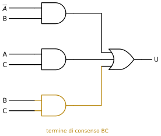

# 2 · Reti combinatorie standard, ritardi e aritmetica

**In questo modulo.** Si usano le forme canoniche, le mappe di Karnaugh e le variabili riportate del modulo 1 (*Algebra booleana e sintesi delle reti combinatorie*). Si studiano le reti combinatorie che si usano come blocchi già pronti: multiplexer, demultiplexer, decoder, encoder. Poi si guarda che cosa succede nel circuito reale, dove ogni porta ha un ritardo, e come i ritardi producano le alee. L'ultima parte è l'aritmetica binaria: la rappresentazione dei numeri e i codici, la somma, il complemento a 2 per i numeri negativi, le reti che sommano, sottraggono, confrontano e moltiplicano, fino all'unità aritmetico-logica. Alla fine del modulo si sa progettare con i blocchi standard, riconoscere ed eliminare un'alea statica, e fare a mano e con una rete le operazioni sui numeri binari con e senza segno.

## 2.1 Multiplexer

Il **multiplexer** (MUX) è un selettore: ha alcuni ingressi dati, alcuni ingressi di selezione e un'uscita, che copia l'ingresso dati scelto dalla selezione. Il più semplice è il MUX 2→1, con ingressi dati $S_0$ e $S_1$, selezione $SEL$ e uscita $U$. La specifica a parole è: $U = S_0$ se $SEL = 0$, $U = S_1$ se $SEL = 1$.

| $SEL$ | $S_1$ | $S_0$ | $U$ |
|---|---|---|---|
| 0 | 0 | 0 | 0 |
| 0 | 0 | 1 | 1 |
| 0 | 1 | 0 | 0 |
| 0 | 1 | 1 | 1 |
| 1 | 0 | 0 | 0 |
| 1 | 0 | 1 | 0 |
| 1 | 1 | 0 | 1 |
| 1 | 1 | 1 | 1 |

La prima forma canonica ha quattro mintermini, che si raccolgono a due a due:

$$U = \overline{SEL}\,\bar{S}_1 S_0 + \overline{SEL}\,S_1 S_0 + SEL\,S_1\bar{S}_0 + SEL\,S_1 S_0 = \overline{SEL}\,S_0 + SEL\,S_1.$$

La seconda ha quattro maxtermini, che si raccolgono allo stesso modo: posto $T = SEL + S_0$, i due fattori $(T + S_1)(T + \bar{S}_1)$ danno $T$, e lo stesso vale per gli altri due. Quindi $U = (SEL + S_0)(\overline{SEL} + S_1)$. Con la mappa le due sintesi si trovano subito: righe $SEL$, colonne $S_1 S_0$.

| $SEL \backslash S_1 S_0$ | 00 | 01 | 11 | 10 |
|---|---|---|---|---|
| 0 | 0 | 1 | 1 | 0 |
| 1 | 0 | 0 | 1 | 1 |

Il circuito della SOP ha due AND e una OR (figura 2.1): $SEL$ entra diretto in una AND e negato nell'altra, quindi una sola delle due AND è "aperta" e lascia passare il suo ingresso dati.

Il MUX 4→1 ha quattro ingressi dati $I_0, \dots, I_3$ e due di selezione $S_1 S_0$, che formano il numero binario dell'ingresso scelto:

| $S_1$ | $S_0$ | $U$ |
|---|---|---|
| 0 | 0 | $I_0$ |
| 0 | 1 | $I_1$ |
| 1 | 0 | $I_2$ |
| 1 | 1 | $I_3$ |

$$U = \bar{S}_1\bar{S}_0\, I_0 + \bar{S}_1 S_0\, I_1 + S_1\bar{S}_0\, I_2 + S_1 S_0\, I_3.$$

In generale un MUX $2^n \to 1$ ha $n$ ingressi di selezione, e la sua uscita è la somma dei prodotti fra ogni mintermine delle selezioni e l'ingresso dati corrispondente. Un MUX grande si costruisce con MUX più piccoli: con tre MUX 2→1 si ottiene un MUX 4→1, facendo scegliere ai primi due con $S_0$ fra $I_0, I_1$ e fra $I_2, I_3$, e all'ultimo con $S_1$ fra le loro uscite (figura 2.2).

Il MUX è una **rete universale**. Se si collegano le $n$ variabili di una funzione agli ingressi di selezione di un MUX $2^n \to 1$ e si mette su ogni ingresso dati la costante 0 o 1 della riga corrispondente della tabella di verità, l'uscita realizza la funzione. Per esempio lo XOR $A \oplus B$ si ottiene da un MUX 4→1 con $A$ su $S_1$, $B$ su $S_0$ e ingressi dati $0, 1, 1, 0$ (figura 2.3).

Il MUX 4→1 si può anche leggere come una mappa a due variabili ($S_1$, $S_0$) con gli ingressi dati nelle celle: è una mappa a variabili riportate. Di qui il legame con il paragrafo 1.6: una funzione di $n$ variabili si realizza anche con un MUX $2^{n-1} \to 1$, mettendo $n - 1$ variabili sulle selezioni e scrivendo negli ingressi dati 0, 1, la variabile rimasta o la sua negazione.

## 2.2 Demultiplexer, decoder, encoder

Il **demultiplexer** (DEMUX) fa l'operazione inversa del MUX: ha un ingresso dati $IN$, $n$ ingressi di selezione e $2^n$ uscite, e porta $IN$ sull'uscita scelta, mentre le altre restano a 0. Per il DEMUX 1→4:

$$U_0 = \bar{S}_1\bar{S}_0\, IN, \quad U_1 = \bar{S}_1 S_0\, IN, \quad U_2 = S_1\bar{S}_0\, IN, \quad U_3 = S_1 S_0\, IN.$$

| $S_1$ | $S_0$ | $U_0$ | $U_1$ | $U_2$ | $U_3$ |
|---|---|---|---|---|---|
| 0 | 0 | $IN$ | 0 | 0 | 0 |
| 0 | 1 | 0 | $IN$ | 0 | 0 |
| 1 | 0 | 0 | 0 | $IN$ | 0 |
| 1 | 1 | 0 | 0 | 0 | $IN$ |

Il **decoder** $n \to 2^n$ ha $n$ ingressi e $2^n$ uscite, e per ogni combinazione degli ingressi porta a 1 una e una sola uscita: l'uscita $U_k$ vale 1 quando gli ingressi formano il numero $k$. Ogni uscita è quindi un mintermine degli ingressi: nel decoder 3→8, $U_0 = \bar{I}_2\bar{I}_1\bar{I}_0$, …, $U_7 = I_2 I_1 I_0$. Un DEMUX è un decoder con un ingresso di abilitazione: se $IN = 0$ tutte le uscite sono a 0, se $IN = 1$ funziona come decoder. Poiché un decoder produce tutti i mintermini, un decoder seguito da una OR degli opportuni mintermini realizza qualsiasi funzione nella prima forma canonica.

> [!aggiunta] Aggiunta in revisione · fonte: Donzellini e altri, *Introduzione al progetto di sistemi digitali* (RL-02)
> **Encoder.** L'**encoder** $2^n \to n$ fa l'inverso del decoder: ha $2^n$ ingressi, di cui se ne suppone attivo uno alla volta, e dà in uscita il numero binario dell'ingresso attivo. Se più ingressi possono essere attivi insieme si usa l'**encoder con priorità**, che codifica quello di indice più alto, con un'uscita $V$ che dice se almeno un ingresso è attivo. Per 4 ingressi:
>
> | $I_3$ | $I_2$ | $I_1$ | $I_0$ | $Y_1$ | $Y_0$ | $V$ |
> |---|---|---|---|---|---|---|
> | 0 | 0 | 0 | 0 | – | – | 0 |
> | 0 | 0 | 0 | 1 | 0 | 0 | 1 |
> | 0 | 0 | 1 | – | 0 | 1 | 1 |
> | 0 | 1 | – | – | 1 | 0 | 1 |
> | 1 | – | – | – | 1 | 1 | 1 |
>
> I trattini negli ingressi sono indifferenze sugli ingressi (paragrafo 1.6). Dalla tabella: $Y_1 = I_3 + I_2$, $Y_0 = I_3 + \bar{I}_2 I_1$, $V = I_3 + I_2 + I_1 + I_0$.

> [!esempio] Una porta logica programmabile
> Una rete ha due ingressi di controllo $S_0$, $S_1$ e due ingressi dati $A$, $B$, e deve comportarsi come una porta diversa a seconda del controllo:
>
> | $S_0$ | $S_1$ | $U$ |
> |---|---|---|
> | 0 | 0 | $A \cdot B$ |
> | 0 | 1 | $A + B$ |
> | 1 | 0 | $\bar{A}$ |
> | 1 | 1 | – |
>
> La combinazione $11$ non si usa: è un'indifferenza su tutta la riga. Sulla mappa a quattro variabili (righe $S_0 S_1$, colonne $AB$)
>
> | $S_0 S_1 \backslash AB$ | 00 | 01 | 11 | 10 |
> |---|---|---|---|---|
> | 00 | 0 | 0 | 1 | 0 |
> | 01 | 0 | 1 | 1 | 1 |
> | 11 | – | – | – | – |
> | 10 | 1 | 1 | 0 | 0 |
>
> la sintesi AND-OR è $U = S_1 A + S_1 B + S_0\bar{A} + \bar{S}_0 AB$ e quella OR-AND è $U = (\bar{S}_0 + \bar{A})(S_0 + S_1 + A)(S_0 + S_1 + B)(A + B + \bar{S}_1)$. L'ultimo fattore copre lo 0 in $S_0 S_1 AB = 0100$ usando l'indifferenza in $1100$; si può scegliere anche $(S_0 + A + B)$, che copre lo stesso 0 insieme a quello in $0000$. Le indifferenze della riga $11$ permettono di scrivere $S_1 A$ invece di $\bar{S}_0 S_1 A$, e $S_0\bar{A}$ invece di $S_0\bar{S}_1\bar{A}$.

## 2.3 Ritardi di propagazione e alee

Nel modulo 1 le porte erano ideali: l'uscita cambiava nello stesso istante degli ingressi. Una porta reale impiega un tempo per rispondere, il **ritardo di propagazione** $t_p$, che è diverso da porta a porta e cambia con la temperatura, con il carico e con il verso della commutazione. Il diagramma temporale reale di una rete combinatoria mostra le uscite che cambiano un po' dopo gli ingressi, e una rete con più livelli accumula i ritardi di tutte le porte che un segnale attraversa.

L'esempio più semplice è $OUT = IN + \overline{IN}$, che per l'algebra vale sempre 1. Nel circuito $IN$ arriva alla OR direttamente, $\overline{IN}$ attraverso un NOT che ritarda di $t_p$. Quando $IN$ scende da 1 a 0, per un tempo pari al ritardo del NOT entrambi gli ingressi della OR sono a 0, e l'uscita fa un impulso a 0 che non dovrebbe esserci (figura 2.4).

> [!definizione] Alea
> Un'**alea** (*hazard*) è una variazione transitoria e indesiderata dell'uscita di una rete combinatoria, dovuta ai diversi ritardi dei percorsi che i segnali seguono dagli ingressi all'uscita. L'alea è **statica** se l'uscita dovrebbe restare costante e invece fa un impulso (alea statica di 1 se dovrebbe restare a 1, di 0 se dovrebbe restare a 0); è **dinamica** se l'uscita dovrebbe cambiare una volta e invece oscilla prima di assestarsi.

Le alee statiche di una rete a due livelli si vedono sulla mappa. Si prenda $U = \bar{A}B + AC$, con $B = C = 1$ e $A$ che scende da 1 a 0: la funzione passa dalla cella $111$ alla cella $011$ e vale 1 in entrambe. Ma le due celle sono coperte da gruppi diversi: in $111$ l'uscita è tenuta a 1 dalla AND di $AC$, in $011$ dalla AND di $\bar{A}B$. Se la prima si spegne prima che la seconda si accenda, cosa che succede perché $\bar{A}$ passa attraverso un NOT in più, l'uscita scende a 0 per un istante.

> [!aggiunta] Aggiunta in revisione · fonte: Donzellini e altri, *Introduzione al progetto di sistemi digitali* (RL-02)
> **Il termine di consenso elimina l'alea.** Se si aggiunge alla sintesi il gruppo $BC$, che copre entrambe le celle, durante la transizione la sua AND resta accesa e tiene l'uscita a 1: $U = \bar{A}B + AC + BC$ è la stessa funzione (è la proprietà del consenso del paragrafo 1.3) ma non ha l'alea (figura 2.5). In generale una sintesi SOP è priva di alee statiche di 1 per le variazioni di una sola variabile se ogni coppia di celle adiacenti a 1 è coperta da almeno un gruppo comune. Si paga con porte in più: la sintesi senza alee non è più minima.

Le alee contano quando l'uscita di una rete combinatoria viene usata mentre è ancora in transizione. La soluzione più generale è non guardarla finché non si è assestata: è quello che fa il **clock** nelle reti sincrone del modulo 3, dove le uscite delle reti combinatorie si campionano solo in istanti in cui sono certamente a regime.

## 2.4 Numeri e codici

Un numero naturale si scrive in **notazione posizionale** in base $B$ con le cifre $a_k \dots a_1 a_0$, ciascuna fra 0 e $B - 1$, e il suo valore è

$$N = a_k B^k + a_{k-1} B^{k-1} + \dots + a_1 B + a_0.$$

In base 10, $134 = 1 \cdot 10^2 + 3 \cdot 10 + 4$. In base 2 le cifre sono bit: $01010_2 = 1 \cdot 2^3 + 1 \cdot 2^1 = 10$. Con $n$ bit si rappresentano i naturali da $0$ a $2^n - 1$; con 4 bit da $0000 = 0$ a $1111 = 15$. Il bit di peso massimo si chiama MSB (*most significant bit*), quello di peso minimo LSB.

**Da binario a decimale** si sommano le potenze di 2 dei bit a 1: $1001_2 = 2^3 + 2^0 = 9$ e $10100110010_2 = 1024 + 256 + 32 + 16 + 2 = 1330$. **Da decimale a binario** si divide ripetutamente per 2: i resti, dal primo all'ultimo, sono i bit dall'LSB all'MSB. Per $38$: $38 = 2 \cdot 19 + 0$, $19 = 2 \cdot 9 + 1$, $9 = 2 \cdot 4 + 1$, $4 = 2 \cdot 2 + 0$, $2 = 2 \cdot 1 + 0$, $1 = 2 \cdot 0 + 1$, quindi $38 = 100110_2$.

Le basi 8 (**ottale**) e 16 (**esadecimale**) sono comode perché una cifra corrisponde a un gruppo fisso di bit, 3 per l'ottale e 4 per l'esadecimale, e si convertono a gruppi partendo da destra. In esadecimale le cifre da 10 a 15 si scrivono A, …, F.

- $33_8 = 3 \cdot 8 + 3 = 27$, e in binario $011\,011_2$; viceversa $001\,010_2 = 12_8 = 10$.
- $0101\,1110_2 = 5E_{16} = 5 \cdot 16 + 14 = 94$; per divisioni successive per 16, $94 = 16 \cdot 5 + 14$ dà di nuovo $5E$.

Il **BCD** (*binary coded decimal*, codice 8421) scrive ogni cifra decimale con i suoi 4 bit: $1013 \to 0001\;0000\;0001\;0011$. È comodo per i visualizzatori, ma spreca 6 delle 16 combinazioni di 4 bit (da 1010 a 1111).

Il **codice Gray** ordina le combinazioni di $n$ bit in modo che due consecutive differiscano per un solo bit. Si costruisce per riflessione: si scrive la sequenza a $n - 1$ bit, poi la stessa al contrario, e si aggiunge davanti 0 alla prima metà e 1 alla seconda. Da $0, 1$ si ottiene $00, 01, 11, 10$, e da questa $000, 001, 011, 010, 110, 111, 101, 100$. È l'ordine delle righe e delle colonne delle mappe di Karnaugh.

Un **bit di parità** aggiunto a un dato permette di accorgersi di un errore di trasmissione su un bit. Con la parità pari il bit vale lo XOR di tutti i bit del dato, così il numero totale di 1 è pari: per il dato $0111010$, che ha quattro 1, il bit di parità è 0. Chi riceve rifà lo XOR di tutto: se viene 1, almeno un bit è cambiato. Due errori si compensano e non si vedono; per controlli più robusti si aggiunge in coda ai dati una somma di controllo (*checksum*).

## 2.5 Somma binaria

La somma si fa in colonna come in base 10, con il riporto: in base 10 $39 + 12 = 51$ perché $9 + 2 = 11$ dà 1 con riporto 1. In base 2, $1 + 1 = 10$: cifra 0 e riporto 1. Per esempio

$$1001010_2 + 110110_2 = 10000000_2,$$

cioè $74 + 54 = 128$: i riporti si propagano fino all'ultima colonna e il risultato ha un bit in più degli addendi.

Il **semisommatore** (*half adder*) somma due bit e dà la somma $S$ e il riporto $C$:

| $A$ | $B$ | $S$ | $C$ |
|---|---|---|---|
| 0 | 0 | 0 | 0 |
| 0 | 1 | 1 | 0 |
| 1 | 0 | 1 | 0 |
| 1 | 1 | 0 | 1 |

quindi $S = A \oplus B$ e $C = AB$. Il **sommatore completo** (*full adder*) somma due bit e il riporto in ingresso $C_{in}$: la somma è lo XOR a tre ingressi $S = A \oplus B \oplus C_{in}$, e il riporto vale 1 quando almeno due dei tre ingressi valgono 1, $C_{out} = AB + AC_{in} + BC_{in}$ (la sintesi della mappa ha tre coppie). La figura 2.6 mostra i due circuiti.

Il **sommatore a cascata** (*ripple carry adder*) a $n$ bit mette in fila $n$ full adder: il riporto in uscita di ogni bit è il riporto in ingresso del successivo, e il riporto in ingresso del bit 0 vale 0 (figura 2.7). Il blocco ADD4 ha ingressi $A_3 \dots A_0$, $B_3 \dots B_0$ e $C_{in}$, uscite $S_3 \dots S_0$ e il riporto finale; due ADD4 in cascata fanno un ADD8. Il difetto è la velocità: nel caso peggiore il riporto deve attraversare tutti gli $n$ stadi, e il ritardo cresce con $n$. Per i numeri naturali, un riporto finale a 1 vuol dire che il risultato non sta in $n$ bit: è un **overflow**.

## 2.6 Sottrazione e numeri negativi

La sottrazione in colonna usa il **prestito**: $0 - 1$ non si può fare, quindi si prende 1 dalla colonna a sinistra, e la colonna vale $10_2 - 1 = 1$. Per esempio $1010010_2 - 111111_2 = 0010011_2$, cioè $82 - 63 = 19$.

Per i numeri negativi l'idea più immediata è usare il primo bit come segno e gli altri come modulo (**modulo e segno**). Ha due difetti: lo zero ha due rappresentazioni ($0000$ e $1000$), e il sommatore del paragrafo 2.5 non funziona più. Per esempio $7 + (-2)$ con 4 bit diventa $0111 + 1010 = 10001$, che non è 5.

> [!definizione] Complemento a 2
> Con $n$ bit, nella rappresentazione in **complemento a 2** il bit più significativo ha peso $-2^{n-1}$ invece di $+2^{n-1}$:
> $$N = -a_{n-1}\, 2^{n-1} + a_{n-2}\, 2^{n-2} + \dots + a_1 \cdot 2 + a_0.$$
> I numeri rappresentabili vanno da $-2^{n-1}$ a $2^{n-1} - 1$; quelli con il primo bit a 1 sono i negativi. Per cambiare segno a un numero si **negano tutti i bit e si somma 1**.

Con 3 bit:

| bit | valore | | bit | valore |
|---|---|---|---|---|
| 000 | 0 | | 100 | −4 |
| 001 | 1 | | 101 | −3 |
| 010 | 2 | | 110 | −2 |
| 011 | 3 | | 111 | −1 |

Si controlla la regola: $-3$ si ottiene da $011$ negando ($100$) e sommando 1 ($101$); $-0$ dà $111 + 1 = 1000$, cioè $000$ sui 3 bit, e lo zero è unico. Con 4 bit i valori vanno da $1000 = -8$ a $0111 = 7$, e $1111 = -1$. Il numero di bit va sempre specificato: $1111$ vale $-1$ su 4 bit e $15$ se è un naturale, e $-11$ su 8 bit si ottiene da $00001011$ negando ($11110100$) e sommando 1: $11110101$.

> [!aggiunta] Aggiunta in revisione · fonte: Donzellini e altri, *Introduzione al progetto di sistemi digitali* (RL-03)
> **Estensione del segno.** Per scrivere un numero in complemento a 2 su più bit si ripete il bit di segno a sinistra: $-3 = 101$ su 3 bit è $11111101$ su 8 bit, e $3 = 011$ è $00000011$.

Il vantaggio del complemento a 2 è che la somma si fa con lo stesso sommatore dei naturali, ignorando il riporto finale:

- $3 + 4$: $0011 + 0100 = 0111 = 7$;
- $-7 + 3$: $1001 + 0011 = 1100 = -4$;
- $-8 + 6$: $1000 + 0110 = 1110 = -2$;
- $7 + (-2)$: $0111 + 1110 = 1\,0101$, e scartando il riporto $0101 = 5$.

> [!aggiunta] Aggiunta in revisione · fonte: Donzellini e altri, *Introduzione al progetto di sistemi digitali* (RL-03)
> **Overflow in complemento a 2.** Il risultato è sbagliato quando non sta nell'intervallo $[-2^{n-1}, 2^{n-1} - 1]$, e questo può succedere solo sommando due numeri dello stesso segno. Si riconosce perché il risultato ha il segno opposto: con 4 bit $5 + 4$ dà $0101 + 0100 = 1001$, che vale $-7$. Il riporto finale qui non serve: l'overflow c'è quando il riporto che entra nel bit di segno è diverso da quello che ne esce, $V = c_n \oplus c_{n-1}$.
>
> **Sottrattore.** Poiché $A - B = A + (-B) = A + \bar{B} + 1$, un sommatore diventa un sottrattore negando $B$ e mettendo $C_{in} = 1$. Con una XOR davanti a ogni bit di $B$, comandata da un segnale $SUB$ che va anche su $C_{in}$, la stessa rete somma ($SUB = 0$) o sottrae ($SUB = 1$).

## 2.7 Prodotto, confronto e unità aritmetico-logica

Il prodotto binario si fa come in base 10, ma i prodotti parziali sono solo copie del moltiplicando, spostate, o zeri: per ogni bit a 1 del moltiplicatore si somma il moltiplicando spostato della sua posizione. Per esempio $10110 \times 111 = 10110 + 101100 + 1011000 = 10011010$, cioè $22 \cdot 7 = 154$. Il prodotto di due numeri di $n$ bit ha fino a $2n$ bit. Una rete moltiplicatrice combinatoria fa i prodotti parziali con porte AND (il prodotto di due bit è il loro AND) e li somma con una schiera di sommatori.

> [!aggiunta] Aggiunta in revisione · fonte: Donzellini e altri, *Introduzione al progetto di sistemi digitali* (RL-03)
> **Comparatore.** Il comparatore di due bit ha tre uscite: $A > B$ vale $A\bar{B}$, $A = B$ vale $\overline{A \oplus B}$, $A < B$ vale $\bar{A}B$. Per due numeri di $n$ bit, l'uguaglianza è l'AND delle XNOR bit a bit; per il confronto di grandezza fra naturali si calcola $A - B$ con il sottrattore: c'è un prestito finale (il riporto finale del sommatore vale 0) se e solo se $A < B$.

L'**unità aritmetico-logica** (ALU, *arithmetic logic unit*) mette insieme più reti che lavorano in parallelo sugli stessi operandi $A$ e $B$, per esempio un sommatore, un moltiplicatore e un comparatore, e un MUX che sceglie quale risultato mandare in uscita secondo un codice di operazione $S_1 S_0$: $00$ somma, $01$ prodotto, $10$ confronto (figura 2.8).

> [!nota] Virgola fissa e virgola mobile
> I numeri non interi si rappresentano in **virgola fissa** decidendo quanti bit stanno dopo la virgola: con tre bit frazionari $0{,}375 = 0{,}011_2$, perché $0{,}375 = 2^{-2} + 2^{-3}$. La precisione assoluta è la stessa per tutti i numeri. In **virgola mobile** il numero si scrive come in notazione scientifica, $7{,}3 \cdot 10^2$, con un bit di segno, un esponente e una mantissa: la precisione relativa è la stessa per numeri grandi e piccoli, mentre quella assoluta cambia con l'esponente. All'esame del corso la virgola mobile non viene chiesta, ma il formato standard si usa ovunque (è quello dei `float` e dei `double` del C) ed è spiegato nel paragrafo 2.8.

## 2.8 Numeri in virgola mobile: lo standard IEEE 754

> [!aggiunta] Aggiunta in revisione · fonte: Patterson e Hennessy, *Struttura e progetto dei calcolatori*; standard IEEE 754 (RL-03)
> **Parte frazionaria in binario.** Le cifre dopo la virgola pesano $2^{-1}, 2^{-2}, 2^{-3}, \dots$, cioè $0{,}5$, $0{,}25$, $0{,}125$, … Per convertire una frazione decimale si moltiplica ripetutamente per 2 e si prende ogni volta la parte intera come bit, dal primo dopo la virgola in poi. Per $0{,}375$: $0{,}375 \cdot 2 = 0{,}75$ (bit 0), $0{,}75 \cdot 2 = 1{,}5$ (bit 1, si tiene $0{,}5$), $0{,}5 \cdot 2 = 1{,}0$ (bit 1, si tiene 0 e ci si ferma): $0{,}375 = 0{,}011_2$. Non tutte le frazioni finiscono: $0{,}1$ dà $0{,}000110011001100\dots_2$ con il gruppo $0011$ che si ripete per sempre, quindi $0{,}1$ in binario non si scrive esattamente con un numero finito di bit.
>
> **L'idea della virgola mobile.** Ogni numero diverso da zero si può scrivere in binario nella forma **normalizzata** $\pm 1{,}m \times 2^E$, con una sola cifra 1 prima della virgola: per esempio $6{,}75 = 110{,}11_2 = 1{,}1011_2 \times 2^2$. Si memorizzano tre campi: il **segno** $s$ (0 positivo, 1 negativo), l'**esponente** $E$ e la **mantissa** $m$, cioè le cifre dopo la virgola. L'1 prima della virgola c'è sempre e non si memorizza (**bit nascosto**), così si guadagna un bit di precisione.
>
> **Il formato a 32 bit (singola precisione).** Il primo bit è il segno, poi 8 bit di esponente, poi 23 bit di mantissa. L'esponente non si scrive in complemento a 2 ma **polarizzato** (*biased*): nel campo si scrive $e = E + 127$, così il campo è un naturale fra 0 e 255 e i numeri si confrontano come interi. Il valore di un numero normalizzato è
> $$N = (-1)^s \times 1{,}m \times 2^{\,e - 127}, \qquad 1 \le e \le 254.$$
> Il formato a 64 bit (doppia precisione) ha lo stesso schema con 11 bit di esponente, polarizzazione 1023, e 52 bit di mantissa.
>
> **Esempio: $-6{,}75$ in singola precisione.** Segno: negativo, $s = 1$. Modulo in binario: $6 = 110_2$ e $0{,}75 = 0{,}11_2$, quindi $110{,}11_2$. Normalizzazione: si sposta la virgola di due posti a sinistra, $1{,}1011_2 \times 2^2$. Esponente: $e = 2 + 127 = 129 = 1000\,0001_2$. Mantissa: le cifre dopo la virgola, $1011$, seguite da 19 zeri. Il numero è
> $$1\;\,10000001\;\,10110000000000000000000 = \texttt{C0D80000}_{16}.$$
>
> **Esempio inverso: $\texttt{41200000}_{16}$.** In binario $0\;10000010\;01000\dots0$: segno positivo, $e = 130$, quindi $E = 3$, mantissa $01$. Il valore è $1{,}01_2 \times 2^3 = 1010_2 = 10$.
>
> **Valori speciali.** I due valori estremi del campo esponente sono riservati.
>
> | Campo $e$ | Mantissa | Significato |
> |---|---|---|
> | 0 | 0 | $\pm 0$ (lo zero ha due rappresentazioni, con i due segni) |
> | 0 | $\ne 0$ | numero **denormalizzato** $(-1)^s \times 0{,}m \times 2^{-126}$, per i valori piccolissimi |
> | da 1 a 254 | qualsiasi | numero normalizzato |
> | 255 | 0 | $\pm\infty$, per esempio il risultato di $1/0$ |
> | 255 | $\ne 0$ | NaN (*not a number*), per esempio $0/0$ o $\sqrt{-1}$ |
>
> **Intervallo e precisione.** Il più grande numero a 32 bit è $(2 - 2^{-23}) \times 2^{127} \approx 3{,}4 \times 10^{38}$, il più piccolo normalizzato positivo è $2^{-126} \approx 1{,}18 \times 10^{-38}$. La mantissa con il bit nascosto ha 24 bit significativi, circa 7 cifre decimali: la distanza fra 1 e il numero rappresentabile successivo è $2^{-23} \approx 1{,}19 \times 10^{-7}$ (l'*epsilon di macchina*). La precisione è relativa: fra $2^{20}$ e $2^{21}$ due numeri consecutivi distano $2^{20-23} = 0{,}125$, fra 1 e 2 distano $2^{-23}$.
>
> **Somma di due numeri in virgola mobile.** (1) Si porta il numero con l'esponente minore allo stesso esponente dell'altro, spostando la sua mantissa a destra; (2) si sommano le mantisse; (3) si normalizza il risultato; (4) si arrotonda ai bit disponibili. Per $1{,}5 + 0{,}375$: $1{,}1_2 \times 2^0 + 1{,}1_2 \times 2^{-2} = 1{,}1_2 \times 2^0 + 0{,}011_2 \times 2^0 = 1{,}111_2 \times 2^0 = 1{,}875$. Lo spostamento del passo (1) fa perdere i bit meno significativi del numero piccolo: in singola precisione $2^{24} + 1$ dà di nuovo $2^{24}$, perché l'1 finisce oltre il ventiquattresimo bit. Per questo con i numeri in virgola mobile la somma non è associativa: $(2^{24} + 1) - 2^{24} = 0$, mentre $(2^{24} - 2^{24}) + 1 = 1$.

> [!attenzione]
> Nell'esponente polarizzato il campo $e$ non è l'esponente: $E = e - 127$. Un errore frequente è dimenticare il bit nascosto quando si ricostruisce il valore, e leggere $0{,}m$ invece di $1{,}m$.

## Esempi ed esercizi svolti

**Esercizio 1.** Una rete con un MUX 4→1, una OR, una XNOR e una AND ha la tabella di verità che vale 1 solo per $ABC = 100$ e $111$. Trovare le sintesi minime.

Con righe $A$ e colonne $BC$, la riga $A = 0$ è tutta a 0, la riga $A = 1$ vale $1, 0, 1, 0$. Gli 1 sono isolati: $U = A\bar{B}\bar{C} + ABC$. Raggruppando gli 0, la riga $A = 0$ dà il fattore $A$, e i due 0 della riga $A = 1$ in $101$ e $110$ danno $(B + \bar{C})$ e $(\bar{B} + C)$: $U = A(B + \bar{C})(\bar{B} + C)$. Le due sintesi dicono la stessa cosa: $U = A \cdot \overline{B \oplus C}$, che è proprio la AND fra $A$ e una XNOR.

**Esercizio 2.** Conversioni. $11 = 1011_2$ (resti $1, 1, 0, 1$); $10 = 12_8$ (resti $2, 1$); $30 = 1E_{16}$ (resti $14, 1$); $-11$ in complemento a 2 su 8 bit è $11110101$.

**Esercizio 3.** Operazioni. $1010010 + 110010 = 10000100$ ($82 + 50 = 132$). $1010100 - 110001 = 0100011$ ($84 - 49 = 35$) e $1010100 - 111111 = 0010101$ ($84 - 63 = 21$). $1010 \times 110 = 10100 + 101000 = 111100$ ($10 \cdot 6 = 60$) e $1010 \times 10110 = 10100 + 101000 + 10100000 = 11011100$ ($10 \cdot 22 = 220$).

**Esercizio 4.** Generatore di parità per 4 bit $B_3 B_2 B_1 B_0$. Il bit di parità pari è $P = B_3 \oplus B_2 \oplus B_1 \oplus B_0$, che si realizza con tre porte XOR a due ingressi, in fila oppure ad albero ($(B_3 \oplus B_2) \oplus (B_1 \oplus B_0)$, più veloce perché i livelli sono due invece di tre). Con la mappa sarebbe una scacchiera, senza nessun raggruppamento possibile.

### Esercizi del laboratorio con il simulatore

> [!aggiunta] Aggiunta in revisione · fonte: esercitazioni con il simulatore Deeds (testi riscritti, dati e soluzioni nuovi) (RL-02, RL-03, RL-08)
> Come nel modulo 1, gli esercizi seguono quelli del laboratorio: si completa lo schema, si ricava la tabella e si controlla con il diagramma temporale.

**Esercizio 5. Il MUX 2→1 nel tempo, e un'alea nascosta.** Un MUX 2→1 ha ingressi dati $I_0$, $I_1$, selezione $SEL$ e uscita $U = \overline{SEL}\,I_0 + SEL\,I_1$. Nella simulazione $I_0$ è un'onda quadra veloce, $I_1$ un'onda quadra lenta, e $SEL$ cambia ogni tanto. Che cosa si vede su $U$? Che cosa succede se $SEL$ scende da 1 a 0 mentre $I_0 = I_1 = 1$?

Finché $SEL = 0$ l'uscita ricopia l'onda veloce, finché $SEL = 1$ quella lenta: guardando $U$ si capisce a colpo d'occhio quale ingresso è selezionato, ed è il motivo per cui i due ingressi si fanno a frequenze diverse. Il secondo caso è più interessante. Con $I_0 = I_1 = 1$ l'uscita deve restare a 1, ma prima della commutazione la tiene alta la AND di $SEL\,I_1$, dopo la AND di $\overline{SEL}\,I_0$, e $\overline{SEL}$ arriva in ritardo perché passa per il NOT: per un istante entrambe le AND sono spente e $U$ fa un impulso a 0. È l'alea statica del paragrafo 2.3: sulla mappa del MUX (paragrafo 2.1) le celle $111$ e $011$ sono coperte da gruppi diversi. Si elimina aggiungendo il consenso $I_0 I_1$:
$$U = \overline{SEL}\,I_0 + SEL\,I_1 + I_0 I_1.$$

**Esercizio 6. DEMUX 1→2.** Ingresso dati $IN$, selezione $S$, uscite $O_0$ e $O_1$. Scrivere tabella ed equazioni e spiegare che cosa si vede in simulazione se $IN$ è un'onda quadra.

L'ingresso va sull'uscita scelta, l'altra resta a 0: $O_0 = \bar{S}\,IN$ e $O_1 = S\,IN$. In tabella: per $S = 0$ si ha $O_0 = IN$, $O_1 = 0$; per $S = 1$ si ha $O_0 = 0$, $O_1 = IN$. Nel diagramma temporale l'onda quadra "salta" da un'uscita all'altra ogni volta che cambia $S$, e l'uscita non selezionata è piatta a 0. Il circuito è fatto di due AND e un NOT: è lo stesso schema del MUX senza la OR finale.

**Esercizio 7. Un canale di comunicazione condiviso.** Quattro sorgenti $A$, $B$, $C$, $D$ devono spedire dati a due destinatari $O_0$ e $O_1$ usando un solo filo, il canale $CH$. Il trasmettitore ha un MUX 4→1 con selezione $S_1 S_0$, il ricevitore un DEMUX 1→2 con selezione $S_{OUT}$. (a) Come si impostano le selezioni per mandare $C$ a $O_1$? (b) Si può mandare nello stesso momento $A$ a $O_0$ e $B$ a $O_1$? (c) Come si condivide il canale fra tutte le sorgenti?

(a) Il MUX mette sul canale l'ingresso il cui indice è $S_1 S_0$: per $C$, che è l'ingresso 2, serve $S_1 S_0 = 10$. Il DEMUX porta il canale su $O_1$ con $S_{OUT} = 1$. Quindi $CH = C$, $O_1 = C$ e $O_0 = 0$.

(b) No: sul filo c'è un solo segnale alla volta. Il canale è una risorsa condivisa, e due trasmissioni contemporanee si possono fare solo con due fili.

(c) Si divide il tempo in intervalli e in ciascuno si dà il canale a una sorgente: per esempio si fa contare $S_1 S_0$ da 00 a 11 e si ricomincia, e si sceglie $S_{OUT}$ secondo il destinatario di quell'intervallo. È la **multiplazione a divisione di tempo**, e il contatore che genera le selezioni è proprio quello del modulo 3. Trasmettitore e ricevitore devono essere d'accordo su chi trasmette in ogni intervallo: in pratica le selezioni sono generate dallo stesso clock.

**Esercizio 8. Che cosa fa questa rete a MUX?** Un MUX 8→1 ha sulle selezioni $C B A$ ($C$ più significativo) e sugli ingressi dati, da $I_0$ a $I_7$, le costanti $0, 0, 0, 1, 0, 1, 1, 1$. (a) Che funzione realizza? Si potrebbe usare per controllare la parità? (b) Modificare gli ingressi dati per realizzare $U = C\bar{A} + B\bar{C}A + \bar{B}\bar{A}\bar{C}$.

(a) L'uscita vale 1 per gli indici 3, 5, 6, 7, cioè $CBA = 011, 101, 110, 111$: le combinazioni con almeno due 1. È la funzione **maggioranza**, $U = AB + AC + BC$, la stessa del riporto del full adder. Per la parità servirebbero gli 1 sugli indici con un numero dispari di 1, cioè 1, 2, 4, 7, quindi ingressi $0, 1, 1, 0, 1, 0, 0, 1$: con questi ingressi no.

(b) Si calcola $U$ riga per riga. Per $CBA = 000$ vale 1 il terzo termine; per $011$ il secondo; per $100$ e $110$ il primo ($C = 1$, $A = 0$); per tutte le altre righe nessun termine. Gli ingressi dati sono quindi $I_0 \dots I_7 = 1, 0, 0, 1, 1, 0, 1, 0$. La stessa funzione si fa con un MUX 4→1, mettendo $C$ e $B$ sulle selezioni e $A$ come variabile riportata: le coppie di righe danno $\bar{A}$ per $CB = 00$, $A$ per $01$, $\bar{A}$ per $10$ e $\bar{A}$ per $11$.

**Esercizio 9. Comparatore di due numeri a 2 bit.** Ingressi $A = A_1 A_0$ e $B = B_1 B_0$, naturali da 0 a 3; uscite $G$ ($A > B$), $E$ ($A = B$), $L$ ($A < B$). Trovare le sintesi minime.

Mappa di $G$ con righe $A_1 A_0$ e colonne $B_1 B_0$, tutte in ordine di Gray; ogni cella vale 1 se il numero della riga è maggiore di quello della colonna:

| $A_1 A_0 \backslash B_1 B_0$ | 00 | 01 | 11 | 10 |
|---|---|---|---|---|
| 00 | 0 | 0 | 0 | 0 |
| 01 | 1 | 0 | 0 | 0 |
| 11 | 1 | 1 | 0 | 1 |
| 10 | 1 | 1 | 0 | 0 |

La quaterna in basso a sinistra (righe 11 e 10, colonne 00 e 01) dà $A_1\bar{B}_1$: se il bit alto di $A$ è 1 e quello di $B$ è 0, $A$ è maggiore qualunque siano gli altri bit. La coppia nella riga 11, colonne 00 e 10, dà $A_1 A_0\bar{B}_0$; la coppia nella colonna 00, righe 01 e 11, dà $A_0\bar{B}_1\bar{B}_0$. Quindi
$$G = A_1\bar{B}_1 + A_1 A_0\bar{B}_0 + A_0\bar{B}_1\bar{B}_0.$$
$L$ si ottiene scambiando i ruoli di $A$ e $B$: $L = \bar{A}_1 B_1 + B_1 B_0\bar{A}_0 + B_0\bar{A}_1\bar{A}_0$. La mappa di $E$ ha gli 1 solo sulla diagonale ($A = B$), quattro celle non adiacenti: la SOP minima è la forma canonica con quattro mintermini, mentre su più livelli la stessa funzione è $E = \overline{A_1 \oplus B_1} \cdot \overline{A_0 \oplus B_0}$, come nel paragrafo 2.7. In ogni caso le tre uscite non sono indipendenti: per ogni coppia ne vale 1 una sola, e $E = \overline{G + L}$.

**Esercizio 10. Moltiplicatore di due numeri a 2 bit.** Ingressi $A_1 A_0$ e $B_1 B_0$; uscita $P = P_3 P_2 P_1 P_0 = A \times B$, da 0 a 9.

Il prodotto massimo è $3 \times 3 = 9 = 1001_2$, quindi bastano 4 bit. Dalle sedici righe della tabella e dalle mappe si ottiene:
$$P_0 = A_0 B_0, \qquad P_3 = A_1 A_0 B_1 B_0, \qquad P_2 = A_1 B_1\bar{A}_0 + A_1 B_1\bar{B}_0 = A_1 B_1\,\overline{A_0 B_0},$$
$$P_1 = A_0 B_1\bar{A}_1 + A_0 B_1\bar{B}_0 + A_1 B_0\bar{A}_0 + A_1 B_0\bar{B}_1.$$
$P_0$ è 1 solo se entrambi i fattori sono dispari; $P_3$ è 1 solo per $3 \times 3$. La forma a più livelli è quella della moltiplicazione in colonna del paragrafo 2.7: i prodotti parziali sono $A_0 B_0$, $A_1 B_0$, $A_0 B_1$, $A_1 B_1$, e
$$P_1 = A_1 B_0 \oplus A_0 B_1, \quad c = A_1 B_0 \cdot A_0 B_1, \quad P_2 = A_1 B_1 \oplus c, \quad P_3 = A_1 B_1 \cdot c,$$
cioè quattro AND per i prodotti parziali e due semisommatori. Prova: $A = 11$, $B = 10$ dà prodotti parziali $A_0 B_0 = 0$, $A_1 B_0 = 0$, $A_0 B_1 = 1$, $A_1 B_1 = 1$; quindi $P_1 = 1$, $c = 0$, $P_2 = 1$, $P_3 = 0$: $P = 0110 = 6$.

**Esercizio 11. Valore assoluto di un numero a 3 bit.** L'ingresso $I_2 I_1 I_0$ è un numero in complemento a 2, da $-4$ a $+3$. L'uscita $Y_1 Y_0$ deve dare il suo valore assoluto; se l'ingresso è $-4$, il cui valore assoluto non sta in 2 bit, l'uscita di errore $ERR$ va a 1 e $Y_1 Y_0$ non interessano.

| $I_2 I_1 I_0$ | valore | $\lvert\cdot\rvert$ | $Y_1 Y_0$ | $ERR$ |
|---|---|---|---|---|
| 000 | 0 | 0 | 00 | 0 |
| 001 | 1 | 1 | 01 | 0 |
| 010 | 2 | 2 | 10 | 0 |
| 011 | 3 | 3 | 11 | 0 |
| 100 | −4 | – | – – | 1 |
| 101 | −3 | 3 | 11 | 0 |
| 110 | −2 | 2 | 10 | 0 |
| 111 | −1 | 1 | 01 | 0 |

Per i negativi il valore assoluto si ottiene con la regola del paragrafo 2.6, negando i bit e sommando 1: per $101$ si ha $010 + 1 = 011 = 3$. Dalla tabella: $Y_0 = I_0$ (cambiare segno non cambia il bit meno significativo), $ERR = I_2\bar{I}_1\bar{I}_0$ e, con l'indifferenza in $100$,
$$Y_1 = I_1\bar{I}_0 + \bar{I}_2 I_1 + I_2\bar{I}_1 = I_1 \oplus I_2 I_0.$$
L'ultima forma si legge così: il bit $Y_1$ è $I_1$ per i positivi, e per i negativi è $I_1$ invertito quando $I_0 = 1$ (il "+1" della regola genera un riporto solo se $I_0 = 0$).

**Esercizio 12. Sommatore a 2 bit: a cascata o a due livelli?** Un sommatore a 2 bit è fatto con un semisommatore sul bit 0 e un full adder sul bit 1: $S_0 = A_0 \oplus B_0$, $c_1 = A_0 B_0$, $S_1 = A_1 \oplus B_1 \oplus c_1$, $S_2 = A_1 B_1 + c_1(A_1 + B_1)$. Ricavare la versione a due livelli e confrontarle.

La tabella ha sedici righe; si sintetizzano le tre uscite con le mappe.
$$S_0 = A_0\bar{B}_0 + \bar{A}_0 B_0, \qquad S_2 = A_1 B_1 + A_1 A_0 B_0 + A_0 B_1 B_0,$$
$$S_1 = A_1\bar{B}_1\bar{A}_0 + A_1\bar{B}_1\bar{B}_0 + \bar{A}_1 B_1\bar{A}_0 + \bar{A}_1 B_1\bar{B}_0 + \bar{A}_1\bar{B}_1 A_0 B_0 + A_1 B_1 A_0 B_0.$$
$S_2$ è il riporto: c'è se i due bit alti sono 1, oppure se c'è il riporto dal bit 0 e almeno un bit alto è 1. $S_1$ è uno XOR di tre variabili "mascherato" e non si semplifica: sei prodotti. Nella versione a cascata il segnale più lento attraversa l'AND di $c_1$ e poi le porte del full adder; nella versione a due livelli ogni uscita attraversa due porte. Si guadagna velocità e si paga in porte: è lo stesso compromesso del sommatore a $n$ bit, dove la rete a due livelli diventerebbe enorme e si usano soluzioni intermedie come il calcolo anticipato del riporto (*carry look-ahead*).

**Esercizio 13. Riconoscere una rete e rifarla con un MUX.** Una rete ha ingressi $A$, $B$: una NOR riceve $A$ e $B$, una AND riceve $A$ e $B$, e una seconda NOR riceve le uscite delle prime due. (a) Che funzione è? (b) Rifarla con un MUX 2→1.

(a) La seconda NOR dà $\overline{\overline{A + B} + AB} = (A + B)\,\overline{AB}$, che vale 1 quando almeno un ingresso è 1 ma non entrambi: è lo XOR. (b) Con $A$ sulla selezione: per $A = 0$ l'uscita deve essere $B$, per $A = 1$ deve essere $\bar{B}$. Quindi $I_0 = B$ e $I_1 = \bar{B}$, con la variabile riportata del paragrafo 1.6. Con un MUX 4→1 servirebbero entrambe le variabili sulle selezioni e le costanti $0, 1, 1, 0$, come nella figura 2.3.

## Esercizi guidati

> [!aggiunta] Aggiunta in revisione · fonte: esercizi nuovi, soluzioni verificate con `strumenti/verifica_ampliamento.py` (RL-02, RL-03)
> Ogni esercizio è diviso in passi: si prova un passo alla volta e si confronta solo dopo.

**Guidato 1. Funzione con un MUX 4→1 e una variabile riportata.** Realizzare $F(A, B, C) = \sum m(1, 2, 6, 7)$ con un MUX 4→1, con $A$ e $B$ sulle selezioni.

*Passo 1.* Si scrivono le righe a coppie, con la stessa coppia $AB$: per $AB = 00$ le righe sono $m_0 = 0$ e $m_1 = 1$; per $01$, $m_2 = 1$ e $m_3 = 0$; per $10$, $m_4 = 0$ e $m_5 = 0$; per $11$, $m_6 = 1$ e $m_7 = 1$.

*Passo 2.* In ogni coppia la prima riga ha $C = 0$ e la seconda $C = 1$; l'uscita si scrive in funzione di $C$: $(0, 1)$ è $C$, $(1, 0)$ è $\bar{C}$, $(0, 0)$ è 0, $(1, 1)$ è 1.

*Passo 3.* Gli ingressi dati sono $I_0 = C$, $I_1 = \bar{C}$, $I_2 = 0$, $I_3 = 1$.

*Passo 4: controllo.* Per $ABC = 011$ il MUX sceglie $I_1 = \bar{C} = 0$, e infatti $m_3$ non è nella lista. Per $ABC = 110$ sceglie $I_3 = 1$, e $m_6$ è nella lista.

**Guidato 2. Somme in complemento a 2 su 8 bit, con l'overflow.** Calcolare $100 + 50$, $100 - 50$ e $-100 - 50$ su 8 bit e dire quando c'è overflow.

*Passo 1: gli operandi.* $100 = 0110\,0100$ e $50 = 0011\,0010$. Per $-50$: si negano i bit di $50$ ($1100\,1101$) e si somma 1: $1100\,1110$. Per $-100$: $1001\,1011 + 1 = 1001\,1100$.

*Passo 2: $100 + 50$.* $0110\,0100 + 0011\,0010 = 1001\,0110$. Due positivi danno un risultato con il primo bit a 1, cioè negativo ($-106$): è overflow, e infatti $150 > 127$.

*Passo 3: $100 - 50 = 100 + (-50)$.* $0110\,0100 + 1100\,1110 = 1\;0011\,0010$. Si scarta il nono bit: $0011\,0010 = 50$. Operandi di segno diverso: l'overflow non è possibile, e il riporto finale a 1 non significa niente.

*Passo 4: $-100 - 50$.* $1001\,1100 + 1100\,1110 = 1\;0110\,1010$. Scartato il nono bit resta $0110\,1010 = 106$, positivo: due negativi hanno dato un positivo, è overflow ($-150 < -128$).

*Passo 5: la regola dei riporti.* Nel passo 2 entra un riporto nel bit 7 ($c_7 = 1$) e non ne esce ($c_8 = 0$): $V = c_8 \oplus c_7 = 1$. Nel passo 3 entra e esce ($c_7 = c_8 = 1$): $V = 0$. Nel passo 4 non entra ma esce ($c_7 = 0$, $c_8 = 1$): $V = 1$.

**Guidato 3. Trovare ed eliminare un'alea statica.** Sia $U = A\bar{C} + BC$. (a) Trovare la transizione che può dare un'alea. (b) Eliminarla.

*Passo 1: la mappa.* Righe $A$, colonne $BC$: il gruppo $BC$ copre le celle $011$ e $111$, il gruppo $A\bar{C}$ le celle $100$ e $110$. Quindi $U = 1$ per $011, 100, 110, 111$.

*Passo 2: coppie di 1 adiacenti coperte da gruppi diversi.* Le celle $110$ (coperta da $A\bar{C}$) e $111$ (coperta da $BC$) sono adiacenti e differiscono per $C$. Con $A = B = 1$ e $C$ che cambia, l'uscita deve restare a 1, ma passa da una AND all'altra: se $C$ scende da 1 a 0, la AND di $BC$ si spegne subito, mentre quella di $A\bar{C}$ si accende solo dopo il ritardo del NOT su $C$. In quell'intervallo $U = 0$.

*Passo 3: il consenso.* Da $A\bar{C}$ e $BC$, togliendo $C$, il consenso è $AB$: copre entrambe le celle. $U = A\bar{C} + BC + AB$ è la stessa funzione senza l'alea.

*Passo 4: controllo.* Durante la transizione, con $A = B = 1$, la AND di $AB$ resta accesa qualunque cosa facciano $C$ e $\bar{C}$.

**Guidato 4. Da decimale a IEEE 754.** Scrivere $-13{,}625$ in singola precisione.

*Passo 1: segno.* Negativo, $s = 1$.

*Passo 2: modulo in binario.* $13 = 1101_2$; $0{,}625 \cdot 2 = 1{,}25$ (1), $0{,}25 \cdot 2 = 0{,}5$ (0), $0{,}5 \cdot 2 = 1$ (1): $0{,}625 = 0{,}101_2$. Quindi $13{,}625 = 1101{,}101_2$.

*Passo 3: normalizzazione.* $1101{,}101_2 = 1{,}101101_2 \times 2^3$.

*Passo 4: esponente.* $e = 3 + 127 = 130 = 1000\,0010_2$.

*Passo 5: mantissa.* Le cifre dopo la virgola, $101101$, seguite da 17 zeri.

*Passo 6: il numero.* $1\;10000010\;10110100000000000000000$, cioè a gruppi di 4 bit $1100\,0001\,0101\,1010\,0000\dots = \texttt{C15A0000}_{16}$.

## Riepilogo

I blocchi standard delle reti combinatorie sono il multiplexer, che sceglie un ingresso dati secondo la selezione, il demultiplexer, che porta un ingresso su un'uscita scelta, il decoder, che accende una sola uscita per ogni combinazione e quindi produce tutti i mintermini, e l'encoder, che fa l'inverso. Il MUX è universale: con le variabili sulle selezioni e la tabella di verità sugli ingressi dati realizza qualsiasi funzione. Nel circuito reale ogni porta ha un ritardo di propagazione, e percorsi di lunghezza diversa producono alee: un'alea statica si vede sulla mappa come una transizione fra celle a 1 coperte da gruppi diversi, e si elimina con il termine di consenso. I numeri si scrivono in notazione posizionale; ottale ed esadecimale raggruppano i bit a 3 e a 4, il BCD codifica le cifre decimali e il codice Gray cambia un bit alla volta. La somma si fa con half e full adder in cascata; i numeri negativi si rappresentano in complemento a 2, che si ottiene negando i bit e sommando 1, e con cui la somma si fa con lo stesso sommatore. L'overflow in complemento a 2 si riconosce dal segno del risultato. Sottrattore, comparatore e moltiplicatore si costruiscono con il sommatore, e l'ALU li riunisce con un MUX che sceglie l'operazione.

## Formulario

> [!aggiunta] Aggiunta in revisione · fonte: sintesi del modulo (RL-02, RL-03)
> Formule, schemi e termini del modulo, con il paragrafo in cui sono spiegati.

### Blocchi standard

| Blocco | Equazioni | Par. |
|---|---|---|
| MUX 2→1 | $U = \overline{SEL}\,I_0 + SEL\,I_1$ | 2.1 |
| MUX 4→1 | $U = \bar{S}_1\bar{S}_0 I_0 + \bar{S}_1 S_0 I_1 + S_1\bar{S}_0 I_2 + S_1 S_0 I_3$ | 2.1 |
| DEMUX 1→4 | $U_k = (\text{mintermine } k \text{ di } S_1 S_0) \cdot IN$ | 2.2 |
| Decoder $n \to 2^n$ | $U_k = 1$ solo se gli ingressi formano $k$: ogni uscita è un mintermine | 2.2 |
| Encoder con priorità a 4 ingressi | $Y_1 = I_3 + I_2$, $Y_0 = I_3 + \bar{I}_2 I_1$, $V = I_3 + I_2 + I_1 + I_0$ | 2.2 |
| Funzione con MUX $2^n \to 1$ | variabili sulle selezioni, tabella sugli ingressi dati | 2.1 |
| Funzione con MUX $2^{n-1} \to 1$ | $n - 1$ variabili sulle selezioni, ingressi $0$, $1$, $x$ o $\bar{x}$ | 2.1 |

### Ritardi e alee

- Alea statica di 1 in una SOP: due celle a 1 adiacenti coperte da gruppi diversi.
- Si elimina con il termine di consenso: da $AB$ e $\bar{A}C$ si aggiunge $BC$.
- Una rete sincrona campiona le uscite combinatorie solo quando sono a regime.

### Numeri

| Che cosa | Formula | Par. |
|---|---|---|
| Valore posizionale | $N = \sum_k a_k B^k$ | 2.4 |
| Naturali su $n$ bit | da $0$ a $2^n - 1$ | 2.4 |
| Complemento a 2 su $n$ bit | $N = -a_{n-1} 2^{n-1} + \sum_{k < n-1} a_k 2^k$, da $-2^{n-1}$ a $2^{n-1} - 1$ | 2.6 |
| Cambio di segno | si negano tutti i bit e si somma 1 | 2.6 |
| Estensione del segno | si ripete il bit di segno a sinistra | 2.6 |
| Overflow in complemento a 2 | operandi dello stesso segno e risultato di segno opposto; $V = c_n \oplus c_{n-1}$ | 2.6 |
| Sottrazione | $A - B = A + \bar{B} + 1$ | 2.6 |
| IEEE 754 a 32 bit | $(-1)^s \times 1{,}m \times 2^{e - 127}$; campi 1, 8, 23 bit | 2.8 |
| IEEE 754 a 64 bit | $(-1)^s \times 1{,}m \times 2^{e - 1023}$; campi 1, 11, 52 bit | 2.8 |

### Aritmetica

$$\text{half adder: } S = A \oplus B,\ C = AB \qquad \text{full adder: } S = A \oplus B \oplus C_{in},\ C_{out} = AB + AC_{in} + BC_{in}$$

Il sommatore a cascata a $n$ bit ha un ritardo che cresce con $n$ (il riporto attraversa tutti gli stadi). Comparatore di un bit: $A > B$ è $A\bar{B}$, $A = B$ è $\overline{A \oplus B}$, $A < B$ è $\bar{A}B$; per $n$ bit l'uguaglianza è l'AND delle XNOR. Il prodotto di due numeri di $n$ bit ha fino a $2n$ bit, e i prodotti parziali sono AND.

### Termini per l'orale

| Termine | In una riga |
|---|---|
| Multiplexer | selettore: copia sull'uscita l'ingresso dati scelto dalla selezione |
| Rete universale | blocco con cui si realizza qualsiasi funzione (il MUX lo è) |
| Demultiplexer | porta un ingresso sull'uscita scelta, le altre restano a 0 |
| Decoder | accende una sola uscita per ogni combinazione: genera tutti i mintermini |
| Encoder con priorità | dà il numero dell'ingresso attivo di indice più alto |
| Ritardo di propagazione | tempo fra la variazione di un ingresso e quella dell'uscita |
| Alea statica / dinamica | impulso indesiderato su un'uscita che deve restare costante / che deve cambiare una volta |
| MSB, LSB | bit di peso massimo e di peso minimo |
| BCD | ogni cifra decimale scritta con 4 bit |
| Codice Gray | sequenza in cui due valori consecutivi differiscono per un bit |
| Bit di parità | bit che rende pari (o dispari) il numero di 1; rivela un errore singolo |
| Overflow | risultato che non sta nei bit disponibili |
| Complemento a 2 | rappresentazione dei negativi con il bit alto di peso $-2^{n-1}$ |
| Bit nascosto | l'1 prima della virgola della mantissa normalizzata, non memorizzato |
| Esponente polarizzato | campo $e = E + 127$ (o $+1023$) invece dell'esponente in complemento a 2 |
| ALU | rete che esegue più operazioni sugli stessi operandi e ne sceglie una con un MUX |

### Domande che tornano spesso

- Perché il MUX è una rete universale? Come si realizza una funzione di 3 variabili con un MUX 4→1?
- Che differenza c'è fra DEMUX e decoder?
- Che cos'è un'alea statica, perché nasce e come si elimina? Disegnare il diagramma temporale di $IN + \overline{IN}$.
- Perché il complemento a 2 è preferito a modulo e segno? Come si riconosce l'overflow?
- Come si passa da un sommatore a un sottrattore con una sola rete?
- Perché il sommatore a cascata è lento?
- Come si scrive un numero in IEEE 754? Che cosa sono il bit nascosto, i denormalizzati, infinito e NaN?
