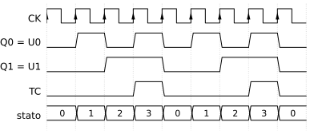

# 3 · Flip-flop, registri e contatori

**In questo modulo.** Si usano l'algebra e le mappe del modulo 1 (*Algebra booleana e sintesi delle reti combinatorie*), i multiplexer, i ritardi e i sommatori del modulo 2 (*Reti combinatorie standard, ritardi e aritmetica*). Si passa dalle reti combinatorie alle **reti sequenziali**, le cui uscite dipendono anche da ciò che è successo prima. Si vede come una retroazione crei un elemento di memoria, il latch, e perché nelle reti sincrone si usino i flip-flop che cambiano solo sul fronte del clock. Poi si studiano i parametri temporali che fissano la frequenza massima di una rete, e i due blocchi costitutivi delle reti sequenziali: i registri e i contatori. Alla fine del modulo si sa scegliere e usare i flip-flop D, JK e T, calcolare il periodo minimo del clock, progettare registri e contatori sincroni e analizzare una rete sincrona disegnandone il diagramma temporale.

## 3.1 Dalla retroazione alla memoria

In una rete combinatoria l'uscita dipende solo dagli ingressi presenti. Se però un'uscita viene riportata in ingresso (**retroazione**), la rete può ricordare. Si prenda una OR con un ingresso $A$ e l'altro collegato alla propria uscita $U$. Finché $A = 0$ e $U = 0$ la situazione è stabile; se $A$ fa un impulso a 1, $U$ va a 1 e, attraverso la retroazione, resta a 1 anche quando $A$ torna a 0. La rete ha memorizzato un 1, ma non può più dimenticarlo.

Per poterlo cancellare si mette sulla retroazione una AND con un secondo ingresso: $U = A + \bar{R}\,U$. Con $R = 1$ la retroazione è interrotta e $U$ torna a 0; con $R = 0$ e $A = 0$ l'uscita conserva il suo valore. I due comandi si chiamano **set** ($S$, porta l'uscita a 1) e **reset** ($R$, la porta a 0). C'è un punto che una rete combinatoria non ha: all'accensione, se nessuno dà un comando, il valore dell'uscita non è definito. Ogni rete sequenziale ha quindi bisogno di un comando di inizializzazione.

> [!aggiunta] Aggiunta in revisione · fonte: Donzellini e altri, *Introduzione al progetto di sistemi digitali* (RL-04)
> **Stato ed equazione caratteristica.** Il valore memorizzato si chiama **stato** e si indica con $Q$; il valore che assumerà dopo un comando si indica con $Q^+$. Per la rete appena vista, scritta con $S$ al posto di $A$, l'equazione caratteristica è $Q^+ = S + \bar{R}\,Q$: lo stato successivo dipende dagli ingressi e dallo stato presente. È la differenza fra una rete sequenziale e una combinatoria.

## 3.2 Latch

Il **latch SR** si realizza con due porte NOR incrociate: ciascuna riceve un ingresso esterno e l'uscita dell'altra (figura 3.1). Le uscite sono $Q$ e $\bar{Q}$, che in funzionamento normale sono una la negazione dell'altra.

| $S$ | $R$ | $Q^+$ | $\bar{Q}^+$ | Comando |
|---|---|---|---|---|
| 0 | 0 | $Q$ | $\bar{Q}$ | memorizzazione: conserva lo stato |
| 0 | 1 | 0 | 1 | reset |
| 1 | 0 | 1 | 0 | set |
| 1 | 1 | – | – | non ammesso |

Questa è la **tabella caratteristica** del latch: dagli ingressi e dallo stato presente dà lo stato successivo. La combinazione $S = R = 1$ non è ammessa perché porta entrambe le uscite a 0, e $\bar{Q}$ non è più la negazione di $Q$. C'è anche un problema peggiore: se da $S = R = 1$ i due ingressi tornano a 0 nello stesso istante, le due NOR cercano di commutare insieme e il risultato dipende da quale è più veloce. In un circuito perfettamente simmetrico le uscite oscillerebbero; nella realtà nessun circuito è perfetto e una delle due vince, ma non si sa quale. La figura 3.2 mostra un diagramma temporale con le configurazioni stabili e questo caso finale.

Con le leggi di De Morgan lo stesso latch si realizza con due NAND incrociate. In questo caso gli ingressi sono **attivi bassi**: il comando arriva quando valgono 0, e si indicano con $\bar{S}$ e $\bar{R}$. La combinazione vietata è $\bar{S} = \bar{R} = 0$.

Un **latch con abilitazione** aggiunge un ingresso $EN$: due porte davanti al latch lasciano passare $S$ e $R$ solo quando $EN = 1$. Con $EN = 0$ il latch conserva lo stato qualunque cosa facciano $S$ e $R$; con $EN = 1$ si comporta come il latch SR. Collegando $S = D$ e $R = \bar{D}$ si ottiene il **latch D**: con $EN = 1$ l'uscita copia $D$, con $EN = 0$ conserva l'ultimo valore. Il latch D non ha combinazioni vietate, perché $S$ e $R$ non valgono mai 1 insieme (figura 3.3).

| $EN$ | $D$ | $Q^+$ |
|---|---|---|
| 0 | – | $Q$ |
| 1 | 0 | 0 |
| 1 | 1 | 1 |

Il **latch JK** elimina la combinazione vietata in un altro modo: le due porte d'ingresso ricevono anche le uscite incrociate, così $J$ agisce solo se $Q = 0$ e $K$ solo se $Q = 1$.

| $J$ | $K$ | $Q^+$ | Comando |
|---|---|---|---|
| 0 | 0 | $Q$ | memorizzazione |
| 0 | 1 | 0 | reset |
| 1 | 0 | 1 | set |
| 1 | 1 | $\bar{Q}$ | commutazione |

Con $J = K = 1$ lo stato si inverte. Ma in un latch la commutazione non si ferma: appena $Q$ cambia, la retroazione cambia gli ingressi delle porte, e lo stato si inverte di nuovo, finché l'abilitazione resta attiva. L'uscita oscilla.

> [!aggiunta] Aggiunta in revisione · fonte: Donzellini e altri, *Introduzione al progetto di sistemi digitali* (RL-04)
> **Trasparenza e metastabilità.** Un latch abilitato è **trasparente**: ogni variazione dell'ingresso arriva subito all'uscita. In una rete in cui l'uscita di un latch, attraverso una rete combinatoria, torna all'ingresso dello stesso latch, finché l'abilitazione è attiva i segnali girano nell'anello senza fermarsi, come nel latch JK. Per questo nelle reti sincrone si usano elementi che campionano l'ingresso in un solo istante: i flip-flop del paragrafo 3.3.
>
> Se l'ingresso di un latch cambia proprio mentre l'abilitazione si chiude, l'uscita può restare per un tempo non prevedibile a un livello intermedio prima di decidere fra 0 e 1. È la **metastabilità**, la versione reale dell'oscillazione del latch SR, e si evita rispettando i tempi del paragrafo 3.4.

## 3.3 Flip-flop sul fronte

Un **flip-flop** (FF) cambia stato solo in corrispondenza di un **fronte** del clock $CK$: il fronte di salita, da 0 a 1, per i FF **PET** (*positive edge triggered*), il fronte di discesa per i FF **NET** (*negative edge triggered*). Fra un fronte e l'altro l'uscita resta ferma qualunque cosa facciano gli ingressi. Nei simboli il fronte si indica con un triangolino sull'ingresso del clock, e un pallino davanti al triangolino indica un FF NET. In questo corso si usano i FF PET.

> [!aggiunta] Aggiunta in revisione · fonte: Donzellini e altri, *Introduzione al progetto di sistemi digitali* (RL-04)
> **Come si ottiene il fronte.** Un modo è lo schema **master-slave**: due latch D in serie, il primo (master) abilitato quando $CK = 0$ e il secondo (slave) quando $CK = 1$. Mentre il clock è basso il master segue l'ingresso e lo slave è chiuso; quando il clock sale il master si chiude sul valore che aveva in quel momento e lo slave lo copia in uscita. L'uscita cambia quindi solo sul fronte di salita, e non c'è mai un percorso trasparente dall'ingresso all'uscita.

I tre FF che servono sono il D, il JK e il T, tutti con la stessa idea: la tabella dice quale sarà lo stato dopo il prossimo fronte.

| FF | Ingressi | $Q^+$ | Equazione caratteristica |
|---|---|---|---|
| D | $D = 0$ / $D = 1$ | 0 / 1 | $Q^+ = D$ |
| JK | $JK = 00, 01, 10, 11$ | $Q$, 0, 1, $\bar{Q}$ | $Q^+ = J\bar{Q} + \bar{K}Q$ |
| T | $T = 0$ / $T = 1$ | $Q$ / $\bar{Q}$ | $Q^+ = T \oplus Q$ |

Nel FF JK la combinazione $J = K = 1$ non fa più oscillare: lo stato si inverte una volta per fronte. Il FF **T** (*toggle*) si ottiene da un JK con $J = K = T$, oppure da un D con $D = T \oplus Q$.

> [!aggiunta] Aggiunta in revisione · fonte: Donzellini e altri, *Introduzione al progetto di sistemi digitali*; esercitazioni con il simulatore (RL-04)
> **Flip-flop D con abilitazione (E-PET).** Nei registri serve spesso un FF che al fronte carichi $D$ solo quando un segnale lo autorizza, e altrimenti conservi lo stato. È il FF **E-PET** (*enabled positive edge triggered*), che ha un ingresso $E$ in più:
> $$Q^+ = E\,D + \bar{E}\,Q.$$
> Dentro c'è un FF D con davanti un MUX 2→1: con $E = 1$ il MUX porta $D$ all'ingresso del FF, con $E = 0$ gli riporta la sua stessa uscita. L'abilitazione non agisce sul clock: il clock arriva a tutti i FF, e quello che cambia è il valore che il FF carica. Fermare il clock con una porta (*clock gating*) sarebbe una cattiva idea, perché la porta ritarda il clock di quel FF rispetto agli altri e può creare fronti spuri.

I FF hanno spesso due ingressi **asincroni**, attivi bassi, che agiscono subito senza aspettare il clock: $\overline{PR}$ (*preset*) forza lo stato a 1 quando vale 0, $\overline{CL}$ (*clear*) lo forza a 0. Si usano per l'inizializzazione: il segnale $\overline{RES}$ di una rete va sui $\overline{CL}$ di tutti i FF, e quando non servono si collegano a 1.

Per il progetto serve la tabella inversa di quella caratteristica: data la transizione $Q \to Q^+$ che si vuole ottenere, quali ingressi bisogna dare. È la **tabella di eccitazione**.

| $Q \to Q^+$ | $D$ | $J$ | $K$ | $T$ |
|---|---|---|---|---|
| 0 → 0 | 0 | 0 | – | 0 |
| 0 → 1 | 1 | 1 | – | 1 |
| 1 → 0 | 0 | – | 1 | 1 |
| 1 → 1 | 1 | – | 0 | 0 |

Per il JK ci sono sempre indifferenze: per passare da 0 a 1 si può dare il set ($JK = 10$) o la commutazione ($JK = 11$), quindi $K$ non conta. Le indifferenze sono il motivo per cui le reti che comandano i JK vengono spesso più semplici di quelle che comandano i D.

> [!attenzione]
> La tabella che dagli ingressi dà lo stato successivo è la tabella **caratteristica**; quella che dalla transizione dà gli ingressi è la tabella di **eccitazione**. Negli esercizi si usano entrambe, e non vanno confuse.

## 3.4 Temporizzazioni

Un FF reale funziona correttamente solo se gli ingressi rispettano alcuni tempi rispetto al fronte del clock (figura 3.4).

> [!definizione] Parametri temporali di un flip-flop
>
> - **Tempo di setup** $t_s$ (minimo): l'ingresso deve essere stabile almeno da $t_s$ prima del fronte.
> - **Tempo di hold** $t_h$ (minimo): l'ingresso deve restare stabile almeno per $t_h$ dopo il fronte.
> - **Tempo di propagazione** $t_p$ (massimo): l'uscita cambia al più $t_p$ dopo il fronte; si distingue $t_{PLH}$ per la salita dell'uscita e $t_{PHL}$ per la discesa.
> - **Durata minima dell'impulso** $t_w$: gli impulsi del clock e dei comandi asincroni devono durare almeno $t_w$.

Se uno di questi tempi non è rispettato il FF può prendere il valore sbagliato o diventare metastabile. Da questi parametri dipende la velocità massima di una rete sincrona.

> [!aggiunta] Aggiunta in revisione · fonte: Donzellini e altri, *Introduzione al progetto di sistemi digitali* (RL-05)
> **Periodo minimo di una rete sincrona.** In una rete in cui le uscite dei FF passano per una rete combinatoria e tornano agli ingressi dei FF, dopo un fronte le uscite cambiano entro $t_p$, la rete combinatoria le elabora entro il suo ritardo massimo $t_{comb}$, e il risultato deve arrivare agli ingressi almeno $t_s$ prima del fronte successivo. Il periodo del clock deve quindi rispettare
> $$T_{CK} \ge T_{min} = t_p + t_{comb} + t_s, \qquad f_{max} = \frac{1}{T_{min}}.$$
> Con $t_p = 10$ ns, $t_{comb} = 25$ ns e $t_s = 5$ ns si ha $T_{min} = 40$ ns e $f_{max} = 25$ MHz. C'è anche un vincolo dall'altra parte: il nuovo valore non deve arrivare troppo presto, prima che sia passato il tempo di hold del fronte appena avvenuto. Serve che il percorso più veloce rispetti $t_{p,min} + t_{comb,min} \ge t_h$, condizione che con i FF commerciali è quasi sempre soddisfatta.

> [!attenzione]
> $T_{min}$ è un periodo, e si misura in secondi; la frequenza massima del clock è il suo inverso. Un clock a 1 MHz ha periodo $1\ \mu\text{s}$, non 1 ms.

## 3.5 Registri

Un **registro** a $n$ bit è un gruppo di $n$ FF D con lo stesso clock, che memorizza una parola di $n$ bit. A seconda di come entrano ed escono i dati si hanno quattro tipi.

- **PIPO** (*parallel input, parallel output*): ogni FF ha il suo ingresso $P_i$ e la sua uscita $Q_i$; a ogni fronte il registro carica tutti i bit insieme. Si disegna come un blocco con un bus di ingresso e uno di uscita a $n$ fili.
- **SISO** (*serial input, serial output*): i FF sono in fila, l'uscita di ciascuno è l'ingresso del successivo, il dato entra da $S_{in}$ un bit per fronte ed esce da $S_{out}$ dopo $n$ fronti. È il **registro a scorrimento** (*shift register*) (figura 3.5).
- **SIPO** (*serial input, parallel output*): è un SISO di cui si prendono tutte le uscite; converte un dato seriale in parallelo.
- **PISO** (*parallel input, serial output*): davanti a ogni FF un selettore comandato da $LD$ sceglie fra l'ingresso parallelo $P_i$ (caricamento, $LD = 1$) e l'uscita del FF precedente (scorrimento, $LD = 0$); converte un dato parallelo in seriale.

Il **registro universale** mette davanti a ogni FF un MUX 4→1 che sceglie che cosa caricare al prossimo fronte. Numerando i bit da destra ($Q_0$ è l'LSB e $Q_{n-1}$ il più a sinistra), il bit $i$ riceve:

| $S_0 S_1$ | Ingresso del FF $i$ | Operazione |
|---|---|---|
| 00 | $Q_i$ | memorizzazione |
| 01 | $Q_{i+1}$ | scorrimento a destra |
| 10 | $Q_{i-1}$ | scorrimento a sinistra |
| 11 | $P_i$ | caricamento parallelo |

Ai due estremi gli ingressi mancanti ($Q_n$ per il bit più a sinistra, $Q_{-1}$ per il bit 0) sono ingressi seriali esterni.

## 3.6 Contatori

Un **contatore** è un registro che a ogni fronte passa al numero successivo. Nella sequenza binaria il bit $Q_0$ cambia a ogni passo, e il bit $Q_i$ cambia quando tutti i bit alla sua destra valgono 1:

| $N$ | $Q_3 Q_2 Q_1 Q_0$ | | $N$ | $Q_3 Q_2 Q_1 Q_0$ |
|---|---|---|---|---|
| 0 | 0000 | | 5 | 0101 |
| 1 | 0001 | | 6 | 0110 |
| 2 | 0010 | | 7 | 0111 |
| 3 | 0011 | | 8 | 1000 |
| 4 | 0100 | | 9 | 1001 |

Con i FF T la regola si traduce direttamente: $T_0 = 1$, $T_1 = Q_0$, $T_2 = Q_1 Q_0$, $T_3 = Q_2 Q_1 Q_0$. È il **contatore sincrono** a 4 bit, che conta da 0 a 15 e poi riparte (contatore modulo 16, figura 3.6). Tutti i FF ricevono lo stesso clock, quindi le uscite cambiano insieme.

Con i FF D lo stesso contatore si progetta dalle equazioni. Per 2 bit: $Q_0$ si inverte sempre, $D_0 = \bar{Q}_0$ (il FF è in configurazione *toggle*); $Q_1$ si inverte quando $Q_0 = 1$, $D_1 = Q_1 \oplus Q_0$. Il contatore modulo 4 conta $0, 1, 2, 3, 0, \dots$ e ha un'uscita **TC** (*terminal count*) che vale 1 nell'ultimo stato, $TC = Q_1 Q_0$ (figura 3.7).

Un **contatore universale** si ottiene con un registro e un sommatore: a ogni fronte il registro carica $Q + N$. Con $N = 00\dots01$ conta in avanti; con $N = 11\dots11$, che in complemento a 2 vale $-1$, conta all'indietro. Il terminal count del conteggio in avanti è lo stato con tutti i bit a 1, $TC = Q_{k-1} Q_{k-2} \cdots Q_1 Q_0$; nel conteggio all'indietro l'ultimo stato è quello con tutti i bit a 0.

> [!aggiunta] Aggiunta in revisione · fonte: Donzellini e altri, *Introduzione al progetto di sistemi digitali* (RL-05)
> **Contatore modulo N e cascata.** Per contare da 0 a $N - 1$ con $N$ non potenza di 2 si riconosce lo stato $N - 1$ e si forza lo stato successivo a 0. Per il contatore decimale (0…9), fra gli stati usati solo il 9 ($1001$) ha $Q_3 = 1$ e $Q_0 = 1$, quindi $TC = Q_3 Q_0$, e lo stato successivo è $Q^+ = \overline{TC} \cdot (Q + 1)$: un reset sincrono comandato da $TC$.
>
> Un contatore con **abilitazione** $EN$ conta solo quando $EN = 1$ e dà $TC$ solo se è abilitato. Collegando il $TC$ di un contatore all'$EN$ del successivo si ottiene un contatore con più cifre: il secondo avanza di uno ogni volta che il primo ricomincia, come le cifre di un contachilometri.

## 3.7 Analisi di reti sincrone

Analizzare una rete sincrona vuol dire ricavarne il comportamento dal circuito. Si scrivono le equazioni degli ingressi dei FF in funzione degli ingressi della rete e delle uscite dei FF, si calcola lo stato dopo ogni fronte, e si disegna il diagramma temporale. Conviene ricordare due regole: i valori si leggono **appena prima** del fronte, e le uscite dei FF cambiano **appena dopo**.

> [!esempio] Due flip-flop in cascata
> L'ingresso $IN$ va a un primo FF, la cui uscita $U_0$ va all'ingresso $D$ di un secondo FF con uscita $U_1$; i due FF hanno lo stesso clock e lo stesso $\overline{RES}$. Finché $\overline{RES} = 0$ le uscite sono a 0. Poi, a ogni fronte, $U_0$ prende il valore che $IN$ aveva appena prima del fronte, e $U_1$ quello che $U_0$ aveva appena prima: $U_1$ è $U_0$ ritardato di un periodo di clock. Un impulso di $IN$ che comincia e finisce fra due fronti non viene visto affatto.

> [!nota]
> Il primo FF si può fare anche con un JK, mettendo $IN$ su $J$ e $\overline{IN}$ su $K$. Con $J = IN$ e $K = \overline{IN}$ il JK riceve solo i comandi di set ($JK = 10$) e di reset ($JK = 01$), quindi $Q^+ = IN$: si comporta esattamente come un FF D, e il diagramma è quello descritto sopra. È il modo di ottenere un FF D da un JK.

> [!esempio] Un registro a scorrimento con retroazione
> Quattro FF D sono in fila con uscite $D$, $C$, $B$, $A$ (il primo è $D$). L'ingresso del primo FF è $IN \oplus B \oplus A$, l'uscita di ogni FF è l'ingresso del successivo; il reset porta tutto a $0000$ (figura 3.8).
>
> 
>
> Lo stato successivo di $DCBA$ è $(IN \oplus B \oplus A,\ D,\ C,\ B)$. Con $IN$ fisso a 1 dopo il reset si ottiene la sequenza
>
> $0000 \to 1000 \to 1100 \to 1110 \to 0111 \to 1011 \to 1101 \to 0110 \to 0011 \to 1001 \to 0100 \to 1010 \to 0101 \to 0010 \to 0001 \to 0000$
>
> che si ripete ogni 15 fronti (lo stato $1111$ non compare). Con $IN = 1$ per un solo fronte e poi sempre 0, la rete parte da $1000$ e attraversa tutti i 15 stati diversi da $0000$:
>
> $1000 \to 0100 \to 0010 \to 1001 \to 1100 \to 0110 \to 1011 \to 0101 \to 1010 \to 1101 \to 1110 \to 1111 \to 0111 \to 0011 \to 0001 \to 1000$
>
> È un **registro a scorrimento con retroazione lineare** (LFSR): con la sola XOR sulla retroazione genera una sequenza lunga, che sembra casuale, e si usa per esempio per produrre bit di prova. Se $IN$ resta a 0 dal reset in poi, la rete resta in $0000$ per sempre: serve almeno un 1 per farla partire.

## Esempi ed esercizi svolti

**Esercizio 1.** Completare la tabella del latch SR a NAND. Gli ingressi sono $\bar{S}$, $\bar{R}$, attivi bassi: $\bar{S}\bar{R} = 11$ memorizza, $01$ (set attivo) dà $Q = 1$, $10$ (reset attivo) dà $Q = 0$, $00$ non è ammesso perché porta entrambe le uscite a 1.

**Esercizio 2.** Ottenere un FF T da un FF D. Dalla tabella di eccitazione del D, $D = Q^+$; dal T, $Q^+ = T \oplus Q$. Quindi $D = T \oplus Q$: una XOR fra $T$ e l'uscita del FF davanti all'ingresso $D$.

**Esercizio 3.** Quale frequenza massima ha un contatore sincrono a 4 bit con FF T, se $t_p = 8$ ns, $t_s = 4$ ns e ogni AND ha un ritardo di 5 ns? Il percorso più lungo va da $Q_0$, $Q_1$, $Q_2$ attraverso la AND che dà $T_3$: se la AND è una sola porta a tre ingressi, $t_{comb} = 5$ ns e $T_{min} = 8 + 5 + 4 = 17$ ns, cioè $f_{max} \approx 58{,}8$ MHz. Se invece $T_3$ si ottiene in cascata, come $T_3 = T_2 \cdot Q_2$ con due AND in serie, $t_{comb} = 10$ ns e $T_{min} = 22$ ns ($f_{max} \approx 45{,}5$ MHz).

**Esercizio 4.** Un registro universale a 4 bit contiene $Q_3 Q_2 Q_1 Q_0 = 1011$, con ingresso seriale a destra 0 e a sinistra 0. Dopo un fronte con $S_0 S_1 = 01$ (scorrimento a destra, ogni bit prende il valore del vicino di sinistra) contiene $0101$; dopo un fronte con $S_0 S_1 = 10$ (a sinistra) partendo da $1011$ contiene $0110$.

### Esercizi del laboratorio con il simulatore

> [!aggiunta] Aggiunta in revisione · fonte: esercitazioni con il simulatore Deeds (testi riscritti, sequenze e soluzioni nuove) (RL-04, RL-05, RL-08)
> Negli esercizi sui flip-flop la tabella di verità non basta: si lavora sul diagramma temporale. Le sequenze sono scritte come tabelle, un intervallo o un fronte per riga, ed è il modo più comodo di risolverle anche a mano.

**Esercizio 5. Latch SR a NAND, e il rilascio contemporaneo.** Il latch ha ingressi attivi bassi $\bar{S}$ e $\bar{R}$. (a) Completare la sequenza. (b) Che cosa mostra il simulatore se, dopo $\bar{S} = \bar{R} = 0$, i due ingressi tornano a 1 nello stesso istante? (c) Perché in un circuito reale l'oscillazione non dura?

| Intervallo | $\bar{S}$ | $\bar{R}$ | $Q$ | $\bar{Q}$ | Comando |
|---|---|---|---|---|---|
| 1 | 1 | 0 | 0 | 1 | reset |
| 2 | 1 | 1 | 0 | 1 | memoria |
| 3 | 0 | 1 | 1 | 0 | set |
| 4 | 1 | 1 | 1 | 0 | memoria |
| 5 | 0 | 0 | 1 | 1 | vietato: le uscite non sono complementari |
| 6 | 1 | 1 | ? | ? | rilascio contemporaneo |

(a) Le prime cinque righe seguono la tabella dell'esercizio 1: il comando è attivo quando l'ingresso vale 0, e nell'intervallo 5 entrambe le NAND hanno un ingresso a 0, quindi entrambe le uscite valgono 1. (b) Nell'intervallo 6 le due NAND vedono gli ingressi esterni a 1 e l'altra uscita a 1, quindi entrambe passano a 0 dopo lo stesso ritardo; a quel punto vedono l'altra uscita a 0 e tornano entrambe a 1, e così via. Nel simulatore le porte hanno ritardi identici e le uscite oscillano insieme con periodo pari a due ritardi. (c) In un circuito reale le due porte non sono mai identiche: una è un po' più veloce, la sua uscita cambia per prima e blocca l'altra, e il latch si ferma in uno dei due stati. Quale, non si può prevedere. È la ragione per cui la combinazione è vietata, e lo stesso fenomeno, con tempi più lunghi, è la metastabilità del paragrafo 3.2.

**Esercizio 6. Latch D con preset e clear.** Il latch D ha anche gli ingressi asincroni attivi bassi $\overline{PR}$ e $\overline{CL}$, che hanno la precedenza su tutto. Completare la colonna $Q$.

| Intervallo | $\overline{PR}$ | $\overline{CL}$ | $EN$ | $D$ | $Q$ |
|---|---|---|---|---|---|
| 1 | 1 | 0 | – | – | 0 |
| 2 | 1 | 1 | 0 | 1 | 0 |
| 3 | 1 | 1 | 1 | 1 | 1 |
| 4 | 1 | 1 | 1 | 0 | 0 |
| 5 | 1 | 1 | 0 | 1 | 0 |
| 6 | 0 | 1 | 0 | 0 | 1 |
| 7 | 1 | 1 | 0 | 0 | 1 |
| 8 | 1 | 1 | 1 | 0 | 0 |

Nell'intervallo 1 il clear porta $Q$ a 0: è l'inizializzazione. Nel 2 il latch è chiuso e conserva 0 anche se $D = 1$. Nel 3 e nel 4 è aperto e trasparente, e $Q$ segue $D$ (prima 1, poi 0). Nel 5 si chiude sul valore che aveva, 0. Nel 6 il preset forza 1 senza guardare $EN$, e nel 7 il latch chiuso conserva quell'1. Nell'8 si riapre e copia $D = 0$.

**Esercizio 7. JK a comando diretto, e lo stato sconosciuto.** Un latch JK senza clock (il JK del paragrafo 3.2 sempre abilitato) ha anche $\overline{PR}$ e $\overline{CL}$. (a) Che cosa mostra il simulatore se la rete non viene inizializzata? (b) Che cosa succede con $J = K = 1$?

(a) All'accensione lo stato di una rete con retroazione non è determinato dalla rete stessa: dipende da come si sono assestate le porte. Il simulatore non ha nessun modo di saperlo e mostra $Q$ come sconosciuto (in Deeds con una riga a metà fra 0 e 1, in altri simulatori con il simbolo X) finché un comando non lo fissa. Anche con $J = K = 0$ lo stato resta sconosciuto, perché "memoria" vuol dire conservare un valore che non si conosce. Il primo set, reset o clear lo rende definito. È il motivo per cui ogni rete sequenziale ha un reset (paragrafo 3.1). (b) Con $J = K = 1$ il comando è "commuta", ma senza clock la commutazione non si ferma: l'uscita cambia, la retroazione cambia gli ingressi delle porte e l'uscita cambia di nuovo, con un periodo legato ai ritardi delle porte. È l'oscillazione che il FF JK sul fronte elimina.

**Esercizio 8. FF D sul fronte con preset e clear.** Il FF D-PET parte con un impulso di $\overline{CL}$. La tabella dà il valore di $D$ appena prima di ogni fronte di salita e gli eventi asincroni fra un fronte e il successivo. Completare $Q$.

| Fronte | $D$ prima del fronte | $Q$ dopo il fronte | Fra questo fronte e il successivo |
|---|---|---|---|
| – | – | 0 | impulso di $\overline{CL}$ |
| 1 | 1 | 1 | |
| 2 | 1 | 1 | |
| 3 | 0 | 0 | impulso di $\overline{PR}$: $Q$ va subito a 1 |
| 4 | 1 | 1 | |
| 5 | 0 | 0 | |
| 6 | 0 | 0 | |

La regola è quella del paragrafo 3.7: si legge $D$ appena prima del fronte, $Q$ cambia appena dopo. Il preset fra il terzo e il quarto fronte agisce subito, senza aspettare il clock; al quarto fronte il FF carica di nuovo $D = 1$, quindi $Q$ resta a 1. Gli ingressi asincroni servono soprattutto all'inizializzazione, ma possono intervenire in qualsiasi momento: per questo in simulazione si provano anche nel mezzo del funzionamento.

**Esercizio 9. FF D con abilitazione (E-PET).** Il FF parte da $Q = 0$. Completare la tabella con $Q^+ = E\,D + \bar{E}\,Q$.

| Fronte | $E$ | $D$ | $Q$ dopo il fronte |
|---|---|---|---|
| 1 | 0 | 1 | 0 |
| 2 | 1 | 1 | 1 |
| 3 | 0 | 0 | 1 |
| 4 | 1 | 0 | 0 |
| 5 | 0 | 1 | 0 |
| 6 | 1 | 1 | 1 |

Con $E = 0$ il fronte non cambia niente, anche se $D$ è diverso da $Q$ (fronti 1, 3 e 5); con $E = 1$ il FF si comporta come un D normale.

**Esercizio 10. FF JK sul fronte.** Il FF parte da $Q = 0$ dopo il clear. Completare la tabella con l'equazione $Q^+ = J\bar{Q} + \bar{K}Q$.

| Fronte | $J$ | $K$ | $Q$ prima | $Q$ dopo | Comando |
|---|---|---|---|---|---|
| 1 | 1 | 0 | 0 | 1 | set |
| 2 | 0 | 0 | 1 | 1 | memoria |
| 3 | 1 | 1 | 1 | 0 | commutazione |
| 4 | 1 | 1 | 0 | 1 | commutazione |
| 5 | 0 | 1 | 1 | 0 | reset |
| 6 | 0 | 1 | 0 | 0 | reset (già a 0) |
| 7 | 1 | 0 | 0 | 1 | set |
| 8 | 1 | 1 | 1 | 0 | commutazione |

Con $J = K = 1$ tenuti fissi per più fronti, $Q$ cambia una volta per fronte: è un divisore di frequenza per 2, ed è il FF T del paragrafo 3.3.

**Esercizio 11. Un registro a scorrimento letto in complemento a 2.** Un registro a scorrimento a 3 bit fatto con FF E-PET ha ingresso $DATA$, abilitazione $E$ sempre a 1 e reset iniziale. A ogni fronte $Q_a$ prende $DATA$, $Q_b$ prende $Q_a$ e $Q_c$ prende $Q_b$. Le uscite $Q_a Q_b Q_c$ si leggono come un numero in complemento a 2 con $Q_a$ bit di segno. Quale sequenza di $DATA$ fa assumere alle uscite i valori $0, -4, +2, -3, -2, +3, +1$?

*Ragionamento.* Dopo ogni fronte il nuovo $Q_a$ è il bit entrato, e $Q_b Q_c$ sono i vecchi $Q_a Q_b$. Quindi il valore di $DATA$ si legge sul bit $Q_a$ del valore successivo, e i bit $Q_b Q_c$ di ogni valore devono coincidere con i bit $Q_a Q_b$ del precedente (altrimenti la sequenza è impossibile).

| Fronte | $DATA$ | $Q_a Q_b Q_c$ | Valore |
|---|---|---|---|
| reset | – | 000 | 0 |
| 1 | 1 | 100 | −4 |
| 2 | 0 | 010 | +2 |
| 3 | 1 | 101 | −3 |
| 4 | 1 | 110 | −2 |
| 5 | 0 | 011 | +3 |
| 6 | 0 | 001 | +1 |

La sequenza è $DATA = 1, 0, 1, 1, 0, 0$. Controllo della coerenza: per esempio $-3 = 101$ ha $Q_b Q_c = 01$, uguale ai primi due bit di $+2 = 010$.

**Esercizio 12. Contatore modulo 16 con FF D.** Progettare il contatore sincrono a 4 bit con FF D (negli appunti della lezione 9 è il contatore modulo 16 a 4 FF) e confrontarlo con quello a FF T.

Ogni bit si inverte quando tutti i bit più bassi valgono 1, cioè $Q_i^+ = Q_i \oplus (Q_{i-1} \cdots Q_0)$. Con i FF D l'ingresso è lo stato successivo:
$$D_0 = \bar{Q}_0, \quad D_1 = Q_1 \oplus Q_0, \quad D_2 = Q_2 \oplus Q_1 Q_0, \quad D_3 = Q_3 \oplus Q_2 Q_1 Q_0.$$
Con i FF T bastava $T_i = Q_{i-1} \cdots Q_0$: la XOR è già dentro il FF T. Prova da $0111$: $D_0 = 0$, $D_1 = 1 \oplus 1 = 0$, $D_2 = 1 \oplus 1 = 0$, $D_3 = 0 \oplus 1 = 1$, quindi $1000$, cioè da 7 a 8. Da $1111$ tutte le XOR danno 0 e il contatore torna a $0000$: il terminal count è $TC = Q_3 Q_2 Q_1 Q_0$.

## Esercizi guidati

> [!aggiunta] Aggiunta in revisione · fonte: esercizi nuovi, soluzioni verificate con `strumenti/verifica_ampliamento.py` (RL-04, RL-05)
> Ogni esercizio è diviso in passi: si prova un passo alla volta e si confronta solo dopo.

**Guidato 1. Contatore modulo 6 con FF T.** Progettare un contatore che conti $0, 1, 2, 3, 4, 5, 0, \dots$ con tre FF T, e controllare che cosa fa se parte da uno stato non usato.

*Passo 1: la tabella degli stati.* Gli stati $Q_2 Q_1 Q_0$ vanno da $000$ a $101$; i codici $110$ e $111$ non si usano e sono indifferenze.

*Passo 2: gli ingressi T.* Per un FF T, $T_i = 1$ se il bit deve cambiare: $T_i = Q_i \oplus Q_i^+$.

| $Q_2 Q_1 Q_0$ | $Q_2^+ Q_1^+ Q_0^+$ | $T_2 T_1 T_0$ |
|---|---|---|
| 000 | 001 | 001 |
| 001 | 010 | 011 |
| 010 | 011 | 001 |
| 011 | 100 | 111 |
| 100 | 101 | 001 |
| 101 | 000 | 101 |

*Passo 3: le sintesi.* $T_0 = 1$ sempre. $T_1$ vale 1 per $001$ e $011$, 0 per $101$: serve $Q_0 = 1$ e $Q_2 = 0$, $T_1 = \bar{Q}_2 Q_0$. $T_2$ vale 1 per $011$ e $101$ e, con le indifferenze in $111$, $T_2 = Q_1 Q_0 + Q_2 Q_0$.

*Passo 4: gli stati non usati.* Da $110$: $T_2 = 0$, $T_1 = 0$, $T_0 = 1$, quindi va in $111$. Da $111$: $T_2 = 1$, $T_1 = 0$, $T_0 = 1$, quindi va in $010$, che è nella sequenza. Il contatore rientra da solo in due fronti.

*Passo 5: il terminal count.* L'ultimo stato è $101$; fra gli stati usati è l'unico con $Q_2 = 1$ e $Q_0 = 1$, quindi $TC = Q_2 Q_0$.

**Guidato 2. Frequenza massima di un contatore.** Un contatore sincrono a 3 bit con FF JK ha $J_0 = K_0 = 1$, $J_1 = K_1 = Q_0$, $J_2 = K_2 = Q_1 Q_0$ (una AND a due ingressi). I FF hanno $t_p = 12$ ns, $t_s = 6$ ns, $t_h = 2$ ns; la AND ha ritardo fra 3 e 7 ns. Trovare la frequenza massima e controllare il tempo di hold.

*Passo 1: il percorso più lungo.* Da un fronte, le uscite dei FF cambiano entro 12 ns; il segnale più lento è quello che attraversa la AND, che aggiunge al massimo 7 ns; deve arrivare a $J_2$, $K_2$ almeno 6 ns prima del fronte successivo.

*Passo 2.* $T_{min} = 12 + 7 + 6 = 25$ ns, quindi $f_{max} = 1/(25\ \text{ns}) = 40$ MHz.

*Passo 3: hold.* Il percorso più veloce è quello senza porte, da $Q_0$ a $J_1$: ci mette almeno il $t_p$ minimo del FF. Se il costruttore garantisce un $t_p$ minimo di almeno 2 ns, la condizione $t_{p,min} + t_{comb,min} \ge t_h$ è rispettata anche nel caso peggiore, con $t_{comb,min} = 0$.

*Passo 4: il controllo delle unità.* 25 ns sono $25 \cdot 10^{-9}$ s; l'inverso è $4 \cdot 10^{7}$ Hz, cioè 40 MHz.

**Guidato 3. Diagramma temporale di una rete con due FF.** Due FF D hanno uscite $A$ e $B$ e reset iniziale a $00$; gli ingressi sono $D_A = IN \oplus B$ e $D_B = A$. Calcolare gli stati per $IN = 1, 1, 0, 0, 1, 0$ (valori appena prima dei fronti 1-6).

*Passo 1: le equazioni dello stato successivo.* $A^+ = IN \oplus B$, $B^+ = A$.

*Passo 2: fronte per fronte.* Si usa sempre lo stato *prima* del fronte.

| Fronte | $IN$ | $A B$ prima | $A^+ = IN \oplus B$ | $B^+ = A$ | $A B$ dopo |
|---|---|---|---|---|---|
| 1 | 1 | 00 | 1 | 0 | 10 |
| 2 | 1 | 10 | 1 | 1 | 11 |
| 3 | 0 | 11 | 1 | 1 | 11 |
| 4 | 0 | 11 | 1 | 1 | 11 |
| 5 | 1 | 11 | 0 | 1 | 01 |
| 6 | 0 | 01 | 1 | 0 | 10 |

*Passo 3: l'errore da evitare.* Al fronte 2 è sbagliato calcolare $B^+$ con il nuovo valore di $A$: i due FF campionano insieme, e $B$ prende il valore che $A$ aveva *prima* del fronte. Qui il valore è lo stesso (1), ma al fronte 5 si vede la differenza: $A$ passa a 0 mentre $B$ prende il vecchio $A = 1$.

## Riepilogo

Una retroazione trasforma una rete combinatoria in un elemento di memoria: il latch SR, con due NOR o due NAND incrociate, conserva lo stato e risponde ai comandi di set e reset, con una combinazione vietata. Con l'abilitazione si ottengono il latch D, senza combinazioni vietate, e il latch JK, che però oscilla con $J = K = 1$ perché è trasparente. I flip-flop cambiano solo sul fronte del clock e risolvono il problema; i tipi D, JK e T hanno equazioni caratteristiche $Q^+ = D$, $Q^+ = J\bar{Q} + \bar{K}Q$, $Q^+ = T \oplus Q$, e per il progetto si usa la tabella di eccitazione. I tempi di setup, hold, propagazione e durata minima vanno rispettati, e il periodo minimo di una rete sincrona è $t_p + t_{comb} + t_s$. I registri memorizzano parole di bit e possono caricare in parallelo o scorrere, e il registro universale sceglie l'operazione con un MUX per bit. I contatori sincroni si fanno con FF T ($T_i$ uguale al prodotto dei bit più bassi) o con FF D, segnalano l'ultimo stato con il terminal count e si collegano in cascata con l'abilitazione. Per analizzare una rete sincrona si scrivono le equazioni dei FF e si calcola lo stato fronte per fronte.

## Formulario

> [!aggiunta] Aggiunta in revisione · fonte: sintesi del modulo (RL-04, RL-05)
> Tabelle ed equazioni dei flip-flop, tempi e strutture del modulo, con i termini da saper spiegare all'orale.

### Elementi di memoria

| Elemento | Comportamento | Equazione o tabella | Par. |
|---|---|---|---|
| Latch SR a NOR | $SR = 00$ memoria, $01$ reset, $10$ set, $11$ vietato | $Q^+ = S + \bar{R}Q$ (con $SR \ne 11$) | 3.2 |
| Latch SR a NAND | ingressi attivi bassi, vietato $\bar{S}\bar{R} = 00$ | | 3.2 |
| Latch D | trasparente con $EN = 1$, memoria con $EN = 0$ | $Q^+ = EN\,D + \overline{EN}\,Q$ | 3.2 |
| FF D (PET) | carica $D$ sul fronte di salita | $Q^+ = D$ | 3.3 |
| FF JK | $00$ memoria, $01$ reset, $10$ set, $11$ commuta | $Q^+ = J\bar{Q} + \bar{K}Q$ | 3.3 |
| FF T | $T = 1$ commuta | $Q^+ = T \oplus Q$ | 3.3 |
| FF E-PET | carica $D$ solo se $E = 1$ | $Q^+ = E\,D + \bar{E}\,Q$ | 3.3 |

### Tabella di eccitazione

| $Q \to Q^+$ | $D$ | $J$ | $K$ | $T$ |
|---|---|---|---|---|
| 0 → 0 | 0 | 0 | – | 0 |
| 0 → 1 | 1 | 1 | – | 1 |
| 1 → 0 | 0 | – | 1 | 1 |
| 1 → 1 | 1 | – | 0 | 0 |

Conversioni: un FF T da un D con $D = T \oplus Q$; un FF T da un JK con $J = K = T$; un FF D da un JK con $J = D$, $K = \bar{D}$.

### Tempi

$$T_{CK} \ge t_p + t_{comb,max} + t_s, \qquad f_{max} = \frac{1}{T_{min}}, \qquad t_{p,min} + t_{comb,min} \ge t_h.$$

### Registri e contatori

- Registro universale, bit $i$: $S_0 S_1 = 00$ tiene $Q_i$, $01$ carica $Q_{i+1}$ (destra), $10$ carica $Q_{i-1}$ (sinistra), $11$ carica $P_i$.
- Contatore binario con FF T: $T_0 = 1$, $T_i = Q_{i-1} \cdots Q_0$. Con FF D: $D_i = Q_i \oplus (Q_{i-1} \cdots Q_0)$.
- Terminal count in avanti: $TC = Q_{k-1} \cdots Q_0$; modulo $N$: si riconosce lo stato $N - 1$ e si azzera in modo sincrono.
- Cascata: il $TC$ di un contatore va sull'$EN$ del successivo.

### Analisi di una rete sincrona

I valori si leggono appena prima del fronte, le uscite cambiano appena dopo; tutti i FF campionano nello stesso istante, quindi ogni FF usa i valori *vecchi* degli altri. Gli ingressi asincroni agiscono subito e hanno la precedenza sul clock.

### Termini per l'orale

| Termine | In una riga |
|---|---|
| Rete sequenziale | rete le cui uscite dipendono anche dalla storia passata degli ingressi |
| Stato | valore memorizzato nei FF; $Q^+$ è lo stato dopo il prossimo comando o fronte |
| Retroazione | collegamento di un'uscita a un ingresso della stessa rete |
| Latch | elemento di memoria sensibile al livello; trasparente quando è abilitato |
| Flip-flop | elemento di memoria che cambia solo sul fronte del clock |
| PET / NET | fronte di salita / di discesa |
| Master-slave | due latch in serie abilitati da livelli opposti del clock |
| Ingressi asincroni | preset e clear, agiscono subito senza il clock |
| Tabella caratteristica | dagli ingressi allo stato successivo |
| Tabella di eccitazione | dalla transizione voluta agli ingressi da dare |
| Setup, hold | tempi prima e dopo il fronte in cui l'ingresso deve restare fermo |
| Metastabilità | uscita a un livello intermedio per un tempo imprevedibile, se i tempi non sono rispettati |
| Registro PIPO, SISO, SIPO, PISO | modi di caricare e leggere i bit, in parallelo o in serie |
| Contatore sincrono | tutti i FF hanno lo stesso clock e cambiano insieme |
| Terminal count | uscita che segnala l'ultimo stato del conteggio |
| LFSR | registro a scorrimento con retroazione XOR, genera sequenze lunghe |

### Domande che tornano spesso

- Come nasce la memoria da una retroazione? Perché serve il reset?
- Perché la combinazione $S = R = 1$ è vietata nel latch SR? Che cosa succede al rilascio contemporaneo?
- Differenza fra latch e flip-flop; perché nelle reti sincrone si usano i FF sul fronte?
- Tabella caratteristica ed equazione del JK; perché il latch JK oscilla e il FF JK no?
- Ricavare la tabella di eccitazione del JK. Perché con i JK le reti vengono spesso più semplici?
- Definire setup e hold e ricavare il periodo minimo di una rete sincrona.
- Progettare un contatore modulo $N$ e collegare due contatori in cascata.
