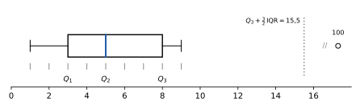
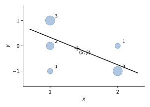
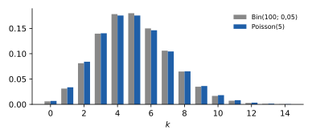
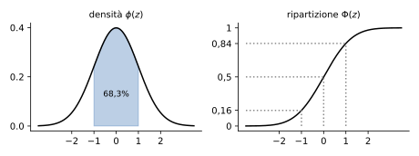
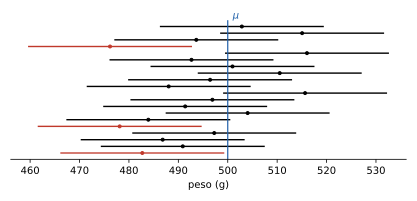
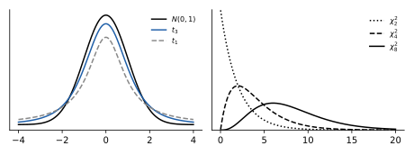
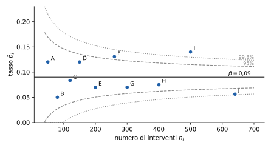

# Statistica

**Appunti del corso · a.a. 2026/27 · Mobius**

Appunti personali e non ufficiali, rivisti e confrontati con il programma ufficiale del corso. Non sostituiscono le lezioni né i testi consigliati.

## Indice

1. Statistica descrittiva
2. Probabilità e variabili aleatorie
3. Valori attesi, leggi notevoli e teoremi limite
4. Inferenza: stima, intervalli e test

## 1 · Statistica descrittiva

**In questo modulo.** Non servono prerequisiti oltre l'algebra delle scuole superiori e la notazione di sommatoria. Si impara a descrivere un insieme di dati: come si organizzano in tabelle e grafici, come si riassumono con pochi numeri che dicono dove stanno (media, mediana, quantili) e quanto sono sparsi (varianza, deviazione standard, scarto interquartile), come si legge il boxplot e come si misura la relazione fra due variabili con la covarianza, la correlazione e la retta dei minimi quadrati. È la parte "descrittiva" della statistica: non si fanno ancora affermazioni sulla popolazione da cui i dati vengono, cosa che richiede la probabilità (moduli 2 e 3) e l'inferenza (modulo 4).

### 1.1 Dati, unità e variabili

Un insieme di dati è una raccolta di osservazioni, organizzata di solito come un foglio di calcolo: ogni riga è un'**unità sperimentale** (uno studente, un'immagine, un pezzo prodotto), ogni colonna è una **variabile**, cioè un'informazione rilevata su ciascuna unità. Le unità si indicano con un indice $\ell = 1, \dots, n$, dove $n$ è la **numerosità** del campione, e il valore della variabile sull'unità $\ell$ si scrive $x_\ell$.

Le dimensioni possono essere molto diverse: gli iscritti al corso di Statistica nel 2025/26 erano $n = 253$, mentre un archivio pubblico di immagini come ImageNet ne contiene circa $14 \cdot 10^6$.

> [!definizione] Variabili quantitative e qualitative
> Una variabile è **quantitativa** se assume valori numerici, $x_\ell \in \mathbb{R}$ (o, più in generale, vettori di numeri: una matrice, un'immagine digitale come tabella di pixel). È **qualitativa** (o categorica) se assume valori in un insieme finito di modalità non numeriche, un "dizionario" $D$: il corso di laurea, la nazionalità, il colore degli occhi.

La distinzione decide quali operazioni hanno senso: la media dell'altezza è un numero utile, la "media del corso di laurea" no. Una variabile qualitativa si può codificare con numeri (1 = gestionale, 2 = informatica), ma i codici restano etichette.

### 1.2 Frequenze e grafici

Siano $v_1, \dots, v_m$ i valori distinti che la variabile assume sul campione, con $m \le n$. La **frequenza assoluta** di $v_i$ è il numero di unità che hanno quel valore, e la **frequenza relativa** è la stessa cosa divisa per $n$:
$$n_i = \#\{\ell = 1, \dots, n \mid x_\ell = v_i\}, \qquad f_i = \frac{n_i}{n}.$$
Si ha $n_1 + \dots + n_m = n$ e $f_1 + \dots + f_m = 1$; le frequenze relative si scrivono spesso in percentuale.

> [!esempio] Corso di laurea degli iscritti
> Dei 253 iscritti, 134 sono di ingegneria gestionale, 111 di informatica e 8 di altri corsi. Le frequenze relative sono
> $$f_1 = \frac{134}{253} \approx 53\%, \qquad f_2 = \frac{111}{253} \approx 44\%, \qquad f_3 = \frac{8}{253} \approx 3\%.$$

La **tabella a una via** elenca $v_i$, $n_i$, $f_i$. Per una variabile qualitativa i grafici usuali sono il **diagramma a barre**, con una barra di altezza $f_i$ per ogni modalità, e il **diagramma a torta**, con settori di ampiezza proporzionale a $f_i$ (nell'esempio: $0{,}53 \cdot 360° \approx 191°$ per gestionale). Per una variabile quantitativa con pochi valori distinti si usa un diagramma a bastoncini sopra i punti $v_i$ dell'asse reale.

> [!aggiunta] Aggiunta in revisione · fonte: Ross, *Introduzione alla statistica* (STA-07)
> La **moda** è il valore (o la modalità) con la frequenza più alta: nell'esempio è "gestionale". È l'unico indice di posizione che ha senso anche per una variabile qualitativa, e può non essere unica.
>
> Il **diagramma di Pareto** è un diagramma a barre con le modalità ordinate per frequenza decrescente, a cui si sovrappone la linea delle frequenze cumulate (53%, 97%, 100% nell'esempio). Si usa per vedere quali poche categorie spiegano la maggior parte dei casi, per esempio quali tipi di guasto causano la maggior parte dei fermi di un impianto.

### 1.3 Tabelle a due vie

Quando su ogni unità si rilevano due variabili qualitative $x$ (con modalità $v_1, \dots, v_m$) e $y$ (con modalità $w_1, \dots, w_k$), si contano le coppie:
$$n_{ij} = \#\{\ell \mid x_\ell = v_i,\ y_\ell = w_j\}, \qquad f_{ij} = \frac{n_{ij}}{n}.$$
La **tabella a due vie** (o di contingenza) ha una riga per ogni $v_i$ e una colonna per ogni $w_j$. Sommando lungo le righe e le colonne si ottengono le **distribuzioni marginali**, cioè le tabelle a una via delle due variabili separate:
$$n_{i\cdot} = n_{i1} + \dots + n_{ik}, \qquad n_{\cdot j} = n_{1j} + \dots + n_{mj}.$$
Il punto al posto di un indice ricorda su quale indice si è sommato.

> [!esempio] Corso di laurea e nazionalità
>
> | | Gestionale | Informatica | Altro | Totale |
> |---|---|---|---|---|
> | Italiani | 127 | 101 | 6 | 234 |
> | Stranieri | 7 | 10 | 2 | 19 |
> | Totale | 134 | 111 | 8 | 253 |
>
> In frequenze relative: $f_{11} = \frac{127}{253} \approx 50\%$, e così via. L'ultima riga è la distribuzione marginale del corso di laurea (53%, 44%, 3%), l'ultima colonna quella della nazionalità (92%, 8%).

La tabella a due vie contiene più informazione delle due marginali: dice come le variabili si combinano. Per confrontare gruppi di dimensioni diverse si usano i **profili**, cioè le frequenze relative calcolate dentro una riga o dentro una colonna.

> [!definizione] Profili riga e colonna
> Il **profilo della riga** $i$ è la distribuzione di $y$ nel sottocampione delle unità con $x = v_i$: $f_{j \mid i} = \frac{n_{ij}}{n_{i\cdot}}$. Il **profilo della colonna** $j$ è la distribuzione di $x$ fra le unità con $y = w_j$: $f_{i \mid j} = \frac{n_{ij}}{n_{\cdot j}}$. Ogni profilo somma a 1.

Nell'esempio, il profilo della riga "stranieri" è $\frac{7}{19} \approx 37\%$, $\frac{10}{19} \approx 53\%$, $\frac{2}{19} \approx 10\%$, contro il 54%, 43%, 3% degli italiani: fra gli stranieri la quota di informatici è più alta. Il profilo della colonna "altro" dice che fra gli iscritti ad altri corsi gli stranieri sono il 25%, contro il 5% fra i gestionali e il 9% fra gli informatici.

Dalle definizioni segue la **regola del prodotto**: la frequenza congiunta è il profilo per la marginale,
$$f_{ij} = f_{j \mid i}\, f_{i\cdot} = f_{i \mid j}\, f_{\cdot j}.$$
È la versione per le frequenze della regola del prodotto per le probabilità del modulo 2.

### 1.4 Indici di posizione

Da qui in poi la variabile è quantitativa, con valori distinti ordinati $v_1 < v_2 < \dots < v_m$.

> [!definizione] Media empirica
> $$\bar x = \frac{x_1 + \dots + x_n}{n} = \frac{n_1 v_1 + \dots + n_m v_m}{n} = f_1 v_1 + \dots + f_m v_m.$$

La seconda forma si usa quando i dati sono dati come tabella di frequenze. Due proprietà immediate: la media sta fra il valore minimo e il massimo, $v_1 \le \bar x \le v_m$; e se si trasformano i dati linearmente, $y_\ell = a x_\ell + b$, la media si trasforma allo stesso modo, $\bar y = a \bar x + b$. Con $a = 1$ e $b = -\bar x$ si ottengono i dati **centrati** $y_\ell = x_\ell - \bar x$, che hanno media nulla.

La media è sensibile ai valori estremi. Con i dati $1, 2, \dots, 10$ la media è $\frac{55}{10} = 5{,}5$; se il 10 diventa 100 la media sale a $\frac{145}{10} = 14{,}5$, un valore che non descrive nessuno dei dati. Un indice più stabile è la mediana, che si definisce con le frequenze cumulate.

La **funzione di distribuzione cumulata empirica** è
$$F(x) = \frac{\#\{\ell \mid x_\ell \le x\}}{n},$$
cioè la frazione di dati minori o uguali a $x$. È una funzione a gradini, nulla prima di $v_1$, uguale a 1 dopo $v_m$, con un salto di altezza $f_i$ in ogni $v_i$; nei punti $v_i$ vale $f_1 + \dots + f_i$.

> [!definizione] Quantili, percentili, quartili
> Per $q \in (0, 1]$, il **quantile** di ordine $q$ è il primo valore $v_i$ in cui la frequenza cumulata raggiunge $q$:
> $$x_q = v_i \quad \text{se} \quad f_1 + \dots + f_{i-1} < q \le f_1 + \dots + f_i.$$
> Il $k$-esimo **percentile** è il quantile di ordine $q = \frac{k}{100}$. I **quartili** sono $Q_1 = x_{1/4}$, $Q_2 = x_{1/2}$ e $Q_3 = x_{3/4}$; si pone anche $Q_0 = v_1$ (minimo) e $Q_4 = v_m$ (massimo). Il quartile $Q_2$ è la **mediana**.

Quindi almeno il 25% dei dati è minore o uguale a $Q_1$, almeno metà dei dati è minore o uguale alla mediana, e così via. Con i dati $1, \dots, 10$ (frequenza $\frac{1}{10}$ ciascuno) la cumulata raggiunge $\frac12$ in 5: la mediana è 5, e resta 5 anche se il 10 diventa 100. La mediana è **robusta** rispetto ai valori anomali, la media no.

> [!nota] Altre convenzioni
> Esistono più definizioni di quantile, che differiscono solo quando la cumulata cade esattamente su $q$ o fra due valori; molti programmi interpolano (con $1, \dots, 10$ danno mediana 5,5). Nel corso si usa la definizione sopra.

### 1.5 Boxplot

Il **boxplot** (diagramma a scatola) riassume la distribuzione in un solo disegno, sopra l'asse dei valori:

- la **scatola** va da $Q_1$ a $Q_3$ e contiene il 50% centrale dei dati, con una linea sulla mediana;
- l'ampiezza della scatola è lo **scarto interquartile** $\mathrm{IQR} = Q_3 - Q_1$;
- i **baffi** partono dai lati della scatola e arrivano al dato più piccolo e al più grande che stanno entro i limiti
$$a = Q_1 - \tfrac{3}{2}\,\mathrm{IQR}, \qquad b = Q_3 + \tfrac{3}{2}\,\mathrm{IQR};$$
- i dati fuori da $[a, b]$ si disegnano come punti isolati: sono i **valori anomali** (*outlier*).

Per i dati $1, \dots, 9, 100$ si ha $Q_1 = 3$, $Q_2 = 5$, $Q_3 = 8$, $\mathrm{IQR} = 5$ e $b = 8 + 7{,}5 = 15{,}5$: il baffo destro arriva a 9 e il 100 è un valore anomalo (figura 1.1). La posizione della mediana dentro la scatola e la lunghezza dei baffi dicono se la distribuzione è simmetrica o sbilanciata da un lato.

### 1.6 Indici di dispersione

Due gruppi di dati possono avere la stessa media ed essere molto diversi. Se uno studente ha preso dieci volte 24 e un altro cinque volte 18 e cinque volte 30, la media è 24 per entrambi, ma i voti del secondo sono molto più sparsi. Gli indici di dispersione misurano quanto.

I più semplici sono il **campo di variazione** (*range*) $v_m - v_1$, che dipende solo dai due estremi, e lo scarto interquartile $\mathrm{IQR}$, che è robusto come la mediana.

> [!definizione] Varianza e deviazione standard
> La **varianza** (della popolazione) e la **varianza campionaria** sono
> $$\sigma^2 = \frac{1}{n} \sum_{\ell = 1}^n (x_\ell - \bar x)^2, \qquad s^2 = \frac{1}{n - 1} \sum_{\ell = 1}^n (x_\ell - \bar x)^2.$$
> Le loro radici $\sigma$ e $s$ sono la **deviazione standard** della popolazione e del campione.

La varianza è la media dei quadrati degli scarti dalla media: si eleva al quadrato perché gli scarti, sommati, darebbero sempre zero. Le due versioni sono legate da $s^2 = \frac{n}{n-1}\sigma^2 = \left(1 + \frac{1}{n - 1}\right)\sigma^2$ e per $n$ grande sono quasi uguali. Il motivo del denominatore $n - 1$ si vedrà nel modulo 4: $s^2$ è lo stimatore corretto della varianza di una popolazione.

La varianza si misura nel quadrato dell'unità dei dati (m², kg²), la deviazione standard nella stessa unità: per questo si usa la seconda per descrivere la dispersione. Nell'esempio dei voti, il primo studente ha $\sigma = 0$; per il secondo ogni scarto vale $\pm 6$, quindi $\sigma^2 = 36$, $\sigma = 6$, $s^2 = 40$.

> [!teorema] Proprietà della varianza
>
> - $\sigma^2 = \overline{x^2} - \bar x^2$, dove $\overline{x^2} = \frac{1}{n}\sum x_\ell^2$ è la media dei quadrati;
> - se $y_\ell = a x_\ell + b$, allora $\sigma_y^2 = a^2 \sigma_x^2$ e $\sigma_y = \lvert a\rvert\, \sigma_x$;
> - $\sigma^2 = 0$ se e solo se tutti i dati sono uguali.

*Dimostrazione dell'ultima.* Se $\sigma^2 = 0$, la somma dei quadrati $(x_\ell - \bar x)^2$ è nulla, e una somma di termini non negativi è nulla solo se lo è ogni termine: $x_\ell = \bar x$ per ogni $\ell$. $\square$

La prima formula è quella comoda per il calcolo: basta la media dei dati e quella dei loro quadrati. La seconda dice che spostare i dati non cambia la dispersione, cambiare scala sì.

> [!aggiunta] Aggiunta in revisione · fonte: Ross, *Introduzione alla statistica* (STA-09)
> Il **coefficiente di variazione** $\mathrm{CV} = \frac{\sigma}{\lvert\bar x\rvert}$ (per $\bar x \ne 0$) misura la dispersione in rapporto alla media ed è un numero puro, quindi permette di confrontare la variabilità di grandezze con unità o ordini di grandezza diversi. Per i voti del secondo studente $\mathrm{CV} = \frac{6}{24} = 0{,}25$.

### 1.7 Covarianza, correlazione e retta dei minimi quadrati

Siano ora rilevate su ogni unità due variabili quantitative, con dati $(x_1, y_1), \dots, (x_n, y_n)$, medie $\bar x$, $\bar y$ e deviazioni standard $\sigma_x, \sigma_y > 0$.

> [!definizione] Covarianza e coefficiente di correlazione
> $$\sigma_{xy} = \frac{1}{n} \sum_{\ell = 1}^n (x_\ell - \bar x)(y_\ell - \bar y) = \overline{xy} - \bar x\, \bar y, \qquad \rho_{xy} = \frac{\sigma_{xy}}{\sigma_x\, \sigma_y}.$$

Il segno della covarianza dice se i due scarti tendono ad avere lo stesso segno (valori grandi di $x$ con valori grandi di $y$) o segno opposto. La covarianza ha come unità il prodotto delle due unità (metri per chilogrammi, per esempio); dividendo per le deviazioni standard si ottiene il **coefficiente di correlazione**, che è un numero puro.

> [!teorema] Proprietà del coefficiente di correlazione
>
> - $\rho_{xy} = \rho_{yx}$ e $\rho_{xx} = 1$;
> - $-1 \le \rho_{xy} \le 1$;
> - $\lvert\rho_{xy}\rvert = 1$ se e solo se i punti $(x_\ell, y_\ell)$ stanno tutti su una retta (con pendenza dello stesso segno di $\rho$);
> - se $z_\ell = a x_\ell + b$ con $a > 0$, allora $\rho_{zy} = \rho_{xy}$: il coefficiente non dipende dalle unità di misura.

Il coefficiente misura quindi la relazione **lineare** fra le variabili: vicino a $\pm 1$ i punti sono vicini a una retta, vicino a 0 non c'è relazione lineare (ma ce ne può essere una di altro tipo, per esempio una parabola).

**Retta dei minimi quadrati.** Si vuole una retta $y = mx + q$ che descriva come $y$ dipende da $x$, per esempio per prevedere il valore di $y$ su una nuova unità di cui si conosce solo $x$. Per ogni dato si definisce il **residuo** $r_\ell = y_\ell - (m x_\ell + q)$, la distanza verticale fra il punto e la retta. Si possono minimizzare due tipi di errore medio:
$$\frac{\lvert r_1\rvert + \dots + \lvert r_n\rvert}{n} \ (\text{errore di Laplace}), \qquad \frac{r_1^2 + \dots + r_n^2}{n} \ (\text{errore di Legendre-Gauss}).$$
Il secondo porta a un problema con una soluzione esplicita.

> [!teorema] Retta dei minimi quadrati
> La retta che rende minima la somma dei quadrati dei residui è
> $$y = \bar y + \rho_{xy} \frac{\sigma_y}{\sigma_x}(x - \bar x), \qquad \text{cioè} \quad m = \frac{\sigma_{xy}}{\sigma_x^2}, \quad q = \bar y - m \bar x.$$

La retta passa per il punto medio $(\bar x, \bar y)$ e ha pendenza dello stesso segno della correlazione.

> [!aggiunta] Aggiunta in revisione · fonte: Ross, *Introduzione alla statistica*; Devore, *Probability and Statistics for Engineering and the Sciences* (STA-11)
> **Coefficiente di determinazione.** La variabilità totale di $y$ si scompone in una parte spiegata dalla retta e una residua:
> $$\sum (y_\ell - \bar y)^2 = \sum (\hat y_\ell - \bar y)^2 + \sum r_\ell^2, \qquad \hat y_\ell = m x_\ell + q.$$
> Il rapporto $R^2 = 1 - \frac{\sum r_\ell^2}{\sum (y_\ell - \bar y)^2}$ è la frazione della variabilità di $y$ spiegata dalla retta; per la retta dei minimi quadrati vale $R^2 = \rho_{xy}^2$. Un $R^2$ vicino a 1 indica un buon adattamento.
>
> **Analisi dei residui.** I residui della retta dei minimi quadrati hanno somma nulla. Disegnati in funzione di $x$, devono apparire come una nuvola senza struttura attorno a zero; se mostrano una curva o una dispersione che cresce con $x$, il modello lineare non è adeguato anche quando $R^2$ è alto.

> [!aggiunta] Aggiunta in revisione · fonte: Newbold, Carlson, Thorne, *Statistica* (STA-10)
> **Paradosso di Simpson.** Una relazione che vale in ogni sottogruppo può invertirsi quando i gruppi si uniscono. Due reparti ammettono candidati: nel reparto A sono ammessi 80 uomini su 100 (80%) e 18 donne su 20 (90%); nel reparto B 5 uomini su 20 (25%) e 30 donne su 100 (30%). In tutti e due i reparti le donne sono ammesse in proporzione maggiore, ma in totale sono ammessi 85 uomini su 120 (71%) e 48 donne su 120 (40%). Il motivo è una terza variabile: le donne hanno fatto domanda soprattutto al reparto B, dove si ammette di meno. Prima di trarre conclusioni da una tabella aggregata conviene guardare i profili nei sottogruppi.

### Esempi ed esercizi svolti

**Esercizio 1 (genere e colore degli occhi).** A 50 persone si chiedono genere (F, M) e colore degli occhi (azzurri A, verdi V, castani C):

| | A | V | C | Totale |
|---|---|---|---|---|
| F | 5 | 8 | 7 | 20 |
| M | 4 | 6 | 20 | 30 |
| Totale | 9 | 14 | 27 | 50 |

Le frequenze relative congiunte sono, per la riga F, 10%, 16%, 14% (totale 40%) e per la riga M 8%, 12%, 40% (totale 60%); le marginali del colore sono 18%, 28%, 54%. I profili riga: fra le donne 25% A, 40% V, 35% C; fra gli uomini 13%, 20%, 67%. I profili colonna: fra chi ha gli occhi azzurri il 56% sono donne, fra i verdi il 57%, fra i castani il 26%. Le frequenze congiunte direbbero che le donne con occhi azzurri sono "poche" (10%), ma è perché le donne sono il 40% del campione: i profili correggono questo effetto.

**Esercizio 2 (un test diagnostico).** Una malattia rara colpisce l'1% della popolazione. Un test ha il 10% di falsi positivi (sani che risultano positivi) e il 20% di falsi negativi (malati che risultano negativi). Su 1000 persone ci si aspettano 10 malati, di cui 8 positivi e 2 negativi, e 990 sani, di cui 99 positivi e 891 negativi:

| | Positivo | Negativo | Totale |
|---|---|---|---|
| Malato | 8 | 2 | 10 |
| Sano | 99 | 891 | 990 |
| Totale | 107 | 893 | 1000 |

Se il test è positivo, la frazione di malati è il profilo della colonna "positivo": $\frac{8}{107} \approx 7{,}5\%$. Un positivo su più di dieci è davvero malato, perché i sani sono così tanti che anche il 10% di errori produce molti più positivi dei malati. Lo stesso calcolo, fatto con le probabilità, è la formula di Bayes del modulo 2.

**Esercizio 3 (quartili e percentili da una tabella).** I dati hanno valori e frequenze relative

| $v_i$ | 1 | 4 | 5 | 8 | 9 | 10 | 12 | 15 |
|---|---|---|---|---|---|---|---|---|
| $f_i$ | $\frac16$ | $\frac16$ | $\frac1{12}$ | $\frac16$ | $\frac1{12}$ | $\frac16$ | $\frac1{12}$ | $\frac1{12}$ |
| cumulata | 17% | 33% | 42% | 58% | 67% | 83% | 92% | 100% |

La cumulata raggiunge il 25% in 4, il 50% in 8, il 75% in 10: $Q_1 = 4$, $Q_2 = 8$, $Q_3 = 10$. Il 10° percentile è 1, il 30° è 4, il 90° è 12. La media è $\sum f_i v_i = \frac{29}{4} = 7{,}25$, un po' sotto la mediana.

**Esercizio 4 (correlazione e retta da una tabella a due vie).** Su 10 unità si rilevano $x \in \{1, 2\}$ e $y \in \{-1, 0, 1\}$, con frequenze assolute

| | $y = -1$ | $y = 0$ | $y = 1$ | Totale |
|---|---|---|---|---|
| $x = 1$ | 1 | 2 | 3 | 6 |
| $x = 2$ | 3 | 1 | 0 | 4 |
| Totale | 4 | 3 | 3 | 10 |

Le medie sono $\bar x = \frac{6 + 8}{10} = 1{,}4$ e $\bar y = \frac{-4 + 3}{10} = -0{,}1$. La media dei prodotti somma $x y$ per ogni casella pesato con la sua frequenza: $\overline{xy} = \frac{1 \cdot (-1) \cdot 1 + 1 \cdot 1 \cdot 3 + 2 \cdot (-1) \cdot 3}{10} = -0{,}4$. Quindi
$$\sigma_{xy} = -0{,}4 - 1{,}4 \cdot (-0{,}1) = -0{,}26.$$
Per le varianze: $\overline{x^2} = 2{,}2$, $\sigma_x^2 = 2{,}2 - 1{,}96 = 0{,}24$; $\overline{y^2} = 0{,}7$, $\sigma_y^2 = 0{,}7 - 0{,}01 = 0{,}69$. Il coefficiente di correlazione è
$$\rho_{xy} = \frac{-0{,}26}{\sqrt{0{,}24 \cdot 0{,}69}} \approx -0{,}64:$$
quando $x$ cresce, $y$ tende a diminuire. La retta dei minimi quadrati ha pendenza $m = \frac{-0{,}26}{0{,}24} = -\frac{13}{12} \approx -1{,}08$ e intercetta $q = -0{,}1 + \frac{13}{12} \cdot 1{,}4 = \frac{17}{12} \approx 1{,}42$; spiega $R^2 = \rho^2 \approx 41\%$ della variabilità di $y$ (figura 1.2).

#### Altri esercizi svolti

> [!aggiunta] Aggiunta in revisione · fonte: esercizi nuovi; la lezione sulla regressione manca negli appunti, e gli esercizi completano il paragrafo 1.7; soluzioni verificate con `strumenti/verifica_ampliamento.py` (STA-07 … STA-11)

**Esercizio 4. Una regressione completa.** Si misurano cinque coppie $(x, y)$: $(1;\ 2{,}1)$, $(2;\ 3{,}9)$, $(3;\ 6{,}2)$, $(4;\ 7{,}8)$, $(5;\ 10{,}0)$. Trovare la retta dei minimi quadrati, $R^2$ e i residui.

*Medie.* $\bar x = 3$, $\bar y = \frac{30}{5} = 6$.

*Somme degli scarti.* Gli scarti di $x$ sono $-2, -1, 0, 1, 2$, quelli di $y$ sono $-3{,}9;\ -2{,}1;\ 0{,}2;\ 1{,}8;\ 4{,}0$. Quindi $\sum (x - \bar x)(y - \bar y) = 7{,}8 + 2{,}1 + 0 + 1{,}8 + 8{,}0 = 19{,}7$ e $\sum (x - \bar x)^2 = 10$.

*Retta.* $m = \frac{19{,}7}{10} = 1{,}97$, $q = \bar y - m\bar x = 6 - 5{,}91 = 0{,}09$: $\hat y = 1{,}97x + 0{,}09$.

*Residui.* $r = y - \hat y$: $0{,}04;\ -0{,}13;\ 0{,}20;\ -0{,}17;\ 0{,}06$. Hanno somma nulla, come deve essere, e non mostrano un andamento (né una curva né una dispersione che cresce con $x$): la retta è un buon modello.

*$R^2$.* $\sum r^2 = 0{,}091$ e $\sum (y - \bar y)^2 = 38{,}9$, quindi $R^2 = 1 - \frac{0{,}091}{38{,}9} = 0{,}998$. La retta spiega il 99,8% della variabilità di $y$. Coerentemente, $r_{xy} = 0{,}999$ e $r_{xy}^2 = R^2$.

**Esercizio 5. Il paradosso di Simpson con i numeri.** Due trattamenti per i calcoli renali, separati per dimensione dei calcoli:

| | Piccoli | Grandi | Totale |
|---|---|---|---|
| Trattamento A | 45 su 50 (90%) | 175 su 250 (70%) | 220 su 300 (73,3%) |
| Trattamento B | 212 su 250 (84,8%) | 30 su 50 (60%) | 242 su 300 (80,7%) |

A è migliore sia sui calcoli piccoli sia su quelli grandi, ma nel totale sembra peggiore. Il motivo è la **variabile confondente**: A è stato usato soprattutto sui calcoli grandi, che guariscono meno con qualsiasi trattamento, B soprattutto sui piccoli. Il totale mescola gruppi con pesi diversi. La conclusione corretta si trae dai dati separati: A è migliore.

**Esercizio 6. Quale macchina è più regolare?** La macchina 1 produce pezzi di media 50 mm e deviazione standard 0,5 mm; la macchina 2 pezzi di media 5 mm e deviazione standard 0,1 mm.

In assoluto la macchina 2 ha la dispersione minore, ma i pezzi hanno dimensioni molto diverse, e il confronto si fa con il **coefficiente di variazione** $CV = \frac{s}{\bar x}$: $\frac{0{,}5}{50} = 1\%$ per la prima, $\frac{0{,}1}{5} = 2\%$ per la seconda. In proporzione alla misura, la macchina 1 è la più regolare.

### Esercizi guidati

> [!aggiunta] Aggiunta in revisione · fonte: esercizi nuovi; soluzioni verificate con `strumenti/verifica_ampliamento.py` (STA-07 … STA-11)
> Ogni esercizio è diviso in passi: si prova un passo alla volta e si confronta solo dopo.

**Guidato 1. Retta dei minimi quadrati e previsione.** Le ore di studio $x$ e i voti $y$ di quattro studenti sono $(2, 18)$, $(4, 22)$, $(6, 25)$, $(8, 27)$. Trovare la retta e prevedere il voto con 5 ore.

*Passo 1: le medie.* $\bar x = 5$, $\bar y = 23$.

*Passo 2: gli scarti.* $x - \bar x = -3, -1, 1, 3$; $y - \bar y = -5, -1, 2, 4$.

*Passo 3: le somme.* $\sum (x - \bar x)(y - \bar y) = 15 + 1 + 2 + 12 = 30$; $\sum (x - \bar x)^2 = 20$.

*Passo 4: la retta.* $m = 1{,}5$, $q = 23 - 7{,}5 = 15{,}5$: $\hat y = 1{,}5x + 15{,}5$.

*Passo 5: la previsione.* Per $x = 5$, $\hat y = 23$. Prevedere fuori dall'intervallo dei dati (per esempio con 20 ore, $\hat y = 45{,}5$, oltre il massimo dei voti) non ha senso: la retta vale solo dove ci sono dati.

**Guidato 2. Profili e indipendenza in una tabella a due vie.** In 200 dipendenti, 80 donne e 120 uomini, lavorano a tempo parziale 24 donne e 36 uomini.

*Passo 1: i profili riga.* Fra le donne il 30% lavora a tempo parziale ($\frac{24}{80}$), fra gli uomini il 30% ($\frac{36}{120}$).

*Passo 2: il profilo marginale.* In tutto $\frac{60}{200} = 30\%$.

*Passo 3: la conclusione.* I profili riga coincidono con il profilo marginale: nei dati, tempo parziale e genere sono indipendenti. Equivale a dire che ogni frequenza congiunta è il prodotto delle marginali: $\frac{24}{200} = 0{,}12 = 0{,}40 \cdot 0{,}30$.

**Guidato 3. Media e varianza da una tabella di frequenze.** In 20 famiglie il numero di figli è 0 per 4 famiglie, 1 per 8, 2 per 6, 3 per 2.

*Passo 1: la media pesata.* $\bar x = \frac{0 \cdot 4 + 1 \cdot 8 + 2 \cdot 6 + 3 \cdot 2}{20} = \frac{26}{20} = 1{,}3$.

*Passo 2: il momento secondo.* $\frac{0 + 8 + 24 + 18}{20} = \frac{50}{20} = 2{,}5$.

*Passo 3: la varianza.* Come media dei quadrati meno il quadrato della media, $2{,}5 - 1{,}69 = 0{,}81$; la varianza campionaria con $n - 1$ è $0{,}81 \cdot \frac{20}{19} = 0{,}853$.

*Passo 4: moda e mediana.* La moda è 1. La mediana è fra il decimo e l'undicesimo valore ordinato, entrambi 1: mediana 1.

### Riepilogo

I dati si organizzano per unità sperimentali e variabili, quantitative o qualitative. Una variabile si riassume con la tabella delle frequenze assolute e relative e con un diagramma a barre, a torta o di Pareto; due variabili qualitative con la tabella a due vie, le marginali e i profili riga e colonna, legati alla frequenza congiunta dalla regola del prodotto. Per una variabile quantitativa la media è la somma dei valori pesati con le frequenze ed è sensibile ai valori estremi; la mediana e gli altri quantili si leggono sulla cumulata empirica e sono robusti. Il boxplot mostra quartili, scarto interquartile e valori anomali (fuori da $Q_1 - \frac32 \mathrm{IQR}$, $Q_3 + \frac32 \mathrm{IQR}$). La dispersione si misura con varianza e deviazione standard ($\sigma^2$ con $\frac1n$, $s^2$ con $\frac{1}{n-1}$), che si calcolano come media dei quadrati meno quadrato della media e non cambiano spostando i dati; il coefficiente di variazione le rende confrontabili. Covarianza e correlazione misurano la relazione lineare fra due variabili, con $\lvert\rho\rvert \le 1$; la retta dei minimi quadrati passa per $(\bar x, \bar y)$ con pendenza $\sigma_{xy}/\sigma_x^2$, la sua bontà si misura con $R^2 = \rho^2$ e si controlla con i residui. Le tabelle aggregate possono ingannare (paradosso di Simpson).

### Formulario

> [!aggiunta] Aggiunta in revisione · fonte: sintesi del modulo (STA-07 … STA-11)
> Indici, formule della regressione e termini per l'orale.

#### Indici

$$\bar x = \frac{1}{n}\sum x_\ell, \qquad s^2 = \frac{1}{n - 1}\sum (x_\ell - \bar x)^2 = \frac{n}{n - 1}\left(\overline{x^2} - \bar x^2\right), \qquad CV = \frac{s}{\bar x}.$$

Mediana: valore centrale dei dati ordinati (media dei due centrali se $n$ è pari). Quartili $Q_1$, $Q_3$; $IQR = Q_3 - Q_1$; nel boxplot sono anomali i dati fuori da $[Q_1 - 1{,}5\,IQR,\ Q_3 + 1{,}5\,IQR]$.

#### Due variabili

$$\operatorname{cov}_{xy} = \frac{1}{n - 1}\sum (x_\ell - \bar x)(y_\ell - \bar y), \qquad r_{xy} = \frac{\operatorname{cov}_{xy}}{s_x s_y} \in [-1, 1],$$

$$m = \frac{\sum (x - \bar x)(y - \bar y)}{\sum (x - \bar x)^2} = r_{xy}\frac{s_y}{s_x}, \qquad q = \bar y - m\bar x, \qquad R^2 = 1 - \frac{\sum r_\ell^2}{\sum (y_\ell - \bar y)^2} = r_{xy}^2.$$

Tabelle a due vie: frequenza congiunta = profilo riga × frequenza marginale della riga; indipendenza nei dati se i profili riga coincidono con il profilo marginale.

#### Termini per l'orale

| Termine | In una riga |
|---|---|
| Unità, variabile, modalità | chi si osserva, che cosa si misura, i valori possibili |
| Variabile qualitativa (nominale, ordinale), quantitativa | categorie (con o senza ordine) o numeri |
| Frequenza assoluta, relativa, cumulata | conteggio, proporzione, somma fino a un valore |
| Diagramma di Pareto | barre ordinate per frequenza decrescente, con la cumulata |
| Moda, mediana, media | valore più frequente, centrale, baricentro |
| Quantile, percentile, quartile | valori che dividono i dati ordinati in parti date |
| Boxplot | scatola da $Q_1$ a $Q_3$ con la mediana e i baffi |
| Robustezza | un indice è robusto se i valori anomali lo spostano poco (la mediana sì, la media no) |
| Correlazione | misura della dipendenza lineare; non implica causalità |
| Residuo | $y_\ell - \hat y_\ell$, distanza verticale dalla retta |
| Variabile confondente | variabile che, se ignorata, crea o inverte una relazione (Simpson) |

#### Domande che tornano spesso

- Differenza fra media e mediana; perché la mediana è robusta?
- Come si costruisce un boxplot e come si riconoscono i dati anomali?
- Perché la varianza campionaria si divide per $n - 1$?
- Ricavare la retta dei minimi quadrati e il significato di $R^2$.
- Correlazione nulla vuol dire assenza di relazione? Un esempio con $y = x^2$.
- Spiegare il paradosso di Simpson con un esempio.

## 2 · Probabilità e variabili aleatorie

**In questo modulo.** Servono il linguaggio degli insiemi (unione, intersezione, complementare), le serie numeriche e gli integrali, anche impropri, di Analisi 1. Il modulo costruisce il modello matematico dei fenomeni casuali: spazio campionario, eventi, assiomi della probabilità. Si impara a contare i casi con il calcolo combinatorio, a usare la probabilità condizionata, la formula delle probabilità totali e quella di Bayes, e a riconoscere eventi indipendenti. Nella seconda parte si introducono le variabili aleatorie, discrete e con densità, la loro legge e la funzione di ripartizione, e si impara a trovare la legge di una funzione di una variabile aleatoria. Il modulo 3 continua con i valori attesi e le leggi notevoli.

### 2.1 Esperimenti, eventi, assiomi

Un **esperimento aleatorio** è una procedura che, ripetuta più volte nelle stesse condizioni, produce risultati diversi. L'insieme dei possibili risultati è lo **spazio campionario** $\Omega$. Qualche esempio: lancio di una moneta, $\Omega = \{T, C\}$; lancio di un dado, $\Omega = \{1, \dots, 6\}$; numero di lanci necessari perché esca testa, $\Omega = \mathbb{N} \setminus \{0\}$; altezza di uno studente scelto a caso, $\Omega = \mathbb{R}$ (o un suo intervallo).

Un **evento** è un sottoinsieme $E \subseteq \Omega$, cioè una collezione di possibili risultati. Se il risultato dell'esperimento è $\omega$, si dice che $E$ **si è verificato** se $\omega \in E$, e che non si è verificato se $\omega \notin E$. Gli eventi si combinano con le operazioni sugli insiemi:

- $\Omega$ è l'evento **certo**, $\emptyset$ l'evento **impossibile**, $\{\omega\}$ un evento **elementare**;
- l'**opposto** $\bar E = \{\omega \in \Omega \mid \omega \notin E\}$ si verifica quando $E$ non si verifica;
- l'**intersezione** $E \cap F$ si verifica quando si verificano entrambi, l'**unione** $E \cup F$ quando se ne verifica almeno uno;
- $E$ e $F$ sono **disgiunti** (incompatibili) se $E \cap F = \emptyset$.

Nel lancio di un dado, con $E$ = "esce un numero pari" $= \{2, 4, 6\}$ e $F$ = "esce un numero primo" $= \{2, 3, 5\}$: se esce 4, $E$ si è verificato e $F$ no; $\bar E = \{1, 3, 5\}$, $E \cap F = \{2\}$, $E \cup F = \{2, 3, 4, 5, 6\}$.

> [!definizione] Probabilità
> Una **probabilità** su $\Omega$ associa a ogni evento $E$ un numero $P[E]$ tale che
>
> 1. $P[\Omega] = 1$;
> 2. $0 \le P[E] \le 1$ per ogni evento $E$;
> 3. se $E_1, E_2, \dots$ sono eventi a due a due disgiunti, $P[E_1 \cup E_2 \cup \dots] = P[E_1] + P[E_2] + \dots$
>
> La coppia $(\Omega, P)$ è uno **spazio di probabilità**.

Conviene pensare a $P[E]$ come all'area di $E$ dentro un quadrato $\Omega$ di area 1: le proprietà che seguono diventano evidenti disegnando gli insiemi.

> [!aggiunta] Aggiunta in revisione · fonte: Ross, *Introduzione alla statistica* (STA-01)
> Il programma distingue tre modi di assegnare le probabilità. La definizione **classica** vale per esiti equiprobabili: casi favorevoli su casi possibili (paragrafo 2.2). La definizione **a posteriori** (frequentista) prende come probabilità di un evento il limite della sua frequenza relativa quando l'esperimento si ripete molte volte; la legge dei grandi numeri del modulo 3 ne è la giustificazione. La definizione **assiomatica** è quella sopra, che comprende le altre due come casi particolari.

> [!teorema] Proprietà della probabilità
>
> 1. $P[\emptyset] = 0$ e $P[\bar E] = 1 - P[E]$;
> 2. se $E \subseteq F$ allora $P[E] \le P[F]$;
> 3. $P[E \cup F] = P[E] + P[F] - P[E \cap F]$;
> 4. principio di inclusione-esclusione per tre eventi:
> $$P[E_1 \cup E_2 \cup E_3] = \sum_i P[E_i] - \sum_{i < j} P[E_i \cap E_j] + P[E_1 \cap E_2 \cap E_3].$$

La 3 si vede scomponendo $E \cup F$ in tre parti disgiunte, $E \setminus F$, $E \cap F$ e $F \setminus E$: sommando $P[E]$ e $P[F]$ si conta due volte l'intersezione. In generale, per $n$ eventi si sommano le probabilità singole, si tolgono quelle delle intersezioni a due, si aggiungono quelle a tre, e così via a segni alterni.

### 2.2 Spazi finiti ed equiprobabili

Uno spazio di probabilità è **finito** se $\Omega = \{\omega_1, \dots, \omega_N\}$. Allora basta conoscere le probabilità degli eventi elementari $p_i = P[\{\omega_i\}]$, che sono numeri $p_i \ge 0$ con $p_1 + \dots + p_N = 1$: per l'additività, la probabilità di un evento è la somma delle $p_i$ dei suoi elementi. Per esempio, una moneta truccata ha $P[T] = p$ e $P[C] = q = 1 - p$, con $0 \le p \le 1$; la moneta è equilibrata se $p = q = \frac12$.

Lo spazio è **equiprobabile** se tutti i risultati hanno la stessa probabilità: allora $p_i = \frac{1}{N}$ e
$$P[E] = \frac{\# E}{\# \Omega} = \frac{\text{casi favorevoli}}{\text{casi possibili}}.$$

Con un dado equilibrato, $P[\text{pari}] = \frac36 = 50\%$ e $P[\text{primo}] = \frac46 \approx 67\%$. La somma di queste due probabilità supera 1, e non c'è contraddizione: i due eventi non sono disgiunti (hanno in comune il 2), e infatti $P[E \cup F] = \frac12 + \frac23 - \frac16 = \frac56$.

> [!attenzione] Scegliere bene lo spazio campionario
> Lanciando due dadi, la somma va da 2 a 12, ma lo spazio $\{2, \dots, 12\}$ **non** è equiprobabile. Lo è lo spazio delle 36 coppie ordinate (primo dado, secondo dado). La somma 7 si ottiene con 6 coppie, quindi $P[\text{somma } 7] = \frac{6}{36} = \frac16$; la somma 11 con 2 coppie, $(5, 6)$ e $(6, 5)$, quindi $P = \frac{2}{36} = \frac{1}{18}$.

Con tre dadi la somma 9 e la somma 10 si ottengono entrambe con sei terne non ordinate di numeri, ma contando le permutazioni la 9 ha 25 casi su $6^3 = 216$ e la 10 ne ha 27: $P[9] \approx 11{,}6\%$, $P[10] = \frac18 = 12{,}5\%$.

### 2.3 Calcolo combinatorio

Negli spazi equiprobabili tutto si riduce a contare. Si ricordano il **fattoriale** $n! = 1 \cdot 2 \cdots n$, con $0! = 1$, e il **coefficiente binomiale**
$$\binom{n}{k} = \frac{n!}{k!\,(n - k)!}, \qquad 0 \le k \le n.$$

Il problema tipico è: in quanti modi si possono scegliere $k$ oggetti da un'urna che contiene $n$ oggetti distinti? Dipende da due cose: se l'oggetto estratto viene rimesso nell'urna (estrazione **con ripetizione**, lo stesso oggetto può uscire più volte) o no, e se l'ordine conta (**disposizioni**) o no (**combinazioni**).

| | Conta l'ordine | Non conta l'ordine |
|---|---|---|
| Senza ripetizione ($k \le n$) | $n(n-1)\cdots(n-k+1) = \dfrac{n!}{(n-k)!}$ | $\dbinom{n}{k}$ |
| Con ripetizione | $n^k$ | $\dbinom{n + k - 1}{k}$ |

Per $k = n$ le disposizioni senza ripetizione sono le **permutazioni**, $n!$. Le combinazioni si ottengono dalle disposizioni dividendo per $k!$, perché ogni gruppo di $k$ oggetti si può ordinare in $k!$ modi.

> [!teorema] Proprietà del coefficiente binomiale
> $$\binom{n}{0} = \binom{n}{n} = 1, \qquad \binom{n}{k} = \binom{n}{n - k}, \qquad \binom{n}{k} = \binom{n-1}{k-1} + \binom{n-1}{k},$$
> $$(a + b)^n = \sum_{k=0}^{n} \binom{n}{k} a^k b^{n-k} \quad (\text{binomio di Newton}).$$

> [!esempio] Urne, lotto, poker
>
> - Un'urna contiene 12 palline rosse e 8 bianche e se ne estraggono 4 senza reimmissione. I casi possibili sono $\binom{20}{4}$; per avere 2 rosse e 2 bianche si scelgono 2 rosse fra 12 e 2 bianche fra 8: $P = \binom{12}{2}\binom{8}{2} / \binom{20}{4} \approx 38\%$.
> - Al lotto si estraggono 5 numeri su 90. Un terno secco (tre numeri giocati, tutti estratti) ha probabilità $\binom{87}{2} / \binom{90}{5} = \frac{5 \cdot 4 \cdot 3}{90 \cdot 89 \cdot 88} = \frac{1}{11748} \approx 8{,}5 \cdot 10^{-5}$. Se la vincita fosse $V$ volte la posta, il gioco sarebbe equo per $(1 - p) \cdot 1 = p V$, cioè $V = \frac1p - 1 = 11747$; il lotto ne paga 4500.
> - A poker si ricevono 5 carte da un mazzo di 52 (13 valori, 4 semi): i casi possibili sono $\binom{52}{5} \approx 2{,}6 \cdot 10^6$. Una **doppia coppia** si forma scegliendo i due valori delle coppie, $\binom{13}{2}$, i semi di ciascuna coppia, $\binom42^2$, e la quinta carta fra le 44 di altro valore: $123\,552$ casi, $P \approx 4{,}8\%$. Un **full** (tris e coppia): $13 \cdot 12 \cdot \binom43 \binom42 = 3744$ casi, $P \approx 0{,}14\%$.
> - I monomi di grado 6 in tre variabili $x, y, z$ corrispondono a scegliere 6 volte una variabile con ripetizione senza ordine: $\binom{8}{6} = 28$. Quelli che contengono tutte e tre le variabili si ottengono moltiplicando $xyz$ per un monomio di grado 3: $\binom{5}{3} = 10$. Scegliendone uno a caso, $P = \frac{10}{28} = \frac{5}{14} \approx 36\%$.

### 2.4 Probabilità condizionata

Spesso si sa che un evento $E$ si è verificato e ci si chiede quanto sia probabile un altro evento $F$. L'informazione riduce lo spazio dei risultati possibili a $E$.

> [!definizione] Probabilità condizionata
> Se $P[E] > 0$, la **probabilità di $F$ dato $E$** è
> $$P[F \mid E] = \frac{P[E \cap F]}{P[E]}.$$

Fissato $E$, la funzione $F \mapsto P[F \mid E]$ è una probabilità (verifica gli assiomi): è la distribuzione di probabilità condizionata al fatto che $E$ si è verificato. Rovesciando la definizione si ottiene la **regola del prodotto** e, iterandola, la **regola della catena**:
$$P[E \cap F] = P[E]\, P[F \mid E], \qquad P[E_1 \cap \dots \cap E_n] = P[E_1]\, P[E_2 \mid E_1] \cdots P[E_n \mid E_1 \cap \dots \cap E_{n-1}].$$

> [!esempio] Due carte di fiori
> Si estraggono due carte da un mazzo di 52. Con $E$ = "la prima è di fiori" e $F$ = "la seconda è di fiori", $P[E] = \frac{13}{52}$ e, sapendo che la prima è di fiori, ne restano 12 su 51: $P[F \mid E] = \frac{12}{51}$. Quindi $P[E \cap F] = \frac{13}{52} \cdot \frac{12}{51}$, lo stesso risultato di $\binom{13}{2}/\binom{52}{2}$.

> [!attenzione] Il condizionato dell'opposto
> In generale $P[F \mid \bar E] \neq 1 - P[F \mid E]$. Nell'esempio, $P[F \mid \bar E] = \frac{13}{51}$, mentre $1 - P[F \mid E] = \frac{39}{51}$. Vale invece $P[\bar F \mid E] = 1 - P[F \mid E]$: si complementa l'evento, non la condizione.

Altri due esempi. Si lancia due volte un dado a 4 facce e si sa che la somma è 4: le coppie possibili sono $(1, 3)$, $(2, 2)$, $(3, 1)$, quindi $P[\text{primo lancio } 3 \mid \text{somma } 4] = \frac13$. A poker la probabilità di una scala reale (asso, re, donna, fante e dieci dello stesso seme) è $\frac{4}{\binom{52}{5}} \approx 1{,}5 \cdot 10^{-6}$; sapendo che la prima carta ricevuta è l'asso di cuori, deve essere la scala reale di cuori e le altre quattro carte sono determinate: $\frac{1}{\binom{51}{4}} \approx 4 \cdot 10^{-6}$, circa $\frac{13}{5}$ volte di più.

### 2.5 Probabilità totali e formula di Bayes

Una famiglia di eventi $E_1, \dots, E_n$ è una **partizione** di $\Omega$ se gli eventi sono a due a due disgiunti e la loro unione è $\Omega$: in ogni prova se ne verifica esattamente uno. Il caso più semplice è la partizione $\{E, \bar E\}$.

> [!teorema] Formula delle probabilità totali
> Se $E_1, \dots, E_n$ è una partizione di $\Omega$, per ogni evento $F$
> $$P[F] = P[F \mid E_1]\, P[E_1] + \dots + P[F \mid E_n]\, P[E_n].$$
> In particolare $P[F] = P[F \mid E]\, P[E] + P[F \mid \bar E]\, P[\bar E]$.

Basta scrivere $F$ come unione disgiunta degli $F \cap E_i$ e applicare la regola del prodotto. La formula si usa quando l'esperimento avviene in due stadi: prima si verifica uno degli $E_i$, poi $F$ con una probabilità che dipende da quale. Per la seconda carta di fiori: $P[F] = \frac{12}{51}\cdot\frac{13}{52} + \frac{13}{51}\cdot\frac{39}{52} = \frac{13}{52} = \frac14$, come se la prima carta non ci fosse.

> [!teorema] Formula di Bayes
> Se $E_1, \dots, E_n$ è una partizione e $P[F] > 0$,
> $$P[E_k \mid F] = \frac{P[F \mid E_k]\, P[E_k]}{P[F \mid E_1]\, P[E_1] + \dots + P[F \mid E_n]\, P[E_n]}.$$

La formula "rovescia" il condizionamento: dalle probabilità dell'effetto date le cause si risale alla probabilità di una causa dato l'effetto osservato. Le $P[E_k]$ si dicono probabilità **a priori**, le $P[E_k \mid F]$ **a posteriori**.

> [!esempio] Dado e moneta
> Si lancia un dado equilibrato e poi una moneta equilibrata tante volte quanto è uscito sul dado. Con $E_i$ = "il dado dà $i$" e $F$ = "escono 4 teste", si ha $P[F \mid E_i] = 0$ per $i \le 3$ e $P[F \mid E_i] = \binom{i}{4}/2^i$ altrimenti: $\frac{1}{16}$, $\frac{5}{32}$, $\frac{15}{64}$ per $i = 4, 5, 6$. Per le probabilità totali
> $$P[F] = \frac16\left(\frac{4}{64} + \frac{10}{64} + \frac{15}{64}\right) = \frac{29}{384} \approx 7{,}6\%.$$
> Sapendo che sono uscite 4 teste, la probabilità che il dado abbia dato 5 è, per Bayes, $\frac{\frac16 \cdot \frac{10}{64}}{\frac{29}{384}} = \frac{10}{29} \approx 34\%$.

> [!esempio] Exit poll
> In un ballottaggio il candidato A prende il 45% dei voti e B il 55%. All'uscita dai seggi risponde al sondaggio il 40% degli elettori di A e il 30% di quelli di B. Con $E$ = "ha votato A" e $F$ = "risponde":
> $$P[E \mid F] = \frac{0{,}40 \cdot 0{,}45}{0{,}40 \cdot 0{,}45 + 0{,}30 \cdot 0{,}55} = \frac{180}{345} = \frac{12}{23} \approx 52\%.$$
> Il sondaggio darebbe vincente A, che perde: la diversa disponibilità a rispondere distorce il campione.

### 2.6 Eventi indipendenti

> [!definizione] Indipendenza
> Due eventi $E$, $F$ sono **indipendenti** se $P[E \cap F] = P[E]\, P[F]$. Tre eventi $E_1, E_2, E_3$ sono indipendenti se $P[E_i \cap E_j] = P[E_i]\, P[E_j]$ per ogni $i \neq j$ e inoltre $P[E_1 \cap E_2 \cap E_3] = P[E_1]\, P[E_2]\, P[E_3]$.

Se $P[E] > 0$, l'indipendenza equivale a $P[F \mid E] = P[F]$: sapere che $E$ si è verificato non cambia la probabilità di $F$. Le prove ripetute di un esperimento (lanci successivi di una moneta, estrazioni con reimmissione) si modellano come indipendenti.

> [!attenzione] Disgiunti non vuol dire indipendenti
> Se $E$ e $F$ hanno probabilità positive e sono disgiunti, $P[E \cap F] = 0 \neq P[E]\, P[F]$: non sono indipendenti, anzi, se si verifica uno l'altro è escluso. Per eventi disgiunti $P[E \cup F] = P[E] + P[F]$; per eventi indipendenti $P[E \cup F] = P[E] + P[F] - P[E]\, P[F]$.

Esempio: una moneta truccata ha probabilità di testa doppia di quella di croce, quindi $P[T] = \frac23$, $P[C] = \frac13$. Lanciandola 3 volte, l'evento "2 teste e 1 croce" è l'unione disgiunta di $TTC$, $TCT$, $CTT$, e per l'indipendenza dei lanci ciascuno ha probabilità $\left(\frac23\right)^2 \cdot \frac13$: in totale $3 \cdot \frac{4}{27} = \frac49$, contro $\frac38$ per una moneta equilibrata.

### 2.7 Variabili aleatorie e loro legge

> [!definizione] Variabile aleatoria
> Dato uno spazio di probabilità $(\Omega, P)$, una **variabile aleatoria** è una funzione $X : \Omega \to \mathbb{R}$, che associa a ogni risultato $\omega$ un numero $X(\omega)$.

Si scrive $\{X \in I\} = \{\omega \in \Omega \mid X(\omega) \in I\}$ per l'evento "$X$ assume un valore in $I$", e allo stesso modo $\{X = x\}$, $\{X \le x\}$, $\{X > x\}$. Esempi: il numero di teste in 3 lanci, $X \in \{0, 1, 2, 3\}$; il numero di lanci fino alla prima testa, $X \in \{1, 2, \dots\}$; il tempo di attesa a un call center, $X \in [0, +\infty)$. Un esempio fondamentale è la **variabile indicatrice** di un evento $E$:
$$\mathbb{1}_E(\omega) = \begin{cases} 1 & \omega \in E, \\ 0 & \omega \notin E, \end{cases}$$
che vale 1 in caso di "successo" e 0 di "insuccesso".

Una variabile è **finita** se assume un numero finito di valori $x_1, \dots, x_n$, **discreta** se ne assume un'infinità numerabile $x_1, x_2, \dots$. In entrambi i casi gli eventi $\{X = x_k\}$ formano una partizione di $\Omega$ e $X = \sum_k x_k \mathbb{1}_{\{X = x_k\}}$.

> [!definizione] Legge di una variabile aleatoria
> La **legge** (o distribuzione) di $X$ è la funzione che a ogni insieme $I \subseteq \mathbb{R}$ associa $\mu_X(I) = P[X \in I]$. Per una variabile finita o discreta è determinata dalla **densità discreta** $p_k = P[X = x_k]$, con $p_k \ge 0$ e $\sum_k p_k = 1$, e
> $$P[X \in I] = \sum_{k \,:\, x_k \in I} p_k.$$

La legge si rappresenta con una tabella $x_k \mapsto p_k$ o con un grafico a bastoncini. Per il numero di teste in 3 lanci di una moneta equilibrata i valori 0, 1, 2, 3 hanno probabilità $\frac18, \frac38, \frac38, \frac18$; con la moneta truccata del paragrafo 2.6, $\frac{1}{27}, \frac{6}{27}, \frac{12}{27}, \frac{8}{27}$.

Due variabili diverse possono avere la stessa legge; si scrive $X \sim Y$. Lanciando due volte una moneta equilibrata, sia $X$ l'indicatrice di "testa al primo lancio" e $Y$ quella di "testa al secondo". Sul risultato $(T, C)$ si ha $X = 1$ e $Y = 0$, quindi $X \neq Y$; ma entrambe valgono 0 o 1 con probabilità $\frac12$, quindi $X \sim Y$.

Per una variabile discreta la condizione $\sum p_k = 1$ è la somma di una serie. Per il numero $N$ di lanci di una moneta equilibrata fino alla prima testa, $P[N = n] = \left(\frac12\right)^{n-1} \cdot \frac12 = \frac{1}{2^n}$ ($n - 1$ croci e poi una testa), e infatti $\sum_{n \ge 1} \frac{1}{2^n} = 1$ (in base 2 è $0{,}111\ldots_2 = 1$).

### 2.8 Variabili con densità

Per grandezze che variano con continuità (tempi, lunghezze, pesi) ogni singolo valore ha probabilità nulla, e la probabilità si assegna agli intervalli con un integrale.

> [!definizione] Densità di probabilità
> Una variabile aleatoria $X$ ha **densità** $f$ se per ogni $a < b$
> $$P[a \le X \le b] = \int_a^b f(x)\, dx,$$
> dove $f$ è continua tranne al più in un numero finito di punti $x_1, \dots, x_N$ (in cui l'integrale si intende improprio, come anche agli estremi $\pm\infty$).

![Figura 2.1 · La probabilità che $X$ cada in $[a, b]$ è l'area sotto la densità.](figure/2-1.svg)

> [!teorema] Proprietà delle densità
>
> - $f(x) \ge 0$ e $\int_{-\infty}^{+\infty} f(x)\, dx = 1$;
> - $P[X = x] = 0$ per ogni $x$, quindi includere o no gli estremi non cambia nulla: $P[a \le X \le b] = P[a < X < b]$;
> - $P[X \le b] = \int_{-\infty}^b f(x)\, dx$ e $P[X \ge a] = \int_a^{+\infty} f(x)\, dx$;
> - se $f = 0$ fuori da $[m, M]$, allora $m \le X \le M$ con probabilità 1.

Viceversa, ogni funzione non negativa con integrale 1 è la densità di qualche variabile aleatoria. Il valore $f(x)$ non è una probabilità (può essere maggiore di 1): è una "probabilità per unità di lunghezza".

> [!esempio] Determinare la costante di una densità
>
> - Un numero estratto uniformemente fra $\frac12$ e 1 ha densità costante $c$ su $(\frac12, 1)$ e nulla altrove. L'area deve essere 1: $c \cdot \frac12 = 1$, quindi $c = 2$.
> - $f(x) = mx$ per $0 \le x \le 1$, nulla altrove: $\int_0^1 mx\, dx = \frac{m}{2} = 1$ dà $m = 2$. Allora $P[\lvert X\rvert \ge \frac12] = P[X \ge \frac12] = \int_{1/2}^1 2x\, dx = 1 - \frac14 = \frac34$.
> - $f(x) = a$ su $[-1, 0]$, $f(x) = b$ su $[1, \frac32]$, nulla altrove, con $a, b \ge 0$: la condizione $a + \frac{b}{2} = 1$ dà $b = 2 - 2a$ con $0 \le a \le 1$. C'è una famiglia di densità, non una sola.
> - $f(x) = \frac{a}{1 + x^2}$ su tutto $\mathbb{R}$: per simmetria $\int f = 2a \lim_{b \to +\infty} \arctan b = a\pi$, quindi $a = \frac{1}{\pi}$ (densità di Cauchy).

### 2.9 Funzione di ripartizione

> [!definizione] Funzione di ripartizione
> La **funzione di ripartizione** di $X$ è $F_X(x) = P[X \le x]$, definita per ogni $x \in \mathbb{R}$. Per una variabile discreta $F_X(x) = \sum_{x_k \le x} p_k$; per una variabile con densità $F_X(x) = \int_{-\infty}^x f(t)\, dt$.

Nel caso discreto $F_X$ è a gradini, con un salto di altezza $p_k$ in ogni $x_k$: per il numero di teste in 3 lanci vale 0 per $x < 0$, $\frac18$ su $[0, 1)$, $\frac12$ su $[1, 2)$, $\frac78$ su $[2, 3)$ e 1 per $x \ge 3$. Con densità è una funzione integrale: per $X$ uniforme su $(0, 1)$ vale 0 per $x < 0$, $x$ per $0 \le x \le 1$, 1 per $x > 1$.

> [!teorema] Proprietà della funzione di ripartizione
>
> 1. $F_X$ è crescente (non decrescente) e $0 \le F_X \le 1$;
> 2. $\lim_{x \to -\infty} F_X(x) = 0$ e $\lim_{x \to +\infty} F_X(x) = 1$;
> 3. $F_X$ è continua a destra, e il salto in $x_0$ è $P[X = x_0]$: $\lim_{x \to x_0^-} F_X(x) = F_X(x_0) - P[X = x_0]$;
> 4. $P[x_1 < X \le x_2] = F_X(x_2) - F_X(x_1)$;
> 5. $F_X = F_Y$ se e solo se $X \sim Y$: la funzione di ripartizione determina la legge;
> 6. se $X$ ha densità $f$, $F_X$ è continua, è di classe $C^1$ fuori dai punti di discontinuità $x_1, \dots, x_N$ di $f$, e lì $F_X' = f$.

Vale anche il viceversa della 6: se $F$ è crescente, con limiti 0 e 1, continua, e di classe $C^1$ fuori da un numero finito di punti, allora è la funzione di ripartizione di una variabile con densità $f = F'$ (con valori arbitrari nei punti eccezionali). Per esempio $F(x) = 0$ per $x \le 0$, $\sqrt{x}$ per $0 < x < 1$, 1 per $x \ge 1$ ha queste proprietà: è la funzione di ripartizione della densità $f(x) = \frac{1}{2\sqrt{x}}$ su $(0, 1)$.

### 2.10 Funzioni di variabili aleatorie

Se $X$ è una variabile aleatoria e $\phi : \mathbb{R} \to \mathbb{R}$ una funzione, $Y = \phi(X)$, cioè $Y(\omega) = \phi(X(\omega))$, è un'altra variabile aleatoria. Per esempio: si vincono 2 euro se esce testa e se ne perdono 3 se esce croce; con $X$ l'indicatrice di testa, il bilancio è $Y = 5X - 3$.

**Caso discreto.** Se $X$ è discreta, anche $Y$ lo è, con valori $\phi(x_k)$ (qualcuno può ripetersi), e
$$P[Y = y] = \sum_{k \,:\, \phi(x_k) = y} P[X = x_k].$$

> [!esempio] Un gioco da 11 euro
> Si pagano 11 euro per giocare; il banco lancia 4 volte una moneta equilibrata e paga il quadrato del numero di teste più 2 euro per ogni croce. Con $X$ = numero di teste, la vincita netta è $Y = X^2 + 2(4 - X) - 11 = X^2 - 2X - 3$.
>
> | $x$ | 0 | 1 | 2 | 3 | 4 |
> |---|---|---|---|---|---|
> | $y = x^2 - 2x - 3$ | $-3$ | $-4$ | $-3$ | 0 | 5 |
> | $P[X = x]$ | $\frac{1}{16}$ | $\frac{4}{16}$ | $\frac{6}{16}$ | $\frac{4}{16}$ | $\frac{1}{16}$ |
>
> I valori $x = 0$ e $x = 2$ danno lo stesso $y$, quindi la legge di $Y$ è: $P[Y = -4] = \frac{4}{16}$, $P[Y = -3] = \frac{7}{16}$, $P[Y = 0] = \frac{4}{16}$, $P[Y = 5] = \frac{1}{16}$.

**Caso con densità.** Se $X$ ha densità $f_X$ e $\phi$ è regolare, si passa per la funzione di ripartizione:

1. si trovano i valori che $Y$ può assumere: se $a \le X \le b$ e $\phi$ manda $[a, b]$ in $[m, M]$, allora $F_Y(y) = 0$ per $y < m$ e $F_Y(y) = 1$ per $y > M$;
2. per $m < y < M$ si scrive $F_Y(y) = P[\phi(X) \le y] = P[X \in I_y]$, dove $I_y = \{x \mid \phi(x) \le y\}$; di solito $I_y$ è un intervallo $[a, x_2(y)]$ oppure $[x_1(y), x_2(y)]$, e allora $F_Y(y) = F_X(x_2(y))$ oppure $F_X(x_2(y)) - F_X(x_1(y))$;
3. si deriva: $f_Y(y) = F_Y'(y)$, direttamente o con la regola della funzione composta, $f_Y(y) = f_X(x_2(y))\, x_2'(y) - f_X(x_1(y))\, x_1'(y)$.

> [!esempio] Una trasformazione lineare
> $X$ ha densità $f_X(x) = 2x$ su $(0, 1)$, nulla altrove, e $Y = -3X + 1$. Per $0 \le X \le 1$ si ha $-2 \le Y \le 1$. Per $-2 < y < 1$:
> $$F_Y(y) = P[-3X + 1 \le y] = P\left[X \ge \tfrac{1 - y}{3}\right] = 1 - F_X\left(\tfrac{1 - y}{3}\right) = 1 - \left(\tfrac{1 - y}{3}\right)^2,$$
> perché $F_X(x) = x^2$ su $[0, 1]$. Derivando, $f_Y(y) = \frac{2}{9}(1 - y)$ su $(-2, 1)$, nulla altrove.

> [!esempio] Una trasformazione non monotona
> $X$ è uniforme su $(0, 1)$ e $Y = (3X - 1)^2$, con valori in $[0, 4]$. Per $y > 0$:
> $$F_Y(y) = P\left[-\sqrt{y} \le 3X - 1 \le \sqrt{y}\right] = P\left[\tfrac{1 - \sqrt{y}}{3} \le X \le \tfrac{1 + \sqrt{y}}{3}\right].$$
> Se $0 < y < 1$ entrambi gli estremi stanno in $[0, 1]$ e $F_Y(y) = \frac{2\sqrt{y}}{3}$; se $1 \le y < 4$ l'estremo sinistro è negativo e $F_Y(y) = \frac{1 + \sqrt{y}}{3}$. Derivando:
> $$f_Y(y) = \frac{1}{3\sqrt{y}} \ \text{per } 0 < y < 1, \qquad f_Y(y) = \frac{1}{6\sqrt{y}} \ \text{per } 1 < y < 4.$$

Non tutte le variabili sono discrete o con densità. Se $X$ è uniforme su $(0, 2)$ e $Y = 0$ per $X \le 1$, $Y = X - 1$ per $X > 1$, allora $P[Y = 0] = \frac12$ (quindi $Y$ non ha densità), ma per $0 < y < 1$ si ha $F_Y(y) = \frac{y + 1}{2}$, che cresce con continuità (quindi $Y$ non è discreta). La funzione di ripartizione ha un salto di $\frac12$ in 0 e poi una rampa.

### Esempi ed esercizi svolti

**Esercizio 1 (il problema dei compleanni).** In un gruppo di $n$ persone, qual è la probabilità che almeno due compiano gli anni lo stesso giorno? Si suppongono 365 giorni equiprobabili e indipendenti. L'evento opposto è "tutti nati in giorni diversi": il primo può essere nato in qualsiasi giorno, il secondo in 364 su 365, e così via. Per $n \le 365$:
$$p_n = 1 - \frac{365 \cdot 364 \cdots (365 - n + 1)}{365^n} = 1 - \left(1 - \frac{1}{365}\right)\left(1 - \frac{2}{365}\right)\cdots\left(1 - \frac{n-1}{365}\right).$$
Con $1 + x \approx e^x$ per $\lvert x\rvert$ piccolo, il prodotto è circa $e^{-(1 + 2 + \dots + (n-1))/365}$, quindi $p_n \approx 1 - e^{-n(n-1)/730}$. Tutt'altra cosa è la probabilità che qualcuno del gruppo sia nato **nel mio** compleanno: $q_n = 1 - \left(\frac{364}{365}\right)^n$.

| $n$ | 10 | 23 | 30 | 50 |
|---|---|---|---|---|
| $p_n$ | 0,117 | 0,507 | 0,706 | 0,970 |
| $1 - e^{-n(n-1)/730}$ | 0,116 | 0,500 | 0,696 | 0,965 |
| $q_n$ | 0,027 | 0,061 | 0,079 | 0,128 |

Con 23 persone si supera il 50%: il risultato sorprende perché si pensa a $q_n$ invece che a $p_n$. Per $n = 3$ si può anche usare l'inclusione-esclusione sugli eventi $E_{ij}$ = "$i$ e $j$ sono nati lo stesso giorno": $3 \cdot \frac{1}{365} - 3 \cdot \frac{1}{365^2} + \frac{1}{365^2} \approx 0{,}0082$.

**Esercizio 2 (coincidenze).** Da un'urna con palline numerate da 1 a $n$ se ne estraggono alcune una dopo l'altra senza reimmissione. Qual è la probabilità che alla terza estrazione esca la pallina numero 3? Con la regola della catena: non esce alla prima ($\frac{n-1}{n}$), non esce alla seconda ($\frac{n-2}{n-1}$), esce alla terza ($\frac{1}{n-2}$). Il prodotto è $\frac1n$: ogni pallina ha la stessa probabilità di uscire in ogni posizione. Con $n = 10$, $\frac{1}{10}$.

**Esercizio 3 (dieci coppie, dieci cabine).** Su una nave ci sono 10 cabine doppie prenotate da 10 coppie; all'imbarco le 20 persone sono assegnate alle cabine a caso. Qual è la probabilità che ogni coppia finisca nella stessa cabina? Con la regola della catena, cabina per cabina: la prima cabina riceve una delle 10 coppie con probabilità $\frac{10}{\binom{20}{2}}$, la seconda una delle 9 rimaste con probabilità $\frac{9}{\binom{18}{2}}$, e così via. Il prodotto si semplifica in
$$\frac{10!\, 2^{10}}{20!} = \frac{1}{19 \cdot 17 \cdot 15 \cdots 3 \cdot 1} \approx 1{,}5 \cdot 10^{-9}.$$

**Esercizio 4 (una densità a due parametri).** Nella densità $f = a$ su $[-1, 0]$, $f = b$ su $[1, \frac32]$ del paragrafo 2.8, con $a = \frac12$ si ha $b = 1$; allora $P[X > 0] = \frac{b}{2} = \frac12$ e $F_X(x) = \frac{x + 1}{2}$ su $[-1, 0]$, costante $\frac12$ su $[0, 1]$, $\frac12 + (x - 1)$ su $[1, \frac32]$. La funzione di ripartizione è continua, con un tratto piatto dove la densità è nulla.

#### Altri esercizi svolti

> [!aggiunta] Aggiunta in revisione · fonte: esercizi nuovi sul modello delle esercitazioni del corso e della raccolta di esercizi di probabilità; soluzioni verificate con `strumenti/verifica_ampliamento.py` (STA-01 … STA-04)

**Esercizio 4. Il test diagnostico.** Una malattia colpisce il 2% della popolazione. Un test la rileva nel 95% dei malati (sensibilità) e dà esito negativo nel 90% dei sani (specificità). Una persona risulta positiva: qual è la probabilità che sia malata?

Con $M$ = "malato" e $+$ = "test positivo": $P(+ \mid M) = 0{,}95$, $P(+ \mid \bar M) = 0{,}10$. Per le probabilità totali $P(+) = 0{,}95 \cdot 0{,}02 + 0{,}10 \cdot 0{,}98 = 0{,}019 + 0{,}098 = 0{,}117$, e per Bayes
$$P(M \mid +) = \frac{0{,}019}{0{,}117} = 0{,}16.$$
Solo il 16% dei positivi è malato. Non è un difetto del test: la malattia è rara, e i falsi positivi, il 10% di una popolazione grande, sono molti più dei veri positivi. Per questo un test di screening positivo si conferma con un secondo test.

**Esercizio 5. Carte.** Da un mazzo di 40 carte con 4 assi se ne estraggono 5 senza reimmissione. Probabilità di esattamente 2 assi?

I casi possibili sono le $\binom{40}{5} = 658\,008$ mani; quelle favorevoli si ottengono scegliendo 2 assi fra 4 e 3 carte fra le 36 non assi: $\binom{4}{2}\binom{36}{3} = 6 \cdot 7140 = 42\,840$. La probabilità è $\frac{42\,840}{658\,008} = 0{,}065$. È la legge ipergeometrica.

**Esercizio 6. Una funzione di ripartizione con due parametri.** $F(x) = 0$ per $x < 0$, $F(x) = ax^2$ per $0 \le x < 2$, $F(x) = b$ per $x \ge 2$. Per quali $a, b$ è la funzione di ripartizione di una variabile con densità? Calcolare la densità e $P(0{,}5 \le X \le 1)$.

Serve $F(x) \to 1$ per $x \to +\infty$, quindi $b = 1$; serve la continuità (una variabile con densità non ha "salti"), quindi in 2 $4a = 1$, $a = \frac14$. La densità è la derivata, $f(x) = \frac{x}{2}$ su $(0, 2)$ e 0 altrove. $P(0{,}5 \le X \le 1) = F(1) - F(0{,}5) = \frac14 - \frac{1}{16} = \frac{3}{16}$.

**Esercizio 7. Dall'uniforme all'esponenziale.** $X$ è uniforme su $(0, 1)$ e $Y = -\frac12\ln X$. Trovare la legge di $Y$.

$Y$ è positiva. Per $y > 0$: $F_Y(y) = P\left(-\tfrac12\ln X \le y\right) = P(\ln X \ge -2y) = P(X \ge e^{-2y}) = 1 - e^{-2y}$. È l'esponenziale di parametro 2. È il modo in cui un computer genera numeri esponenziali a partire da numeri uniformi.

**Esercizio 8. Una trasformazione non monotona.** $X$ è uniforme su $(0, 1)$ e $Y = (2X - 1)^2$. Densità di $Y$?

$Y \in [0, 1]$. Per $0 \le y \le 1$: $F_Y(y) = P(|2X - 1| \le \sqrt y) = P\left(\frac{1 - \sqrt y}{2} \le X \le \frac{1 + \sqrt y}{2}\right) = \sqrt y$, la lunghezza dell'intervallo. Derivando, $f_Y(y) = \frac{1}{2\sqrt y}$ su $(0, 1)$. La densità è illimitata vicino a 0: tutti gli $X$ vicini a $\frac12$ finiscono vicino a $Y = 0$.

### Esercizi guidati

> [!aggiunta] Aggiunta in revisione · fonte: esercizi nuovi; soluzioni verificate con `strumenti/verifica_ampliamento.py` (STA-02 … STA-04)
> Ogni esercizio è diviso in passi: si prova un passo alla volta e si confronta solo dopo.

**Guidato 1. Bayes con tre macchine.** Tre macchine producono il 50%, il 30% e il 20% dei pezzi, con difettosità dell'1%, del 2% e del 3%. Un pezzo è difettoso: da quale macchina viene più probabilmente?

*Passo 1: le probabilità congiunte.* $P(M_1 \cap D) = 0{,}5 \cdot 0{,}01 = 0{,}005$; $P(M_2 \cap D) = 0{,}3 \cdot 0{,}02 = 0{,}006$; $P(M_3 \cap D) = 0{,}2 \cdot 0{,}03 = 0{,}006$.

*Passo 2: probabilità totale.* $P(D) = 0{,}017$.

*Passo 3: Bayes.* $P(M_1 \mid D) = \frac{0{,}005}{0{,}017} = 0{,}29$; $P(M_2 \mid D) = P(M_3 \mid D) = \frac{0{,}006}{0{,}017} = 0{,}35$.

*Passo 4: la lettura.* La macchina 1 produce metà dei pezzi ma è la meno probabile come origine di un difetto. Le probabilità a posteriori sommano a 1: è il controllo da fare sempre.

**Guidato 2. Due eventi indipendenti senza che sembri.** Si lanciano due dadi. $A$ = "la somma è 7", $B$ = "il primo dado mostra 3". Sono indipendenti?

*Passo 1.* $P(A) = \frac{6}{36} = \frac16$ (le coppie $(1, 6), \dots, (6, 1)$).

*Passo 2.* $P(B) = \frac16$.

*Passo 3.* $A \cap B = \{(3, 4)\}$, quindi $P(A \cap B) = \frac{1}{36} = P(A)P(B)$: indipendenti.

*Passo 4: il confronto.* Con "la somma è 8" al posto di 7 non lo sarebbero: $P = \frac{5}{36}$ e $P(\text{somma } 8 \cap B) = \frac{1}{36} \ne \frac{5}{216}$. Con la somma 7, qualunque sia il primo dado c'è sempre esattamente un valore del secondo che funziona, e sapere il primo non cambia niente.

**Guidato 3. $Y = X^2$ con $X$ uniforme su $(-1, 2)$.**

*Passo 1: i valori di $Y$.* $X \in (-1, 2)$, quindi $Y \in [0, 4)$.

*Passo 2: per $0 \le y \le 1$.* $Y \le y$ se $-\sqrt y \le X \le \sqrt y$, un intervallo tutto dentro $(-1, 2)$ di lunghezza $2\sqrt y$: $F_Y(y) = \frac{2\sqrt y}{3}$.

*Passo 3: per $1 < y < 4$.* Ora $-\sqrt y < -1$, e l'intervallo utile è $(-1, \sqrt y]$: $F_Y(y) = \frac{\sqrt y + 1}{3}$.

*Passo 4: la densità.* Derivando, $f_Y(y) = \frac{1}{3\sqrt y}$ su $(0, 1)$ e $\frac{1}{6\sqrt y}$ su $(1, 4)$. Controllo: $\int_0^1 \frac{dy}{3\sqrt y} + \int_1^4 \frac{dy}{6\sqrt y} = \frac23 + \frac13 = 1$.

### Riepilogo

Un esperimento aleatorio si modella con uno spazio campionario $\Omega$, i cui sottoinsiemi sono gli eventi, e una probabilità che verifica gli assiomi ($P[\Omega] = 1$, valori in $[0, 1]$, additività sugli eventi disgiunti); ne seguono la regola del complementare e l'inclusione-esclusione. Negli spazi equiprobabili la probabilità è casi favorevoli su casi possibili e si calcola con disposizioni ($n!/(n-k)!$ o $n^k$) e combinazioni ($\binom{n}{k}$ o $\binom{n+k-1}{k}$). La probabilità condizionata $P[F \mid E] = P[E \cap F]/P[E]$ dà la regola del prodotto e della catena, la formula delle probabilità totali su una partizione e la formula di Bayes per risalire dalle osservazioni alle cause. Due eventi sono indipendenti se la probabilità dell'intersezione è il prodotto, il che non ha niente a che fare con l'essere disgiunti. Una variabile aleatoria è una funzione numerica del risultato; la sua legge si descrive con la densità discreta nel caso discreto, con una densità $f$ (non negativa, di integrale 1) nel caso continuo, e in ogni caso con la funzione di ripartizione $F_X(x) = P[X \le x]$, crescente, continua a destra, con $F_X' = f$ dove $f$ è continua. La legge di $Y = \phi(X)$ si trova sommando le probabilità dei valori con la stessa immagine nel caso discreto, e passando per $F_Y$ e derivando nel caso con densità.

### Formulario

> [!aggiunta] Aggiunta in revisione · fonte: sintesi del modulo (STA-01 … STA-04)
> Regole del calcolo delle probabilità, combinatoria e variabili aleatorie, con i termini per l'orale.

#### Regole

$$P(\bar E) = 1 - P(E), \quad P(E \cup F) = P(E) + P(F) - P(E \cap F), \quad P(F \mid E) = \frac{P(E \cap F)}{P(E)}, \quad P(E \cap F) = P(E)\,P(F \mid E).$$

$$P(F) = \sum_i P(F \mid E_i)P(E_i), \qquad P(E_k \mid F) = \frac{P(F \mid E_k)P(E_k)}{\sum_i P(F \mid E_i)P(E_i)} \qquad (E_i \text{ partizione}).$$

Indipendenza: $P(E \cap F) = P(E)P(F)$; per tre eventi servono anche le coppie.

#### Combinatoria

| Conteggio | Formula |
|---|---|
| Disposizioni con ripetizione | $n^k$ |
| Disposizioni semplici | $\frac{n!}{(n - k)!}$ |
| Permutazioni | $n!$ |
| Combinazioni | $\binom{n}{k}$ |
| Ipergeometrica | $\frac{\binom{K}{k}\binom{N - K}{n - k}}{\binom{N}{n}}$ |

#### Variabili aleatorie

- Discreta: $p(x) = P(X = x)$, $\sum p(x) = 1$. Con densità: $f \ge 0$, $\int f = 1$, $P(a \le X \le b) = \int_a^b f$.
- Ripartizione: $F(x) = P(X \le x)$, crescente, continua a destra, da 0 a 1; $f = F'$ dove $F$ è derivabile.
- Trasformazioni: si calcola $F_Y(y) = P(g(X) \le y)$ e si deriva; se $g$ è monotona, $f_Y(y) = f_X(g^{-1}(y))\,\lvert(g^{-1})'(y)\rvert$.

#### Termini per l'orale

| Termine | In una riga |
|---|---|
| Spazio campionario | insieme dei risultati possibili dell'esperimento |
| Evento | sottoinsieme dello spazio campionario |
| Probabilità classica, frequentista, assiomatica | casi favorevoli su possibili; limite delle frequenze; funzione che rispetta gli assiomi di Kolmogorov |
| Eventi incompatibili / indipendenti | intersezione vuota / probabilità dell'intersezione uguale al prodotto |
| Partizione | eventi incompatibili la cui unione è tutto lo spazio |
| Probabilità a priori / a posteriori | prima e dopo l'osservazione, nella formula di Bayes |
| Variabile aleatoria | funzione che associa un numero a ogni risultato |
| Funzione di ripartizione | $F(x) = P(X \le x)$ |

#### Domande che tornano spesso

- Gli assiomi della probabilità e le conseguenze ($P(\bar E)$, unione di due eventi).
- Definire la probabilità condizionata e dimostrare la formula delle probabilità totali e quella di Bayes.
- Eventi incompatibili e indipendenti: che differenza c'è?
- Proprietà della funzione di ripartizione; legame con la densità.
- Come si trova la legge di $Y = g(X)$, anche per $g$ non monotona?

## 3 · Valori attesi, leggi notevoli e teoremi limite

**In questo modulo.** Si usano le variabili aleatorie, le densità e le funzioni di ripartizione del modulo 2, le serie (geometrica, esponenziale) e l'integrazione per parti di Analisi. Si definiscono la speranza e la varianza di una variabile aleatoria, con le loro proprietà e la disuguaglianza di Chebyshev, la covarianza e la correlazione di due variabili. Poi si studiano le leggi che compaiono più spesso nelle applicazioni (Bernoulli, binomiale, geometrica, Pascal, Poisson, ipergeometrica, uniformi, esponenziale, normale), con il modello da cui nascono, e si impara a usare le tavole della normale, i quantili e i valori critici. Il modulo si chiude con la legge dei grandi numeri e il teorema del limite centrale, che sono il ponte verso l'inferenza del modulo 4.

### 3.1 Speranza

La **speranza** (valore atteso, media) di una variabile aleatoria è la media dei suoi valori pesata con le probabilità:

> [!definizione] Speranza
>
> - Se $X$ è finita o discreta, con valori $x_k$: $\mathbb{E}[X] = \sum_k x_k\, P[X = x_k]$.
> - Se $X$ ha densità $f$: $\mathbb{E}[X] = \int_{-\infty}^{+\infty} x f(x)\, dx$.
>
> Nel caso di infiniti valori si chiede che la serie o l'integrale converga assolutamente; altrimenti la speranza non esiste (o è infinita).

> [!esempio] Speranze elementari
>
> - Numero di teste in due lanci di una moneta con $P[T] = p$: i valori 0, 1, 2 hanno probabilità $(1-p)^2$, $2p(1-p)$, $p^2$, e $\mathbb{E}[X] = 2p(1-p) + 2p^2 = 2p$.
> - Lancio di un dado equilibrato: $\mathbb{E}[X] = \frac16(1 + \dots + 6) = \frac72$.
> - Densità $f(x) = 2x$ su $(0, 1)$: $\mathbb{E}[X] = \int_0^1 2x^2\, dx = \frac23$.
> - Densità $f(x) = \frac{1}{L} e^{-x/L}$ per $x \ge 0$ (esponenziale, paragrafo 3.6): per parti, $\int_0^{+\infty} \frac{x}{L} e^{-x/L}\, dx = \left[-(x + L) e^{-x/L}\right]_0^{+\infty} = L$.
> - Densità $f(x) = \frac{2}{\pi}\frac{1}{1 + x^2}$ per $x \ge 0$: $\int_0^{+\infty} \frac{2}{\pi}\frac{x}{1 + x^2}\, dx = \frac{1}{\pi}\left[\ln(1 + x^2)\right]_0^{+\infty} = +\infty$. La speranza è infinita.

> [!teorema] Proprietà della speranza
>
> 1. Se $X \sim Y$ allora $\mathbb{E}[X] = \mathbb{E}[Y]$; se $X = c$ costante, $\mathbb{E}[X] = c$.
> 2. **Linearità**: $\mathbb{E}[aX + bY] = a\,\mathbb{E}[X] + b\,\mathbb{E}[Y]$.
> 3. **Monotonia**: se $X \ge 0$ allora $\mathbb{E}[X] \ge 0$; se $X \le Y$ allora $\mathbb{E}[X] \le \mathbb{E}[Y]$; se $m \le X \le M$ allora $m \le \mathbb{E}[X] \le M$.
> 4. Se $X$ e $Y$ sono **indipendenti** (paragrafo 3.4), $\mathbb{E}[XY] = \mathbb{E}[X]\,\mathbb{E}[Y]$.
> 5. **Formula di trasferimento**: se $Y = \phi(X)$,
> $$\mathbb{E}[\phi(X)] = \sum_k \phi(x_k)\, P[X = x_k] \quad \text{oppure} \quad \mathbb{E}[\phi(X)] = \int_{-\infty}^{+\infty} \phi(x) f(x)\, dx.$$
> 6. **Formula delle code**: se $X$ ha valori in $\mathbb{N}$, $\mathbb{E}[X] = \sum_{n=0}^{\infty} P[X > n]$; se $X \ge 0$ ha densità, $\mathbb{E}[X] = \int_0^{+\infty} P[X > x]\, dx$.

La formula di trasferimento è il modo pratico di calcolare $\mathbb{E}[Y]$ senza trovare la legge di $Y$. Per esempio, se $X$ è uniforme su $(0, \pi)$, con densità $\frac{1}{\pi}$, e $Y = \sin X$:
$$\mathbb{E}[\sin X] = \int_0^\pi \frac{\sin x}{\pi}\, dx = \frac{1}{\pi}\left[-\cos x\right]_0^\pi = \frac{2}{\pi}.$$
Passando per la legge si trova lo stesso risultato: per $0 < y < 1$, $\sin X \le y$ quando $X \le \arcsin y$ o $X \ge \pi - \arcsin y$, quindi $F_Y(y) = \frac{2}{\pi}\arcsin y$ e $f_Y(y) = \frac{2}{\pi}\frac{1}{\sqrt{1 - y^2}}$.

> [!esempio] Due lanci di una moneta truccata
> Siano $X$, $Y$ le indicatrici di testa al primo e al secondo lancio, indipendenti con $P[T] = p$. Allora $\mathbb{E}[X] = \mathbb{E}[Y] = p$ e, per linearità, $\mathbb{E}[X + Y] = 2p$ (lo stesso risultato di prima, senza la legge della somma). Inoltre $\mathbb{E}[2XY + 3] = 2\,\mathbb{E}[X]\,\mathbb{E}[Y] + 3 = 2p^2 + 3$, $\mathbb{E}[X^2] = 0^2(1-p) + 1^2 p = p$ e
> $$\mathbb{E}\left[\frac{\cos(\pi X)}{1 + Y}\right] = \mathbb{E}[\cos(\pi X)]\, \mathbb{E}\left[\frac{1}{1 + Y}\right] = (1 - 2p)\left(1 - \frac{p}{2}\right).$$

Con la formula delle code si trova la speranza del numero $N$ di lanci di una moneta con $P[T] = p$ fino alla prima testa: $N > n$ vuol dire $n$ croci di fila, quindi $P[N > n] = (1 - p)^n$ e $\mathbb{E}[N] = \sum_{n \ge 0} (1 - p)^n = \frac{1}{p}$.

### 3.2 Speranza condizionata

Se $X$ e $Y$ sono variabili finite e $P[Y = y_j] > 0$, la **speranza condizionata** di $X$ dato $Y = y_j$ è la speranza di $X$ calcolata con la probabilità condizionata:
$$\mathbb{E}[X \mid Y = y_j] = \sum_k x_k\, P[X = x_k \mid Y = y_j].$$

> [!teorema] Formula delle torri
> $$\mathbb{E}[X] = \mathbb{E}[X \mid Y = y_1]\, P[Y = y_1] + \dots + \mathbb{E}[X \mid Y = y_m]\, P[Y = y_m].$$

È la formula delle probabilità totali per le speranze: si calcola la media in ciascun caso e poi la media dei casi.

> [!esempio] Un'urna di monete
> Un'urna contiene 12 monete equilibrate e 8 truccate con $P[T] = \frac13$. Si estrae una moneta e la si lancia 3 volte; $X$ è il numero di teste. Con $Y = 1$ se la moneta è equilibrata (probabilità $\frac{12}{20} = \frac35$) e $Y = 0$ altrimenti ($\frac25$), il numero medio di teste in 3 lanci è $3 \cdot \frac12$ nel primo caso e $3 \cdot \frac13$ nel secondo:
> $$\mathbb{E}[X] = \frac32 \cdot \frac35 + 1 \cdot \frac25 = \frac{9}{10} + \frac{4}{10} = \frac{13}{10}.$$

Lo stesso ragionamento vale quando il numero di prove è aleatorio. Si lancia un dado equilibrato e poi una moneta con $P[T] = p$ tante volte quanto è uscito sul dado. Sia $N$ l'esito del dado e $S = X_1 + \dots + X_N$ il numero di teste, con $X_i$ indicatrice di testa all'$i$-esimo lancio. Se $N = n$ la media è $np$, quindi
$$\mathbb{E}[S] = \sum_{n=1}^{6} np \cdot \frac16 = \frac{p}{6} \cdot 21 = \frac72 p = \mathbb{E}[N]\, \mathbb{E}[X_1].$$

### 3.3 Varianza e disuguaglianza di Chebyshev

> [!definizione] Varianza e deviazione standard
> Se $\mu = \mathbb{E}[X]$, la **varianza** di $X$ è $\mathrm{Var}[X] = \mathbb{E}[(X - \mu)^2] = \sigma^2$, e $\sigma = \sqrt{\mathrm{Var}[X]}$ è la **deviazione standard**.

La varianza misura quanto $X$ si allontana in media dalla sua speranza, come la varianza dei dati del modulo 1. Più in generale $\mathbb{E}[X^k]$ è il **momento** di ordine $k$: la speranza è il momento primo, e la varianza si calcola dai primi due.

> [!teorema] Proprietà della varianza
>
> 1. $\mathrm{Var}[X] = \mathbb{E}[X^2] - \mathbb{E}[X]^2$;
> 2. $\mathrm{Var}[aX + b] = a^2\, \mathrm{Var}[X]$;
> 3. se $X$ e $Y$ sono indipendenti, $\mathrm{Var}[X + Y] = \mathrm{Var}[X] + \mathrm{Var}[Y]$;
> 4. **disuguaglianza di Chebyshev**: per ogni $\varepsilon > 0$, $P[\lvert X - \mu\rvert \ge \varepsilon] \le \dfrac{\mathrm{Var}[X]}{\varepsilon^2}$.

La disuguaglianza dice qualcosa solo per $\varepsilon > \sigma$ (altrimenti il secondo membro supera 1). Scegliendo $\varepsilon = \sigma/\sqrt{\eta}$ con $0 < \eta < 1$, diventa: con probabilità almeno $1 - \eta$,
$$\mu - \frac{\sigma}{\sqrt{\eta}} < X < \mu + \frac{\sigma}{\sqrt{\eta}}.$$
Per esempio, con probabilità almeno del 75% ($\eta = \frac14$) una variabile qualsiasi dista meno di $2\sigma$ dalla sua speranza. È una stima grossolana, ma vale per ogni legge.

> [!esempio] Varianze elementari
>
> - **Indicatrice** $X = \mathbb{1}_E$ con $P[E] = p$: $X^2 = X$, quindi $\mathbb{E}[X^2] = p$ e $\mathrm{Var}[X] = p - p^2 = p(1-p)$.
> - **Uniforme discreta** su $\{1, \dots, n\}$: $\mathbb{E}[X] = \frac{n+1}{2}$ e $\mathbb{E}[X^2] = \frac1n \sum k^2 = \frac{(n+1)(2n+1)}{6}$, quindi
> $$\mathrm{Var}[X] = \frac{(n+1)(2n+1)}{6} - \frac{(n+1)^2}{4} = \frac{n+1}{12}(4n + 2 - 3n - 3) = \frac{n^2 - 1}{12}.$$
> Per un dado, $\frac{35}{12}$.
>
> - **Uniforme** su $(0, 1)$: $\mathbb{E}[X] = \frac12$, $\mathbb{E}[X^2] = \int_0^1 x^2\, dx = \frac13$, $\mathrm{Var}[X] = \frac13 - \frac14 = \frac{1}{12}$. Per $Y = (b - a)X + a$, uniforme su $(a, b)$: $\mathbb{E}[Y] = \frac{a+b}{2}$ e $\mathrm{Var}[Y] = \frac{(b-a)^2}{12}$.

### 3.4 Leggi congiunte, covarianza e correlazione

Due variabili finite $X$ e $Y$ definite sullo stesso spazio hanno una **legge congiunta**, la tabella delle probabilità $P[X = x_i, Y = y_j]$. Come per le tabelle a due vie del modulo 1, le **marginali** si ottengono sommando lungo righe e colonne:
$$P[X = x_i] = \sum_j P[X = x_i, Y = y_j], \qquad P[Y = y_j] = \sum_i P[X = x_i, Y = y_j],$$
e la legge di $X$ condizionata a $Y = y_j$ è il profilo della colonna $j$, $P[X = x_i \mid Y = y_j] = P[X = x_i, Y = y_j] / P[Y = y_j]$.

> [!aggiunta] Aggiunta in revisione · fonte: Ross, *Introduzione alla statistica*; Devore, *Probability and Statistics for Engineering and the Sciences* (STA-06)
> Due variabili aleatorie sono **indipendenti**, e si scrive $X \perp Y$, se per ogni coppia di intervalli $I$, $J$ gli eventi $\{X \in I\}$ e $\{Y \in J\}$ sono indipendenti. Per variabili discrete basta che la legge congiunta sia il prodotto delle marginali: $P[X = x_i, Y = y_j] = P[X = x_i]\, P[Y = y_j]$ per ogni $i, j$. Le variabili $X_1, \dots, X_n$ sono indipendenti se gli eventi $\{X_1 \in I_1\}, \dots, \{X_n \in I_n\}$ lo sono per ogni scelta degli intervalli; è il caso dei risultati di prove ripetute nelle stesse condizioni.

> [!definizione] Covarianza e coefficiente di correlazione
> $$\mathrm{Cov}[X, Y] = \mathbb{E}\big[(X - \mathbb{E}[X])(Y - \mathbb{E}[Y])\big], \qquad \rho_{X,Y} = \frac{\mathrm{Cov}[X, Y]}{\sqrt{\mathrm{Var}[X]\, \mathrm{Var}[Y]}}.$$

> [!teorema] Proprietà della covarianza
>
> 1. $\mathrm{Cov}[X, Y] = \mathbb{E}[XY] - \mathbb{E}[X]\,\mathbb{E}[Y]$;
> 2. $\mathrm{Cov}[X, Y] = \mathrm{Cov}[Y, X]$ e $\mathrm{Cov}[X, X] = \mathrm{Var}[X]$;
> 3. è lineare in ciascun argomento: $\mathrm{Cov}[aX + bY, Z] = a\,\mathrm{Cov}[X, Z] + b\,\mathrm{Cov}[Y, Z]$;
> 4. $\mathrm{Var}[X + Y] = \mathrm{Var}[X] + 2\,\mathrm{Cov}[X, Y] + \mathrm{Var}[Y]$;
> 5. $-1 \le \rho_{X,Y} \le 1$ (disuguaglianza di Cauchy-Schwarz);
> 6. se $X \perp Y$ allora $\mathrm{Cov}[X, Y] = 0$.

Il viceversa della 6 è falso: covarianza nulla non implica indipendenza. Siano $X \in \{-1, 0, 1\}$ e $Y \in \{0, 1\}$ con legge congiunta $P[X = -1, Y = 1] = \frac14$, $P[X = 0, Y = 0] = \frac12$, $P[X = 1, Y = 1] = \frac14$ (le altre caselle nulle). Allora $\mathbb{E}[X] = 0$, $\mathbb{E}[XY] = -\frac14 + \frac14 = 0$, quindi $\mathrm{Cov}[X, Y] = 0$. Ma $P[X = 0, Y = 1] = 0$ mentre $P[X = 0]\, P[Y = 1] = \frac12 \cdot \frac12$: le variabili non sono indipendenti (anzi $Y = X^2$).

> [!esempio] Covarianza da una legge congiunta
>
> | | $Y = 0$ | $Y = 1$ | $P[X = x]$ |
> |---|---|---|---|
> | $X = 0$ | 0 | $\frac{1}{16}$ | $\frac{1}{16}$ |
> | $X = 1$ | $\frac18$ | $\frac18$ | $\frac14$ |
> | $X = 2$ | $\frac14$ | $\frac18$ | $\frac38$ |
> | $X = 3$ | $\frac{1}{16}$ | $\frac{3}{16}$ | $\frac14$ |
> | $X = 4$ | $\frac{1}{16}$ | 0 | $\frac{1}{16}$ |
> | $P[Y = y]$ | $\frac12$ | $\frac12$ | 1 |
>
> Dalle marginali $\mathbb{E}[X] = \frac14 + \frac34 + \frac34 + \frac14 = 2$ e $\mathbb{E}[Y] = \frac12$. Il prodotto $XY$ è diverso da zero solo nella colonna $Y = 1$: $\mathbb{E}[XY] = 1 \cdot \frac18 + 2 \cdot \frac18 + 3 \cdot \frac{3}{16} = \frac{15}{16}$. Quindi $\mathrm{Cov}[X, Y] = \frac{15}{16} - 1 = -\frac{1}{16}$.

### 3.5 Leggi discrete notevoli

Ogni legge nasce da un modello; il modello di riferimento è una moneta con $P[T] = p \in (0, 1)$ lanciata più volte, con lanci indipendenti.

> [!definizione] Bernoulli $B(p)$
> $X$ vale 1 (testa, successo) con probabilità $p$ e 0 con probabilità $1 - p$. Ogni indicatrice $\mathbb{1}_E$ è una Bernoulli di parametro $P[E]$. $\mathbb{E}[X] = p$, $\mathrm{Var}[X] = p(1 - p)$.

Il prodotto di due Bernoulli indipendenti $B(p_1)$ e $B(p_2)$ è una Bernoulli di parametro $p_1 p_2$, perché vale 1 solo quando valgono 1 entrambe.

> [!definizione] Binomiale $\mathrm{Bin}(n, p)$
> $S_n$ è il numero di teste in $n$ lanci, cioè $S_n = X_1 + \dots + X_n$ con $X_i \sim B(p)$ indipendenti. Ha valori $0, \dots, n$ e
> $$P[S_n = k] = \binom{n}{k} p^k (1 - p)^{n-k}, \qquad \mathbb{E}[S_n] = np, \quad \mathrm{Var}[S_n] = np(1 - p).$$

Il coefficiente binomiale conta le posizioni delle $k$ teste fra gli $n$ lanci; speranza e varianza seguono dalla linearità e dall'indipendenza. Se $S_n \sim \mathrm{Bin}(n, p)$ e $S_m \sim \mathrm{Bin}(m, p)$ sono indipendenti, $S_n + S_m \sim \mathrm{Bin}(n + m, p)$: si contano le teste in $n + m$ lanci.

> [!definizione] Geometrica $\mathrm{Geo}(p)$
> $T$ è il numero di lanci necessari per avere la prima testa (tempo di primo successo). Ha valori $1, 2, \dots$ e
> $$P[T = n] = (1 - p)^{n-1} p, \qquad P[T > n] = (1 - p)^n, \qquad \mathbb{E}[T] = \frac{1}{p}, \quad \mathrm{Var}[T] = \frac{1 - p}{p^2}.$$
> Vale l'**assenza di memoria**: $P[T > n + k \mid T > n] = P[T > k]$ per ogni $n, k \in \mathbb{N}$.

L'assenza di memoria dice che, se dopo $n$ lanci non è ancora uscita testa, l'attesa che resta ha la stessa legge di quella iniziale: la moneta non "ricorda" le croci passate. Al lotto, un numero ha probabilità $p = \frac{5}{90} = \frac{1}{18}$ di uscire su una ruota a ogni estrazione; la probabilità che non esca per 257 estrazioni di fila è $\left(\frac{17}{18}\right)^{257} \approx 4{,}2 \cdot 10^{-7}$, ma sapendo che non è uscito per 257 volte, la probabilità che non esca neanche alla successiva è ancora $\frac{17}{18} \approx 94\%$. I numeri "ritardatari" non sono più probabili degli altri.

> [!definizione] Pascal $\mathrm{Pascal}(k, p)$
> $T_k$ è il numero di lanci necessari per avere $k$ teste (tempo del $k$-esimo successo). Ha valori $k, k + 1, \dots$ e
> $$P[T_k = n] = \binom{n-1}{k-1} (1 - p)^{n-k} p^k, \qquad \mathbb{E}[T_k] = \frac{k}{p}, \quad \mathrm{Var}[T_k] = k\frac{1 - p}{p^2}.$$
> Inoltre $T_k = U_1 + \dots + U_k$, dove $U_i$ è il numero di lanci fra il successo $i - 1$ e il successo $i$, e le $U_i \sim \mathrm{Geo}(p)$ sono indipendenti.

Nella formula, l'ultimo lancio è una testa e fra i primi $n - 1$ ci sono le altre $k - 1$ teste. Gli eventi $\{T_k \le n\}$ e $\{S_n \ge k\}$ coincidono (in $n$ lanci ci sono almeno $k$ teste se e solo se la $k$-esima è arrivata entro il lancio $n$).

> [!definizione] Poisson $\mathrm{Poisson}(\lambda)$
> $N$ ha valori $0, 1, 2, \dots$ e, per un parametro $\lambda > 0$,
> $$P[N = k] = e^{-\lambda}\frac{\lambda^k}{k!}, \qquad \mathbb{E}[N] = \mathrm{Var}[N] = \lambda.$$
> Se $N \sim \mathrm{Poisson}(\lambda)$ e $M \sim \mathrm{Poisson}(\mu)$ sono indipendenti, $N + M \sim \mathrm{Poisson}(\lambda + \mu)$.

La Poisson è la legge degli **eventi rari**: il numero di successi in moltissime prove, ciascuna con probabilità piccola. Se $n$ è grande e $p$ piccolo, con $\lambda = np$,
$$P[S_n = k] = \frac{n(n-1)\cdots(n-k+1)}{n^k}\cdot\frac{\lambda^k}{k!}\cdot\frac{\left(1 - \frac{\lambda}{n}\right)^n}{\left(1 - \frac{\lambda}{n}\right)^k} \xrightarrow[n \to \infty]{} e^{-\lambda}\frac{\lambda^k}{k!},$$
perché il primo e l'ultimo fattore tendono a 1 e $\left(1 - \frac{\lambda}{n}\right)^n \to e^{-\lambda}$. Si usa per il numero di clienti in un'ora, di accessi a un sito, di guasti in un periodo. Per calcolare più valori di seguito è comoda la relazione $P[N = k] = \frac{\lambda}{k} P[N = k - 1]$.

> [!definizione] Ipergeometrica $\mathrm{Hyper}(r, b, n)$
> Da un'urna con $r$ palline rosse e $b$ bianche se ne estraggono $n \le r + b$ senza reimmissione; $\tilde S_n$ è il numero di rosse estratte. Per $k \le r$ e $n - k \le b$:
> $$P[\tilde S_n = k] = \frac{\binom{r}{k}\binom{b}{n-k}}{\binom{r+b}{n}}, \qquad \mathbb{E}[\tilde S_n] = n\frac{r}{r+b}, \quad \mathrm{Var}[\tilde S_n] = n\frac{r}{r+b}\cdot\frac{b}{r+b}\cdot\frac{r+b-n}{r+b-1}.$$

Senza reimmissione le estrazioni non sono indipendenti, ma se $r$ e $b$ sono grandi rispetto a $n$ la differenza è trascurabile e l'ipergeometrica è vicina alla binomiale con $p = \frac{r}{r+b}$: la varianza differisce solo per il fattore $\frac{r+b-n}{r+b-1}$, vicino a 1.

> [!esempio] Lampadine difettose
> Su 1000 lampadine prodotte, 100 sono difettose. In un campione di 10, il numero di difettose è $X \sim \mathrm{Hyper}(100, 900, 10)$, molto vicino a $Y \sim \mathrm{Bin}(10; 0{,}1)$; entrambe hanno speranza 1.
>
> | $k$ | 0 | 1 | 2 | 3 | $> 3$ |
> |---|---|---|---|---|---|
> | $P[X = k]$ (ipergeometrica) | 34,7% | 38,9% | 19,4% | 5,7% | 1,2% |
> | $P[Y = k]$ (binomiale) | 34,9% | 38,7% | 19,4% | 5,7% | 1,3% |

L'**uniforme discreta** su $\{1, \dots, N\}$, modello di un dado equilibrato con $N$ facce, ha $P[X = k] = \frac1N$, speranza $\frac{N+1}{2}$ e varianza $\frac{N^2-1}{12}$ (paragrafo 3.3).

### 3.6 Leggi continue notevoli

> [!definizione] Uniforme $U[a, b]$
> Densità $f(x) = \frac{1}{b - a}$ su $[a, b]$, nulla altrove. Funzione di ripartizione 0 per $x < a$, $\frac{x - a}{b - a}$ su $[a, b]$, 1 per $x > b$. $\mathbb{E}[X] = \frac{a+b}{2}$, $\mathrm{Var}[X] = \frac{(b-a)^2}{12}$. Se $X_0 \sim U[0, 1]$, allora $(b - a)X_0 + a \sim U[a, b]$.

> [!definizione] Esponenziale $\mathcal{E}(\lambda)$
> Per $\lambda > 0$, densità $f(t) = \lambda e^{-\lambda t}$ per $t \ge 0$, nulla per $t < 0$. Con $\tau = \frac{1}{\lambda}$:
> $$F(t) = 1 - e^{-\lambda t}, \quad P[T > t] = e^{-t/\tau} \ (t \ge 0), \qquad \mathbb{E}[T] = \tau, \quad \mathrm{Var}[T] = \tau^2.$$
> Vale l'assenza di memoria: $P[T > t + s \mid T > s] = P[T > t]$ per ogni $t, s \ge 0$.

L'esponenziale è il modello dei tempi di attesa senza usura (il tempo fino alla prossima chiamata, la durata di un componente elettronico), ed è l'analogo continuo della geometrica. Il parametro $\tau$ è il tempo medio: più è grande, più la densità parte bassa (da $\frac{1}{\tau}$) e decresce lentamente.

> [!esempio] Call center
> Un call center risponde in media a 12 telefonate l'ora. Il tempo di attesa $T$ fra una chiamata e la successiva si modella come esponenziale con $\mathbb{E}[T] = \frac{60}{12} = 5$ minuti, cioè $\lambda = 0{,}2$ al minuto. La probabilità di aspettare meno di 4 minuti è $P[T \le 4] = 1 - e^{-4/5} \approx 55\%$. Se si è già aspettato 2 minuti, la probabilità di aspettare in tutto meno di 5 è, per l'assenza di memoria, $1 - P[T > 3] = 1 - e^{-3/5} \approx 45\%$.

### 3.7 La legge normale

> [!definizione] Normale standard e normale $N(\mu, \sigma^2)$
> La **normale standard** $Z \sim N(0, 1)$ ha densità
> $$\phi(z) = \frac{1}{\sqrt{2\pi}} e^{-z^2/2}, \qquad z \in \mathbb{R}.$$
> Per $\mu \in \mathbb{R}$ e $\sigma > 0$, $X \sim N(\mu, \sigma^2)$ ha densità $f(x) = \frac{1}{\sqrt{2\pi\sigma^2}} e^{-(x - \mu)^2 / (2\sigma^2)}$.

La densità standard è la "curva a campana": simmetrica rispetto a 0, con massimo $\frac{1}{\sqrt{2\pi}} \approx 0{,}40$ in 0 e flessi in $\pm 1$. Quella di $N(\mu, \sigma^2)$ ha la stessa forma, centrata in $\mu$, con flessi in $\mu \pm \sigma$. Fra $\mu - \sigma$ e $\mu + \sigma$ cade circa il 68% della probabilità.

> [!teorema] Proprietà della normale
>
> 1. Se $Z \sim N(0, 1)$, allora $X = \sigma Z + \mu \sim N(\mu, \sigma^2)$; viceversa $\frac{X - \mu}{\sigma} \sim N(0, 1)$ (**standardizzazione**).
> 2. $\mathbb{E}[Z] = 0$, $\mathrm{Var}[Z] = 1$; $\mathbb{E}[X] = \mu$, $\mathrm{Var}[X] = \sigma^2$.
> 3. Se $X \sim N(\mu, \sigma^2)$ e $a \neq 0$, $aX + b \sim N(a\mu + b, a^2\sigma^2)$.
> 4. Se $X \sim N(\mu_1, \sigma_1^2)$ e $Y \sim N(\mu_2, \sigma_2^2)$ sono indipendenti, $aX + bY \sim N(a\mu_1 + b\mu_2, a^2\sigma_1^2 + b^2\sigma_2^2)$.

La funzione di ripartizione della normale standard
$$\Phi(z) = P[Z \le z] = \frac{1}{\sqrt{2\pi}}\int_{-\infty}^z e^{-t^2/2}\, dt$$
non si esprime con funzioni elementari e si legge sulle **tavole** (righe per la prima cifra decimale, colonne per la seconda: $\Phi(1{,}24) = 0{,}8925$ si trova alla riga 1,2 e alla colonna 0,04).

> [!teorema] Proprietà di $\Phi$
>
> 1. $\Phi(0) = \frac12$ e $\Phi(-z) = 1 - \Phi(z)$ (per simmetria);
> 2. per $\varepsilon > 0$: $P[\lvert Z\rvert \ge \varepsilon] = 2\Phi(-\varepsilon)$ e $P[\lvert Z\rvert \le \varepsilon] = 2\Phi(\varepsilon) - 1$;
> 3. per $a < b$ e $X \sim N(\mu, \sigma^2)$: $P[a \le X \le b] = \Phi\left(\frac{b - \mu}{\sigma}\right) - \Phi\left(\frac{a - \mu}{\sigma}\right)$;
> 4. per $z > 0$ la coda si maggiora con $\Phi(-z) \le \dfrac{1}{z\sqrt{2\pi}} e^{-z^2/2}$.

*Dimostrazione della 4.* Per $t \ge z > 0$ si ha $1 \le \frac{t}{z}$, quindi
$$\Phi(-z) = P[Z \ge z] = \frac{1}{\sqrt{2\pi}}\int_z^{+\infty} e^{-t^2/2}\, dt \le \frac{1}{\sqrt{2\pi}}\int_z^{+\infty} \frac{t}{z} e^{-t^2/2}\, dt = \frac{1}{z\sqrt{2\pi}} e^{-z^2/2}. \ \square$$

La maggiorazione è grossolana per $z = 1$ ($\Phi(-1) \approx 16\%$, la stima dà 24%), ma diventa precisa al crescere di $z$: per $z = 2$, $2{,}3\%$ contro $2{,}7\%$; per $z = 3$, $0{,}13\%$ contro $0{,}15\%$; per $z = 4$, $0{,}0032\%$ contro $0{,}0034\%$. Le code della normale vanno a zero molto in fretta.

> [!definizione] Quantili e valori critici
> Per $p \in (0, 1)$ il **quantile** $\varphi_p$ è il numero tale che $P[Z \le \varphi_p] = p$. Per $\alpha \in (0, 1)$ il **valore critico** $z_\alpha$ è il numero tale che $P[Z > z_\alpha] = \alpha$. Quindi $z_\alpha = \varphi_{1 - \alpha}$.

Per simmetria $\varphi_{1-p} = -\varphi_p$, e $z_\alpha > 0$ se e solo se $\alpha < \frac12$. I valori più usati sono $z_{0,1} = 1{,}2816$, $z_{0,05} = 1{,}6449$, $z_{0,025} = 1{,}9600$, $z_{0,01} = 2{,}3263$, $z_{0,005} = 2{,}5758$. Sulle tavole si cercano a rovescio: $\Phi(1{,}28) = 0{,}8997$ e $\Phi(1{,}29) = 0{,}9015$, quindi $\varphi_{0,9} = z_{0,1}$ sta fra 1,28 e 1,29.

> [!esempio] Uso delle tavole
> $X \sim N(1; 0{,}16)$, quindi $\sigma = 0{,}4$. Standardizzando:
> $$P[0{,}6 \le X \le 1{,}3] = P\left[-1 \le Z \le 0{,}75\right] = \Phi(0{,}75) - \Phi(-1) = 0{,}7734 - 0{,}1587 = 0{,}6147,$$
> $$P[X > 2] = P[Z > 2{,}5] = \Phi(-2{,}5) = 0{,}0062.$$

### 3.8 Teoremi limite

Siano $X_1, X_2, \dots$ variabili aleatorie indipendenti e con la stessa legge di una variabile $X$ (si dice **indipendenti e identicamente distribuite**, i.i.d.), con $\mu = \mathbb{E}[X]$ e $\sigma^2 = \mathrm{Var}[X]$. Per la linearità e l'indipendenza, la somma e la media hanno
$$\mathbb{E}[X_1 + \dots + X_n] = n\mu, \quad \mathrm{Var}[X_1 + \dots + X_n] = n\sigma^2, \qquad \mathbb{E}\left[\frac{X_1 + \dots + X_n}{n}\right] = \mu, \quad \mathrm{Var}\left[\frac{X_1 + \dots + X_n}{n}\right] = \frac{\sigma^2}{n}.$$
La media ha la stessa speranza di una singola osservazione, ma una varianza $n$ volte più piccola.

> [!teorema] Legge dei grandi numeri
> Per ogni $\varepsilon > 0$,
> $$\lim_{n \to \infty} P\left[\left\lvert \frac{X_1 + \dots + X_n}{n} - \mu \right\rvert \ge \varepsilon\right] = 0.$$

Segue da Chebyshev applicata alla media: la probabilità è al più $\frac{\sigma^2}{n\varepsilon^2}$, che tende a 0. Con $X_i$ indicatrici di un evento, la media è la frequenza relativa dell'evento in $n$ prove, e il teorema dice che si avvicina alla probabilità: è la giustificazione della definizione frequentista.

> [!teorema] Teorema del limite centrale
> Per ogni $z \in \mathbb{R}$,
> $$\lim_{n \to \infty} P\left[\frac{X_1 + \dots + X_n - n\mu}{\sigma\sqrt{n}} \le z\right] = \Phi(z), \quad \text{cioè} \quad \lim_{n \to \infty} P\left[\frac{\bar X_n - \mu}{\sigma/\sqrt{n}} \le z\right] = \Phi(z),$$
> dove $\bar X_n = \frac{X_1 + \dots + X_n}{n}$.

Quale che sia la legge di $X$, per $n$ grande la somma standardizzata è approssimativamente normale: in pratica $X_1 + \dots + X_n \approx N(n\mu, n\sigma^2)$ e $\bar X_n \approx N(\mu, \sigma^2/n)$. È il motivo per cui la normale è così diffusa: le grandezze che nascono dalla somma di molti piccoli effetti indipendenti sono quasi normali.

> [!esempio] Una moneta lanciata 100 volte
> Sia $Y = \frac{S_{100}}{100}$ la frequenza relativa delle teste in 100 lanci di una moneta equilibrata, quindi $\mu = \frac12$ e $\sigma^2 = \frac14$. Qual è la probabilità che $\lvert Y - \frac12 \rvert < \frac{1}{10}$?
>
> - **Calcolo esatto**: è $P[40 < S_{100} < 60] = \sum_{k=41}^{59} \binom{100}{k} 2^{-100} \approx 94{,}3\%$.
> - **Chebyshev**: almeno $1 - \frac{\sigma^2}{n\varepsilon^2} = 1 - \frac{1/4}{100 \cdot 1/100} = 75\%$.
> - **Teorema del limite centrale**: $P\left[\lvert Z\rvert < \frac{\varepsilon\sqrt{n}}{\sigma}\right] = 2\Phi(2) - 1 \approx 95{,}4\%$.
>
> La stima di Chebyshev è sicura ma pessimista; quella del TLC è approssimata ma vicina al valore vero.

> [!attenzione] Quando il TLC non basta
> Il teorema riguarda $n \to \infty$ con la legge di $X$ fissata. Una variabile $N \sim \mathrm{Poisson}(225)$ è la somma di 225 Poisson(1) indipendenti, quindi è quasi normale: $P[N \le 200] \approx \Phi\left(\frac{200 - 225}{15}\right) = \Phi(-1{,}67) \approx 4{,}8\%$, contro il valore esatto 4,9%. Ma anche $M \sim \mathrm{Poisson}(1)$ si può scrivere come somma di $m$ Poisson($\frac1m$) per ogni $m$ grande, e non è affatto normale: $P[M \le 1] = 2e^{-1} \approx 74\%$, mentre la normale darebbe $\Phi(0) = 50\%$. Ciò che conta è che i singoli addendi non dipendano da $n$, cioè, per la Poisson, che $\lambda$ sia grande.

### Esempi ed esercizi svolti

**Esercizio 1 (un dado lanciato 8 volte).** Sia $S$ il numero di 6 in 8 lanci: $S \sim \mathrm{Bin}(8, \frac16)$. Allora $P[S = 2] = \binom82 \left(\frac16\right)^2\left(\frac56\right)^6 \approx 0{,}26$, $P[S \ge 2] = 1 - P[S = 0] - P[S = 1] = 1 - \left(\frac56\right)^8 - 8 \cdot \frac16\left(\frac56\right)^7 \approx 0{,}40$, e il numero medio di 6 è $\mathbb{E}[S] = \frac86 = \frac43$.

**Esercizio 2 (urna con monete equilibrate e truccate).** Un'urna contiene 10 monete, 7 equilibrate e 3 truccate con $P[T] = \frac23$. Si estrae una moneta e la si lancia 3 volte. a) Probabilità di 2 teste: per le probabilità totali
$$P[S_3 = 2] = \binom32\left(\frac12\right)^3 \cdot \frac{7}{10} + \binom32\left(\frac23\right)^2\frac13 \cdot \frac{3}{10} = \frac{21}{80} + \frac{2}{15} = \frac{19}{48} \approx 40\%.$$
b) Sapendo che sono uscite 2 teste, la probabilità che la moneta sia truccata è, per Bayes, $\frac{2/15}{19/48} = \frac{32}{95} \approx 34\%$. c) Numero medio di teste, per la formula delle torri: $\frac32 \cdot \frac{7}{10} + 2 \cdot \frac{3}{10} = \frac{33}{20}$.

**Esercizio 3 (tempi di successo).** Una moneta equilibrata viene lanciata ripetutamente. a) La probabilità di 3 teste in 5 lanci è $P[S_5 = 3] = \binom53 \frac{1}{32} = \frac{10}{32} \approx 31\%$. b) La probabilità che la terza testa arrivi al quinto lancio è $P[T_3 = 5] = \binom42\frac{1}{32} = \frac{6}{32} \approx 19\%$. c) La probabilità che la terza testa arrivi entro il quinto lancio è $P[T_3 \le 5] = \frac18 + \frac{3}{16} + \frac{6}{32} = \frac12$, e coincide con $P[S_5 \ge 3] = \frac{10 + 5 + 1}{32}$. d) Con $T_1 = U_1$ e $T_2 = U_1 + U_2$, la variabile $X = T_1 + T_2 = 2U_1 + U_2$ ha $\mathrm{Var}[X] = 4\,\mathrm{Var}[U_1] + \mathrm{Var}[U_2] = 5\frac{1 - p}{p^2}$, $\mathrm{Cov}[X, T_1] = 2\,\mathrm{Var}[U_1] = 2\frac{1 - p}{p^2}$ e, poiché $U_i \ge 1$, $P[X = 4] = P[U_1 = 1,\ U_2 = 2] = p \cdot (1 - p)p = p^2(1 - p)$.

**Esercizio 4 (overbooking).** Il 5% di chi compra un biglietto aereo non si presenta all'imbarco. Una compagnia vende 100 biglietti per un aereo da 98 posti. Il numero $S$ di passeggeri che non si presentano è $\mathrm{Bin}(100; 0{,}05)$ e tutti hanno posto se $S \ge 2$:
$$P[S \ge 2] = 1 - 0{,}95^{100} - 100 \cdot 0{,}05 \cdot 0{,}95^{99} \approx 96{,}29\%.$$
Con l'approssimazione di Poisson, $\lambda = 5$: $1 - e^{-5}(1 + 5) \approx 95{,}96\%$.

**Esercizio 5 (un sito web).** Un sito riceve in media 5 utenti l'ora e si blocca se ne arrivano più di 11. Con $N \sim \mathrm{Poisson}(5)$: $P[N = 12] = e^{-5}\frac{5^{12}}{12!} \approx 3{,}4 \cdot 10^{-3}$, e con la ricorsione $P[N = 13] = \frac{5}{13} P[N = 12] \approx 1{,}3 \cdot 10^{-3}$, $P[N = 14] = \frac{5}{14}P[N = 13] \approx 0{,}5 \cdot 10^{-3}$. Sommando i termini successivi, che decrescono in fretta, $P[N \ge 12] \approx 5{,}5 \cdot 10^{-3}$.

**Esercizio 6 (una banca con due sportelli).** I clienti in coda ai due sportelli di una banca sono $N_1 \sim \mathrm{Poisson}(8)$ e $N_2 \sim \mathrm{Poisson}(4)$, indipendenti. Il totale $N = N_1 + N_2$ è $\mathrm{Poisson}(12)$, e $P[N = 9] = e^{-12}\frac{12^9}{9!} \approx 8{,}7\%$. Sapendo che i clienti sono $n$ in tutto, il numero di quelli al secondo sportello è binomiale:
$$P[N_2 = k \mid N = n] = \frac{P[N_1 = n - k]\, P[N_2 = k]}{P[N = n]} = \binom{n}{k}\left(\frac{4}{12}\right)^k\left(\frac{8}{12}\right)^{n-k}.$$

**Esercizio 7 (altezze).** L'altezza degli studenti è $X \sim N(\mu, \sigma^2)$ con $\mu = 175$ cm e $\mathrm{Var}[X] = 64$ cm², quindi $\sigma = 8$ cm. a) $P[X > 183] = P[Z > 1] = \Phi(-1) \approx 15{,}9\%$. b) Uno studente è "atipico" se la sua altezza differisce dalla media di più di 10 cm: $P[\lvert X - 175\rvert > 10] = P[\lvert Z\rvert > 1{,}25] = 2\Phi(-1{,}25) \approx 21\%$. c) Il $\delta > 0$ tale che $P[\mu - \delta < X < \mu + \delta] = 50\%$: deve essere $2\Phi\left(\frac\delta\sigma\right) - 1 = \frac12$, cioè $\frac{\delta}{\sigma} = \varphi_{0,75} \approx 0{,}6745$ e $\delta \approx 5{,}40$ cm.

**Esercizio 8 (biscotti in gita).** In gita ogni studente mangia in media 6 biscotti, con deviazione standard 2. Quanti biscotti servono per 81 studenti per essere sicuri al 99% di non restare senza? Il totale $S$ è la somma di 81 variabili indipendenti, quindi per il TLC $S \approx N(81 \cdot 6, 81 \cdot 4) = N(486, 18^2)$. Si cerca $m$ con $P[S \le m] \ge 0{,}99$: $\frac{m - 486}{18} \ge \varphi_{0,99} = 2{,}3263$, cioè $m \ge 486 + 41{,}9$. Servono 528 biscotti.

#### Altri esercizi svolti

> [!aggiunta] Aggiunta in revisione · fonte: esercizi nuovi sul modello delle esercitazioni del corso (`Esercitazione_26_11`, `TestoEsercitazioneGuidata15_11`) e delle raccolte di esercizi; tavole della normale del corso; soluzioni verificate con `strumenti/verifica_ampliamento.py` (STA-04 … STA-06, STA-18)

**Esercizio 4. Una geometrica troncata e un'estrazione che dipende da lei.** Tizio lancia una moneta equa finché esce testa, ma al massimo 4 volte; $N$ è il numero di lanci. Poi Caio estrae, con reimmissione, $N$ palline da un'urna con 6 rosse e 4 nere; $X$ è il numero di rosse. (a) Legge, speranza e varianza di $N$. (b) $E[X]$. (c) $P(X = 2)$. (d) Sapendo che $X = 2$, qual è la probabilità che Tizio abbia lanciato 4 volte?

(a) $N = 1$ se la prima è testa, $P = \frac12$; $N = 2$ con probabilità $\frac14$; $N = 3$ con $\frac18$; $N = 4$ in tutti gli altri casi, cioè se i primi tre lanci sono croce: $\frac18$ (il quarto lancio si fa comunque, qualunque sia l'esito). Le probabilità sommano a 1. $E[N] = \frac12 + \frac24 + \frac38 + \frac48 = \frac{15}{8}$, $E[N^2] = \frac12 + 1 + \frac98 + 2 = \frac{37}{8}$, $\operatorname{Var}(N) = \frac{37}{8} - \frac{225}{64} = \frac{71}{64}$.

(b) Dato $N = n$, $X \sim B(n, 0{,}6)$, con speranza $0{,}6n$. Per la formula della speranza totale (paragrafo 3.2), $E[X] = \sum_n E[X \mid N = n]\,P(N = n) = 0{,}6\,E[N] = 1{,}125$.

(c) Con la formula delle probabilità totali, sommando sui valori di $N$ per cui due rosse sono possibili:
$$P(X = 2) = \frac14 \cdot 0{,}6^2 + \frac18 \cdot \binom{3}{2}0{,}6^2 \cdot 0{,}4 + \frac18 \cdot \binom{4}{2}0{,}6^2 \cdot 0{,}4^2 = 0{,}09 + 0{,}054 + 0{,}0432 = 0{,}1872.$$

(d) Bayes: $P(N = 4 \mid X = 2) = \frac{0{,}0432}{0{,}1872} = 0{,}23$.

**Esercizio 5. Il massimo di variabili normali.** $X_1, \dots, X_n$ sono indipendenti con legge $N(0, 1)$ e $M = \max(X_1, \dots, X_n)$. (a) Funzione di ripartizione di $M$. (b) Per $n = 50$, $P(M > 2{,}5)$. (c) Quanto deve essere grande $n$ perché $P(M > 2{,}5) > \frac12$?

(a) $M \le x$ se e solo se tutte le $X_i$ sono $\le x$, e per l'indipendenza $F_M(x) = \Phi(x)^n$. (b) $\Phi(2{,}5) = 0{,}99379$, quindi $P(M > 2{,}5) = 1 - 0{,}99379^{50} = 0{,}268$. (c) Serve $\Phi(2{,}5)^n < \frac12$, cioè $n > \frac{\ln 0{,}5}{\ln 0{,}99379} = 111{,}3$: $n \ge 112$. È il motivo per cui, guardando molti dati, prima o poi si trova un valore "anomalo" anche se non c'è niente di anomalo.

**Esercizio 6. Combinazione lineare di normali.** $X \sim N(1, 4)$ e $Y \sim N(-2, 9)$ sono indipendenti. Calcolare $P(2X - Y > 9)$.

Una combinazione lineare di normali indipendenti è normale, con $E[2X - Y] = 2 \cdot 1 - (-2) = 4$ e $\operatorname{Var}(2X - Y) = 4 \cdot 4 + 9 = 25$ (le varianze si sommano anche con il segno meno, perché $\operatorname{Var}(-Y) = \operatorname{Var}(Y)$). Quindi $P(2X - Y > 9) = P\left(Z > \frac{9 - 4}{5}\right) = 1 - \Phi(1) = 0{,}159$.

**Esercizio 7. Una legge congiunta con un parametro.** $X$ e $Y$ hanno la legge congiunta

| $X \backslash Y$ | $-1$ | $0$ | $2$ |
|---|---|---|---|
| 0 | $a$ | $2a$ | $2a$ |
| 1 | $2a$ | $a$ | $2a$ |

(a) Trovare $a$. (b) Leggi marginali; $X$ è una legge notevole? (c) $E[Y]$ e $E[Y \mid X = 1]$. (d) Covarianza: sono indipendenti?

(a) La somma deve fare 1: $10a = 1$, $a = 0{,}1$. (b) $P(X = 0) = P(X = 1) = 0{,}5$: $X$ è di Bernoulli di parametro $\frac12$. $P(Y = -1) = 0{,}3$, $P(Y = 0) = 0{,}3$, $P(Y = 2) = 0{,}4$. (c) $E[Y] = -0{,}3 + 0{,}8 = 0{,}5$. Dato $X = 1$ la legge di $Y$ è la seconda riga divisa per $0{,}5$: $0{,}4$, $0{,}2$, $0{,}4$, e $E[Y \mid X = 1] = -0{,}4 + 0{,}8 = 0{,}4$. (d) $E[XY] = 1 \cdot (-1 \cdot 0{,}2 + 0 + 2 \cdot 0{,}2) = 0{,}2$, $\operatorname{Cov}(X, Y) = 0{,}2 - 0{,}5 \cdot 0{,}5 = -0{,}05 \ne 0$: non sono indipendenti. Bastava anche una casella: $P(X = 0, Y = -1) = 0{,}1 \ne 0{,}5 \cdot 0{,}3$.

**Esercizio 8. Teorema centrale per una somma di uniformi.** $X_1, \dots, X_{48}$ sono indipendenti e uniformi su $(0, 2)$. Calcolare approssimativamente $P(44 \le X_1 + \dots + X_{48} \le 52)$.

Per una uniforme su $(0, 2)$, $\mu = 1$ e $\sigma^2 = \frac{(2 - 0)^2}{12} = \frac13$. La somma ha media 48 e varianza $\frac{48}{3} = 16$, deviazione standard 4. Per il teorema centrale è circa normale: $P\left(-1 \le Z \le 1\right) = 0{,}683$.

**Esercizio 9. Assenza di memoria.** La durata di un componente è esponenziale con media 1000 ore. Sapendo che ha funzionato per 500 ore, qual è la probabilità che arrivi a 1500?

$P(T > 1500 \mid T > 500) = \frac{e^{-1500/1000}}{e^{-500/1000}} = e^{-1} = 0{,}368$, la stessa probabilità che un componente nuovo superi le 1000 ore. L'esponenziale "non invecchia": è il modello giusto per i guasti casuali, sbagliato per l'usura.

**Esercizio 10. Binomiale e approssimazione di Poisson.** Un lotto di 500 pezzi ha probabilità di difetto 0,004 per pezzo, indipendentemente. Probabilità di al più un difettoso?

Esattamente $P(X \le 1) = 0{,}996^{500} + 500 \cdot 0{,}004 \cdot 0{,}996^{499} = 0{,}4055$. Con $n$ grande e $p$ piccolo, $X$ è circa di Poisson con $\lambda = np = 2$: $P(X \le 1) \approx e^{-2}(1 + 2) = 0{,}4060$. L'approssimazione sbaglia alla quarta cifra.

### Esercizi guidati

> [!aggiunta] Aggiunta in revisione · fonte: esercizi nuovi; soluzioni verificate con `strumenti/verifica_ampliamento.py` (STA-04, STA-05, STA-18)
> Ogni esercizio è diviso in passi: si prova un passo alla volta e si confronta solo dopo.

**Guidato 1. Una densità con una costante.** Sia $f(x) = c\,x^2$ per $0 < x < 3$ e 0 altrove.

*Passo 1: la costante.* $\int_0^3 cx^2\,dx = 9c = 1$, quindi $c = \frac19$.

*Passo 2: la speranza.* $E[X] = \int_0^3 x \cdot \frac{x^2}{9}\,dx = \frac{81}{36} = \frac94$.

*Passo 3: il momento secondo.* $E[X^2] = \int_0^3 \frac{x^4}{9}\,dx = \frac{243}{45} = \frac{27}{5}$.

*Passo 4: la varianza.* $\operatorname{Var}(X) = \frac{27}{5} - \frac{81}{16} = \frac{27}{80}$.

*Passo 5: un controllo di buon senso.* La densità cresce verso destra, quindi la media deve stare oltre il centro dell'intervallo, 1,5: infatti $\frac94 = 2{,}25$.

**Guidato 2. Usare la tavola della normale.** Le altezze sono $N(170, 64)$ in centimetri. (a) Che frazione supera 186 cm? (b) Sotto quale altezza sta il 90% delle persone?

*Passo 1: standardizzare.* $Z = \frac{X - 170}{8}$; la varianza è 64, la deviazione standard 8.

*Passo 2: la probabilità.* $P(X > 186) = P(Z > 2) = 1 - \Phi(2) = 1 - 0{,}9772 = 0{,}0228$.

*Passo 3: il quantile.* Si cerca $z$ con $\Phi(z) = 0{,}90$: dalla tavola $z = 1{,}2816$.

*Passo 4: tornare alla scala originale.* $x = 170 + 1{,}2816 \cdot 8 = 180{,}3$ cm.

**Guidato 3. Normale al posto della binomiale, con la correzione di continuità.** $X \sim B(100; 0{,}3)$. Approssimare $P(X \le 25)$.

*Passo 1: media e varianza.* $np = 30$, $np(1 - p) = 21$.

*Passo 2: la correzione.* $X$ è intera, e $X \le 25$ equivale a $X < 25{,}5$: si usa 25,5.

*Passo 3: standardizzare.* $\frac{25{,}5 - 30}{\sqrt{21}} = -0{,}98$.

*Passo 4: la tavola.* $\Phi(-0{,}98) = 0{,}164$. Il valore esatto è 0,163; senza correzione si troverebbe $\Phi(-1{,}09) = 0{,}138$, molto peggio.

### Riepilogo

La speranza è la media dei valori di una variabile pesata con la sua legge; è lineare, monotona, si calcola per le funzioni di $X$ con la formula di trasferimento e, per variabili a valori interi o positive, con la formula delle code. La speranza condizionata e la formula delle torri permettono di calcolarla per casi. La varianza $\mathbb{E}[X^2] - \mathbb{E}[X]^2$ misura la dispersione, scala con $a^2$, si somma per variabili indipendenti e controlla le code con Chebyshev. Covarianza e correlazione misurano la dipendenza lineare di due variabili; l'indipendenza implica covarianza nulla, non il viceversa. Le leggi discrete notevoli nascono dai lanci di una moneta: Bernoulli, binomiale (numero di successi, $np$ e $np(1-p)$), geometrica e Pascal (tempi di successo, senza memoria la prima), Poisson come limite della binomiale per eventi rari ($\lambda = np$, speranza e varianza $\lambda$), ipergeometrica per le estrazioni senza reimmissione. Fra le continue, l'uniforme, l'esponenziale (tempi di attesa senza memoria, media $\tau = 1/\lambda$) e la normale, che si riduce alla standard con $Z = (X - \mu)/\sigma$ e si usa con le tavole di $\Phi$, i quantili $\varphi_p$ e i valori critici $z_\alpha$. Per variabili i.i.d. la media ha speranza $\mu$ e varianza $\sigma^2/n$: per la legge dei grandi numeri si concentra attorno a $\mu$, e per il teorema del limite centrale è approssimativamente $N(\mu, \sigma^2/n)$.

### Formulario

> [!aggiunta] Aggiunta in revisione · fonte: sintesi del modulo (STA-04 … STA-06, STA-18)
> Proprietà di speranza e varianza, leggi notevoli e teoremi limite, con i termini per l'orale.

#### Speranza e varianza

$$E[aX + b] = aE[X] + b, \quad E[X + Y] = E[X] + E[Y], \quad \operatorname{Var}(X) = E[X^2] - E[X]^2, \quad \operatorname{Var}(aX + b) = a^2\operatorname{Var}(X),$$

$$\operatorname{Var}(X \pm Y) = \operatorname{Var}(X) + \operatorname{Var}(Y) \pm 2\operatorname{Cov}(X, Y), \quad \operatorname{Cov}(X, Y) = E[XY] - E[X]E[Y], \quad \rho = \frac{\operatorname{Cov}(X, Y)}{\sigma_X\sigma_Y} \in [-1, 1].$$

Speranza totale: $E[X] = \sum_i E[X \mid A_i]P(A_i)$. Chebyshev: $P(|X - \mu| \ge k\sigma) \le \frac{1}{k^2}$.

#### Leggi notevoli

| Legge | Valori / densità | $E$ | $\operatorname{Var}$ |
|---|---|---|---|
| Bernoulli $B(p)$ | $P(1) = p$ | $p$ | $p(1 - p)$ |
| Binomiale $B(n, p)$ | $\binom{n}{k}p^k(1 - p)^{n-k}$ | $np$ | $np(1 - p)$ |
| Geometrica (primo successo) | $(1 - p)^{k-1}p$, $k \ge 1$ | $\frac1p$ | $\frac{1 - p}{p^2}$ |
| Poisson $P(\lambda)$ | $e^{-\lambda}\frac{\lambda^k}{k!}$ | $\lambda$ | $\lambda$ |
| Uniforme $U(a, b)$ | $\frac{1}{b - a}$ su $(a, b)$ | $\frac{a + b}{2}$ | $\frac{(b - a)^2}{12}$ |
| Esponenziale $E(\lambda)$ | $\lambda e^{-\lambda x}$, $x > 0$ | $\frac1\lambda$ | $\frac{1}{\lambda^2}$ |
| Normale $N(\mu, \sigma^2)$ | $\frac{1}{\sigma\sqrt{2\pi}}e^{-(x - \mu)^2/(2\sigma^2)}$ | $\mu$ | $\sigma^2$ |

Normale: $Z = \frac{X - \mu}{\sigma}$, $\Phi(-z) = 1 - \Phi(z)$; regola 68-95-99,7. Somme di normali indipendenti sono normali.

#### Teoremi limite

- **Legge dei grandi numeri:** $\bar X_n \to \mu$ (in probabilità).
- **Teorema centrale:** $\frac{X_1 + \dots + X_n - n\mu}{\sigma\sqrt n}$ è circa $N(0, 1)$ per $n$ grande.
- **Binomiale con la normale:** $np$ e $n(1 - p)$ almeno 5 (o 10), con correzione di continuità $\pm 0{,}5$.
- **Binomiale con la Poisson:** $n$ grande, $p$ piccolo, $\lambda = np$.

#### Termini per l'orale

| Termine | In una riga |
|---|---|
| Speranza (valore atteso) | media dei valori pesata con le probabilità |
| Varianza, deviazione standard | dispersione attorno alla speranza, e la sua radice |
| Indipendenza di variabili | la legge congiunta è il prodotto delle marginali |
| Covarianza, correlazione | misura di dipendenza lineare; $\rho = \pm 1$ se c'è una relazione lineare esatta |
| Legge marginale, condizionata | legge di una sola variabile; legge di $Y$ sapendo il valore di $X$ |
| Assenza di memoria | $P(T > s + t \mid T > s) = P(T > t)$: esponenziale e geometrica |
| Processo di Poisson | arrivi casuali: il numero in un intervallo è di Poisson, i tempi fra arrivi esponenziali |

#### Domande che tornano spesso

- Definire speranza e varianza; dimostrare $\operatorname{Var}(X) = E[X^2] - E[X]^2$.
- Dimostrare la disuguaglianza di Chebyshev e ricavarne la legge dei grandi numeri.
- Covarianza nulla implica indipendenza? Un controesempio.
- Ricavare speranza e varianza della binomiale come somma di Bernoulli.
- Enunciare il teorema centrale e spiegare perché giustifica gli intervalli per $n$ grande.
- Perché l'esponenziale non ha memoria?

## 4 · Inferenza: stima, intervalli e test

**In questo modulo.** Servono le leggi notevoli, la normale con quantili e valori critici, la legge dei grandi numeri e il teorema del limite centrale del modulo 3. Fin qui la legge delle variabili era nota e se ne calcolavano le probabilità; nell'inferenza si fa il percorso inverso: da un campione di dati si ricavano informazioni sui parametri ignoti della popolazione. Si definiscono stimatori corretti e consistenti, si costruiscono intervalli di confidenza per la media (con varianza nota e ignota), per la varianza, per una proporzione e per la differenza di due medie, e si sceglie la numerosità del campione. Si introducono le leggi chi-quadro e t di Student. Le ultime sezioni trattano i test di ipotesi (errori, livello di significatività, p-value, potenza), i test per medie, varianze e tabelle di contingenza, e l'analisi della varianza a una via.

### 4.1 Campioni, stime e stimatori

Una variabile aleatoria $X$ descrive una grandezza in una **popolazione** (il peso dei pesci di un allevamento, l'esito del lancio di una moneta). La sua legge dipende da un **parametro** $\theta$ ignoto, per esempio $p$ se $X \sim B(p)$, oppure in generale $\theta = \mathbb{E}[X]$.

> [!definizione] Campione, stima, stimatore
> Un **campione** di dimensione $n$ è una famiglia $X_1, \dots, X_n$ di variabili aleatorie indipendenti e con la stessa legge di $X$. I numeri $x_1, \dots, x_n$ effettivamente osservati sono una **realizzazione** del campione. Una funzione $T$ dei dati dà la **stima** $T(x_1, \dots, x_n)$ del parametro, un numero; la stessa funzione applicata al campione dà lo **stimatore** $\hat\theta = T(X_1, \dots, X_n)$, una variabile aleatoria.

Per esempio, $n$ lanci della stessa moneta sono un campione di $X \sim B(p)$; una realizzazione è una sequenza di 0 e 1 come $(1, 0, 1, \dots, 0)$; la frequenza relativa delle teste $\frac{x_1 + \dots + x_n}{n}$ è una stima di $p$, e $\hat p = \frac{X_1 + \dots + X_n}{n}$ è lo stimatore corrispondente. La distinzione è essenziale: la stima cambia da un campione all'altro, e le proprietà di uno stimatore descrivono come si comporta "in media" su tutti i campioni possibili.

> [!definizione] Stimatore corretto e consistente
> Una successione di stimatori $\hat\theta_n = T_n(X_1, \dots, X_n)$ è
>
> - **corretta** (non distorta) se $\mathbb{E}[\hat\theta_n] = \theta$ per ogni $n$; la differenza $\mathbb{E}[\hat\theta_n] - \theta$ si chiama **distorsione**;
> - **consistente** (in media quadratica) se l'**errore quadratico medio** tende a zero: $\lim_{n \to \infty} \mathbb{E}\big[(\hat\theta_n - \theta)^2\big] = 0$.

L'errore quadratico medio si scompone in varianza più quadrato della distorsione:
$$\mathbb{E}\big[(\hat\theta - \theta)^2\big] = \mathrm{Var}[\hat\theta] + \big(\mathbb{E}[\hat\theta] - \theta\big)^2.$$
Per uno stimatore corretto è la sola varianza, quindi uno stimatore corretto è consistente se $\mathrm{Var}[\hat\theta_n] \to 0$.

> [!aggiunta] Aggiunta in revisione · fonte: Ross, *Introduzione alla statistica* (STA-12)
> Fra due stimatori corretti dello stesso parametro è più **efficiente** quello con varianza minore: a parità di campione, le sue stime si disperdono meno attorno al valore vero. Per esempio, per la media di una popolazione sia $X_1$ (la prima osservazione) sia $\bar X$ sono corretti, ma $\mathrm{Var}[\bar X] = \frac{\sigma^2}{n}$ è $n$ volte più piccola di $\mathrm{Var}[X_1] = \sigma^2$.

Gli stimatori più usati sono la **media campionaria** e la **varianza campionaria**:
$$\bar X = \frac{1}{n}\sum_{i=1}^n X_i, \qquad S^2 = \frac{1}{n - 1}\sum_{i=1}^n (X_i - \bar X)^2.$$

> [!teorema] Proprietà di media e varianza campionaria
> Se $\mu = \mathbb{E}[X]$ e $\sigma^2 = \mathrm{Var}[X]$: $\bar X$ è uno stimatore corretto e consistente di $\mu$, e $S^2$ è uno stimatore corretto di $\sigma^2$.

*Dimostrazione.* Per la linearità $\mathbb{E}[\bar X] = \frac1n \cdot n\mu = \mu$, e per l'indipendenza $\mathrm{Var}[\bar X] = \frac{1}{n^2} \cdot n\sigma^2 = \frac{\sigma^2}{n} \to 0$. Per $S^2$, si osserva che $X_i - \bar X$ ha speranza nulla, quindi $\mathbb{E}[(X_i - \bar X)^2] = \mathrm{Var}[X_i - \bar X]$. Scrivendo $X_i - \bar X = \left(1 - \frac1n\right)X_i - \frac1n\sum_{j \neq i} X_j$, somma di variabili indipendenti,
$$\mathrm{Var}[X_i - \bar X] = \left(1 - \frac1n\right)^2\sigma^2 + \frac{n-1}{n^2}\sigma^2 = \frac{(n-1)^2 + (n-1)}{n^2}\sigma^2 = \frac{n-1}{n}\sigma^2.$$
Sommando sugli $n$ indici e dividendo per $n - 1$ si ottiene $\mathbb{E}[S^2] = \sigma^2$. $\square$

Con $\frac{1}{n}$ al posto di $\frac{1}{n-1}$ lo stimatore sarebbe distorto: sottostimerebbe la varianza di un fattore $\frac{n-1}{n}$. È il motivo del denominatore $n - 1$ già incontrato nel modulo 1.

### 4.2 Intervallo di confidenza per la media con varianza nota

Una stima puntuale non dice quanto ci si può fidare. Un **intervallo di confidenza** è un intervallo calcolato dai dati che contiene il parametro con una probabilità fissata in anticipo.

Si supponga $X \sim N(\mu, \sigma^2)$ con $\mu$ ignoto e $\sigma^2$ noto. Allora $\bar X \sim N\left(\mu, \frac{\sigma^2}{n}\right)$ e, standardizzando, $\frac{\bar X - \mu}{\sigma/\sqrt n} \sim N(0, 1)$. Fissato $\alpha \in (0, 1)$,
$$P\left[\left\lvert \frac{\bar X - \mu}{\sigma/\sqrt n}\right\rvert \le z_{\alpha/2}\right] = 1 - \alpha,$$
e risolvendo la disuguaglianza rispetto a $\mu$: con probabilità $1 - \alpha$,
$$\bar X - \frac{\sigma}{\sqrt n} z_{\alpha/2} \le \mu \le \bar X + \frac{\sigma}{\sqrt n} z_{\alpha/2}.$$

> [!definizione] Intervallo di confidenza per la media (varianza nota)
> Data una realizzazione con media $\bar x$, l'intervallo
> $$\left[\bar x - \delta,\ \bar x + \delta\right], \qquad \delta = z_{\alpha/2}\frac{\sigma}{\sqrt n},$$
> è l'**intervallo di confidenza** bilatero per $\mu$ al **livello di confidenza** $1 - \alpha$.

> [!attenzione] Che cosa vuol dire "al 95%"
> Una volta calcolato sui dati, l'intervallo è fisso, e $\mu$ è un numero: o ci sta dentro o no. Non si può dire che "$\mu$ sta nell'intervallo con probabilità 95%". Il 95% si riferisce alla procedura: se si ripetesse l'esperimento con molti campioni, circa il 95% degli intervalli così costruiti conterrebbe $\mu$ (figura 4.1). Per questo si parla di confidenza e non di probabilità.

Se $X$ non è normale ma $n$ è grande, per il teorema del limite centrale $\bar X$ è approssimativamente $N(\mu, \sigma^2/n)$ e lo stesso intervallo ha livello approssimativamente $1 - \alpha$. Senza alcuna ipotesi sulla legge e per ogni $n$, la disuguaglianza di Chebyshev dà invece l'intervallo $\bar x \pm \frac{1}{\sqrt\alpha}\frac{\sigma}{\sqrt n}$, con livello almeno $1 - \alpha$, molto più largo:

| $1 - \alpha$ | 75% | 90% | 95% | 99% |
|---|---|---|---|---|
| $\frac{1}{\sqrt\alpha}$ (Chebyshev) | 2 | 3,16 | 4,47 | 10 |
| $z_{\alpha/2}$ (normale) | 1,15 | 1,645 | 1,96 | 2,576 |

> [!esempio] Il peso dei pesci
> In un allevamento il peso dei pesci è normale con media ignota e deviazione standard $\sigma = 100$ g. Un campione di 100 pesci ha peso medio 500 g.
>
> - Al 90%: $\alpha = 0{,}1$, $z_{0,05} = 1{,}645$, $\delta = 1{,}645 \cdot \frac{100}{10} = 16{,}45$, quindi $484 \le \mu \le 516$ g.
> - Al 99%: $z_{0,005} = 2{,}576$, $\delta = 25{,}76$, quindi $474 \le \mu \le 526$ g. Più confidenza costa un intervallo più largo.
> - Quanto deve essere grande il campione perché l'intervallo al 99% sia largo come quello al 90% con 100 pesci? Deve essere $\frac{2{,}576}{\sqrt{n'}} = \frac{1{,}645}{\sqrt{100}}$, cioè $n' = \left(\frac{2{,}576}{1{,}645}\right)^2 \cdot 100 \approx 245{,}2$: servono 246 pesci.

### 4.3 Leggi chi-quadro e t di Student

Quando la varianza non è nota la si stima con $S^2$, e servono le leggi delle quantità che ne risultano.

> [!definizione] Leggi chi-quadro e t di Student
> Siano $Z_1, \dots, Z_n$, $Z$ normali standard indipendenti.
>
> - La legge di $W_n = Z_1^2 + \dots + Z_n^2$ è la **chi-quadro con $n$ gradi di libertà**, $\chi^2_n$. Ha valori positivi, $\mathbb{E}[W_n] = n$, $\mathrm{Var}[W_n] = 2n$, ed è asimmetrica (con moda in $\max\{n - 2, 0\}$).
> - Se $W_n \sim \chi^2_n$ è indipendente da $Z$, la legge di $T_n = \dfrac{Z}{\sqrt{W_n / n}}$ è la **t di Student con $n$ gradi di libertà**, $t_n$. È simmetrica, con $\mathbb{E}[T_n] = 0$ per $n \ge 2$ e $\mathrm{Var}[T_n] = \frac{n}{n-2}$ per $n \ge 3$.

La t di Student somiglia alla normale standard ma ha code più spesse, perché al denominatore c'è una quantità aleatoria; al crescere di $n$ si avvicina alla normale, e per $n$ grande $t_{\alpha, n} \approx z_\alpha$ (figura 4.2). Per $n$ grande anche la chi-quadro è quasi normale, $N(n, 2n)$, per il teorema del limite centrale.

I **valori critici** si definiscono come per la normale, con la coda destra: $P[T_n > t_{\alpha, n}] = \alpha$ e $P[W_n > \chi^2_{\alpha, n}] = \alpha$, e si leggono sulle tavole. Per simmetria $P[-t_{\alpha/2, n} \le T_n \le t_{\alpha/2, n}] = 1 - \alpha$; per la chi-quadro, che non è simmetrica, servono due valori: $P[\chi^2_{1-\alpha/2, n} \le W_n \le \chi^2_{\alpha/2, n}] = 1 - \alpha$.

> [!teorema] Campioni normali
> Se $X_1, \dots, X_n$ è un campione di $N(\mu, \sigma^2)$, allora
>
> 1. $\dfrac{\bar X - \mu}{S/\sqrt n} \sim t_{n-1}$;
> 2. $\dfrac{(n - 1)S^2}{\sigma^2} \sim \chi^2_{n-1}$;
> 3. $\bar X$ e $S^2$ sono indipendenti.

Si perde un grado di libertà perché gli scarti $X_i - \bar X$ hanno somma nulla. Dal teorema, come nel paragrafo 4.2, si ricavano gli intervalli.

> [!definizione] Intervalli per media e varianza di una popolazione normale
> Con $\bar x$ e $s^2$ calcolate sui dati, al livello $1 - \alpha$:
> $$\bar x - t_{\alpha/2, n-1}\frac{s}{\sqrt n} \le \mu \le \bar x + t_{\alpha/2, n-1}\frac{s}{\sqrt n}, \qquad \frac{(n-1)s^2}{\chi^2_{\alpha/2, n-1}} \le \sigma^2 \le \frac{(n-1)s^2}{\chi^2_{1-\alpha/2, n-1}}.$$

L'intervallo per $\sigma^2$ non è simmetrico attorno a $s^2$. Per $n$ grande $t_{\alpha/2, n-1} \approx z_{\alpha/2}$ e l'intervallo per la media è quasi quello con varianza nota, con $s$ al posto di $\sigma$.

> [!esempio] Pezzi venduti in un'ora
> Il numero di pezzi venduti in una certa ora del giorno è normale. In 9 giorni si osservano media $\bar x = 200$ e deviazione standard campionaria $s = 13$. Intervalli al 98% ($\alpha = 0{,}02$, $\frac\alpha2 = 0{,}01$, 8 gradi di libertà):
>
> - per $\mu$: $t_{0,01; 8} = 2{,}896$, $\delta = 2{,}896 \cdot \frac{13}{3} \approx 12{,}6$, quindi $187{,}4 \le \mu \le 212{,}6$. Usando per errore la normale ($z_{0,01} = 2{,}326$) si troverebbe $\delta \approx 10$: con soli 9 dati la differenza conta;
> - per $\sigma^2$: $\chi^2_{0,99; 8} = 1{,}646$ e $\chi^2_{0,01; 8} = 20{,}090$, quindi $\frac{8 \cdot 169}{20{,}090} \le \sigma^2 \le \frac{8 \cdot 169}{1{,}646}$, cioè $67{,}3 \le \sigma^2 \le 821{,}1$ e $8{,}2 \le \sigma \le 28{,}7$. Con pochi dati la varianza è stimata male.

### 4.4 Intervalli per una proporzione e numerosità del campione

Sia $X \sim B(p)$ con $p$ ignoto (la frazione di pezzi difettosi, di elettori di un partito) e $\hat p = \frac{X_1 + \dots + X_n}{n}$ la frequenza relativa dei successi. Per il teorema del limite centrale $\hat p \approx N\left(p, \frac{p(1-p)}{n}\right)$, ma la varianza dipende da $p$, che è ignoto. Ci sono due modi di aggirare il problema:

> [!definizione] Intervalli per una proporzione
> Al livello approssimato $1 - \alpha$:
> $$J_1 = \left[\hat p - \delta_1,\ \hat p + \delta_1\right], \quad \delta_1 = \frac{z_{\alpha/2}}{2\sqrt n}; \qquad J_2 = \left[\hat p - \delta_2,\ \hat p + \delta_2\right], \quad \delta_2 = z_{\alpha/2}\frac{\sqrt{\hat p(1 - \hat p)}}{\sqrt n}.$$

$J_1$ usa la maggiorazione $p(1 - p) \le \frac14$, quindi è prudente (più largo); $J_2$ sostituisce $p$ con la stima $\hat p$.

> [!esempio] Una moneta sospetta
> Una moneta lanciata 100 volte dà 60 teste: $\hat p = 0{,}6$ e $\sqrt{\hat p(1 - \hat p)} \approx 0{,}490$.
>
> - Al 90% ($\alpha = 0{,}1$, $z_{0,05} = 1{,}645$): $\delta_2 \approx 0{,}081$, $J_2 = [0{,}519;\ 0{,}681]$; $\delta_1 \approx 0{,}082$, $J_1 = [0{,}518;\ 0{,}682]$.
> - Al 99% ($z_{0,005} = 2{,}576$): $\delta_2 \approx 0{,}126$, $J_2 = [0{,}474;\ 0{,}726]$; $\delta_1 \approx 0{,}129$, $J_1 = [0{,}471;\ 0{,}729]$.
>
> Al 90% l'intervallo esclude $\frac12$, al 99% no: i dati sono un indizio, non una prova, che la moneta sia truccata. Se le teste fossero 90, al 99% si avrebbe $J_2 = [0{,}823;\ 0{,}977]$ e $J_1 = [0{,}771;\ 1{,}029]$: quando $\hat p$ è vicino a 0 o a 1, $J_1$ è troppo prudente ed esce perfino da $[0, 1]$.

**Numerosità del campione.** Spesso si fissa in anticipo la precisione voluta: si vuole che la stima differisca dal valore vero meno di $\varepsilon$ con probabilità almeno $1 - \alpha$. Basta che sia $\delta = z_{\alpha/2}\frac{\sigma}{\sqrt n} \le \varepsilon$, cioè
$$n \ge \frac{z_{\alpha/2}^2\, \sigma^2}{\varepsilon^2},$$
da arrotondare all'intero superiore. Per una proporzione, se non si sa nulla di $p$, si usa $\sigma^2 = \frac14$. Con Chebyshev, invece, $n \ge \frac{\sigma^2}{\alpha\varepsilon^2}$.

> [!esempio] Quanti lanci?
> Quanti lanci di una moneta equilibrata servono perché la frequenza relativa delle teste differisca da $\frac12$ meno di $\frac{1}{100}$ con probabilità almeno del 90%? Con Chebyshev, $n \ge \frac{1/4}{0{,}1 \cdot 10^{-4}} = 25\,000$. Con il teorema del limite centrale, $n \ge \frac{1{,}645^2 \cdot \frac14}{10^{-4}} \approx 6765$.

### 4.5 Differenza di due medie

> [!aggiunta] Aggiunta in revisione · fonte: Ross, *Introduzione alla statistica*; Devore, *Probability and Statistics for Engineering and the Sciences* (STA-13)
> Spesso si confrontano due popolazioni (due macchine, due terapie, due classi) con medie $\mu_1$ e $\mu_2$, e interessa $\mu_1 - \mu_2$.
>
> **Campioni indipendenti, varianze note o campioni grandi.** Con campioni di dimensioni $n_1$, $n_2$ e medie $\bar x_1$, $\bar x_2$, la differenza $\bar X_1 - \bar X_2$ è (approssimativamente) normale con varianza $\frac{\sigma_1^2}{n_1} + \frac{\sigma_2^2}{n_2}$, e l'intervallo al livello $1 - \alpha$ è
> $$\bar x_1 - \bar x_2 \pm z_{\alpha/2}\sqrt{\frac{\sigma_1^2}{n_1} + \frac{\sigma_2^2}{n_2}},$$
> dove per campioni grandi le varianze ignote si sostituiscono con $s_1^2$, $s_2^2$.
>
> **Campioni indipendenti normali, varianze ignote ma uguali.** Si stima la varianza comune con la **varianza combinata** $s_p^2 = \frac{(n_1 - 1)s_1^2 + (n_2 - 1)s_2^2}{n_1 + n_2 - 2}$, e si usa la t di Student con $n_1 + n_2 - 2$ gradi di libertà:
> $$\bar x_1 - \bar x_2 \pm t_{\alpha/2,\, n_1 + n_2 - 2}\; s_p\sqrt{\frac{1}{n_1} + \frac{1}{n_2}}.$$
>
> **Campioni appaiati.** Se i dati sono coppie misurate sulla stessa unità (prima e dopo un trattamento, due strumenti sullo stesso pezzo), non sono indipendenti. Si calcolano le differenze $d_i = x_i - y_i$ e si tratta $d_1, \dots, d_n$ come un solo campione: l'intervallo per $\mu_1 - \mu_2$ è $\bar d \pm t_{\alpha/2, n-1}\frac{s_d}{\sqrt n}$.
>
> *Esempio.* Due linee producono pezzi; su 40 pezzi della prima la media di una misura è 52 (con $\sigma_1^2 = 36$), su 50 della seconda è 48 ($\sigma_2^2 = 25$). L'errore standard della differenza è $\sqrt{\frac{36}{40} + \frac{25}{50}} = \sqrt{1{,}4} \approx 1{,}18$ e l'intervallo al 95% è $4 \pm 1{,}96 \cdot 1{,}18$, cioè $[1{,}7;\ 6{,}3]$: non contiene 0, quindi le due linee differiscono.

### 4.6 Test di ipotesi

> [!aggiunta] Aggiunta in revisione · fonte: Ross, *Introduzione alla statistica*; Newbold, Carlson, Thorne, *Statistica* (STA-14)
> Un **test di ipotesi** decide, sulla base di un campione, fra due affermazioni sul parametro: l'**ipotesi nulla** $H_0$ (per esempio $\mu = \mu_0$, "la media dichiarata è vera") e l'**ipotesi alternativa** $H_1$, bilatera ($\mu \neq \mu_0$) o unilatera ($\mu > \mu_0$ oppure $\mu < \mu_0$). Si calcola una **statistica test**, una funzione del campione di cui si conosce la legge quando $H_0$ è vera, e si rifiuta $H_0$ se il suo valore cade nella **regione di rifiuto**, cioè è troppo improbabile sotto $H_0$.
>
> Le decisioni possibili hanno due tipi di errore:
>
> | | $H_0$ vera | $H_0$ falsa |
> |---|---|---|
> | Si accetta $H_0$ | corretto | errore di II tipo (probabilità $\beta$) |
> | Si rifiuta $H_0$ | errore di I tipo (probabilità $\alpha$) | corretto (probabilità $1 - \beta$) |
>
> Il **livello di significatività** $\alpha$ è la probabilità massima di errore di I tipo che si accetta, fissata prima di guardare i dati (tipicamente 5% o 1%). La **potenza** $1 - \beta$ è la probabilità di rifiutare $H_0$ quando è falsa, e dipende dal vero valore del parametro: cresce quando questo si allontana da $\mu_0$ e quando cresce $n$. Le due ipotesi non sono simmetriche: si rifiuta $H_0$ solo con evidenza forte, e "accettare" $H_0$ vuol dire solo che i dati non bastano a rifiutarla.
>
> Il **p-value** è la probabilità, calcolata sotto $H_0$, di osservare un valore della statistica almeno altrettanto estremo di quello osservato. Si rifiuta $H_0$ al livello $\alpha$ se e solo se il p-value è minore di $\alpha$; il p-value dice quindi, in un solo numero, per quali livelli i dati portano a rifiutare.
>
> **Test sulla media, varianza nota.** Per $H_0: \mu = \mu_0$ la statistica è $Z = \frac{\bar X - \mu_0}{\sigma/\sqrt n}$, normale standard sotto $H_0$. Al livello $\alpha$ si rifiuta se $\lvert z\rvert > z_{\alpha/2}$ (alternativa bilatera), se $z > z_\alpha$ (alternativa $\mu > \mu_0$), se $z < -z_\alpha$ (alternativa $\mu < \mu_0$). Il test bilatero al livello $\alpha$ rifiuta esattamente quando $\mu_0$ non sta nell'intervallo di confidenza al livello $1 - \alpha$.
>
> *Esempio (potenza).* Per i pesci del paragrafo 4.2 ($\sigma = 100$, $n = 100$) si sottopone a test $H_0: \mu = 500$ contro $H_1: \mu > 500$ al 5%. Si rifiuta se $\bar x > 500 + 1{,}645 \cdot 10 = 516{,}45$. Se in realtà $\mu = 520$, la probabilità di rifiutare è $P\left[Z > \frac{516{,}45 - 520}{10}\right] = \Phi(0{,}355) \approx 64\%$: con questo campione una differenza di 20 g sfugge in più di un caso su tre.

### 4.7 Test per medie, proporzioni, varianze e tabelle

> [!aggiunta] Aggiunta in revisione · fonte: Ross, *Introduzione alla statistica*; Devore, *Probability and Statistics for Engineering and the Sciences* (STA-15)
> Tutti i test seguono lo schema del paragrafo 4.6; cambiano la statistica e la sua legge sotto $H_0$.
>
> | Ipotesi nulla | Statistica | Legge sotto $H_0$ |
> |---|---|---|
> | $\mu = \mu_0$, varianza ignota, popolazione normale | $T = \dfrac{\bar X - \mu_0}{S/\sqrt n}$ | $t_{n-1}$ |
> | $p = p_0$, $n$ grande | $Z = \dfrac{\hat p - p_0}{\sqrt{p_0(1 - p_0)/n}}$ | circa $N(0, 1)$ |
> | $\sigma^2 = \sigma_0^2$, popolazione normale | $W = \dfrac{(n-1)S^2}{\sigma_0^2}$ | $\chi^2_{n-1}$ |
> | $\mu_1 = \mu_2$, campioni indipendenti | $\dfrac{\bar X_1 - \bar X_2}{\sqrt{\sigma_1^2/n_1 + \sigma_2^2/n_2}}$ oppure con $s_p$ | $N(0, 1)$ oppure $t_{n_1 + n_2 - 2}$ |
> | $\mu_1 = \mu_2$, campioni appaiati | $\dfrac{\bar D}{S_D/\sqrt n}$ | $t_{n-1}$ |
>
> *Esempio (media, varianza ignota).* Per le ore di straordinario dell'esercizio 1 in fondo al modulo ($n = 81$, $\bar x = 24$, $s = 6$), l'azienda dichiara una media di 25,5 ore. Con $H_0: \mu = 25{,}5$ contro $\mu \neq 25{,}5$: $t = \frac{24 - 25{,}5}{6/9} = -2{,}25$. Al 5% il valore critico è $t_{0,025; 80} = 1{,}990$ e si rifiuta $H_0$; all'1% è $t_{0,005; 80} = 2{,}639$ e non si rifiuta. Il p-value è circa 2,7%.
>
> *Esempio (proporzione).* Per la moneta con 60 teste su 100, $H_0: p = \frac12$: $z = \frac{0{,}6 - 0{,}5}{0{,}5/10} = 2$, con p-value $2\Phi(-2) \approx 4{,}6\%$. Si rifiuta al 5%, non all'1%, in accordo con gli intervalli del paragrafo 4.4.
>
> *Esempio (varianza).* Per i pezzi venduti del paragrafo 4.3 ($n = 9$, $s^2 = 169$), $H_0: \sigma^2 = 100$ contro $\sigma^2 > 100$: $w = \frac{8 \cdot 169}{100} = 13{,}52$, minore di $\chi^2_{0,05; 8} = 15{,}507$. Al 5% non si rifiuta.
>
> **Test chi-quadro di indipendenza.** Per una tabella a due vie con $m$ righe e $k$ colonne si sottopone a test $H_0$: "le due variabili sono indipendenti". Sotto $H_0$ la frequenza attesa della casella $(i, j)$ è $e_{ij} = \frac{n_{i\cdot}\, n_{\cdot j}}{n}$, e la statistica
> $$\chi^2 = \sum_{i,j} \frac{(n_{ij} - e_{ij})^2}{e_{ij}}$$
> ha approssimativamente legge $\chi^2_{(m-1)(k-1)}$ se tutte le $e_{ij}$ sono almeno 5. Si rifiuta per valori grandi. Per la tabella genere × colore degli occhi del modulo 1 le frequenze attese sono 3,6, 5,6, 10,8 per le donne e 5,4, 8,4, 16,2 per gli uomini, e $\chi^2 \approx 4{,}85$ con 2 gradi di libertà: minore di $\chi^2_{0,05; 2} = 5{,}991$, quindi al 5% non si rifiuta l'indipendenza (p-value circa 9%). Una frequenza attesa è sotto 5, e l'approssimazione va presa con cautela.

### 4.8 Analisi della varianza a una via

> [!aggiunta] Aggiunta in revisione · fonte: Ross, *Introduzione alla statistica*; Devore, *Probability and Statistics for Engineering and the Sciences* (STA-16)
> L'**ANOVA** (*analysis of variance*) confronta le medie di $k \ge 2$ gruppi in un solo test, con $H_0: \mu_1 = \dots = \mu_k$ contro "almeno due medie sono diverse". Si suppone che in ogni gruppo i dati siano normali con la stessa varianza $\sigma^2$, e che i gruppi siano indipendenti. Siano $n_i$ e $\bar x_i$ la numerosità e la media del gruppo $i$, $N = n_1 + \dots + n_k$ e $\bar x$ la media generale. La variabilità totale si scompone in quella **fra i gruppi** e quella **entro i gruppi**:
> $$\underbrace{\sum_{i,j} (x_{ij} - \bar x)^2}_{SS_T} = \underbrace{\sum_i n_i(\bar x_i - \bar x)^2}_{SS_B} + \underbrace{\sum_{i,j}(x_{ij} - \bar x_i)^2}_{SS_W}.$$
> Sotto $H_0$ la statistica
> $$F = \frac{SS_B/(k - 1)}{SS_W/(N - k)}$$
> ha legge **F di Fisher** con $(k - 1, N - k)$ gradi di libertà, e si rifiuta $H_0$ se $F > F_{\alpha;\, k-1,\, N-k}$ (dalle tavole di Fisher). L'idea: se le medie sono uguali, la dispersione fra le medie dei gruppi deve essere confrontabile con quella dentro i gruppi; se è molto più grande, le medie differiscono.
>
> *Esempio.* Tre gruppi di tre misure: (20, 22, 24), (25, 27, 26), (21, 23, 22), con medie 22, 26, 22 e media generale $\frac{70}{3}$. Si trova $SS_B = 32$ e $SS_W = 8 + 2 + 2 = 12$, quindi $F = \frac{32/2}{12/6} = 8$, maggiore di $F_{0,05; 2, 6} = 5{,}14$: al 5% le medie non sono tutte uguali. Con due soli gruppi l'ANOVA equivale al test t con varianza combinata.

### 4.9 Il funnel plot

> [!aggiunta] Aggiunta in revisione · fonte: Spiegelhalter, "Funnel plots for comparing institutional performance", *Statistics in Medicine* 24 (2005); programma del corso, "se c'è tempo" (STA-13, STA-14)
> **Il problema.** Si vogliono confrontare più strutture (ospedali, scuole, reparti di un'azienda) attraverso una proporzione: la mortalità dopo un intervento, la percentuale di promossi, la frazione di pezzi difettosi. La tentazione è fare una classifica dei tassi osservati $\hat p_i = \frac{x_i}{n_i}$, ma è un errore: una struttura con pochi casi ha un tasso molto variabile per puro caso, e finisce in cima o in fondo alla classifica senza essere né migliore né peggiore delle altre. Il **funnel plot** (grafico a imbuto) tiene conto proprio della numerosità.
>
> **La costruzione.** Si suppone (ipotesi nulla) che tutte le strutture abbiano la stessa probabilità vera $p$, stimata con il tasso complessivo
> $$\bar p = \frac{\sum_i x_i}{\sum_i n_i}.$$
> Sotto questa ipotesi $\hat p_i$ ha media $\bar p$ e deviazione standard $\sqrt{\bar p(1 - \bar p)/n_i}$, e per $n_i$ grande è circa normale (paragrafo 4.4). Nel piano con $n$ in ascissa e il tasso in ordinata si disegnano la retta $y = \bar p$ e le **curve di controllo**
> $$\bar p \pm z\sqrt{\frac{\bar p(1 - \bar p)}{n}},$$
> di solito con $z = 1{,}96$ (95%) e $z = 3{,}09$ (99,8%). Le curve si stringono al crescere di $n$, come un imbuto: con più casi il tasso osservato deve stare più vicino a quello medio. Poi si mette un punto $(n_i, \hat p_i)$ per ogni struttura.
>
> **La lettura.** Un punto dentro le curve al 95% è compatibile con la media: la differenza da $\bar p$ si spiega con il caso. Un punto fra le curve al 95% e al 99,8% è un segnale di **allerta**: succederebbe per caso a circa una struttura su venti. Un punto fuori dalle curve al 99,8% è un segnale di **allarme**: per caso succederebbe a circa una struttura su cinquecento, e conviene cercare una causa. Ogni punto, in pratica, è un test dell'ipotesi $p_i = \bar p$ al livello del 5% o dello 0,2%, e le curve sono le regioni di accettazione disegnate tutte insieme.
>
> **Esempio.** Dieci ospedali riportano i decessi dopo un intervento.
>
> | Ospedale | A | B | C | D | E | F | G | H | I | J |
> |---|---|---|---|---|---|---|---|---|---|---|
> | Interventi $n_i$ | 50 | 80 | 120 | 150 | 200 | 260 | 300 | 400 | 500 | 640 |
> | Decessi $x_i$ | 6 | 4 | 10 | 18 | 14 | 34 | 21 | 30 | 70 | 36 |
> | Tasso $\hat p_i$ | 0,120 | 0,050 | 0,083 | 0,120 | 0,070 | 0,131 | 0,070 | 0,075 | 0,140 | 0,056 |
>
> In tutto 243 decessi su 2700 interventi, quindi $\bar p = 0{,}09$. Per l'ospedale I, $\sqrt{0{,}09 \cdot 0{,}91/500} = 0{,}0128$, e le curve superiori valgono $0{,}09 + 1{,}96 \cdot 0{,}0128 = 0{,}115$ e $0{,}09 + 3{,}09 \cdot 0{,}0128 = 0{,}130$: il tasso 0,140 è fuori da entrambe, allarme ($z = \frac{0{,}140 - 0{,}09}{0{,}0128} = 3{,}9$). L'ospedale F ($z = 2{,}3$) è in allerta. A e D hanno lo stesso tasso, 12%, più alto della media, ma sono dentro l'imbuto: con 50 e 150 interventi una differenza così è normale. In basso, J ha $z = -3{,}0$: è in allerta "dalla parte buona", e varrebbe la pena di capire che cosa fa di diverso. Una classifica dei tassi avrebbe messo A e D fra i peggiori, alla pari di I, e B fra i migliori; il funnel plot dice che fra A, B, C, D, E, G, H non c'è nessuna differenza dimostrabile (figura 4.3).

*Figura 4.3. Funnel plot dei dieci ospedali: retta del tasso medio, curve di controllo al 95% (tratteggiate) e al 99,8% (punteggiate).*

> [!attenzione]
> Le curve si calcolano con $\bar p$, il tasso comune sotto l'ipotesi nulla, non con il tasso della singola struttura. E il funnel plot non dice *perché* un punto è fuori: casi più gravi, errori di registrazione o qualità peggiore danno lo stesso segnale. È uno strumento per decidere dove guardare, non un giudizio.

### Esempi ed esercizi svolti

**Esercizio 1 (ore di straordinario).** Le ore mensili di straordinario dei dipendenti di un'azienda sono normali. In un campione di 81 dipendenti si trovano $\bar x = 24$ e $s = 6$. Intervalli al 99% ($\alpha = 0{,}01$, 80 gradi di libertà). Per la media: $t_{0,005; 80} = 2{,}639$, $\varepsilon = 2{,}639 \cdot \frac{6}{9} \approx 1{,}759$, quindi $22{,}24 \le \mu \le 25{,}76$; con la normale, $z_{0,005} = 2{,}576$ e $22{,}28 \le \mu \le 25{,}72$, quasi uguale perché $n$ è grande. Per la varianza: $\chi^2_{0,995; 80} = 51{,}172$ e $\chi^2_{0,005; 80} = 116{,}321$, quindi
$$\frac{80 \cdot 36}{116{,}321} \le \sigma^2 \le \frac{80 \cdot 36}{51{,}172}, \qquad 24{,}76 \le \sigma^2 \le 56{,}28, \qquad 4{,}98 \le \sigma \le 7{,}50.$$

**Esercizio 2 (scegliere l'intervallo giusto).** Lo schema degli intervalli al livello $1 - \alpha$:

| Situazione | Stimatore | Intervallo |
|---|---|---|
| Proporzione, $X \sim B(p)$, $n$ grande | $\hat p$ | $\hat p \pm z_{\alpha/2}\frac{\sqrt{\hat p(1-\hat p)}}{\sqrt n}$ |
| Media, varianza nota $\sigma_0^2$ (normale, o $n$ grande) | $\bar x$ | $\bar x \pm z_{\alpha/2}\frac{\sigma_0}{\sqrt n}$ |
| Media, varianza ignota, popolazione normale | $\bar x$, $s^2$ | $\bar x \pm t_{\alpha/2, n-1}\frac{s}{\sqrt n}$ |
| Varianza, popolazione normale | $s^2$ | $\left[\frac{(n-1)s^2}{\chi^2_{\alpha/2, n-1}},\ \frac{(n-1)s^2}{\chi^2_{1-\alpha/2, n-1}}\right]$ |

Per un campione grande di una popolazione qualsiasi con varianza ignota si usa la seconda riga con $s$ al posto di $\sigma_0$.

#### Altri esercizi svolti

> [!aggiunta] Aggiunta in revisione · fonte: esercizi nuovi sul modello delle esercitazioni e delle raccolte di esercizi del corso; valori critici dalle tavole del corso; soluzioni verificate con `strumenti/verifica_ampliamento.py` (STA-13 … STA-16)
> Ogni test si imposta con gli stessi cinque passi: (1) ipotesi $H_0$ e $H_1$, bilatera o unilatera; (2) statistica test e sua legge sotto $H_0$; (3) livello $\alpha$ e regione di rifiuto; (4) valore osservato; (5) decisione e, se si può, p-value.

**Esercizio 3. Test sulla media con varianza nota, unilatero.** Un produttore dichiara che le sue lampadine durano in media 1000 ore, con $\sigma = 80$ ore. Un'associazione di consumatori ne prova 64 e trova $\bar x = 980$. C'è evidenza che la durata media sia minore di quella dichiarata?

(1) $H_0: \mu = 1000$ contro $H_1: \mu < 1000$ (l'associazione sospetta una durata *minore*). (2) $Z = \frac{\bar X - 1000}{80/\sqrt{64}} \sim N(0, 1)$ sotto $H_0$. (3) Al 5% si rifiuta se $z < -1{,}645$. (4) $z = \frac{980 - 1000}{10} = -2$. (5) Si rifiuta al 5%. Il p-value è $\Phi(-2) = 0{,}023$: all'1% non si rifiuterebbe.

**Esercizio 4. Test t su un piccolo campione.** Dieci misure di una lunghezza danno $\bar x = 12{,}4$ mm e $s = 0{,}9$ mm. Il valore nominale è 12 mm. Al 5%, le misure sono compatibili con il nominale?

$H_0: \mu = 12$ contro $\mu \ne 12$; varianza ignota e $n$ piccolo, quindi $T = \frac{\bar X - 12}{S/\sqrt{10}} \sim t_9$ (popolazione supposta normale). $t = \frac{0{,}4}{0{,}9/\sqrt{10}} = 1{,}41$, e $t_{0,025; 9} = 2{,}262$. Non si rifiuta: il p-value è circa 0,19. Con la normale al posto della t si userebbe 1,96: per $n = 10$ la differenza fra le due tavole è già sensibile.

**Esercizio 5. Due medie con varianza combinata.** Due metodi di studio: 12 studenti con il metodo 1 ottengono in media 78 punti con $s_1 = 6$, 10 studenti con il metodo 2 ottengono 72 con $s_2 = 5$. Al 5%, i metodi danno risultati diversi? Dare l'intervallo al 95% per la differenza.

Si suppongono popolazioni normali con la stessa varianza. La varianza combinata è
$$s_p^2 = \frac{11 \cdot 36 + 9 \cdot 25}{12 + 10 - 2} = \frac{621}{20} = 31{,}05, \qquad s_p = 5{,}57.$$
L'errore standard della differenza è $s_p\sqrt{\frac{1}{12} + \frac{1}{10}} = 2{,}39$, e $t = \frac{78 - 72}{2{,}39} = 2{,}51$, con 20 gradi di libertà. Poiché $t_{0,025; 20} = 2{,}086$, si rifiuta $H_0: \mu_1 = \mu_2$ (p-value 0,021). L'intervallo è $6 \pm 2{,}086 \cdot 2{,}39 = [1{,}0;\ 11{,}0]$: non contiene lo 0, coerentemente con il test.

**Esercizio 6. Dati appaiati.** Sei pazienti misurano la pressione prima e dopo un farmaco; le differenze "prima meno dopo" sono $3, 5, -1, 4, 2, 5$. Il farmaco abbassa la pressione?

I dati non sono due campioni indipendenti: sono le stesse persone. Si lavora sulle differenze, con $H_0: \mu_D = 0$ contro $\mu_D > 0$. $\bar d = 3$, $s_D^2 = \frac{0 + 4 + 16 + 1 + 1 + 4}{5} = 5{,}2$, $s_D = 2{,}28$. $t = \frac{3}{2{,}28/\sqrt{6}} = 3{,}22$ con 5 gradi di libertà; $t_{0,05; 5} = 2{,}015$: si rifiuta, il farmaco abbassa la pressione (p-value unilatero circa 0,012). Trattare i dati come due campioni indipendenti sarebbe un errore: si perderebbe l'informazione che le misure vengono a coppie, e la variabilità fra persone diverse coprirebbe l'effetto.

**Esercizio 7. Chi-quadro di adattamento: il dado è truccato?** In 120 lanci le facce da 1 a 6 escono $25, 17, 15, 23, 24, 16$ volte.

$H_0$: il dado è equo, quindi ogni faccia è attesa $e_i = 20$ volte. $\chi^2 = \sum \frac{(o_i - e_i)^2}{e_i} = \frac{25 + 9 + 25 + 9 + 16 + 16}{20} = 5{,}0$. I gradi di libertà sono $6 - 1 = 5$ (le frequenze hanno un vincolo, la somma è 120). $\chi^2_{0,05; 5} = 11{,}07$: non si rifiuta, le differenze sono compatibili con il caso (p-value 0,42).

**Esercizio 8. ANOVA con la tabella completa.** Tre macchine producono pezzi; il peso in grammi di quattro pezzi per macchina è: A: 10, 12, 11, 13; B: 14, 15, 13, 16; C: 11, 10, 12, 11. Le macchine producono pezzi dello stesso peso medio?

Medie: $\bar x_A = 11{,}5$, $\bar x_B = 14{,}5$, $\bar x_C = 11$, media generale $\bar x = \frac{148}{12} = 12{,}33$.

| Fonte | $SS$ | gradi di libertà | $MS = SS/\text{gdl}$ |
|---|---|---|---|
| fra i gruppi | $4\big[(11{,}5 - 12{,}33)^2 + (14{,}5 - 12{,}33)^2 + (11 - 12{,}33)^2\big] = 28{,}67$ | $k - 1 = 2$ | 14,33 |
| dentro i gruppi | $5 + 5 + 2 = 12$ | $N - k = 9$ | 1,33 |
| totale | 40,67 | 11 | |

$F = \frac{14{,}33}{1{,}33} = 10{,}75$, e $F_{0,05; 2, 9} = 4{,}26$: si rifiuta l'uguaglianza delle medie (p-value 0,004). L'ANOVA dice solo che *almeno due* medie sono diverse; dalle medie si vede che è la macchina B a produrre pezzi più pesanti.

**Esercizio 9. Quanti dati servono per vedere una differenza?** Nel test $H_0: \mu = 500$ contro $\mu > 500$ con $\sigma = 100$ e $\alpha = 5\%$ (paragrafo 4.6), quanti pesci servono perché la potenza sia del 90% quando $\mu = 520$?

Si rifiuta se $\bar x > 500 + z_\alpha\frac{\sigma}{\sqrt n}$; la potenza in $\mu = 520$ è $P\left[Z > z_\alpha - \frac{20\sqrt n}{100}\right]$, che vale 0,90 quando $z_\alpha - \frac{20\sqrt n}{100} = -z_{0,10} = -1{,}2816$. Quindi
$$\sqrt n = \frac{(1{,}645 + 1{,}2816) \cdot 100}{20} = 14{,}63, \qquad n \ge 214{,}1,$$
cioè servono 215 pesci, più del doppio dei 100 del paragrafo 4.6, dove la potenza era del 64%.

### Esercizi guidati

> [!aggiunta] Aggiunta in revisione · fonte: esercizi nuovi; soluzioni verificate con `strumenti/verifica_ampliamento.py` (STA-13 … STA-15)
> Ogni esercizio è diviso in passi: si prova un passo alla volta e si confronta solo dopo.

**Guidato 1. Un sondaggio.** Su 1000 intervistati, 540 sono favorevoli a una proposta. Si può dire, all'1%, che la maggioranza è favorevole?

*Passo 1: le ipotesi.* La domanda è se $p > 0{,}5$: $H_0: p = 0{,}5$ contro $H_1: p > 0{,}5$.

*Passo 2: la statistica.* $Z = \frac{\hat p - 0{,}5}{\sqrt{0{,}5 \cdot 0{,}5/1000}}$, circa normale standard sotto $H_0$. Al denominatore va $p_0$, non $\hat p$: la legge si calcola supponendo vera $H_0$.

*Passo 3: la regione di rifiuto.* All'1%, unilatero: $z > 2{,}326$.

*Passo 4: il valore.* $z = \frac{0{,}04}{0{,}0158} = 2{,}53$.

*Passo 5: decisione.* Si rifiuta $H_0$: p-value $1 - \Phi(2{,}53) = 0{,}006$.

**Guidato 2. Un funnel plot in piccolo.** Tre reparti hanno avuto rispettivamente 3 pezzi difettosi su 40, 12 su 100 e 30 su 400. Che cosa dice il funnel plot al 95%?

*Passo 1: il tasso comune.* $\bar p = \frac{3 + 12 + 30}{40 + 100 + 400} = \frac{45}{540} = 0{,}0833$.

*Passo 2: le deviazioni standard.* $\sqrt{\bar p(1 - \bar p)/n}$ vale 0,0437 per $n = 40$, 0,0276 per $n = 100$, 0,0138 per $n = 400$.

*Passo 3: i valori $z$.* Reparto 1: $\frac{0{,}075 - 0{,}0833}{0{,}0437} = -0{,}19$. Reparto 2: $\frac{0{,}12 - 0{,}0833}{0{,}0276} = 1{,}33$. Reparto 3: $\frac{0{,}075 - 0{,}0833}{0{,}0138} = -0{,}60$.

*Passo 4: conclusione.* Tutti i $|z|$ sono minori di 1,96: i tre reparti sono dentro l'imbuto. Il 12% del secondo reparto sembra alto, ma con 100 pezzi è compatibile con un tasso dell'8%.

**Guidato 3. Chi-quadro di indipendenza su una tabella $2 \times 2$.** Su 200 clienti, 60 dei 100 che hanno ricevuto un'offerta via email hanno comprato, contro 45 dei 100 che non l'hanno ricevuta. Acquisto e offerta sono indipendenti, al 5%?

*Passo 1: la tabella.* Righe: email sì (60 comprano, 40 no), email no (45 comprano, 55 no). Totali di colonna: 105 comprano, 95 no.

*Passo 2: le frequenze attese.* $e_{ij} = \frac{n_{i\cdot}\,n_{\cdot j}}{n}$: per entrambe le righe $\frac{100 \cdot 105}{200} = 52{,}5$ e $\frac{100 \cdot 95}{200} = 47{,}5$.

*Passo 3: la statistica.* $\chi^2 = \frac{7{,}5^2}{52{,}5} + \frac{7{,}5^2}{47{,}5} + \frac{7{,}5^2}{52{,}5} + \frac{7{,}5^2}{47{,}5} = 4{,}51$, con $(2 - 1)(2 - 1) = 1$ grado di libertà.

*Passo 4: decisione.* $\chi^2_{0,05; 1} = 3{,}841$: si rifiuta l'indipendenza. Il p-value è circa 0,034, quindi all'1% non si rifiuterebbe.

### Riepilogo

Un campione è una famiglia di variabili i.i.d. con la legge della popolazione; uno stimatore è una funzione del campione, corretto se ha speranza uguale al parametro, consistente se l'errore quadratico medio (varianza più distorsione al quadrato) tende a zero, più efficiente di un altro se ha varianza minore. La media campionaria e la varianza campionaria con $n - 1$ sono stimatori corretti di $\mu$ e $\sigma^2$. Un intervallo di confidenza al livello $1 - \alpha$ è costruito in modo che la procedura contenga il parametro nella frazione $1 - \alpha$ dei campioni: per la media con varianza nota è $\bar x \pm z_{\alpha/2}\sigma/\sqrt n$ (esatto per popolazioni normali, approssimato per $n$ grande), con varianza ignota $\bar x \pm t_{\alpha/2, n-1}s/\sqrt n$, per la varianza si usano due valori critici della chi-quadro, per una proporzione $\hat p \pm z_{\alpha/2}\sqrt{\hat p(1-\hat p)/n}$ o la versione prudente con $\frac{1}{2\sqrt n}$. La numerosità per una precisione $\varepsilon$ è $n \ge z_{\alpha/2}^2\sigma^2/\varepsilon^2$. Per due medie si usano le differenze, con la varianza combinata o con i dati appaiati. Un test di ipotesi rifiuta $H_0$ quando la statistica test cade nella regione di rifiuto, con probabilità di errore di I tipo $\alpha$; la potenza è la probabilità di rifiutare quando $H_0$ è falsa, e il p-value è il più piccolo livello a cui i dati portano a rifiutare. Gli stessi schemi danno i test per media, proporzione, varianza, differenza di medie, il test chi-quadro di indipendenza per le tabelle a due vie e l'ANOVA a una via, che confronta più medie con la statistica F.

### Formulario

> [!aggiunta] Aggiunta in revisione · fonte: sintesi del modulo (STA-12 … STA-16)
> Stimatori, intervalli, test e valori critici più usati, con i termini per l'orale.

#### Stimatori

$$\bar X = \frac{1}{n}\sum X_i, \quad S^2 = \frac{1}{n - 1}\sum (X_i - \bar X)^2, \quad E[\bar X] = \mu, \quad \operatorname{Var}(\bar X) = \frac{\sigma^2}{n}, \quad MSE = \operatorname{Var} + (\text{distorsione})^2.$$

#### Intervalli al livello $1 - \alpha$

| Parametro | Intervallo |
|---|---|
| $\mu$, $\sigma$ nota | $\bar x \pm z_{\alpha/2}\,\sigma/\sqrt n$ |
| $\mu$, $\sigma$ ignota, normale | $\bar x \pm t_{\alpha/2, n-1}\,s/\sqrt n$ |
| $p$, $n$ grande | $\hat p \pm z_{\alpha/2}\sqrt{\hat p(1 - \hat p)/n}$ |
| $\sigma^2$, normale | $\left[\frac{(n-1)s^2}{\chi^2_{\alpha/2, n-1}}, \frac{(n-1)s^2}{\chi^2_{1-\alpha/2, n-1}}\right]$ |
| $\mu_1 - \mu_2$, varianze uguali | $\bar x_1 - \bar x_2 \pm t_{\alpha/2, n_1+n_2-2}\,s_p\sqrt{1/n_1 + 1/n_2}$ |

Numerosità per un errore massimo $\varepsilon$: $n \ge \left(\frac{z_{\alpha/2}\sigma}{\varepsilon}\right)^2$ per la media, $n \ge \frac{z_{\alpha/2}^2}{4\varepsilon^2}$ per una proporzione (caso peggiore $p = \frac12$).

#### Test

| $H_0$ | Statistica | Legge sotto $H_0$ |
|---|---|---|
| $\mu = \mu_0$, $\sigma$ nota | $\frac{\bar X - \mu_0}{\sigma/\sqrt n}$ | $N(0, 1)$ |
| $\mu = \mu_0$, $\sigma$ ignota | $\frac{\bar X - \mu_0}{S/\sqrt n}$ | $t_{n-1}$ |
| $p = p_0$ | $\frac{\hat p - p_0}{\sqrt{p_0(1 - p_0)/n}}$ | circa $N(0, 1)$ |
| $\sigma^2 = \sigma_0^2$ | $\frac{(n-1)S^2}{\sigma_0^2}$ | $\chi^2_{n-1}$ |
| $\mu_1 = \mu_2$ | $\frac{\bar X_1 - \bar X_2}{S_p\sqrt{1/n_1 + 1/n_2}}$ | $t_{n_1+n_2-2}$ |
| appaiati | $\frac{\bar D}{S_D/\sqrt n}$ | $t_{n-1}$ |
| adattamento, $k$ classi | $\sum \frac{(o_i - e_i)^2}{e_i}$ | $\chi^2_{k-1}$ |
| indipendenza, $m \times k$ | $\sum \frac{(n_{ij} - e_{ij})^2}{e_{ij}}$, $e_{ij} = \frac{n_{i\cdot}n_{\cdot j}}{n}$ | $\chi^2_{(m-1)(k-1)}$ |
| ANOVA, $k$ gruppi | $\frac{SS_B/(k-1)}{SS_W/(N-k)}$ | $F_{k-1, N-k}$ |

Funnel plot: curve $\bar p \pm z\sqrt{\bar p(1 - \bar p)/n}$ con $z = 1{,}96$ e $3{,}09$.

#### Valori critici della normale

| $\alpha$ | 0,10 | 0,05 | 0,025 | 0,01 | 0,005 | 0,001 |
|---|---|---|---|---|---|---|
| $z_\alpha$ | 1,282 | 1,645 | 1,960 | 2,326 | 2,576 | 3,090 |

#### Termini per l'orale

| Termine | In una riga |
|---|---|
| Stimatore corretto, consistente, efficiente | speranza uguale al parametro; MSE che tende a 0; varianza minore |
| Intervallo di confidenza | intervallo casuale che contiene il parametro con probabilità $1 - \alpha$ |
| Ipotesi nulla e alternativa | l'affermazione da mettere alla prova e quella che si accetta se la si rifiuta |
| Errore di I e II tipo | rifiutare $H_0$ vera; accettare $H_0$ falsa |
| Livello di significatività | probabilità massima di errore di I tipo |
| Potenza | probabilità di rifiutare $H_0$ quando è falsa |
| p-value | probabilità, sotto $H_0$, di un risultato almeno così estremo |
| Gradi di libertà | numero di quantità libere dopo i vincoli |
| Funnel plot | confronto di tassi con curve di controllo che dipendono da $n$ |

#### Domande che tornano spesso

- Perché $S^2$ si divide per $n - 1$? Dimostrare che è corretto.
- Ricavare l'intervallo per la media con varianza nota; che cosa vuol dire "al 95%"?
- Quando si usa la t di Student e perché le sue code sono più pesanti della normale?
- Definire errori di I e II tipo, potenza e p-value; legame fra test bilatero e intervallo di confidenza.
- Test chi-quadro: come si calcolano le frequenze attese e i gradi di libertà?
- Idea dell'ANOVA: perché si confronta la varianza fra i gruppi con quella dentro i gruppi?
- A che cosa serve un funnel plot, e perché una classifica dei tassi è fuorviante?
