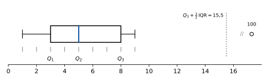
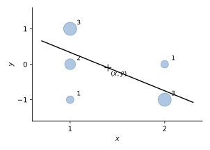

# 1 · Statistica descrittiva

**In questo modulo.** Non servono prerequisiti oltre l'algebra delle scuole superiori e la notazione di sommatoria. Si impara a descrivere un insieme di dati: come si organizzano in tabelle e grafici, come si riassumono con pochi numeri che dicono dove stanno (media, mediana, quantili) e quanto sono sparsi (varianza, deviazione standard, scarto interquartile), come si legge il boxplot e come si misura la relazione fra due variabili con la covarianza, la correlazione e la retta dei minimi quadrati. È la parte "descrittiva" della statistica: non si fanno ancora affermazioni sulla popolazione da cui i dati vengono, cosa che richiede la probabilità (moduli 2 e 3) e l'inferenza (modulo 4).

## 1.1 Dati, unità e variabili

Un insieme di dati è una raccolta di osservazioni, organizzata di solito come un foglio di calcolo: ogni riga è un'**unità sperimentale** (uno studente, un'immagine, un pezzo prodotto), ogni colonna è una **variabile**, cioè un'informazione rilevata su ciascuna unità. Le unità si indicano con un indice $\ell = 1, \dots, n$, dove $n$ è la **numerosità** del campione, e il valore della variabile sull'unità $\ell$ si scrive $x_\ell$.

Le dimensioni possono essere molto diverse: gli iscritti al corso di Statistica nel 2025/26 erano $n = 253$, mentre un archivio pubblico di immagini come ImageNet ne contiene circa $14 \cdot 10^6$.

> [!definizione] Variabili quantitative e qualitative
> Una variabile è **quantitativa** se assume valori numerici, $x_\ell \in \mathbb{R}$ (o, più in generale, vettori di numeri: una matrice, un'immagine digitale come tabella di pixel). È **qualitativa** (o categorica) se assume valori in un insieme finito di modalità non numeriche, un "dizionario" $D$: il corso di laurea, la nazionalità, il colore degli occhi.

La distinzione decide quali operazioni hanno senso: la media dell'altezza è un numero utile, la "media del corso di laurea" no. Una variabile qualitativa si può codificare con numeri (1 = gestionale, 2 = informatica), ma i codici restano etichette.

## 1.2 Frequenze e grafici

Siano $v_1, \dots, v_m$ i valori distinti che la variabile assume sul campione, con $m \le n$. La **frequenza assoluta** di $v_i$ è il numero di unità che hanno quel valore, e la **frequenza relativa** è la stessa cosa divisa per $n$:
$$n_i = \#\{\ell = 1, \dots, n \mid x_\ell = v_i\}, \qquad f_i = \frac{n_i}{n}.$$
Si ha $n_1 + \dots + n_m = n$ e $f_1 + \dots + f_m = 1$; le frequenze relative si scrivono spesso in percentuale.

> [!esempio] Corso di laurea degli iscritti
> Dei 253 iscritti, 134 sono di ingegneria gestionale, 111 di informatica e 8 di altri corsi. Le frequenze relative sono
> $$f_1 = \frac{134}{253} \approx 53\%, \qquad f_2 = \frac{111}{253} \approx 44\%, \qquad f_3 = \frac{8}{253} \approx 3\%.$$

La **tabella a una via** elenca $v_i$, $n_i$, $f_i$. Per una variabile qualitativa i grafici usuali sono il **diagramma a barre**, con una barra di altezza $f_i$ per ogni modalità, e il **diagramma a torta**, con settori di ampiezza proporzionale a $f_i$ (nell'esempio: $0{,}53 \cdot 360° \approx 191°$ per gestionale). Per una variabile quantitativa con pochi valori distinti si usa un diagramma a bastoncini sopra i punti $v_i$ dell'asse reale.

La **moda** è il valore (o la modalità) con la frequenza più alta: nell'esempio è "gestionale". È l'unico indice di posizione che ha senso anche per una variabile qualitativa, e può non essere unica.

Il **diagramma di Pareto** è un diagramma a barre con le modalità ordinate per frequenza decrescente, a cui si sovrappone la linea delle frequenze cumulate (53%, 97%, 100% nell'esempio). Si usa per vedere quali poche categorie spiegano la maggior parte dei casi, per esempio quali tipi di guasto causano la maggior parte dei fermi di un impianto.

## 1.3 Tabelle a due vie

Quando su ogni unità si rilevano due variabili qualitative $x$ (con modalità $v_1, \dots, v_m$) e $y$ (con modalità $w_1, \dots, w_k$), si contano le coppie:
$$n_{ij} = \#\{\ell \mid x_\ell = v_i,\ y_\ell = w_j\}, \qquad f_{ij} = \frac{n_{ij}}{n}.$$
La **tabella a due vie** (o di contingenza) ha una riga per ogni $v_i$ e una colonna per ogni $w_j$. Sommando lungo le righe e le colonne si ottengono le **distribuzioni marginali**, cioè le tabelle a una via delle due variabili separate:
$$n_{i\cdot} = n_{i1} + \dots + n_{ik}, \qquad n_{\cdot j} = n_{1j} + \dots + n_{mj}.$$
Il punto al posto di un indice ricorda su quale indice si è sommato.

> [!esempio] Corso di laurea e nazionalità
>
> | | Gestionale | Informatica | Altro | Totale |
> |---|---|---|---|---|
> | Italiani | 127 | 101 | 6 | 234 |
> | Stranieri | 7 | 10 | 2 | 19 |
> | Totale | 134 | 111 | 8 | 253 |
>
> In frequenze relative: $f_{11} = \frac{127}{253} \approx 50\%$, e così via. L'ultima riga è la distribuzione marginale del corso di laurea (53%, 44%, 3%), l'ultima colonna quella della nazionalità (92%, 8%).

La tabella a due vie contiene più informazione delle due marginali: dice come le variabili si combinano. Per confrontare gruppi di dimensioni diverse si usano i **profili**, cioè le frequenze relative calcolate dentro una riga o dentro una colonna.

> [!definizione] Profili riga e colonna
> Il **profilo della riga** $i$ è la distribuzione di $y$ nel sottocampione delle unità con $x = v_i$: $f_{j \mid i} = \frac{n_{ij}}{n_{i\cdot}}$. Il **profilo della colonna** $j$ è la distribuzione di $x$ fra le unità con $y = w_j$: $f_{i \mid j} = \frac{n_{ij}}{n_{\cdot j}}$. Ogni profilo somma a 1.

Nell'esempio, il profilo della riga "stranieri" è $\frac{7}{19} \approx 37\%$, $\frac{10}{19} \approx 53\%$, $\frac{2}{19} \approx 10\%$, contro il 54%, 43%, 3% degli italiani: fra gli stranieri la quota di informatici è più alta. Il profilo della colonna "altro" dice che fra gli iscritti ad altri corsi gli stranieri sono il 25%, contro il 5% fra i gestionali e il 9% fra gli informatici.

Dalle definizioni segue la **regola del prodotto**: la frequenza congiunta è il profilo per la marginale,
$$f_{ij} = f_{j \mid i}\, f_{i\cdot} = f_{i \mid j}\, f_{\cdot j}.$$
È la versione per le frequenze della regola del prodotto per le probabilità del modulo 2.

## 1.4 Indici di posizione

Da qui in poi la variabile è quantitativa, con valori distinti ordinati $v_1 < v_2 < \dots < v_m$.

> [!definizione] Media empirica
> $$\bar x = \frac{x_1 + \dots + x_n}{n} = \frac{n_1 v_1 + \dots + n_m v_m}{n} = f_1 v_1 + \dots + f_m v_m.$$

La seconda forma si usa quando i dati sono dati come tabella di frequenze. Due proprietà immediate: la media sta fra il valore minimo e il massimo, $v_1 \le \bar x \le v_m$; e se si trasformano i dati linearmente, $y_\ell = a x_\ell + b$, la media si trasforma allo stesso modo, $\bar y = a \bar x + b$. Con $a = 1$ e $b = -\bar x$ si ottengono i dati **centrati** $y_\ell = x_\ell - \bar x$, che hanno media nulla.

La media è sensibile ai valori estremi. Con i dati $1, 2, \dots, 10$ la media è $\frac{55}{10} = 5{,}5$; se il 10 diventa 100 la media sale a $\frac{145}{10} = 14{,}5$, un valore che non descrive nessuno dei dati. Un indice più stabile è la mediana, che si definisce con le frequenze cumulate.

La **funzione di distribuzione cumulata empirica** è
$$F(x) = \frac{\#\{\ell \mid x_\ell \le x\}}{n},$$
cioè la frazione di dati minori o uguali a $x$. È una funzione a gradini, nulla prima di $v_1$, uguale a 1 dopo $v_m$, con un salto di altezza $f_i$ in ogni $v_i$; nei punti $v_i$ vale $f_1 + \dots + f_i$.

> [!definizione] Quantili, percentili, quartili
> Per $q \in (0, 1]$, il **quantile** di ordine $q$ è il primo valore $v_i$ in cui la frequenza cumulata raggiunge $q$:
> $$x_q = v_i \quad \text{se} \quad f_1 + \dots + f_{i-1} < q \le f_1 + \dots + f_i.$$
> Il $k$-esimo **percentile** è il quantile di ordine $q = \frac{k}{100}$. I **quartili** sono $Q_1 = x_{1/4}$, $Q_2 = x_{1/2}$ e $Q_3 = x_{3/4}$; si pone anche $Q_0 = v_1$ (minimo) e $Q_4 = v_m$ (massimo). Il quartile $Q_2$ è la **mediana**.

Quindi almeno il 25% dei dati è minore o uguale a $Q_1$, almeno metà dei dati è minore o uguale alla mediana, e così via. Con i dati $1, \dots, 10$ (frequenza $\frac{1}{10}$ ciascuno) la cumulata raggiunge $\frac12$ in 5: la mediana è 5, e resta 5 anche se il 10 diventa 100. La mediana è **robusta** rispetto ai valori anomali, la media no.

> [!nota] Altre convenzioni
> Esistono più definizioni di quantile, che differiscono solo quando la cumulata cade esattamente su $q$ o fra due valori; molti programmi interpolano (con $1, \dots, 10$ danno mediana 5,5). Nel corso si usa la definizione sopra.

## 1.5 Boxplot

Il **boxplot** (diagramma a scatola) riassume la distribuzione in un solo disegno, sopra l'asse dei valori:

- la **scatola** va da $Q_1$ a $Q_3$ e contiene il 50% centrale dei dati, con una linea sulla mediana;
- l'ampiezza della scatola è lo **scarto interquartile** $\mathrm{IQR} = Q_3 - Q_1$;
- i **baffi** partono dai lati della scatola e arrivano al dato più piccolo e al più grande che stanno entro i limiti
$$a = Q_1 - \tfrac{3}{2}\,\mathrm{IQR}, \qquad b = Q_3 + \tfrac{3}{2}\,\mathrm{IQR};$$
- i dati fuori da $[a, b]$ si disegnano come punti isolati: sono i **valori anomali** (*outlier*).

Per i dati $1, \dots, 9, 100$ si ha $Q_1 = 3$, $Q_2 = 5$, $Q_3 = 8$, $\mathrm{IQR} = 5$ e $b = 8 + 7{,}5 = 15{,}5$: il baffo destro arriva a 9 e il 100 è un valore anomalo (figura 1.1). La posizione della mediana dentro la scatola e la lunghezza dei baffi dicono se la distribuzione è simmetrica o sbilanciata da un lato.

## 1.6 Indici di dispersione

Due gruppi di dati possono avere la stessa media ed essere molto diversi. Se uno studente ha preso dieci volte 24 e un altro cinque volte 18 e cinque volte 30, la media è 24 per entrambi, ma i voti del secondo sono molto più sparsi. Gli indici di dispersione misurano quanto.

I più semplici sono il **campo di variazione** (*range*) $v_m - v_1$, che dipende solo dai due estremi, e lo scarto interquartile $\mathrm{IQR}$, che è robusto come la mediana.

> [!definizione] Varianza e deviazione standard
> La **varianza** (della popolazione) e la **varianza campionaria** sono
> $$\sigma^2 = \frac{1}{n} \sum_{\ell = 1}^n (x_\ell - \bar x)^2, \qquad s^2 = \frac{1}{n - 1} \sum_{\ell = 1}^n (x_\ell - \bar x)^2.$$
> Le loro radici $\sigma$ e $s$ sono la **deviazione standard** della popolazione e del campione.

La varianza è la media dei quadrati degli scarti dalla media: si eleva al quadrato perché gli scarti, sommati, darebbero sempre zero. Le due versioni sono legate da $s^2 = \frac{n}{n-1}\sigma^2 = \left(1 + \frac{1}{n - 1}\right)\sigma^2$ e per $n$ grande sono quasi uguali. Il motivo del denominatore $n - 1$ si vedrà nel modulo 4: $s^2$ è lo stimatore corretto della varianza di una popolazione.

La varianza si misura nel quadrato dell'unità dei dati (m², kg²), la deviazione standard nella stessa unità: per questo si usa la seconda per descrivere la dispersione. Nell'esempio dei voti, il primo studente ha $\sigma = 0$; per il secondo ogni scarto vale $\pm 6$, quindi $\sigma^2 = 36$, $\sigma = 6$, $s^2 = 40$.

> [!teorema] Proprietà della varianza
>
> - $\sigma^2 = \overline{x^2} - \bar x^2$, dove $\overline{x^2} = \frac{1}{n}\sum x_\ell^2$ è la media dei quadrati;
> - se $y_\ell = a x_\ell + b$, allora $\sigma_y^2 = a^2 \sigma_x^2$ e $\sigma_y = \lvert a\rvert\, \sigma_x$;
> - $\sigma^2 = 0$ se e solo se tutti i dati sono uguali.

*Dimostrazione dell'ultima.* Se $\sigma^2 = 0$, la somma dei quadrati $(x_\ell - \bar x)^2$ è nulla, e una somma di termini non negativi è nulla solo se lo è ogni termine: $x_\ell = \bar x$ per ogni $\ell$. $\square$

La prima formula è quella comoda per il calcolo: basta la media dei dati e quella dei loro quadrati. La seconda dice che spostare i dati non cambia la dispersione, cambiare scala sì.

Il **coefficiente di variazione** $\mathrm{CV} = \frac{\sigma}{\lvert\bar x\rvert}$ (per $\bar x \ne 0$) misura la dispersione in rapporto alla media ed è un numero puro, quindi permette di confrontare la variabilità di grandezze con unità o ordini di grandezza diversi. Per i voti del secondo studente $\mathrm{CV} = \frac{6}{24} = 0{,}25$.

## 1.7 Covarianza, correlazione e retta dei minimi quadrati

Siano ora rilevate su ogni unità due variabili quantitative, con dati $(x_1, y_1), \dots, (x_n, y_n)$, medie $\bar x$, $\bar y$ e deviazioni standard $\sigma_x, \sigma_y > 0$.

> [!definizione] Covarianza e coefficiente di correlazione
> $$\sigma_{xy} = \frac{1}{n} \sum_{\ell = 1}^n (x_\ell - \bar x)(y_\ell - \bar y) = \overline{xy} - \bar x\, \bar y, \qquad \rho_{xy} = \frac{\sigma_{xy}}{\sigma_x\, \sigma_y}.$$

Il segno della covarianza dice se i due scarti tendono ad avere lo stesso segno (valori grandi di $x$ con valori grandi di $y$) o segno opposto. La covarianza ha come unità il prodotto delle due unità (metri per chilogrammi, per esempio); dividendo per le deviazioni standard si ottiene il **coefficiente di correlazione**, che è un numero puro.

> [!teorema] Proprietà del coefficiente di correlazione
>
> - $\rho_{xy} = \rho_{yx}$ e $\rho_{xx} = 1$;
> - $-1 \le \rho_{xy} \le 1$;
> - $\lvert\rho_{xy}\rvert = 1$ se e solo se i punti $(x_\ell, y_\ell)$ stanno tutti su una retta (con pendenza dello stesso segno di $\rho$);
> - se $z_\ell = a x_\ell + b$ con $a > 0$, allora $\rho_{zy} = \rho_{xy}$: il coefficiente non dipende dalle unità di misura.

Il coefficiente misura quindi la relazione **lineare** fra le variabili: vicino a $\pm 1$ i punti sono vicini a una retta, vicino a 0 non c'è relazione lineare (ma ce ne può essere una di altro tipo, per esempio una parabola).

**Retta dei minimi quadrati.** Si vuole una retta $y = mx + q$ che descriva come $y$ dipende da $x$, per esempio per prevedere il valore di $y$ su una nuova unità di cui si conosce solo $x$. Per ogni dato si definisce il **residuo** $r_\ell = y_\ell - (m x_\ell + q)$, la distanza verticale fra il punto e la retta. Si possono minimizzare due tipi di errore medio:
$$\frac{\lvert r_1\rvert + \dots + \lvert r_n\rvert}{n} \ (\text{errore di Laplace}), \qquad \frac{r_1^2 + \dots + r_n^2}{n} \ (\text{errore di Legendre-Gauss}).$$
Il secondo porta a un problema con una soluzione esplicita.

> [!teorema] Retta dei minimi quadrati
> La retta che rende minima la somma dei quadrati dei residui è
> $$y = \bar y + \rho_{xy} \frac{\sigma_y}{\sigma_x}(x - \bar x), \qquad \text{cioè} \quad m = \frac{\sigma_{xy}}{\sigma_x^2}, \quad q = \bar y - m \bar x.$$

La retta passa per il punto medio $(\bar x, \bar y)$ e ha pendenza dello stesso segno della correlazione.

**Coefficiente di determinazione.** La variabilità totale di $y$ si scompone in una parte spiegata dalla retta e una residua:
$$\sum (y_\ell - \bar y)^2 = \sum (\hat y_\ell - \bar y)^2 + \sum r_\ell^2, \qquad \hat y_\ell = m x_\ell + q.$$
Il rapporto $R^2 = 1 - \frac{\sum r_\ell^2}{\sum (y_\ell - \bar y)^2}$ è la frazione della variabilità di $y$ spiegata dalla retta; per la retta dei minimi quadrati vale $R^2 = \rho_{xy}^2$. Un $R^2$ vicino a 1 indica un buon adattamento.

**Analisi dei residui.** I residui della retta dei minimi quadrati hanno somma nulla. Disegnati in funzione di $x$, devono apparire come una nuvola senza struttura attorno a zero; se mostrano una curva o una dispersione che cresce con $x$, il modello lineare non è adeguato anche quando $R^2$ è alto.

**Paradosso di Simpson.** Una relazione che vale in ogni sottogruppo può invertirsi quando i gruppi si uniscono. Due reparti ammettono candidati: nel reparto A sono ammessi 80 uomini su 100 (80%) e 18 donne su 20 (90%); nel reparto B 5 uomini su 20 (25%) e 30 donne su 100 (30%). In tutti e due i reparti le donne sono ammesse in proporzione maggiore, ma in totale sono ammessi 85 uomini su 120 (71%) e 48 donne su 120 (40%). Il motivo è una terza variabile: le donne hanno fatto domanda soprattutto al reparto B, dove si ammette di meno. Prima di trarre conclusioni da una tabella aggregata conviene guardare i profili nei sottogruppi.

## Esempi ed esercizi svolti

**Esercizio 1 (genere e colore degli occhi).** A 50 persone si chiedono genere (F, M) e colore degli occhi (azzurri A, verdi V, castani C):

| | A | V | C | Totale |
|---|---|---|---|---|
| F | 5 | 8 | 7 | 20 |
| M | 4 | 6 | 20 | 30 |
| Totale | 9 | 14 | 27 | 50 |

Le frequenze relative congiunte sono, per la riga F, 10%, 16%, 14% (totale 40%) e per la riga M 8%, 12%, 40% (totale 60%); le marginali del colore sono 18%, 28%, 54%. I profili riga: fra le donne 25% A, 40% V, 35% C; fra gli uomini 13%, 20%, 67%. I profili colonna: fra chi ha gli occhi azzurri il 56% sono donne, fra i verdi il 57%, fra i castani il 26%. Le frequenze congiunte direbbero che le donne con occhi azzurri sono "poche" (10%), ma è perché le donne sono il 40% del campione: i profili correggono questo effetto.

**Esercizio 2 (un test diagnostico).** Una malattia rara colpisce l'1% della popolazione. Un test ha il 10% di falsi positivi (sani che risultano positivi) e il 20% di falsi negativi (malati che risultano negativi). Su 1000 persone ci si aspettano 10 malati, di cui 8 positivi e 2 negativi, e 990 sani, di cui 99 positivi e 891 negativi:

| | Positivo | Negativo | Totale |
|---|---|---|---|
| Malato | 8 | 2 | 10 |
| Sano | 99 | 891 | 990 |
| Totale | 107 | 893 | 1000 |

Se il test è positivo, la frazione di malati è il profilo della colonna "positivo": $\frac{8}{107} \approx 7{,}5\%$. Un positivo su più di dieci è davvero malato, perché i sani sono così tanti che anche il 10% di errori produce molti più positivi dei malati. Lo stesso calcolo, fatto con le probabilità, è la formula di Bayes del modulo 2.

**Esercizio 3 (quartili e percentili da una tabella).** I dati hanno valori e frequenze relative

| $v_i$ | 1 | 4 | 5 | 8 | 9 | 10 | 12 | 15 |
|---|---|---|---|---|---|---|---|---|
| $f_i$ | $\frac16$ | $\frac16$ | $\frac1{12}$ | $\frac16$ | $\frac1{12}$ | $\frac16$ | $\frac1{12}$ | $\frac1{12}$ |
| cumulata | 17% | 33% | 42% | 58% | 67% | 83% | 92% | 100% |

La cumulata raggiunge il 25% in 4, il 50% in 8, il 75% in 10: $Q_1 = 4$, $Q_2 = 8$, $Q_3 = 10$. Il 10° percentile è 1, il 30° è 4, il 90° è 12. La media è $\sum f_i v_i = \frac{29}{4} = 7{,}25$, un po' sotto la mediana.

**Esercizio 4 (correlazione e retta da una tabella a due vie).** Su 10 unità si rilevano $x \in \{1, 2\}$ e $y \in \{-1, 0, 1\}$, con frequenze assolute

| | $y = -1$ | $y = 0$ | $y = 1$ | Totale |
|---|---|---|---|---|
| $x = 1$ | 1 | 2 | 3 | 6 |
| $x = 2$ | 3 | 1 | 0 | 4 |
| Totale | 4 | 3 | 3 | 10 |

Le medie sono $\bar x = \frac{6 + 8}{10} = 1{,}4$ e $\bar y = \frac{-4 + 3}{10} = -0{,}1$. La media dei prodotti somma $x y$ per ogni casella pesato con la sua frequenza: $\overline{xy} = \frac{1 \cdot (-1) \cdot 1 + 1 \cdot 1 \cdot 3 + 2 \cdot (-1) \cdot 3}{10} = -0{,}4$. Quindi
$$\sigma_{xy} = -0{,}4 - 1{,}4 \cdot (-0{,}1) = -0{,}26.$$
Per le varianze: $\overline{x^2} = 2{,}2$, $\sigma_x^2 = 2{,}2 - 1{,}96 = 0{,}24$; $\overline{y^2} = 0{,}7$, $\sigma_y^2 = 0{,}7 - 0{,}01 = 0{,}69$. Il coefficiente di correlazione è
$$\rho_{xy} = \frac{-0{,}26}{\sqrt{0{,}24 \cdot 0{,}69}} \approx -0{,}64:$$
quando $x$ cresce, $y$ tende a diminuire. La retta dei minimi quadrati ha pendenza $m = \frac{-0{,}26}{0{,}24} = -\frac{13}{12} \approx -1{,}08$ e intercetta $q = -0{,}1 + \frac{13}{12} \cdot 1{,}4 = \frac{17}{12} \approx 1{,}42$; spiega $R^2 = \rho^2 \approx 41\%$ della variabilità di $y$ (figura 1.2).

### Altri esercizi svolti

**Esercizio 4. Una regressione completa.** Si misurano cinque coppie $(x, y)$: $(1;\ 2{,}1)$, $(2;\ 3{,}9)$, $(3;\ 6{,}2)$, $(4;\ 7{,}8)$, $(5;\ 10{,}0)$. Trovare la retta dei minimi quadrati, $R^2$ e i residui.

*Medie.* $\bar x = 3$, $\bar y = \frac{30}{5} = 6$.

*Somme degli scarti.* Gli scarti di $x$ sono $-2, -1, 0, 1, 2$, quelli di $y$ sono $-3{,}9;\ -2{,}1;\ 0{,}2;\ 1{,}8;\ 4{,}0$. Quindi $\sum (x - \bar x)(y - \bar y) = 7{,}8 + 2{,}1 + 0 + 1{,}8 + 8{,}0 = 19{,}7$ e $\sum (x - \bar x)^2 = 10$.

*Retta.* $m = \frac{19{,}7}{10} = 1{,}97$, $q = \bar y - m\bar x = 6 - 5{,}91 = 0{,}09$: $\hat y = 1{,}97x + 0{,}09$.

*Residui.* $r = y - \hat y$: $0{,}04;\ -0{,}13;\ 0{,}20;\ -0{,}17;\ 0{,}06$. Hanno somma nulla, come deve essere, e non mostrano un andamento (né una curva né una dispersione che cresce con $x$): la retta è un buon modello.

*$R^2$.* $\sum r^2 = 0{,}091$ e $\sum (y - \bar y)^2 = 38{,}9$, quindi $R^2 = 1 - \frac{0{,}091}{38{,}9} = 0{,}998$. La retta spiega il 99,8% della variabilità di $y$. Coerentemente, $r_{xy} = 0{,}999$ e $r_{xy}^2 = R^2$.

**Esercizio 5. Il paradosso di Simpson con i numeri.** Due trattamenti per i calcoli renali, separati per dimensione dei calcoli:

| | Piccoli | Grandi | Totale |
|---|---|---|---|
| Trattamento A | 45 su 50 (90%) | 175 su 250 (70%) | 220 su 300 (73,3%) |
| Trattamento B | 212 su 250 (84,8%) | 30 su 50 (60%) | 242 su 300 (80,7%) |

A è migliore sia sui calcoli piccoli sia su quelli grandi, ma nel totale sembra peggiore. Il motivo è la **variabile confondente**: A è stato usato soprattutto sui calcoli grandi, che guariscono meno con qualsiasi trattamento, B soprattutto sui piccoli. Il totale mescola gruppi con pesi diversi. La conclusione corretta si trae dai dati separati: A è migliore.

**Esercizio 6. Quale macchina è più regolare?** La macchina 1 produce pezzi di media 50 mm e deviazione standard 0,5 mm; la macchina 2 pezzi di media 5 mm e deviazione standard 0,1 mm.

In assoluto la macchina 2 ha la dispersione minore, ma i pezzi hanno dimensioni molto diverse, e il confronto si fa con il **coefficiente di variazione** $CV = \frac{s}{\bar x}$: $\frac{0{,}5}{50} = 1\%$ per la prima, $\frac{0{,}1}{5} = 2\%$ per la seconda. In proporzione alla misura, la macchina 1 è la più regolare.

## Esercizi guidati

Ogni esercizio è diviso in passi: si prova un passo alla volta e si confronta solo dopo.

**Guidato 1. Retta dei minimi quadrati e previsione.** Le ore di studio $x$ e i voti $y$ di quattro studenti sono $(2, 18)$, $(4, 22)$, $(6, 25)$, $(8, 27)$. Trovare la retta e prevedere il voto con 5 ore.

*Passo 1: le medie.* $\bar x = 5$, $\bar y = 23$.

*Passo 2: gli scarti.* $x - \bar x = -3, -1, 1, 3$; $y - \bar y = -5, -1, 2, 4$.

*Passo 3: le somme.* $\sum (x - \bar x)(y - \bar y) = 15 + 1 + 2 + 12 = 30$; $\sum (x - \bar x)^2 = 20$.

*Passo 4: la retta.* $m = 1{,}5$, $q = 23 - 7{,}5 = 15{,}5$: $\hat y = 1{,}5x + 15{,}5$.

*Passo 5: la previsione.* Per $x = 5$, $\hat y = 23$. Prevedere fuori dall'intervallo dei dati (per esempio con 20 ore, $\hat y = 45{,}5$, oltre il massimo dei voti) non ha senso: la retta vale solo dove ci sono dati.

**Guidato 2. Profili e indipendenza in una tabella a due vie.** In 200 dipendenti, 80 donne e 120 uomini, lavorano a tempo parziale 24 donne e 36 uomini.

*Passo 1: i profili riga.* Fra le donne il 30% lavora a tempo parziale ($\frac{24}{80}$), fra gli uomini il 30% ($\frac{36}{120}$).

*Passo 2: il profilo marginale.* In tutto $\frac{60}{200} = 30\%$.

*Passo 3: la conclusione.* I profili riga coincidono con il profilo marginale: nei dati, tempo parziale e genere sono indipendenti. Equivale a dire che ogni frequenza congiunta è il prodotto delle marginali: $\frac{24}{200} = 0{,}12 = 0{,}40 \cdot 0{,}30$.

**Guidato 3. Media e varianza da una tabella di frequenze.** In 20 famiglie il numero di figli è 0 per 4 famiglie, 1 per 8, 2 per 6, 3 per 2.

*Passo 1: la media pesata.* $\bar x = \frac{0 \cdot 4 + 1 \cdot 8 + 2 \cdot 6 + 3 \cdot 2}{20} = \frac{26}{20} = 1{,}3$.

*Passo 2: il momento secondo.* $\frac{0 + 8 + 24 + 18}{20} = \frac{50}{20} = 2{,}5$.

*Passo 3: la varianza.* Come media dei quadrati meno il quadrato della media, $2{,}5 - 1{,}69 = 0{,}81$; la varianza campionaria con $n - 1$ è $0{,}81 \cdot \frac{20}{19} = 0{,}853$.

*Passo 4: moda e mediana.* La moda è 1. La mediana è fra il decimo e l'undicesimo valore ordinato, entrambi 1: mediana 1.

## Riepilogo

I dati si organizzano per unità sperimentali e variabili, quantitative o qualitative. Una variabile si riassume con la tabella delle frequenze assolute e relative e con un diagramma a barre, a torta o di Pareto; due variabili qualitative con la tabella a due vie, le marginali e i profili riga e colonna, legati alla frequenza congiunta dalla regola del prodotto. Per una variabile quantitativa la media è la somma dei valori pesati con le frequenze ed è sensibile ai valori estremi; la mediana e gli altri quantili si leggono sulla cumulata empirica e sono robusti. Il boxplot mostra quartili, scarto interquartile e valori anomali (fuori da $Q_1 - \frac32 \mathrm{IQR}$, $Q_3 + \frac32 \mathrm{IQR}$). La dispersione si misura con varianza e deviazione standard ($\sigma^2$ con $\frac1n$, $s^2$ con $\frac{1}{n-1}$), che si calcolano come media dei quadrati meno quadrato della media e non cambiano spostando i dati; il coefficiente di variazione le rende confrontabili. Covarianza e correlazione misurano la relazione lineare fra due variabili, con $\lvert\rho\rvert \le 1$; la retta dei minimi quadrati passa per $(\bar x, \bar y)$ con pendenza $\sigma_{xy}/\sigma_x^2$, la sua bontà si misura con $R^2 = \rho^2$ e si controlla con i residui. Le tabelle aggregate possono ingannare (paradosso di Simpson).

## Formulario

Indici, formule della regressione e termini per l'orale.

### Indici

$$\bar x = \frac{1}{n}\sum x_\ell, \qquad s^2 = \frac{1}{n - 1}\sum (x_\ell - \bar x)^2 = \frac{n}{n - 1}\left(\overline{x^2} - \bar x^2\right), \qquad CV = \frac{s}{\bar x}.$$

Mediana: valore centrale dei dati ordinati (media dei due centrali se $n$ è pari). Quartili $Q_1$, $Q_3$; $IQR = Q_3 - Q_1$; nel boxplot sono anomali i dati fuori da $[Q_1 - 1{,}5\,IQR,\ Q_3 + 1{,}5\,IQR]$.

### Due variabili

$$\operatorname{cov}_{xy} = \frac{1}{n - 1}\sum (x_\ell - \bar x)(y_\ell - \bar y), \qquad r_{xy} = \frac{\operatorname{cov}_{xy}}{s_x s_y} \in [-1, 1],$$

$$m = \frac{\sum (x - \bar x)(y - \bar y)}{\sum (x - \bar x)^2} = r_{xy}\frac{s_y}{s_x}, \qquad q = \bar y - m\bar x, \qquad R^2 = 1 - \frac{\sum r_\ell^2}{\sum (y_\ell - \bar y)^2} = r_{xy}^2.$$

Tabelle a due vie: frequenza congiunta = profilo riga × frequenza marginale della riga; indipendenza nei dati se i profili riga coincidono con il profilo marginale.

### Termini per l'orale

| Termine | In una riga |
|---|---|
| Unità, variabile, modalità | chi si osserva, che cosa si misura, i valori possibili |
| Variabile qualitativa (nominale, ordinale), quantitativa | categorie (con o senza ordine) o numeri |
| Frequenza assoluta, relativa, cumulata | conteggio, proporzione, somma fino a un valore |
| Diagramma di Pareto | barre ordinate per frequenza decrescente, con la cumulata |
| Moda, mediana, media | valore più frequente, centrale, baricentro |
| Quantile, percentile, quartile | valori che dividono i dati ordinati in parti date |
| Boxplot | scatola da $Q_1$ a $Q_3$ con la mediana e i baffi |
| Robustezza | un indice è robusto se i valori anomali lo spostano poco (la mediana sì, la media no) |
| Correlazione | misura della dipendenza lineare; non implica causalità |
| Residuo | $y_\ell - \hat y_\ell$, distanza verticale dalla retta |
| Variabile confondente | variabile che, se ignorata, crea o inverte una relazione (Simpson) |

### Domande che tornano spesso

- Differenza fra media e mediana; perché la mediana è robusta?
- Come si costruisce un boxplot e come si riconoscono i dati anomali?
- Perché la varianza campionaria si divide per $n - 1$?
- Ricavare la retta dei minimi quadrati e il significato di $R^2$.
- Correlazione nulla vuol dire assenza di relazione? Un esempio con $y = x^2$.
- Spiegare il paradosso di Simpson con un esempio.
