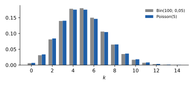
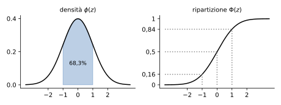

# 3 · Valori attesi, leggi notevoli e teoremi limite

**In questo modulo.** Si usano le variabili aleatorie, le densità e le funzioni di ripartizione del modulo 2, le serie (geometrica, esponenziale) e l'integrazione per parti di Analisi. Si definiscono la speranza e la varianza di una variabile aleatoria, con le loro proprietà e la disuguaglianza di Chebyshev, la covarianza e la correlazione di due variabili. Poi si studiano le leggi che compaiono più spesso nelle applicazioni (Bernoulli, binomiale, geometrica, Pascal, Poisson, ipergeometrica, uniformi, esponenziale, normale), con il modello da cui nascono, e si impara a usare le tavole della normale, i quantili e i valori critici. Il modulo si chiude con la legge dei grandi numeri e il teorema del limite centrale, che sono il ponte verso l'inferenza del modulo 4.

## 3.1 Speranza

La **speranza** (valore atteso, media) di una variabile aleatoria è la media dei suoi valori pesata con le probabilità:

> [!definizione] Speranza
>
> - Se $X$ è finita o discreta, con valori $x_k$: $\mathbb{E}[X] = \sum_k x_k\, P[X = x_k]$.
> - Se $X$ ha densità $f$: $\mathbb{E}[X] = \int_{-\infty}^{+\infty} x f(x)\, dx$.
>
> Nel caso di infiniti valori si chiede che la serie o l'integrale converga assolutamente; altrimenti la speranza non esiste (o è infinita).

> [!esempio] Speranze elementari
>
> - Numero di teste in due lanci di una moneta con $P[T] = p$: i valori 0, 1, 2 hanno probabilità $(1-p)^2$, $2p(1-p)$, $p^2$, e $\mathbb{E}[X] = 2p(1-p) + 2p^2 = 2p$.
> - Lancio di un dado equilibrato: $\mathbb{E}[X] = \frac16(1 + \dots + 6) = \frac72$.
> - Densità $f(x) = 2x$ su $(0, 1)$: $\mathbb{E}[X] = \int_0^1 2x^2\, dx = \frac23$.
> - Densità $f(x) = \frac{1}{L} e^{-x/L}$ per $x \ge 0$ (esponenziale, paragrafo 3.6): per parti, $\int_0^{+\infty} \frac{x}{L} e^{-x/L}\, dx = \left[-(x + L) e^{-x/L}\right]_0^{+\infty} = L$.
> - Densità $f(x) = \frac{2}{\pi}\frac{1}{1 + x^2}$ per $x \ge 0$: $\int_0^{+\infty} \frac{2}{\pi}\frac{x}{1 + x^2}\, dx = \frac{1}{\pi}\left[\ln(1 + x^2)\right]_0^{+\infty} = +\infty$. La speranza è infinita.

> [!teorema] Proprietà della speranza
>
> 1. Se $X \sim Y$ allora $\mathbb{E}[X] = \mathbb{E}[Y]$; se $X = c$ costante, $\mathbb{E}[X] = c$.
> 2. **Linearità**: $\mathbb{E}[aX + bY] = a\,\mathbb{E}[X] + b\,\mathbb{E}[Y]$.
> 3. **Monotonia**: se $X \ge 0$ allora $\mathbb{E}[X] \ge 0$; se $X \le Y$ allora $\mathbb{E}[X] \le \mathbb{E}[Y]$; se $m \le X \le M$ allora $m \le \mathbb{E}[X] \le M$.
> 4. Se $X$ e $Y$ sono **indipendenti** (paragrafo 3.4), $\mathbb{E}[XY] = \mathbb{E}[X]\,\mathbb{E}[Y]$.
> 5. **Formula di trasferimento**: se $Y = \phi(X)$,
> $$\mathbb{E}[\phi(X)] = \sum_k \phi(x_k)\, P[X = x_k] \quad \text{oppure} \quad \mathbb{E}[\phi(X)] = \int_{-\infty}^{+\infty} \phi(x) f(x)\, dx.$$
> 6. **Formula delle code**: se $X$ ha valori in $\mathbb{N}$, $\mathbb{E}[X] = \sum_{n=0}^{\infty} P[X > n]$; se $X \ge 0$ ha densità, $\mathbb{E}[X] = \int_0^{+\infty} P[X > x]\, dx$.

La formula di trasferimento è il modo pratico di calcolare $\mathbb{E}[Y]$ senza trovare la legge di $Y$. Per esempio, se $X$ è uniforme su $(0, \pi)$, con densità $\frac{1}{\pi}$, e $Y = \sin X$:
$$\mathbb{E}[\sin X] = \int_0^\pi \frac{\sin x}{\pi}\, dx = \frac{1}{\pi}\left[-\cos x\right]_0^\pi = \frac{2}{\pi}.$$
Passando per la legge si trova lo stesso risultato: per $0 < y < 1$, $\sin X \le y$ quando $X \le \arcsin y$ o $X \ge \pi - \arcsin y$, quindi $F_Y(y) = \frac{2}{\pi}\arcsin y$ e $f_Y(y) = \frac{2}{\pi}\frac{1}{\sqrt{1 - y^2}}$.

> [!esempio] Due lanci di una moneta truccata
> Siano $X$, $Y$ le indicatrici di testa al primo e al secondo lancio, indipendenti con $P[T] = p$. Allora $\mathbb{E}[X] = \mathbb{E}[Y] = p$ e, per linearità, $\mathbb{E}[X + Y] = 2p$ (lo stesso risultato di prima, senza la legge della somma). Inoltre $\mathbb{E}[2XY + 3] = 2\,\mathbb{E}[X]\,\mathbb{E}[Y] + 3 = 2p^2 + 3$, $\mathbb{E}[X^2] = 0^2(1-p) + 1^2 p = p$ e
> $$\mathbb{E}\left[\frac{\cos(\pi X)}{1 + Y}\right] = \mathbb{E}[\cos(\pi X)]\, \mathbb{E}\left[\frac{1}{1 + Y}\right] = (1 - 2p)\left(1 - \frac{p}{2}\right).$$

Con la formula delle code si trova la speranza del numero $N$ di lanci di una moneta con $P[T] = p$ fino alla prima testa: $N > n$ vuol dire $n$ croci di fila, quindi $P[N > n] = (1 - p)^n$ e $\mathbb{E}[N] = \sum_{n \ge 0} (1 - p)^n = \frac{1}{p}$.

## 3.2 Speranza condizionata

Se $X$ e $Y$ sono variabili finite e $P[Y = y_j] > 0$, la **speranza condizionata** di $X$ dato $Y = y_j$ è la speranza di $X$ calcolata con la probabilità condizionata:
$$\mathbb{E}[X \mid Y = y_j] = \sum_k x_k\, P[X = x_k \mid Y = y_j].$$

> [!teorema] Formula delle torri
> $$\mathbb{E}[X] = \mathbb{E}[X \mid Y = y_1]\, P[Y = y_1] + \dots + \mathbb{E}[X \mid Y = y_m]\, P[Y = y_m].$$

È la formula delle probabilità totali per le speranze: si calcola la media in ciascun caso e poi la media dei casi.

> [!esempio] Un'urna di monete
> Un'urna contiene 12 monete equilibrate e 8 truccate con $P[T] = \frac13$. Si estrae una moneta e la si lancia 3 volte; $X$ è il numero di teste. Con $Y = 1$ se la moneta è equilibrata (probabilità $\frac{12}{20} = \frac35$) e $Y = 0$ altrimenti ($\frac25$), il numero medio di teste in 3 lanci è $3 \cdot \frac12$ nel primo caso e $3 \cdot \frac13$ nel secondo:
> $$\mathbb{E}[X] = \frac32 \cdot \frac35 + 1 \cdot \frac25 = \frac{9}{10} + \frac{4}{10} = \frac{13}{10}.$$

Lo stesso ragionamento vale quando il numero di prove è aleatorio. Si lancia un dado equilibrato e poi una moneta con $P[T] = p$ tante volte quanto è uscito sul dado. Sia $N$ l'esito del dado e $S = X_1 + \dots + X_N$ il numero di teste, con $X_i$ indicatrice di testa all'$i$-esimo lancio. Se $N = n$ la media è $np$, quindi
$$\mathbb{E}[S] = \sum_{n=1}^{6} np \cdot \frac16 = \frac{p}{6} \cdot 21 = \frac72 p = \mathbb{E}[N]\, \mathbb{E}[X_1].$$

## 3.3 Varianza e disuguaglianza di Chebyshev

> [!definizione] Varianza e deviazione standard
> Se $\mu = \mathbb{E}[X]$, la **varianza** di $X$ è $\mathrm{Var}[X] = \mathbb{E}[(X - \mu)^2] = \sigma^2$, e $\sigma = \sqrt{\mathrm{Var}[X]}$ è la **deviazione standard**.

La varianza misura quanto $X$ si allontana in media dalla sua speranza, come la varianza dei dati del modulo 1. Più in generale $\mathbb{E}[X^k]$ è il **momento** di ordine $k$: la speranza è il momento primo, e la varianza si calcola dai primi due.

> [!teorema] Proprietà della varianza
>
> 1. $\mathrm{Var}[X] = \mathbb{E}[X^2] - \mathbb{E}[X]^2$;
> 2. $\mathrm{Var}[aX + b] = a^2\, \mathrm{Var}[X]$;
> 3. se $X$ e $Y$ sono indipendenti, $\mathrm{Var}[X + Y] = \mathrm{Var}[X] + \mathrm{Var}[Y]$;
> 4. **disuguaglianza di Chebyshev**: per ogni $\varepsilon > 0$, $P[\lvert X - \mu\rvert \ge \varepsilon] \le \dfrac{\mathrm{Var}[X]}{\varepsilon^2}$.

La disuguaglianza dice qualcosa solo per $\varepsilon > \sigma$ (altrimenti il secondo membro supera 1). Scegliendo $\varepsilon = \sigma/\sqrt{\eta}$ con $0 < \eta < 1$, diventa: con probabilità almeno $1 - \eta$,
$$\mu - \frac{\sigma}{\sqrt{\eta}} < X < \mu + \frac{\sigma}{\sqrt{\eta}}.$$
Per esempio, con probabilità almeno del 75% ($\eta = \frac14$) una variabile qualsiasi dista meno di $2\sigma$ dalla sua speranza. È una stima grossolana, ma vale per ogni legge.

> [!esempio] Varianze elementari
>
> - **Indicatrice** $X = \mathbb{1}_E$ con $P[E] = p$: $X^2 = X$, quindi $\mathbb{E}[X^2] = p$ e $\mathrm{Var}[X] = p - p^2 = p(1-p)$.
> - **Uniforme discreta** su $\{1, \dots, n\}$: $\mathbb{E}[X] = \frac{n+1}{2}$ e $\mathbb{E}[X^2] = \frac1n \sum k^2 = \frac{(n+1)(2n+1)}{6}$, quindi
> $$\mathrm{Var}[X] = \frac{(n+1)(2n+1)}{6} - \frac{(n+1)^2}{4} = \frac{n+1}{12}(4n + 2 - 3n - 3) = \frac{n^2 - 1}{12}.$$
> Per un dado, $\frac{35}{12}$.
>
> - **Uniforme** su $(0, 1)$: $\mathbb{E}[X] = \frac12$, $\mathbb{E}[X^2] = \int_0^1 x^2\, dx = \frac13$, $\mathrm{Var}[X] = \frac13 - \frac14 = \frac{1}{12}$. Per $Y = (b - a)X + a$, uniforme su $(a, b)$: $\mathbb{E}[Y] = \frac{a+b}{2}$ e $\mathrm{Var}[Y] = \frac{(b-a)^2}{12}$.

## 3.4 Leggi congiunte, covarianza e correlazione

Due variabili finite $X$ e $Y$ definite sullo stesso spazio hanno una **legge congiunta**, la tabella delle probabilità $P[X = x_i, Y = y_j]$. Come per le tabelle a due vie del modulo 1, le **marginali** si ottengono sommando lungo righe e colonne:
$$P[X = x_i] = \sum_j P[X = x_i, Y = y_j], \qquad P[Y = y_j] = \sum_i P[X = x_i, Y = y_j],$$
e la legge di $X$ condizionata a $Y = y_j$ è il profilo della colonna $j$, $P[X = x_i \mid Y = y_j] = P[X = x_i, Y = y_j] / P[Y = y_j]$.

> [!aggiunta] Aggiunta in revisione · fonte: Ross, *Introduzione alla statistica*; Devore, *Probability and Statistics for Engineering and the Sciences* (STA-06)
> Due variabili aleatorie sono **indipendenti**, e si scrive $X \perp Y$, se per ogni coppia di intervalli $I$, $J$ gli eventi $\{X \in I\}$ e $\{Y \in J\}$ sono indipendenti. Per variabili discrete basta che la legge congiunta sia il prodotto delle marginali: $P[X = x_i, Y = y_j] = P[X = x_i]\, P[Y = y_j]$ per ogni $i, j$. Le variabili $X_1, \dots, X_n$ sono indipendenti se gli eventi $\{X_1 \in I_1\}, \dots, \{X_n \in I_n\}$ lo sono per ogni scelta degli intervalli; è il caso dei risultati di prove ripetute nelle stesse condizioni.

> [!definizione] Covarianza e coefficiente di correlazione
> $$\mathrm{Cov}[X, Y] = \mathbb{E}\big[(X - \mathbb{E}[X])(Y - \mathbb{E}[Y])\big], \qquad \rho_{X,Y} = \frac{\mathrm{Cov}[X, Y]}{\sqrt{\mathrm{Var}[X]\, \mathrm{Var}[Y]}}.$$

> [!teorema] Proprietà della covarianza
>
> 1. $\mathrm{Cov}[X, Y] = \mathbb{E}[XY] - \mathbb{E}[X]\,\mathbb{E}[Y]$;
> 2. $\mathrm{Cov}[X, Y] = \mathrm{Cov}[Y, X]$ e $\mathrm{Cov}[X, X] = \mathrm{Var}[X]$;
> 3. è lineare in ciascun argomento: $\mathrm{Cov}[aX + bY, Z] = a\,\mathrm{Cov}[X, Z] + b\,\mathrm{Cov}[Y, Z]$;
> 4. $\mathrm{Var}[X + Y] = \mathrm{Var}[X] + 2\,\mathrm{Cov}[X, Y] + \mathrm{Var}[Y]$;
> 5. $-1 \le \rho_{X,Y} \le 1$ (disuguaglianza di Cauchy-Schwarz);
> 6. se $X \perp Y$ allora $\mathrm{Cov}[X, Y] = 0$.

Il viceversa della 6 è falso: covarianza nulla non implica indipendenza. Siano $X \in \{-1, 0, 1\}$ e $Y \in \{0, 1\}$ con legge congiunta $P[X = -1, Y = 1] = \frac14$, $P[X = 0, Y = 0] = \frac12$, $P[X = 1, Y = 1] = \frac14$ (le altre caselle nulle). Allora $\mathbb{E}[X] = 0$, $\mathbb{E}[XY] = -\frac14 + \frac14 = 0$, quindi $\mathrm{Cov}[X, Y] = 0$. Ma $P[X = 0, Y = 1] = 0$ mentre $P[X = 0]\, P[Y = 1] = \frac12 \cdot \frac12$: le variabili non sono indipendenti (anzi $Y = X^2$).

> [!esempio] Covarianza da una legge congiunta
>
> | | $Y = 0$ | $Y = 1$ | $P[X = x]$ |
> |---|---|---|---|
> | $X = 0$ | 0 | $\frac{1}{16}$ | $\frac{1}{16}$ |
> | $X = 1$ | $\frac18$ | $\frac18$ | $\frac14$ |
> | $X = 2$ | $\frac14$ | $\frac18$ | $\frac38$ |
> | $X = 3$ | $\frac{1}{16}$ | $\frac{3}{16}$ | $\frac14$ |
> | $X = 4$ | $\frac{1}{16}$ | 0 | $\frac{1}{16}$ |
> | $P[Y = y]$ | $\frac12$ | $\frac12$ | 1 |
>
> Dalle marginali $\mathbb{E}[X] = \frac14 + \frac34 + \frac34 + \frac14 = 2$ e $\mathbb{E}[Y] = \frac12$. Il prodotto $XY$ è diverso da zero solo nella colonna $Y = 1$: $\mathbb{E}[XY] = 1 \cdot \frac18 + 2 \cdot \frac18 + 3 \cdot \frac{3}{16} = \frac{15}{16}$. Quindi $\mathrm{Cov}[X, Y] = \frac{15}{16} - 1 = -\frac{1}{16}$.

## 3.5 Leggi discrete notevoli

Ogni legge nasce da un modello; il modello di riferimento è una moneta con $P[T] = p \in (0, 1)$ lanciata più volte, con lanci indipendenti.

> [!definizione] Bernoulli $B(p)$
> $X$ vale 1 (testa, successo) con probabilità $p$ e 0 con probabilità $1 - p$. Ogni indicatrice $\mathbb{1}_E$ è una Bernoulli di parametro $P[E]$. $\mathbb{E}[X] = p$, $\mathrm{Var}[X] = p(1 - p)$.

Il prodotto di due Bernoulli indipendenti $B(p_1)$ e $B(p_2)$ è una Bernoulli di parametro $p_1 p_2$, perché vale 1 solo quando valgono 1 entrambe.

> [!definizione] Binomiale $\mathrm{Bin}(n, p)$
> $S_n$ è il numero di teste in $n$ lanci, cioè $S_n = X_1 + \dots + X_n$ con $X_i \sim B(p)$ indipendenti. Ha valori $0, \dots, n$ e
> $$P[S_n = k] = \binom{n}{k} p^k (1 - p)^{n-k}, \qquad \mathbb{E}[S_n] = np, \quad \mathrm{Var}[S_n] = np(1 - p).$$

Il coefficiente binomiale conta le posizioni delle $k$ teste fra gli $n$ lanci; speranza e varianza seguono dalla linearità e dall'indipendenza. Se $S_n \sim \mathrm{Bin}(n, p)$ e $S_m \sim \mathrm{Bin}(m, p)$ sono indipendenti, $S_n + S_m \sim \mathrm{Bin}(n + m, p)$: si contano le teste in $n + m$ lanci.

> [!definizione] Geometrica $\mathrm{Geo}(p)$
> $T$ è il numero di lanci necessari per avere la prima testa (tempo di primo successo). Ha valori $1, 2, \dots$ e
> $$P[T = n] = (1 - p)^{n-1} p, \qquad P[T > n] = (1 - p)^n, \qquad \mathbb{E}[T] = \frac{1}{p}, \quad \mathrm{Var}[T] = \frac{1 - p}{p^2}.$$
> Vale l'**assenza di memoria**: $P[T > n + k \mid T > n] = P[T > k]$ per ogni $n, k \in \mathbb{N}$.

L'assenza di memoria dice che, se dopo $n$ lanci non è ancora uscita testa, l'attesa che resta ha la stessa legge di quella iniziale: la moneta non "ricorda" le croci passate. Al lotto, un numero ha probabilità $p = \frac{5}{90} = \frac{1}{18}$ di uscire su una ruota a ogni estrazione; la probabilità che non esca per 257 estrazioni di fila è $\left(\frac{17}{18}\right)^{257} \approx 4{,}2 \cdot 10^{-7}$, ma sapendo che non è uscito per 257 volte, la probabilità che non esca neanche alla successiva è ancora $\frac{17}{18} \approx 94\%$. I numeri "ritardatari" non sono più probabili degli altri.

> [!definizione] Pascal $\mathrm{Pascal}(k, p)$
> $T_k$ è il numero di lanci necessari per avere $k$ teste (tempo del $k$-esimo successo). Ha valori $k, k + 1, \dots$ e
> $$P[T_k = n] = \binom{n-1}{k-1} (1 - p)^{n-k} p^k, \qquad \mathbb{E}[T_k] = \frac{k}{p}, \quad \mathrm{Var}[T_k] = k\frac{1 - p}{p^2}.$$
> Inoltre $T_k = U_1 + \dots + U_k$, dove $U_i$ è il numero di lanci fra il successo $i - 1$ e il successo $i$, e le $U_i \sim \mathrm{Geo}(p)$ sono indipendenti.

Nella formula, l'ultimo lancio è una testa e fra i primi $n - 1$ ci sono le altre $k - 1$ teste. Gli eventi $\{T_k \le n\}$ e $\{S_n \ge k\}$ coincidono (in $n$ lanci ci sono almeno $k$ teste se e solo se la $k$-esima è arrivata entro il lancio $n$).

> [!definizione] Poisson $\mathrm{Poisson}(\lambda)$
> $N$ ha valori $0, 1, 2, \dots$ e, per un parametro $\lambda > 0$,
> $$P[N = k] = e^{-\lambda}\frac{\lambda^k}{k!}, \qquad \mathbb{E}[N] = \mathrm{Var}[N] = \lambda.$$
> Se $N \sim \mathrm{Poisson}(\lambda)$ e $M \sim \mathrm{Poisson}(\mu)$ sono indipendenti, $N + M \sim \mathrm{Poisson}(\lambda + \mu)$.

La Poisson è la legge degli **eventi rari**: il numero di successi in moltissime prove, ciascuna con probabilità piccola. Se $n$ è grande e $p$ piccolo, con $\lambda = np$,
$$P[S_n = k] = \frac{n(n-1)\cdots(n-k+1)}{n^k}\cdot\frac{\lambda^k}{k!}\cdot\frac{\left(1 - \frac{\lambda}{n}\right)^n}{\left(1 - \frac{\lambda}{n}\right)^k} \xrightarrow[n \to \infty]{} e^{-\lambda}\frac{\lambda^k}{k!},$$
perché il primo e l'ultimo fattore tendono a 1 e $\left(1 - \frac{\lambda}{n}\right)^n \to e^{-\lambda}$. Si usa per il numero di clienti in un'ora, di accessi a un sito, di guasti in un periodo. Per calcolare più valori di seguito è comoda la relazione $P[N = k] = \frac{\lambda}{k} P[N = k - 1]$.

> [!definizione] Ipergeometrica $\mathrm{Hyper}(r, b, n)$
> Da un'urna con $r$ palline rosse e $b$ bianche se ne estraggono $n \le r + b$ senza reimmissione; $\tilde S_n$ è il numero di rosse estratte. Per $k \le r$ e $n - k \le b$:
> $$P[\tilde S_n = k] = \frac{\binom{r}{k}\binom{b}{n-k}}{\binom{r+b}{n}}, \qquad \mathbb{E}[\tilde S_n] = n\frac{r}{r+b}, \quad \mathrm{Var}[\tilde S_n] = n\frac{r}{r+b}\cdot\frac{b}{r+b}\cdot\frac{r+b-n}{r+b-1}.$$

Senza reimmissione le estrazioni non sono indipendenti, ma se $r$ e $b$ sono grandi rispetto a $n$ la differenza è trascurabile e l'ipergeometrica è vicina alla binomiale con $p = \frac{r}{r+b}$: la varianza differisce solo per il fattore $\frac{r+b-n}{r+b-1}$, vicino a 1.

> [!esempio] Lampadine difettose
> Su 1000 lampadine prodotte, 100 sono difettose. In un campione di 10, il numero di difettose è $X \sim \mathrm{Hyper}(100, 900, 10)$, molto vicino a $Y \sim \mathrm{Bin}(10; 0{,}1)$; entrambe hanno speranza 1.
>
> | $k$ | 0 | 1 | 2 | 3 | $> 3$ |
> |---|---|---|---|---|---|
> | $P[X = k]$ (ipergeometrica) | 34,7% | 38,9% | 19,4% | 5,7% | 1,2% |
> | $P[Y = k]$ (binomiale) | 34,9% | 38,7% | 19,4% | 5,7% | 1,3% |

L'**uniforme discreta** su $\{1, \dots, N\}$, modello di un dado equilibrato con $N$ facce, ha $P[X = k] = \frac1N$, speranza $\frac{N+1}{2}$ e varianza $\frac{N^2-1}{12}$ (paragrafo 3.3).

## 3.6 Leggi continue notevoli

> [!definizione] Uniforme $U[a, b]$
> Densità $f(x) = \frac{1}{b - a}$ su $[a, b]$, nulla altrove. Funzione di ripartizione 0 per $x < a$, $\frac{x - a}{b - a}$ su $[a, b]$, 1 per $x > b$. $\mathbb{E}[X] = \frac{a+b}{2}$, $\mathrm{Var}[X] = \frac{(b-a)^2}{12}$. Se $X_0 \sim U[0, 1]$, allora $(b - a)X_0 + a \sim U[a, b]$.

> [!definizione] Esponenziale $\mathcal{E}(\lambda)$
> Per $\lambda > 0$, densità $f(t) = \lambda e^{-\lambda t}$ per $t \ge 0$, nulla per $t < 0$. Con $\tau = \frac{1}{\lambda}$:
> $$F(t) = 1 - e^{-\lambda t}, \quad P[T > t] = e^{-t/\tau} \ (t \ge 0), \qquad \mathbb{E}[T] = \tau, \quad \mathrm{Var}[T] = \tau^2.$$
> Vale l'assenza di memoria: $P[T > t + s \mid T > s] = P[T > t]$ per ogni $t, s \ge 0$.

L'esponenziale è il modello dei tempi di attesa senza usura (il tempo fino alla prossima chiamata, la durata di un componente elettronico), ed è l'analogo continuo della geometrica. Il parametro $\tau$ è il tempo medio: più è grande, più la densità parte bassa (da $\frac{1}{\tau}$) e decresce lentamente.

> [!esempio] Call center
> Un call center risponde in media a 12 telefonate l'ora. Il tempo di attesa $T$ fra una chiamata e la successiva si modella come esponenziale con $\mathbb{E}[T] = \frac{60}{12} = 5$ minuti, cioè $\lambda = 0{,}2$ al minuto. La probabilità di aspettare meno di 4 minuti è $P[T \le 4] = 1 - e^{-4/5} \approx 55\%$. Se si è già aspettato 2 minuti, la probabilità di aspettare in tutto meno di 5 è, per l'assenza di memoria, $1 - P[T > 3] = 1 - e^{-3/5} \approx 45\%$.

## 3.7 La legge normale

> [!definizione] Normale standard e normale $N(\mu, \sigma^2)$
> La **normale standard** $Z \sim N(0, 1)$ ha densità
> $$\phi(z) = \frac{1}{\sqrt{2\pi}} e^{-z^2/2}, \qquad z \in \mathbb{R}.$$
> Per $\mu \in \mathbb{R}$ e $\sigma > 0$, $X \sim N(\mu, \sigma^2)$ ha densità $f(x) = \frac{1}{\sqrt{2\pi\sigma^2}} e^{-(x - \mu)^2 / (2\sigma^2)}$.

La densità standard è la "curva a campana": simmetrica rispetto a 0, con massimo $\frac{1}{\sqrt{2\pi}} \approx 0{,}40$ in 0 e flessi in $\pm 1$. Quella di $N(\mu, \sigma^2)$ ha la stessa forma, centrata in $\mu$, con flessi in $\mu \pm \sigma$. Fra $\mu - \sigma$ e $\mu + \sigma$ cade circa il 68% della probabilità.

> [!teorema] Proprietà della normale
>
> 1. Se $Z \sim N(0, 1)$, allora $X = \sigma Z + \mu \sim N(\mu, \sigma^2)$; viceversa $\frac{X - \mu}{\sigma} \sim N(0, 1)$ (**standardizzazione**).
> 2. $\mathbb{E}[Z] = 0$, $\mathrm{Var}[Z] = 1$; $\mathbb{E}[X] = \mu$, $\mathrm{Var}[X] = \sigma^2$.
> 3. Se $X \sim N(\mu, \sigma^2)$ e $a \neq 0$, $aX + b \sim N(a\mu + b, a^2\sigma^2)$.
> 4. Se $X \sim N(\mu_1, \sigma_1^2)$ e $Y \sim N(\mu_2, \sigma_2^2)$ sono indipendenti, $aX + bY \sim N(a\mu_1 + b\mu_2, a^2\sigma_1^2 + b^2\sigma_2^2)$.

La funzione di ripartizione della normale standard
$$\Phi(z) = P[Z \le z] = \frac{1}{\sqrt{2\pi}}\int_{-\infty}^z e^{-t^2/2}\, dt$$
non si esprime con funzioni elementari e si legge sulle **tavole** (righe per la prima cifra decimale, colonne per la seconda: $\Phi(1{,}24) = 0{,}8925$ si trova alla riga 1,2 e alla colonna 0,04).

> [!teorema] Proprietà di $\Phi$
>
> 1. $\Phi(0) = \frac12$ e $\Phi(-z) = 1 - \Phi(z)$ (per simmetria);
> 2. per $\varepsilon > 0$: $P[\lvert Z\rvert \ge \varepsilon] = 2\Phi(-\varepsilon)$ e $P[\lvert Z\rvert \le \varepsilon] = 2\Phi(\varepsilon) - 1$;
> 3. per $a < b$ e $X \sim N(\mu, \sigma^2)$: $P[a \le X \le b] = \Phi\left(\frac{b - \mu}{\sigma}\right) - \Phi\left(\frac{a - \mu}{\sigma}\right)$;
> 4. per $z > 0$ la coda si maggiora con $\Phi(-z) \le \dfrac{1}{z\sqrt{2\pi}} e^{-z^2/2}$.

*Dimostrazione della 4.* Per $t \ge z > 0$ si ha $1 \le \frac{t}{z}$, quindi
$$\Phi(-z) = P[Z \ge z] = \frac{1}{\sqrt{2\pi}}\int_z^{+\infty} e^{-t^2/2}\, dt \le \frac{1}{\sqrt{2\pi}}\int_z^{+\infty} \frac{t}{z} e^{-t^2/2}\, dt = \frac{1}{z\sqrt{2\pi}} e^{-z^2/2}. \ \square$$

La maggiorazione è grossolana per $z = 1$ ($\Phi(-1) \approx 16\%$, la stima dà 24%), ma diventa precisa al crescere di $z$: per $z = 2$, $2{,}3\%$ contro $2{,}7\%$; per $z = 3$, $0{,}13\%$ contro $0{,}15\%$; per $z = 4$, $0{,}0032\%$ contro $0{,}0034\%$. Le code della normale vanno a zero molto in fretta.

> [!definizione] Quantili e valori critici
> Per $p \in (0, 1)$ il **quantile** $\varphi_p$ è il numero tale che $P[Z \le \varphi_p] = p$. Per $\alpha \in (0, 1)$ il **valore critico** $z_\alpha$ è il numero tale che $P[Z > z_\alpha] = \alpha$. Quindi $z_\alpha = \varphi_{1 - \alpha}$.

Per simmetria $\varphi_{1-p} = -\varphi_p$, e $z_\alpha > 0$ se e solo se $\alpha < \frac12$. I valori più usati sono $z_{0,1} = 1{,}2816$, $z_{0,05} = 1{,}6449$, $z_{0,025} = 1{,}9600$, $z_{0,01} = 2{,}3263$, $z_{0,005} = 2{,}5758$. Sulle tavole si cercano a rovescio: $\Phi(1{,}28) = 0{,}8997$ e $\Phi(1{,}29) = 0{,}9015$, quindi $\varphi_{0,9} = z_{0,1}$ sta fra 1,28 e 1,29.

> [!esempio] Uso delle tavole
> $X \sim N(1; 0{,}16)$, quindi $\sigma = 0{,}4$. Standardizzando:
> $$P[0{,}6 \le X \le 1{,}3] = P\left[-1 \le Z \le 0{,}75\right] = \Phi(0{,}75) - \Phi(-1) = 0{,}7734 - 0{,}1587 = 0{,}6147,$$
> $$P[X > 2] = P[Z > 2{,}5] = \Phi(-2{,}5) = 0{,}0062.$$

## 3.8 Teoremi limite

Siano $X_1, X_2, \dots$ variabili aleatorie indipendenti e con la stessa legge di una variabile $X$ (si dice **indipendenti e identicamente distribuite**, i.i.d.), con $\mu = \mathbb{E}[X]$ e $\sigma^2 = \mathrm{Var}[X]$. Per la linearità e l'indipendenza, la somma e la media hanno
$$\mathbb{E}[X_1 + \dots + X_n] = n\mu, \quad \mathrm{Var}[X_1 + \dots + X_n] = n\sigma^2, \qquad \mathbb{E}\left[\frac{X_1 + \dots + X_n}{n}\right] = \mu, \quad \mathrm{Var}\left[\frac{X_1 + \dots + X_n}{n}\right] = \frac{\sigma^2}{n}.$$
La media ha la stessa speranza di una singola osservazione, ma una varianza $n$ volte più piccola.

> [!teorema] Legge dei grandi numeri
> Per ogni $\varepsilon > 0$,
> $$\lim_{n \to \infty} P\left[\left\lvert \frac{X_1 + \dots + X_n}{n} - \mu \right\rvert \ge \varepsilon\right] = 0.$$

Segue da Chebyshev applicata alla media: la probabilità è al più $\frac{\sigma^2}{n\varepsilon^2}$, che tende a 0. Con $X_i$ indicatrici di un evento, la media è la frequenza relativa dell'evento in $n$ prove, e il teorema dice che si avvicina alla probabilità: è la giustificazione della definizione frequentista.

> [!teorema] Teorema del limite centrale
> Per ogni $z \in \mathbb{R}$,
> $$\lim_{n \to \infty} P\left[\frac{X_1 + \dots + X_n - n\mu}{\sigma\sqrt{n}} \le z\right] = \Phi(z), \quad \text{cioè} \quad \lim_{n \to \infty} P\left[\frac{\bar X_n - \mu}{\sigma/\sqrt{n}} \le z\right] = \Phi(z),$$
> dove $\bar X_n = \frac{X_1 + \dots + X_n}{n}$.

Quale che sia la legge di $X$, per $n$ grande la somma standardizzata è approssimativamente normale: in pratica $X_1 + \dots + X_n \approx N(n\mu, n\sigma^2)$ e $\bar X_n \approx N(\mu, \sigma^2/n)$. È il motivo per cui la normale è così diffusa: le grandezze che nascono dalla somma di molti piccoli effetti indipendenti sono quasi normali.

> [!esempio] Una moneta lanciata 100 volte
> Sia $Y = \frac{S_{100}}{100}$ la frequenza relativa delle teste in 100 lanci di una moneta equilibrata, quindi $\mu = \frac12$ e $\sigma^2 = \frac14$. Qual è la probabilità che $\lvert Y - \frac12 \rvert < \frac{1}{10}$?
>
> - **Calcolo esatto**: è $P[40 < S_{100} < 60] = \sum_{k=41}^{59} \binom{100}{k} 2^{-100} \approx 94{,}3\%$.
> - **Chebyshev**: almeno $1 - \frac{\sigma^2}{n\varepsilon^2} = 1 - \frac{1/4}{100 \cdot 1/100} = 75\%$.
> - **Teorema del limite centrale**: $P\left[\lvert Z\rvert < \frac{\varepsilon\sqrt{n}}{\sigma}\right] = 2\Phi(2) - 1 \approx 95{,}4\%$.
>
> La stima di Chebyshev è sicura ma pessimista; quella del TLC è approssimata ma vicina al valore vero.

> [!attenzione] Quando il TLC non basta
> Il teorema riguarda $n \to \infty$ con la legge di $X$ fissata. Una variabile $N \sim \mathrm{Poisson}(225)$ è la somma di 225 Poisson(1) indipendenti, quindi è quasi normale: $P[N \le 200] \approx \Phi\left(\frac{200 - 225}{15}\right) = \Phi(-1{,}67) \approx 4{,}8\%$, contro il valore esatto 4,9%. Ma anche $M \sim \mathrm{Poisson}(1)$ si può scrivere come somma di $m$ Poisson($\frac1m$) per ogni $m$ grande, e non è affatto normale: $P[M \le 1] = 2e^{-1} \approx 74\%$, mentre la normale darebbe $\Phi(0) = 50\%$. Ciò che conta è che i singoli addendi non dipendano da $n$, cioè, per la Poisson, che $\lambda$ sia grande.

## Esempi ed esercizi svolti

**Esercizio 1 (un dado lanciato 8 volte).** Sia $S$ il numero di 6 in 8 lanci: $S \sim \mathrm{Bin}(8, \frac16)$. Allora $P[S = 2] = \binom82 \left(\frac16\right)^2\left(\frac56\right)^6 \approx 0{,}26$, $P[S \ge 2] = 1 - P[S = 0] - P[S = 1] = 1 - \left(\frac56\right)^8 - 8 \cdot \frac16\left(\frac56\right)^7 \approx 0{,}40$, e il numero medio di 6 è $\mathbb{E}[S] = \frac86 = \frac43$.

**Esercizio 2 (urna con monete equilibrate e truccate).** Un'urna contiene 10 monete, 7 equilibrate e 3 truccate con $P[T] = \frac23$. Si estrae una moneta e la si lancia 3 volte. a) Probabilità di 2 teste: per le probabilità totali
$$P[S_3 = 2] = \binom32\left(\frac12\right)^3 \cdot \frac{7}{10} + \binom32\left(\frac23\right)^2\frac13 \cdot \frac{3}{10} = \frac{21}{80} + \frac{2}{15} = \frac{19}{48} \approx 40\%.$$
b) Sapendo che sono uscite 2 teste, la probabilità che la moneta sia truccata è, per Bayes, $\frac{2/15}{19/48} = \frac{32}{95} \approx 34\%$. c) Numero medio di teste, per la formula delle torri: $\frac32 \cdot \frac{7}{10} + 2 \cdot \frac{3}{10} = \frac{33}{20}$.

**Esercizio 3 (tempi di successo).** Una moneta equilibrata viene lanciata ripetutamente. a) La probabilità di 3 teste in 5 lanci è $P[S_5 = 3] = \binom53 \frac{1}{32} = \frac{10}{32} \approx 31\%$. b) La probabilità che la terza testa arrivi al quinto lancio è $P[T_3 = 5] = \binom42\frac{1}{32} = \frac{6}{32} \approx 19\%$. c) La probabilità che la terza testa arrivi entro il quinto lancio è $P[T_3 \le 5] = \frac18 + \frac{3}{16} + \frac{6}{32} = \frac12$, e coincide con $P[S_5 \ge 3] = \frac{10 + 5 + 1}{32}$. d) Con $T_1 = U_1$ e $T_2 = U_1 + U_2$, la variabile $X = T_1 + T_2 = 2U_1 + U_2$ ha $\mathrm{Var}[X] = 4\,\mathrm{Var}[U_1] + \mathrm{Var}[U_2] = 5\frac{1 - p}{p^2}$, $\mathrm{Cov}[X, T_1] = 2\,\mathrm{Var}[U_1] = 2\frac{1 - p}{p^2}$ e, poiché $U_i \ge 1$, $P[X = 4] = P[U_1 = 1,\ U_2 = 2] = p \cdot (1 - p)p = p^2(1 - p)$.

**Esercizio 4 (overbooking).** Il 5% di chi compra un biglietto aereo non si presenta all'imbarco. Una compagnia vende 100 biglietti per un aereo da 98 posti. Il numero $S$ di passeggeri che non si presentano è $\mathrm{Bin}(100; 0{,}05)$ e tutti hanno posto se $S \ge 2$:
$$P[S \ge 2] = 1 - 0{,}95^{100} - 100 \cdot 0{,}05 \cdot 0{,}95^{99} \approx 96{,}29\%.$$
Con l'approssimazione di Poisson, $\lambda = 5$: $1 - e^{-5}(1 + 5) \approx 95{,}96\%$.

**Esercizio 5 (un sito web).** Un sito riceve in media 5 utenti l'ora e si blocca se ne arrivano più di 11. Con $N \sim \mathrm{Poisson}(5)$: $P[N = 12] = e^{-5}\frac{5^{12}}{12!} \approx 3{,}4 \cdot 10^{-3}$, e con la ricorsione $P[N = 13] = \frac{5}{13} P[N = 12] \approx 1{,}3 \cdot 10^{-3}$, $P[N = 14] = \frac{5}{14}P[N = 13] \approx 0{,}5 \cdot 10^{-3}$. Sommando i termini successivi, che decrescono in fretta, $P[N \ge 12] \approx 5{,}5 \cdot 10^{-3}$.

**Esercizio 6 (una banca con due sportelli).** I clienti in coda ai due sportelli di una banca sono $N_1 \sim \mathrm{Poisson}(8)$ e $N_2 \sim \mathrm{Poisson}(4)$, indipendenti. Il totale $N = N_1 + N_2$ è $\mathrm{Poisson}(12)$, e $P[N = 9] = e^{-12}\frac{12^9}{9!} \approx 8{,}7\%$. Sapendo che i clienti sono $n$ in tutto, il numero di quelli al secondo sportello è binomiale:
$$P[N_2 = k \mid N = n] = \frac{P[N_1 = n - k]\, P[N_2 = k]}{P[N = n]} = \binom{n}{k}\left(\frac{4}{12}\right)^k\left(\frac{8}{12}\right)^{n-k}.$$

**Esercizio 7 (altezze).** L'altezza degli studenti è $X \sim N(\mu, \sigma^2)$ con $\mu = 175$ cm e $\mathrm{Var}[X] = 64$ cm², quindi $\sigma = 8$ cm. a) $P[X > 183] = P[Z > 1] = \Phi(-1) \approx 15{,}9\%$. b) Uno studente è "atipico" se la sua altezza differisce dalla media di più di 10 cm: $P[\lvert X - 175\rvert > 10] = P[\lvert Z\rvert > 1{,}25] = 2\Phi(-1{,}25) \approx 21\%$. c) Il $\delta > 0$ tale che $P[\mu - \delta < X < \mu + \delta] = 50\%$: deve essere $2\Phi\left(\frac\delta\sigma\right) - 1 = \frac12$, cioè $\frac{\delta}{\sigma} = \varphi_{0,75} \approx 0{,}6745$ e $\delta \approx 5{,}40$ cm.

**Esercizio 8 (biscotti in gita).** In gita ogni studente mangia in media 6 biscotti, con deviazione standard 2. Quanti biscotti servono per 81 studenti per essere sicuri al 99% di non restare senza? Il totale $S$ è la somma di 81 variabili indipendenti, quindi per il TLC $S \approx N(81 \cdot 6, 81 \cdot 4) = N(486, 18^2)$. Si cerca $m$ con $P[S \le m] \ge 0{,}99$: $\frac{m - 486}{18} \ge \varphi_{0,99} = 2{,}3263$, cioè $m \ge 486 + 41{,}9$. Servono 528 biscotti.

### Altri esercizi svolti

> [!aggiunta] Aggiunta in revisione · fonte: esercizi nuovi sul modello delle esercitazioni del corso (`Esercitazione_26_11`, `TestoEsercitazioneGuidata15_11`) e delle raccolte di esercizi; tavole della normale del corso; soluzioni verificate con `strumenti/verifica_ampliamento.py` (STA-04 … STA-06, STA-18)

**Esercizio 4. Una geometrica troncata e un'estrazione che dipende da lei.** Tizio lancia una moneta equa finché esce testa, ma al massimo 4 volte; $N$ è il numero di lanci. Poi Caio estrae, con reimmissione, $N$ palline da un'urna con 6 rosse e 4 nere; $X$ è il numero di rosse. (a) Legge, speranza e varianza di $N$. (b) $E[X]$. (c) $P(X = 2)$. (d) Sapendo che $X = 2$, qual è la probabilità che Tizio abbia lanciato 4 volte?

(a) $N = 1$ se la prima è testa, $P = \frac12$; $N = 2$ con probabilità $\frac14$; $N = 3$ con $\frac18$; $N = 4$ in tutti gli altri casi, cioè se i primi tre lanci sono croce: $\frac18$ (il quarto lancio si fa comunque, qualunque sia l'esito). Le probabilità sommano a 1. $E[N] = \frac12 + \frac24 + \frac38 + \frac48 = \frac{15}{8}$, $E[N^2] = \frac12 + 1 + \frac98 + 2 = \frac{37}{8}$, $\operatorname{Var}(N) = \frac{37}{8} - \frac{225}{64} = \frac{71}{64}$.

(b) Dato $N = n$, $X \sim B(n, 0{,}6)$, con speranza $0{,}6n$. Per la formula della speranza totale (paragrafo 3.2), $E[X] = \sum_n E[X \mid N = n]\,P(N = n) = 0{,}6\,E[N] = 1{,}125$.

(c) Con la formula delle probabilità totali, sommando sui valori di $N$ per cui due rosse sono possibili:
$$P(X = 2) = \frac14 \cdot 0{,}6^2 + \frac18 \cdot \binom{3}{2}0{,}6^2 \cdot 0{,}4 + \frac18 \cdot \binom{4}{2}0{,}6^2 \cdot 0{,}4^2 = 0{,}09 + 0{,}054 + 0{,}0432 = 0{,}1872.$$

(d) Bayes: $P(N = 4 \mid X = 2) = \frac{0{,}0432}{0{,}1872} = 0{,}23$.

**Esercizio 5. Il massimo di variabili normali.** $X_1, \dots, X_n$ sono indipendenti con legge $N(0, 1)$ e $M = \max(X_1, \dots, X_n)$. (a) Funzione di ripartizione di $M$. (b) Per $n = 50$, $P(M > 2{,}5)$. (c) Quanto deve essere grande $n$ perché $P(M > 2{,}5) > \frac12$?

(a) $M \le x$ se e solo se tutte le $X_i$ sono $\le x$, e per l'indipendenza $F_M(x) = \Phi(x)^n$. (b) $\Phi(2{,}5) = 0{,}99379$, quindi $P(M > 2{,}5) = 1 - 0{,}99379^{50} = 0{,}268$. (c) Serve $\Phi(2{,}5)^n < \frac12$, cioè $n > \frac{\ln 0{,}5}{\ln 0{,}99379} = 111{,}3$: $n \ge 112$. È il motivo per cui, guardando molti dati, prima o poi si trova un valore "anomalo" anche se non c'è niente di anomalo.

**Esercizio 6. Combinazione lineare di normali.** $X \sim N(1, 4)$ e $Y \sim N(-2, 9)$ sono indipendenti. Calcolare $P(2X - Y > 9)$.

Una combinazione lineare di normali indipendenti è normale, con $E[2X - Y] = 2 \cdot 1 - (-2) = 4$ e $\operatorname{Var}(2X - Y) = 4 \cdot 4 + 9 = 25$ (le varianze si sommano anche con il segno meno, perché $\operatorname{Var}(-Y) = \operatorname{Var}(Y)$). Quindi $P(2X - Y > 9) = P\left(Z > \frac{9 - 4}{5}\right) = 1 - \Phi(1) = 0{,}159$.

**Esercizio 7. Una legge congiunta con un parametro.** $X$ e $Y$ hanno la legge congiunta

| $X \backslash Y$ | $-1$ | $0$ | $2$ |
|---|---|---|---|
| 0 | $a$ | $2a$ | $2a$ |
| 1 | $2a$ | $a$ | $2a$ |

(a) Trovare $a$. (b) Leggi marginali; $X$ è una legge notevole? (c) $E[Y]$ e $E[Y \mid X = 1]$. (d) Covarianza: sono indipendenti?

(a) La somma deve fare 1: $10a = 1$, $a = 0{,}1$. (b) $P(X = 0) = P(X = 1) = 0{,}5$: $X$ è di Bernoulli di parametro $\frac12$. $P(Y = -1) = 0{,}3$, $P(Y = 0) = 0{,}3$, $P(Y = 2) = 0{,}4$. (c) $E[Y] = -0{,}3 + 0{,}8 = 0{,}5$. Dato $X = 1$ la legge di $Y$ è la seconda riga divisa per $0{,}5$: $0{,}4$, $0{,}2$, $0{,}4$, e $E[Y \mid X = 1] = -0{,}4 + 0{,}8 = 0{,}4$. (d) $E[XY] = 1 \cdot (-1 \cdot 0{,}2 + 0 + 2 \cdot 0{,}2) = 0{,}2$, $\operatorname{Cov}(X, Y) = 0{,}2 - 0{,}5 \cdot 0{,}5 = -0{,}05 \ne 0$: non sono indipendenti. Bastava anche una casella: $P(X = 0, Y = -1) = 0{,}1 \ne 0{,}5 \cdot 0{,}3$.

**Esercizio 8. Teorema centrale per una somma di uniformi.** $X_1, \dots, X_{48}$ sono indipendenti e uniformi su $(0, 2)$. Calcolare approssimativamente $P(44 \le X_1 + \dots + X_{48} \le 52)$.

Per una uniforme su $(0, 2)$, $\mu = 1$ e $\sigma^2 = \frac{(2 - 0)^2}{12} = \frac13$. La somma ha media 48 e varianza $\frac{48}{3} = 16$, deviazione standard 4. Per il teorema centrale è circa normale: $P\left(-1 \le Z \le 1\right) = 0{,}683$.

**Esercizio 9. Assenza di memoria.** La durata di un componente è esponenziale con media 1000 ore. Sapendo che ha funzionato per 500 ore, qual è la probabilità che arrivi a 1500?

$P(T > 1500 \mid T > 500) = \frac{e^{-1500/1000}}{e^{-500/1000}} = e^{-1} = 0{,}368$, la stessa probabilità che un componente nuovo superi le 1000 ore. L'esponenziale "non invecchia": è il modello giusto per i guasti casuali, sbagliato per l'usura.

**Esercizio 10. Binomiale e approssimazione di Poisson.** Un lotto di 500 pezzi ha probabilità di difetto 0,004 per pezzo, indipendentemente. Probabilità di al più un difettoso?

Esattamente $P(X \le 1) = 0{,}996^{500} + 500 \cdot 0{,}004 \cdot 0{,}996^{499} = 0{,}4055$. Con $n$ grande e $p$ piccolo, $X$ è circa di Poisson con $\lambda = np = 2$: $P(X \le 1) \approx e^{-2}(1 + 2) = 0{,}4060$. L'approssimazione sbaglia alla quarta cifra.

## Esercizi guidati

> [!aggiunta] Aggiunta in revisione · fonte: esercizi nuovi; soluzioni verificate con `strumenti/verifica_ampliamento.py` (STA-04, STA-05, STA-18)
> Ogni esercizio è diviso in passi: si prova un passo alla volta e si confronta solo dopo.

**Guidato 1. Una densità con una costante.** Sia $f(x) = c\,x^2$ per $0 < x < 3$ e 0 altrove.

*Passo 1: la costante.* $\int_0^3 cx^2\,dx = 9c = 1$, quindi $c = \frac19$.

*Passo 2: la speranza.* $E[X] = \int_0^3 x \cdot \frac{x^2}{9}\,dx = \frac{81}{36} = \frac94$.

*Passo 3: il momento secondo.* $E[X^2] = \int_0^3 \frac{x^4}{9}\,dx = \frac{243}{45} = \frac{27}{5}$.

*Passo 4: la varianza.* $\operatorname{Var}(X) = \frac{27}{5} - \frac{81}{16} = \frac{27}{80}$.

*Passo 5: un controllo di buon senso.* La densità cresce verso destra, quindi la media deve stare oltre il centro dell'intervallo, 1,5: infatti $\frac94 = 2{,}25$.

**Guidato 2. Usare la tavola della normale.** Le altezze sono $N(170, 64)$ in centimetri. (a) Che frazione supera 186 cm? (b) Sotto quale altezza sta il 90% delle persone?

*Passo 1: standardizzare.* $Z = \frac{X - 170}{8}$; la varianza è 64, la deviazione standard 8.

*Passo 2: la probabilità.* $P(X > 186) = P(Z > 2) = 1 - \Phi(2) = 1 - 0{,}9772 = 0{,}0228$.

*Passo 3: il quantile.* Si cerca $z$ con $\Phi(z) = 0{,}90$: dalla tavola $z = 1{,}2816$.

*Passo 4: tornare alla scala originale.* $x = 170 + 1{,}2816 \cdot 8 = 180{,}3$ cm.

**Guidato 3. Normale al posto della binomiale, con la correzione di continuità.** $X \sim B(100; 0{,}3)$. Approssimare $P(X \le 25)$.

*Passo 1: media e varianza.* $np = 30$, $np(1 - p) = 21$.

*Passo 2: la correzione.* $X$ è intera, e $X \le 25$ equivale a $X < 25{,}5$: si usa 25,5.

*Passo 3: standardizzare.* $\frac{25{,}5 - 30}{\sqrt{21}} = -0{,}98$.

*Passo 4: la tavola.* $\Phi(-0{,}98) = 0{,}164$. Il valore esatto è 0,163; senza correzione si troverebbe $\Phi(-1{,}09) = 0{,}138$, molto peggio.

## Riepilogo

La speranza è la media dei valori di una variabile pesata con la sua legge; è lineare, monotona, si calcola per le funzioni di $X$ con la formula di trasferimento e, per variabili a valori interi o positive, con la formula delle code. La speranza condizionata e la formula delle torri permettono di calcolarla per casi. La varianza $\mathbb{E}[X^2] - \mathbb{E}[X]^2$ misura la dispersione, scala con $a^2$, si somma per variabili indipendenti e controlla le code con Chebyshev. Covarianza e correlazione misurano la dipendenza lineare di due variabili; l'indipendenza implica covarianza nulla, non il viceversa. Le leggi discrete notevoli nascono dai lanci di una moneta: Bernoulli, binomiale (numero di successi, $np$ e $np(1-p)$), geometrica e Pascal (tempi di successo, senza memoria la prima), Poisson come limite della binomiale per eventi rari ($\lambda = np$, speranza e varianza $\lambda$), ipergeometrica per le estrazioni senza reimmissione. Fra le continue, l'uniforme, l'esponenziale (tempi di attesa senza memoria, media $\tau = 1/\lambda$) e la normale, che si riduce alla standard con $Z = (X - \mu)/\sigma$ e si usa con le tavole di $\Phi$, i quantili $\varphi_p$ e i valori critici $z_\alpha$. Per variabili i.i.d. la media ha speranza $\mu$ e varianza $\sigma^2/n$: per la legge dei grandi numeri si concentra attorno a $\mu$, e per il teorema del limite centrale è approssimativamente $N(\mu, \sigma^2/n)$.

## Formulario

> [!aggiunta] Aggiunta in revisione · fonte: sintesi del modulo (STA-04 … STA-06, STA-18)
> Proprietà di speranza e varianza, leggi notevoli e teoremi limite, con i termini per l'orale.

### Speranza e varianza

$$E[aX + b] = aE[X] + b, \quad E[X + Y] = E[X] + E[Y], \quad \operatorname{Var}(X) = E[X^2] - E[X]^2, \quad \operatorname{Var}(aX + b) = a^2\operatorname{Var}(X),$$

$$\operatorname{Var}(X \pm Y) = \operatorname{Var}(X) + \operatorname{Var}(Y) \pm 2\operatorname{Cov}(X, Y), \quad \operatorname{Cov}(X, Y) = E[XY] - E[X]E[Y], \quad \rho = \frac{\operatorname{Cov}(X, Y)}{\sigma_X\sigma_Y} \in [-1, 1].$$

Speranza totale: $E[X] = \sum_i E[X \mid A_i]P(A_i)$. Chebyshev: $P(|X - \mu| \ge k\sigma) \le \frac{1}{k^2}$.

### Leggi notevoli

| Legge | Valori / densità | $E$ | $\operatorname{Var}$ |
|---|---|---|---|
| Bernoulli $B(p)$ | $P(1) = p$ | $p$ | $p(1 - p)$ |
| Binomiale $B(n, p)$ | $\binom{n}{k}p^k(1 - p)^{n-k}$ | $np$ | $np(1 - p)$ |
| Geometrica (primo successo) | $(1 - p)^{k-1}p$, $k \ge 1$ | $\frac1p$ | $\frac{1 - p}{p^2}$ |
| Poisson $P(\lambda)$ | $e^{-\lambda}\frac{\lambda^k}{k!}$ | $\lambda$ | $\lambda$ |
| Uniforme $U(a, b)$ | $\frac{1}{b - a}$ su $(a, b)$ | $\frac{a + b}{2}$ | $\frac{(b - a)^2}{12}$ |
| Esponenziale $E(\lambda)$ | $\lambda e^{-\lambda x}$, $x > 0$ | $\frac1\lambda$ | $\frac{1}{\lambda^2}$ |
| Normale $N(\mu, \sigma^2)$ | $\frac{1}{\sigma\sqrt{2\pi}}e^{-(x - \mu)^2/(2\sigma^2)}$ | $\mu$ | $\sigma^2$ |

Normale: $Z = \frac{X - \mu}{\sigma}$, $\Phi(-z) = 1 - \Phi(z)$; regola 68-95-99,7. Somme di normali indipendenti sono normali.

### Teoremi limite

- **Legge dei grandi numeri:** $\bar X_n \to \mu$ (in probabilità).
- **Teorema centrale:** $\frac{X_1 + \dots + X_n - n\mu}{\sigma\sqrt n}$ è circa $N(0, 1)$ per $n$ grande.
- **Binomiale con la normale:** $np$ e $n(1 - p)$ almeno 5 (o 10), con correzione di continuità $\pm 0{,}5$.
- **Binomiale con la Poisson:** $n$ grande, $p$ piccolo, $\lambda = np$.

### Termini per l'orale

| Termine | In una riga |
|---|---|
| Speranza (valore atteso) | media dei valori pesata con le probabilità |
| Varianza, deviazione standard | dispersione attorno alla speranza, e la sua radice |
| Indipendenza di variabili | la legge congiunta è il prodotto delle marginali |
| Covarianza, correlazione | misura di dipendenza lineare; $\rho = \pm 1$ se c'è una relazione lineare esatta |
| Legge marginale, condizionata | legge di una sola variabile; legge di $Y$ sapendo il valore di $X$ |
| Assenza di memoria | $P(T > s + t \mid T > s) = P(T > t)$: esponenziale e geometrica |
| Processo di Poisson | arrivi casuali: il numero in un intervallo è di Poisson, i tempi fra arrivi esponenziali |

### Domande che tornano spesso

- Definire speranza e varianza; dimostrare $\operatorname{Var}(X) = E[X^2] - E[X]^2$.
- Dimostrare la disuguaglianza di Chebyshev e ricavarne la legge dei grandi numeri.
- Covarianza nulla implica indipendenza? Un controesempio.
- Ricavare speranza e varianza della binomiale come somma di Bernoulli.
- Enunciare il teorema centrale e spiegare perché giustifica gli intervalli per $n$ grande.
- Perché l'esponenziale non ha memoria?
