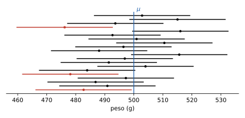
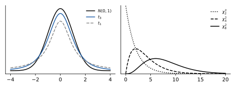

# 4 · Inferenza: stima, intervalli e test

**In questo modulo.** Servono le leggi notevoli, la normale con quantili e valori critici, la legge dei grandi numeri e il teorema del limite centrale del modulo 3. Fin qui la legge delle variabili era nota e se ne calcolavano le probabilità; nell'inferenza si fa il percorso inverso: da un campione di dati si ricavano informazioni sui parametri ignoti della popolazione. Si definiscono stimatori corretti e consistenti, si costruiscono intervalli di confidenza per la media (con varianza nota e ignota), per la varianza, per una proporzione e per la differenza di due medie, e si sceglie la numerosità del campione. Si introducono le leggi chi-quadro e t di Student. Le ultime sezioni trattano i test di ipotesi (errori, livello di significatività, p-value, potenza), i test per medie, varianze e tabelle di contingenza, e l'analisi della varianza a una via.

## 4.1 Campioni, stime e stimatori

Una variabile aleatoria $X$ descrive una grandezza in una **popolazione** (il peso dei pesci di un allevamento, l'esito del lancio di una moneta). La sua legge dipende da un **parametro** $\theta$ ignoto, per esempio $p$ se $X \sim B(p)$, oppure in generale $\theta = \mathbb{E}[X]$.

> [!definizione] Campione, stima, stimatore
> Un **campione** di dimensione $n$ è una famiglia $X_1, \dots, X_n$ di variabili aleatorie indipendenti e con la stessa legge di $X$. I numeri $x_1, \dots, x_n$ effettivamente osservati sono una **realizzazione** del campione. Una funzione $T$ dei dati dà la **stima** $T(x_1, \dots, x_n)$ del parametro, un numero; la stessa funzione applicata al campione dà lo **stimatore** $\hat\theta = T(X_1, \dots, X_n)$, una variabile aleatoria.

Per esempio, $n$ lanci della stessa moneta sono un campione di $X \sim B(p)$; una realizzazione è una sequenza di 0 e 1 come $(1, 0, 1, \dots, 0)$; la frequenza relativa delle teste $\frac{x_1 + \dots + x_n}{n}$ è una stima di $p$, e $\hat p = \frac{X_1 + \dots + X_n}{n}$ è lo stimatore corrispondente. La distinzione è essenziale: la stima cambia da un campione all'altro, e le proprietà di uno stimatore descrivono come si comporta "in media" su tutti i campioni possibili.

> [!definizione] Stimatore corretto e consistente
> Una successione di stimatori $\hat\theta_n = T_n(X_1, \dots, X_n)$ è
>
> - **corretta** (non distorta) se $\mathbb{E}[\hat\theta_n] = \theta$ per ogni $n$; la differenza $\mathbb{E}[\hat\theta_n] - \theta$ si chiama **distorsione**;
> - **consistente** (in media quadratica) se l'**errore quadratico medio** tende a zero: $\lim_{n \to \infty} \mathbb{E}\big[(\hat\theta_n - \theta)^2\big] = 0$.

L'errore quadratico medio si scompone in varianza più quadrato della distorsione:
$$\mathbb{E}\big[(\hat\theta - \theta)^2\big] = \mathrm{Var}[\hat\theta] + \big(\mathbb{E}[\hat\theta] - \theta\big)^2.$$
Per uno stimatore corretto è la sola varianza, quindi uno stimatore corretto è consistente se $\mathrm{Var}[\hat\theta_n] \to 0$.

> [!aggiunta] Aggiunta in revisione · fonte: Ross, *Introduzione alla statistica* (STA-12)
> Fra due stimatori corretti dello stesso parametro è più **efficiente** quello con varianza minore: a parità di campione, le sue stime si disperdono meno attorno al valore vero. Per esempio, per la media di una popolazione sia $X_1$ (la prima osservazione) sia $\bar X$ sono corretti, ma $\mathrm{Var}[\bar X] = \frac{\sigma^2}{n}$ è $n$ volte più piccola di $\mathrm{Var}[X_1] = \sigma^2$.

Gli stimatori più usati sono la **media campionaria** e la **varianza campionaria**:
$$\bar X = \frac{1}{n}\sum_{i=1}^n X_i, \qquad S^2 = \frac{1}{n - 1}\sum_{i=1}^n (X_i - \bar X)^2.$$

> [!teorema] Proprietà di media e varianza campionaria
> Se $\mu = \mathbb{E}[X]$ e $\sigma^2 = \mathrm{Var}[X]$: $\bar X$ è uno stimatore corretto e consistente di $\mu$, e $S^2$ è uno stimatore corretto di $\sigma^2$.

*Dimostrazione.* Per la linearità $\mathbb{E}[\bar X] = \frac1n \cdot n\mu = \mu$, e per l'indipendenza $\mathrm{Var}[\bar X] = \frac{1}{n^2} \cdot n\sigma^2 = \frac{\sigma^2}{n} \to 0$. Per $S^2$, si osserva che $X_i - \bar X$ ha speranza nulla, quindi $\mathbb{E}[(X_i - \bar X)^2] = \mathrm{Var}[X_i - \bar X]$. Scrivendo $X_i - \bar X = \left(1 - \frac1n\right)X_i - \frac1n\sum_{j \neq i} X_j$, somma di variabili indipendenti,
$$\mathrm{Var}[X_i - \bar X] = \left(1 - \frac1n\right)^2\sigma^2 + \frac{n-1}{n^2}\sigma^2 = \frac{(n-1)^2 + (n-1)}{n^2}\sigma^2 = \frac{n-1}{n}\sigma^2.$$
Sommando sugli $n$ indici e dividendo per $n - 1$ si ottiene $\mathbb{E}[S^2] = \sigma^2$. $\square$

Con $\frac{1}{n}$ al posto di $\frac{1}{n-1}$ lo stimatore sarebbe distorto: sottostimerebbe la varianza di un fattore $\frac{n-1}{n}$. È il motivo del denominatore $n - 1$ già incontrato nel modulo 1.

## 4.2 Intervallo di confidenza per la media con varianza nota

Una stima puntuale non dice quanto ci si può fidare. Un **intervallo di confidenza** è un intervallo calcolato dai dati che contiene il parametro con una probabilità fissata in anticipo.

Si supponga $X \sim N(\mu, \sigma^2)$ con $\mu$ ignoto e $\sigma^2$ noto. Allora $\bar X \sim N\left(\mu, \frac{\sigma^2}{n}\right)$ e, standardizzando, $\frac{\bar X - \mu}{\sigma/\sqrt n} \sim N(0, 1)$. Fissato $\alpha \in (0, 1)$,
$$P\left[\left\lvert \frac{\bar X - \mu}{\sigma/\sqrt n}\right\rvert \le z_{\alpha/2}\right] = 1 - \alpha,$$
e risolvendo la disuguaglianza rispetto a $\mu$: con probabilità $1 - \alpha$,
$$\bar X - \frac{\sigma}{\sqrt n} z_{\alpha/2} \le \mu \le \bar X + \frac{\sigma}{\sqrt n} z_{\alpha/2}.$$

> [!definizione] Intervallo di confidenza per la media (varianza nota)
> Data una realizzazione con media $\bar x$, l'intervallo
> $$\left[\bar x - \delta,\ \bar x + \delta\right], \qquad \delta = z_{\alpha/2}\frac{\sigma}{\sqrt n},$$
> è l'**intervallo di confidenza** bilatero per $\mu$ al **livello di confidenza** $1 - \alpha$.

> [!attenzione] Che cosa vuol dire "al 95%"
> Una volta calcolato sui dati, l'intervallo è fisso, e $\mu$ è un numero: o ci sta dentro o no. Non si può dire che "$\mu$ sta nell'intervallo con probabilità 95%". Il 95% si riferisce alla procedura: se si ripetesse l'esperimento con molti campioni, circa il 95% degli intervalli così costruiti conterrebbe $\mu$ (figura 4.1). Per questo si parla di confidenza e non di probabilità.

Se $X$ non è normale ma $n$ è grande, per il teorema del limite centrale $\bar X$ è approssimativamente $N(\mu, \sigma^2/n)$ e lo stesso intervallo ha livello approssimativamente $1 - \alpha$. Senza alcuna ipotesi sulla legge e per ogni $n$, la disuguaglianza di Chebyshev dà invece l'intervallo $\bar x \pm \frac{1}{\sqrt\alpha}\frac{\sigma}{\sqrt n}$, con livello almeno $1 - \alpha$, molto più largo:

| $1 - \alpha$ | 75% | 90% | 95% | 99% |
|---|---|---|---|---|
| $\frac{1}{\sqrt\alpha}$ (Chebyshev) | 2 | 3,16 | 4,47 | 10 |
| $z_{\alpha/2}$ (normale) | 1,15 | 1,645 | 1,96 | 2,576 |

> [!esempio] Il peso dei pesci
> In un allevamento il peso dei pesci è normale con media ignota e deviazione standard $\sigma = 100$ g. Un campione di 100 pesci ha peso medio 500 g.
>
> - Al 90%: $\alpha = 0{,}1$, $z_{0,05} = 1{,}645$, $\delta = 1{,}645 \cdot \frac{100}{10} = 16{,}45$, quindi $484 \le \mu \le 516$ g.
> - Al 99%: $z_{0,005} = 2{,}576$, $\delta = 25{,}76$, quindi $474 \le \mu \le 526$ g. Più confidenza costa un intervallo più largo.
> - Quanto deve essere grande il campione perché l'intervallo al 99% sia largo come quello al 90% con 100 pesci? Deve essere $\frac{2{,}576}{\sqrt{n'}} = \frac{1{,}645}{\sqrt{100}}$, cioè $n' = \left(\frac{2{,}576}{1{,}645}\right)^2 \cdot 100 \approx 245{,}2$: servono 246 pesci.

## 4.3 Leggi chi-quadro e t di Student

Quando la varianza non è nota la si stima con $S^2$, e servono le leggi delle quantità che ne risultano.

> [!definizione] Leggi chi-quadro e t di Student
> Siano $Z_1, \dots, Z_n$, $Z$ normali standard indipendenti.
>
> - La legge di $W_n = Z_1^2 + \dots + Z_n^2$ è la **chi-quadro con $n$ gradi di libertà**, $\chi^2_n$. Ha valori positivi, $\mathbb{E}[W_n] = n$, $\mathrm{Var}[W_n] = 2n$, ed è asimmetrica (con moda in $\max\{n - 2, 0\}$).
> - Se $W_n \sim \chi^2_n$ è indipendente da $Z$, la legge di $T_n = \dfrac{Z}{\sqrt{W_n / n}}$ è la **t di Student con $n$ gradi di libertà**, $t_n$. È simmetrica, con $\mathbb{E}[T_n] = 0$ per $n \ge 2$ e $\mathrm{Var}[T_n] = \frac{n}{n-2}$ per $n \ge 3$.

La t di Student somiglia alla normale standard ma ha code più spesse, perché al denominatore c'è una quantità aleatoria; al crescere di $n$ si avvicina alla normale, e per $n$ grande $t_{\alpha, n} \approx z_\alpha$ (figura 4.2). Per $n$ grande anche la chi-quadro è quasi normale, $N(n, 2n)$, per il teorema del limite centrale.

I **valori critici** si definiscono come per la normale, con la coda destra: $P[T_n > t_{\alpha, n}] = \alpha$ e $P[W_n > \chi^2_{\alpha, n}] = \alpha$, e si leggono sulle tavole. Per simmetria $P[-t_{\alpha/2, n} \le T_n \le t_{\alpha/2, n}] = 1 - \alpha$; per la chi-quadro, che non è simmetrica, servono due valori: $P[\chi^2_{1-\alpha/2, n} \le W_n \le \chi^2_{\alpha/2, n}] = 1 - \alpha$.

> [!teorema] Campioni normali
> Se $X_1, \dots, X_n$ è un campione di $N(\mu, \sigma^2)$, allora
>
> 1. $\dfrac{\bar X - \mu}{S/\sqrt n} \sim t_{n-1}$;
> 2. $\dfrac{(n - 1)S^2}{\sigma^2} \sim \chi^2_{n-1}$;
> 3. $\bar X$ e $S^2$ sono indipendenti.

Si perde un grado di libertà perché gli scarti $X_i - \bar X$ hanno somma nulla. Dal teorema, come nel paragrafo 4.2, si ricavano gli intervalli.

> [!definizione] Intervalli per media e varianza di una popolazione normale
> Con $\bar x$ e $s^2$ calcolate sui dati, al livello $1 - \alpha$:
> $$\bar x - t_{\alpha/2, n-1}\frac{s}{\sqrt n} \le \mu \le \bar x + t_{\alpha/2, n-1}\frac{s}{\sqrt n}, \qquad \frac{(n-1)s^2}{\chi^2_{\alpha/2, n-1}} \le \sigma^2 \le \frac{(n-1)s^2}{\chi^2_{1-\alpha/2, n-1}}.$$

L'intervallo per $\sigma^2$ non è simmetrico attorno a $s^2$. Per $n$ grande $t_{\alpha/2, n-1} \approx z_{\alpha/2}$ e l'intervallo per la media è quasi quello con varianza nota, con $s$ al posto di $\sigma$.

> [!esempio] Pezzi venduti in un'ora
> Il numero di pezzi venduti in una certa ora del giorno è normale. In 9 giorni si osservano media $\bar x = 200$ e deviazione standard campionaria $s = 13$. Intervalli al 98% ($\alpha = 0{,}02$, $\frac\alpha2 = 0{,}01$, 8 gradi di libertà):
>
> - per $\mu$: $t_{0,01; 8} = 2{,}896$, $\delta = 2{,}896 \cdot \frac{13}{3} \approx 12{,}6$, quindi $187{,}4 \le \mu \le 212{,}6$. Usando per errore la normale ($z_{0,01} = 2{,}326$) si troverebbe $\delta \approx 10$: con soli 9 dati la differenza conta;
> - per $\sigma^2$: $\chi^2_{0,99; 8} = 1{,}646$ e $\chi^2_{0,01; 8} = 20{,}090$, quindi $\frac{8 \cdot 169}{20{,}090} \le \sigma^2 \le \frac{8 \cdot 169}{1{,}646}$, cioè $67{,}3 \le \sigma^2 \le 821{,}1$ e $8{,}2 \le \sigma \le 28{,}7$. Con pochi dati la varianza è stimata male.

## 4.4 Intervalli per una proporzione e numerosità del campione

Sia $X \sim B(p)$ con $p$ ignoto (la frazione di pezzi difettosi, di elettori di un partito) e $\hat p = \frac{X_1 + \dots + X_n}{n}$ la frequenza relativa dei successi. Per il teorema del limite centrale $\hat p \approx N\left(p, \frac{p(1-p)}{n}\right)$, ma la varianza dipende da $p$, che è ignoto. Ci sono due modi di aggirare il problema:

> [!definizione] Intervalli per una proporzione
> Al livello approssimato $1 - \alpha$:
> $$J_1 = \left[\hat p - \delta_1,\ \hat p + \delta_1\right], \quad \delta_1 = \frac{z_{\alpha/2}}{2\sqrt n}; \qquad J_2 = \left[\hat p - \delta_2,\ \hat p + \delta_2\right], \quad \delta_2 = z_{\alpha/2}\frac{\sqrt{\hat p(1 - \hat p)}}{\sqrt n}.$$

$J_1$ usa la maggiorazione $p(1 - p) \le \frac14$, quindi è prudente (più largo); $J_2$ sostituisce $p$ con la stima $\hat p$.

> [!esempio] Una moneta sospetta
> Una moneta lanciata 100 volte dà 60 teste: $\hat p = 0{,}6$ e $\sqrt{\hat p(1 - \hat p)} \approx 0{,}490$.
>
> - Al 90% ($\alpha = 0{,}1$, $z_{0,05} = 1{,}645$): $\delta_2 \approx 0{,}081$, $J_2 = [0{,}519;\ 0{,}681]$; $\delta_1 \approx 0{,}082$, $J_1 = [0{,}518;\ 0{,}682]$.
> - Al 99% ($z_{0,005} = 2{,}576$): $\delta_2 \approx 0{,}126$, $J_2 = [0{,}474;\ 0{,}726]$; $\delta_1 \approx 0{,}129$, $J_1 = [0{,}471;\ 0{,}729]$.
>
> Al 90% l'intervallo esclude $\frac12$, al 99% no: i dati sono un indizio, non una prova, che la moneta sia truccata. Se le teste fossero 90, al 99% si avrebbe $J_2 = [0{,}823;\ 0{,}977]$ e $J_1 = [0{,}771;\ 1{,}029]$: quando $\hat p$ è vicino a 0 o a 1, $J_1$ è troppo prudente ed esce perfino da $[0, 1]$.

**Numerosità del campione.** Spesso si fissa in anticipo la precisione voluta: si vuole che la stima differisca dal valore vero meno di $\varepsilon$ con probabilità almeno $1 - \alpha$. Basta che sia $\delta = z_{\alpha/2}\frac{\sigma}{\sqrt n} \le \varepsilon$, cioè
$$n \ge \frac{z_{\alpha/2}^2\, \sigma^2}{\varepsilon^2},$$
da arrotondare all'intero superiore. Per una proporzione, se non si sa nulla di $p$, si usa $\sigma^2 = \frac14$. Con Chebyshev, invece, $n \ge \frac{\sigma^2}{\alpha\varepsilon^2}$.

> [!esempio] Quanti lanci?
> Quanti lanci di una moneta equilibrata servono perché la frequenza relativa delle teste differisca da $\frac12$ meno di $\frac{1}{100}$ con probabilità almeno del 90%? Con Chebyshev, $n \ge \frac{1/4}{0{,}1 \cdot 10^{-4}} = 25\,000$. Con il teorema del limite centrale, $n \ge \frac{1{,}645^2 \cdot \frac14}{10^{-4}} \approx 6765$.

## 4.5 Differenza di due medie

> [!aggiunta] Aggiunta in revisione · fonte: Ross, *Introduzione alla statistica*; Devore, *Probability and Statistics for Engineering and the Sciences* (STA-13)
> Spesso si confrontano due popolazioni (due macchine, due terapie, due classi) con medie $\mu_1$ e $\mu_2$, e interessa $\mu_1 - \mu_2$.
>
> **Campioni indipendenti, varianze note o campioni grandi.** Con campioni di dimensioni $n_1$, $n_2$ e medie $\bar x_1$, $\bar x_2$, la differenza $\bar X_1 - \bar X_2$ è (approssimativamente) normale con varianza $\frac{\sigma_1^2}{n_1} + \frac{\sigma_2^2}{n_2}$, e l'intervallo al livello $1 - \alpha$ è
> $$\bar x_1 - \bar x_2 \pm z_{\alpha/2}\sqrt{\frac{\sigma_1^2}{n_1} + \frac{\sigma_2^2}{n_2}},$$
> dove per campioni grandi le varianze ignote si sostituiscono con $s_1^2$, $s_2^2$.
>
> **Campioni indipendenti normali, varianze ignote ma uguali.** Si stima la varianza comune con la **varianza combinata** $s_p^2 = \frac{(n_1 - 1)s_1^2 + (n_2 - 1)s_2^2}{n_1 + n_2 - 2}$, e si usa la t di Student con $n_1 + n_2 - 2$ gradi di libertà:
> $$\bar x_1 - \bar x_2 \pm t_{\alpha/2,\, n_1 + n_2 - 2}\; s_p\sqrt{\frac{1}{n_1} + \frac{1}{n_2}}.$$
>
> **Campioni appaiati.** Se i dati sono coppie misurate sulla stessa unità (prima e dopo un trattamento, due strumenti sullo stesso pezzo), non sono indipendenti. Si calcolano le differenze $d_i = x_i - y_i$ e si tratta $d_1, \dots, d_n$ come un solo campione: l'intervallo per $\mu_1 - \mu_2$ è $\bar d \pm t_{\alpha/2, n-1}\frac{s_d}{\sqrt n}$.
>
> *Esempio.* Due linee producono pezzi; su 40 pezzi della prima la media di una misura è 52 (con $\sigma_1^2 = 36$), su 50 della seconda è 48 ($\sigma_2^2 = 25$). L'errore standard della differenza è $\sqrt{\frac{36}{40} + \frac{25}{50}} = \sqrt{1{,}4} \approx 1{,}18$ e l'intervallo al 95% è $4 \pm 1{,}96 \cdot 1{,}18$, cioè $[1{,}7;\ 6{,}3]$: non contiene 0, quindi le due linee differiscono.

## 4.6 Test di ipotesi

> [!aggiunta] Aggiunta in revisione · fonte: Ross, *Introduzione alla statistica*; Newbold, Carlson, Thorne, *Statistica* (STA-14)
> Un **test di ipotesi** decide, sulla base di un campione, fra due affermazioni sul parametro: l'**ipotesi nulla** $H_0$ (per esempio $\mu = \mu_0$, "la media dichiarata è vera") e l'**ipotesi alternativa** $H_1$, bilatera ($\mu \neq \mu_0$) o unilatera ($\mu > \mu_0$ oppure $\mu < \mu_0$). Si calcola una **statistica test**, una funzione del campione di cui si conosce la legge quando $H_0$ è vera, e si rifiuta $H_0$ se il suo valore cade nella **regione di rifiuto**, cioè è troppo improbabile sotto $H_0$.
>
> Le decisioni possibili hanno due tipi di errore:
>
> | | $H_0$ vera | $H_0$ falsa |
> |---|---|---|
> | Si accetta $H_0$ | corretto | errore di II tipo (probabilità $\beta$) |
> | Si rifiuta $H_0$ | errore di I tipo (probabilità $\alpha$) | corretto (probabilità $1 - \beta$) |
>
> Il **livello di significatività** $\alpha$ è la probabilità massima di errore di I tipo che si accetta, fissata prima di guardare i dati (tipicamente 5% o 1%). La **potenza** $1 - \beta$ è la probabilità di rifiutare $H_0$ quando è falsa, e dipende dal vero valore del parametro: cresce quando questo si allontana da $\mu_0$ e quando cresce $n$. Le due ipotesi non sono simmetriche: si rifiuta $H_0$ solo con evidenza forte, e "accettare" $H_0$ vuol dire solo che i dati non bastano a rifiutarla.
>
> Il **p-value** è la probabilità, calcolata sotto $H_0$, di osservare un valore della statistica almeno altrettanto estremo di quello osservato. Si rifiuta $H_0$ al livello $\alpha$ se e solo se il p-value è minore di $\alpha$; il p-value dice quindi, in un solo numero, per quali livelli i dati portano a rifiutare.
>
> **Test sulla media, varianza nota.** Per $H_0: \mu = \mu_0$ la statistica è $Z = \frac{\bar X - \mu_0}{\sigma/\sqrt n}$, normale standard sotto $H_0$. Al livello $\alpha$ si rifiuta se $\lvert z\rvert > z_{\alpha/2}$ (alternativa bilatera), se $z > z_\alpha$ (alternativa $\mu > \mu_0$), se $z < -z_\alpha$ (alternativa $\mu < \mu_0$). Il test bilatero al livello $\alpha$ rifiuta esattamente quando $\mu_0$ non sta nell'intervallo di confidenza al livello $1 - \alpha$.
>
> *Esempio (potenza).* Per i pesci del paragrafo 4.2 ($\sigma = 100$, $n = 100$) si sottopone a test $H_0: \mu = 500$ contro $H_1: \mu > 500$ al 5%. Si rifiuta se $\bar x > 500 + 1{,}645 \cdot 10 = 516{,}45$. Se in realtà $\mu = 520$, la probabilità di rifiutare è $P\left[Z > \frac{516{,}45 - 520}{10}\right] = \Phi(0{,}355) \approx 64\%$: con questo campione una differenza di 20 g sfugge in più di un caso su tre.

## 4.7 Test per medie, proporzioni, varianze e tabelle

> [!aggiunta] Aggiunta in revisione · fonte: Ross, *Introduzione alla statistica*; Devore, *Probability and Statistics for Engineering and the Sciences* (STA-15)
> Tutti i test seguono lo schema del paragrafo 4.6; cambiano la statistica e la sua legge sotto $H_0$.
>
> | Ipotesi nulla | Statistica | Legge sotto $H_0$ |
> |---|---|---|
> | $\mu = \mu_0$, varianza ignota, popolazione normale | $T = \dfrac{\bar X - \mu_0}{S/\sqrt n}$ | $t_{n-1}$ |
> | $p = p_0$, $n$ grande | $Z = \dfrac{\hat p - p_0}{\sqrt{p_0(1 - p_0)/n}}$ | circa $N(0, 1)$ |
> | $\sigma^2 = \sigma_0^2$, popolazione normale | $W = \dfrac{(n-1)S^2}{\sigma_0^2}$ | $\chi^2_{n-1}$ |
> | $\mu_1 = \mu_2$, campioni indipendenti | $\dfrac{\bar X_1 - \bar X_2}{\sqrt{\sigma_1^2/n_1 + \sigma_2^2/n_2}}$ oppure con $s_p$ | $N(0, 1)$ oppure $t_{n_1 + n_2 - 2}$ |
> | $\mu_1 = \mu_2$, campioni appaiati | $\dfrac{\bar D}{S_D/\sqrt n}$ | $t_{n-1}$ |
>
> *Esempio (media, varianza ignota).* Per le ore di straordinario dell'esercizio 1 in fondo al modulo ($n = 81$, $\bar x = 24$, $s = 6$), l'azienda dichiara una media di 25,5 ore. Con $H_0: \mu = 25{,}5$ contro $\mu \neq 25{,}5$: $t = \frac{24 - 25{,}5}{6/9} = -2{,}25$. Al 5% il valore critico è $t_{0,025; 80} = 1{,}990$ e si rifiuta $H_0$; all'1% è $t_{0,005; 80} = 2{,}639$ e non si rifiuta. Il p-value è circa 2,7%.
>
> *Esempio (proporzione).* Per la moneta con 60 teste su 100, $H_0: p = \frac12$: $z = \frac{0{,}6 - 0{,}5}{0{,}5/10} = 2$, con p-value $2\Phi(-2) \approx 4{,}6\%$. Si rifiuta al 5%, non all'1%, in accordo con gli intervalli del paragrafo 4.4.
>
> *Esempio (varianza).* Per i pezzi venduti del paragrafo 4.3 ($n = 9$, $s^2 = 169$), $H_0: \sigma^2 = 100$ contro $\sigma^2 > 100$: $w = \frac{8 \cdot 169}{100} = 13{,}52$, minore di $\chi^2_{0,05; 8} = 15{,}507$. Al 5% non si rifiuta.
>
> **Test chi-quadro di indipendenza.** Per una tabella a due vie con $m$ righe e $k$ colonne si sottopone a test $H_0$: "le due variabili sono indipendenti". Sotto $H_0$ la frequenza attesa della casella $(i, j)$ è $e_{ij} = \frac{n_{i\cdot}\, n_{\cdot j}}{n}$, e la statistica
> $$\chi^2 = \sum_{i,j} \frac{(n_{ij} - e_{ij})^2}{e_{ij}}$$
> ha approssimativamente legge $\chi^2_{(m-1)(k-1)}$ se tutte le $e_{ij}$ sono almeno 5. Si rifiuta per valori grandi. Per la tabella genere × colore degli occhi del modulo 1 le frequenze attese sono 3,6, 5,6, 10,8 per le donne e 5,4, 8,4, 16,2 per gli uomini, e $\chi^2 \approx 4{,}85$ con 2 gradi di libertà: minore di $\chi^2_{0,05; 2} = 5{,}991$, quindi al 5% non si rifiuta l'indipendenza (p-value circa 9%). Una frequenza attesa è sotto 5, e l'approssimazione va presa con cautela.

## 4.8 Analisi della varianza a una via

> [!aggiunta] Aggiunta in revisione · fonte: Ross, *Introduzione alla statistica*; Devore, *Probability and Statistics for Engineering and the Sciences* (STA-16)
> L'**ANOVA** (*analysis of variance*) confronta le medie di $k \ge 2$ gruppi in un solo test, con $H_0: \mu_1 = \dots = \mu_k$ contro "almeno due medie sono diverse". Si suppone che in ogni gruppo i dati siano normali con la stessa varianza $\sigma^2$, e che i gruppi siano indipendenti. Siano $n_i$ e $\bar x_i$ la numerosità e la media del gruppo $i$, $N = n_1 + \dots + n_k$ e $\bar x$ la media generale. La variabilità totale si scompone in quella **fra i gruppi** e quella **entro i gruppi**:
> $$\underbrace{\sum_{i,j} (x_{ij} - \bar x)^2}_{SS_T} = \underbrace{\sum_i n_i(\bar x_i - \bar x)^2}_{SS_B} + \underbrace{\sum_{i,j}(x_{ij} - \bar x_i)^2}_{SS_W}.$$
> Sotto $H_0$ la statistica
> $$F = \frac{SS_B/(k - 1)}{SS_W/(N - k)}$$
> ha legge **F di Fisher** con $(k - 1, N - k)$ gradi di libertà, e si rifiuta $H_0$ se $F > F_{\alpha;\, k-1,\, N-k}$ (dalle tavole di Fisher). L'idea: se le medie sono uguali, la dispersione fra le medie dei gruppi deve essere confrontabile con quella dentro i gruppi; se è molto più grande, le medie differiscono.
>
> *Esempio.* Tre gruppi di tre misure: (20, 22, 24), (25, 27, 26), (21, 23, 22), con medie 22, 26, 22 e media generale $\frac{70}{3}$. Si trova $SS_B = 32$ e $SS_W = 8 + 2 + 2 = 12$, quindi $F = \frac{32/2}{12/6} = 8$, maggiore di $F_{0,05; 2, 6} = 5{,}14$: al 5% le medie non sono tutte uguali. Con due soli gruppi l'ANOVA equivale al test t con varianza combinata.

## Esempi ed esercizi svolti

**Esercizio 1 (ore di straordinario).** Le ore mensili di straordinario dei dipendenti di un'azienda sono normali. In un campione di 81 dipendenti si trovano $\bar x = 24$ e $s = 6$. Intervalli al 99% ($\alpha = 0{,}01$, 80 gradi di libertà). Per la media: $t_{0,005; 80} = 2{,}639$, $\varepsilon = 2{,}639 \cdot \frac{6}{9} \approx 1{,}759$, quindi $22{,}24 \le \mu \le 25{,}76$; con la normale, $z_{0,005} = 2{,}576$ e $22{,}28 \le \mu \le 25{,}72$, quasi uguale perché $n$ è grande. Per la varianza: $\chi^2_{0,995; 80} = 51{,}172$ e $\chi^2_{0,005; 80} = 116{,}321$, quindi
$$\frac{80 \cdot 36}{116{,}321} \le \sigma^2 \le \frac{80 \cdot 36}{51{,}172}, \qquad 24{,}76 \le \sigma^2 \le 56{,}28, \qquad 4{,}98 \le \sigma \le 7{,}50.$$

**Esercizio 2 (scegliere l'intervallo giusto).** Lo schema degli intervalli al livello $1 - \alpha$:

| Situazione | Stimatore | Intervallo |
|---|---|---|
| Proporzione, $X \sim B(p)$, $n$ grande | $\hat p$ | $\hat p \pm z_{\alpha/2}\frac{\sqrt{\hat p(1-\hat p)}}{\sqrt n}$ |
| Media, varianza nota $\sigma_0^2$ (normale, o $n$ grande) | $\bar x$ | $\bar x \pm z_{\alpha/2}\frac{\sigma_0}{\sqrt n}$ |
| Media, varianza ignota, popolazione normale | $\bar x$, $s^2$ | $\bar x \pm t_{\alpha/2, n-1}\frac{s}{\sqrt n}$ |
| Varianza, popolazione normale | $s^2$ | $\left[\frac{(n-1)s^2}{\chi^2_{\alpha/2, n-1}},\ \frac{(n-1)s^2}{\chi^2_{1-\alpha/2, n-1}}\right]$ |

Per un campione grande di una popolazione qualsiasi con varianza ignota si usa la seconda riga con $s$ al posto di $\sigma_0$.

## Riepilogo

Un campione è una famiglia di variabili i.i.d. con la legge della popolazione; uno stimatore è una funzione del campione, corretto se ha speranza uguale al parametro, consistente se l'errore quadratico medio (varianza più distorsione al quadrato) tende a zero, più efficiente di un altro se ha varianza minore. La media campionaria e la varianza campionaria con $n - 1$ sono stimatori corretti di $\mu$ e $\sigma^2$. Un intervallo di confidenza al livello $1 - \alpha$ è costruito in modo che la procedura contenga il parametro nella frazione $1 - \alpha$ dei campioni: per la media con varianza nota è $\bar x \pm z_{\alpha/2}\sigma/\sqrt n$ (esatto per popolazioni normali, approssimato per $n$ grande), con varianza ignota $\bar x \pm t_{\alpha/2, n-1}s/\sqrt n$, per la varianza si usano due valori critici della chi-quadro, per una proporzione $\hat p \pm z_{\alpha/2}\sqrt{\hat p(1-\hat p)/n}$ o la versione prudente con $\frac{1}{2\sqrt n}$. La numerosità per una precisione $\varepsilon$ è $n \ge z_{\alpha/2}^2\sigma^2/\varepsilon^2$. Per due medie si usano le differenze, con la varianza combinata o con i dati appaiati. Un test di ipotesi rifiuta $H_0$ quando la statistica test cade nella regione di rifiuto, con probabilità di errore di I tipo $\alpha$; la potenza è la probabilità di rifiutare quando $H_0$ è falsa, e il p-value è il più piccolo livello a cui i dati portano a rifiutare. Gli stessi schemi danno i test per media, proporzione, varianza, differenza di medie, il test chi-quadro di indipendenza per le tabelle a due vie e l'ANOVA a una via, che confronta più medie con la statistica F.
