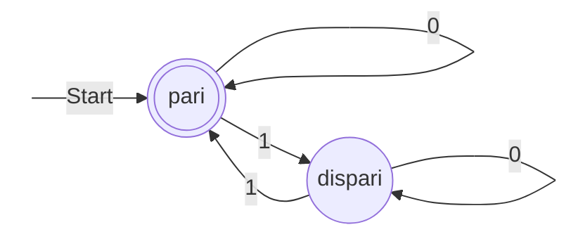
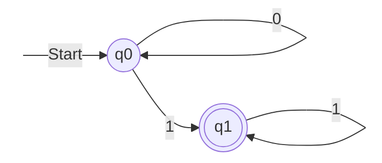
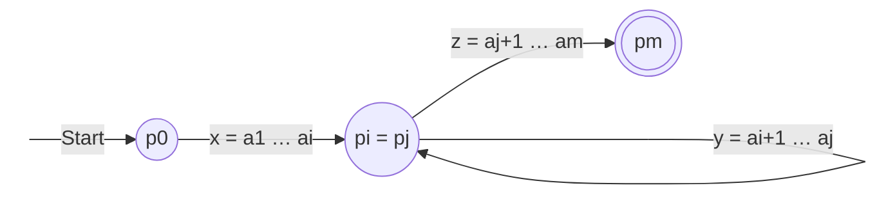
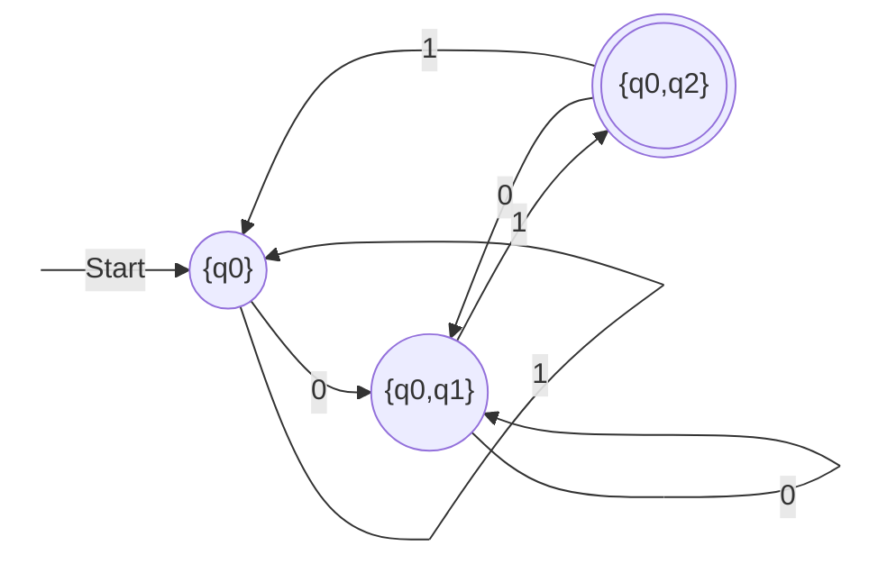
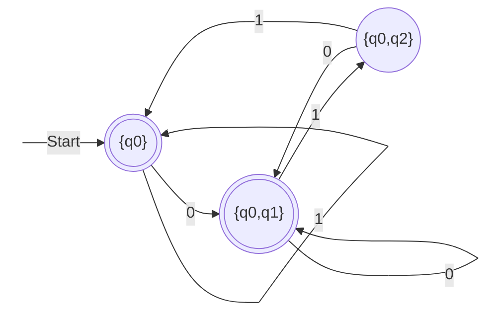
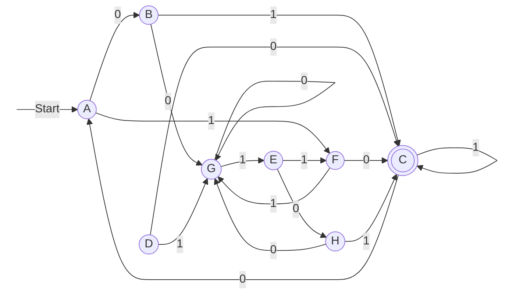
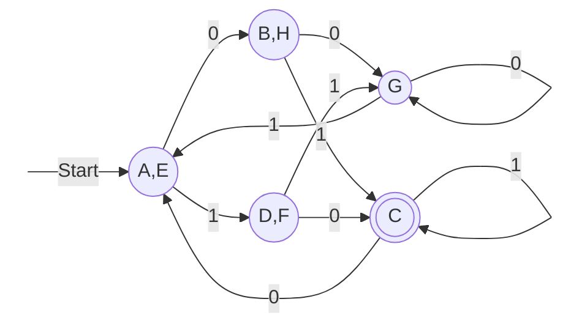

# Lezione 10 — Pumping lemma, proprietà di chiusura e minimizzazione

La lezione chiude il pacchetto di slide *Linguaggi regolari* (slide 55–90). Si apre con le «cattive notizie»: un teorema, il **pumping lemma**, che permette di dimostrare che certi linguaggi, anche molto semplici, **non sono regolari**, e che quindi gli automi a stati finiti non bastano come definizione di algoritmo. Seguono le «buone notizie»: i linguaggi regolari sono una classe molto robusta, **chiusa** rispetto a molte operazioni (unione, concatenazione, chiusura, complemento, intersezione, differenza, inversione). L'ultima parte introduce l'**equivalenza tra stati** di un DFA e l'algoritmo **table-filling**, con cui si decide se due linguaggi regolari coincidono e si **minimizza** un automa.

> [!warning] Data della lezione
> L'intestazione della trascrizione riporta il 31 ottobre 2026, un sabato, verosimilmente la data di caricamento. La lezione di C++ della [[Lezione 09 - Mappe, oggetti funzione ed eccezioni|lezione 9]] è datata 29 ottobre; in questa lezione il docente parla dell'esercizio lasciato «ieri alla pratica», saluta con «buon weekend» e annuncia che dalla settimana successiva si tornerà al calendario abituale (C++ il mercoledì, teoria il giovedì). La data indicata qui, venerdì 30 ottobre, è quindi ricostruita.

## Dove eravamo rimasti

Il docente riassume il percorso. Si sono visti tre tipi di automi a stati finiti: deterministici, non deterministici ed ε-NFA. Il non determinismo non aumenta la potenza: ogni NFA e ogni ε-NFA si riconduce a un DFA, al prezzo, nel caso pessimo, di un'esplosione esponenziale del numero degli stati, che però in molti casi di interesse pratico non si verifica. Gli automi sono l'algoritmo che risolve il word problem dei linguaggi regolari, ma non sono una descrizione esplicita del linguaggio: lo descrivono solo implicitamente, riconoscendone le stringhe. Per descrivere un linguaggio regolare servono le espressioni regolari. Da un'espressione regolare si ottiene un automa passando per un ε-NFA, poi determinizzato, e l'automa si può anche simulare direttamente senza costi eccessivi; da un automa si ottiene l'espressione con l'eliminazione degli stati ([[Lezione 08 - Dalle espressioni regolari agli automi e ritorno|lezione 8]]).

Questo schema si ripeterà per le classi di linguaggi più potenti: i linguaggi liberi dal contesto con gli automi a pila (*push-down*), e poi le macchine di Turing. L'automa è l'algoritmo che risolve il word problem, la grammatica è la descrizione del linguaggio, e si cerca sempre la corrispondenza tra le due.

## Le cattive notizie: linguaggi non regolari

### Il limite degli automi a stati finiti

Non tutti i linguaggi descrivibili con una grammatica sono regolari: lo sono solo quelli descrivibili con le grammatiche regolari, che, come si vedrà, sono molto limitate. Ci sono quindi linguaggi, cioè problemi, che gli automi a stati finiti non possono riconoscere, e questo porterà alla classe successiva di automi e linguaggi. Un automa a stati finiti può riconoscere un **token**, come nell'esercizio della lezione precedente: le parole chiave, gli identificatori, i numeri interi (niente punto) e in virgola mobile (un solo punto decimale), gli identificatori del C++ con le loro regole. Non può invece stabilire se la **sintassi** di un intero programma C++ è corretta: il linguaggio dei programmi sintatticamente corretti non è regolare. Lo si potrà fare con un automa a pila.

Il docente insiste su che cosa significhi qui «potenza»: è la capacità di esprimere linguaggi e di risolvere il relativo word problem. Non ha niente a che fare con la velocità di calcolo o con i megabyte e i terabyte di memoria: si è ancora a un livello puramente qualitativo.

### L'intuizione: gli automi non sanno contare

L'esempio è il linguaggio
$$
L_{01} = \{0^n 1^n : n \geq 1\},
$$
le stringhe binarie formate da una sequenza di zeri seguita da una sequenza di uni, con tanti zeri quanti uni: $0011$ e $000111$ vanno bene, $001$ no. È un linguaggio «banalotto», eppure sfugge agli automi a stati finiti.

Prima della dimostrazione, il docente fa appello all'intuizione. Con le espressioni regolari si hanno tre costrutti: concatenazione, unione e ripetizione. Per $0^n1^n$ serve la concatenazione, un prefisso di zeri seguito da un suffisso di uni. Ma passando dagli zeri agli uni bisogna **ricordarsi quanti zeri c'erano**, e come fa un automa a ricordare un $n$ arbitrario? L'unico modo che ha per accettare una sequenza di zeri di lunghezza qualsiasi è un **ciclo**: legge uno zero e torna nello stesso stato, e così accetta uno, due, tre zeri, quanti se ne vuole. Poi arriva un 1 e comincia ad accettare uni, ma quanti? Tutti quelli che arrivano: non c'è modo di mettere in relazione quante volte si è girato sul ciclo degli zeri e quante su quello degli uni. In alternativa si può usare uno stato diverso per ogni zero letto e poi fare altrettanti passi con gli uni: così si riconosce $000111$, ma non $0011$, né le stringhe più lunghe. Mettendosi lì «tipo Lego» a cercare i pezzi per costruire la macchina, i pezzi non ci sono.

In altre parole, gli automi a stati finiti **contano solo fino a un limite finito**. Possono, per esempio, controllare una **parità**: un automa con due stati riconosce le stringhe con un numero pari di 1. Lo stato iniziale è anche finale (zero uni letti è un numero pari); con uno 0 si resta dove si è, con un 1 si passa all'altro stato. È lo stesso principio dell'automa per la parità di zeri e uni visto nella [[Lezione 04 - Tecniche deduttive e automi a stati finiti|lezione 4]].



Il ciclo tra i due stati «conta» modulo 2. Se invece si prova con $0^n1^n$, il tentativo più naturale è un automa che gira su 0 nello stato iniziale, passa con un 1 a uno stato finale e ci resta leggendo altri 1:



Ma questo automa riconosce $0^*1^+$: tutti gli zeri che si vogliono, poi **almeno** un 1, senza alcun legame tra le due quantità.

> [!warning] L'operatore $+$ e la stringa vuota
> L'operatore $E^+$ («almeno una volta») non fa parte della definizione delle espressioni regolari data nel corso, ma è un'abbreviazione: $E^+ = EE^*$. Il docente scrive $L(E^+) = L(E^*) \setminus \{\epsilon\}$. Vale nel caso dell'esempio ($1^+$), ma non in generale: se $\epsilon \in L(E)$, allora $\epsilon \in L(E^+)$. Per esempio $L((\epsilon + 0)^+) = L(0^*)$ contiene la stringa vuota. L'identità corretta in generale è $L(E^+) = L(E)L(E)^*$.

### La dimostrazione per $L_{01}$

Ora la stessa idea in modo formale, per questo linguaggio. Si supponga per assurdo che $L_{01}$ sia regolare. Allora esiste un DFA $A = (Q, \{0, 1\}, \delta, q_0, F)$ che lo accetta, e per definizione ha un numero finito di stati: $|Q| = k$. Fissato $k$, l'automa deve accettare la stringa $0^k1^k$. Leggendo il prefisso $0^k$ attraversa $k + 1$ stati, contando quello iniziale: $\hat{\delta}(q_0, \epsilon), \hat{\delta}(q_0, 0), \dots, \hat{\delta}(q_0, 0^k)$. Ma gli stati sono solo $k$, quindi almeno uno si deve ripetere.

> [!important] Principio dei cassetti
> Se si distribuiscono $m$ oggetti in $k$ cassetti e $m > k$, almeno un cassetto contiene più di un oggetto. In inglese è il *pigeonhole principle*: se ci sono più piccioni che buche, due piccioni dividono la stessa buca. Equivalentemente, non esiste una funzione iniettiva da un insieme finito a uno di cardinalità minore.

Ne segue che esistono due prefissi $0^i$ e $0^j$, con $i \neq j$, dopo i quali l'automa si trova nello **stesso stato** $q$. Ed ecco l'assurdo. Da $q$, leggendo $1^i$, l'automa finisce in uno stato finale oppure no.

- Se $\hat{\delta}(q, 1^i) \in F$, l'automa accetta $0^j1^i$, perché anche dopo $0^j$ si trova in $q$; ma $0^j1^i \notin L_{01}$, dato che $j \neq i$.
- Se $\hat{\delta}(q, 1^i) \notin F$, l'automa rifiuta $0^i1^i$, che invece appartiene a $L_{01}$.

In entrambi i casi l'automa sbaglia, quindi $L_{01}$ non può essere regolare. È, formalizzato, il ragionamento intuitivo di prima: se c'è una ripetizione, la ripetizione deve funzionare per un numero arbitrario di zeri inseriti nella stringa, e quindi l'automa non può distinguere $0^i$ da $0^j$. L'automa a due stati di prima è un esempio concreto: accetta sequenze di zeri di lunghezze diverse finendo nello stesso stato, e dopo un 1 resta nello stato finale anche con due, tre, quattro uni.

Questa dimostrazione vale solo per $L_{01}$. Il **pumping lemma** generalizza l'idea a qualsiasi linguaggio regolare.

### Il pumping lemma

> [!important] Teorema (pumping lemma per i linguaggi regolari)
> Sia $L$ un linguaggio regolare. Allora esiste un intero $n$ tale che ogni stringa $w \in L$ con $|w| \geq n$ si può scrivere come $w = xyz$ in modo che:
> 1. $y \neq \epsilon$;
> 2. $|xy| \leq n$;
> 3. per ogni $k \geq 0$, la stringa $xy^kz$ appartiene a $L$.

Per motivi storici si chiama «lemma», ma è a tutti gli effetti un teorema. Intuitivamente, in ogni stringa abbastanza lunga del linguaggio si può sempre trovare una sottostringa $y$ non vuota, non troppo distante dall'inizio di $w$, che si può ripetere un numero qualsiasi di volte, anche zero, ottenendo ancora una stringa del linguaggio. Il nome viene da qui: la $y$ si può «pompare» (*to pump*) dentro la stringa tutte le volte che si vuole. La stringa è divisa in un **prefisso** $x$, un **corpo** $y$ e un **suffisso** $z$.

**Dimostrazione.** Sia $L$ regolare. Allora è riconosciuto da un DFA $A = (Q, \Sigma, \delta, q_0, F)$ con, diciamo, $n$ stati. Sia $w = a_1a_2\cdots a_m \in L$, con $a_i \in \Sigma$ (singoli simboli, non stringhe) e $m \geq n$: come nell'esempio, ci si mette nella situazione in cui la stringa è più lunga del numero degli stati. Sia
$$
p_i = \hat{\delta}(q_0, a_1a_2\cdots a_i)
$$
lo stato raggiunto dopo aver consumato i primi $i$ simboli; in particolare $p_0 = q_0$. Gli $n + 1$ stati $p_0, p_1, \dots, p_n$ non possono essere tutti distinti, perché gli stati distinti sono solo $n$: per il principio dei cassetti esistono $i$ e $j$ con $0 \leq i < j \leq n$ tali che $p_i = p_j$. Si scomponga allora $w = xyz$ con
$$
x = a_1 \cdots a_i, \qquad y = a_{i+1} \cdots a_j, \qquad z = a_{j+1} \cdots a_m .
$$



Leggendo $x$ l'automa va da $p_0$ a $p_i$; leggendo $y$ fa un **giro** che lo riporta in $p_i = p_j$ (nella figura è disegnato come un anello, ma in generale passa per più stati, perché $y$ ha più simboli); leggendo $z$ va da $p_j$ allo stato $p_m$, che è finale perché $w \in L$. Le condizioni dell'enunciato sono soddisfatte:

- $y \neq \epsilon$, perché $i < j$; $x$ e $z$ invece possono essere vuote (per $i = 0$ e per $j = m$);
- $|xy| = j \leq n$;
- poiché $y$ riporta l'automa nello stesso stato, il giro si può percorrere zero, una o quante volte si vuole: per ogni $k \geq 0$, da $p_0$ con $xy^kz$ si arriva comunque a $p_m$, quindi $xy^kz \in L$. $\square$

Il docente invita a pensarla sempre così: l'automa ha $n$ stati, ma le stringhe possono essere più lunghe di $n$, quindi da qualche parte uno stato si ripete, e tutto ciò che si incontra durante il giro, la $y$, si può inserire zero, una o $n$ volte. Le ipotesi del lemma servono solo a dire che si è esattamente in questa situazione. È un **limite fondamentale** dei nostri automi: se un automa rappresenta ciò che è calcolabile, e lo scopo del corso è trovare una definizione formale di calcolatore e di algoritmo, gli automi a stati finiti «falls short», come direbbero gli americani: restano corti, perché non risolvono il word problem nemmeno per linguaggi banali come $0^n1^n$. Alcune cose però le fanno, e per il primo stadio dell'interprete, il tokenizer, vanno benissimo.

### Usare il pumping lemma

Ora che si ha il pumping lemma, quando si sospetta che un linguaggio non sia regolare non serve una dimostrazione ad hoc. Il docente presenta lo schema come una sorta di algoritmo per l'esame: davanti alla domanda «dimostrare che il linguaggio è (o non è) regolare», ci si fa un'idea; se si pensa che non lo sia, si parte con questo schema.

1. Si suppone per assurdo che $L$ sia regolare, e si chiama $n$ la costante data dal pumping lemma.
2. Si sceglie una stringa $w \in L$ con $|w| \geq n$, costruita in funzione di $n$.
3. Si considera una qualsiasi scomposizione $w = xyz$ che rispetti $y \neq \epsilon$ e $|xy| \leq n$.
4. Si trova un $k \geq 0$ per cui $xy^kz \notin L$, contraddicendo il lemma.

> [!warning] Chi sceglie la scomposizione
> A voce il docente dice di prendere «opportunamente» $x$, $y$ e $z$. Il punto va interpretato con attenzione. Il lemma garantisce che **esiste** una scomposizione con le tre proprietà, ma non dice quale: per arrivare all'assurdo bisogna quindi mostrare che **ogni** scomposizione ammessa (con $y \neq \epsilon$ e $|xy| \leq n$) fallisce per qualche $k$. Si sceglie liberamente solo la stringa $w$. Le dimostrazioni delle slide rispettano questa regola, perché il vincolo $|xy| \leq n$ determina la forma di tutte le scomposizioni possibili, come si vede negli esempi.

> [!example] $L_{01}$ non è regolare
> Si supponga $L_{01}$ regolare e sia $n$ la costante del lemma. Si sceglie $w = 0^n1^n \in L_{01}$, che ha lunghezza $2n \geq n$. Per il lemma $w = xyz$ con $|xy| \leq n$, $y \neq \epsilon$ e $xy^kz \in L_{01}$ per ogni $k \geq 0$. Poiché i primi $n$ simboli di $w$ sono tutti zeri e $|xy| \leq n$, sia $x$ sia $y$ sono formate **solo da zeri**, e $y$ ne contiene almeno uno:
> $$w = \underbrace{0 \cdots 0}_{x}\,\underbrace{0 \cdots 0}_{y}\,\underbrace{0 \cdots 0\,1 \cdots 1}_{z} .$$
> Per $k = 0$ dovrebbe valere $xz \in L_{01}$, ma $xz$ ha meno zeri che uni: assurdo. Quindi $L_{01}$ non è regolare. Si è verificato al calcolatore, per $n$ da 1 a 8, che tutte le scomposizioni ammesse di $0^n1^n$ producono con $k = 0$ una stringa fuori dal linguaggio.

Il linguaggio $0^n1^n$, anticipa il docente, verrà «conquistato» subito con la classe successiva di automi, gli automi a pila. Il prossimo esempio richiederà invece molto di più: non è regolare, e come si vedrà non è nemmeno libero dal contesto; per riconoscerlo serve una macchina di Turing, perché bisogna saper fare delle divisioni.

> [!example] I numeri primi in unario non formano un linguaggio regolare
> I numeri sono rappresentati in **unario**: il numero $p$ è la sequenza di $p$ uni ($1$ è uno, $11$ è due, $111$ è tre). Sia
> $$L_{pr} = \{1^p : p \text{ è primo}\}.$$
> Si supponga $L_{pr}$ regolare e sia $n$ la costante del lemma. Si sceglie un numero primo $p \geq n + 2$ (esiste, perché i primi sono infiniti) e la stringa $w = 1^p$. Per il lemma $w = xyz$ con $y \neq \epsilon$ e $|xy| \leq n$; sia $m = |y|$. Si prende $k = p - m$: allora $xy^{p-m}z$ dovrebbe appartenere a $L_{pr}$. Ma la sua lunghezza è
> $$|xy^{p-m}z| = |xz| + (p - m)|y| = (p - m) + (p - m)m = (1 + m)(p - m),$$
> un prodotto di due fattori, che non è primo a meno che uno dei due non valga 1. Nessuno dei due vale 1:
> - $y \neq \epsilon$ implica $m \geq 1$, quindi $1 + m \geq 2$;
> - $m = |y| \leq |xy| \leq n$ e $p \geq n + 2$ implicano $p - m \geq n + 2 - n = 2$.
>
> La lunghezza non è quindi un numero primo, e $xy^{p-m}z \notin L_{pr}$: assurdo. Il calcolo è stato verificato per $n$ da 1 a 29 e per tutti i valori ammessi di $m$. La scelta $p \geq n + 2$ serve proprio a garantire $p - m \geq 2$.

> [!tip] Approfondimento — Origini e limiti del pumping lemma
> #approfondimento
> Il pumping lemma per i linguaggi regolari fu dimostrato per la prima volta da Michael Rabin e Dana Scott nel 1959, nell'articolo *Finite Automata and Their Decision Problems* [@rabin1959; @wiki-pumpinglemma]; fu riscoperto nel 1961 da Bar-Hillel, Perles e Shamir come caso particolare del loro pumping lemma per i linguaggi liberi dal contesto [@wiki-pumpinglemma], che si vedrà più avanti nel corso. Va ricordato che il lemma dà una condizione **necessaria ma non sufficiente** per la regolarità: ogni linguaggio regolare la soddisfa, ma esistono linguaggi non regolari che la soddisfano comunque [@wiki-pumpinglemma]. Il lemma serve quindi solo a dimostrare che un linguaggio **non** è regolare, mai che lo è.

## Le buone notizie: proprietà di chiusura

### L'elenco

I linguaggi regolari hanno una serie di proprietà che li rendono una classe molto **robusta**. Possono aiutare negli esercizi, perché a volte evitano di ricorrere al pumping lemma o di costruire un automa da zero.

> [!important] Proprietà di chiusura dei linguaggi regolari
> Se $M$ e $N$ sono linguaggi regolari sull'alfabeto $\Sigma$, sono regolari anche:
> 1. l'**unione** $M \cup N$;
> 2. la **concatenazione** $M.N$;
> 3. la **chiusura** $M^*$;
> 4. il **complemento** $\overline{M} = \Sigma^* \setminus M$;
> 5. l'**intersezione** $M \cap N$;
> 6. la **differenza** $M \setminus N$;
> 7. l'**inversione** $M^R = \{w^R : w \in M\}$.

Il **complemento** di $M$ è l'insieme di tutte le stringhe sull'alfabeto che non stanno in $M$. La **differenza** $M \setminus N$, che il docente scrive a volte $M - N$ e a volte con la barra rovesciata, sono gli elementi di $M$ che non stanno in $N$; in un diagramma di Venn è la parte di $M$ esterna a $N$. Alla lavagna, dopo qualche tentativo, il docente la esprime con le altre operazioni:
$$
M \setminus N = M \cap \overline{N},
$$
cioè il complemento di $N$, che contiene tutto tranne $N$, intersecato con $M$. L'**inversione** di una stringa è la stringa letta al contrario, definita ricorsivamente:
$$
\epsilon^R = \epsilon, \qquad (ax)^R = x^R a \quad \text{per } a \in \Sigma,\ x \in \Sigma^* .
$$
Per esempio $(011)^R = 110$. L'inverso di un linguaggio contiene tutte le sue stringhe rovesciate.

### Unione, concatenazione e chiusura

Queste tre proprietà si dimostrano facilmente con le espressioni regolari. Se $M$ è regolare esiste un'espressione regolare $E$ con $M = L(E)$, e se $N$ è regolare esiste $F$ con $N = L(F)$. Allora $E + F$ è un'espressione regolare, e per definizione $L(E + F) = L(E) \cup L(F) = M \cup N$. Allo stesso modo $L(E.F) = M.N$ e $L(E^*) = M^*$. Le tre proprietà valgono, in sostanza, perché sono i costruttori stessi delle espressioni regolari.

> [!warning] Un refuso nella slide 65
> La slide scrive $L(E.F) = N.M$. L'ordine corretto è $L(E.F) = M.N$: la concatenazione non è commutativa, e l'espressione $E.F$ descrive prima le stringhe di $M = L(E)$ e poi quelle di $N = L(F)$. Nella slide 64, inoltre, l'enunciato introduce i linguaggi come $L$ e $M$ ma poi usa $M$ e $N$.

### Complemento

Se $L$ è regolare, anche $\overline{L}$ lo è. Sia $L$ riconosciuto da un DFA $A = (Q, \Sigma, \delta, q_0, F)$, e sia
$$
B = (Q, \Sigma, \delta, q_0, Q \setminus F),
$$
l'automa uguale ad $A$ in cui gli stati finali e non finali sono **scambiati**. Allora $L(B) = \overline{L}$: una stringa porta $B$ nello stesso stato in cui porta $A$, e quello stato è finale in $B$ se e solo se non lo è in $A$.

> [!important] La funzione di transizione deve essere totale
> La costruzione funziona solo se $\delta$ è **totale**, cioè definita per ogni stato e ogni simbolo, come prevede la definizione di DFA. Nella pratica, ricorda il docente, si fa spesso finta che un automa con transizioni omesse sia un DFA ([[Lezione 06 - Equivalenza tra automi ed espressioni regolari#DFA con transizioni omesse e stati bloccanti|lezione 6]]); qui non si può. Se mancasse una transizione, una stringa che la richiede verrebbe rifiutata sia da $A$ sia da $B$, e non apparterrebbe né a $L(A)$ né a $L(B)$. Prima di scambiare gli stati finali bisogna quindi aggiungere lo stato bloccante.

L'esempio delle slide è il DFA delle stringhe che finiscono con $01$, ottenuto nella lezione 6 con la costruzione per sottoinsiemi: la funzione di transizione è totale, perché da ogni stato esce un arco per ogni simbolo.



L'automa del complemento ha gli stessi stati e le stesse transizioni, ma sono finali $\{q_0\}$ e $\{q_0, q_1\}$, mentre $\{q_0, q_2\}$ non lo è più: riconosce le stringhe che **non** finiscono con $01$, compresa la stringa vuota.



Entrambi gli automi sono stati verificati su tutte le stringhe binarie fino alla lunghezza 12.

### Intersezione

Se $M$ e $N$ sono regolari, anche $M \cap N$ lo è. Per le **leggi di De Morgan**, che si possono verificare con i diagrammi di Venn,
$$
M \cap N = \overline{\overline{M} \cup \overline{N}} :
$$
l'intersezione di due linguaggi è il complemento dell'unione dei complementi. I complementi $\overline{M}$ e $\overline{N}$ sono regolari, la loro unione è regolare, e il complemento dell'unione è ancora regolare.

Le slide chiedono se esista anche una costruzione diretta, a partire dagli automi. Esiste, ed è facile. Siano $M = L(A_M)$ e $N = L(A_N)$, con
$$
A_M = (Q_M, \Sigma, \delta_M, q_M, F_M), \qquad A_N = (Q_N, \Sigma, \delta_N, q_N, F_N),
$$
entrambi deterministici, il che non fa perdere generalità perché ci si può sempre ricondurre a un DFA. Si costruisce un automa che **simula i due in parallelo** e accetta se e solo se accettano entrambi: se $A_M$ va dallo stato $p$ allo stato $s$ leggendo $a$, e $A_N$ va dallo stato $q$ allo stato $t$ leggendo lo stesso $a$, l'automa dell'intersezione va dalla coppia $(p, q)$ alla coppia $(s, t)$. Si chiama **automa prodotto**, perché i suoi stati sono le coppie del prodotto cartesiano degli insiemi di stati.

> [!important] Automa prodotto per l'intersezione
> $$A_{M \cap N} = \big(Q_M \times Q_N,\ \Sigma,\ \delta_{M \cap N},\ (q_M, q_N),\ F_M \times F_N\big),$$
> $$\delta_{M \cap N}\big((p, q), a\big) = \big(\delta_M(p, a),\ \delta_N(q, a)\big).$$
> Per induzione sulla lunghezza di $w$ si dimostra che
> $$\hat{\delta}_{M \cap N}\big((q_M, q_N), w\big) = \big(\hat{\delta}_M(q_M, w),\ \hat{\delta}_N(q_N, w)\big),$$
> e quindi $w$ porta in uno stato finale, cioè in una coppia di stati finali, se e solo se è accettata da entrambi gli automi.

Il docente non svolge l'induzione; il caso base e il passo seguono direttamente dalle definizioni di $\hat{\delta}$ e di $\delta_{M\cap N}$, come nelle dimostrazioni della lezione 6. Osserva anche che questa è la costruzione da usare se all'esame si chiede l'automa che accetta l'intersezione di due linguaggi dati con i loro automi.

> [!warning] Nomi degli automi nelle slide
> Le slide 69–71 introducono gli automi come $A_M$ e $A_N$, ma poi scrivono $A_L$, $A_M$ e $A_{L \cap M}$. Qui si usano coerentemente $A_M$, $A_N$ e $A_{M \cap N}$.

> [!example] Almeno uno 0 e almeno un 1
> L'automa (a) riconosce le stringhe che contengono **almeno uno 0**: gira sugli 1 nello stato iniziale $p$, passa con il primo 0 allo stato finale $q$ e ci resta. L'automa (b) riconosce quelle con **almeno un 1**, con gli stati $r$ (iniziale) ed $s$ (finale).
> ```mermaid
> flowchart LR
>     S1(( )) -->|Start| p((p))
>     p -->|1| p
>     p -->|0| q(((q)))
>     q -->|"0, 1"| q
>     S2(( )) -->|Start| r((r))
>     r -->|0| r
>     r -->|1| s(((s)))
>     s -->|"0, 1"| s
>     style S1 fill:none,stroke:none
>     style S2 fill:none,stroke:none
> ```
> L'automa prodotto parte da $pr$. Con un 1, $p$ resta in $p$ e $r$ va in $s$: si va in $ps$. Da $ps$ con un 1 si resta in $ps$, con uno 0 si va in $qs$. Da $pr$ con uno 0 si va in $qr$, e da lì con un 1 in $qs$. L'unico stato finale è $qs$, la coppia dei due stati finali, in cui si resta con qualsiasi simbolo.
> ```mermaid
> flowchart LR
>     S(( )) -->|Start| pr((pr))
>     pr -->|1| ps((ps))
>     pr -->|0| qr((qr))
>     ps -->|1| ps
>     ps -->|0| qs(((qs)))
>     qr -->|0| qr
>     qr -->|1| qs
>     qs -->|"0, 1"| qs
>     style S fill:none,stroke:none
> ```
> Il linguaggio riconosciuto è quello delle stringhe con almeno uno 0 **e** almeno un 1, in qualsiasi ordine: è l'intersezione dei due linguaggi, come si è verificato su tutte le stringhe binarie fino alla lunghezza 12. A voce il docente dice a un certo punto che «risulta dall'unione dei due linguaggi», ma si corregge subito: è l'intersezione.

### Differenza

Se $M$ e $N$ sono regolari, anche $M \setminus N$ lo è. Basta osservare che $M \setminus N = M \cap \overline{N}$: il complemento $\overline{N}$ è regolare, e l'intersezione di due linguaggi regolari è regolare. Esprimendo la differenza con operazioni di cui si conosce già la chiusura, il risultato è immediato.

### Inversione

Se $M$ è regolare, anche $M^R$ lo è. Sia $M$ riconosciuto da un automa $A$. Lo si modifica per fargli riconoscere $M^R$:

1. si **girano tutti gli archi**;
2. il vecchio stato iniziale diventa l'**unico stato finale**;
3. si crea un nuovo stato iniziale $p_0$, con transizioni su $\epsilon$ verso tutti i vecchi stati finali ($\delta(p_0, \epsilon) = F$).

Una stringa $w$ portava $A$ dallo stato iniziale a uno stato finale; nel nuovo automa, partendo da quello stato finale e percorrendo gli archi al contrario, la stringa $w^R$ riporta al vecchio stato iniziale. Il nuovo stato iniziale, con le transizioni su $\epsilon$, sceglie in modo non deterministico da quale vecchio stato finale partire.

Il docente chiede agli studenti che tipo di automa si ottenga. È ancora un automa a stati finiti, ma non più deterministico, anche se $A$ lo era: è un **ε-NFA**. Girando gli archi, uno stato può ritrovarsi con più archi uscenti etichettati con lo stesso simbolo, o con nessuno; e il nuovo stato iniziale ha transizioni su $\epsilon$. Non si esce però dalla classe dei linguaggi regolari, perché gli ε-NFA sono riconducibili ai DFA: ci si è semplicemente semplificati la vita, dato che non si sa da quale stato finale partire. Volendo, una costruzione per sottoinsiemi produce il DFA equivalente.

> [!example] L'inverso delle stringhe che finiscono con $01$
> Si applica la costruzione al DFA delle stringhe che finiscono con $01$ visto sopra, chiamandone gli stati $a = \{q_0\}$, $b = \{q_0, q_1\}$, $c = \{q_0, q_2\}$.
> ```mermaid
> flowchart LR
>     S(( )) -->|Start| p0((p0))
>     p0 -->|ε| c((c))
>     c -->|1| b((b))
>     b -->|0| b
>     b -->|0| a(((a)))
>     b -->|0| c
>     a -->|1| a
>     a -->|1| c
>     style S fill:none,stroke:none
> ```
> Ogni arco $x \xrightarrow{s} y$ del DFA è diventato $y \xrightarrow{s} x$: per esempio da $a$ con 0 si andava in $b$, ora da $b$ con 0 si va in $a$. Lo stato $b$ ha tre archi uscenti etichettati 0 e $a$ due etichettati 1, mentre mancano del tutto gli archi da $a$ e da $c$ con lo 0 e da $b$ con l'1: l'automa non è deterministico. Riconosce le stringhe che **iniziano** con $10$, cioè le inverse di quelle che finiscono con $01$, come si è verificato su tutte le stringhe binarie fino alla lunghezza 12.

C'è anche una **dimostrazione alternativa** con le espressioni regolari. Sia $M = L(E)$. Si costruisce per induzione strutturale su $E$ un'espressione $E^R$ tale che $L(E^R) = (L(E))^R = M^R$.

- **Base.** Se $E$ è $\epsilon$, $\emptyset$ o un simbolo $a$, allora $E^R = E$: un simbolo letto al contrario è sempre lo stesso simbolo, il linguaggio vuoto resta vuoto, la stringa vuota resta vuota.
- **Unione.** Se $E = F + G$, allora $E^R = F^R + G^R$: l'inversione si propaga sull'unione.
- **Concatenazione.** Se $E = F.G$, allora $E^R = G^R.F^R$: qui sta l'unico passaggio delicato, perché l'ordine dei due fattori va **scambiato**. Rovesciando una stringa $uv$ con $u \in L(F)$ e $v \in L(G)$ si ottiene $v^Ru^R$.
- **Chiusura.** Se $E = F^*$, allora $E^R = (F^R)^*$.

A voce il docente parla di «intersezione» a proposito del passaggio con lo scambio dei fattori: si tratta della concatenazione, come nelle slide. Per esempio, $(0 + 1)^*01$ descrive le stringhe che finiscono con $01$, e $\big((0+1)^*01\big)^R = 10(0 + 1)^*$ descrive quelle che iniziano con $10$, coerentemente con l'esempio sull'automa.

## Equivalenza e minimizzazione

### Stati equivalenti e distinguibili

L'ultimo gruppo di risultati permette di ridurre un automa al più piccolo possibile e di decidere se due automi sono equivalenti. Il punto di partenza è una nozione di equivalenza tra gli stati di un DFA.

> [!important] Stati equivalenti e distinguibili
> Sia $A = (Q, \Sigma, \delta, q_0, F)$ un DFA e siano $p, q \in Q$. Gli stati $p$ e $q$ sono **equivalenti**, e si scrive $p \equiv q$, se per ogni $w \in \Sigma^*$
> $$\hat{\delta}(p, w) \in F \iff \hat{\delta}(q, w) \in F .$$
> Se $p \not\equiv q$, si dice che $p$ e $q$ sono **distinguibili**: esiste una stringa $w$ tale che $\hat{\delta}(p, w) \in F$ e $\hat{\delta}(q, w) \notin F$, o viceversa.

Due stati equivalenti sono **indistinguibili** dal punto di vista dell'accettazione: che l'automa si trovi in $p$ o in $q$, qualunque cosa arrivi dopo verrà accettata o rifiutata allo stesso modo. Si noti che non si chiede che $\hat{\delta}(p, w)$ e $\hat{\delta}(q, w)$ siano lo stesso stato, ma solo che siano entrambi finali o entrambi non finali. Due stati sono invece distinguibili se esiste **almeno una** stringa che li distingue.

L'esempio delle slide è il DFA seguente, con stato iniziale $A$ e un solo stato finale, $C$.



La tabella di transizione corrispondente, con $\to$ per lo stato iniziale e $\star$ per quello finale, è la seguente.

| | 0 | 1 |
|---|---|---|
| $\to A$ | $B$ | $F$ |
| $B$ | $G$ | $C$ |
| $\star C$ | $A$ | $C$ |
| $D$ | $C$ | $G$ |
| $E$ | $H$ | $F$ |
| $F$ | $C$ | $G$ |
| $G$ | $G$ | $E$ |
| $H$ | $G$ | $C$ |

- **$C \equiv G$?** No. Con la stringa vuota, $\hat{\delta}(C, \epsilon) = C$ è finale, mentre $\hat{\delta}(G, \epsilon) = G$ non lo è: la stringa $\epsilon$ li distingue.
- **$A \equiv G$?** No. Con la stringa $01$, da $A$ si va in $B$ e poi in $C$, che è finale; da $G$ si resta in $G$ con lo 0 e si va in $E$ con l'1, che non è finale.
- **$A \equiv E$?** Sì, e lo si dimostra **per casi** sulla stringa $w$:
  - $w = \epsilon$: $\hat{\delta}(A, \epsilon) = A$ e $\hat{\delta}(E, \epsilon) = E$, entrambi non finali;
  - $w = 1x$: $\delta(A, 1) = \delta(E, 1) = F$, quindi $\hat{\delta}(A, 1x) = \hat{\delta}(E, 1x) = \hat{\delta}(F, x)$, e da lì in poi i due percorsi coincidono;
  - $w = 0$: $\delta(A, 0) = B$ e $\delta(E, 0) = H$, entrambi non finali;
  - $w = 00x$: $\hat{\delta}(A, 00) = \hat{\delta}(E, 00) = G$, quindi i percorsi coincidono da $G$ in poi;
  - $w = 01x$: $\hat{\delta}(A, 01) = \hat{\delta}(E, 01) = C$, quindi i percorsi coincidono da $C$ in poi.

  Non ci sono altri casi: una stringa o è vuota, o inizia con 1, o è $0$, o inizia con $00$, o inizia con $01$. In ogni caso le due partenze portano a stati entrambi non finali o allo stesso stato, quindi $A \equiv E$.

> [!warning] Una formulazione della slide 76
> Per giustificare $C \not\equiv G$, la slide scrive «esiste almeno una $w$ per cui $\hat{\delta}(C, w) \neq \hat{\delta}(G, w)$». La condizione che conta non è che gli stati raggiunti siano diversi, ma che **uno solo** dei due sia finale: due stati equivalenti possono benissimo portare, con la stessa stringa, in stati diversi (da $A$ e da $E$, con lo 0, si va in $B$ e in $H$). Gli esempi della slide sono corretti, perché in entrambi i casi uno stato raggiunto è finale e l'altro no.

### L'algoritmo table-filling

Le coppie distinguibili sono importanti perché sono quelle **non ridondanti**. Due stati indistinguibili si possono **fondere** in un unico stato, perché tutto ciò che succede da uno in poi è uguale a ciò che succede dall'altro; due stati distinguibili vanno tenuti separati. Le coppie distinguibili si calcolano con un metodo induttivo detto **table-filling** («riempimento della tabella», abbreviato TF).

> [!important] Algoritmo table-filling
> Dato un DFA $A = (Q, \Sigma, \delta, q_0, F)$:
> - **Base.** Se $p \in F$ e $q \notin F$, allora $p \not\equiv q$.
> - **Induzione.** Se esiste $a \in \Sigma$ tale che $\delta(p, a) \not\equiv \delta(q, a)$, allora $p \not\equiv q$.
>
> Si applica il passo induttivo finché non si scoprono più coppie distinguibili. Le coppie rimaste non marcate sono quelle equivalenti.

L'algoritmo riempie una tabella triangolare con una casella per ogni coppia di stati, segnando con una croce le coppie distinguibili. Il caso base è giustificato dalla stringa vuota, che distingue uno stato finale da uno non finale. Il passo induttivo dice che se il simbolo $a$ porta $p$ e $q$ in due stati già noti come distinguibili, distinti da una stringa $w$, allora la stringa $aw$ distingue $p$ e $q$. In pratica si procede **all'indietro**: si parte dalle coppie che coinvolgono lo stato finale e si risale.

Sull'esempio, il caso base marca tutte le coppie formate da $C$, l'unico stato finale, e da un altro stato: $C$ è distinguibile da $A$, $B$, $D$, $E$, $F$, $G$ e $H$. Poi si propaga.

- Si sa che $C \not\equiv H$. Poiché $\delta(E, 0) = H$ e $\delta(F, 0) = C$, anche $E \not\equiv F$.
- Si sa che $C \not\equiv B$. Poiché $\delta(A, 0) = B$ e $\delta(F, 0) = C$, anche $A \not\equiv F$.
- Si sa che $C \not\equiv H$. Poiché $\delta(E, 0) = H$ e $\delta(D, 0) = C$, anche $E \not\equiv D$.

Si continua così fino a riempire la tabella. Il risultato finale, che si è ricalcolato con il programma più sotto, è il seguente ($\times$ indica una coppia distinguibile, $\equiv$ una coppia equivalente).

| | $A$ | $B$ | $C$ | $D$ | $E$ | $F$ | $G$ |
|---|---|---|---|---|---|---|---|
| $B$ | $\times$ | | | | | | |
| $C$ | $\times$ | $\times$ | | | | | |
| $D$ | $\times$ | $\times$ | $\times$ | | | | |
| $E$ | $\equiv$ | $\times$ | $\times$ | $\times$ | | | |
| $F$ | $\times$ | $\times$ | $\times$ | $\equiv$ | $\times$ | | |
| $G$ | $\times$ | $\times$ | $\times$ | $\times$ | $\times$ | $\times$ | |
| $H$ | $\times$ | $\equiv$ | $\times$ | $\times$ | $\times$ | $\times$ | $\times$ |

Le coppie equivalenti sono quindi $A \equiv E$, $B \equiv H$ e $D \equiv F$; tutte le altre sono distinguibili.

> [!warning] Il risultato finale della slide 80
> La slide riporta come risultato finale «$E \equiv B$, $F \equiv D$, $H \equiv B$». Il docente ha segnalato in aula l'errore: la prima coppia è $E \equiv A$, non $E \equiv B$, come mostrano le caselle evidenziate nella tabella della stessa slide e il calcolo svolto qui sopra. Il docente ha annunciato una versione corretta delle slide; il PDF ricevuto con questa lezione è identico al precedente e contiene ancora l'errore. Il docente raccomanda di procurarsi sempre la versione più aggiornata delle slide: il corso viene tenuto per la prima volta, e il materiale può avere ancora qualche imprecisione.

### La correttezza dell'algoritmo

> [!important] Teorema
> Se due stati $p$ e $q$ non sono distinti dall'algoritmo table-filling, allora $p \equiv q$.

**Dimostrazione.** Per assurdo. Si supponga che esista una coppia «sbagliata» $\{p, q\}$: gli stati sono distinguibili, cioè esiste $w$ con $\hat{\delta}(p, w) \in F$ e $\hat{\delta}(q, w) \notin F$ (o viceversa), ma l'algoritmo non li distingue. Tra tutte le coppie sbagliate e tutte le stringhe che le distinguono, sia $w = a_1a_2\cdots a_n$ la **più corta**, e sia $\{p, q\}$ la coppia che essa distingue. Esattamente uno tra $\hat{\delta}(p, w)$ e $\hat{\delta}(q, w)$ è finale.

1. Si ha $w \neq \epsilon$: altrimenti uno solo tra $p$ e $q$ sarebbe finale, e l'algoritmo li distinguerebbe già nel caso base. Quindi $n \geq 1$.
2. Siano $r = \delta(p, a_1)$ e $s = \delta(q, a_1)$. La stringa $a_2 \cdots a_n$ distingue $r$ da $s$, perché $\hat{\delta}(r, a_2\cdots a_n) = \hat{\delta}(p, w)$ e $\hat{\delta}(s, a_2\cdots a_n) = \hat{\delta}(q, w)$, e uno solo dei due è finale.
3. La coppia $\{r, s\}$ non può essere sbagliata: sarebbe distinta da una stringa più corta di $w$, che per ipotesi è la più corta. Quindi l'algoritmo ha scoperto che $r$ ed $s$ sono distinguibili.
4. Ma allora, nel passo induttivo con il simbolo $a_1$, l'algoritmo distingue anche $p$ da $q$: assurdo. $\square$

La dimostrazione mostra che l'algoritmo è **completo**: trova tutte le coppie distinguibili. Che sia anche **corretto**, cioè che ogni coppia marcata sia davvero distinguibile, segue dalla giustificazione del caso base e del passo induttivo data sopra. Quindi, se il table-filling dice che due stati sono equivalenti, lo sono davvero.

Il programma seguente realizza l'algoritmo in Python e lo applica all'automa dell'esempio. È stato usato per ricalcolare la tabella e le classi di equivalenza.

```python
import itertools

def table_filling(states, alphabet, delta, finals):
    """Restituisce l'insieme delle coppie {p, q} distinguibili."""
    pairs = [frozenset(c) for c in itertools.combinations(states, 2)]
    marked = {pq for pq in pairs if len(pq & finals) == 1}       # caso base
    changed = True
    while changed:                                               # passo induttivo
        changed = False
        for pq in pairs:
            if pq in marked:
                continue
            p, q = sorted(pq)
            for a in alphabet:
                succ = frozenset({delta[p, a], delta[q, a]})
                if len(succ) == 2 and succ in marked:            # successori distinguibili
                    marked.add(pq)
                    changed = True
                    break
    return marked

# DFA dell'esempio: per ogni stato, i successori con 0 e con 1
T = {'A': ('B', 'F'), 'B': ('G', 'C'), 'C': ('A', 'C'), 'D': ('C', 'G'),
     'E': ('H', 'F'), 'F': ('C', 'G'), 'G': ('G', 'E'), 'H': ('G', 'C')}
delta = {(s, a): T[s][int(a)] for s in T for a in '01'}
marked = table_filling(sorted(T), '01', delta, {'C'})
equivalent = [sorted(pq) for pq in map(frozenset, itertools.combinations(sorted(T), 2))
              if pq not in marked]
print(equivalent)   # [['A', 'E'], ['B', 'H'], ['D', 'F']]
```

Se il simbolo $a$ porta $p$ e $q$ nello **stesso** stato, i successori non sono una coppia, e il controllo `len(succ) == 2` lo esclude: uno stato non è mai distinguibile da sé stesso.

### Equivalenza di linguaggi regolari

Come si stabilisce se due linguaggi regolari $L$ e $M$, descritti in qualche forma, sono lo stesso linguaggio? Per i linguaggi regolari, osserva il docente, si può fare, anche se si vedrà che non è sempre così facile.

1. Si convertono entrambi in **DFA**: se sono già DFA, bene; se sono descritti da espressioni regolari, NFA o ε-NFA, si ricava il DFA con le costruzioni già viste.
2. Si costruisce l'automa **unione** dei due DFA, cioè l'automa che li contiene entrambi, uno accanto all'altro; non importa che abbia due stati iniziali.
3. Si applica il table-filling. Se i due stati iniziali risultano **distinguibili**, allora $L \neq M$; altrimenti $L = M$.

L'idea è che i due stati iniziali sono equivalenti esattamente quando accettano le stesse stringhe, cioè quando i due automi riconoscono lo stesso linguaggio.

> [!example] Due DFA per $L(\epsilon + (0+1)^*0)$
> Il primo DFA ha gli stati $A$ (iniziale e finale) e $B$: da entrambi con 0 si va in $A$ e con 1 in $B$. Il secondo ha gli stati $C$ (iniziale e finale), $D$ (finale) ed $E$: da $C$ e da $D$ con 0 si va in $D$ e con 1 in $E$; da $E$ con 0 si torna in $C$ e con 1 si resta in $E$.
> ```mermaid
> flowchart LR
>     S1(( )) -->|Start| A(((A)))
>     A -->|0| A
>     A -->|1| B((B))
>     B -->|1| B
>     B -->|0| A
>     S2(( )) -->|Start| C(((C)))
>     C -->|0| D(((D)))
>     C -->|1| E((E))
>     D -->|0| D
>     D -->|1| E
>     E -->|0| C
>     E -->|1| E
>     style S1 fill:none,stroke:none
>     style S2 fill:none,stroke:none
> ```
> Entrambi accettano la stringa vuota e le stringhe che terminano con 0: per tornare nello stato iniziale $A$ serve uno 0, e lo stesso vale per tornare negli stati finali del secondo automa. Applicando il table-filling all'unione dei due automi, la tabella risultante è:
>
> | | $A$ | $B$ | $C$ | $D$ |
> |---|---|---|---|---|
> | $B$ | $\times$ | | | |
> | $C$ | | $\times$ | | |
> | $D$ | | $\times$ | | |
> | $E$ | $\times$ | | $\times$ | $\times$ |
>
> I due stati iniziali $A$ e $C$ non sono distinguibili, quindi i due DFA sono equivalenti; le classi di equivalenza dell'unione sono $\{A, C, D\}$ e $\{B, E\}$. Il docente lascia la costruzione della tabella come esercizio. Il risultato e i linguaggi dei due automi sono stati verificati al calcolatore.

### Minimizzazione

Il table-filling serve anche a **minimizzare** un automa. La relazione $\equiv$ indotta dall'algoritmo è **riflessiva, simmetrica e transitiva**: è quindi una **relazione di equivalenza**, e divide gli stati in classi. Data $A = (Q, \Sigma, \delta, q_0, F)$, si indica con
$$
p/_{\equiv} = \{ q \in Q \mid q \equiv p \}
$$
la **classe di equivalenza** di $p$, e con $Q/_{\equiv}$ l'insieme delle classi («$Q$ modulo equivalenza»): due stati equivalenti si contano una volta sola. Minimizzare significa rimpiazzare ogni stato $p$ con la sua classe $p/_{\equiv}$. L'automa dell'esempio ha le classi
$$
\{A, E\},\quad \{B, H\},\quad \{C\},\quad \{D, F\},\quad \{G\} .
$$

> [!important] Il DFA minimo
> Dato il DFA $A = (Q, \Sigma, \delta, q_0, F)$, il DFA minimizzato è
> $$B = \big(Q/_{\equiv},\ \Sigma,\ \gamma,\ q_0/_{\equiv},\ F/_{\equiv}\big), \qquad \gamma(p/_{\equiv}, a) = \delta(p, a)/_{\equiv} .$$
> Gli stati sono le classi, lo stato iniziale è la classe di $q_0$, e la transizione da una classe con il simbolo $a$ porta nella classe dello stato in cui si sarebbe andati nell'automa originale.

Perché $B$ sia ben definito bisogna verificare che la transizione non dipenda dal rappresentante scelto per la classe: se $p \equiv q$, deve essere $\delta(p, a) \equiv \delta(q, a)$. È così, perché se fosse $\delta(p, a) \not\equiv \delta(q, a)$, il passo induttivo del table-filling concluderebbe $p \not\equiv q$. Inoltre $F/_{\equiv}$ contiene tutti e soli gli stati finali di $A$: uno stato finale e uno non finale non sono mai equivalenti, per il caso base.

Sull'esempio: da $\{A, E\}$ con 1 si va in $F$, sia da $A$ sia da $E$, quindi nella classe $\{D, F\}$; con 0, da $A$ si va in $B$ e da $E$ in $H$, ma $B$ e $H$ stanno nella stessa classe, quindi si va in $\{B, H\}$. Si procede così per tutte le classi: si prendono le transizioni dell'automa originale e le si riportano sulle classi. Lo stato iniziale è $\{A, E\}$, lo stato finale resta $C$.



Da otto stati si passa a cinque. Si noti che nell'automa originale lo stato $D$ non è raggiungibile dallo stato iniziale (nessun arco vi entra); qui non crea problemi, perché è equivalente a $F$ e confluisce nella classe $\{D, F\}$, che è raggiungibile. In generale, però, gli stati non raggiungibili vanno eliminati prima di minimizzare, come presuppone la dimostrazione della sezione seguente. Si è verificato che il DFA minimizzato accetta esattamente le stesse stringhe dell'originale, su tutte le stringhe binarie fino alla lunghezza 12.

> [!warning] Il table-filling non si applica agli NFA
> L'algoritmo vale **solo per automi deterministici**. Il controesempio delle slide è l'NFA seguente, che riconosce le stringhe che finiscono con 0.
> ```mermaid
> flowchart LR
>     S(( )) -->|Start| A((A))
>     A -->|"0, 1"| A
>     A -->|0| B(((B)))
>     A -->|1| C((C))
>     C -->|0| A
>     style S fill:none,stroke:none
> ```
> Lo stato $C$ è superfluo: eliminandolo, l'automa riconosce lo stesso linguaggio (lo si è verificato), perché da $C$ si può solo tornare in $A$, dove si poteva comunque restare. Eppure $A \not\equiv C$: con la stringa 0, da $A$ si può raggiungere lo stato finale $B$, da $C$ si va solo in $A$, che non è finale. Negli NFA, quindi, si possono eliminare stati che non sono equivalenti a nessun altro, e l'equivalenza tra stati non basta a minimizzare.

### Perché non si può fare di meglio

Ci si può chiedere se, dopo la minimizzazione, possa esistere un DFA ancora più piccolo che riconosce lo stesso linguaggio. La risposta è no. Sia $B$ il DFA ottenuto applicando il table-filling al DFA $A$; si sa già che $L(A) = L(B)$. Si supponga per assurdo che esista un DFA $C$ con $L(C) = L(B)$ e **meno stati** di $B$. Si applica l'algoritmo all'unione di $B$ e $C$.

1. Poiché $L(B) = L(C)$, gli stati iniziali sono equivalenti: $q_{0B} \equiv q_{0C}$. Inoltre, per ogni simbolo $a$, $\delta(q_{0B}, a) \equiv \delta(q_{0C}, a)$: se due stati sono equivalenti, lo sono anche i loro successori con lo stesso simbolo.
2. Per ogni stato $p$ di $B$ esiste almeno uno stato $q$ di $C$ con $p \equiv q$. Infatti $B$ non ha stati inaccessibili, quindi $p = \hat{\delta}(q_{0B}, a_1a_2\cdots a_k)$ per qualche stringa; preso $q = \hat{\delta}(q_{0C}, a_1a_2\cdots a_k)$, applicando ripetutamente il punto 1 si ottiene $p \equiv q$.
3. Poiché $C$ ha meno stati di $B$, per il principio dei cassetti ci devono essere due stati distinti $r$ ed $s$ di $B$ equivalenti allo stesso stato $t$ di $C$: $r \equiv t \equiv s$. Per transitività $r \equiv s$.
4. Ma $B$ è stato costruito dal table-filling, che ha già fuso tutti gli stati equivalenti: due stati distinti di $B$ non possono essere equivalenti. Contraddizione. $\square$

Applicando di nuovo il table-filling all'automa minimizzato non si ottiene quindi un automa più piccolo: l'automa che si ottiene con le classi di equivalenza è il **DFA minimo**, e non si può andare oltre.

> [!tip] Approfondimento — Unicità del DFA minimo e algoritmi più efficienti
> #approfondimento
> Il ragionamento appena visto si può spingere oltre: il DFA minimo di un linguaggio regolare è **unico**, a meno di rinominare gli stati [@hopcroft2007; @wiki-dfaminimization]. Due DFA minimi per lo stesso linguaggio hanno quindi lo stesso numero di stati e la stessa struttura, e il confronto tra automi minimi è un altro modo di decidere l'equivalenza. Per quanto riguarda l'efficienza, il table-filling è semplice ma non il metodo più veloce. John Hopcroft propose nel 1971 un algoritmo di minimizzazione basato sul raffinamento di partizioni che, per un DFA con $n$ stati e un alfabeto di $s$ simboli, richiede nel caso pessimo un tempo $O(ns \log n)$ [@wiki-dfaminimization]. In generale, la procedura di minimizzazione comprende anche l'eliminazione preliminare degli stati non raggiungibili dallo stato iniziale [@wiki-dfaminimization], che la dimostrazione precedente presuppone al punto 2.

## Ricapitolando

Il docente riassume la lezione. Le cattive notizie: il pumping lemma mostra che alcuni linguaggi, anche semplici e interessanti, non sono regolari, e quindi l'automa a stati finiti, per quanto bello, semplice e «carino», non basta come nozione di algoritmo: ci sono linguaggi che gli sfuggono. Le buone notizie: i linguaggi regolari hanno molte proprietà di chiusura. Inoltre, con il table-filling si può scoprire se un automa «ciccione» ne ammette uno più piccolo, e quindi **minimizzare** gli automi, con un risparmio di spazio e una maggiore efficienza, sia nella memorizzazione dell'algoritmo sia nella sua esecuzione.

Soprattutto, si può **decidere** se due linguaggi regolari sono equivalenti. Se sono dati da espressioni regolari, le si converte in ε-NFA con la costruzione di McNaughton-Yamada-Thompson; si trasforma ogni ε-NFA in un DFA con la costruzione per sottoinsiemi; si minimizzano i due DFA con il table-filling e, sempre con il table-filling, li si confronta. Ogni passo è un algoritmo, quindi il problema di stabilire se due espressioni regolari, o due automi a stati finiti, anche non deterministici, descrivono lo stesso linguaggio è **decidibile**: gli si può dare una risposta algoritmica.

Non sarà sempre così. Appena si sale di un livello, con gli automi a pila, che sono più potenti e riconoscono più linguaggi, compresi quelli regolari, il problema dell'equivalenza diventa **indecidibile**; lo si dimostrerà parlando delle macchine di Turing. Sarebbe utile, per esempio, poter verificare che un traduttore da un linguaggio di programmazione a un altro preservi il linguaggio, ma non si può fare in generale. Questo non è l'unico limite: come si dimostrerà alla fine del corso, quasi tutto ciò che è interessante a proposito dei programmi non si può decidere con un programma ([[Lezione 01 - Presentazione del corso|lezione 1]]).

> [!tip] Approfondimento — Equivalenza di grammatiche libere dal contesto
> #approfondimento
> L'indecidibilità a cui allude il docente riguarda le **grammatiche libere dal contesto**, il formalismo descrittivo che corrisponde agli automi a pila: non esiste un algoritmo che, date due grammatiche libere dal contesto, stabilisca sempre se generano lo stesso linguaggio. Il risultato è dimostrato nel libro di Hopcroft, Motwani e Ullman, nel capitolo sui problemi indecidibili relativi ai linguaggi liberi dal contesto [@hopcroft2007].

Dalla settimana successiva, annuncia il docente, si torna al calendario abituale: il mercoledì C++, il giovedì il nuovo pacchetto di informatica teorica, i **linguaggi liberi dal contesto** e gli **automi a pila**.

## In sintesi

Un automa a stati finiti ha un numero finito di stati, quindi su una stringa più lunga del numero di stati deve ripetere uno stato: il tratto letto tra le due visite si può ripetere un numero qualsiasi di volte. È il contenuto del pumping lemma: per ogni linguaggio regolare esiste $n$ tale che ogni stringa di lunghezza almeno $n$ si scompone in $xyz$ con $y \neq \epsilon$, $|xy| \leq n$ e $xy^kz$ nel linguaggio per ogni $k \geq 0$. Per dimostrare che un linguaggio non è regolare si suppone il contrario, si sceglie una stringa opportuna e si mostra che ogni scomposizione ammessa produce, per qualche $k$, una stringa fuori dal linguaggio; così si dimostra che $0^n1^n$ e i numeri primi in unario non sono regolari.

I linguaggi regolari sono chiusi rispetto a unione, concatenazione e chiusura (per costruzione delle espressioni regolari), complemento (scambiando stati finali e non finali in un DFA con funzione di transizione totale), intersezione (per De Morgan o con l'automa prodotto), differenza ($M \cap \overline{N}$) e inversione (girando gli archi o per induzione strutturale sull'espressione). Due stati di un DFA sono equivalenti se nessuna stringa li distingue; il table-filling calcola le coppie distinguibili partendo dalle coppie finale/non finale e propagando all'indietro. Serve a decidere se due linguaggi regolari coincidono (gli stati iniziali dell'automa unione devono essere equivalenti) e a minimizzare un DFA fondendo le classi di equivalenza; il DFA così ottenuto non ammette DFA equivalenti con meno stati. L'algoritmo non si applica agli NFA.
