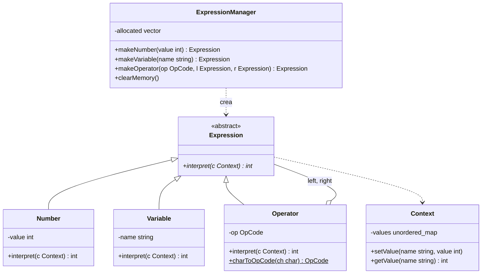
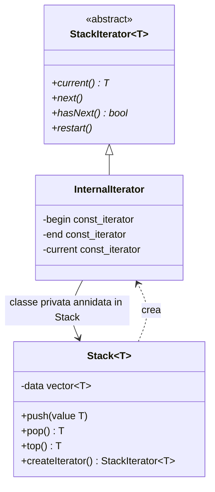

# Lezione 11 — Soluzioni degli esercizi, algoritmi e iteratori

La lezione di C++ ha due parti. Nella prima il docente discute le soluzioni pubblicate dei due esercizi proposti alla fine della [[Lezione 07 - Design pattern e classi come tipi#Esercizi|lezione 7]]: la struttura dati per le espressioni, costruita con i pattern Composite e Interpreter, e la pila iterabile, costruita con i pattern Iterator e Factory Method. La discussione della prima soluzione porta al problema della gestione della memoria con i puntatori, risolto con un gestore centralizzato degli oggetti. La seconda parte apre il pacchetto di slide *05_OOprogramming*, tratto dalle Exploration 10 e 11 del libro di Lischner [@lischner2020]: gli **algoritmi** della libreria standard, gli **intervalli** (*range*) e gli **iteratori**, con un excursus sulle funzioni di inserimento «per collocazione» (*emplacement*). Il resto del pacchetto (Exploration 22, 23 e 24, sull'uso avanzato degli intervalli e sulle funzioni anonime) è rinviato alle lezioni successive. La soluzione dell'esercizio sul tokenizer della [[Lezione 09 - Mappe, oggetti funzione ed eccezioni#Esercizio: un tokenizer per un sottoinsieme del C|lezione 9]] verrà discussa più avanti.

> [!warning] Data della lezione
> L'intestazione della trascrizione riporta il 5 novembre 2026, la stessa data della lezione di teoria successiva ([[Lezione 12 - Grammatiche libere dal contesto e ambiguità|lezione 12]]). In quella lezione il docente si riferisce a questa come a quella di «ieri», e le lezioni di C++ si tengono il mercoledì: la data indicata qui, il 4 novembre, è quindi ricostruita.

## La soluzione dell'esercizio sulle espressioni

### Struttura: il Composite

Il docente ricorda che questi esercizi sono «pezzetti» dell'interprete del progetto, e vanno quindi guardati con attenzione. Il problema era definire una struttura dati per le espressioni aritmetiche ispirata al pattern **Interpreter**, che a sua volta si basa sul **Composite**: nella soluzione si applicano almeno questi due pattern. L'idea è che un'espressione complessa sia costituita da espressioni più semplici combinate tra loro con degli operatori. Nella terminologia del Composite, l'espressione è il **component**, che può essere un oggetto atomico (una **foglia**) o un **composite**.



La classe base `Expression` è il component. `Number` è una classe **atomica**: un numero non contiene altre espressioni, «è un numero, fine». Anche `Variable` è un atomo; nel testo dell'esercizio era pensata come estensione da aggiungere in un secondo momento, ma la soluzione finale la include già. `Operator` è invece il **composite**: somma, sottrazione, moltiplicazione e divisione sono espressioni binarie, con due sottoespressioni. Nel diagramma del pattern ci sono una sola foglia e un solo composite, ma è solo lo schema minimo: le foglie e i composite possono essere quanti si vuole.

### Comportamento: l'Interpreter

Dal punto di vista strutturale la soluzione è un Composite; dal punto di vista **comportamentale** si tratta di espressioni da interpretare, ed entra in gioco l'Interpreter. Il metodo astratto `interpret` riceve un **contesto**, che fornisce la base d'appoggio per l'interpretazione. Le espressioni terminali del pattern corrispondono alle foglie del Composite, quelle non terminali ai composite. Quello che cambia rispetto al Composite non è la struttura, ma l'uso: è un uso specifico del Composite per interpretare espressioni.

In `Expression` il metodo `interpret` è dichiarato **virtuale puro** e prende un `Context`. Che cosa sia il contesto, inizialmente, non interessa: si rispetta il pattern. Poiché il metodo è virtuale puro, `Expression` è una classe **astratta**, non istanziabile, e le sottoclassi devono implementarlo: altrimenti sarebbero astratte anch'esse. `Number`, `Variable` e `Operator` sono invece le classi **concrete** con cui si costruiscono le espressioni.

Ogni classe dichiara costruttori, costruttore di copia e operatore di assegnamento, secondo la regola della [[Lezione 07 - Design pattern e classi come tipi#La copia|lezione 7]]: dire sempre esplicitamente se va bene il default. Mancano costruttore e assegnamento per spostamento, osserva il docente, perché non è ancora stato visto come definirli. Un `Number` si può costruire solo passando il valore, memorizzato come intero.

**L'interpretazione di un numero** è il numero stesso. Il metodo riceve il contesto perché fa parte dell'interfaccia della classe base, ma lo ignora: un numero è un numero, qualunque sia il contesto. Interpretare un oggetto non ne cambia il contenuto, quindi il metodo è `const`; ed è un `override` del metodo della base.

**L'operatore** dichiara al proprio interno un tipo **enumerativo** (`enum`), `OpCode`, con quattro possibili valori, uno per operazione. Una variabile di tipo `OpCode` può assumere solo quei valori; come il compilatore li gestisca internamente non interessa. L'operatore si costruisce con un codice operativo e due **puntatori** a `Expression`, gli operandi sinistro e destro: i puntatori servono perché con essi funziona il polimorfismo, e ciascun operando può essere a sua volta un operatore, un numero o una variabile. Ci sono metodi per leggere l'operatore e i due operandi, e un metodo di utilità `charToOpCode`, che dato un carattere restituisce il codice corrispondente. È dichiarato `static`: non riguarda un oggetto particolare, ma è un metodo **di classe**, che si chiama con `Operator::charToOpCode('+')` senza bisogno di un oggetto.

> [!tip] Approfondimento — `enum` ed `enum class`
> #approfondimento
> Un'enumerazione è un tipo distinto i cui valori sono limitati a un insieme, che comprende alcune costanti con nome, gli **enumeratori** [@cppref-enum]. Con `enum`, come nella soluzione, gli enumeratori sono visibili nello scope che contiene l'enumerazione (qui la classe `Operator`, quindi `Operator::PLUS`) e si convertono implicitamente in interi. Dal C++11 esistono anche le enumerazioni **con scope**, dichiarate con `enum class`: gli enumeratori vanno sempre qualificati (`OpCode::PLUS`) e non si convertono implicitamente in interi, il che evita confusioni tra tipi diversi, nello spirito dei value type della lezione 7 [@cppref-enum].

**L'interpretazione di un operatore** è definita nel file di implementazione. Il docente osserva che l'espressione è memorizzata in una **struttura ad albero**: un'espressione può avere sottonodi, che possono avere a loro volta sottonodi. Per sapere quanto vale un prodotto, una somma o una divisione bisogna prima sapere quanto valgono gli operandi, che possono essere un numero, una variabile o un'espressione complessa. Il metodo chiama quindi `interpret` sull'operando sinistro e su quello destro (l'ordine non conta; si fa prima il sinistro solo perché si legge da sinistra), poi combina i due valori con l'operazione indicata dal codice operativo. In termini tecnici questa è una **visita** dell'albero.

Questa è un'interpretazione nel senso pieno del termine: la struttura dati che rappresenta l'espressione di per sé non ha un valore, ma la funzione `interpret` gliene assegna uno. E l'operatore non sa nulla di come siano fatti i nodi sottostanti: sa solo che hanno un `interpret`. Qui si vedono all'opera insieme il Composite e l'Interpreter. Lo stesso meccanismo funziona per strutture molto più complicate. Un programma è una struttura gerarchica: si compone di funzioni, le funzioni di istruzioni (*statement*), le istruzioni possono essere composte (si pensi a un `for`), e così via. Valutare un programma significa valutare la sua funzione `main`, e quindi tutte le sue istruzioni, che possono chiamare altre funzioni. È esattamente quello che andrà implementato nel progetto, con una struttura un po' più complicata, il **Visitor**, che il docente mostrerà più avanti.

> [!warning] Visita e ricorsione
> Il docente dice che l'interpretazione dell'operatore non è una ricorsione «in senso tecnico», perché non richiama la stessa funzione ma `interpret` sui due rami, pur usando un meccanismo simile alla ricorsione. In realtà, quando un operando è a sua volta un operatore, la chiamata `left_->interpret(c)` esegue proprio `Operator::interpret` su un altro oggetto: la funzione richiama sé stessa, anche se in modo indiretto, attraverso il meccanismo delle funzioni virtuali. Si tratta quindi di una ricorsione a tutti gli effetti, la cui terminazione è garantita dal fatto che l'albero è finito e che le foglie non richiamano nulla. Il punto essenziale del docente resta valido: una struttura definita **induttivamente** si esplora naturalmente con un procedimento ricorsivo. Poiché il valore di un nodo si calcola dopo quelli dei figli, la visita è quella che nei libri di algoritmi si chiama **in ordine posticipato** (*postorder*) [@cormen2009].

### Il contesto e la tabella dei simboli

Anche l'operatore, come il numero, non usa il contesto: un più è un più, un meno è un meno. Se il linguaggio delle espressioni supportasse l'**overloading** degli operatori, il contesto diventerebbe importante, perché la semantica di un operatore potrebbe dipenderne. Qui non è così. Il contesto serve invece alla **variabile**, che è una stringa: qual è il valore di `x`? Dipende da un assegnamento fatto in precedenza. Non si sta definendo la sintassi di un linguaggio, ma si immagina che questa sia la controparte di un interprete in cui da qualche parte il valore della variabile è stato definito. Interpretare la variabile significa quindi chiedere al contesto il valore associato al suo identificatore.

Il contesto è realizzato con una **mappa**, come visto nella [[Lezione 09 - Mappe, oggetti funzione ed eccezioni#Le mappe|lezione 9]]: la chiave è il nome della variabile, il valore è il suo valore. Si può impostare il valore di una variabile e leggerlo con `find`, che restituisce un iteratore alla coppia chiave-valore, di cui il secondo elemento è il valore. La soluzione usa una `std::unordered_map`, perché l'ordine non interessa e in media è più efficiente di `std::map`; il perché si vedrà nel secondo semestre.

Il progetto avrà bisogno di un contesto di questo tipo. Qui si chiama `Context` per rispettare il pattern, ma il nome usato nei compilatori è **tabella dei simboli** (*symbol table*). Il docente osserva che l'esigenza di strutture dati efficienti per recuperare un valore a partire da una chiave è nata proprio nell'infrastruttura informatica: nei compilatori, con la tabella dei simboli; nei sistemi operativi, con la tabella dei processi, dove a ogni identificativo di processo sono associate tutte le sue informazioni (con identificativi numerici basterebbe un vettore, ma i processi nascono e muoiono di continuo, e conviene un'altra struttura); nelle basi di dati, con gli indici. Basi di dati, sistemi operativi e compilatori sono, in fondo, programmi con dentro strutture dati.

### Il problema della memoria

Nel `main` le espressioni sono costruite **a mano**: si crea con `new` un numero, poi un altro, poi un operatore che li combina. Come un'espressione scritta in un file di testo arrivi nella struttura dati, per ora, non interessa. Il problema è un altro: si sono usati i puntatori.

Un oggetto allocato con `new` in un punto del programma resta in memoria finché qualcuno non esegue la corrispondente `delete`. Il C++, a differenza di Java e Python, non ha un **garbage collector**, letteralmente un «raccoglitore della spazzatura»: un meccanismo che si accorge della memoria non più utilizzata e la recupera automaticamente. Il C++ è stato pensato con in mente l'efficienza, e la gestione della memoria è affare del programmatore. Un programma apparentemente compatto in memoria può così, a poco a poco, lasciare allocati oggetti che non usa più.

L'esempio della soluzione è una funzione «apparentemente innocente», `leaksMemory`, che con due cicli annidati costruisce e valuta una sorta di tavola pitagorica: per ogni coppia $(i, j)$ crea due numeri e un operatore di moltiplicazione, e stampa il risultato dell'interpretazione. Funziona: la prima riga è tutta di zeri, perché il ciclo esterno vale 0, la seconda è $0, 1, 2, 3, 4$, e così via. Ma che cosa manca? Manca la `delete`, che chiamerebbe i distruttori e restituirebbe la memoria. Con cicli da 5 per 5 si eseguono 25 giri, e a ogni giro si perdono tre nodi: alla fine sono «bruciati» 75 oggetti. Eseguendo la versione ricostruita più sotto sotto Valgrind, compilata con g++ su un sistema a 64 bit, risultano infatti persi 1600 byte in 75 blocchi.

In un programma «stupido» non è grave: quando il programma termina, il sistema operativo recupera tutta la memoria che il processo aveva preso. Ma si pensi a un **browser**, che resta acceso a lungo, apre molte pagine, si collega a diversi server. Anche il browser è un programma: se ogni volta che interpreta una pagina allocasse la memoria per contenerla e poi, passando a un'altra pagina, la lasciasse allocata, dopo un po' la memoria comincerebbe a riempirsi e tutto il sistema rallenterebbe (con i meccanismi di paginazione che si vedono in Sistemi operativi). Si può obiettare che basta non dimenticare la `delete`; ma dimenticarsene non è difficile, e metterle tutte è una seccatura.

### Un gestore centralizzato: di nuovo i pattern

La soluzione usa di nuovo i pattern. Si crea un **gestore** che centralizza l'allocazione della memoria delle espressioni, `ExpressionManager`. Dal punto di vista dei pattern è una **concrete factory**: manca la parte astratta, ma si potrebbe definire una classe base astratta per i gestori della memoria (una abstract factory) e farne derivare il gestore delle espressioni. Il gestore ha un **factory method** per ogni tipo di nodo: uno per i numeri, uno per gli operatori, uno per le variabili. Quando gli si chiede un numero, alloca un `Number` con il valore richiesto e lo restituisce come `Expression*`; in più, si ricorda di ogni allocazione in un vettore di puntatori. Invece di fare `new` direttamente, si passa per il gestore.

La funzione `doesNotLeakMemory` è identica a `leaksMemory`, e anch'essa alloca nodi «infischiandosene», ma riceve, oltre al contesto, il gestore, e fa tutte le allocazioni tramite esso. I nodi restano allocati, e il loro comportamento è esattamente lo stesso. Ma se ci si accorge che la memoria sta finendo, o che i nodi allocati fin lì non servono più (sono nodi temporanei), si chiama `clearMemory` sul gestore, che **spazza** il vettore delle allocazioni, distrugge tutti i nodi e svuota il vettore. Il docente la definisce una forma molto primitiva di garbage collection: in un vero garbage collector è il gestore stesso ad accorgersi che c'è troppa memoria occupata e a eliminare ciò che non è più utilizzato.

C'è di più. Se il gestore è un oggetto **automatico**, creato all'interno di una funzione, all'uscita dalla funzione viene chiamato il suo distruttore, che chiama `clearMemory`. Associando un gestore a una funzione, per esempio quella che visualizza una pagina del browser, tutta la memoria allocata in quella funzione se ne va all'uscita. Nella soluzione il gestore è creato nel `main`, quindi la memoria viene liberata alla fine del programma. Questo modo di gestire i puntatori «stupidi» è più furbo; con i **puntatori intelligenti** (*smart pointer*), introdotti dal C++11, il problema si può risolvere ancora meglio, e il docente spera di arrivare a mostrarli nel corso.

> [!tip] Approfondimento — RAII
> #approfondimento
> Il meccanismo per cui il distruttore del gestore libera la memoria all'uscita dallo scope ha un nome nel C++: **RAII**, *Resource Acquisition Is Initialization*. È la tecnica che lega il ciclo di vita di una risorsa da acquisire prima dell'uso (memoria dinamica, file aperti, connessioni, lock) alla vita di un oggetto: il costruttore acquisisce la risorsa, il distruttore la rilascia, e il rilascio è garantito quando la vita dell'oggetto finisce, anche in caso di eccezioni [@cppref-raii]. Il gestore delle espressioni ne è un esempio, e lo sono anche i puntatori intelligenti come `std::unique_ptr`, presentato in un approfondimento della [[Lezione 07 - Design pattern e classi come tipi#Esercizio 1: struttura dati per le espressioni|lezione 7]].

> [!warning] Chi possiede i nodi
> Con il gestore cambia la **proprietà** (*ownership*) dei nodi: è il gestore a possederli tutti e a distruggerli. Di conseguenza l'operatore **non** deve distruggere i propri operandi nel distruttore, come faceva invece la soluzione proposta nella nota della lezione 7: se lo facesse, ogni operando verrebbe distrutto due volte, una dall'operatore e una dal gestore, con comportamento indefinito. Le due strategie («ogni nodo possiede i suoi figli» oppure «un gestore possiede tutti i nodi») sono entrambe valide, ma non vanno mescolate.

Il codice seguente ricostruisce la soluzione a partire dalla descrizione del docente (nomi delle classi e dei metodi, uso di `unordered_map`, `enum`, gestore con vettore delle allocazioni). Non è il codice pubblicato, che può differire nei dettagli; per brevità è tutto in un file, mentre la soluzione divide dichiarazioni e definizioni tra header e file di implementazione.

```cpp
#include <iostream>
#include <stdexcept>
#include <string>
#include <unordered_map>
#include <vector>

// Context: la tabella dei simboli (nome della variabile -> valore)
class Context {
public:
  void setValue(std::string const& name, int value) { values_[name] = value; }
  int getValue(std::string const& name) const {
    auto it{values_.find(name)};
    if (it == values_.end()) throw std::runtime_error{"variabile non definita: " + name};
    return it->second;
  }
private:
  std::unordered_map<std::string, int> values_;
};

// AbstractExpression / Component
class Expression {
public:
  Expression() = default;
  Expression(Expression const&) = default;
  Expression& operator=(Expression const&) = default;
  virtual ~Expression() = default;
  virtual int interpret(Context const& c) const = 0;
};

// TerminalExpression / Leaf
class Number : public Expression {
public:
  explicit Number(int value) : value_{value} {}
  int getValue() const { return value_; }
  int interpret(Context const&) const override { return value_; }   // il contesto non serve
private:
  int value_;
};

class Variable : public Expression {
public:
  explicit Variable(std::string name) : name_{std::move(name)} {}
  std::string const& getName() const { return name_; }
  int interpret(Context const& c) const override { return c.getValue(name_); }
private:
  std::string name_;
};

// NonterminalExpression / Composite
class Operator : public Expression {
public:
  enum OpCode { PLUS, MINUS, TIMES, DIV };
  Operator(OpCode op, Expression* left, Expression* right) : op_{op}, left_{left}, right_{right} {}
  OpCode getOp() const { return op_; }
  Expression* getLeft() const { return left_; }
  Expression* getRight() const { return right_; }
  int interpret(Context const& c) const override;
  static OpCode charToOpCode(char ch);              // metodo di utilità, a livello di classe
private:
  OpCode op_;
  Expression* left_;                                 // non posseduti: li gestisce il manager
  Expression* right_;
};

int Operator::interpret(Context const& c) const {
  int l{left_->interpret(c)};                        // prima gli operandi...
  int r{right_->interpret(c)};
  switch (op_) {                                     // ...poi l'operazione
    case PLUS: return l + r;
    case MINUS: return l - r;
    case TIMES: return l * r;
    case DIV:
      if (r == 0) throw std::runtime_error{"divisione per zero"};
      return l / r;
  }
  throw std::logic_error{"codice operatore non valido"};
}

Operator::OpCode Operator::charToOpCode(char ch) {
  switch (ch) {
    case '+': return PLUS;
    case '-': return MINUS;
    case '*': return TIMES;
    case '/': return DIV;
  }
  throw std::invalid_argument{std::string{"operatore sconosciuto: "} + ch};
}

// Concrete factory che centralizza l'allocazione dei nodi
class ExpressionManager {
public:
  ExpressionManager() = default;
  ExpressionManager(ExpressionManager const&) = delete;
  ExpressionManager& operator=(ExpressionManager const&) = delete;
  ~ExpressionManager() { clearMemory(); }

  Expression* makeNumber(int value) { return remember(new Number{value}); }
  Expression* makeVariable(std::string const& name) { return remember(new Variable{name}); }
  Expression* makeOperator(Operator::OpCode op, Expression* l, Expression* r) {
    return remember(new Operator{op, l, r});
  }
  void clearMemory() {
    for (Expression* e : allocated_) delete e;
    allocated_.clear();
  }
private:
  Expression* remember(Expression* e) { allocated_.push_back(e); return e; }
  std::vector<Expression*> allocated_;
};

void leaksMemory(int n, int m, Context const& c) {
  for (int i{0}; i < n; ++i) {
    for (int j{0}; j < m; ++j) {
      Expression* a{new Number{i}};
      Expression* b{new Number{j}};
      Expression* e{new Operator{Operator::TIMES, a, b}};
      std::cout << e->interpret(c) << ' ';
    }                                                // manca la delete: tre nodi persi a ogni giro
    std::cout << '\n';
  }
}

void doesNotLeakMemory(int n, int m, Context const& c, ExpressionManager& manager) {
  for (int i{0}; i < n; ++i) {
    for (int j{0}; j < m; ++j) {
      Expression* e{manager.makeOperator(Operator::TIMES, manager.makeNumber(i), manager.makeNumber(j))};
      std::cout << e->interpret(c) << ' ';
    }
    std::cout << '\n';
  }
}

int main(int argc, char*[]) {
  Context context;
  ExpressionManager manager;
  if (argc > 1) leaksMemory(5, 5, context);          // con un argomento: versione con perdite
  else doesNotLeakMemory(5, 5, context, manager);

  context.setValue("x", 20);                          // un'espressione con una variabile
  Expression* e{manager.makeOperator(Operator::charToOpCode('+'),
                                     manager.makeVariable("x"), manager.makeNumber(22))};
  std::cout << "x + 22 = " << e->interpret(context) << '\n';
}
```

L'output è la tavola pitagorica da 0 a 4 seguita da `x + 22 = 42`. Valgrind conferma che la versione con il gestore libera tutta la memoria (`All heap blocks were freed`), mentre la versione con `leaksMemory` perde 75 blocchi. L'ultimo esempio mostra un'espressione con una variabile: si imposta nel contesto `x` a 20, si crea un operatore che somma la variabile e un numero, e lo si interpreta.

Il docente raccomanda di studiare bene questa soluzione, perché è un pezzo importante del progetto finale, e di scrivergli o chiedere un appuntamento se qualcosa non torna.

## La soluzione dell'esercizio sulla pila

Il secondo esercizio, meno importante per il progetto ma «carino», mostra il pattern Iterator «in tutta la sua bellezza». La soluzione esiste in due versioni, una per gli interi e una generica con i template; il docente mostra la seconda e suggerisce a chi la trova ostica di partire dalla prima. L'esercizio, «di una banalità sconvolgente», chiedeva una pila con le classiche operazioni `push`, `pop` e `top`; la parte interessante era renderla **iterabile**.

Il docente lo ha realizzato non «alla C++», ma rispettando il pattern, «alla Java», per far vedere come funziona. C'è una classe base astratta `StackIterator`, che è un **template** perché la pila contiene elementi di un tipo generico, e quindi anche l'iteratore. Ha il distruttore virtuale e dichiara l'interfaccia dell'iteratore, che si confronta così con quella del pattern:

| Pattern Iterator ([[Lezione 07 - Design pattern e classi come tipi#Iterator|lezione 7]]) | Soluzione | Significato |
|---|---|---|
| `first()` | `restart()` | riporta l'iteratore all'inizio |
| `next()` | `next()` | avanza all'elemento successivo, come `++` |
| `isDone()` | `hasNext()` | dice se ci sono ancora elementi (con il significato rovesciato) |
| `currentItem()` | `current()` | restituisce l'elemento corrente |

La pila è realizzata con un `std::vector`, che ha già tutti i metodi per essere usato come pila: `push_back` per inserire in cima, `back` per leggere l'elemento in cima e `pop_back` per toglierlo. Chi ha progettato la libreria standard ha pensato che i vettori potessero essere usati come pile e ha fornito metodi efficienti; come si vedrà nel secondo semestre, nel caso del vettore questi metodi si possono implementare in modo molto efficiente. Il docente non commenta `push`, `pop` e `top` «per non insultare l'intelligenza» degli studenti.

Poi c'è il **factory method**: alla pila si può chiedere un iteratore, `createIterator`, che restituisce un puntatore a `StackIterator` ma alloca un oggetto di tipo `InternalIterator`.

### La classe annidata privata

Il punto è questo: un iteratore efficiente deve conoscere la struttura interna della pila, ma non si vuole che una classe esterna alla pila sappia com'è fatta. La soluzione è una **classe interna**, cioè una classe definita dentro un'altra classe. Le classi annidate, dice il docente, sono una «figata» sotto certi punti di vista: hanno accesso alla rappresentazione della classe che le contiene, ma, essendo interne, non la espongono. `InternalIterator` è dichiarata nella parte **privata** di `Stack`: dall'esterno non si può costruire un oggetto di quel tipo (lo si è verificato: il compilatore risponde `'class Stack<int>::InternalIterator' is private within this context`), ma il factory method lo può restituire tramite l'interfaccia **pubblica** `StackIterator`. Questo permette di avere un'interfaccia pubblica per l'iteratore, mantenere l'incapsulamento e iterare in modo efficiente.

> [!warning] Il termine «chiusura»
> Il docente chiama questo meccanismo «chiusura». In informatica il termine **chiusura** (*closure*) indica di solito una funzione insieme alle variabili dell'ambiente che ha catturato; nel C++ è il nome del tipo degli oggetti creati dalle funzioni anonime (lambda), che il corso vedrà a breve: il tipo di una lambda si chiama infatti *closure type* [@cppref-lambda]. Il meccanismo descritto qui è piuttosto un caso di **incapsulamento**: un tipo privato reso accessibile solo attraverso un'interfaccia pubblica. L'accesso di `InternalIterator` alla rappresentazione della pila deriva dal fatto che una classe annidata è un membro della classe che la contiene, e ha quindi gli stessi diritti di accesso degli altri membri, compresi quelli ai membri privati [@cppref-nested].

L'iteratore interno usa a sua volta gli **iteratori del vettore**. Quando viene creato riceve per riferimento costante il vettore che sostiene la pila, e si memorizza tre iteratori: l'inizio (`begin()`), la fine (`end()`) e la posizione corrente, inizialmente all'inizio. `current()` restituisce l'elemento nella posizione corrente; `next()` incrementa la posizione, usando il meccanismo di iterazione del C++; `hasNext()` controlla se la posizione corrente è diversa dalla fine; `restart()` riporta la posizione corrente all'inizio. Con tre iteratori si implementano tutti i metodi, e chi usa la pila non ha mai accesso alla struttura interna.

Se si cambiasse la rappresentazione, per esempio usando una lista invece di un vettore, l'iteratore interno potrebbe restare quasi uguale, purché il nuovo contenitore appartenga alla libreria standard e offra gli stessi iteratori: basterebbe cambiare i tipi. Con un contenitore fatto in casa, con modalità di iterazione proprie, andrebbe invece riscritto. Questo è accettabile, perché l'iteratore interno è privato e risente per forza delle modifiche alla parte privata della classe; dall'esterno, invece, tutto continua a funzionare.



Anche questo codice è una ricostruzione dalla descrizione del docente.

```cpp
#include <iostream>
#include <stdexcept>
#include <string>
#include <vector>

// Interfaccia pubblica dell'iteratore (classe base astratta)
template <class T>
class StackIterator {
public:
  virtual ~StackIterator() = default;
  virtual T const& current() const = 0;   // elemento corrente
  virtual void next() = 0;                // avanza (come ++)
  virtual bool hasNext() const = 0;       // ci sono ancora elementi?
  virtual void restart() = 0;             // torna all'inizio
};

template <class T>
class Stack {
public:
  void push(T const& value) { data_.push_back(value); }
  T pop() {
    if (data_.empty()) throw std::out_of_range{"pop su pila vuota"};
    T value{data_.back()};
    data_.pop_back();
    return value;
  }
  T const& top() const {
    if (data_.empty()) throw std::out_of_range{"top su pila vuota"};
    return data_.back();
  }
  StackIterator<T>* createIterator() const {        // factory method
    return new InternalIterator{data_};
  }
private:
  // Classe annidata privata: conosce la rappresentazione, ma non è visibile all'esterno
  class InternalIterator : public StackIterator<T> {
  public:
    explicit InternalIterator(std::vector<T> const& data)
        : begin_{data.begin()}, end_{data.end()}, current_{data.begin()} {}
    T const& current() const override { return *current_; }
    void next() override { ++current_; }
    bool hasNext() const override { return current_ != end_; }
    void restart() override { current_ = begin_; }
  private:
    typename std::vector<T>::const_iterator begin_, end_, current_;   // tre iteratori del vector
  };
  std::vector<T> data_;
};

int main() {
  Stack<std::string> s;
  s.push("primo");
  s.push("secondo");
  s.push("terzo");
  StackIterator<std::string>* it{s.createIterator()};
  for (; it->hasNext(); it->next()) std::cout << it->current() << ' ';
  std::cout << '\n';                                  // primo secondo terzo
  std::cout << "pop: " << s.pop() << ", top: " << s.top() << '\n';
  delete it;                                          // creato prima del pop: non va più usato
  it = s.createIterator();
  for (it->restart(); it->hasNext(); it->next()) std::cout << it->current() << ' ';
  std::cout << '\n';                                  // primo secondo
  delete it;
}
```

Si noti che, scorrendo il vettore da `begin()` a `end()`, questo iteratore visita la pila **dal fondo verso la cima**. La soluzione proposta nella nota della lezione 7 la visitava invece dalla cima verso il fondo: entrambe le scelte sono legittime, perché l'esercizio non fissava un ordine.

> [!tip] Approfondimento — Iteratori invalidati
> #approfondimento
> Un iteratore costruito sugli iteratori di un `std::vector` dipende dallo stato del vettore. Dopo un `pop_back`, gli iteratori e i riferimenti all'ultimo elemento diventano **invalidi**, e lo diventa anche l'iteratore `end()` [@cppref-popback]. Un `InternalIterator` creato prima di un `pop` conserva quindi un `end_` non più valido, e usarlo ha comportamento indefinito; per questo il `main` qui sopra distrugge l'iteratore e ne crea uno nuovo dopo il `pop`. Anche un inserimento in coda (`push_back` o `emplace_back`) può invalidare tutti gli iteratori, se provoca una riallocazione del vettore [@cppref-emplaceback]. È una delle ragioni per cui gli iteratori vanno usati «a vita breve», subito dopo averli creati.

## Algoritmi, intervalli e iteratori

### Esplorazioni «vecchie»

La seconda parte riprende il libro. Il docente osserva che le Exploration di questo pacchetto hanno numeri più bassi di quelle viste finora: chi ha seguito il suo consiglio di leggere le Exploration precedenti a quelle viste insieme le ha forse già incontrate. Sono cose che l'anno scorso, con ogni probabilità, non sono state viste: la possibilità di usare **algoritmi**, **intervalli** (*range*) e **iteratori**, e quella di avere **funzioni anonime**. L'idea di una funzione senza nome sembra strana: una funzione di solito ha un nome proprio per poterla richiamare. Ma a volte serve una funzione *hic et nunc*, solo in quel punto, e non le si vuole dare un nome; è una cosa usata spesso, e funziona bene. Questi concetti vengono usati spesso nelle Exploration successive, quindi serve una premessa.

### Ordinare un vettore

Per ordinare un vettore, la libreria standard offre un algoritmo pronto. Oltre a `<vector>` si include **`<algorithm>`**, la parte della libreria standard che contiene gli algoritmi di uso generale: ordinamento, ricerca, e così via.

```cpp
#include <algorithm>
#include <iostream>
#include <vector>

int main() {
  std::vector<int> data{};
  int x{};
  while (std::cin >> x)
    data.emplace_back(x);          // variante "emplacement" di push_back
  std::ranges::sort(data);         // O(n log n) confronti
  for (int element : data)
    std::cout << element << ' ';
  std::cout << std::endl;
}
```

Con l'input `5 3 9 1` il programma stampa `1 3 5 9`. Basta passare il vettore a `std::ranges::sort`, e lo si ottiene ordinato. L'ordinamento ha un'efficienza che, nel caso pessimo, cresce come il numero degli elementi moltiplicato per il suo logaritmo: $O(n \log n)$ confronti [@cppref-rangessort]. La notazione $O$ si vedrà nel secondo semestre; per ora va intesa come «non può andare peggio di così»: il tempo di esecuzione non supera una costante moltiplicata per $n \log n$, quindi cresce un po' più che linearmente ma meno che quadraticamente. Per ordinare dei vettori non serve scrivere il proprio algoritmo; gli algoritmi di ordinamento si studieranno comunque, «andando sotto il cofano».

### Excursus: inserimento e collocazione

Per aggiungere l'elemento al vettore il programma non usa `push_back`, ma `emplace_back`. Dal punto di vista del risultato, osserva il docente, non cambia niente: per ora `emplace_back` è semplicemente un altro nome per la stessa operazione; sotto il cofano, però, il comportamento è diverso.

Di solito si aggiungono dati a un contenitore con le **funzioni di inserimento** (*insertion*), come `insert`, `push_front` e `push_back`. Che cosa succede con il frammento seguente?

```cpp
std::vector<std::string> data{};
data.push_back("Hello world!");
```

Il compilatore può trattare la chiamata come se fosse stata scritta `data.push_back(std::string("Hello world!"));`. Viene creato, con un costruttore, un oggetto `std::string` **temporaneo** a partire dal letterale; il temporaneo viene passato a `push_back` e spostato in un altro oggetto, nella memoria del vettore; quando `push_back` termina, il temporaneo viene distrutto. Per un momento esistono quindi due oggetti, il temporaneo e quello nel vettore. «Siamo felici?» Le slide rispondono con le parole di Scott Meyers, dal libro *Effective Modern C++* [@meyers2014]: i «fanatici delle prestazioni» non possono fare a meno di notare che si potrebbe evitare di costruire e distruggere un oggetto temporaneo; e poiché chi programma in C++ ha buone probabilità di essere un fanatico delle prestazioni, o almeno di simpatizzare con il loro punto di vista, la questione lo riguarda («se le prestazioni non vi interessano, non dovreste essere nella stanza di Python in fondo al corridoio?»). Il docente lo traduce a modo suo: chi non è attento alle prestazioni può sempre seguire il corso di Python.

Le **funzioni di collocazione** (*emplacement*), come `emplace`, `emplace_front` ed `emplace_back`, costruiscono invece l'oggetto **direttamente al suo posto** nel contenitore, a partire dagli argomenti ricevuti, senza creare un temporaneo [@cppref-emplaceback]:

```cpp
std::vector<std::string> data{};
data.emplace_back("Hello world!");   // la stringa è costruita direttamente nel vettore
```

La differenza si vede con una classe che stampa quali funzioni membro vengono chiamate:

```cpp
#include <iostream>
#include <string>
#include <vector>

struct traced {
  std::string text;
  traced(char const* s) : text{s} { std::cout << "  costruzione da letterale\n"; }
  traced(traced const& o) : text{o.text} { std::cout << "  copia\n"; }
  traced(traced&& o) noexcept : text{std::move(o.text)} { std::cout << "  spostamento\n"; }
  ~traced() { std::cout << "  distruzione\n"; }
};

int main() {
  std::vector<traced> data;
  data.reserve(2);                         // evita riallocazioni che confonderebbero l'output
  std::cout << "push_back:\n";
  data.push_back("Hello world!");
  std::cout << "emplace_back:\n";
  data.emplace_back("Hello world!");
  std::cout << "fine\n";
}
```

Con `push_back` l'output mostra una costruzione da letterale, uno spostamento e una distruzione (quella del temporaneo); con `emplace_back` solo la costruzione. Alla fine vengono distrutti i due elementi del vettore.

> [!important] Inserimento e collocazione
> In linea di principio le funzioni di collocazione dovrebbero essere a volte più efficienti di quelle di inserimento, e non dovrebbero mai essere meno efficienti. In pratica è più probabile che siano più veloci quando:
> - il valore aggiunto viene **costruito** nel contenitore, non assegnato a un elemento esistente;
> - il tipo degli argomenti passati è **diverso** dal tipo contenuto nel contenitore (come il letterale rispetto a `std::string`);
> - il contenitore **non rifiuterà** il valore perché duplicato.
>
> Inoltre le funzioni di collocazione possono eseguire conversioni di tipo che le funzioni di inserimento rifiuterebbero.

Per il progetto, conclude il docente, usare `emplace_back` o `push_back` probabilmente non cambia nulla: si usi quella più comoda, ma è bene sapere che cosa c'è sotto.

### Che cosa serve per ordinare

`std::ranges::sort` fa parte del modulo `<algorithm>`, che raccoglie gli algoritmi di uso generale per operare sugli oggetti della libreria standard. Può ordinare qualsiasi contenitore, a patto che:

1. abbia i factory method `begin()` ed `end()` per ottenere gli iteratori;
2. permetta di accedere a elementi specifici, per esempio con `[]` o con il metodo `at`;
3. contenga elementi tra cui esiste un **ordine** («last but not least»): per gli interi esiste; per elementi di una classe definita dall'utente, l'ordine va definito.

I vettori di tipi scalari e di stringhe vanno sempre bene. Ci sono molti altri algoritmi: per esempio `binary_search`, e `shuffle`, che invece di ordinare gli elementi li «disordina». Il consiglio del docente: prima di realizzare un algoritmo, al netto di quelli che si studieranno nel secondo semestre, si guardi sempre che cosa c'è già nella libreria. È sempre meglio usare qualcosa che esiste piuttosto che «reinventare la ruota».

### Intervalli

`std::ranges::sort` è un esempio di **algoritmo generico**, e gli algoritmi generici lavorano su dati strutturati come **intervalli** (*range*). Ce ne sono di diversi tipi. I vettori sono intervalli **dimensionati** (*sized range*): la loro dimensione è nota in anticipo, con il metodo `size()`. Le righe lette da un file di testo o dall'input standard formano anch'esse un intervallo, cioè una sequenza di valori, ma non dimensionato: quanti elementi ci siano lo si sa solo alla fine. Gli intervalli dipendono dagli iteratori: la maggior parte degli algoritmi richiede un **iteratore di lettura**, con la corrispondente **sentinella** che segnala la fine (come `begin()` ed `end()`), per ottenere i dati in ingresso; un **iteratore di scrittura** si può usare per riempire un altro contenitore, magari con dati trasformati, una possibilità che il docente trova molto interessante.

**Copiare tra vettori.**

```cpp
#include <algorithm>
#include <cassert>
#include <vector>

int main() {
  std::vector<int> input{10, 20, 30};
  std::vector<int> output{};
  output.resize(input.size());             // spazio per gli elementi copiati
  std::ranges::copy(input, output.begin());
  assert(input == output);                 // termina il programma se la condizione è falsa
}
```

Il punto fondamentale: un vettore appena creato ha zero elementi, perché i vettori sono dinamici e non hanno una dimensione fissa come gli array. Prima di copiare `input` dentro `output` bisogna quindi fare un `resize`, per assicurarsi che la destinazione sia abbastanza grande: l'iteratore `output.begin()` scrive negli elementi esistenti, non ne aggiunge di nuovi.

L'ultima riga usa la macro **`assert`**, dichiarata in `<cassert>`: se la condizione è violata, il programma termina con un errore. È diverso da un'eccezione: la terminazione non è intercettabile, e quindi «non è elegante». In alternativa si potrebbe lanciare un'eccezione, con un `throw` eseguito se `input` è diverso da `output`.

> [!tip] Approfondimento — Che cosa fa `assert`
> #approfondimento
> Se la condizione è falsa, `assert` scrive sullo standard error un messaggio diagnostico, che comprende il testo della condizione, il nome del file, il numero di riga e il nome della funzione, e poi chiama `std::abort()` [@cppref-assert]. Se però la macro `NDEBUG` è definita nel punto in cui si include `<cassert>`, le asserzioni sono **disattivate**: `assert` non fa nulla, e la condizione non viene nemmeno valutata [@cppref-assert]. Per questo le asserzioni servono a controllare durante lo sviluppo condizioni che non dovrebbero mai essere false, e non a gestire errori che possono verificarsi nell'uso normale, come un input sbagliato: per quelli si usano le eccezioni.

**Copiare su uno stream di output.**

```cpp
#include <algorithm>
#include <iostream>
#include <iterator>
#include <vector>

int main() {
  std::vector<int> data;
  int element;
  while (std::cin >> element)
    data.emplace_back(element);
  std::ranges::sort(data);           // l'ordinamento avviene sul posto
  std::ranges::copy(data, std::ostream_iterator<int>{std::cout, "\n"});
}
```

Si leggono gli elementi, li si accoda al vettore e li si ordina: l'ordinamento avviene **sul posto**, cioè il contenitore è sia la sorgente sia la destinazione. Poi si copia il contenuto del vettore su un **`std::ostream_iterator`**, dichiarato in `<iterator>`: un iteratore di scrittura che, a ogni elemento assegnatogli, lo scrive sullo stream indicato seguito dal separatore (qui un a capo). Così si stampa un vettore **senza scrivere un ciclo**.

**Copiare da uno stream di input.**

```cpp
#include <algorithm>
#include <iostream>
#include <iterator>
#include <ranges>
#include <vector>

int main() {
  std::vector<int> data;
  std::ranges::copy(std::ranges::istream_view<int>(std::cin),
                    std::back_inserter(data));        // fa spazio nel vettore
  std::ranges::sort(data);
  std::ranges::copy(data, std::ostream_iterator<int>{std::cout, "\n"});
}
```

Anche la lettura è una copia. **`std::ranges::istream_view<int>`**, dichiarato in `<ranges>`, fornisce una vista dello stream di input come intervallo: genera la sequenza applicando ripetutamente `>>` allo stream [@cppref-istreamview]. Come destinazione si usa **`std::back_inserter(data)`**, un iteratore di scrittura che aggiunge gli elementi in coda al vettore [@cppref-backinserter]: serve perché bisogna fare spazio ai dati man mano che arrivano, dato che non si sa in anticipo quanti saranno. Lo stream potrebbe essere un file: il programma legge, ordina e scrive usando solo il concetto di intervallo. Con l'input `4 2 8` stampa `2`, `4`, `8` su tre righe.

Per operazioni su sequenze di elementi, queste funzioni velocizzano molto la scrittura del codice e lasciano l'efficienza a funzioni già pronte. È un modo di programmare diverso da quello con cui si è partiti, dove per scorrere un vettore o un file si scrive un `for`, come si è fatto anche nelle lezioni precedenti: più sofisticato, ma non meno efficiente.

### Esperimenti

Il docente propone di modificare questi programmi per prendere confidenza:

1. chiamare `unique_copy` al posto di `copy`, ottenendo un'alternativa alle mappe per eliminare i **duplicati**; attenzione, `unique_copy` ha senso solo **dopo** l'ordinamento;
2. chiamare `reverse` al posto di `sort`, per ottenere il vettore rovesciato;
3. provare `shuffle`, prima o dopo `sort`, per vederne l'effetto.

Il programma seguente esegue le tre prove su un vettore fisso:

```cpp
#include <algorithm>
#include <iostream>
#include <iterator>
#include <random>
#include <vector>

int main() {
  std::vector<int> data{5, 3, 9, 3, 1, 5, 5, 7};
  std::ostream_iterator<int> out{std::cout, " "};

  std::ranges::sort(data);
  std::ranges::copy(data, out); std::cout << "<- sort\n";
  std::ranges::unique_copy(data, out); std::cout << "<- unique_copy dopo sort\n";

  std::vector<int> unsorted{5, 3, 9, 3, 1, 5, 5, 7};
  std::ranges::unique_copy(unsorted, out); std::cout << "<- unique_copy senza sort\n";

  std::ranges::reverse(data);
  std::ranges::copy(data, out); std::cout << "<- reverse\n";

  std::mt19937 gen{42};                      // generatore di numeri pseudocasuali
  std::ranges::shuffle(data, gen);
  std::ranges::copy(data, out); std::cout << "<- shuffle\n";
}
```

L'output, con g++, è:

```text
1 3 3 5 5 5 7 9 <- sort
1 3 5 7 9 <- unique_copy dopo sort
5 3 9 3 1 5 7 <- unique_copy senza sort
9 7 5 5 5 3 3 1 <- reverse
7 3 1 9 3 5 5 5 <- shuffle
```

La terza riga spiega l'avvertenza del docente: `unique_copy` elimina solo i duplicati **consecutivi**, quindi senza ordinamento le ripetizioni non adiacenti restano (i due 3 e il 5 iniziale). L'ordine prodotto da `shuffle` dipende dal generatore e dalla sua inizializzazione: con un altro seme, o con un'altra libreria standard, cambia.

Il docente insiste: è roba nuova, e senza sperimentarla non la si capisce. Si scrivano programmi, ci si ponga un problema (per esempio ordinare una serie di elementi), si leggano gli elementi da file, si usino stringhe invece di interi. Questi strumenti possono servire anche nel progetto, per esempio nella tokenizzazione, leggendo i caratteri e usando queste funzionalità. Se si incontrano ostacoli che non si riescono a superare con il libro, si può chiedere a un'IA, o al docente.

### Gli iteratori

Il meccanismo che fa funzionare tutto questo, tornando ai design pattern, sono gli **iteratori**. Un iteratore è un oggetto che «punta» a un elemento di una sequenza:

```cpp
std::vector<int> data{5, 6, 7, 8, 9};
std::vector<int>::iterator itr = data.begin();   // itr "punta" a 5
++itr;                                            // ora punta a 6
--itr;                                            // di nuovo a 5
std::cout << *itr << '\n';                        // stampa 5
```

`data.begin()` è il factory method che crea un iteratore posizionato all'inizio. In C++ un iteratore si **incrementa** o si **decrementa** per avanzare o tornare indietro nella sequenza, perché il pattern Iterator è realizzato con gli operatori, e si **dereferenzia** con `*` per ottenere l'elemento a cui punta.

> [!warning] Un refuso nella slide sugli iteratori
> La slide scrive `std::cout >> *itr;`. L'operatore corretto per la stampa è `<<`: con `>>` il compilatore segnala `no match for 'operator>>'`. Nella slide sull'emplacement, inoltre, il letterale in `push_back(std::string("Hello world!“))` termina con una virgoletta tipografica, che non compila.

Il docente ripete un consiglio già dato nella [[Lezione 09 - Mappe, oggetti funzione ed eccezioni#Tre modi di scorrere un vettore|lezione 9]]: con gli iteratori si usino sempre il **pre-incremento** e il **pre-decremento** (`++itr`, `--itr`), salvo necessità, perché si risparmia un oggetto temporaneo. Con il post-incremento `itr++` viene creato un temporaneo, che contiene il valore precedente.

Attenzione però: **non tutti gli iteratori si possono decrementare**. Un iteratore sull'output, come un `std::ostream_iterator`, si può solo incrementare: sull'output si può solo andare avanti, non si torna indietro. Lo stesso vale per la lettura da un file, dove si possono solo leggere altri caratteri. Il codice seguente non compila:

```cpp
std::ostream_iterator<int> output{std::cout, "\n"};
--output;          // errore: non si può decrementare un iteratore di output
```

Il compilatore risponde `no match for 'operator--' (operand type is 'std::ostream_iterator<int>')`.

La prossima lezione di C++ proseguirà con il pacchetto, e vedrà la soluzione del tokenizer. In fondo al pacchetto c'è un esercizio con altre cose da sperimentare; il docente invita ad approfittare delle settimane a disposizione per scrivere qualche programma con intervalli e iteratori, «belli ma non facilissimi» da padroneggiare.

## In sintesi

La soluzione dell'esercizio sulle espressioni combina il Composite, per la struttura (`Expression` astratta, `Number` e `Variable` foglie, `Operator` composite con due puntatori a `Expression`), e l'Interpreter, per il comportamento (il metodo virtuale puro `interpret` con un contesto). L'interpretazione di un operatore valuta prima gli operandi e poi applica l'operazione: è una visita ricorsiva dell'albero dell'espressione. Il contesto è una tabella dei simboli realizzata con una `std::unordered_map`. Poiché il C++ non ha un garbage collector, ogni `new` senza `delete` è una perdita di memoria; un gestore che centralizza le allocazioni con dei factory method e libera tutto nel distruttore (RAII) risolve il problema, a patto che i nodi non distruggano a loro volta i figli. La pila iterabile usa un iteratore astratto (`current`, `next`, `hasNext`, `restart`), un factory method e una classe annidata privata che sfrutta gli iteratori del vettore interno: l'incapsulamento è preservato.

La libreria standard offre algoritmi generici in `<algorithm>`, come `std::ranges::sort`, che ordina in $O(n \log n)$ qualsiasi contenitore con iteratori, accesso agli elementi ed elementi ordinabili. `emplace_back` costruisce l'elemento direttamente nel contenitore, evitando il temporaneo di `push_back`. Gli algoritmi lavorano su intervalli, dimensionati o no, attraverso iteratori di lettura e di scrittura: `std::ranges::copy` copia tra vettori (dopo un `resize`), verso un `std::ostream_iterator` o da un `std::ranges::istream_view` con un `std::back_inserter`. `unique_copy` elimina i duplicati consecutivi, quindi va usato dopo l'ordinamento. Gli iteratori si incrementano, si decrementano (non tutti) e si dereferenziano; conviene usare il pre-incremento.
