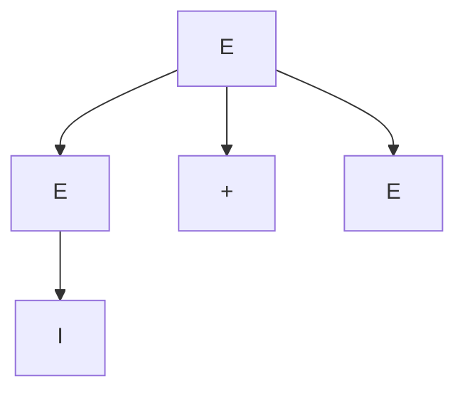
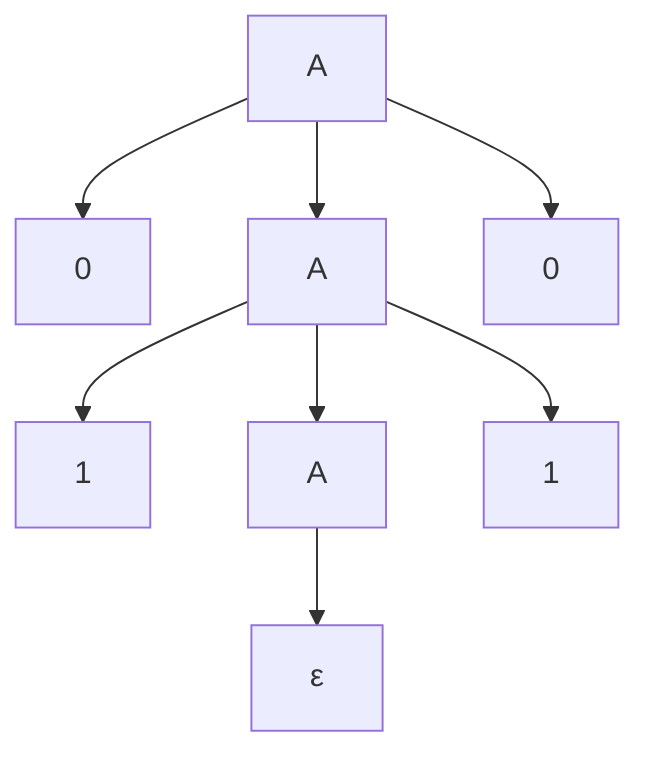
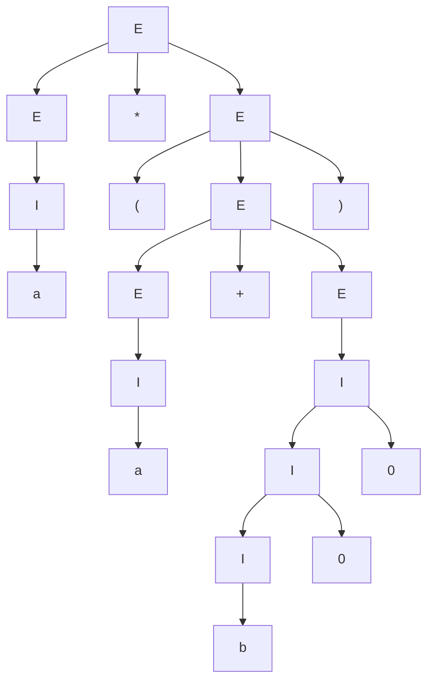
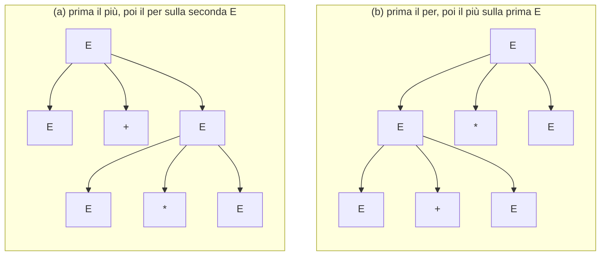
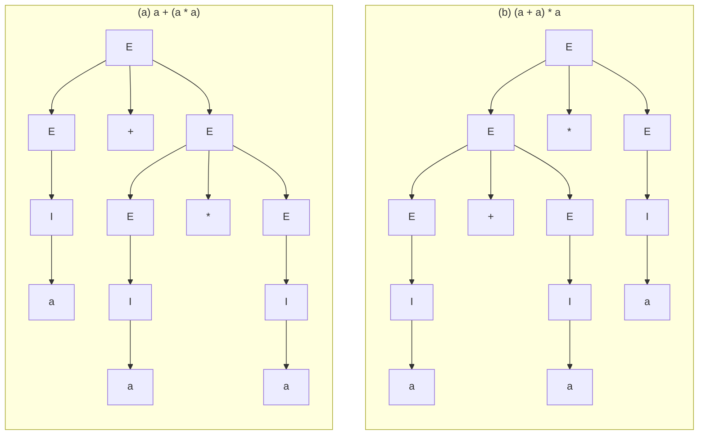

# Lezione 12 — Grammatiche libere dal contesto e ambiguità

Lasciati alle spalle i linguaggi regolari, la lezione apre il pacchetto di slide *Linguaggi liberi dal contesto* (slide 1–32). Il primo passo oltre i linguaggi regolari sono le **grammatiche libere dal contesto** (*context-free grammar*, CFG), un formalismo descrittivo più potente delle espressioni regolari. La lezione ne dà la definizione, introduce le nozioni di **derivazione** e di **inferenza**, dimostra che una grammatica genera esattamente il linguaggio dei palindromi, e introduce gli **alberi sintattici**, la rappresentazione che più interessa agli informatici. Si chiude con il primo problema che nasce salendo di livello: l'**ambiguità**.

> [!warning] Versione delle slide
> Il pacchetto ricevuto con questa lezione è una versione aggiornata rispetto a quella usata in aula. Le differenze riguardano soprattutto i lucidi su grafi e alberi, che il docente ha saltato a lezione annunciando di volerli spostare nell'introduzione del corso: nella nuova versione sono sostituiti da un solo lucido di ripasso sulla nomenclatura degli alberi (slide 21). La numerazione delle slide citata in questa nota è quella della nuova versione, il cui piè di pagina riporta però ancora «/ 86» anziché il numero effettivo di pagine (84).

## Dove siamo

Il docente riassume il quadro. Si vogliono definire linguaggi formali; le **grammatiche** dicono come sono fatti, cioè li **descrivono**. Una volta descritto il linguaggio si pone il word problem, e per risolverlo ci sono gli **automi**, che **riconoscono** se una stringa appartiene al linguaggio. Tra i due c'è una **dualità**: da un automa si risale alla descrizione del linguaggio (per i linguaggi regolari, dall'automa all'espressione regolare), e dalla descrizione si genera automaticamente l'algoritmo che risolve il word problem (dall'espressione regolare all'ε-NFA, poi al DFA). Per i linguaggi regolari si è messo in piedi un bel po' di armamentario: chiusura rispetto a molte operazioni, minimizzazione, equivalenza; e il pumping lemma ha mostrato che non tutti i linguaggi sono regolari, perché un automa a stati finiti «non sa contare» ([[Lezione 10 - Pumping lemma, proprietà di chiusura e minimizzazione|lezione 10]]).

Ora si sale di espressività, e la prima stazione a cui il «treno» si ferma è quella dei **linguaggi liberi dal contesto**. Il nome fa pensare che esistano anche linguaggi che dipendono dal contesto, e infatti esistono: sono l'ultimo passo che si vedrà, i linguaggi riconosciuti dalla **macchina di Turing**, oltre la quale, come ci si convincerà senza poterlo dimostrare, non c'è niente di più potente; è il modello di calcolo dei PC, degli smartphone e di qualsiasi cosa calcoli oggi. Qui si è a un passo intermedio. Si vedranno le grammatiche libere dal contesto (CFG) e gli **automi push-down** (*pushdown automaton*, PDA), che nei testi italiani si trovano a volte tradotti come «automi a pila» («pila» nel senso di una pila di piatti); il docente, che trova la traduzione brutta, li chiamerà push-down. Si intuisce già che i secondi sono la versione algoritmica delle prime: le grammatiche descrivono, gli automi riconoscono, lo stesso gioco delle espressioni regolari e degli automi a stati finiti. Questa volta, però, si parte dal linguaggio per arrivare agli automi.

## Oltre i linguaggi regolari: i palindromi

Oltre a $0^n1^n$ c'è un altro esempio di linguaggio non regolare: quello delle stringhe **palindrome**, che si leggono allo stesso modo nei due sensi, come «adda», «otto», «mom» o «dad». Dato un alfabeto $\Sigma$,
$$
L_p = \{ w \in \Sigma^* : w = w^R \},
$$
dove $w^R$ indica la stringa $w$ letta al contrario, come definito nella [[Lezione 10 - Pumping lemma, proprietà di chiusura e minimizzazione#Le buone notizie: proprietà di chiusura|lezione 10]].

Intuitivamente, un automa a stati finiti non riesce a riconoscere i palindromi perché non sa quando fermarsi né che cosa ricordarsi: se legge uno 0 all'inizio, alla fine deve leggere uno 0; se legge un 1, alla fine deve leggere un 1; ma come fa a ricordarselo, per stringhe lunghe a piacere? Formalmente, con il pumping lemma: sia $\Sigma = \{0, 1\}$ e si supponga $L_p$ regolare, con $n$ la costante del lemma. La stringa $0^n10^n$ è palindroma. Leggendo il prefisso $0^n$ il DFA deve passare per un ciclo, ma quello stesso ciclo può portarlo a riconoscere anche $0^m10^n$ con $m \neq n$, che non è palindroma: lo stesso gioco fatto per $0^n1^n$.

> [!example] La dimostrazione con lo schema della lezione 10
> Si sceglie $w = 0^n10^n$, di lunghezza $2n + 1 \geq n$. Ogni scomposizione $w = xyz$ con $|xy| \leq n$ e $y \neq \epsilon$ ha $x$ e $y$ fatte di soli zeri, perché i primi $n$ simboli di $w$ sono zeri. Per $k = 0$ si ottiene $xz = 0^{n - |y|}10^n$, che ha meno zeri prima dell'1 che dopo, e quindi non è palindroma: assurdo. Dunque $L_p$ non è regolare.

Come si potrebbe allora definire $L_p$? Il docente propone di pensare a una funzione ricorsiva, in C, C++ o Python, che controlli se una stringa è palindroma. La definizione **induttiva** è naturale:

- **Base.** $\epsilon$, $0$ e $1$ sono palindromi.
- **Passo.** Se $w$ è palindroma, anche $0w0$ e $1w1$ lo sono.

Un controllo ricorsivo prende il primo e l'ultimo carattere, verifica che siano uguali e, se lo sono, controlla ricorsivamente ciò che sta in mezzo. Si può fare anche con un ciclo, confrontando i caratteri dall'esterno verso l'interno e fermandosi alla prima coppia diversa. La versione ricorsiva in C++ segue da vicino la definizione:

```cpp
#include <iostream>
#include <string_view>

// Base: lunghezza 0 o 1. Passo: primo == ultimo e l'interno è palindromo.
bool is_palindrome(std::string_view w) {
  if (w.size() <= 1) return true;
  return w.front() == w.back() and is_palindrome(w.substr(1, w.size() - 2));
}

int main() {
  for (std::string_view w : {"", "0", "0110", "01010", "0010", "001"})
    std::cout << '"' << w << "\": " << std::boolalpha << is_palindrome(w) << '\n';
}
```

Il programma stampa `true` per le prime quattro stringhe e `false` per le ultime due. L'idea è che questa definizione, specifica per i palindromi, si può generalizzare: tutti i linguaggi con caratteristiche simili, che sono appunto i linguaggi liberi dal contesto, si possono definire in modo analogo con una grammatica libera dal contesto.

## Le grammatiche libere dal contesto

> [!important] Grammatica libera dal contesto
> Una **grammatica libera dal contesto** (CFG) è una quadrupla
> $$G = (V, T, P, S)$$
> dove:
> - $V$ è un insieme finito di simboli **non terminali**, detti anche **variabili**;
> - $T$ è un insieme finito di simboli **terminali**, cioè l'alfabeto, i simboli atomici;
> - $P$ è un insieme finito di **produzioni** (o **regole**) della forma $A \to \alpha$, dove $A \in V$ è una variabile e $\alpha \in (V \cup T)^*$ è una sequenza, eventualmente vuota, di simboli terminali e non terminali;
> - $S \in V$ è una variabile distinta, detta **simbolo iniziale**.

In una produzione $A \to \alpha$, la variabile $A$ si chiama **testa** e la sequenza $\alpha$ **corpo**. Le produzioni definiscono le variabili: dicono che cosa può prendere il posto di una variabile. Il simbolo iniziale è quello da cui parte la **generazione** delle stringhe: le grammatiche sono un formalismo **generativo**.

> [!example] La grammatica dei palindromi
> $G_p = (\{A\}, \{0, 1\}, P, A)$, con le produzioni
> $$A \to \epsilon \qquad A \to 0 \qquad A \to 1 \qquad A \to 0A0 \qquad A \to 1A1 .$$
> Per compattezza si raggruppano le produzioni con la stessa testa: $P = \{A \to \epsilon \mid 0 \mid 1 \mid 0A0 \mid 1A1\}$, dove la barra verticale si legge «oppure».

La grammatica ricopia da vicino la definizione induttiva. C'è un solo simbolo non terminale, $A$, che è anche il simbolo iniziale; i terminali sono 0 e 1, l'alfabeto che negli automi si chiamava $\Sigma$. Applicando le regole a partire da $A$ si generano stringhe. Da $A$ si può ottenere $\epsilon$, quindi la stringa vuota è palindroma; si possono ottenere 0 e 1. Oppure si può riscrivere $A$ come $0A0$, poi la nuova $A$ come $1A1$, ottenendo $01A10$, poi ancora $010A010$, e così via: ogni volta si sostituisce la variabile con il corpo di una sua produzione. A un certo punto si decide di fermarsi, riscrivendo $A$ come $\epsilon$ (o come 0, o come 1): con $A \to \epsilon$ si ottiene $010010$, una stringa palindroma. A seconda delle regole applicate si generano tutte le possibili stringhe palindrome, e solo quelle: ogni regola, intuitivamente, produce un palindromo a partire da un palindromo più corto. Lo si dimostrerà formalmente più avanti.

Si ha così, almeno a livello descrittivo, un formalismo più potente delle espressioni regolari.

### Le espressioni regolari come grammatica

Informalmente, le CFG sono **più espressive** delle espressioni regolari. Per esempio, la sintassi stessa delle espressioni regolari su $\{0, 1\}$ si può definire con una CFG:
$$
G_r = \big(\{E\},\ \{0, 1, ., +, {}^*, (, )\},\ P,\ E\big)
$$
con le produzioni
$$
E \to 0 \qquad E \to 1 \qquad E \to E.E \qquad E \to E + E \qquad E \to E^* \qquad E \to (E).
$$
Un simbolo dell'alfabeto è un'espressione regolare; la concatenazione, l'unione e la chiusura di espressioni regolari sono espressioni regolari; e anche un'espressione tra parentesi lo è. Con una CFG si può quindi dire come si scrivono le espressioni regolari, mentre con un'espressione regolare non si può: le parentesi devono essere bilanciate, e bilanciare le parentesi richiede di contare, che è esattamente ciò che gli automi a stati finiti non sanno fare.

> [!warning] Notazione degli asterischi nelle slide
> In aula il docente segnala due imprecisioni grafiche: nella slide 8 l'asterisco della chiusura dovrebbe essere in apice ($E \to E^*$), e nella slide 9 l'asterisco della moltiplicazione dovrebbe stare in linea ($E \to E * E$). Nella versione aggiornata delle slide il primo simbolo è stato sostituito; in questa nota la chiusura è sempre in apice e la moltiplicazione in linea.

### Espressioni con identificatori

Un esempio in stile linguaggio di programmazione. Gli operatori sono solo $+$ e $*$; gli operandi sono **identificatori** definiti dall'espressione regolare
$$
(a + b)(a + b + 0 + 1)^* ,
$$
cioè stringhe che iniziano con una lettera ($a$ o $b$) e proseguono con lettere o cifre binarie: $a$, $b$, $a01$ sono identificatori, $0a$ no. Le espressioni sono generate dalla grammatica $G = (\{E, I\}, T, P, E)$, con $T = \{+, *, (, ), a, b, 0, 1\}$ e le produzioni:

| Numero | Produzione | Significato |
|---|---|---|
| 1 | $E \to I$ | un identificatore è un'espressione |
| 2 | $E \to E + E$ | somma di due espressioni |
| 3 | $E \to E * E$ | prodotto di due espressioni |
| 4 | $E \to (E)$ | espressione tra parentesi |
| 5 | $I \to a$ | identificatore di una sola lettera |
| 6 | $I \to b$ | |
| 7 | $I \to Ia$ | un identificatore seguito da una lettera |
| 8 | $I \to Ib$ | |
| 9 | $I \to I0$ | un identificatore seguito da una cifra |
| 10 | $I \to I1$ | |

Le produzioni 5 e 6 sono i casi base, le produzioni dalla 7 alla 10 i passi induttivi: è il modo ricorsivo di definire i linguaggi visto all'inizio del corso. Le regole 7–10 aggiungono sempre un simbolo in **coda**, e lasciano una $I$ in testa; l'unico modo di sbarazzarsene, cioè di terminare la generazione, è usare la regola 5 o la 6. Per questo un identificatore può iniziare solo con una lettera. Per esempio:
$$
I \Rightarrow Ia \Rightarrow Iba \Rightarrow I0ba \Rightarrow a0ba ,
$$
dove si sono usate, nell'ordine, le regole 7, 8, 9 e 5. Le stringhe intermedie, che contengono ancora variabili, non sono stringhe del linguaggio: si chiameranno **forme sentenziali**. L'ultima, fatta di soli terminali, lo è. Si è verificato al calcolatore che le stringhe generate da $I$ fino alla lunghezza 5 sono esattamente quelle descritte dall'espressione regolare. Non è una dimostrazione formale, ma l'esempio mostra che le CFG sono abbastanza potenti da esprimere ciò che si esprime con le espressioni regolari: qualsiasi espressione regolare si può riscrivere come una grammatica libera dal contesto.

Questo è, osserva il docente, una forma semplificata dei nomi di variabile del C++. Un identificatore del C potrebbe essere descritto da un'espressione come
$$
(a + \cdots + z + A + \cdots + Z + \_)\,(a + \cdots + z + A + \cdots + Z + 0 + \cdots + 9 + \_)^* ,
$$
che negli strumenti pratici si abbrevia `[a-zA-Z_][a-zA-Z0-9_]*`, dove `[0-9]` indica una qualsiasi cifra da 0 a 9. Un identificatore inizia con una lettera o con un trattino basso e prosegue con lettere, cifre o trattini bassi: in C++, una variabile chiamata `0a` produce un errore, `a0` va bene. L'esempio delle espressioni con identificatori verrà ripreso nella parte di C++ per scrivere un algoritmo di **parsing** delle espressioni, la base di ciò che servirà nel progetto.

> [!tip] Approfondimento — Gli identificatori del C++
> #approfondimento
> L'espressione del docente descrive la forma tradizionale degli identificatori. Lo standard C++ ammette anche caratteri Unicode oltre alle lettere latine, e riserva alcuni identificatori (per esempio quelli che contengono un doppio trattino basso, o che iniziano con un trattino basso seguito da una lettera maiuscola) all'implementazione [@cppref-identifiers]. Per i programmi del corso la forma `[a-zA-Z_][a-zA-Z0-9_]*` è comunque quella da usare.

## Inferenza e derivazione

Le produzioni si possono usare in due direzioni.

- **Derivazione**: dalla **testa al corpo**. Si parte dal simbolo iniziale e si rimpiazzano le variabili con i corpi delle produzioni, generando stringhe. È ciò che si è fatto finora.
- **Inferenza**: dal **corpo alla testa**. Data una stringa, si cerca di capire se è il corpo di qualche produzione, e si risale verso il simbolo iniziale, per stabilire se la stringa appartiene al linguaggio.

> [!example] Un'inferenza per $a * (a + b00)$
> | | Stringa | Linguaggio di | Produzione | Stringhe usate |
> |---|---|---|---|---|
> | (i) | $a$ | $I$ | 5 | — |
> | (ii) | $b$ | $I$ | 6 | — |
> | (iii) | $b0$ | $I$ | 9 | (ii) |
> | (iv) | $b00$ | $I$ | 9 | (iii) |
> | (v) | $a$ | $E$ | 1 | (i) |
> | (vi) | $b00$ | $E$ | 1 | (iv) |
> | (vii) | $a + b00$ | $E$ | 2 | (v), (vi) |
> | (viii) | $(a + b00)$ | $E$ | 4 | (vii) |
> | (ix) | $a * (a + b00)$ | $E$ | 3 | (v), (viii) |
>
> $a$ è un identificatore per la produzione 5, $b$ per la 6; $b0$ lo è per la 9, sapendo che $b$ è un identificatore, e così $b00$. Poiché $a$ e $b00$ sono identificatori, per la produzione 1 sono espressioni; per la 2 lo è $a + b00$, per la 4 $(a + b00)$, e per la 3 $a * (a + b00)$. Invece di generare la stringa partendo da $E$, si risale a $E$ mettendo insieme i pezzi.

Questa direzione, dal corpo alla testa, è quella che nella parte pratica si chiama **parsing**, ed è quella che serve per un interprete: data una stringa, bisogna stabilire se appartiene alla grammatica e, se sì, costruire la struttura dati corrispondente per poi valutarla. Nella lezione di C++ del giorno precedente ([[Lezione 11 - Soluzioni degli esercizi, algoritmi e iteratori#La soluzione dell'esercizio sulle espressioni|lezione 11]]) si è partiti dal fondo: si è immaginato di avere già l'espressione in memoria, costruita a mano, e la si è valutata. Il passo che manca è usare questi concetti per costruire l'espressione a partire dal testo, e lo si farà a tempo debito.

### La derivazione, formalmente

> [!important] Derivazione
> Sia $G = (V, T, P, S)$ una CFG, siano $A \in V$, $\alpha, \beta \in (V \cup T)^*$ e sia $A \to \gamma$ una produzione di $P$. Si scrive
> $$\alpha A \beta \Rightarrow_G \alpha \gamma \beta$$
> (o semplicemente $\alpha A \beta \Rightarrow \alpha\gamma\beta$ se la grammatica è ovvia) e si dice che $\alpha\gamma\beta$ **deriva** da $\alpha A \beta$ in un passo.
>
> La relazione $\overset{*}{\Rightarrow}$ («deriva in zero o più passi») è la **chiusura riflessiva e transitiva** di $\Rightarrow$:
> - **Base.** Per ogni $\alpha \in (V \cup T)^*$, $\alpha \overset{*}{\Rightarrow} \alpha$.
> - **Induzione.** Se $\alpha \overset{*}{\Rightarrow} \beta$ e $\beta \Rightarrow \gamma$, allora $\alpha \overset{*}{\Rightarrow} \gamma$.

Le lettere greche indicano stringhe finite che possono contenere sia terminali sia variabili, cioè elementi di $(V \cup T)^*$. Un passo di derivazione sceglie una variabile nella stringa e la sostituisce con il corpo di una sua produzione, lasciando invariato tutto il resto: nella derivazione degli identificatori, il passo $Ia \Rightarrow Iba$ usa la produzione $I \to Ib$, con $\alpha = \epsilon$ e $\beta = a$. La derivazione in più passi è una catena di passi singoli. Il docente la paragona al gioco in cui si passa da una parola a un'altra cambiando una lettera per volta, ottenendo sempre parole di senso compiuto.

### Il non determinismo

Una derivazione di $a * (a + b00)$ da $E$ è:
$$
\begin{aligned}
E &\Rightarrow E * E \Rightarrow I * E \Rightarrow a * E \Rightarrow a * (E) \Rightarrow a * (E + E) \Rightarrow a * (I + E) \\
&\Rightarrow a * (a + E) \Rightarrow a * (a + I) \Rightarrow a * (a + I0) \Rightarrow a * (a + I00) \Rightarrow a * (a + b00).
\end{aligned}
$$
A ogni passo si sceglie una variabile, le si applica una regola e si va avanti finché restano solo terminali. Ma a ogni passo ci possono essere **più scelte**. Da $I * E$, per esempio, si può riscrivere prima $I$ come $a$ e poi $E$ come $(E)$, oppure prima $E$ e poi $I$: entrambe le strade sono lecite. E non tutte le scelte portano alla stringa voluta: se il primo passo fosse $E \Rightarrow E + E$ invece di $E \Rightarrow E * E$, non si arriverebbe mai a $a * (a + b00)$, perché nella stringa c'è un per al livello più esterno, non un più.

Questo è un problema. Il non determinismo, come si è visto con gli automi, «rompe le scatole», perché di per sé non si può implementare: tirare a indovinare e sperare di essere fortunati non è un algoritmo. Se la stringa appartiene al linguaggio ma si sbaglia la prima produzione, che cosa si fa? Il docente anticipa che questo apparente tirare a indovinare si può risolvere in modo sistematico, a un certo costo, e che non sempre è necessario farlo; ci si tornerà. Per ora basta notare che qui c'è qualcosa che nelle espressioni regolari non c'era: lì era tutto «bello, tranquillo, deterministico».

### Derivazioni a sinistra e a destra

Una prima strategia per ridurre le scelte è fissare **quale** variabile rimpiazzare.

> [!important] Derivazioni a sinistra e a destra
> - Una **derivazione a sinistra** (*leftmost*), indicata con $\underset{lm}{\Rightarrow}$, rimpiazza sempre la variabile **più a sinistra** con il corpo di una delle sue produzioni.
> - Una **derivazione a destra** (*rightmost*), indicata con $\underset{rm}{\Rightarrow}$, rimpiazza sempre la variabile **più a destra**.

Un esempio di derivazione a destra della stessa stringa:
$$
\begin{aligned}
E &\underset{rm}{\Rightarrow} E * E \underset{rm}{\Rightarrow} E * (E) \underset{rm}{\Rightarrow} E * (E + E) \underset{rm}{\Rightarrow} E * (E + I) \underset{rm}{\Rightarrow} E * (E + I0) \\
&\underset{rm}{\Rightarrow} E * (E + I00) \underset{rm}{\Rightarrow} E * (E + b00) \underset{rm}{\Rightarrow} E * (I + b00) \underset{rm}{\Rightarrow} E * (a + b00) \\
&\underset{rm}{\Rightarrow} I * (a + b00) \underset{rm}{\Rightarrow} a * (a + b00).
\end{aligned}
$$
A ogni passo si espande la variabile più a destra (i terminali sono già «espansi», sono la base). Si conclude che $E \underset{rm}{\overset{*}{\Rightarrow}} a * (a + b00)$: la derivazione a destra arriva alla stringa desiderata, e non si è persa generalità. Resta però il fatto che si è scelto bene la regola da applicare: se al primo passo si fosse scelto $E + E$, si sarebbe «fregati». Il non determinismo resta in agguato, perché fissare la variabile da espandere non dice quale produzione usare.

### Notazione

Per le derivazioni si adottano queste convenzioni:

- lettere minuscole dell'inizio dell'alfabeto, come $a, b, c$, indicano **simboli terminali**; anche cifre e altri simboli come $+$, $-$ o le parentesi sono terminali;
- lettere maiuscole dell'inizio dell'alfabeto, come $A, B, C$, indicano **variabili**;
- lettere minuscole della fine dell'alfabeto, come $w, x, y, z$, indicano **stringhe di terminali**;
- lettere maiuscole della fine dell'alfabeto, come $X, Y, Z$, indicano **un simbolo**, terminale o variabile;
- lettere greche minuscole, come $\alpha, \beta, \gamma$, indicano **stringhe di terminali e variabili**.

> [!warning] Un refuso nella slide 14
> La slide scrive che «lettere maiuscole come $x, y, z$» denotano terminali o variabili. Il docente lo ha segnalato in aula: le lettere vanno scritte maiuscole, $X, Y, Z$, per distinguerle dalle stringhe di terminali $x, y, z$.

## Il linguaggio di una grammatica

> [!important] Linguaggio libero dal contesto
> Se $G = (V, T, P, S)$ è una CFG, il **linguaggio di $G$** è
> $$L(G) = \{ w \in T^* : S \overset{*}{\Rightarrow}_G w \},$$
> cioè l'insieme delle stringhe di soli terminali derivabili dal simbolo iniziale in zero o più passi. Un linguaggio $L$ è **libero dal contesto** (*context-free language*, CFL) se $L = L(G)$ per qualche CFG $G$.

### La grammatica dei palindromi genera i palindromi

Ora si può dimostrare formalmente ciò che si era visto intuitivamente.

> [!important] Teorema
> $L(G_p) = \{ w \in \{0, 1\}^* : w = w^R \}$.

Bisogna dimostrare che, per ogni $w \in \{0,1\}^*$, si ha $w \in L(G_p)$ **se e solo se** $w = w^R$: due direzioni.

**Direzione «se»: se $w = w^R$, allora $w \in L(G_p)$.** Per induzione sulla lunghezza $|w|$.

- **Base.** $|w| = 0$ oppure $|w| = 1$ (due casi base). Allora $w$ è $\epsilon$, $0$ oppure $1$. Poiché $A \to \epsilon$, $A \to 0$ e $A \to 1$ sono produzioni, in tutti i casi base $A \overset{*}{\Rightarrow} w$ (in un passo).
- **Induzione.** Sia $|w| \geq 2$. Poiché $w = w^R$, $w$ inizia e finisce con lo stesso simbolo, e ciò che sta in mezzo è a sua volta palindromo: $w = 0x0$ oppure $w = 1x1$, con $x = x^R$. Si consideri $w = 0x0$. La stringa $x$ è più corta di $w$, quindi per ipotesi induttiva $A \overset{*}{\Rightarrow} x$. Allora
$$A \Rightarrow 0A0 \overset{*}{\Rightarrow} 0x0 = w ,$$
e quindi $w \in L(G_p)$. Il caso $w = 1x1$ è analogo, con la produzione $A \to 1A1$.

**Direzione «solo se»: se $w \in L(G_p)$, allora $w = w^R$.** Questa volta per induzione sulla **lunghezza della derivazione** $A \overset{*}{\Rightarrow} w$.

- **Base.** La derivazione ha un passo. Allora usa una delle produzioni $A \to \epsilon$, $A \to 0$, $A \to 1$, e $w$ è $\epsilon$, $0$ o $1$: tutte palindrome.
- **Induzione.** La derivazione ha $n + 1$ passi, con $n \geq 1$. Poiché sono almeno due passi, il primo deve usare $A \to 0A0$ oppure $A \to 1A1$: sono le uniche produzioni che lasciano una variabile da espandere, e quindi le uniche che permettono passi successivi. Si ha quindi
$$A \Rightarrow 0A0 \overset{*}{\Rightarrow} 0x0 = w \qquad \text{oppure} \qquad A \Rightarrow 1A1 \overset{*}{\Rightarrow} 1x1 = w ,$$
dove $A \overset{*}{\Rightarrow} x$ in $n$ passi. Questa derivazione è più corta, quindi per ipotesi induttiva $x = x^R$. Ma allora anche $0x0$ e $1x1$ sono palindrome: per esempio $(0x0)^R = 0x^R0 = 0x0$. Pertanto $w = w^R$. $\square$

Si è verificato anche al calcolatore che le stringhe generate da $G_p$ fino alla lunghezza 10 sono esattamente i palindromi binari di quelle lunghezze (125 stringhe in tutto).

> [!warning] Il passo induttivo detto a voce
> Nella trascrizione il docente parla a un certo punto di una derivazione «di $n + 2$ passi»; le slide formulano il passo induttivo, come qui, con $n + 1$ passi e $n \geq 1$, cioè con almeno due passi. Le due formulazioni portano allo stesso ragionamento.

> [!important] Schema delle dimostrazioni sulle grammatiche
> Per dimostrare che una grammatica $G$ genera **tutte e sole** le stringhe di un linguaggio $L$ si dimostrano due direzioni:
> 1. se $w \in L$, allora $G$ genera $w$: di solito **per induzione su $|w|$**;
> 2. se $G$ genera $w$, allora $w \in L$: di solito **per induzione sul numero di passi** della derivazione $S \overset{*}{\Rightarrow} w$.
>
> Se nelle stringhe derivate compaiono più variabili, bisogna considerarle separatamente, enunciando una proprietà per ciascuna.

Il docente avverte che un esercizio di questo tipo può capitare all'esame: «dammi una grammatica per questo linguaggio, e dimostrami che genera effettivamente le stringhe del linguaggio». Sta preparando alcuni esercizi di esempio.

## Forme sentenziali

> [!important] Forme sentenziali
> Sia $G = (V, T, P, S)$ una CFG e $\alpha \in (V \cup T)^*$. Se $S \overset{*}{\Rightarrow} \alpha$, si dice che $\alpha$ è una **forma sentenziale**. Se $S \underset{lm}{\overset{*}{\Rightarrow}} \alpha$ è una **forma sentenziale sinistra**; se $S \underset{rm}{\overset{*}{\Rightarrow}} \alpha$, una **forma sentenziale destra**.

Le forme sentenziali sono le stringhe intermedie di una derivazione. Il linguaggio $L(G)$ contiene tutte e sole le forme sentenziali fatte di soli terminali, cioè con $\alpha \in T^*$. Nella grammatica delle espressioni:

- $E * (I + E)$ è una forma sentenziale, perché $E \Rightarrow E * E \Rightarrow E * (E) \Rightarrow E * (E + E) \Rightarrow E * (I + E)$; questa derivazione non è né a sinistra né a destra: a volte si è espansa la variabile più a sinistra, a volte quella più a destra;
- $a * E$ è una forma sentenziale sinistra, perché $E \underset{lm}{\Rightarrow} E * E \underset{lm}{\Rightarrow} I * E \underset{lm}{\Rightarrow} a * E$;
- $E * (E + E)$ è una forma sentenziale destra, perché $E \underset{rm}{\Rightarrow} E * E \underset{rm}{\Rightarrow} E * (E) \underset{rm}{\Rightarrow} E * (E + E)$.

> [!warning] Un refuso nella slide 20
> Nella derivazione a sinistra di $a * E$ la slide scrive il secondo passo come $IE$, senza il simbolo di moltiplicazione; il docente lo ha notato in aula. Il passo corretto è $I * E$.

## Alberi sintattici

### Un ripasso sugli alberi

Gli **alberi** non sono stati definiti formalmente nel corso; il docente ne dà per assodata la definizione, già incontrata parlando di ereditarietà e di design pattern, e rimanda alla nomenclatura della slide 21, intuitiva se si pensa alle cartelle di un file system. Un albero è una struttura gerarchica, con la **radice** disegnata in alto. Le **foglie** sono i nodi in fondo, che non hanno sottoalberi; gli altri sono **nodi interni**. Si parla di **padre** e **figli** a seconda che un nodo stia sopra o sotto un altro, e di **fratelli** per i nodi con lo stesso padre; più in generale di **antenati** e **discendenti**. Il **grado** di un nodo è il numero dei suoi figli. Il **livello** (o **profondità**) di un nodo è la sua distanza dalla radice, che ha livello 0; l'**altezza** di un nodo è la lunghezza del cammino più lungo da esso a una foglia, e l'altezza dell'albero è quella della radice. Un nodo, con tutti i suoi discendenti, forma il **sottoalbero** che ha quel nodo come radice.

### Definizione

Le derivazioni si possono rappresentare graficamente con alberi. Gli **alberi sintattici** (*parse tree*) sono alberi radicati che forniscono una rappresentazione alternativa alle derivazioni e alle inferenze ricorsive. Per la stessa stringa ci possono essere più alberi sintattici, e questo, come si vedrà, è il cuore del problema dell'ambiguità.

> [!important] Albero sintattico
> Data una CFG $G = (V, T, P, S)$, un albero radicato è un **albero sintattico** per $G$ se:
> 1. ogni **nodo interno** è etichettato con una variabile di $V$;
> 2. ogni **foglia** è etichettata con un simbolo di $V \cup T \cup \{\epsilon\}$, e una foglia etichettata $\epsilon$ è l'**unico figlio** del suo genitore;
> 3. se un nodo interno è etichettato $A$ e i suoi figli, da sinistra a destra, sono etichettati $X_1, X_2, \dots, X_k$, allora $A \to X_1X_2\cdots X_k$ è una produzione di $P$.

L'albero riflette quindi la struttura delle produzioni: un nodo è la testa di una regola, i suoi figli ne sono il corpo. Nella grammatica delle espressioni, l'albero seguente ha la radice $E$ con figli $E$, $+$, $E$ (produzione 2), e il primo figlio $E$ ha a sua volta un figlio $I$ (produzione 1). Corrisponde alla derivazione in due passi $E \Rightarrow E + E \Rightarrow I + E$.



> [!warning] Due imprecisioni nelle slide 24 e 25
> La slide 24 dice che l'albero «mostra la derivazione $E \Rightarrow I + E$», con la freccia del passo singolo; i passi sono due, e la notazione corretta è $E \overset{*}{\Rightarrow} I + E$. La slide 25 dice che l'albero dei palindromi mostra la derivazione «$P \overset{*}{\Rightarrow} 0110$», ma il simbolo iniziale della grammatica è $A$: va letto $A \overset{*}{\Rightarrow} 0110$.

Nella grammatica dei palindromi, l'albero seguente applica $A \to 0A0$ alla radice, $A \to 1A1$ al figlio centrale e $A \to \epsilon$ al nipote, la cui unica foglia è $\epsilon$. Corrisponde alla derivazione $A \Rightarrow 0A0 \Rightarrow 01A10 \Rightarrow 0110$.



### Il prodotto

> [!important] Prodotto di un albero sintattico
> Il **prodotto** (*yield*) di un albero sintattico è la stringa che si ottiene leggendo le foglie **da sinistra a destra**. Se si considerano gli alberi sintattici la cui radice è etichettata con il simbolo iniziale e il cui prodotto è una stringa di soli terminali, l'insieme dei loro prodotti è esattamente il **linguaggio della grammatica**.

Nell'albero dei palindromi le foglie, lette da sinistra a destra, sono $0$, $1$, $\epsilon$, $1$, $0$, e il prodotto è $0110$. Il docente usa l'immagine dei libri per bambini con le figure in rilievo: aprendo la pagina, la figura si alza in tre dimensioni. La stringa è piatta, una sequenza di caratteri; l'albero sintattico ne è la **struttura**, e le sue foglie sono la stringa stessa.

L'albero seguente, nella grammatica delle espressioni, ha prodotto $a * (a + b00)$:



Il docente lo collega alla lezione di C++ del giorno precedente. Se si sale di un livello, considerando $b00$ come un unico token invece di scomporlo con le regole degli identificatori, e si mette ogni operatore nel nodo padre invece che tra i figli, si ottiene esattamente l'albero dell'espressione costruito a mano con le classi `Operator`, `Variable` e `Number`. Non a caso il pattern Interpreter parla di espressioni **terminali** e **non terminali**, la stessa terminologia delle grammatiche. Il problema sarà capire come costruire quest'albero automaticamente.

> [!important] Derivazioni e alberi sintattici
> Sia $G = (V, T, P, S)$ una CFG e $A \in V$. Le seguenti affermazioni sono equivalenti:
> 1. si può determinare per inferenza ricorsiva che $w$ è nel linguaggio di $A$;
> 2. $A \overset{*}{\Rightarrow} w$;
> 3. $A \underset{lm}{\overset{*}{\Rightarrow}} w$ e $A \underset{rm}{\overset{*}{\Rightarrow}} w$;
> 4. esiste un albero sintattico di $G$ con radice $A$ e prodotto $w$.

Il corso non le dimostra. Sapere che sono equivalenti permette di ragionare nel modo più conveniente; agli informatici serve soprattutto la quarta, perché l'albero sintattico è la struttura su cui si fanno le valutazioni. Le derivazioni e le inferenze, osserva il docente, rispecchiano il modo di ragionare dei matematici e dei logici (dalla testa della regola si deriva il corpo, e così via); l'albero è l'approccio informatico: ricostruire da una stringa, che sia un'espressione o un intero programma C++ («uno stringone»), la sua **struttura gerarchica**, per poterla valutare, interpretare, eseguire o tradurre.

## L'ambiguità

### Due alberi per la stessa forma

Nella grammatica delle espressioni, la forma sentenziale $E + E * E$ ha due derivazioni:
$$
E \Rightarrow E + E \Rightarrow E + E * E \qquad \text{e} \qquad E \Rightarrow E * E \Rightarrow E + E * E .
$$
Nella prima si usa prima la produzione del più e poi, sulla seconda $E$, quella del per; nella seconda si usa prima il per e poi, sulla prima $E$, il più. Le due derivazioni corrispondono a due **alberi sintattici diversi**:



Il docente chiede quale sia il problema, al di là del fatto che i due alberi sono diversi; entrambe le derivazioni sono lecite, perché usano regole della grammatica. Si pensi che le $E$ diventino numeri: $5 + 2 * 7$. Quanto fa? 19, perché $2 \times 7 = 14$ e $14 + 5 = 19$. L'albero giusto è quindi (a): è proprio ciò che farebbe l'interprete della lezione precedente, che per calcolare la somma deve conoscere il valore dei due operandi, e per conoscere il secondo deve calcolare il prodotto. Ma «giusto» in che senso? Dalle elementari, o forse dalle medie, si è imparato che moltiplicazione e divisione hanno **precedenza** su somma e sottrazione. Anche il C++ rispetta la precedenza: scrivendo `5 + 2 * 7` si ottiene 19. Evidentemente, dunque, la grammatica del C++ non è questa, altrimenti il compilatore non saprebbe scegliere: potrebbe calcolare $(5 + 2) \times 7 = 49$, con l'albero (b), perché dal punto di vista formale entrambi gli alberi vanno bene. Lo si è verificato: i due alberi danno 19 e 49.

> [!important] Grammatica ambigua
> Sia $G = (V, T, P, S)$ una CFG. $G$ è **ambigua** se esiste almeno una stringa in $T^*$ che ha **più di un albero sintattico**. Se ogni stringa di $L(G)$ ha al più un albero sintattico, $G$ è detta **non ambigua**.

Nella grammatica delle espressioni, la stringa terminale $a + a * a$ ha due alberi sintattici, quindi la grammatica è ambigua.



L'esistenza di più alberi sintattici per la stessa stringa introduce una forma di **non determinismo**, e questo è insito nelle grammatiche libere dal contesto. Le espressioni regolari e gli automi a stati finiti deterministici non ce l'hanno (gli automi non deterministici sì, ma sono riconducibili ai deterministici). Anche gli automi push-down, nella loro definizione iniziale, saranno non deterministici. Salendo di espressività, osserva il docente, le cose si fanno subito più interessanti.

### Derivazioni diverse non significano ambiguità

L'esistenza di più **derivazioni** non comporta necessariamente l'esistenza di più **alberi**. Nella grammatica delle espressioni la stringa $a + b$ ha, per esempio, le due derivazioni
$$
E \Rightarrow E + E \Rightarrow I + E \Rightarrow a + E \Rightarrow a + I \Rightarrow a + b
$$
e
$$
E \Rightarrow E + E \Rightarrow E + I \Rightarrow I + I \Rightarrow I + b \Rightarrow a + b ,
$$
la prima a sinistra e la seconda mista; ma l'albero sintattico è lo stesso. Le derivazioni differiscono solo nell'**ordine** in cui si espandono le variabili, non nelle produzioni applicate a ciascuna. È quindi la presenza di più alberi sintattici, non di più derivazioni, a rendere ambigua una grammatica: l'albero sintattico è il dispositivo con cui si identifica l'ambiguità.

E l'ambiguità è un problema proprio perché l'albero sintattico è la struttura dati che corrisponde all'espressione, quella che permette di fare il parsing e la valutazione. Se non la si sa costruire in modo deterministico, si è «fregati»: i calcolatori sono, o dovrebbero essere, deterministici, «a meno di interazioni con i neutrini e le tempeste solari». Il docente anticipa che nelle grammatiche libere dal contesto **non sempre** l'ambiguità si può rimuovere: esistono linguaggi **inerentemente ambigui**, che pongono un problema per il parsing. Nei casi che interessano in pratica, però, si riuscirà a evitare la trappola.

> [!warning] Grammatica ambigua o linguaggio ambiguo
> La slide 22 dice che, in presenza di più alberi sintattici per una stessa forma sentenziale, «il linguaggio è ambiguo», e anche a voce il docente parla a volte di linguaggio ambiguo. Secondo la definizione della slide 32, però, l'ambiguità è una proprietà della **grammatica**: lo stesso linguaggio può avere grammatiche ambigue e grammatiche non ambigue. Di un **linguaggio** si dice che è **inerentemente ambiguo** solo quando **tutte** le grammatiche che lo generano sono ambigue.

> [!tip] Approfondimento — Linguaggi inerentemente ambigui
> #approfondimento
> Un esempio classico di linguaggio libero dal contesto inerentemente ambiguo, discusso nel libro di Hopcroft, Motwani e Ullman, è
> $$L = \{a^nb^nc^md^m : n, m \geq 1\} \cup \{a^nb^mc^md^n : n, m \geq 1\}$$
> [@hopcroft2007]. Le stringhe della forma $a^nb^nc^nd^n$ appartengono a entrambe le parti, e qualunque grammatica per $L$ finisce per avere due alberi sintattici diversi per alcune di esse. Esiste anche un limite più generale: stabilire se una CFG arbitraria è ambigua è un problema **indecidibile**, cioè non esiste un algoritmo che lo risolva per tutte le grammatiche [@hopcroft2007; @wiki-ambiguous]. Lo si comprenderà meglio con le macchine di Turing.

> [!tip] Approfondimento — La grammatica del C++
> #approfondimento
> Il docente osserva che la grammatica del C++ si trova in rete scritta come grammatica libera dal contesto, e che questo livello di espressività è quello necessario e sufficiente nella maggior parte dei casi. Lo standard ne riporta un riassunto in un allegato, avvertendo però che non è una descrizione esatta del linguaggio: la grammatica riassunta accetta un **soprainsieme** dei costrutti C++ validi, e servono regole di disambiguazione aggiuntive, per esempio per distinguere le espressioni dalle dichiarazioni [@cppdraft-gram]. La precedenza tra gli operatori, invece, è codificata direttamente nella grammatica, con variabili diverse per i diversi livelli di precedenza; le slide successive del pacchetto (dalla 33) mostrano come si fa con la grammatica delle espressioni.

Il programma seguente conta gli alberi sintattici di una stringa nella grammatica delle espressioni, con una tecnica di **programmazione dinamica**: per ogni sottostringa e ogni variabile calcola il numero di alberi, riusando i risultati per le sottostringhe più corte. È stato usato per verificare gli esempi.

```python
from functools import lru_cache

# E -> I | E+E | E*E | (E)        I -> a | b | Ia | Ib | I0 | I1
def parse_trees(w):
    @lru_cache(None)
    def I(i, j):                       # alberi con radice I e prodotto w[i:j]
        if j - i == 1:
            return 1 if w[i] in 'ab' else 0              # produzioni 5 e 6
        return I(i, j - 1) if w[j - 1] in 'ab01' else 0  # produzioni 7-10

    @lru_cache(None)
    def E(i, j):                       # alberi con radice E e prodotto w[i:j]
        n = I(i, j)                                       # produzione 1
        if j - i >= 3 and w[i] == '(' and w[j - 1] == ')':
            n += E(i + 1, j - 1)                          # produzione 4
        for k in range(i + 1, j - 1):                     # produzioni 2 e 3:
            if w[k] in '+*':                              # w[k] è l'operatore della radice
                n += E(i, k) * E(k + 1, j)
        return n
    return E(0, len(w))

for s in ['a+a*a', 'a*(a+b00)', 'a+b', 'a+a*a+a']:
    print(s, parse_trees(s))   # 2, 1, 1, 5
```

La stringa $a * (a + b00)$ ha un solo albero, perché le parentesi fissano la struttura; $a + b$ ne ha uno solo, nonostante le molte derivazioni; $a + a * a$ ne ha due, e $a + a * a + a$ addirittura cinque: con più operatori le possibili strutture si moltiplicano rapidamente.

Il docente chiude qui: la settimana successiva si riparte con il C++ e poi con la teoria.

## In sintesi

I palindromi, come $0^n1^n$, non sono un linguaggio regolare, ma si definiscono facilmente per induzione, e questa definizione si traduce in una **grammatica libera dal contesto** $G = (V, T, P, S)$: variabili, terminali, produzioni $A \to \alpha$ e simbolo iniziale. Le CFG sono un formalismo generativo, più espressivo delle espressioni regolari: possono descrivere la sintassi stessa delle espressioni regolari e le espressioni con identificatori. Le produzioni si usano dalla testa al corpo nelle **derivazioni** e dal corpo alla testa nelle **inferenze**, che corrispondono al parsing. La derivazione in un passo sostituisce una variabile con il corpo di una sua produzione, e $\overset{*}{\Rightarrow}$ ne è la chiusura riflessiva e transitiva; le scelte possibili a ogni passo introducono non determinismo, che le derivazioni a sinistra e a destra riducono ma non eliminano. Il linguaggio di una CFG è l'insieme delle stringhe di terminali derivabili dal simbolo iniziale; per dimostrare che una grammatica genera un linguaggio si procede per induzione sulla lunghezza delle stringhe in un verso e sulla lunghezza delle derivazioni nell'altro, come per i palindromi. Le **forme sentenziali** sono le stringhe intermedie delle derivazioni. Gli **alberi sintattici** rappresentano le derivazioni: i nodi interni sono variabili, i figli sono il corpo di una produzione, e il **prodotto** (le foglie lette da sinistra a destra) è la stringa derivata; inferenza, derivazione, derivazioni a sinistra e a destra e alberi sintattici sono modi equivalenti di stabilire che una stringa appartiene al linguaggio. Una grammatica è **ambigua** se una stringa ha più di un albero sintattico, come $a + a * a$ nella grammatica delle espressioni: l'ambiguità corrisponde a un non determinismo, e rende impossibile decidere, per esempio, la precedenza tra gli operatori.
