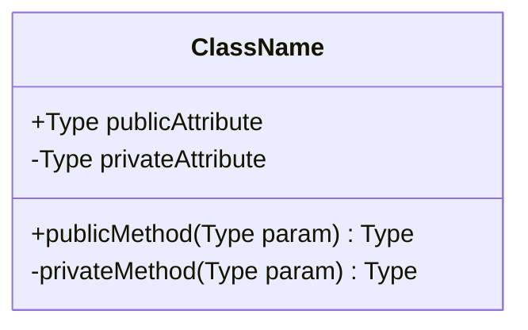
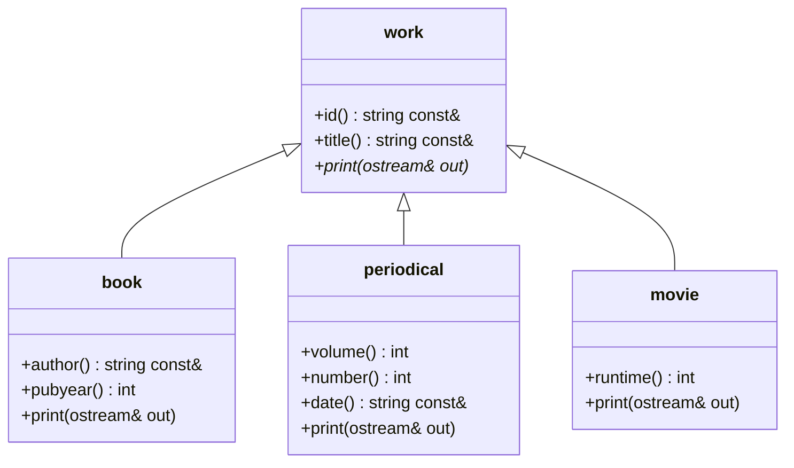
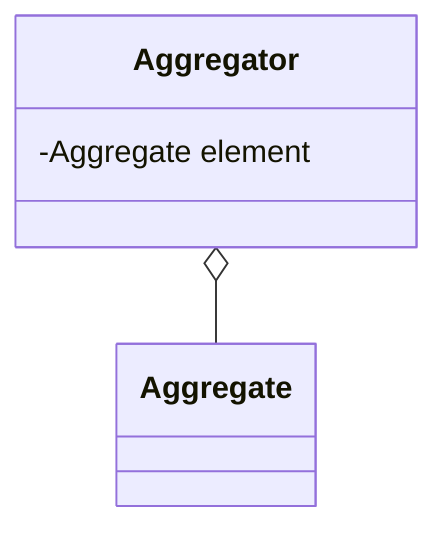
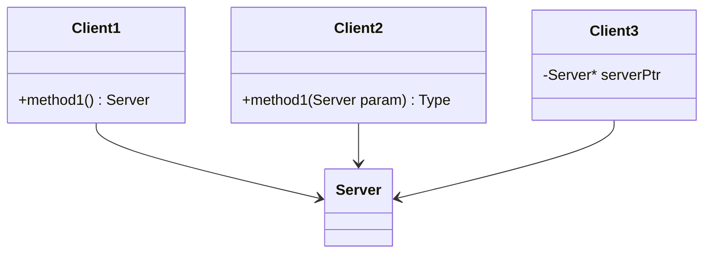
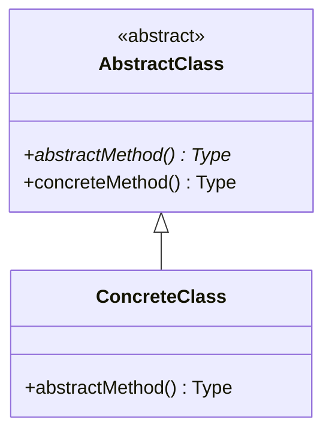
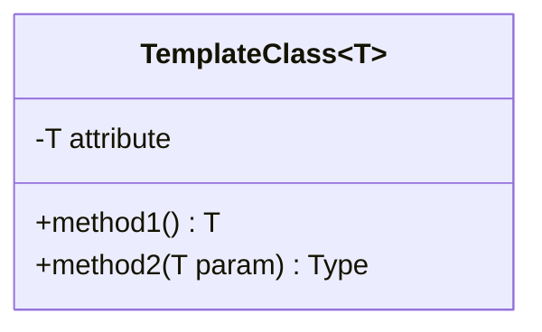
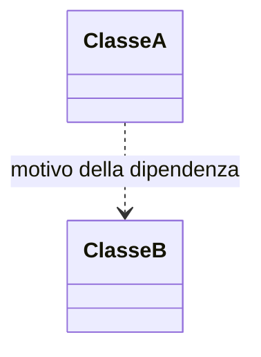

---

## lezione: 5 data: 2026-10-07 argomenti: [polimorfismo, funzioni virtuali, override, tabella delle funzioni virtuali, distruttori virtuali, overloading e overriding, operator<<, slicing, funzioni virtuali pure, classi astratte, UML, diagramma delle classi, ereditarietà, aggregazione, utilizzo, dipendenza, semantica formale]
---
# Lezione 5 — Funzioni virtuali e introduzione a UML

La lezione di C++ ha due parti. La prima completa il pacchetto di slide sulla programmazione orientata agli oggetti con l'**Exploration 39**, dedicata alle funzioni virtuali, cioè al meccanismo che in C++ rende davvero funzionante il polimorfismo (slide 32–53 di _01_OOprogramming_). La seconda introduce il **diagramma delle classi UML**, il vocabolario grafico con cui nel resto del corso verranno descritte le applicazioni, compreso l'interprete del progetto (slide 1–15 di _Introduzione a UML_).

All'inizio il docente ricorda alcune indicazioni di metodo. Le explorations precedenti alla 37 vanno lette da soli, soprattutto per le parti meno chiare. Gli esempi del libro, scaricabili in rete, verranno pubblicati anche su AulaWeb in una cartella compressa, pronti da importare nel proprio ambiente di sviluppo. Il docente userà Visual Studio Code, ma ognuno è libero di usare l'ambiente che preferisce. Chi resta bloccato nelle prove deve chiedere. Chi, leggendo oltre l'Exploration 39, trova qualcosa di interessante, anche non previsto dal corso, può prendere un appuntamento per discuterne.

## Riepilogo: dove eravamo rimasti

Il docente riprende il filo della [[Lezione 03 - Ereditarietà in C++|lezione 3]]. Derivare una classe da un'altra significa riprenderne attributi e metodi e aggiungerne di nuovi; dal punto di vista concettuale, tra le due classi si stabilisce una relazione. Dalla classe generica `work` si sono derivate `book` e `periodical`, e si è visto come vengono chiamati costruttori e distruttori. Si era però osservato che ridefinire nella classe derivata un metodo con lo stesso nome non realizza il polimorfismo: è solo una messa in ombra. È il punto da cui riparte la lezione.

## Funzioni virtuali

### Il problema

Il polimorfismo richiede che un metodo dichiarato nella classe base e ridefinito nelle classi derivate si comporti in modo diverso a seconda dell'oggetto concreto su cui viene chiamato. In C++ questo **non avviene automaticamente**. Se nella classe derivata si ridefinisce un metodo con la stessa **firma** (_signature_: tipo restituito, nome e parametri), il meccanismo è quello della messa in ombra visto la volta scorsa. Chiamando il metodo su un oggetto della classe derivata si esegue la versione della classe derivata; chiamandolo attraverso un riferimento alla classe base si esegue la versione della classe base.

Per ottenere il polimorfismo servono **due condizioni**:

1. nella classe base il metodo deve essere dichiarato **`virtual`**. La dichiarazione comunica che il metodo può, o deve (la differenza si vedrà più avanti), essere ridefinito nelle classi derivate;
2. gli oggetti devono essere usati tramite **riferimenti** o **puntatori**. Con gli oggetti automatici, cioè dichiarati come si dichiarerebbe un `int` nello scope di una funzione, il polimorfismo non funziona.

Il docente anticipa che i **puntatori** saranno lo strumento usato nel progetto, nella forma «vecchio stile» ereditata dal C. Se avanzerà tempo verranno presentati anche i puntatori moderni della libreria standard (i cosiddetti _smart pointer_). Per il progetto bastano i puntatori tradizionali, e il docente mostrerà alcune tecniche per renderne l'uso meno problematico.

### La classe `work` con un metodo virtuale

L'esercizio proposto dalle slide è definire un metodo `print` nella classe base `work` e ridefinirlo opportunamente in `book` e `periodical`, in modo che il polimorfismo funzioni. È la versione concreta dell'esempio delle forme e del metodo `draw` visto alla lavagna nella lezione 3.

```cpp
#include <iostream>
#include <string>
#include <string_view>

class work {
  public:
    work() = default;
    work(work const& w) = default;
    work(std::string_view id, std::string_view title)
      : id_{id}, title_{title} {}
    virtual ~work() {}                                // distruttore virtuale
    std::string const& id() const { return id_; }
    std::string const& title() const { return title_; }
    virtual void print(std::ostream&) const {}        // metodo virtuale
  private:
    std::string id_;
    std::string title_;
};
```

Rispetto alla versione della lezione 3 ci sono due modifiche.

La prima è il **distruttore virtuale** `virtual ~work() {}`. Il docente lo presenta come regola di buona programmazione da prendere per ora «sulla fiducia»: ogni classe usata come base di una gerarchia deve avere il distruttore dichiarato virtuale, anche se non fa nulla. La regola è ripresa e motivata più avanti, nella sezione [[#Distruttori virtuali]].

La seconda è il metodo **`print`**, dichiarato `virtual`. Riceve uno _stream_ di output (`std::ostream`, la classe di cui `std::cout` è un oggetto) e vi scrive la descrizione del lavoro. Lo stream è passato per **riferimento non costante**, perché scrivendovi se ne modifica lo stato. Il metodo è `const` perché non modifica l'oggetto `work`, e si può quindi chiamare anche su oggetti costanti. Nella classe base il corpo è vuoto: non si sa come stampare un lavoro generico. Per lo stesso motivo il parametro non ha nome, cosa che il C++ consente quando il parametro non viene usato.

### La parola chiave `override`

```cpp
class book : public work {
  public:
    book() : work{}, author_{}, pubyear_{} {}
    book(book const& b) = default;
    book(std::string_view id, std::string_view title,
         std::string_view author, int pubyear)
      : work{id, title}, author_{author}, pubyear_{pubyear} {}
    std::string const& author() const { return author_; }
    int pubyear() const { return pubyear_; }
    void print(std::ostream& out) const override {
        out << author() << ", " << title() << ", " << pubyear() << ".";
    }
  private:
    std::string author_;
    int pubyear_;
};

class periodical : public work {
  public:
    // ... costruttori come nella lezione 3 ...
    int volume() const { return volume_; }
    int number() const { return number_; }
    std::string const& date() const { return date_; }
    void print(std::ostream& out) const override {
        out << title() << ", " << volume() << "(" << number() << "), "
            << date() << ".";
    }
  private:
    int volume_;
    int number_;
    std::string date_;
};
```

Ciascuna classe derivata **ridefinisce** `print` in base al proprio contenuto: il libro stampa autore, titolo e anno di pubblicazione, il periodico titolo, volume, numero e data. Qui il parametro ha un nome, `out`, perché serve. La ridefinizione di un metodo virtuale si chiama in inglese **override**.

La parola chiave **`override`**, introdotta con il C++11 [@cppref-override], dichiara esplicitamente l'intenzione di ridefinire un metodo virtuale della classe base. Il compilatore verifica allora che nella classe base esista davvero un metodo virtuale con la stessa firma; se non esiste, segnala un errore. Senza `override`, un errore di battitura nella firma (un parametro diverso, un `const` dimenticato) produrrebbe silenziosamente un metodo **nuovo**, e il polimorfismo non funzionerebbe senza alcun avviso. `override` non è indispensabile al meccanismo, ma è una garanzia di correttezza, e il docente raccomanda di **metterlo sempre** quando un metodo è inteso come ridefinizione. Se per esempio la classe base non dichiarasse `print` virtuale, la classe derivata con `override` non compilerebbe: GCC segnala che il metodo «è marcato `override` ma non ridefinisce nulla».

> [!warning] Discrepanze nel codice delle slide Nelle slide 35 e 37 alcuni caratteri sono virgolette tipografiche (`“, “`, `'\n’`), probabilmente inserite automaticamente da PowerPoint: in C++ vanno usate le virgolette dritte, come nel codice di questa nota. Nella slide 44 il metodo `print` di `movie` scrive `out << title << ...`: manca la coppia di parentesi della chiamata (`title()`), e così il codice non compila. Infine, la slide 49 è scritta in forma abbreviata (`int main {` senza parentesi, istruzioni senza punto e virgola) e va letta come schema, non come codice compilabile. Tutto il codice di questa nota è stato compilato e verificato con GCC in modalità C++20.

### Il polimorfismo all'opera

```cpp
void showoff(work const& w) {
    w.print(std::cout);
    std::cout << '\n';
}

int main() {
    book sc{"1", "The Sun Also Crashes", "Ernest Lemmingway", 2000};
    book ecpp{"2", "Exploring C++", "Ray Lischner", 2020};
    periodical pop{"3", "Popular C++", 13, 42, "January 1, 2000"};
    periodical today{"4", "C++ Today", 1, 1, "January 13, 1984"};

    showoff(sc);
    showoff(ecpp);
    showoff(pop);
    showoff(today);
}
```

L'output è:

```text
Ernest Lemmingway, The Sun Also Crashes, 2000.
Ray Lischner, Exploring C++, 2020.
Popular C++, 13(42), January 1, 2000.
C++ Today, 1(1), January 13, 1984.
```

I quattro oggetti in `main` sono oggetti automatici: chiamando direttamente `sc.print(...)` si otterrebbe la versione di `book`, ma senza alcun polimorfismo. La funzione `showoff`, invece, riceve un **riferimento costante a `work`**. Le si possono passare oggetti `book` e `periodical`, perché entrambe le classi derivano da `work`: un libro _è un_ lavoro. Dentro `showoff` si chiama `print` su un `work`, la cui versione non stampa nulla. Ma poiché `print` è virtuale e l'oggetto è raggiunto tramite riferimento, viene eseguita la versione dell'oggetto **effettivamente** passato.

> [!important] Le condizioni del polimorfismo in C++
> 
> 1. Il metodo è dichiarato `virtual` nella classe base.
> 2. Le classi derivate lo ridefiniscono con la stessa firma, preferibilmente segnalandolo con `override`.
> 3. L'oggetto è usato tramite un riferimento o un puntatore alla classe base.
> 
> Se manca la prima o la terza condizione, viene chiamata la versione della classe base.

Il docente spiega anche come il compilatore ottiene questo comportamento. Quando una classe contiene metodi virtuali, il compilatore aggiunge al codice prodotto una **tabella delle funzioni virtuali** (_virtual table_), che tiene traccia di quale versione di ciascun metodo appartiene a ciascuna classe. Quando `showoff` chiama `print` su un oggetto che in realtà è un `book`, la chiamata passa per la tabella e raggiunge `book::print`. Il meccanismo ha un costo: la chiamata è indiretta, e il codice oggetto contiene la tabella. Per questo Stroustrup ha reso il polimorfismo **opzionale**: se non si scrive `virtual`, la tabella non viene generata e non si paga nulla. È il principio di zero overhead visto nella lezione 3, che lascia il controllo al programmatore. In Java, e anche in Python, il polimorfismo funziona invece automaticamente.

### Un design migliore: ridefinire `operator<<`

Una volta capito il concetto, c'è un modo più elegante di stampare gli oggetti: ridefinire l'operatore di inserimento `<<`, già visto a Fondamenti, così da poter scrivere `std::cout << sc`.

```cpp
std::ostream& operator<<(std::ostream& out, work const& w) {
    w.print(out);
    return out;
}
```

La funzione va scritta **fuori** dalla classe `work`, come funzione indipendente, ed è questo l'aspetto un po' strano dell'operatore `<<`. Ogni elemento della firma ha una ragione.

- L'oggetto `w` è passato per **riferimento costante**. È costante perché non deve essere modificato (e `print` è `const`). È un riferimento perché altrimenti il polimorfismo non funzionerebbe, e anche per efficienza.
- Lo stream `out` è passato per **riferimento non costante**, perché l'operatore lo modifica.
- Lo stesso riferimento allo stream viene **restituito**. Questo permette le chiamate concatenate come `std::cout << primo_libro << secondo_libro << std::endl;`, in cui il risultato di ogni `<<` è lo stream su cui agisce il successivo.

Il docente consiglia di memorizzare la forma: è sempre la stessa, con lo stream come primo argomento e l'oggetto da stampare come secondo.

### Overloading e overriding

In italiano i due termini si traducono spesso entrambi con «ridefinizione», ma indicano cose diverse.

| |Overloading (sovraccarico)|Overriding (ridefinizione)|
|---|---|---|
|Che cosa|stesso nome di funzione, **firme diverse**|stessa firma, ridefinita in una **classe derivata**|
|Esempio|`int pow(int, int)` e `float pow(float, float)`|`book::print` ridefinisce `work::print`|
|Risoluzione|a tempo di compilazione, in base ai tipi degli argomenti|a tempo di esecuzione, in base all'oggetto (se il metodo è virtuale)|

L'overloading è ciò che si fa ridefinendo gli operatori di una classe (`+`, `++`, `=`, `<<`). In C non è possibile, e funzioni analoghe per tipi diversi devono avere nomi diversi; in C++ sì.

### Le regole delle funzioni virtuali

- Una funzione dichiarata virtuale **resta virtuale** in tutte le classi derivate che la ridefiniscono. Una volta deciso di «pagare il prezzo» del polimorfismo (chiamata tramite tabella, codice un po' più grande), lo si può usare in tutta la gerarchia.
- Se una classe derivata **non** ridefinisce una funzione virtuale, **eredita** quella della classe base.
- Lo specificatore `override` è opzionale ma previene errori: una funzione marcata `override` deve ridefinire una funzione virtuale della classe base.

### L'esempio della classe `movie`

Le slide aggiungono una terza classe derivata, `movie`, con un attributo in più: la durata del film in minuti.

```cpp
class movie : public work {
  public:
    movie() : work{}, runtime_{0} {}
    movie(movie const&) = default;
    movie(std::string_view id, std::string_view title, int runtime)
      : work{id, title}, runtime_{runtime} {}
    int runtime() const { return runtime_; }
  private:
    int runtime_;   ///< durata in minuti
};
```

`movie` **non** ridefinisce `print`. Stampando con l'operatore `<<` tutti gli oggetti dell'esempio, più un film `tr{"5", "Lord of the Token Rings", 314}`, i libri e i periodici vengono stampati correttamente. Per il film si ottiene invece una riga vuota: `movie` eredita la `print` di `work`, il cui corpo è vuoto. Per stampare qualcosa occorre ridefinire il metodo:

```cpp
    void print(std::ostream& out) const override {
        out << title() << " (" << runtime() << " min)";
    }
```

Con questa aggiunta il film viene stampato come `Lord of the Token Rings (314 min)`.

### Riferimenti e slicing

Che cosa succederebbe se l'operatore `<<` ricevesse l'oggetto **per valore**?

```cpp
std::ostream& operator<<(std::ostream& out, work w) {   // per valore: sbagliato
    w.print(out);
    return out;
}
```

Verrebbe chiamata la `print` di `work`, non quella ridefinita in `book`, e tutte le stampe produrrebbero righe vuote. Il polimorfismo non funziona perché non si sono usati né riferimenti né puntatori.

Qualcosa di analogo accade con un assegnamento tra oggetti automatici:

```cpp
work w;
book nuts{"7", "C++ in a Nutshell", "Ray Lischner", 2003};
w = nuts;
```

Il compilatore accetta l'assegnamento, perché un libro è un lavoro, ma **taglia via** (_slicing_) tutto ciò che non appartiene a `work`. In `w` finiscono solo l'identificativo e il titolo, mentre `author_` e `pubyear_` vanno persi. Passando invece `nuts` per riferimento a una funzione che si aspetta un `work&`, dentro la funzione resta disponibile tutta l'informazione dell'oggetto.

Il docente spiega perché deve andare così. Un oggetto automatico viene allocato nello spazio dati della funzione, sullo **stack** delle chiamate, e quello spazio ha una dimensione fissata: per `w` ci sono i byte necessari ai due campi di `work`, per `nuts` quelli necessari a tutti i campi di `book`. Assegnare `nuts` a `w` significa versare il contenuto di una pentola grande in una pentola piccola: ciò che non ci sta va perso. È la stessa situazione dell'Ariane 5, in cui un valore a 64 bit fu infilato in uno spazio da 16 (si veda la [[Lezione 01 - Presentazione del corso|lezione 1]]). Un puntatore o un riferimento, invece, ha sempre la stessa dimensione (32 o 64 bit) indipendentemente dalla grandezza dell'oggetto a cui si riferisce, che vive altrove in memoria. Per questo un puntatore a `work` può riferirsi senza problemi a un `book`.

In linguaggi come Java e Python gli oggetti sono **sempre** manipolati tramite riferimenti, e il problema non si pone. In C++ no: per efficienza e per lasciare il controllo al programmatore, il polimorfismo funziona solo se si dichiarano i metodi `virtual`, li si ridefinisce e si lavora con riferimenti o puntatori.

### Funzioni virtuali pure e classi astratte

Con la sola parola chiave `virtual`, le classi derivate **scelgono**: ereditare il metodo della classe base, che nel caso di `work::print` non fa nulla, oppure ridefinirlo. Si può **costringere** le classi derivate a ridefinirlo?

L'esempio motivante è ancora quello delle forme. In un programma di disegno, la classe base _shape_ deve avere un metodo `draw`. Si sa come disegnare un cerchio, un rettangolo o una freccia, ma non una forma «in astratto», che potrebbe essere qualunque cosa, anche un patatoide. Non ha senso **definire** `draw` per _shape_; ha senso solo **dichiararlo** e stabilire che ogni forma concreta deve averlo. Lo stesso vale per `work::print`: il corpo vuoto è un ripiego, e una classe derivata potrebbe dimenticarsi per errore di ridefinirlo, come è successo a `movie`.

Lo strumento è la **funzione virtuale pura** (_pure virtual function_), che si dichiara scrivendo `= 0` al posto del corpo:

```cpp
class work {
  public:
    work() = default;
    work(work const& w) = default;
    work(std::string_view id, std::string_view title)
      : id_{id}, title_{title} {}
    virtual ~work() {}
    std::string const& id() const { return id_; }
    std::string const& title() const { return title_; }
    virtual void print(std::ostream&) const = 0;     // virtuale pura
  private:
    std::string id_;
    std::string title_;
};
```

> [!important] Classi astratte 
> Una classe che contiene almeno una funzione virtuale pura è **astratta**: non si possono creare oggetti di quella classe. Una classe derivata che non ridefinisce tutte le funzioni virtuali pure ereditate è anch'essa astratta. Per essere istanziabile, una classe derivata deve ridefinirle tutte.

È un esempio di **contratto di programmazione**: «se derivi da me, devi ridefinire queste funzioni, altrimenti non potrai essere istanziata».

La sintassi `= 0` sorprende. Il docente ne dà questa spiegazione: la tabella delle funzioni virtuali è una tabella di puntatori a funzione, e nel C tradizionale lo 0 indica il puntatore nullo. Una funzione virtuale «uguale a zero» è dunque una voce della tabella che non punta a nulla, una funzione dichiarata ma non definita. Un dettaglio implementativo è stato così «elevato a sintassi».

Con `print` virtuale pura, la classe `work` non è più istanziabile:

```cpp
work w;            // errore: work è una classe astratta
movie m;           // errore anche questo, se movie non ridefinisce print
```

GCC segnala «cannot declare variable `w` to be of abstract type `work`». `work` resta però utilizzabile come **tipo** di riferimenti e puntatori:

```cpp
book b{"2", "Exploring C++", "Ray Lischner", 2020};
work& w = b;       // corretto: nessuno slicing
w.print(std::cout);
```

Qui `b` è un oggetto automatico, con tutti i suoi dati sullo stack, e `w` è un riferimento a quei dati: di fatto un puntatore implicito. Non c'è alcuna copia, quindi nessuno slicing. Questo è l'effetto delle funzioni virtuali pure: il tipo esiste, ma non se ne possono creare oggetti.

La sezione [[Lezione 03 - Ereditarietà in C++#`default`, `delete` e costruttori personalizzati|sui costruttori eliminati]] della lezione 3 aveva lasciato in sospeso come impedire la creazione di oggetti di una classe base permettendone la derivazione: le classi astratte sono la risposta.

### Distruttori virtuali

> [!important] Regola 
> Se una classe dichiara virtuale uno qualsiasi dei suoi membri, standard o puro, deve sempre includere un distruttore dichiarato `virtual`.

Le classi viste finora non avrebbero bisogno di un distruttore, perché non c'è nulla da ripulire. Il compilatore non impone il distruttore virtuale: è una buona pratica per evitare errori sottili. Il docente promette di tornare sull'argomento se il corso affronterà l'ereditarietà multipla.

> [!warning] Precisazione sulle motivazioni 
> A lezione la regola viene collegata ai problemi delle gerarchie «a diamante», in cui una classe eredita da due classi che hanno una base comune; in un passaggio si parla, per un evidente lapsus, di costruttore virtuale (in C++ i costruttori non possono essere virtuali). La motivazione principale documentata è un'altra, e riguarda gli oggetti allocati dinamicamente. Distruggere un oggetto derivato con `delete` tramite un puntatore alla classe base ha **comportamento indefinito** se il distruttore della classe base non è virtuale [@cppref-destructor]. In pratica, di solito viene eseguito solo il distruttore della classe base, e le risorse della parte derivata non vengono rilasciate. Le gerarchie a diamante pongono un problema diverso, che in C++ si affronta con l'ereditarietà virtuale.

> [!tip] Approfondimento — Il distruttore virtuale in azione #approfondimento 
> Con il distruttore virtuale, `delete` su un puntatore alla base distrugge correttamente l'oggetto intero, dalla classe derivata alla base, nell'ordine inverso alla costruzione visto nella lezione 3:
> 
> ```cpp
> #include <iostream>
> struct vbase {
>     virtual ~vbase() { std::cout << "~vbase\n"; }
> };
> struct vderived : vbase {
>     ~vderived() override { std::cout << "~vderived\n"; }
> };
> int main() {
>     vbase* p = new vderived;
>     delete p;      // stampa ~vderived e poi ~vbase
> }
> ```
> 
> Togliendo `virtual` dal distruttore di `vbase`, la stessa `delete` avrebbe comportamento indefinito. Una linea guida diffusa riassume la questione: il distruttore di una classe base deve essere o pubblico e virtuale, oppure protetto e non virtuale [@cppref-destructor]. Il secondo caso impedisce del tutto la `delete` tramite puntatore alla base. Si noti anche che `override` si può applicare ai distruttori [@cppref-override].

### Esercizio: stampare un file di lavori

Il pacchetto si chiude con un esercizio, di cui il docente pubblicherà la soluzione e un file di esempio, e che verrà svolto insieme.

1. Usare le classi `work`, `book`, `periodical` e `movie` per stampare in modo leggibile (_pretty print_) un file di testo con dati su libri, periodici e film.
2. Il file è in formato **CSV** (_comma separated values_): ogni riga contiene i dati di un lavoro, con i campi separati da un punto e virgola. Il primo campo è `book`, `periodical` o `movie` e identifica il tipo di contenuto. Un file di questo tipo si può produrre anche da un foglio di calcolo, salvandolo in formato CSV.

I suggerimenti delle slide:

- leggere il file riga per riga, memorizzando ogni riga in una `std::string`;
- usare i metodi di `std::string` per analizzare (_parse_) ogni riga e generare l'oggetto del tipo giusto: è un'occasione per esplorare i metodi della classe;
- raccogliere tutti gli oggetti creati in un unico contenitore, per esempio un `std::vector`;
- scorrere il contenitore stampando tutti i lavori sulla console con `std::cout`.

Il `std::vector` della STL, spiega il docente, è una «versione evoluta» dell'array: un template, quindi un vettore di stringhe, di interi o di qualunque altro tipo. A differenza di un array non richiede di specificare in anticipo il numero di elementi, che si possono aggiungere dinamicamente. Realizza una struttura dati chiamata **vettore dinamico**, che nel secondo semestre verrà studiata «aprendo il cofano»; per ora la si usa senza conoscerne l'interno, come si farà anche con altre strutture dati.

L'ultima parte dell'esercizio è il vero test di progettazione. Si supponga che serva una nuova classe `report`, sottoclasse di `work`: un rapporto è un lavoro con un titolo e un'istituzione che lo pubblica, come un'università o un centro di ricerca. Si aggiunga la classe e qualche riga di prova al file, e si conti quante parti del codice vanno modificate, oltre ad aver aggiunto la classe, per farlo funzionare. Idealmente, **una sola riga**: se è così, il codice è davvero orientato agli oggetti. Programmare a oggetti, ricorda il docente, non significa usare la parola chiave `class`, ma mettere al lavoro i benefici del paradigma.

> [!warning] Precisazione: un vettore di puntatori, non di oggett
> i A lezione si dice che il contenitore sarà «un vector di work». Per far funzionare il polimorfismo, però, il vettore deve contenere **puntatori** (o riferimenti, tramite opportuni involucri) a `work`, non oggetti `work`. Un `std::vector<work>` copierebbe ogni oggetto in un elemento di tipo `work`, con lo slicing visto sopra. Se `print` è virtuale pura, non compilerebbe neppure, perché `work` è astratta. Il tipo corretto è `std::vector<work*>`, con gli oggetti creati dinamicamente tramite `new`.

> [!example]- Una soluzione possibile (da provare prima da soli) La soluzione ufficiale verrà pubblicata dal docente e potrebbe differire. Questa versione assume un formato di file plausibile: `book;id;titolo;autore;anno`, `periodical;id;titolo;volume;numero;data`, `movie;id;titolo;durata`. Usa i puntatori tradizionali, come anticipato per il progetto, ed è stata compilata e provata con un file di esempio.
> 
> ```cpp
> #include <fstream>
> #include <iostream>
> #include <sstream>
> #include <string>
> #include <string_view>
> #include <vector>
> 
> class work {
>   public:
>     work(std::string_view id, std::string_view title) : id_{id}, title_{title} {}
>     virtual ~work() {}
>     std::string const& id() const { return id_; }
>     std::string const& title() const { return title_; }
>     virtual void print(std::ostream& out) const = 0;
>   private:
>     std::string id_, title_;
> };
> 
> std::ostream& operator<<(std::ostream& out, work const& w) { w.print(out); return out; }
> 
> class book : public work {
>   public:
>     book(std::string_view id, std::string_view title, std::string_view author, int pubyear)
>       : work{id, title}, author_{author}, pubyear_{pubyear} {}
>     void print(std::ostream& out) const override {
>         out << author_ << ", " << title() << ", " << pubyear_ << ".";
>     }
>   private:
>     std::string author_;
>     int pubyear_;
> };
> 
> class periodical : public work {
>   public:
>     periodical(std::string_view id, std::string_view title, int volume, int number,
>                std::string_view date)
>       : work{id, title}, volume_{volume}, number_{number}, date_{date} {}
>     void print(std::ostream& out) const override {
>         out << title() << ", " << volume_ << "(" << number_ << "), " << date_ << ".";
>     }
>   private:
>     int volume_, number_;
>     std::string date_;
> };
> 
> class movie : public work {
>   public:
>     movie(std::string_view id, std::string_view title, int runtime)
>       : work{id, title}, runtime_{runtime} {}
>     void print(std::ostream& out) const override {
>         out << title() << " (" << runtime_ << " min)";
>     }
>   private:
>     int runtime_;
> };
> 
> // Divide una riga nei campi separati da ';'
> std::vector<std::string> split(std::string const& line) {
>     std::vector<std::string> fields;
>     std::istringstream in{line};
>     std::string field;
>     while (std::getline(in, field, ';'))
>         fields.push_back(field);
>     return fields;
> }
> 
> // Crea l'oggetto del tipo indicato nel primo campo (nullptr se sconosciuto)
> work* make_work(std::vector<std::string> const& f) {
>     if (f[0] == "book")       return new book{f[1], f[2], f[3], std::stoi(f[4])};
>     if (f[0] == "periodical") return new periodical{f[1], f[2], std::stoi(f[3]),
>                                                     std::stoi(f[4]), f[5]};
>     if (f[0] == "movie")      return new movie{f[1], f[2], std::stoi(f[3])};
>     return nullptr;
> }
> 
> int main(int argc, char* argv[]) {
>     std::ifstream file{argc > 1 ? argv[1] : "works.csv"};
>     std::vector<work*> works;
>     std::string line;
>     while (std::getline(file, line)) {
>         if (line.empty()) continue;
>         if (work* w = make_work(split(line)))
>             works.push_back(w);
>     }
>     for (work* w : works)
>         std::cout << *w << '\n';     // polimorfismo tramite puntatore
>     for (work* w : works)
>         delete w;                    // corretto grazie al distruttore virtuale
> }
> ```
> 
> Per aggiungere `report` basta definire la classe (con titolo, istituzione e la propria `print`) e aggiungere **una riga** in `make_work`:
> 
> ```cpp
>     if (f[0] == "report")     return new report{f[1], f[2], f[3]};
> ```
> 
> Il resto del programma (lettura, contenitore, stampa e deallocazione) non cambia, perché lavora solo con l'interfaccia di `work`. Il programma mostra anche, in concreto, perché serve il distruttore virtuale: la `delete` finale avviene tramite puntatori a `work`.

## Introduzione a UML

La seconda parte della lezione è, nelle parole del docente, un'introduzione «super superficiale» allo **Unified Modeling Language** (UML). È un linguaggio per la modellazione del software, e volendo anche di altri sistemi. Non ha la forza di uno standard vincolante, ma fornisce un vocabolario grafico per descrivere le applicazioni che si scriveranno in C++, compreso l'interprete. Le slide prevedono tre parti (diagramma delle classi, macchine a stati, diagramma di sequenza), ma il corso tratta solo il **diagramma delle classi**: non è un corso di ingegneria del software.

### Algoritmi e applicazioni

Un singolo algoritmo si può descrivere in molti modi: con un linguaggio di programmazione, con lo **pseudocodice** (una notazione simile al codice ma libera dai dettagli di un linguaggio specifico) o con i **diagrammi di flusso**, che forse compaiono nei libri delle superiori per la risoluzione delle equazioni di secondo grado. Questi strumenti non sono però adeguati al progetto di **applicazioni** ottenute combinando algoritmi, strutture dati, interfacce utente e comunicazione su larga scala. Le slide ne elencano i limiti:

- hanno una complessità pari o superiore a quella del programma che li realizza;
- hanno un livello di dettaglio elevato e rigido: mostrano la singola operazione ma non l'insieme;
- faticano a specificare elementi diversi dagli algoritmi, come le strutture dati e le relative librerie, la comunicazione via rete e via file, l'interazione con l'utente.

L'esempio del docente è Google Maps. L'**algoritmo** che calcola il percorso più breve tra due punti di una mappa verrà studiato nel secondo semestre e sta nello spazio di una slide di pseudocodice. L'**applicazione** Google Maps, con la visualizzazione della mappa, lo zoom, la scelta dei mezzi e tutto ciò che il browser fa dietro le quinte, è un'altra cosa: descriverla in pseudocodice significherebbe produrre tanta carta quanto il programma stesso.

### Un po' di storia

Il problema di come progettare il software si pone da circa cinquant'anni. Agli inizi il calcolatore si programmava collegando fili, poi con interruttori, poi con le schede perforate. Ancora negli anni Settanta si usavano terminali simili a macchine da scrivere e schede perforate. Il programma veniva battuto su schede, consegnato all'operatore del centro di calcolo e restituito giorni dopo sotto forma di una pila di carta, che nella gran parte dei casi segnalava un errore. Intanto si cominciavano a concepire i linguaggi che oggi diamo per scontati. Le slide riassumono le tappe principali:

- nel 1972 David Parnas, con l'articolo _On the criteria to be used in decomposing systems into modules_, pone il problema della **modularità** [@parnas1972]. Oggi sembra ovvio: anche un'automobile ha un progetto modulare, e una batteria si sostituisce con un'altra equivalente;
- nel 1982 Grady Booch, con l'articolo _Object Oriented Design_, propone una delle prime metodologie di **progettazione orientata agli oggetti** [@booch1982]: non basta il modulo, serve il concetto di oggetto. Il docente ricorda di aver studiato ingegneria del software sul metodo di Booch, con i suoi caratteristici diagrammi a «nuvolette»;
- James Rumbaugh e altri, nel libro _Object-Oriented Modeling and Design_, introducono la **OMT** (_Object Modeling Technique_) [@rumbaugh1991];
- infine Rumbaugh e Booch, insieme a Ivar Jacobson, propongono **UML** come sintesi delle varie proposte. È un linguaggio per la **progettazione**, non per la programmazione.

L'evoluzione dei metodi di progettazione segue quella dei linguaggi: procedurali (C, Pascal) negli anni Settanta, modulari (Modula-2, Ada) negli anni Ottanta, orientati agli oggetti (C++, Java, C#) tra gli anni Ottanta e Novanta. Il docente ricorda di non aver studiato Java all'università perché allora era troppo nuovo, e che anche Python nasceva in quegli anni.

> [!warning] Precisazione sulle date La slide 4 colloca la proposta di UML nel 1999 e il libro di Rumbaugh nel 1990. Secondo l'archivio delle specifiche dell'OMG, la versione 1.1 di UML, la prima adottata come standard, risale al 1997; la versione 1.2 è del 1999 [@omg-uml]. Il libro di Rumbaugh e colleghi sulla OMT è stato pubblicato nel 1991 [@rumbaugh1991].

### L'Object Management Group

UML è proposto dall'**Object Management Group** (OMG), un'organizzazione internazionale aperta e senza scopo di lucro fondata nel 1989 [@omg-what-is-uml]. Raggruppa produttori di software, utenti finali, università e agenzie governative, e propone standard di progettazione e sviluppo in ambito informatico. Oltre a UML ci sono **SysML** (_Systems Modeling Language_), oggi arrivato alla versione 2, per i sistemi cosiddetti **cyber-fisici**, che comprendono sia hardware sia software, e **MDA** (_Model Driven Architecture_).

Non si tratta di standard con valore legale, come quelli ISO o IEC. Un software non deve essere «conforme a UML» per poter essere venduto, mentre un calcolatore deve rispettare per esempio le norme su sicurezza e dissipazione. Sono però standard di riferimento, tenuti in grande considerazione. Il docente invita a dare un'occhiata, almeno una volta, al sito dell'OMG, dopo le explorations, che per il corso sono più importanti.

### Che cos'è UML

La presentazione ufficiale di UML recita: «UML helps you specify, visualize, and document models of software systems, including their structure and design» [@omg-what-is-uml]. UML non è dunque un linguaggio di programmazione: è un linguaggio prevalentemente **grafico** per tre attività, specificare, visualizzare e documentare.

Il docente insiste sulla differenza tra **specificare** e **documentare**. Entrambe le attività dicono come è fatto un oggetto, ma in momenti diversi. La **specifica** viene **prima**: è ciò che il committente richiede, «mi serve una cosa fatta così, così e così». In realtà è un documento complesso, simile a un contratto con penali, come per la costruzione di una casa o di un ponte, e verrà approfondito in Ingegneria del software. La **documentazione** viene **dopo**: in forma brutale, sono i commenti al codice, che scritti in un certo modo permettono anche di generare in parte la documentazione in automatico. UML permette di fare entrambe le cose in modo visuale, a livello di intere applicazioni.

La presentazione ufficiale prosegue con un'ambizione notevole: con UML si dovrebbe poter modellare quasi ogni tipo di applicazione, su qualunque combinazione di hardware, sistema operativo, linguaggio di programmazione e rete. UML 2.0 definisce **tredici tipi di diagrammi**, divisi in tre categorie [@omg-what-is-uml]:

|Categoria|Diagramma|Uso (dalle slide)|
|---|---|---|
|Struttura|Class|architettura delle classi e loro relazioni|
||Object|oggetti dinamici e loro relazioni|
||Component|architettura dei moduli|
||Composite Structure||
||Package|architettura dei package|
||Deployment||
|Comportamento|Use Case|esemplificazioni di funzionamento|
||Activity|modello per flussi di esecuzione|
||State Machine|macchine a stati estese|
|Interazione|Sequence|chiamate tra metodi di oggetti|
||Communication||
||Timing||
||Interaction Overview||

L'analogia del docente è quella dell'edificio. La pianta di un appartamento, l'impianto elettrico e quello idraulico sono mappe diverse, e solo insieme documentano la costruzione. Allo stesso modo, diagrammi UML diversi documentano aspetti diversi di un'applicazione. Le macchine a stati sono di fatto ciò che si è visto in Reti logiche e che si sta studiando con gli automi, e vengono tralasciate insieme ai diagrammi di sequenza. Interessa solo il diagramma delle classi, perché mette in evidenza l'architettura delle classi e le loro relazioni, che in questo corso diventano fondamentali. Lo schema delle forme con il metodo `draw` della lezione 3 era, senza dirlo, proprio un diagramma delle classi. Attraverso i diagrammi delle classi si parlerà anche dei _design pattern_, per i quali le dispense sono già in linea.

### Il diagramma delle classi

Un diagramma delle classi mostra:

- le **classi**, con nome, attributi (campi) e metodi, ciascuno con la propria visibilità (`public`, `private`, `protected`);
- le **relazioni** tra le classi:
    - **ereditarietà** (_IS-A_), tra una classe e le sue derivate dirette: per esempio, _periodical is-a work_;
    - **aggregazione** (_HAS-A_), tra una classe e le sue componenti;
    - **utilizzo** (_USES_), tra una classe e le classi di cui si serve;
- notazioni per altre relazioni, come l'implementazione e l'istanziazione, e per **classi astratte**, **classi generiche** (template) e **interfacce**.

Le interfacce, come costrutto a sé, esistono in Java ma non in C++. Il loro equivalente in C++ è una classe in cui tutti i metodi sono virtuali puri: una classe che è pura definizione di un'interfaccia.

> [!important] La semantica di riferimento del corso Come si vedrà alla fine della sezione, UML non ha una semantica formale. Le corrispondenze tra diagrammi e codice C++ presentate qui sono quelle adottate dal docente, in linea con i principali strumenti UML, e valgono come convenzione del corso.

#### Rappresentazione delle classi

Una classe si disegna come un rettangolo diviso in tre sezioni: il nome, gli attributi e i metodi. I membri pubblici sono preceduti da `+`, quelli privati da `-`, e il tipo segue i due punti. Alla classe C++ seguente

```cpp
class ClassName {
  public:
    Type publicAttribute;
    Type publicMethod(Type param);
  private:
    Type privateAttribute;
    Type privateMethod(Type param);
};
```

corrisponde, nella forma più completa, il diagramma:



Il contenuto si adatta al livello di dettaglio desiderato, e le slide mostrano tre forme, tutte lecite:

1. la forma **completa**, con attributi e metodi pubblici e privati;
2. la forma con la sola **interfaccia pubblica** (attributi e metodi pubblici). È la più comune, perché documenta subito la funzionalità della classe, nascondendo i dettagli implementativi;
3. il solo **nome** della classe. È utile per uno schizzo veloce dell'architettura, oppure per classi di libreria come `std::string`, `std::vector` o `std::map`: sarebbe inutile riportarne l'intera interfaccia, che è nota.

#### Ereditarietà

L'ereditarietà si indica con una freccia a **punta triangolare vuota** che va dalla classe derivata alla classe base. I metodi virtuali sono scritti in corsivo. Applicata all'esempio della lezione, la notazione dà:



Il diagramma corrisponde allo schema delle slide: una classe base con un metodo `virtual`, e classi derivate che lo ridefiniscono con `override` e aggiungono metodi specifici.

#### Aggregazione

L'aggregazione è una relazione di **possesso** tra un _aggregatore_ (_Aggregator_) e gli oggetti _aggregati_ (_Aggregate_). Si indica con una linea che termina con un **rombo** dal lato dell'aggregatore. In C++ corrisponde tipicamente a un attributo:

```cpp
class Aggregate { /* ... */ };

class Aggregator {
  private:
    Aggregate element;
};
```



L'idea alla base dell'aggregazione è che gli oggetti aggregati abbiano un **tempo di vita uguale** a quello dell'aggregatore. L'esempio della biblioteca, che contiene molti libri, rende l'idea della relazione _has-many_, ma non è perfetto: chiudere una biblioteca non comporta, di norma, bruciarne i libri. Un esempio migliore è un contenitore, come una lista o un vettore: quando il contenitore viene distrutto, di solito si vogliono distruggere anche gli oggetti che conteneva. Anche se l'aggregatore allocasse dinamicamente gli oggetti aggregati e li distruggesse nel proprio distruttore, si avrebbe aggregazione. Se invece i tempi di vita non coincidono, è più appropriata la relazione di utilizzo.

#### Utilizzo

La relazione di utilizzo (_USES_) si indica con una freccia dal _client_ alla classe utilizzata, il _server_. Il principio è che gli oggetti client si servono degli oggetti server, ma questi **non sono di loro proprietà**. Il nome richiama il paradigma client-server: un browser usa un sito web, ma il server esiste indipendentemente dai client, che nascono e muoiono mentre il server rimane. Un altro esempio è una sorgente di dati che esiste in modo autonomo, usata da diversi oggetti che ne producono elaborazioni o visualizzazioni diverse.

In C++ la relazione può nascere in tre modi:

```cpp
class Server { /* ... */ };

class Client1 {
  public:
    Server method1();               // restituisce un Server
};

class Client2 {
  public:
    Type method1(Server param);     // riceve un Server come parametro
};

class Client3 {
  private:
    Server* serverPtr;              // conserva un puntatore a un Server
};
```



Nel terzo caso il client ha un puntatore al server, ma **non è responsabile** della sua deallocazione: quando il client viene distrutto, il server può continuare a esistere. Se il distruttore del client deallocasse anche il server, la relazione sarebbe di aggregazione. Il docente riconosce che sono distinzioni sottili, ma sono quelle che documentano davvero come funziona il codice. Si noti anche che la notazione prescinde dal contenuto dei metodi.

#### Classi astratte

Una classe astratta si indica scrivendone il **nome in corsivo**. Una classe è astratta quando almeno uno dei suoi metodi è astratto, cioè, in C++, virtuale puro (`= 0`). Se una classe concreta eredita da una classe astratta, **deve** ridefinire i metodi astratti e **può** ridefinire quelli concreti:

```cpp
class AbstractClass {
  public:
    virtual Type abstractMethod() = 0;
    virtual Type concreteMethod();
};

class ConcreteClass : public AbstractClass {
  public:
    Type abstractMethod() override;
};
```



Nel diagramma Mermaid il carattere astratto è indicato dall'etichetta `<<abstract>>` e il metodo astratto dall'asterisco, che lo rende in corsivo.

#### Classi generiche

Un template si indica con un piccolo riquadro tratteggiato, in alto a destra del rettangolo della classe, che contiene il parametro `T`. All'interno della classe, `T` può comparire come tipo di un attributo, come tipo restituito o come tipo di un parametro. Possono comparire anche riferimenti `T&`, puntatori `T*` e istanze di altri template costruite con `T`.

```cpp
template <class T>
class TemplateClass {
  public:
    T method1();
    Type method2(T param);
  private:
    T attribute;
};
```



#### Dipendenze e annotazioni

Ci possono essere dipendenze che non rientrano nei casi precedenti. La **dipendenza** («$A$ dipende da $B$») è un concetto più generale, che si indica con una **freccia tratteggiata** accompagnata dal motivo della dipendenza. Si può usare anche in prima approssimazione al posto di _USES_ o _HAS-A_, quando non si sa ancora quale delle due sia appropriata, per poi raffinare il diagramma.



Le **annotazioni**, infine, aggiungono ai diagrammi informazioni non strutturali. Si disegnano come un foglietto con l'angolo piegato, collegato all'elemento a cui si riferiscono. Di solito servono a mostrare frammenti di codice significativi.

> [!tip] Approfondimento — Aggregazione e composizione nello standard UML #approfondimento Lo standard UML distingue due forme di aggregazione [@omg-uml251]. L'aggregazione **condivisa** (_shared_) si disegna con il rombo vuoto, e la specifica ne lascia volutamente aperto il significato preciso, che varia a seconda dell'ambito e di chi modella. L'aggregazione **composita**, o **composizione**, si disegna con il rombo pieno: l'oggetto composito è responsabile dell'esistenza delle parti, e se viene distrutto le parti vengono distrutte con esso. La relazione che il corso chiama «aggregazione», con tempi di vita coincidenti, corrisponde quindi a quella che lo standard chiama composizione. In Mermaid la composizione si scrive `*--`. La relazione _USES_ corrisponde invece, nello standard, a un'associazione navigabile o a una dipendenza d'uso. La divergenza conferma l'osservazione del docente sulla mancanza di una semantica univoca.

### UML non ha una semantica formale

Il docente conclude con un'avvertenza. UML definisce una **forma**, cioè una sintassi grafica, ma non un **significato** formale: non stabilisce in modo standard come tradurre i diagrammi in codice. La corrispondenza tra diagrammi e C++ presentata a lezione è «la semantica del docente», a uso degli studenti. Non è un'invenzione arbitraria, perché ricalca quella dei principali strumenti di riferimento, ma non è l'unica possibile. Questo è un limite serio, in un corso che nella parte teorica, con gli automi e i modelli successivi, è sempre attento a definire sia la sintassi sia la semantica. Una semantica formale per tutto UML sarebbe probabilmente impossibile da definire e difficile da gestire meccanicamente, e quindi lo si accetta così com'è.

Lo stesso vale per molti linguaggi di programmazione. Secondo il docente, la semantica del C++ è di fatto quella su cui si sono accordati gli sviluppatori dei compilatori, come GCC o Visual C++. Java ha una semantica formale fino a un certo punto, in termini di _bytecode_, e Python non ne ha una. Un'eccezione è CompCert, un compilatore C che ha una semantica formale del linguaggio che compila: chi lo usa ha la garanzia che il codice prodotto corrisponda esattamente al sorgente. In generale, nell'ingegneria del software, la cura formale che il corso metterà nella parte teorica non è comune. Va tenuto presente che la semantica di riferimento adottata qui non è necessariamente l'unica né è formalizzata.

> [!warning] Precisazione sulla semantica del C++ Il C++ ha comunque una definizione ufficiale: lo standard internazionale **ISO/IEC 14882**, la cui edizione più recente è del 2024. Stabilendo i requisiti che ogni implementazione deve rispettare, lo standard definisce di fatto il linguaggio [@iso14882]. È però scritto in linguaggio naturale. Il significato dei programmi è quindi normato, ma non formalizzato matematicamente come lo sarà la semantica degli automi in questo corso. In questo senso va intesa l'osservazione del docente.

> [!tip] Approfondimento — CompCert #approfondimento CompCert è un compilatore per quasi tutto il linguaggio C (secondo lo standard ISO C 2011), che genera codice per diverse architetture, tra cui ARM, RISC-V e x86. Ciò che lo distingue è che ogni sua fase è accompagnata da una dimostrazione matematica, verificata da una macchina, che il codice eseguibile prodotto si comporta esattamente come prescrive la semantica del programma sorgente [@compcert]. Le dimostrazioni sono sviluppate con l'assistente alle dimostrazioni Rocq (in precedenza Coq). È un esempio concreto di quanto anticipato nella lezione 1: la verifica formale della correttezza è possibile per casi specifici, a prezzo di uno sforzo notevole.

## In sintesi

In C++ il polimorfismo richiede tre ingredienti: metodi dichiarati `virtual` nella classe base, ridefinizioni con la stessa firma nelle classi derivate (meglio se segnalate con `override`) e uso degli oggetti tramite riferimenti o puntatori. Il meccanismo si basa su una tabella delle funzioni virtuali e ha un piccolo costo, per questo è opzionale. Passando o assegnando oggetti per valore si perde la parte derivata (_slicing_). Le funzioni virtuali pure (`= 0`) rendono la classe astratta e obbligano le classi derivate a ridefinirle. Ogni classe base con metodi virtuali deve avere un distruttore virtuale, soprattutto perché la `delete` tramite puntatore alla base sia corretta. L'overloading riusa un nome con firme diverse, l'overriding ridefinisce un metodo virtuale.

UML è un linguaggio grafico per specificare, visualizzare e documentare il software, proposto dall'OMG. Del corso interessa il diagramma delle classi: rettangoli con nome, attributi e metodi, e relazioni di ereditarietà (freccia a triangolo vuoto), aggregazione (rombo), utilizzo (freccia) e dipendenza (freccia tratteggiata), con notazioni per classi astratte e generiche. UML non ha una semantica formale: la corrispondenza con il C++ usata nel corso è una convenzione.