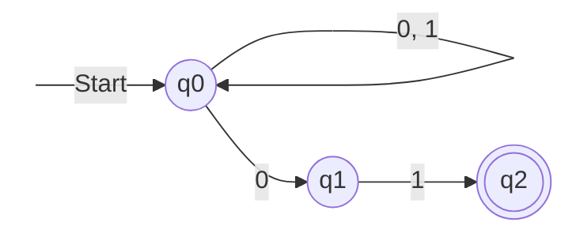
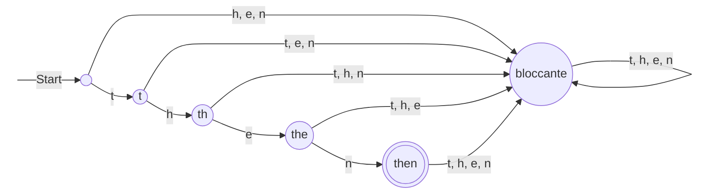
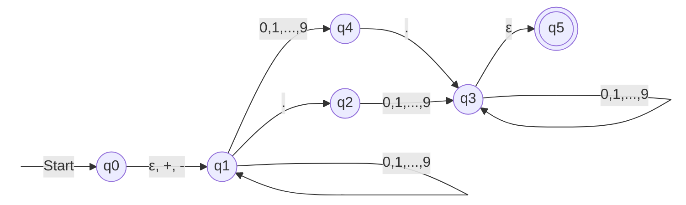
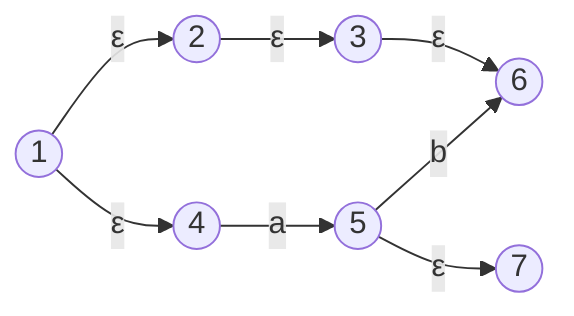
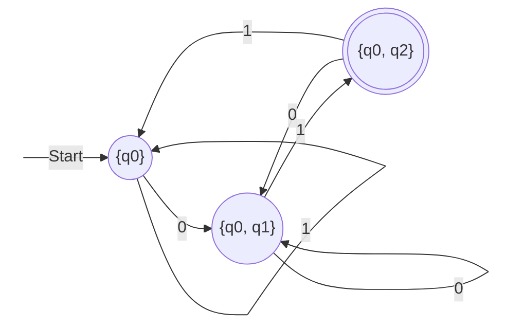
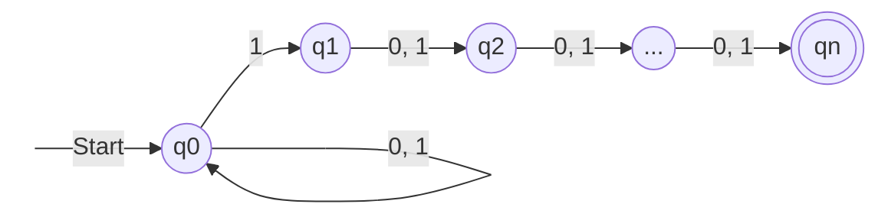
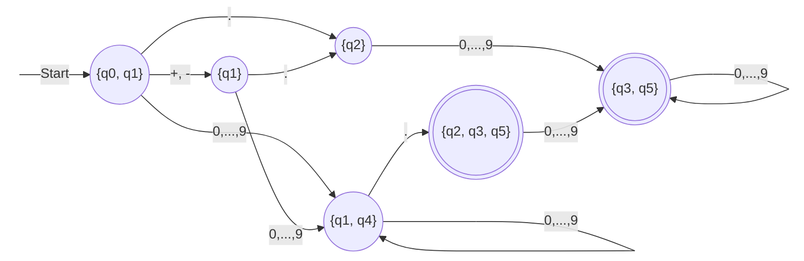

# Lezione 6 — Equivalenza tra automi ed espressioni regolari

La lezione prosegue il pacchetto di slide *Linguaggi regolari* dalla slide 17 alla 43. Dopo un ripasso degli automi non deterministici e della loro dimostrazione di correttezza, completa due questioni lasciate aperte nella [[Lezione 04 - Tecniche deduttive e automi a stati finiti|lezione 4]]: che cosa fare con le transizioni omesse nei DFA, e quanto sia davvero potente il non determinismo. Introduce poi un terzo tipo di automa, con transizioni che non consumano simboli, e dimostra il risultato centrale della lezione: **DFA, NFA ed ε-NFA riconoscono esattamente la stessa classe di linguaggi**. Si chiude con la definizione delle **espressioni regolari**, lo strumento per *descrivere* i linguaggi regolari.

## Ripasso: automi deterministici e non deterministici

Gli automi a stati finiti sono una riedizione delle macchine a stati viste in Reti logiche: «stessa zuppa», dice il docente. I linguaggi che riconoscono sono, per definizione, i **linguaggi regolari**. Un linguaggio è regolare se esiste un automa a stati finiti deterministico che lo riconosce; i linguaggi regolari sono quindi quelli il cui riconoscimento richiede la potenza di calcolo di un circuito digitale, cioè di una macchina a stati finiti.

L'automa non deterministico si distacca invece da quanto visto in Reti logiche, perché non si può realizzare in pratica: un circuito che decidesse «un po' come gli pare» sarebbe guasto. Il docente fa l'esempio di un'unità aritmetico-logica che ogni tanto calcolasse $2 + 2 = 4$ e ogni tanto $2 + 2 = 5$. Ricorda che qualcosa del genere accadde a Intel negli anni Novanta, con il celebre difetto di divisione del Pentium, che costò all'azienda un grave danno di immagine e il ritiro dei processori.

> [!tip] Approfondimento — Il difetto FDIV del Pentium
> #approfondimento
> Il difetto, scoperto nel 1994, riguardava l'istruzione di divisione in virgola mobile (FDIV) del Pentium. L'algoritmo di divisione usava una tabella di valori precalcolati, nella quale mancavano alcune voci, e certe coppie di operandi producevano quindi un quoziente sbagliato. Intel sostenne un costo di 475 milioni di dollari per la sostituzione dei processori [@shirriff-fdiv]. Rispetto all'esempio della lezione va fatta una precisazione: il difetto era del tutto **deterministico**. Con un dividendo e un divisore che lo attivano, il risultato è sbagliato il 100% delle volte; per divisioni casuali, il caso si presentava circa una volta su nove miliardi [@shirriff-fdiv]. Era quindi un circuito *scorretto*, non *non deterministico*. Resta un buon esempio dei danni di un errore di progettazione hardware, in linea con i casi visti nella lezione 1.

Come dispositivo **teorico**, però, il non determinismo accompagnerà tutto il semestre e riserverà diverse sorprese; nel secondo semestre sarà collegato al problema da un milione di dollari già citato. Il punto chiave è la condizione di accettazione. Un NFA accetta una stringa se **esiste** un percorso dallo stato iniziale a uno stato finale che consumi tutta la stringa. In modo equivalente, l'NFA non calcola, dato uno stato e un simbolo, un singolo stato, ma sempre un **insieme di stati**. Da un insieme di stati, considerando tutte le transizioni possibili sul simbolo letto, si passa a un altro insieme di stati, e così via. Se nell'insieme raggiunto dopo aver consumato l'intera stringa c'è almeno uno stato finale, la stringa è accettata.

Il docente insiste su questa immagine dell'insieme di stati, perché è quella che porta alla conclusione principale della lezione. Nonostante la stranezza del modello, l'NFA **non è più potente** del DFA: non riconosce linguaggi diversi da quelli regolari. Il risultato non è del tutto «gratis», come si vedrà, ma vale sempre.

### L'NFA delle stringhe che finiscono con 01

L'esempio di riferimento resta l'NFA con stati $q_0, q_1, q_2$ che accetta le stringhe che finiscono con $01$:

Se una stringa finisce con $01$, esiste una sequenza di transizioni che porta in $q_2$. Equivalentemente, l'insieme di stati raggiunto alla fine contiene $q_2$. Se la stringa non finisce con $01$, non c'è modo di trovarsi in $q_2$ alla fine. Il docente sottolinea un caso istruttivo: una stringa che contiene $01$ **nel mezzo**. L'automa può effettivamente «scegliere» di andare in $q_1$ e poi in $q_2$ su quella occorrenza, ma restano altri simboli da consumare. Da $q_2$ ogni simbolo porta nell'insieme vuoto, che per definizione non contiene $q_2$, e da lì non si torna indietro. Trovarsi in $q_2$ prima di aver esaurito la stringa non serve a nulla; trovarcisi a stringa esaurita significa accettare.

### La dimostrazione di correttezza, ripresa

Il docente riprende la dimostrazione delle slide 17–18 che nella lezione 4 era stata solo mostrata. Conferma l'errore di numerazione già segnalato nella nota della lezione 4: nella slide 18 gli enunciati sono numerati da 0 a 2, «alla C», mentre nella slide 17 sono numerati da 1 a 3. Nella versione aggiornata delle slide, pubblicata dopo la lezione 8, l'errore è corretto.

La presenta però solo come **traccia**. Nel caso base la stringa vuota lascia l'automa nello stato iniziale, che non è finale, quindi la stringa vuota non è accettata, come deve essere. Nel passo si assume $w = xa$ con gli enunciati veri per $x$, e si osserva che valgono anche per $xa$. I dettagli sono lasciati agli studenti come esercizio («fill in the blanks»). La dimostrazione completa, con tutti i passaggi, è nella sezione [[Lezione 04 - Tecniche deduttive e automi a stati finiti#La dimostrazione di correttezza dell'NFA|La dimostrazione di correttezza dell'NFA]] della nota della lezione 4.

Il docente ne trae lo schema generale: per dimostrare che un automa accetta esattamente un certo linguaggio si procede **per induzione sulla lunghezza delle stringhe**. Si verifica prima se la stringa vuota debba essere accettata o no, poi che la proprietà si trasmette dalle stringhe di lunghezza $n$ a quelle di lunghezza $n + 1$.

## DFA con transizioni omesse e stati bloccanti

Nella versione aggiornata delle slide, pubblicata dopo la lezione 8, i due lucidi su questo argomento (slide 19–20) sono stati spostati alle slide 33–34, dopo la costruzione per sottoinsiemi, a cui fanno riferimento. Il contenuto è invariato.

Nella lezione 4 l'automa che riconosce la parola chiave `then` era stato presentato come esempio di automa a stati finiti. Il docente precisa ora che **non è un DFA**. In un DFA la funzione di transizione è **totale**: per ogni stato bisogna dire che cosa succede con **ogni** simbolo, senza dimenticarne nessuno, perché non esiste l'insieme vuoto come nell'NFA. Nell'automa di `then`, invece, dal primo stato è indicata solo la transizione con `t`, dal secondo solo quella con `h`, e così via.

L'automa rispetta però la definizione di **NFA**: una transizione non indicata ha come risultato l'insieme vuoto di stati. Per trasformarlo in un vero DFA bisogna fissare l'alfabeto, per esempio $\Sigma = \{t, h, e, n\}$, e decidere che cosa succede con le lettere non previste. Il docente discute due possibilità, che portano a linguaggi diversi:

1. **Restare nello stato corrente** quando arriva una lettera diversa da quella attesa, e restare nello stato finale qualunque lettera arrivi. L'automa accetta allora le stringhe in cui le lettere $t$, $h$, $e$, $n$ compaiono in quest'ordine, anche non consecutivamente: per esempio anche `thten`. Non riconosce più solo la parola `then`.
2. **Andare in uno stato di errore** quando arriva una lettera inattesa, e restarvi qualunque lettera arrivi. È la scelta che riconosce **esattamente** la sola stringa `then`, ed è quella prevista dalle slide.

Lo stato di errore della seconda soluzione si chiama **stato bloccante** (*dead state*). Le slide ne danno la definizione precisa, che il docente sottolinea essere univoca.

> [!important] Completamento con lo stato bloccante
> Dato un automa in cui da ogni stato esce al più una transizione per ogni simbolo, si ottiene un DFA equivalente aggiungendo uno stato bloccante $t$ tale che:
> - $\delta(t, a) = t$ per ogni simbolo $a \in \Sigma$: una volta entrati, non si esce più;
> - $\delta(q, a) = t$ per ogni stato $q$ privo di una transizione sul simbolo $a$;
> - $t \notin F$: uno stato bloccante non è mai finale.

Con il completamento, qualunque stringa sull'alfabeto $\{t, h, e, n\}$ diversa da `then` porta nello stato bloccante, o termina in uno stato non finale. Quando la stringa è consumata l'automa non si trova nello stato finale, e la stringa è rifiutata.

Lo stesso automa si otterrebbe applicando all'NFA la costruzione per sottoinsiemi che si vedrà tra poco: lo stato bloccante corrisponde all'insieme vuoto di stati. Siccome NFA e DFA sono equivalenti, nella pratica si **omette** lo stato bloccante, e si chiama DFA anche un automa che da ogni stato ha **al più** una transizione per simbolo, anziché esattamente una. È un abuso di notazione consapevole: chi vede un automa così sa che si può sempre completare in un DFA vero e proprio.

## Automi con transizioni su ε

### L'idea: un automa per i numeri decimali

Il docente introduce un altro tipo di automa non deterministico, che servirà più avanti. In esso sono ammesse transizioni che **non consumano simboli** dell'input, dette **transizioni su $\epsilon$**. L'esempio delle slide è un automa che accetta numeri decimali, descritti come:

1. un segno $+$ o $-$, opzionale;
2. una stringa di cifre decimali;
3. un punto decimale;
4. un'altra stringa di cifre decimali.

Il funzionamento è il seguente. Da $q_0$ l'automa può leggere il segno $+$ o $-$, oppure passare in $q_1$ **senza leggere nulla**. La decisione di non consumare simboli è anch'essa non deterministica. In $q_1$ resta finché legge cifre. Al punto decimale ha due strade. Se ha già letto la parte intera, può leggere l'ultima cifra passando in $q_4$ e poi il punto passando in $q_3$. Oppure può leggere il punto direttamente da $q_1$ passando in $q_2$, da cui deve leggere almeno una cifra per arrivare in $q_3$. In $q_3$ legge le eventuali altre cifre e infine passa in $q_5$, lo stato finale, con una transizione su $\epsilon$. Una stringa con due punti, come `5.5.`, non viene accettata: dopo il secondo punto nessuno stato raggiungibile ha una transizione uscente con il punto, e l'automa si blocca.

> [!important] Il linguaggio accettato
> L'automa accetta tutte e sole le stringhe formate da un segno opzionale, una sequenza di cifre, un punto e un'altra sequenza di cifre, **con almeno una cifra** prima o dopo il punto. Sono accettate, per esempio, `-12.3`, `5.`, `.5` e `+.5`. Sono rifiutate `5`, perché il punto è obbligatorio, `.` e `5.5.`. La caratterizzazione è stata verificata confrontando l'automa con la descrizione su tutte le stringhe di lunghezza fino a 6 sull'alfabeto $\{+, -, ., 0, 5\}$.

> [!warning] Discrepanza nella trascrizione
> Nella descrizione a voce compaiono due affermazioni da correggere. Una è che il numero «potrebbe non avere la virgola»: in realtà il punto è obbligatorio, e la stringa `5` è rifiutata. Probabilmente il riferimento era al percorso attraverso $q_4$, che permette di non avere cifre **dopo** il punto, come in `5.`. L'altra è che non esisterebbe un percorso verso lo stato finale per una stringa che inizia con un punto. In realtà `.5` è accettata ($q_0 \xrightarrow{\epsilon} q_1 \xrightarrow{.} q_2 \xrightarrow{5} q_3 \xrightarrow{\epsilon} q_5$). Più avanti, costruendo il DFA equivalente, il docente rileva lui stesso che l'automa accetta anche i numeri che iniziano con il punto. La dimostrazione formale della correttezza, per induzione, è stata omessa in aula.

### La definizione di ε-NFA

> [!important] Definizione: ε-NFA
> Un automa non deterministico con transizioni su $\epsilon$ (*NFA with $\epsilon$-transitions*, ε-NFA) è una quintupla $A = (Q, \Sigma, \delta, q_0, F)$ in cui $Q$, $\Sigma$, $q_0$ e $F$ sono definiti come negli NFA, mentre la funzione di transizione
> $$\delta : Q \times (\Sigma \cup \{\epsilon\}) \to 2^Q$$
> ammette anche $\epsilon$ come simbolo in input. Un ε-NFA può quindi cambiare stato senza consumare input.

Le slide scrivono il dominio come $Q \times \Sigma \cup \{\epsilon\}$, senza parentesi; il significato inteso è quello riportato sopra, con l'unione tra $\Sigma$ e $\{\epsilon\}$.

L'automa dei numeri decimali è l'ε-NFA $E = (\{q_0, \dots, q_5\}, \{., +, -, 0, 1, \dots, 9\}, \delta, q_0, \{q_5\})$. Nella sua tabella di transizione compare una **colonna in più**, quella di $\epsilon$:

| $\delta$ | $\epsilon$ | $+, -$ | $.$ | $0, \dots, 9$ |
| -------- | ---------- | ------ | --- | ------------- |
| $\to q_0$ | $\{q_1\}$ | $\{q_1\}$ | $\emptyset$ | $\emptyset$ |
| $q_1$ | $\emptyset$ | $\emptyset$ | $\{q_2\}$ | $\{q_1, q_4\}$ |
| $q_2$ | $\emptyset$ | $\emptyset$ | $\emptyset$ | $\{q_3\}$ |
| $q_3$ | $\{q_5\}$ | $\emptyset$ | $\emptyset$ | $\{q_3\}$ |
| $q_4$ | $\emptyset$ | $\emptyset$ | $\{q_3\}$ | $\emptyset$ |
| $\star q_5$ | $\emptyset$ | $\emptyset$ | $\emptyset$ | $\emptyset$ |

Gli ε-NFA serviranno due volte: per collegare automi ed espressioni regolari, e come base degli **automi a pila** (*pushdown*), che sono in sostanza ε-NFA con in più una pila.

### La chiusura ε

Per definire la computazione di un ε-NFA si vuole considerare equivalenti tutti gli stati raggiungibili da uno stato senza leggere nulla, cioè attraverso sequenze di sole transizioni su $\epsilon$. Si «chiude» quindi uno stato aggiungendo tutti gli stati raggiungibili da esso tramite una sequenza $\epsilon\epsilon\cdots\epsilon$.

> [!important] Definizione: chiusura ε
> La chiusura ε di uno stato $q$, indicata con $\mathrm{ECLOSE}(q)$, è definita induttivamente:
> - **base**: $q \in \mathrm{ECLOSE}(q)$;
> - **passo**: se $p \in \mathrm{ECLOSE}(q)$ e $r \in \delta(p, \epsilon)$, allora $r \in \mathrm{ECLOSE}(q)$.
>
> Per un insieme di stati $S$ si pone $\mathrm{ECLOSE}(S) = \bigcup_{q \in S} \mathrm{ECLOSE}(q)$.

L'immagine del docente è quella di un **fluido che si allarga**. Le transizioni su $\epsilon$ sono canali aperti, e la chiusura è l'insieme degli stati che il fluido raggiunge partendo da $q$. L'esempio delle slide usa questo automa:

Per calcolare $\mathrm{ECLOSE}(1)$ si applica la definizione:

- $1 \in \mathrm{ECLOSE}(1)$ per il caso base;
- da 1 escono transizioni su $\epsilon$ verso 2 e verso 4, quindi $2, 4 \in \mathrm{ECLOSE}(1)$;
- da 4 non escono transizioni su $\epsilon$, e il fluido lì si arresta; da 2 si raggiunge 3, quindi $3 \in \mathrm{ECLOSE}(1)$;
- da 3 si raggiunge 6, quindi $6 \in \mathrm{ECLOSE}(1)$.

Risulta
$$
\mathrm{ECLOSE}(1) = \{1, 2, 3, 4, 6\}, \qquad \mathrm{ECLOSE}(4) = \{4\}, \qquad \mathrm{ECLOSE}(5) = \{5, 7\} .
$$
Lo stato 5 non appartiene a $\mathrm{ECLOSE}(1)$, perché da 4 a 5 si passa solo leggendo il simbolo $a$. Da 4 non esce alcuna transizione su $\epsilon$, quindi la sua chiusura contiene solo 4 stesso. Da 5 si raggiunge 7 con una transizione su $\epsilon$.

### La funzione di transizione estesa

> [!important] Definizione: $\hat{\delta}$ per gli ε-NFA
> - **base**: $\hat{\delta}(q, \epsilon) = \mathrm{ECLOSE}(q)$;
> - **passo**: se $w = xa$, con $x \in \Sigma^*$ e $a \in \Sigma$,
> $$\hat{\delta}(q, xa) = \bigcup_{p \,\in\, \hat{\delta}(q, x)} \;\bigcup_{r \,\in\, \delta(p, a)} \mathrm{ECLOSE}(r) .$$

Rispetto agli NFA cambiano due cose. La prima è il caso base: senza leggere nulla l'automa non resta solo in $q$, ma si trova in tutti gli stati della chiusura di $q$. La seconda è il passo. Raggiunto l'insieme $\hat{\delta}(q, x)$, si fa un passo sul simbolo $a$ da ciascuno dei suoi stati, esattamente come negli NFA. Poi si chiude ciascuno degli stati ottenuti, aggiungendo quelli raggiungibili con transizioni su $\epsilon$.

> [!warning] Discrepanze nella slide 26
> La formula del passo nelle slide contiene due imprecisioni, segnalate in aula, una delle quali da uno studente; il docente ha annunciato la pubblicazione delle slide corrette. La prima: la stringa è indicata come $wa$ nella parte sinistra e come $x$ nella parte destra, mentre va usato lo stesso nome ($w = xa$). La seconda: la funzione $\delta$ è applicata direttamente all'insieme $\hat{\delta}(q, x)$, mentre è definita su singoli stati, e va quindi presa l'unione su tutti gli stati dell'insieme, come nella formula sopra. Dalla trascrizione non si ricava con certezza quale fosse il secondo errore segnalato in aula. Nella versione aggiornata del pacchetto, pubblicata dopo la [[Lezione 08 - Dalle espressioni regolari agli automi e ritorno|lezione 8]], la formula è alla slide 24: la prima imprecisione è corretta (il passo è scritto per $w = xa$), mentre $\delta$ resta applicata all'insieme $\hat{\delta}(q, x)$, da leggere come abbreviazione dell'unione, la stessa convenzione usata nella slide 35.

> [!example] Esercizio: $\hat{\delta}(q_0, 5.6)$ nell'automa dei numeri decimali
> Il docente lo propone come verifica e lo svolge rapidamente.
>
> | Lettura | Passo sul simbolo | Dopo la chiusura ε |
> | ------- | ----------------- | ------------------ |
> | $\epsilon$ | — | $\mathrm{ECLOSE}(q_0) = \{q_0, q_1\}$ |
> | $5$ | $\delta(q_0, 5) \cup \delta(q_1, 5) = \{q_1, q_4\}$ | $\{q_1, q_4\}$ |
> | $.$ | $\delta(q_1, .) \cup \delta(q_4, .) = \{q_2, q_3\}$ | $\{q_2, q_3, q_5\}$ |
> | $6$ | $\delta(q_2, 6) \cup \delta(q_3, 6) \cup \delta(q_5, 6) = \{q_3\}$ | $\{q_3, q_5\}$ |
>
> Quindi $\hat{\delta}(q_0, 5.6) = \{q_3, q_5\}$, che contiene lo stato finale $q_5$: la stringa è accettata. A voce, dopo il punto, il docente indica l'insieme $\{q_2, q_3\}$, che è il risultato **prima** della chiusura. Chiudendo si aggiunge $q_5$, raggiungibile da $q_3$ con una transizione su $\epsilon$. Il risultato finale non cambia.

Ci si potrebbe chiedere perché aggiungere questa ulteriore complicazione, quando il non determinismo sembrava già bastare. Il docente risponde che l'ε-NFA avrà una sua utilità precisa nel collegamento con le espressioni regolari e negli automi a pila.

## Equivalenza tra DFA, NFA ed ε-NFA

### L'enunciato

Ora arriva quella che il docente chiama «la parte bella». I tre tipi di automa visti finora sono **equivalenti**, nel senso che riconoscono la stessa classe di linguaggi. Che un linguaggio riconosciuto da un DFA sia riconosciuto anche da un NFA e da un ε-NFA è banale. Sorprendente è il viceversa. Se un ε-NFA, apparentemente il più potente dei tre, riconosce un linguaggio, si può **calcolare**, senza tirare a indovinare, un DFA che riconosce esattamente lo stesso linguaggio. Ricordando che per il corso la potenza di un modello di calcolo è la sua capacità di riconoscere linguaggi, i tre modelli hanno la stessa potenza.

> [!important] Teorema (equivalenza tra NFA e DFA)
> Per ogni NFA $N$ esiste un DFA $D$ tale che $L(D) = L(N)$, e viceversa.

**Da DFA a NFA** la direzione è banale. Un DFA si trasforma in un NFA equivalente ponendo $\delta_N(q, a) = \{p\}$ ogni volta che $\delta_D(q, a) = p$. Un NFA la cui funzione di transizione restituisce sempre un singoletto compie esattamente la stessa computazione di un DFA. Per induzione sulla lunghezza di $w$ si mostra che, se $\hat{\delta}_D(q_0, w) = p$, allora $\hat{\delta}_N(q_0, w) = \{p\}$. In questo senso la definizione di NFA include quella di DFA, e si sarebbe potuto partire direttamente dagli NFA; di solito si preferisce però introdurre prima gli automi deterministici.

**Da NFA a DFA** la direzione è meno banale, perché l'NFA, con la sua capacità di «indovinare» il percorso giusto, sembra più potente. Va dimostrato che per ogni NFA $N = (Q_N, \Sigma, \delta_N, q_0, F_N)$ si può costruire un DFA $D = (Q_D, \Sigma, \delta_D, \{q_0\}, F_D)$ con $L(D) = L(N)$.

### La costruzione per sottoinsiemi

L'idea è quella già suggerita: pensare la computazione di un NFA non come «stato, simbolo, stato» ma come «insieme di stati, simbolo, insieme di stati». Il docente pone una domanda alla classe: un NFA con 5 stati, quanti sottoinsiemi di stati ha? Il loro numero è finito, ed è $2^5 = 32$. Come visto nella lezione 4 e nel compendio, ogni sottoinsieme corrisponde a una stringa di 5 bit, in cui ogni bit dice se l'elemento corrispondente c'è o no: $00000$ è l'insieme vuoto, $11111$ l'insieme intero.

Se si usano come **stati** del nuovo automa gli **insiemi di stati** dell'NFA, tutto torna deterministico. Da un insieme di stati, con un dato simbolo, si arriva sempre a **uno e un solo** insieme di stati. E poiché gli insiemi sono in numero finito, l'automa risultante è ancora un automa a stati finiti deterministico.

> [!important] Definizione: costruzione per sottoinsiemi (*subset construction*)
> Dato l'NFA $N = (Q_N, \Sigma, \delta_N, q_0, F_N)$, il DFA $D = (Q_D, \Sigma, \delta_D, \{q_0\}, F_D)$ è definito da:
> - $Q_D = \{ S : S \subseteq Q_N \}$: gli stati di $D$ sono i sottoinsiemi di stati di $N$;
> - lo stato iniziale è il singoletto $\{q_0\}$;
> - $F_D = \{ S \subseteq Q_N : S \cap F_N \neq \emptyset \}$: sono finali gli insiemi che contengono almeno uno stato finale di $N$;
> - per ogni $S \subseteq Q_N$ e $a \in \Sigma$,
> $$\delta_D(S, a) = \bigcup_{p \in S} \delta_N(p, a) .$$

La funzione $\delta_D$ è esattamente il passo della funzione estesa degli NFA, ma vista come transizione di un automa sugli insiemi.

### Esempio: le stringhe che finiscono con 01

Applicando la costruzione «pedissequa» all'NFA dell'esempio si considerano tutti gli $2^3 = 8$ sottoinsiemi di $\{q_0, q_1, q_2\}$: l'insieme vuoto, i singoletti, le coppie e la terna. Sono finali, contrassegnati con $\star$, tutti quelli che contengono $q_2$.

| $\delta_D$ | 0 | 1 |
| ---------- | - | - |
| $\emptyset$ | $\emptyset$ | $\emptyset$ |
| $\to \{q_0\}$ | $\{q_0, q_1\}$ | $\{q_0\}$ |
| $\{q_1\}$ | $\emptyset$ | $\{q_2\}$ |
| $\star \{q_2\}$ | $\emptyset$ | $\emptyset$ |
| $\{q_0, q_1\}$ | $\{q_0, q_1\}$ | $\{q_0, q_2\}$ |
| $\star \{q_0, q_2\}$ | $\{q_0, q_1\}$ | $\{q_0\}$ |
| $\star \{q_1, q_2\}$ | $\emptyset$ | $\{q_2\}$ |
| $\star \{q_0, q_1, q_2\}$ | $\{q_0, q_1\}$ | $\{q_0, q_2\}$ |

Ogni riga si calcola unendo le transizioni dei singoli stati. Per esempio, da $\{q_0, q_1\}$ con il simbolo 1 si ottiene $\delta_N(q_0, 1) \cup \delta_N(q_1, 1) = \{q_0\} \cup \{q_2\} = \{q_0, q_2\}$.

Non serve però considerare tutti i sottoinsiemi: la maggior parte, di solito, non è **raggiungibile** dallo stato iniziale. La costruzione «furba» parte dallo stato iniziale e aggiunge alla tabella solo gli stati che effettivamente compaiono.

> [!important] Costruzione dei soli stati accessibili
> - **Base**: $S = \{q_0\}$ è accessibile.
> - **Induzione**: se lo stato $S$ è accessibile, lo sono anche tutti gli stati $\delta_D(S, a)$, per ogni $a \in \Sigma$.

Nell'esempio, il docente procede così. Da $\{q_0\}$ con lo 0 si va in $\{q_0, q_1\}$, che è un nuovo stato da aggiungere; con l'1 si resta in $\{q_0\}$. Da $\{q_0, q_1\}$ con lo 0 si torna in $\{q_0, q_1\}$; con l'1 si va in $\{q_0, q_2\}$, un altro nuovo stato, finale perché contiene $q_2$. Da $\{q_0, q_2\}$ con lo 0 si va in $\{q_0, q_1\}$ e con l'1 in $\{q_0\}$. Non compaiono stati nuovi, e la costruzione è finita: bastano **tre** stati.

In aula il docente ha inizialmente seguito la tabella completa e si è accorto che le ultime righe non tornavano con la costruzione che stava facendo. La spiegazione è che la tabella delle slide è quella «pedissequa», con tutti i sottoinsiemi, mentre lui stava costruendo solo gli stati accessibili. Le righe di $\emptyset$, $\{q_1\}$, $\{q_2\}$, $\{q_1, q_2\}$ e $\{q_0, q_1, q_2\}$ non sono raggiungibili da $\{q_0\}$, e si possono scartare.

Il risultato è un DFA vero e proprio: da ogni stato escono esattamente due transizioni, una per simbolo. Riconosce lo stesso linguaggio dell'NFA, come si vede leggendolo. Con una sequenza di 1 si resta in $\{q_0\}$. Uno 0 porta in $\{q_0, q_1\}$, e un 1 subito dopo porta nello stato finale. Se però la stringa prosegue, un ulteriore simbolo fa uscire dallo stato finale: è il caso dello $01$ «nel mezzo». L'unico modo di terminare in $\{q_0, q_2\}$ è che la stringa finisca proprio con $01$.

### La correttezza della costruzione

La costruzione si può applicare a qualunque NFA. Resta da dimostrare che funziona sempre.

> [!important] Teorema
> Sia $D$ il DFA ottenuto da un NFA $N$ con la costruzione per sottoinsiemi. Allora $L(D) = L(N)$.

La dimostrazione si appoggia su un **lemma**, cioè un risultato ausiliario.

> [!important] Lemma
> Per qualsiasi $w \in \Sigma^*$, la funzione di transizione estesa del DFA $D$ e quella dell'NFA $N$ danno lo stesso risultato:
> $$\hat{\delta}_D(\{q_0\}, w) = \hat{\delta}_N(q_0, w) .$$

Il lemma è «quello giusto da avere», osserva il docente. A sinistra c'è la funzione estesa di un DFA, che restituisce un singolo stato di $D$; ma gli stati di $D$ sono insiemi di stati di $N$. A destra c'è la funzione estesa dell'NFA, che restituisce un insieme di stati di $N$. Il lemma dice che l'insieme raggiunto dal DFA dopo aver letto $w$ è esattamente l'insieme raggiunto dall'NFA.

**Dimostrazione del teorema, dato il lemma.** Si concatenano tre equivalenze, ciascuna con la sua giustificazione:

$$
\begin{aligned}
w \in L(D) &\iff \hat{\delta}_D(\{q_0\}, w) \in F_D && \text{(definizione di accettazione nei DFA)} \\
&\iff \hat{\delta}_D(\{q_0\}, w) \cap F_N \neq \emptyset && \text{(definizione di } F_D\text{)} \\
&\iff \hat{\delta}_N(q_0, w) \cap F_N \neq \emptyset && \text{(lemma)} \\
&\iff w \in L(N) && \text{(definizione di accettazione negli NFA)} .
\end{aligned}
$$

Senza il lemma, il terzo passaggio non si potrebbe fare.

**Dimostrazione del lemma**, per induzione sulla lunghezza di $w$.

- **Base**: $w = \epsilon$. Per definizione $\hat{\delta}_D(\{q_0\}, \epsilon) = \{q_0\}$, perché in un DFA la stringa vuota lascia nello stato di partenza. D'altra parte $\hat{\delta}_N(q_0, \epsilon) = \{q_0\}$ per il caso base degli NFA. L'enunciato segue quindi dalle definizioni.
- **Passo**: $w = xa$, con l'enunciato vero per $x$, che è più corta di $w$.
$$
\begin{aligned}
\hat{\delta}_D(\{q_0\}, xa) &= \delta_D\big(\hat{\delta}_D(\{q_0\}, x), a\big) && \text{(definizione di } \hat{\delta}_D\text{)} \\
&= \delta_D\big(\hat{\delta}_N(q_0, x), a\big) && \text{(ipotesi induttiva)} \\
&= \bigcup_{p \,\in\, \hat{\delta}_N(q_0, x)} \delta_N(p, a) && \text{(costruzione di } \delta_D\text{)} \\
&= \hat{\delta}_N(q_0, xa) && \text{(definizione di } \hat{\delta}_N\text{)} .
\end{aligned}
$$

Nelle slide le quattro giustificazioni sono abbreviate con *def*, *i.h.* (*inductive hypothesis*, ipotesi induttiva), *cst* (*construction*, costruzione) e di nuovo *def*. Gli automi non deterministici non sono quindi più potenti di quelli deterministici: da un NFA si può sempre costruire un DFA equivalente.

### Il prezzo: l'esplosione esponenziale

Se gli NFA non sono più potenti, che cosa li distingue? La **compattezza**. Un NFA con 5 stati può richiedere un DFA equivalente con fino a $2^5 = 32$ stati. Gli NFA sono una rappresentazione più **succinta**, non più potente. Il docente ricorda che l'esponenziale è «una brutta cosa», come si ripeterà per tutto il corso: trasforma qualcosa di gestibile in qualcosa che diventa rapidamente ingestibile. Memorizzare un automa ottenuto determinizzandone uno non deterministico può costare esponenzialmente di più.

In generale $|Q_D| = 2^{|Q_N|}$, ma di solito molti stati non sono raggiungibili, e il DFA effettivamente costruito è molto più piccolo. Nell'esempio di $01$ il DFA ha 3 stati come l'NFA. Ci si potrebbe chiedere se vada sempre così bene. Purtroppo no, e per dimostrarlo basta un controesempio.

> [!important] Il caso pessimo
> Esiste un NFA con $n + 1$ stati che non ha alcun DFA equivalente con meno di $2^n$ stati. Nel caso pessimo, quindi, la conversione da NFA a DFA comporta una crescita esponenziale del numero di stati.

L'NFA delle slide ha stati $q_0, q_1, \dots, q_n$. Da $q_0$ escono un anello su 0 e 1 e una transizione su 1 verso $q_1$, l'unica scelta non deterministica. Da ogni $q_i$ con $1 \leq i < n$ si passa a $q_{i+1}$ con qualunque simbolo, e $q_n$ è l'unico stato finale.

L'automa accetta le stringhe in cui l'**$n$-esimo simbolo dalla fine è 1**. La scelta non deterministica consiste nell'«indovinare» quale 1 si trova esattamente $n$ posizioni prima della fine.

Applicando la costruzione per sottoinsiemi, gli insiemi continuano ad allargarsi. Da $\{q_0\}$ con lo 0 si resta in $\{q_0\}$, con l'1 si va in $\{q_0, q_1\}$. Da $\{q_0, q_1\}$ con lo 0 si va in $\{q_0, q_2\}$, con l'1 in $\{q_0, q_1, q_2\}$, e così via. Il DFA deve in sostanza ricordare quali degli ultimi $n$ simboli erano 1, e gli stati raggiungibili sono tutti i $2^n$ sottoinsiemi che contengono $q_0$. Lo si è verificato al calcolatore per $n$ da 1 a 7: gli stati raggiungibili sono esattamente $2^n$, e neppure minimizzando il DFA se ne elimina alcuno.

> [!warning] Discrepanze tra trascrizione e slide
> Nella descrizione a voce dell'espansione dei sottoinsiemi, il passo da $\{q_0, q_1\}$ con lo 0 è indicato come $\{q_0, q_1, q_2\}$. Il risultato corretto è $\{q_0, q_2\}$: $q_0$ con lo 0 resta in $q_0$, e $q_1$ con lo 0 va in $q_2$. Nella slide 34 (slide 32 nella versione aggiornata del pacchetto, dove la svista è rimasta), inoltre, si parla di conversione «da DFA a NFA»: la conversione che comporta la crescita esponenziale è quella **da NFA a DFA**.

> [!tip] Approfondimento — Perché nessun DFA più piccolo
> #approfondimento
> Il risultato si dimostra con un argomento di «indistinguibilità» [@hopcroft2007]. Si supponga, per assurdo, che un DFA con meno di $2^n$ stati riconosca il linguaggio $L_n$ delle stringhe il cui $n$-esimo simbolo dalla fine è 1. Le stringhe binarie di lunghezza $n$ sono $2^n$, più degli stati. Per il **principio dei cassetti**, due stringhe distinte $u$ e $v$ di lunghezza $n$ portano il DFA nello stesso stato. Essendo distinte, differiscono in qualche posizione $i$; si supponga $u_i = 1$ e $v_i = 0$. Si aggiungano a entrambe $i - 1$ zeri. In $u0^{i-1}$ l'$n$-esimo simbolo dalla fine è $u_i = 1$, quindi la stringa sta in $L_n$; in $v0^{i-1}$ è $v_i = 0$, quindi la stringa non ci sta. Ma dopo $u$ e dopo $v$ il DFA si trova nello stesso stato, e leggendo gli stessi simboli arriva nello stesso stato finale della computazione: o accetta entrambe le stringhe o le rifiuta entrambe. È una contraddizione, quindi ogni DFA per $L_n$ ha almeno $2^n$ stati.

Il docente anticipa che nel secondo semestre si imparerà a parlare di **caso pessimo**. Vista come algoritmo, la costruzione per sottoinsiemi nel caso pessimo provoca un'esplosione esponenziale dello spazio occupato dall'automa. Di solito non succede, ma se succede è fastidioso.

### Dagli ε-NFA ai DFA

Anche gli ε-NFA non sono più potenti. Si potrebbe procedere in due passi, trasformando prima l'ε-NFA in un NFA equivalente. Ma si può anche costruire direttamente il DFA: la costruzione è la stessa di prima, ragionando però sulle **chiusure** degli insiemi di stati.

> [!important] Definizione: dal ε-NFA al DFA
> Dato l'ε-NFA $E = (Q_E, \Sigma, \delta_E, q_0, F_E)$, il DFA $D = (Q_D, \Sigma, \delta_D, q_D, F_D)$ con $L(D) = L(E)$ è definito da:
> - $Q_D = \{ S : S \subseteq Q_E \text{ e } S = \mathrm{ECLOSE}(S) \}$: gli stati sono gli insiemi di stati **chiusi** rispetto alle transizioni su $\epsilon$;
> - $q_D = \mathrm{ECLOSE}(q_0)$;
> - $F_D = \{ S \in Q_D : S \cap F_E \neq \emptyset \}$;
> - $\delta_D(S, a) = \bigcup \{ \mathrm{ECLOSE}(p) : p \in \delta_E(t, a) \text{ per qualche } t \in S \}$.

Nella slide 35 la definizione di $\delta_D$ è preceduta da un «con» di troppo, un refuso senza conseguenze.

Applicata all'automa dei numeri decimali, la costruzione dei soli stati accessibili procede così. Lo stato iniziale è $\mathrm{ECLOSE}(q_0) = \{q_0, q_1\}$, per la transizione su $\epsilon$ da $q_0$ a $q_1$. Da $\{q_0, q_1\}$:

- con $+$ o $-$ si va in $\{q_1\}$;
- con il punto si va in $\{q_2\}$;
- con una cifra si va in $\{q_1, q_4\}$, un nuovo stato, perché da $q_1$ con una cifra si può restare in $q_1$ o andare in $q_4$.

Da $\{q_1, q_4\}$ con il punto si va in $q_2$, da $q_1$, e in $q_3$, da $q_4$; chiudendo si aggiunge $q_5$, e si ottiene $\{q_2, q_3, q_5\}$. Con le cifre, da $\{q_2\}$, da $\{q_2, q_3, q_5\}$ e da $\{q_3, q_5\}$ si va sempre in $\{q_3, q_5\}$. Gli stati finali sono quelli che contengono $q_5$.

Il diagramma coincide con quello della slide 36 ed è stato verificato al calcolatore applicando la costruzione. Come osserva il docente, a rigore va ancora completato con lo stato bloccante, cioè l'insieme vuoto, per tutti i simboli che in un dato stato non sono leciti. Per esempio, un segno letto dopo una cifra, o un secondo punto. Per la convenzione vista prima, lo si omette. Il diagramma conferma anche che l'automa accetta numeri che iniziano con il punto: da $\{q_0, q_1\}$ con il punto si va in $\{q_2\}$, e con una cifra nello stato finale $\{q_3, q_5\}$.

> [!important] Teorema (equivalenza tra ε-NFA e DFA)
> Un linguaggio $L$ è accettato da un ε-NFA se e solo se è accettato da un DFA.

Una direzione è di nuovo banale: un DFA è un ε-NFA senza transizioni su $\epsilon$ e con transizioni deterministiche. Per l'altra si costruisce $D$ come sopra e si mostra per induzione su $w$ che $\hat{\delta}_E(q_0, w) = \hat{\delta}_D(q_D, w)$. Il docente non ripete la dimostrazione in aula, perché è identica a quella per gli NFA, con l'aggiunta delle chiusure su $\epsilon$:

- **base**: $\hat{\delta}_E(q_0, \epsilon) = \mathrm{ECLOSE}(q_0) = q_D = \hat{\delta}_D(q_D, \epsilon)$;
- **passo**: se l'enunciato vale per $x$,
$$
\begin{aligned}
\hat{\delta}_E(q_0, xa) &= \bigcup_{p \,\in\, \delta_E(\hat{\delta}_E(q_0, x), a)} \mathrm{ECLOSE}(p) && \text{(definizione di } \hat{\delta}_E\text{)} \\
&= \bigcup_{p \,\in\, \delta_E(\hat{\delta}_D(q_D, x), a)} \mathrm{ECLOSE}(p) && \text{(ipotesi induttiva)} \\
&= \delta_D\big(\hat{\delta}_D(q_D, x), a\big) && \text{(costruzione di } \delta_D\text{)} \\
&= \hat{\delta}_D(q_D, xa) && \text{(definizione di } \hat{\delta}_D\text{)} .
\end{aligned}
$$

Qui $\delta_E(S, a)$ abbrevia, come nelle slide, l'unione di $\delta_E(t, a)$ per tutti i $t \in S$.

Riassumendo, se si indica con $\mathcal{L}(X)$ la classe dei linguaggi riconoscibili con un certo tipo di automa $X$:
$$
\mathcal{L}(\text{DFA}) = \mathcal{L}(\text{NFA}) = \mathcal{L}(\epsilon\text{-NFA}) .
$$

## Espressioni regolari

### Descrivere invece di riconoscere

Il docente riparte dal word problem. Gli automi visti finora sono **algoritmi** che lo risolvono. Accettano alcune stringhe e ne rifiutano altre, e così definiscono un linguaggio in modo **implicito**, operazionale. È come dire: «ecco un algoritmo che accetta certi numeri e non altri»; magari è l'algoritmo che verifica se un numero è primo, e quindi il riconoscitore del linguaggio dei numeri primi. Di solito, però, un linguaggio lo si vuole **descrivere**. Per i numeri primi si dice: «un numero è primo se e solo se è divisibile solo per 1 e per sé stesso».

Per i linguaggi regolari, questo è il ruolo delle **espressioni regolari**: sono, dice il docente, la **grammatica** dei linguaggi regolari. Se $RE$ è l'insieme delle espressioni regolari corrette e $\mathcal{L}(RE)$ la classe dei linguaggi descrivibili con esse, si vedrà che
$$
\mathcal{L}(RE) = \mathcal{L}(\text{DFA}) :
$$
i linguaggi descrivibili con espressioni regolari sono tutti e soli quelli il cui word problem si risolve con un automa a stati finiti.

### Definizione

> [!important] Definizione: espressione regolare
> Dato un alfabeto $\Sigma$, le espressioni regolari (RE) su $\Sigma$ e i linguaggi che descrivono sono definiti induttivamente:
> - $\epsilon$ e $\emptyset$ sono espressioni regolari, con $L(\epsilon) = \{\epsilon\}$ e $L(\emptyset) = \emptyset$;
> - se $a \in \Sigma$, allora $a$ è un'espressione regolare, con $L(a) = \{a\}$;
> - se $E$ è un'espressione regolare, allora $(E)$ è un'espressione regolare, con $L((E)) = L(E)$;
> - se $E$ e $F$ sono espressioni regolari, allora $E + F$ è un'espressione regolare, con $L(E + F) = L(E) \cup L(F)$;
> - se $E$ e $F$ sono espressioni regolari, allora $E.F$ (o semplicemente $EF$) è un'espressione regolare, con $L(E.F) = L(E).L(F)$;
> - se $E$ è un'espressione regolare, allora $E^*$ è un'espressione regolare, con $L(E^*) = \big(L(E)\big)^*$.
>
> Data un'espressione regolare $E$, $L(E)$ è il linguaggio descritto da $E$.

Ogni regola ha una lettura immediata, che si appoggia sulle operazioni sui linguaggi viste nella lezione 2:

- l'**unione** $E + F$ descrive tutte le stringhe descritte da $E$ e tutte quelle descritte da $F$;
- la **concatenazione** $EF$ descrive le stringhe che hanno come prefisso una stringa descritta da $E$ e come suffisso una stringa descritta da $F$;
- la **chiusura** $E^*$ descrive tutte le stringhe che si ottengono dal linguaggio di $E$ con la chiusura riflessiva e transitiva, cioè concatenando un numero qualsiasi, anche nullo, di sue stringhe;
- le **parentesi** non cambiano il linguaggio: servono solo a esplicitare le precedenze.

Il docente segnala un **sovraccarico di notazione** nella prima regola. Nell'espressione $L(\epsilon) = \{\epsilon\}$, il simbolo $\epsilon$ a sinistra appartiene alla **sintassi**: è il simbolo dell'espressione regolare. Quello a destra appartiene alla **semantica**: è la stringa vuota. Lo stesso vale per $\emptyset$. A rigore si dovrebbero usare due simboli diversi, così come in C++ si distingue tra la costante che indica il puntatore nullo nel codice e il valore che essa assume quando il programma viene compilato. Si accetta l'abuso di notazione, sapendo che c'è.

Si noti che la definizione è **ricorsiva**: casi base ($\epsilon$, $\emptyset$, i simboli) e operatori di costruzione (parentesi, unione, concatenazione, chiusura). Le espressioni regolari sono quindi strutture su cui si potrà ragionare per induzione strutturale, come le espressioni aritmetiche della [[Lezione 04 - Tecniche deduttive e automi a stati finiti#Induzione strutturale|lezione 4]].

### Esempio: zeri e uni alternati

Si vuole descrivere il linguaggio
$$
L = \{ w \in \{0, 1\}^* \mid \text{0 e 1 si alternano in } w \},
$$
cioè le stringhe binarie in cui non compaiono mai due simboli uguali consecutivi. Una prima espressione regolare è
$$
(01)^* + (10)^* + 0(10)^* + 1(01)^* .
$$
I quattro termini coprono i quattro casi possibili:

- $(01)^*$: le stringhe che iniziano con 0 e finiscono con 1 ($\epsilon$, $01$, $0101$, ...);
- $(10)^*$: quelle che iniziano con 1 e finiscono con 0;
- $0(10)^*$: quelle che iniziano e finiscono con 0 ($0$, $010$, ...);
- $1(01)^*$: quelle che iniziano e finiscono con 1 ($1$, $101$, ...).

Un'espressione equivalente e più compatta è
$$
(\epsilon + 1)(01)^*(\epsilon + 0) .
$$
Qui la parte centrale $(01)^*$ produce le coppie alternate, il fattore iniziale permette di cominciare **opzionalmente** con un 1 e quello finale di terminare opzionalmente con uno 0. Se la stringa inizia con 1 si sceglie il termine $1$ del primo fattore, se inizia con 0 si sceglie $\epsilon$; analogamente per la fine. Entrambe le espressioni sono state verificate confrontandole con la definizione del linguaggio su tutte le stringhe binarie di lunghezza fino a 10.

### Precedenza degli operatori

Per ridurre le parentesi si fissa un ordine di precedenza, dal più forte al più debole:

1. chiusura (e potenza);
2. concatenazione;
3. unione.

In caso di dubbio conviene comunque usare le parentesi. Per esempio, $01^* + 1$ si raggruppa come $\big(0(1)^*\big) + 1$. La stella si applica solo all'1, la concatenazione lega lo 0 a $1^*$, e l'unione viene per ultima. Il linguaggio descritto contiene quindi la stringa $1$ e tutte le stringhe formate da uno 0 seguito da zero o più 1: $0$, $01$, $011$, $0111$, e così via. È diverso da $(01)^* + 1$ e da $0(1^* + 1)$.

> [!tip] Approfondimento — Le espressioni regolari nei linguaggi di programmazione
> #approfondimento
> Le espressioni regolari degli strumenti di programmazione usano una sintassi leggermente diversa da quella teorica, ma con lo stesso significato di base. Nel C++, la libreria `<regex>`, disponibile dal C++11, usa per default la grammatica ECMAScript [@cppref-regex]. Lì l'unione si scrive con la barra verticale `|`, che ha la precedenza più bassa, come il $+$ teorico. La stella `*` indica zero o più ripetizioni. Ci sono poi abbreviazioni comode: `+` per una o più ripetizioni ($E^+ = EE^*$) e `?` per un elemento opzionale ($\epsilon + E$). L'espressione $(\epsilon + 1)(01)^*(\epsilon + 0)$ si scrive così `1?(01)*0?`. È lo strumento naturale per descrivere i token nell'analisi lessicale del progetto, come anticipato nella lezione 2.

La [[Lezione 08 - Dalle espressioni regolari agli automi e ritorno|lezione 8]] riprende le espressioni regolari con altri esempi e mostra che tutti i linguaggi descritti da espressioni regolari sono riconosciuti da automi a stati finiti, e viceversa.

## In sintesi

Un automa con transizioni omesse non è formalmente un DFA, ma lo diventa aggiungendo uno stato bloccante non finale, verso cui vanno tutte le transizioni mancanti; nella pratica lo si omette. Gli ε-NFA ammettono transizioni che non consumano input. La loro computazione usa la chiusura ε, cioè l'insieme degli stati raggiungibili con sole transizioni su $\epsilon$, sia nel caso base sia dopo ogni passo.

DFA, NFA ed ε-NFA riconoscono la stessa classe di linguaggi, quelli regolari. Il passaggio da NFA a DFA è la costruzione per sottoinsiemi: gli stati del DFA sono insiemi di stati dell'NFA, la transizione su un simbolo è l'unione delle transizioni dei singoli stati, e sono finali gli insiemi che contengono uno stato finale. La correttezza si dimostra per induzione, tramite il lemma $\hat{\delta}_D(\{q_0\}, w) = \hat{\delta}_N(q_0, w)$. Per gli ε-NFA la costruzione è la stessa, con le chiusure. Il non determinismo non aumenta la potenza, ma rende le descrizioni più compatte: nel caso pessimo il DFA equivalente ha un numero di stati esponenziale.

Le espressioni regolari, definite ricorsivamente a partire da $\epsilon$, $\emptyset$ e dai simboli con unione, concatenazione e chiusura, sono lo strumento per descrivere i linguaggi regolari. Hanno un ordine di precedenza (chiusura, concatenazione, unione) e, come si vedrà, descrivono esattamente i linguaggi riconosciuti dagli automi a stati finiti.
