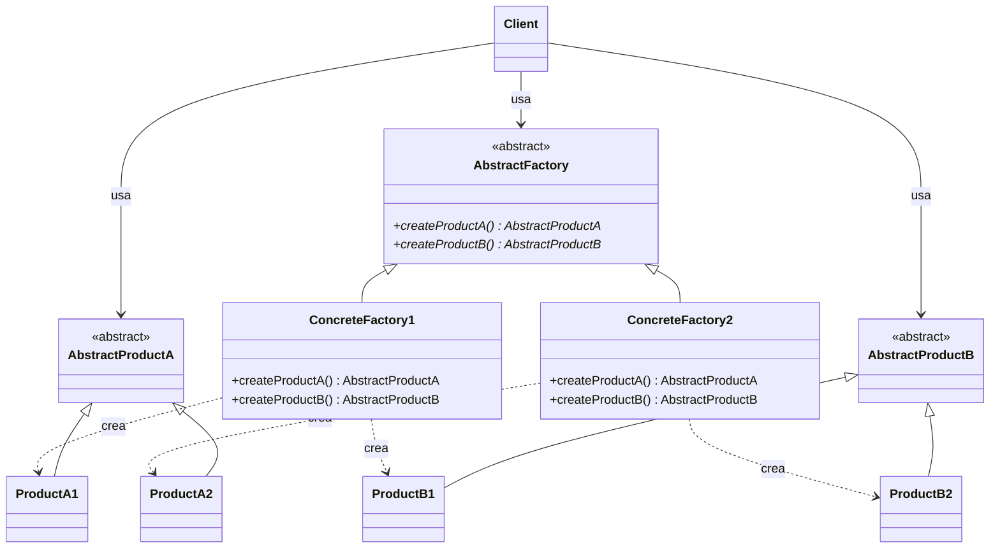
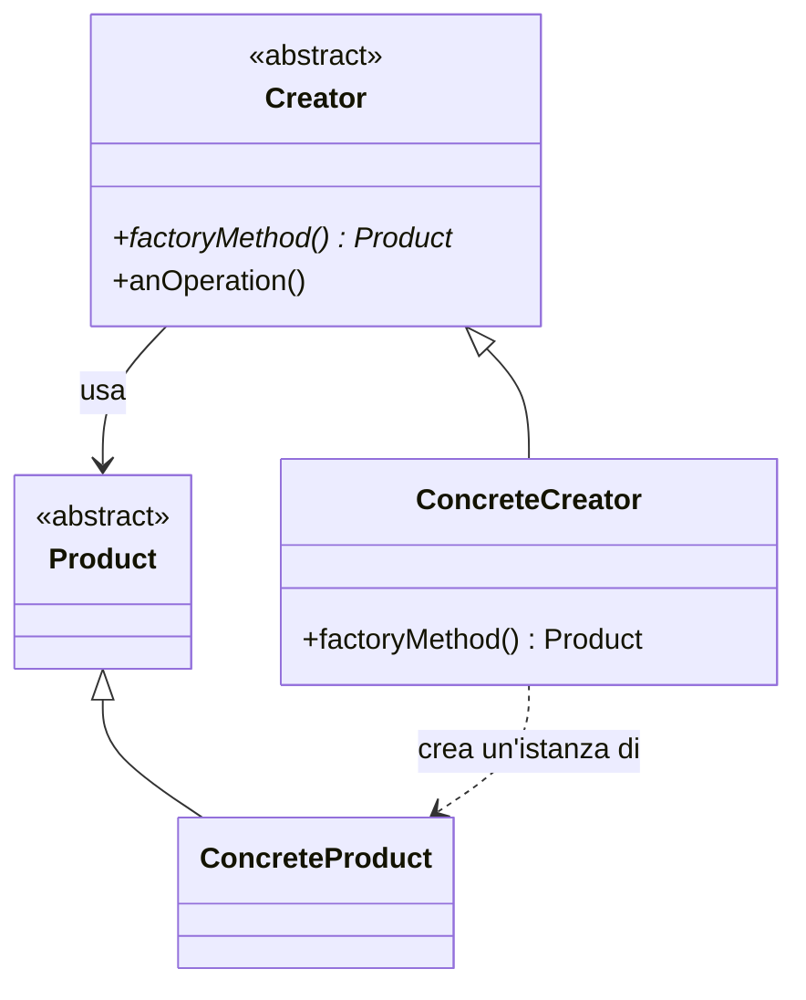
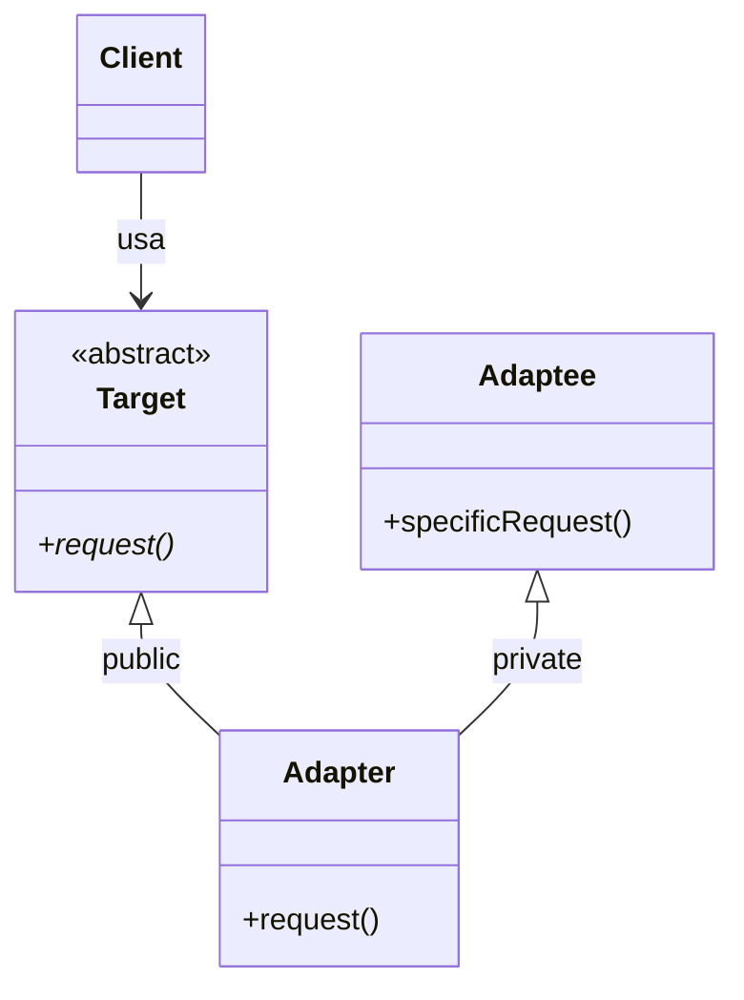
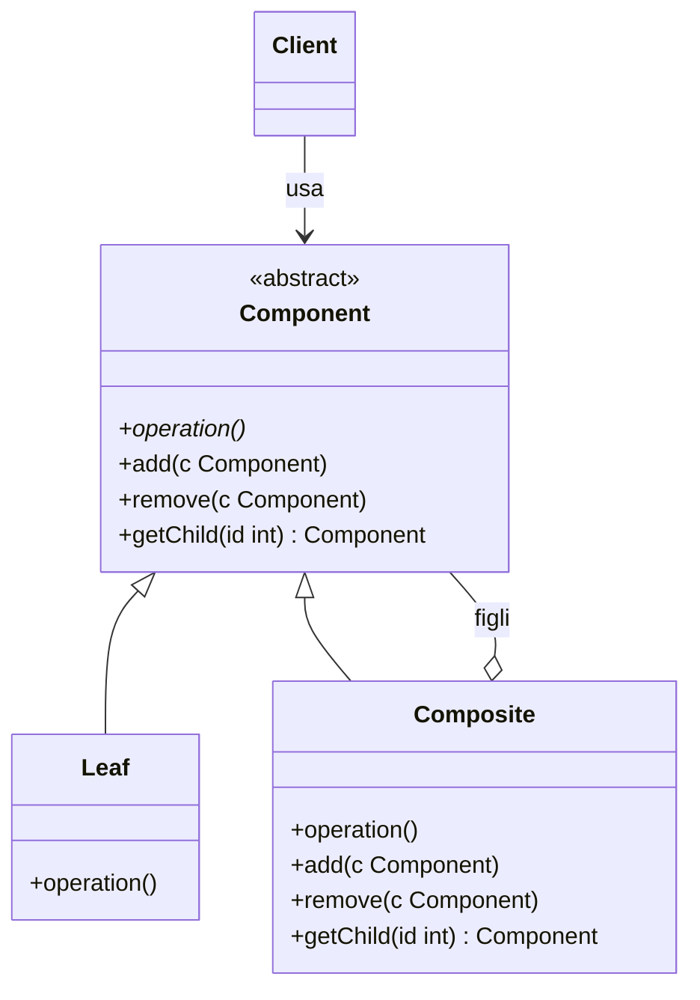
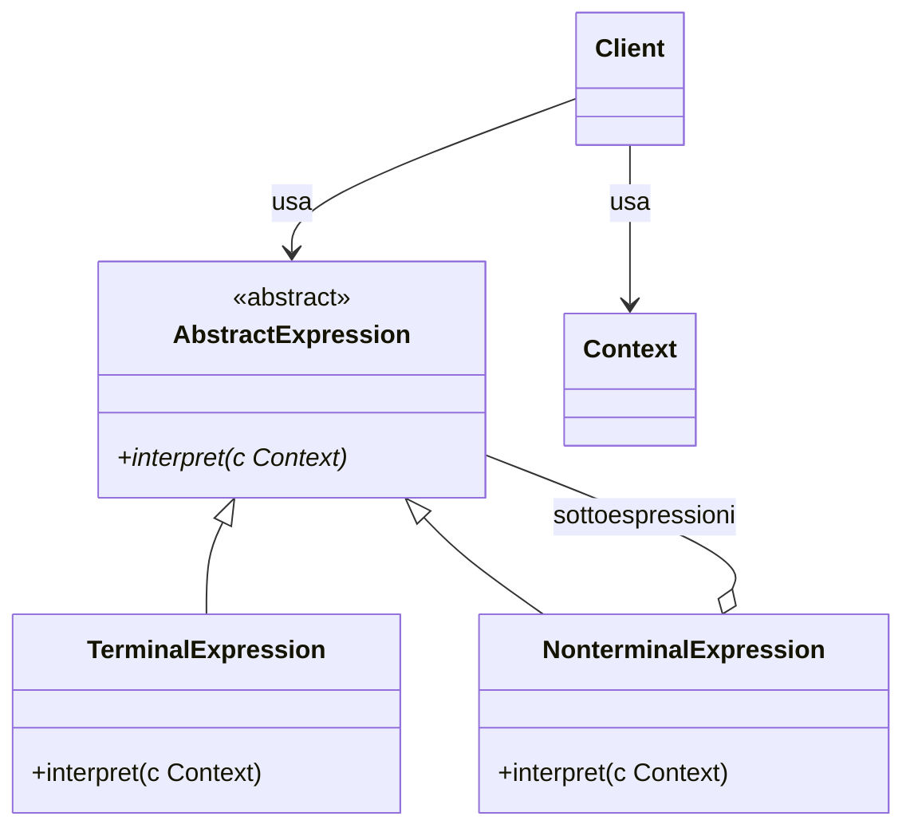
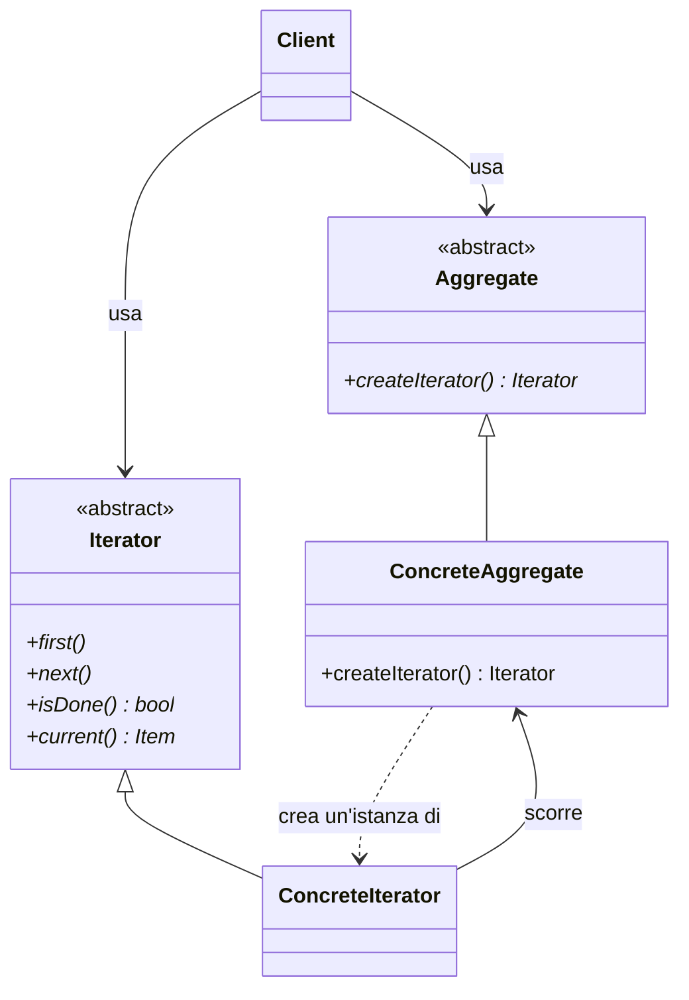
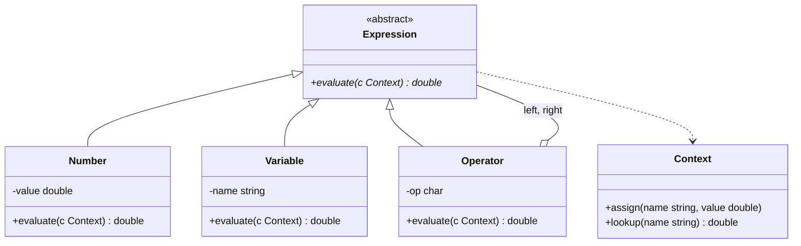

# Lezione 7 — Design pattern e classi come tipi

La lezione di C++ ha due parti. La prima introduce i **design pattern**, cioè gli schemi ricorrenti con cui si organizzano le classi di un programma orientato agli oggetti, usando il pacchetto di slide *Design Pattern* e il diagramma delle classi UML introdotto nella [[Lezione 05 - Funzioni virtuali e introduzione a UML|lezione 5]]. Dei pattern presenti nelle slide il docente ne approfondisce sei, quelli che serviranno nelle esercitazioni e nel progetto: Abstract Factory, Factory Method, Adapter, Composite, Interpreter e Iterator. La seconda parte torna al linguaggio con il pacchetto *03_OOprogramming*, tratto dal libro di Lischner [@lischner2020]: l'**Exploration 40** (classi e tipi), l'**Exploration 41** (dichiarazioni e definizioni) e l'**Exploration 43** (i «moduli» alla vecchia maniera, cioè la separazione in file header e file sorgente). Chiudono la lezione due esercizi che mettono in pratica quattro dei pattern visti.

In apertura il docente comunica di aver pubblicato la soluzione dell'esercizio sulla stampa dei lavori proposto nella [[Lezione 05 - Funzioni virtuali e introduzione a UML#Esercizio: stampare un file di lavori|lezione 5]], ringraziando chi gli aveva segnalato problemi nella pubblicazione. Invita a confrontarla con la propria e annuncia che verrà discussa in una lezione successiva.

## Da UML ai design pattern

### Che cosa descrive UML

Il docente riprende la [[Lezione 05 - Funzioni virtuali e introduzione a UML#Introduzione a UML|lezione 5]]. UML, come altri formalismi grafici, descrive la **struttura** di un'applicazione: quali classi ci sono, che cosa contengono e come si relazionano. Non descrive ciò che accade dentro i metodi, cioè gli algoritmi. È quindi lo **scheletro** del programma, ed è per questo che verrà richiesto come parte della consegna del progetto. Anche gli strumenti che promettono di generare codice a partire da UML producono in realtà uno scheletro: le dichiarazioni delle classi e dei metodi, il cui contenuto va scritto a mano.

UML comprende anche formalismi per descrivere il comportamento, per esempio le **macchine a stati**. Il docente non li tratta: sarebbe il terzo formalismo per le macchine a stati, dopo quello di Reti logiche e gli automi della parte di informatica teorica, con particolarità proprie e una potenza espressiva maggiore di quella degli automi del corso. Chi seguirà il corso di Ingegneria del software li incontrerà lì. Del vastissimo standard UML il corso ha preso solo un piccolo pezzo del diagramma delle classi: «un bagno brevissimo in un mare molto più vasto», sufficiente però per parlare di design pattern.

### Un sapere empirico

UML, come si è visto, non ha una semantica formale: nelle slide del docente ogni diagramma è accompagnato da codice C++, ma è una convenzione del corso. I design pattern si collocano un livello sopra. Usano UML per razionalizzare la soluzione di un problema, ma il problema è descritto in linguaggio naturale e la soluzione con un formalismo privo di semantica formale. Nascono da osservazioni empiriche, non da assiomi. Vanno quindi presi con giudizio, «non in maniera religiosa»: sono utili per inquadrare soluzioni che torneranno nel progetto, ma non sono teoremi.

## I design pattern

### L'origine in architettura

L'idea di pattern nasce in **architettura**. Il docente invita a osservare la città in cui si abita. A Genova si riconoscono molte epoche di costruzione: il centro storico, le espansioni di Carignano e Castelletto, i centri storici dei comuni poi inglobati, come Sestri Ponente o Pegli, e attorno a essi gli edifici più recenti. Guardando un edificio se ne indovina più o meno l'epoca: prima del Novecento, primi del Novecento, periodo razionalista, anni Sessanta e Settanta, e così via.

Al di là dello stile, edifici diversi della stessa epoca presentano le **stesse soluzioni**. Non perché gli architetti siano «dei copioni»: c'è un canone prevalente, compatibile con le tecniche costruttive e i materiali dell'epoca, e se un collega ha risolto brillantemente un problema per un edificio con la stessa destinazione, si tende a riusarne lo schema progettuale. L'esempio del docente è il **cavedio**, il pozzo interno presente in molti edifici vecchi, su cui si affacciano cucine e bagni. È una soluzione furba: ci passano tutti i tubi e più appartamenti ne prendono luce. Negli edifici recenti non si trova più, perché sono cambiati i materiali, le tecniche e il gusto.

Le slide aprono con la definizione dell'architetto Christopher Alexander, del 1977: ogni pattern descrive un problema che si presenta più e più volte nel nostro ambiente e poi descrive il nucleo della soluzione, in modo che la si possa usare un milione di volte senza mai farlo due volte nello stesso modo.

> [!tip] Approfondimento — *A Pattern Language*
> #approfondimento
> La citazione delle slide viene dal libro *A Pattern Language: Towns, Buildings, Construction*, pubblicato nel 1977 da Oxford University Press, di Christopher Alexander con Sara Ishikawa e Murray Silverstein [@alexander1977]. Il libro raccoglie 253 pattern per la progettazione di città ed edifici, che nel loro insieme formano un «linguaggio» [@wiki-patternlanguage]. Le slide scrivono «Cristopher»: la grafia corretta è Christopher.

### Il libro della «banda dei quattro»

L'idea è stata trasportata nel software da quattro autori, Erich Gamma, Richard Helm, Ralph Johnson e John Vlissides, nel libro *Design Patterns* del 1994. Sono familiarmente detti la **banda dei quattro** (*Gang of Four*, spesso abbreviato in GoF). La loro tesi è che ciò che vale in architettura vale anche nel software. Le slide ne riportano una frase: i design pattern catturano soluzioni sviluppate ed evolute nel tempo, che non sono quelle che si generano al primo tentativo, ma il frutto di innumerevoli riprogettazioni alla ricerca di maggiore riusabilità e flessibilità.

Il docente racconta di non averlo studiato all'università: nel 1994 era al terzo anno, e il libro era una novità assoluta. Quando andò a lavorare per un periodo in Intel, gli consegnarono due libri da studiare, il manuale del C++ di Stroustrup e *Design Patterns*. Il secondo, dice, si legge molto bene e insegna davvero come organizzare un programma orientato agli oggetti, soprattutto a chi non lo ha mai fatto. Il docente cercherà di rendere disponibile il PDF del libro tramite il sito del corso.

Dal 1994 l'ingegneria del software si è evoluta, anche prima dell'arrivo dei modelli linguistici. Il corso si sofferma sui pattern «istituzionali» del primo libro, e tra questi su quelli più consolidati e utili al progetto.

> [!warning] Quanti sono i pattern del libro
> Il docente dice che nel libro ce ne sono «credo una quarantina». In realtà *Design Patterns* ne cataloga **23**: 5 creazionali, 7 strutturali e 11 comportamentali [@gof1994; @wiki-designpatterns]. Le slide del corso ne presentano 17, e la lezione ne approfondisce 6.

### Gli elementi di un pattern

Nel software un design pattern ha quattro elementi:

1. **nome**: un appellativo sintetico con cui riferirsi al problema e alla sua soluzione;
2. **problema**: la descrizione del problema e del contesto in cui il pattern si applica;
3. **soluzione**: gli elementi che costituiscono il progetto, cioè un'architettura di classi, con le loro relazioni, responsabilità e collaborazioni;
4. **conseguenze**: i risultati e i compromessi ottenuti applicando il pattern, utili per valutare soluzioni alternative.

Le conseguenze contano quanto la soluzione. Il docente torna al cavedio: si adotta, si risolvono molti problemi, poi si apre la finestra e ci si trova davanti il vicino in bagno. Bisogna sapere in anticipo che queste situazioni esistono.

### Tre famiglie

I pattern si dividono in tre famiglie.

| Famiglia | Che cosa fa | Nelle slide | Trattati in aula |
|---|---|---|---|
| Creazionali | astraggono il processo di istanziazione degli oggetti | Abstract Factory, Builder, Factory Method, Prototype, Singleton | Abstract Factory, Factory Method |
| Strutturali | compongono classi e oggetti in strutture più grandi | Adapter, Bridge, Composite, Decorator | Adapter, Composite |
| Comportamentali | distribuiscono un algoritmo e le responsabilità su più classi e oggetti | Command, Interpreter, Iterator, Observer, State, Strategy, Template Method, Visitor | Interpreter, Iterator (Visitor rinviato) |

Il docente avverte che le definizioni possono sembrare filosofia, e che gli esempi le renderanno concrete. Nei prossimi esercizi di C++ e nel progetto i pattern torneranno quasi sempre, con le relative soluzioni. Aggiunge che librerie come la Standard Template Library del C++, le Qt per le interfacce grafiche o le librerie di algebra lineare sono spesso organizzate secondo pattern, e conoscerli aiuta a capirne l'organizzazione.

## Pattern creazionali

I pattern creazionali forniscono un'astrazione del processo di istanziazione degli oggetti. Un oggetto si può creare direttamente, con `new` o come variabile automatica. In alcune situazioni, però, conviene farlo creare da un'altra classe o da un altro metodo. Questi pattern incapsulano la conoscenza delle classi concrete usate nel sistema e nascondono il modo in cui vengono create e composte. Lo scopo è quello di sempre: rendere il codice generico e **robusto ai cambiamenti** dovuti a manutenzione ed estensione. Più si isolano gli aspetti concreti, meno codice va toccato quando si aggiunge una funzionalità. È il gioco proposto nell'esercizio precedente: aggiungere una classe e scoprire di dover modificare una sola riga.

### Abstract Factory

> [!important] Abstract Factory
> **Scopo.** Fornire un'interfaccia per creare famiglie di oggetti correlati o dipendenti, senza specificare le loro classi concrete.
>
> **Applicabilità.** Un sistema deve essere indipendente dal modo in cui i suoi prodotti vengono creati, composti e rappresentati; esistono famiglie di oggetti correlati, progettati per essere usati insieme, e il vincolo va garantito; il sistema va configurato scegliendo tra più famiglie di prodotti.

Il docente la chiama «la regina dei pattern creazionali». *Factory* va tradotto con **fabbrica**, non con «fattoria». La struttura è la seguente.



I partecipanti sono:

- **AbstractFactory**: dichiara l'interfaccia delle operazioni che creano i prodotti astratti; è una classe astratta, con metodi virtuali puri;
- **ConcreteFactory**: implementa le operazioni di creazione dei prodotti concreti;
- **AbstractProduct**: dichiara l'interfaccia di una tipologia di prodotto;
- **ConcreteProduct**: è il prodotto creato da una fabbrica concreta e implementa l'interfaccia astratta;
- **Client**: un oggetto che *usa* (la relazione UML di utilizzo) soltanto le interfacce di AbstractFactory e AbstractProduct.

L'esempio del docente è un'**interfaccia grafica** che deve funzionare sia su Windows sia su Mac. Le librerie che creano gli oggetti grafici sono diverse sui due sistemi, quindi la fabbrica concreta che crea i *widget* (i componenti grafici: menu, barre di scorrimento, campi di testo) deve essere diversa. Il programma, però, lo si vuole scrivere una volta sola. Se il programma fa riferimento solo ai metodi della fabbrica astratta e alle interfacce astratte dei prodotti, al momento della configurazione si crea la fabbrica concreta adatta al sistema operativo, e il polimorfismo fa il resto. Al client non interessa quale fabbrica concreta sia stata usata, né se gli oggetti generati siano di tipo A1 e B1 o A2 e B2. Le **Qt** funzionano così: girano su Windows, Mac e Linux, e chi crea una finestra e la popola di pulsanti, campi di testo e cursori fa riferimento solo a interfacce astratte. Le librerie di interfacce grafiche, osserva il docente, sono «una miniera d'oro» di pattern.

Il codice seguente traduce lo schema per l'esempio delle interfacce grafiche. I prodotti sono pulsanti e campi di testo, e le due famiglie sono quella Windows e quella Mac. Come nel resto del corso si usano i puntatori tradizionali, e ogni classe base ha un distruttore virtuale.

```cpp
#include <iostream>

// Prodotti astratti
class Button {
public:
  virtual ~Button() = default;
  virtual void draw() const = 0;
};

class TextField {
public:
  virtual ~TextField() = default;
  virtual void draw() const = 0;
};

// Fabbrica astratta
class WidgetFactory {
public:
  virtual ~WidgetFactory() = default;
  virtual Button* createButton() const = 0;
  virtual TextField* createTextField() const = 0;
};

// Famiglia concreta 1
class WinButton : public Button {
public:
  void draw() const override { std::cout << "[pulsante Windows]\n"; }
};
class WinTextField : public TextField {
public:
  void draw() const override { std::cout << "[campo di testo Windows]\n"; }
};
class WinFactory : public WidgetFactory {
public:
  Button* createButton() const override { return new WinButton{}; }
  TextField* createTextField() const override { return new WinTextField{}; }
};

// Famiglia concreta 2
class MacButton : public Button {
public:
  void draw() const override { std::cout << "(pulsante Mac)\n"; }
};
class MacTextField : public TextField {
public:
  void draw() const override { std::cout << "(campo di testo Mac)\n"; }
};
class MacFactory : public WidgetFactory {
public:
  Button* createButton() const override { return new MacButton{}; }
  TextField* createTextField() const override { return new MacTextField{}; }
};

// Il client conosce solo le interfacce astratte
void buildDialog(WidgetFactory const& factory) {
  Button* ok{factory.createButton()};
  TextField* name{factory.createTextField()};
  name->draw();
  ok->draw();
  delete name;
  delete ok;
}

int main() {
  WinFactory win;
  MacFactory mac;
  buildDialog(win);
  buildDialog(mac);
}
```

L'output, verificato compilando con g++ in modalità C++20, è:

```text
[campo di testo Windows]
[pulsante Windows]
(campo di testo Mac)
(pulsante Mac)
```

La funzione `buildDialog` non nomina mai una classe concreta. Per aggiungere una terza famiglia, per esempio Linux, basta scrivere i nuovi prodotti e la nuova fabbrica, senza toccare il client. Il vincolo di famiglia è garantito dalla struttura: una `MacFactory` non può produrre un pulsante Windows.

### Factory Method

> [!important] Factory Method
> **Scopo.** Definire un'interfaccia per la creazione di un oggetto, lasciando alle sottoclassi la decisione su quale classe istanziare: l'istanziazione viene **deferita alle sottoclassi**.
>
> **Applicabilità.** Una classe non sa in anticipo di quale classe saranno gli oggetti che deve creare; una classe vuole che siano le sue sottoclassi a scegliere gli oggetti da creare; le classi delegano responsabilità a classi di supporto, e si vuole localizzare in un punto preciso la conoscenza di quale classe di supporto viene usata.

Il docente salta Builder e passa al Factory Method, importante per due ragioni. La prima: i metodi di una Abstract Factory sono metodi che creano oggetti, cioè Factory Method; in questo senso il Factory Method è un **sottopattern** dell'Abstract Factory. La seconda: ha senso anche da solo, e servirà subito per un altro pattern, l'Iterator.



Il **Creator** dichiara il metodo factory, che restituisce un oggetto di tipo **Product**. Può anche definirne un'implementazione standard. Il **ConcreteCreator** lo ridefinisce per restituire un'istanza di uno specifico **ConcreteProduct**. Le slide annotano accanto a `anOperation()` il frammento `product = factoryMethod()`: quando il Creator ha bisogno di un nuovo prodotto, se lo fa dare dal metodo factory, e lo usa tramite l'interfaccia astratta. È, in sostanza, un'Abstract Factory ridotta a un solo metodo.

Nell'esempio seguente il Creator è un'applicazione che sa *quando* creare un documento ma non *quale*: lo decide la sottoclasse.

```cpp
#include <iostream>

class Document {                       // Product
public:
  virtual ~Document() = default;
  virtual void open() const = 0;
};

class TextDocument : public Document { // ConcreteProduct
public:
  void open() const override { std::cout << "apro un documento di testo\n"; }
};

class Application {                    // Creator
public:
  virtual ~Application() = default;
  void newDocument() const {           // anOperation
    Document* doc{createDocument()};   // product = factoryMethod()
    doc->open();
    delete doc;
  }
protected:
  virtual Document* createDocument() const = 0;   // factoryMethod
};

class TextEditor : public Application {           // ConcreteCreator
protected:
  Document* createDocument() const override { return new TextDocument{}; }
};

int main() {
  TextEditor editor;
  editor.newDocument();   // stampa: apro un documento di testo
}
```

Il docente ricorda che sul libro, o in rete, si trovano gli altri pattern creazionali, che la lezione non tratta.

## Pattern strutturali

I pattern strutturali riguardano il modo in cui classi e oggetti si combinano per formare strutture più grandi. Un dato può essere composto da più classi diverse, e combinandole si ottengono nuove funzionalità. Questi pattern usano l'ereditarietà per comporre interfacce e implementazioni, oppure compongono oggetti.

### Adapter

> [!important] Adapter
> **Scopo.** Convertire l'interfaccia di una classe nell'interfaccia richiesta dal client, permettendo a classi con interfacce incompatibili di lavorare insieme.
>
> **Applicabilità.** Si vuole usare una classe esistente la cui interfaccia non è compatibile con quella desiderata; si vuole creare una classe riusabile che cooperi con classi non correlate o impreviste; si devono usare diverse sottoclassi esistenti, ma non è pratico adattarne l'interfaccia creando una sottoclasse per ciascuna.

Il nome dice tutto: è l'**adattatore** della presa elettrica, che permette di infilare una spina italiana in una presa Schuko o viceversa. Il servizio richiesto dal client (la spina) non corrisponde all'interfaccia offerta dal servitore (la presa), e l'adattatore si infila correttamente nell'una e accetta l'altra. L'esempio informatico del docente è una libreria di algebra lineare. Un programma, magari *legacy* (cioè vecchio ma ancora in uso), usa una vecchia classe di algebra lineare; ne è disponibile una nuova con le stesse operazioni (prodotti tra matrici, prodotti scalari e vettoriali, determinanti, inversioni), ma le due interfacce non si parlano. Invece di riscrivere tutto, si scrive un adattatore, detto anche **wrapper** («involucro»), che avvolge la classe esistente e ne offre le funzionalità con l'interfaccia richiesta. Si potrebbe obiettare che è ovvio, ma è un pattern, e gli autori del libro hanno voluto codificarlo.



Il **Client** collabora con oggetti conformi all'interfaccia **Target**. L'**Adaptee** è la classe esistente da adattare. L'**Adapter** adatta l'interfaccia dell'Adaptee al Target: quando il client chiama `request()`, l'adapter la traduce in una chiamata a `specificRequest()`. Né il client né il target devono sapere che esiste un adapter.

Le slide notano che il pattern è specificato con un'**ereditarietà multipla**. In C++ si realizza così: l'adapter eredita **pubblicamente** dal target, di cui offre l'interfaccia, e **privatamente** dall'adaptee, di cui riusa l'implementazione (l'annotazione «implementazione» del diagramma). In Java, che non ha ereditarietà multipla tra classi, bisogna ricorrere all'implementazione di un'interfaccia. La nota, spiega il docente, è un residuo di quando il linguaggio del corso era Java.

```cpp
#include <iostream>

// Target: l'interfaccia che il client si aspetta
class Shape {
public:
  virtual ~Shape() = default;
  virtual double area() const = 0;
};

// Adaptee: una classe esistente con un'interfaccia diversa
class LegacyRectangle {
public:
  LegacyRectangle(double w, double h) : w_{w}, h_{h} {}
  double computeSurface() const { return w_ * h_; }
private:
  double w_, h_;
};

// Adapter: eredita l'interfaccia (public) e l'implementazione (private)
class RectangleAdapter : public Shape, private LegacyRectangle {
public:
  RectangleAdapter(double w, double h) : LegacyRectangle{w, h} {}
  double area() const override { return computeSurface(); }  // request() -> specificRequest()
};

void printArea(Shape const& s) {   // il client conosce solo Shape
  std::cout << "area = " << s.area() << '\n';
}

int main() {
  RectangleAdapter r{3.0, 4.0};
  printArea(r);                    // stampa: area = 12
}
```

L'ereditarietà privata fa sì che l'interfaccia dell'adaptee resti nascosta. Una chiamata `r.computeSurface()` dal `main`, o la conversione di `r` in un riferimento a `LegacyRectangle`, sono rifiutate dal compilatore («inaccessible base»), come si è verificato.

> [!tip] Approfondimento — Adapter di classe e adapter di oggetto
> #approfondimento
> Lo schema delle slide è quello che il libro della GoF chiama **adapter di classe**, basato sull'ereditarietà multipla. Il libro ne descrive anche una seconda forma, l'**adapter di oggetto**, in cui l'adapter eredita solo dal target e *contiene* un oggetto adaptee a cui inoltra le richieste [@gof1994]. Nel diagramma UML la seconda freccia di ereditarietà diventa quindi un'aggregazione. L'adapter di oggetto funziona anche in linguaggi senza ereditarietà multipla e può adattare un adaptee e tutte le sue sottoclassi; quello di classe permette invece di ridefinire parte del comportamento dell'adaptee.

### Composite

> [!important] Composite
> **Scopo.** Comporre oggetti in strutture ad albero per rappresentare gerarchie **tutto-parte**, permettendo ai client di trattare in modo uniforme oggetti singoli e composizioni di oggetti.
>
> **Applicabilità.** Si vuole rappresentare una gerarchia tutto-parte; si vuole che i client possano ignorare la differenza tra oggetti composti e oggetti singoli.

Il docente lo indica come il pattern centrale del progetto, insieme a uno comportamentale, e come lo strutturale che interesserà di più. Si basa sulla nozione di **albero**, che il docente riconosce di non aver introdotto nella parte di base del corso. Intuitivamente è la struttura del *file system*: una **radice** in cima, cartelle che contengono altre cartelle e file, e in fondo le **foglie**, che non contengono nulla. Ogni elemento diverso dalla radice è contenuto in esattamente un altro elemento. Se gli oggetti di un programma formano gerarchie di questo tipo, il Composite è il pattern adatto.

Due esempi del docente. Il primo è un **macchinario**, per esempio per la tessitura, composto da sottomacchine (una che prende il filo, una che lo intreccia, una che fa uscire il tessuto), a loro volta scomponibili. Una rappresentazione di questo tipo serve, per esempio, a produrre la **distinta base** (*bill of materials*), l'elenco dei componenti da ordinare per costruire la macchina. Il secondo è un'**interfaccia grafica**: la finestra principale contiene pannelli, i pannelli contengono widget, e un campo di testo può contenere a sua volta delle barre di scorrimento. Tutti i componenti hanno un'interfaccia comune, per esempio il metodo che reagisce a un clic del mouse, ma ognuno ha il proprio comportamento.



I partecipanti sono:

- **Component**: dichiara l'interfaccia degli oggetti nella composizione e l'interfaccia per gestirne le parti;
- **Leaf**: un oggetto elementare, o **atomico**, come un pulsante o un campo di testo in cui non si può inserire altro;
- **Composite**: un oggetto che contiene altri componenti, come un pannello; aggrega le parti e implementa le operazioni legate a esse;
- **Client**: manipola gli oggetti tramite l'interfaccia di Component.

Il punto chiave, sottolinea il docente, è che un composite contiene dei **component**, non delle foglie: altrimenti la struttura si fermerebbe a due livelli. Un component può essere una foglia o, a sua volta, un composite, e questo produce l'albero. Le slide annotano l'implementazione tipica dell'operazione nel composite: `for all g in children: g.operation()`, cioè l'operazione viene applicata ricorsivamente a tutti i figli.

Il codice seguente realizza la distinta base del macchinario. L'operazione è il calcolo del costo: per una parte è il suo prezzo, per un assieme è la somma dei costi delle sue parti.

```cpp
#include <iostream>
#include <string>
#include <vector>

class Component {
public:
  explicit Component(std::string name) : name_{std::move(name)} {}
  Component(Component const&) = delete;
  Component& operator=(Component const&) = delete;
  virtual ~Component() = default;
  virtual double cost() const = 0;                   // operation()
  virtual void print(int indent) const = 0;
protected:
  std::string name_;
};

class Part : public Component {                      // Leaf
public:
  Part(std::string name, double price) : Component{std::move(name)}, price_{price} {}
  double cost() const override { return price_; }
  void print(int indent) const override {
    std::cout << std::string(indent, ' ') << name_ << ": " << price_ << '\n';
  }
private:
  double price_;
};

class Assembly : public Component {                  // Composite
public:
  explicit Assembly(std::string name) : Component{std::move(name)} {}
  ~Assembly() override {
    for (Component* c : children_) delete c;          // l'assieme possiede le sue parti
  }
  void add(Component* c) { children_.push_back(c); }
  double cost() const override {
    double total{0.0};
    for (Component* c : children_) total += c->cost();  // for all g in children: g.operation()
    return total;
  }
  void print(int indent) const override {
    std::cout << std::string(indent, ' ') << name_ << " (" << cost() << ")\n";
    for (Component* c : children_) c->print(indent + 2);
  }
private:
  std::vector<Component*> children_;
};

int main() {
  Assembly* feeder{new Assembly{"alimentatore del filo"}};
  feeder->add(new Part{"rocchetto", 12.5});
  feeder->add(new Part{"tenditore", 7.0});

  Assembly loom{"telaio"};
  loom.add(feeder);
  loom.add(new Part{"pettine", 30.0});
  loom.add(new Part{"motore", 120.0});

  loom.print(0);
  std::cout << "costo totale: " << loom.cost() << '\n';
}
```

L'output è il seguente; il programma è stato controllato anche con Valgrind, senza perdite di memoria.

```text
telaio (169.5)
  alimentatore del filo (19.5)
    rocchetto: 12.5
    tenditore: 7
  pettine: 30
  motore: 120
costo totale: 169.5
```

Il client chiama `cost()` sul telaio senza sapere se sotto ci siano parti o assiemi, e l'assieme «alimentatore» è trattato come una parte qualsiasi. La copia è cancellata (`= delete`) perché un assieme possiede i suoi figli: copiarlo membro a membro produrrebbe due assiemi con gli stessi puntatori, e i figli verrebbero distrutti due volte.

> [!tip] Approfondimento — Dove dichiarare `add` e `remove`
> #approfondimento
> Nello schema delle slide le operazioni di gestione dei figli (`add`, `remove`, `getChild`) sono dichiarate in Component, quindi anche le foglie le possiedono. Il libro della GoF discute esplicitamente il compromesso [@gof1994]. Dichiararle in Component privilegia la **trasparenza**: il client tratta tutti i componenti allo stesso modo. Dichiararle solo in Composite, come nel codice qui sopra, privilegia la **sicurezza**: aggiungere un figlio a una foglia diventa un errore di compilazione, al prezzo di dover distinguere i composti quando li si costruisce.

Il docente salta il Decorator e passa ai pattern comportamentali.

## Pattern comportamentali

I pattern comportamentali descrivono non solo relazioni tra oggetti, ma anche il modo in cui gli oggetti **comunicano**. Il docente li presenta come **algoritmi distribuiti**: invece di concentrare un algoritmo in un unico metodo di un'unica classe, lo si distribuisce su più metodi e più oggetti. Usano l'ereditarietà per distribuire il comportamento tra le classi e la composizione per far cooperare oggetti diversi.

### Interpreter

> [!important] Interpreter
> **Scopo.** Dato un linguaggio formale, definire una rappresentazione della sua grammatica insieme a un interprete che usa tale rappresentazione per valutare le frasi del linguaggio.
>
> **Applicabilità.** La grammatica è semplice (per grammatiche complesse la gerarchia di classi diventa difficile da gestire, ed è meglio usare generatori automatici di analizzatori sintattici); l'efficienza non è l'aspetto principale.

Il progetto del corso è un interprete, quindi questo è il pattern di riferimento per il progetto: è esattamente ciò che serve per la sua struttura dati. Il docente osserva che le grammatiche non sono ancora state introdotte: finora si sono visti gli automi e la definizione delle espressioni regolari, e più avanti arriveranno formalismi più potenti, che «faranno scopa» con l'interprete. Per situazioni di livello industriale esistono altre soluzioni, di cui si parlerà nel corso, ma per il progetto questo pattern va benissimo.



Dal punto di vista **strutturale**, l'Interpreter **è un Composite**: cambiano i nomi, ma le relazioni sono le stesse. Il client ha a che fare con un'espressione astratta del linguaggio. Un'espressione può essere **terminale**, cioè atomica, come una lettera, un numero o un simbolo, oppure **non terminale**, cioè espandibile ulteriormente. In un'espressione aritmetica un numero è un'espressione terminale: sotto non c'è altro. La somma o il prodotto di due espressioni sono espressioni non terminali, perché per valutarle bisogna guardare dentro le due sottoespressioni.

Dal punto di vista **comportamentale**, l'Interpreter aggiunge l'operazione `interpret`, che valuta un'espressione dato un **contesto**. Il contesto contiene le informazioni globali dell'interprete; per esempio, per dare un valore a un'espressione che contiene variabili bisogna sapere quanto valgono le variabili. I partecipanti delle slide sono:

- **AbstractExpression**: dichiara l'operazione di interpretazione, comune a tutti i nodi dell'albero sintattico;
- **TerminalExpression**: implementa l'interpretazione dei simboli terminali della grammatica;
- **NonterminalExpression**: implementa l'interpretazione delle regole della grammatica; di norma serve una classe per ogni regola;
- **Context**: contiene le informazioni globali relative all'interprete;
- **Client**: costruisce l'albero sintattico e invoca l'interpretazione.

Per non anticipare la soluzione del primo esercizio, che riguarda le espressioni aritmetiche, l'esempio seguente interpreta espressioni **booleane** con costanti, variabili, congiunzione e negazione. Il contesto associa a ogni nome di variabile un valore di verità, e usa `std::unordered_map`, il contenitore associativo che l'esercizio suggerisce.

```cpp
#include <iostream>
#include <string>
#include <unordered_map>

class Context {                                   // informazioni globali
public:
  void assign(std::string const& name, bool value) { values_[name] = value; }
  bool lookup(std::string const& name) const { return values_.at(name); }
private:
  std::unordered_map<std::string, bool> values_;
};

class BoolExp {                                   // AbstractExpression
public:
  BoolExp() = default;
  BoolExp(BoolExp const&) = delete;
  BoolExp& operator=(BoolExp const&) = delete;
  virtual ~BoolExp() = default;
  virtual bool interpret(Context const& c) const = 0;
};

class Constant : public BoolExp {                 // TerminalExpression
public:
  explicit Constant(bool v) : value_{v} {}
  bool interpret(Context const&) const override { return value_; }
private:
  bool value_;
};

class Variable : public BoolExp {                 // TerminalExpression
public:
  explicit Variable(std::string name) : name_{std::move(name)} {}
  bool interpret(Context const& c) const override { return c.lookup(name_); }
private:
  std::string name_;
};

class And : public BoolExp {                      // NonterminalExpression
public:
  And(BoolExp* l, BoolExp* r) : left_{l}, right_{r} {}
  ~And() override { delete left_; delete right_; }
  bool interpret(Context const& c) const override {
    return left_->interpret(c) and right_->interpret(c);
  }
private:
  BoolExp* left_;
  BoolExp* right_;
};

class Not : public BoolExp {                      // NonterminalExpression
public:
  explicit Not(BoolExp* e) : operand_{e} {}
  ~Not() override { delete operand_; }
  bool interpret(Context const& c) const override { return not operand_->interpret(c); }
private:
  BoolExp* operand_;
};

int main() {
  // (x and not y) and true
  BoolExp* e{new And{new And{new Variable{"x"}, new Not{new Variable{"y"}}},
                     new Constant{true}}};
  Context c;
  c.assign("x", true);
  c.assign("y", false);
  std::cout << std::boolalpha << e->interpret(c) << '\n';   // true
  c.assign("y", true);
  std::cout << e->interpret(c) << '\n';                     // false
  delete e;
}
```

L'albero dell'espressione $(x \land \lnot y) \land \mathit{true}$ si costruisce dal basso: le foglie sono le variabili e la costante, i nodi interni sono `And` e `Not`. La stessa struttura si valuta in contesti diversi senza ricostruirla. È, in piccolo, ciò che farà l'interprete del progetto, dove l'albero sarà prodotto dall'analisi sintattica descritta nella [[Lezione 02 - Architettura di un interprete e linguaggi formali|lezione 2]].

Il docente conclude che Factory Method, Composite e Interpreter verranno usati «più e più volte», e che se ora sembrano concetti sospesi nell'aria, verranno messi a terra con esempi.

### Iterator

> [!important] Iterator
> **Scopo.** Fornire un modo per accedere in sequenza agli elementi di un contenitore senza esporne la rappresentazione interna.
>
> **Applicabilità.** Si vuole nascondere la struttura interna del contenitore pur permettendone la scansione dall'esterno; servono più scansioni contemporanee; si vuole un modo uniforme di scandire contenitori di tipo diverso (**iterazione polimorfa**).

Chi progetta un contenitore, come un vettore o una lista, offre all'utente operazioni per aggiungere, togliere e cercare elementi. Vorrà offrire anche un modo per **scorrerli**. Il problema è farlo senza esporre come è fatto il contenitore all'interno, e farlo in modo efficiente: in modo inefficiente si può sempre fare. L'iteratore risolve entrambi i problemi.



L'**Aggregate** è il contenitore e offre un metodo factory, `createIterator()`. Il **ConcreteAggregate** lo implementa restituendo un'istanza del **ConcreteIterator** (nelle slide: `return new ConcreteIterator(this)`). Questo implementa l'interfaccia astratta **Iterator**, che permette di inizializzare la scansione (`first`), avanzare all'elemento successivo (`next`), sapere se la scansione è finita (`isDone`) e accedere all'elemento corrente (`current`). Il ConcreteIterator tiene traccia della posizione raggiunta. Il docente fa notare che qui un pattern creazionale, il Factory Method, viene usato all'interno di un pattern comportamentale. Il secondo esercizio della lezione chiede di realizzare proprio questo schema per una pila, e la soluzione proposta più sotto ne mostra il codice.

### Visitor e gli altri pattern

C'è un ultimo pattern comportamentale che verrà usato nel progetto, il **Visitor**. Il docente non lo presenta ora perché è piuttosto difficile da capire in astratto, e lo riprenderà con un esempio concreto quando servirà. La lezione si chiude con un'indicazione: per ora UML e design pattern vanno tenuti «in un cassetto», per tirarli fuori al momento opportuno.

Per completezza, la tabella riporta lo scopo dei pattern presenti nelle slide ma non trattati in aula, come lo enunciano le slide stesse.

| Pattern | Famiglia | Scopo |
|---|---|---|
| Builder | creazionale | separare la costruzione di un oggetto complesso dalla sua rappresentazione, così che lo stesso processo crei rappresentazioni diverse |
| Prototype | creazionale | creare nuovi oggetti copiando un'istanza prototipo |
| Singleton | creazionale | assicurare che una classe abbia una sola istanza, con un punto di accesso globale |
| Bridge | strutturale | disaccoppiare un'astrazione dalla sua implementazione, così che possano variare indipendentemente |
| Decorator | strutturale | aggiungere dinamicamente responsabilità a un oggetto, in alternativa flessibile all'ereditarietà |
| Command | comportamentale | incapsulare una richiesta in un oggetto, per gestirla come un dato (accodarla, annullarla) |
| Observer | comportamentale | definire una dipendenza uno-a-molti: quando un oggetto cambia stato, quelli collegati vengono notificati |
| State | comportamentale | permettere a un oggetto di cambiare comportamento quando cambia il suo stato interno |
| Strategy | comportamentale | definire una famiglia di algoritmi intercambiabili |
| Template Method | comportamentale | definire lo scheletro di un algoritmo, lasciando alcuni passi alle sottoclassi |
| Visitor | comportamentale | definire nuove operazioni sugli elementi di una struttura senza modificarne le classi |

## Classi e tipi

Con il tempo rimasto il docente torna al codice, con l'Exploration 40 del libro di Lischner.

### Alias di tipo e value type

In C il costrutto `typedef` permette di definire un **alias**, cioè un sinonimo, per un tipo. In C++ si usa la parola chiave `using`. Si possono definire, per esempio, tre sinonimi di `int` per altezza, peso e indice di massa corporea (BMI):

```cpp
#include <iostream>

using height = int;
using weight = int;
using bmi = int;

bmi compute_bmi(height h, weight w) {
  return w * 10000 / (h * h);
}

int main() {
  height h{178};
  weight w{75};
  std::cout << "Bogus Metabolic Index = " << compute_bmi(w, h) << '\n';
}
```

Gli alias sono comodi quando un tipo ha un nome lungo e fastidioso da ripetere, come l'istanza di un template, per esempio un vettore di vettori di stringhe. In molti casi, osserva il docente, si può anche lasciare che sia il compilatore a dedurre il tipo, scrivendo `auto`. L'esempio mostra però che non sempre sono una buona idea. L'interfaccia di `compute_bmi` vuole prima l'altezza e poi il peso, ma la chiamata li passa scambiati, e il compilatore non segnala nulla, perché per lui sono tutti `int`. Il programma stampa 316 invece del valore corretto, 23 (verificato).

> [!warning] Precisazioni sulle versioni del C++
> Il docente attribuisce `auto` al C++20. La deduzione del tipo di una variabile dal suo inizializzatore con `auto` esiste invece dal **C++11**; il C++20 ne ha esteso l'uso, per esempio ai parametri dei template abbreviati [@cppref-auto]. Anche la dichiarazione di alias con `using` è disponibile dal C++11, e, come `typedef`, introduce un sinonimo e non un tipo nuovo [@cppref-typealias]. Nel codice delle slide le stringhe terminano con un apice tipografico (`'\n’`), che non compila; qui è stato sostituito con l'apice semplice.

Molto meglio definire **strutture** distinte. Si ricordi che una `struct` è una classe in cui tutto è pubblico per default.

```cpp
#include <iostream>

using bmi = int;

struct height {
  height(int h) : value{h} {}
  int value;
};

struct weight {
  weight(int w) : value{w} {}
  int value;
};

bmi compute_bmi(height h, weight w) {
  return w.value * 10000 / (h.value * h.value);
}

int main() {
  height h{178};
  weight w{75};
  std::cout << "Bogus Metabolic Index = " << compute_bmi(w, h) << '\n';
}
```

Ora la chiamata con gli argomenti scambiati è un **errore di compilazione** (g++: `could not convert 'w' from 'weight' to 'height'`), e chiamando `compute_bmi(h, w)` si ottiene 23. Il docente anticipa una critica: gli argomenti sono passati per copia. Trattandosi di strutture con un solo valore non è un problema; chi è «pignolo» può passarli per riferimento costante. Questa soluzione introduce qualche riga di codice in più (costruttori, eventuali distruttori), e potrebbe essere leggermente più lenta, ma non è detto, perché il compilatore può ottimizzare. Come politica di progetto, però, è **grandemente preferibile**: è più sicura. Gli alias non sono quindi da bandire, perché in alcuni casi servono, ma qui la scelta giusta è un *value type*.

> [!tip] Approfondimento — Il ruolo di `explicit`
> #approfondimento
> Le strutture delle slide proteggono dallo scambio tra un `height` e un `weight`, ma non dallo scambio tra numeri: il costruttore `height(int)` è un **costruttore di conversione**, che il compilatore usa implicitamente. Si è verificato che `compute_bmi(75, 178)` compila e stampa di nuovo 316. Dichiarando i costruttori `explicit` (`explicit height(int h) : value{h} {}`), il compilatore non li usa più per conversioni implicite e copie-inizializzazioni [@cppref-explicit]: `compute_bmi(75, 178)` diventa un errore, mentre `height h{178}` continua a funzionare, perché è un'inizializzazione diretta.

I tipi `height` e `weight` sono esempi di **value type**: tipi che devono comportarsi come i valori ordinari, come `int` o `float`. Devono poter essere memorizzati nei contenitori, come `std::vector`, e in generale devono comportarsi il più possibile come i tipi predefiniti (*built-in*). Il modello da studiare, consiglia il docente, è la classe `std::string`: rappresenta un oggetto che in altri linguaggi, come Python, è addirittura primitivo, ed è un ottimo esempio di value type ben progettato. Altri value type tipici sono le classi per i numeri complessi o razionali.

### La copia

Come già visto, un oggetto viene copiato quando è **passato per valore**, e il comportamento della copia è controllato dal **costruttore di copia**. In C++ ci sono tre possibilità:

1. **omettere** il costruttore di copia, e il compilatore ne genera uno di default;
2. **personalizzarlo**, fornendone un'implementazione;
3. **cancellarlo** con `= delete`: gli oggetti non possono più essere copiati, e quindi possono essere passati solo per riferimento.

Se il comportamento di default va bene, è sempre meglio **dirlo esplicitamente**, con `= default`. Il docente è categorico: evitare il default implicito, perché potrebbe voler dire che ce ne si è dimenticati, e che magari quel comportamento non andava bene. Se nelle sue soluzioni si trova un default implicito, è una dimenticanza da segnalargli.

### L'assegnamento

Quando un oggetto viene **assegnato** a un altro si chiama l'**operatore di assegnamento** (`operator=`), detto anche, impropriamente, «costruttore di assegnamento». Anche qui esiste un default, e le possibilità sono le stesse: personalizzarlo, cancellarlo o dichiarare esplicitamente il default. La personalizzazione è fondamentale quando servono **copie profonde**. Se l'oggetto è un contenitore, che cosa significa assegnarlo a un altro? Che i due oggetti puntano allo stesso insieme di dati, oppure che i dati vengono copiati in due insiemi distinti? È un problema da affrontare esplicitamente.

Il codice seguente mostra le tre scelte nella sintassi corretta, e una classe che stampa quale funzione membro viene chiamata.

```cpp
#include <iostream>

class copiable {
public:
  copiable() = default;
  copiable(copiable const& other) = default;            // copia di default, esplicita
  copiable& operator=(copiable const& other) = default; // assegnamento di default, esplicito
  ~copiable() = default;
};

class not_copiable {
public:
  not_copiable() = default;
  not_copiable(not_copiable const& other) = delete;            // niente copia
  not_copiable& operator=(not_copiable const& other) = delete; // niente assegnamento
  ~not_copiable() = default;
};

class traced {
public:
  traced() { std::cout << "costruttore\n"; }
  traced(traced const&) { std::cout << "costruttore di copia\n"; }   // personalizzato
  traced& operator=(traced const&) {                                 // personalizzato
    std::cout << "operatore di assegnamento\n";
    return *this;
  }
  ~traced() { std::cout << "distruttore\n"; }
};

void by_value(traced t) {}

int main() {
  traced x;          // costruttore
  traced y{x};       // costruttore di copia
  y = x;             // operatore di assegnamento
  by_value(x);       // costruttore di copia, poi distruttore del parametro
}                    // distruttori di y e x
```

L'output è `costruttore`, `costruttore di copia`, `operatore di assegnamento`, `costruttore di copia` e tre volte `distruttore`. Con `not_copiable`, sia `not_copiable d{c};` sia `e = c;` producono l'errore `use of deleted function`.

> [!warning] Discrepanze nel codice delle slide
> Le slide scrivono il parametro del costruttore di copia come `Example(const& Example)` e quello dell'operatore come `operator=(const& Example)`. La sintassi corretta è `Example(Example const& other)` (o `Example(const Example& other)`): prima il tipo, poi `&`. Con la forma delle slide g++ rifiuta il codice (`ISO C++ forbids declaration of 'Example' with no type`). Una sola slide, quella che introduce l'operatore di assegnamento, usa la forma corretta `Example const& other`. Mancano inoltre i punti e virgola dopo le definizioni di classe.

> [!important] Buone pratiche
> Definire sempre esplicitamente:
> - i **costruttori**, usando `= default` se va bene quello di default;
> - il **distruttore**, personalizzato o di default, ricordando `virtual` per le classi che si useranno come base;
> - il **costruttore di copia**, rendendo esplicito il default se va bene;
> - l'**operatore di assegnamento**, idem.
>
> Queste scelte definiscono il **contratto** che gli oggetti della classe rispettano quando vengono creati, passati per valore, assegnati o distrutti.

Il docente le definisce «vangelo», per lui e per gli studenti, e chiede di fargli notare se nelle sue soluzioni le ha dimenticate. Quando si riprende il codice dopo sei mesi, o lo si dà a un'intelligenza artificiale perché lo analizzi, chiunque lo legga, umano o agente artificiale, deve capire esattamente che cosa si voleva fare e perché. Se un'IA produce codice senza queste dichiarazioni, vanno aggiunte.

Il termine «contratto» non va inteso in senso legale, anche se esiste anche quello: se il software non rispetta requisiti contrattualizzati, l'azienda può incorrere in penali. Il problema è serio perché, come si dimostrerà nella parte di informatica teorica, **non esiste una procedura automatica per verificare la correttezza del software**: è un'impossibilità matematica. Il docente lo anticipa come l'ultimo teorema del corso, «il regalo di Natale». A mano si può dimostrare la correttezza di un programma, automaticamente no in generale; per questo il software ha difetti, e non perché nelle grandi aziende siano «tutti scemi». Testing e verifiche parziali sono possibili e in parte automatizzabili, ma in ultima analisi la verifica del software è indecidibile. Diventa quindi importante scrivere software **corretto per costruzione** (*correct by design*), con una disciplina di programmazione. Lo stesso vale per la sicurezza, che verrà trattata nel corso del terzo anno sugli strumenti software: i controlli automatici esistono, ma non sono mai risolutivi. I teoremi alla base di questa affermazione sono richiamati nella [[Lezione 01 - Presentazione del corso|lezione 1]].

### Lo spostamento

Fino al C++ «vecchio» le funzioni membro speciali erano queste quattro: costruttore, distruttore, costruttore di copia e operatore di assegnamento. Dal **C++11** si aggiunge lo **spostamento** (*move*): accanto al costruttore di copia c'è il **costruttore di spostamento**, e accanto all'assegnamento l'**assegnamento per spostamento**.

> [!important] Semantica di spostamento
> Spostare un oggetto da una sorgente a una destinazione significa che:
> - la destinazione assume il valore originale della sorgente;
> - la sorgente resta in uno **stato legale ma non specificato**, su cui non bisogna fare affidamento;
> - spostare è più efficiente che copiare.
>
> La funzione `std::move`, dichiarata in `<utility>`, forza la semantica di spostamento.

A voce il docente parla dapprima di uno stato «non valido», poi si corregge: lo stato è legale ma sconosciuto, e l'oggetto non va più usato per il suo valore. Come per la copia, il compilatore può usare lo spostamento senza che ce ne si accorga. Quando una funzione restituisce una `std::string`, in teoria andrebbe creato un oggetto temporaneo e copiato nella stringa che raccoglie il risultato (`s = f();`). Poiché la funzione è terminata, è inutile copiare: il compilatore può spostare la stringa restituita in quella del chiamante. Il gioco della copia e dello spostamento realizza così una sorta di passaggio per riferimento implicito, quello che Java e Python fanno sempre, gestendo gli oggetti per riferimento, mentre il C++ ha il suo sistema.

```cpp
#include <iostream>
#include <string>
#include <utility>
#include <vector>

void print(std::vector<int> const& vector) {
  std::cout << "{ ";
  for (int i : vector) std::cout << i << ' ';
  std::cout << "}\n";
}

int main() {
  std::vector source{1, 2, 3};
  print(source);
  std::vector copy{source};             // costruttore di copia: nuova allocazione
  print(copy);
  std::vector move{std::move(source)};  // costruttore di spostamento
  print(move);
  print(source);                        // legale, ma non va più usato per il suo valore

  std::string s{"My text"}, t{};
  t = std::move(s);                     // assegnamento per spostamento
  std::cout << "t = \"" << t << "\", s.size() = " << s.size() << '\n';
}
```

L'output è:

```text
{ 1 2 3 }
{ 1 2 3 }
{ 1 2 3 }
{ }
t = "My text", s.size() = 0
```

La copia alloca nuova memoria e duplica i dati; lo spostamento no, e il vettore `move` contiene ciò che c'era in `source`. Stampare `source` è lecito, perché il suo stato è legale, ma il contenuto è vuoto. Con le stringhe, `target = source` chiama l'operatore di assegnamento e crea una copia, mentre `target = std::move(source)` evita di raddoppiare l'allocazione e di perdere tempo nella copia.

Il corso, per ora, non vede come personalizzare costruttore e assegnamento per spostamento. Si sa però che **tutti i tipi della libreria standard** (stringhe, vettori, mappe) li definiscono, e quindi `std::move` si può usare su di essi. Lo spostamento è utile, per esempio, con stringhe e vettori restituiti da funzioni, o quando si crea un oggetto dentro un metodo, un uso che il docente dice di aver fatto anche nelle sue soluzioni. Il C++ effettua comunque per conto suo ottimizzazioni sui valori di ritorno, ma chi non si fida può forzare lo spostamento.

> [!warning] Che cosa resta nella sorgente
> Il vettore vuoto stampato dopo lo spostamento è il comportamento di g++ e della sua libreria standard, non una garanzia generale. Salvo indicazione contraria, gli oggetti della libreria standard da cui si è spostato sono lasciati in uno «stato valido ma non specificato»: valgono gli invarianti della classe, quindi si possono usare le operazioni senza precondizioni, come l'assegnamento o `clear()`, ma non quelle che ne hanno, come `back()` su una stringa che potrebbe essere vuota [@cppref-move]. Le slide, inoltre, scrivono `std::vector const&` nel parametro di `print`, senza argomento del template: non compila (`missing template argument list after 'std::vector'`), e qui è stato corretto in `std::vector<int> const&`.

L'ottimizzazione dei valori di ritorno a cui accenna il docente è la *copy elision*, già incontrata nella [[Lezione 03 - Ereditarietà in C++|lezione 3]] [@cppref-elision].

### Il confronto

Un value type deve potersi confrontare per **uguaglianza** e **disuguaglianza**, ridefinendo `operator==` e `operator!=`. Se ha senso, cioè se gli oggetti della classe si possono ordinare, si possono ridefinire anche `operator<`, `operator<=`, `operator>` e `operator>=`.

Le stringhe, per esempio, si possono ordinare. Il docente chiede agli studenti come si chiami il loro ordine, quello del dizionario: non «alfabetico», ma **lessicografico**. L'ordine alfabetico è quello tra le singole lettere; l'ordine lessicografico lo estende alle parole.

> [!important] Ordine lessicografico
> Dato un alfabeto totalmente ordinato, una stringa $u$ precede una stringa $v$ nell'ordine lessicografico se:
> - $u$ è un prefisso proprio di $v$, oppure
> - nella prima posizione $i$ in cui differiscono, il simbolo di $u$ precede quello di $v$.
>
> Si confrontano quindi le lettere da sinistra a destra, e la prima differenza decide.

«Albero» viene prima di «zuzzurellone», perché la *a* precede la *z*. «Albero» viene prima di «alloro» perché le prime due lettere coincidono, e alla terza la *b* precede la *l*. Il concetto, avverte il docente, servirà di nuovo più avanti. Si è verificato che con `std::string` sia `"albero" < "alloro"` sia `"albero" < "zuzzurellone"` valgono `true`.

Non tutti gli oggetti hanno però un ordine naturale. Per oggetti che codificano i dati anagrafici di una persona o di un veicolo si può ordinare solo scegliendo una **chiave**, come si dice nelle basi di dati: le persone si possono ordinare per cognome, per anno di nascita, per codice fiscale o, per gli studenti, per numero di matricola. Per una classe `persona`, o una sua derivata `studente`, gli operatori `<` e `<=` potrebbero quindi non avere senso, perché ci sono molti ordini possibili. L'uguaglianza invece sì: due persone sono uguali se e solo se sono lo stesso individuo, cioè hanno lo stesso nome, cognome, codice fiscale e così via.

> [!warning] Operatori di confronto nelle slide
> Le slide dichiarano `bool operator==(Example const& a, Example const& b)` **dentro** la classe. Un operatore binario definito come funzione membro ha però un solo parametro esplicito, perché l'operando sinistro è l'oggetto stesso: g++ rifiuta il codice (`must have exactly one argument`). Le alternative corrette sono una funzione membro `bool operator==(Example const& other) const`, oppure una funzione non membro (eventualmente `friend`) con due parametri, come nell'esempio della classe `Rational` più sotto.

> [!tip] Approfondimento — I confronti nel C++20
> #approfondimento
> Dal C++20 un `operator==` si può dichiarare `= default`: il compilatore genera il confronto membro a membro [@cppref-defaultcmp]. Inoltre, con le nuove regole di risoluzione dell'overloading, un'espressione `a != b` può usare `operator==` riscrivendosi come `!(a == b)`, e non è più necessario definire `operator!=` a mano. Dichiarando `auto operator<=>(T const&) const = default;` (il cosiddetto operatore «astronave», dichiarato in `<compare>`) si ottengono tutti e sei gli operatori relazionali. Si è verificato con g++:
>
> ```cpp
> #include <compare>
> #include <iostream>
> #include <string>
>
> struct person {
>   std::string surname;
>   int student_id;
>   bool operator==(person const&) const = default;  // confronto membro a membro
> };
>
> struct height {
>   int value;
>   auto operator<=>(height const&) const = default; // tutti e sei gli operatori
> };
>
> int main() {
>   person a{"Rossi", 1234}, b{"Rossi", 1234};
>   std::cout << std::boolalpha << (a == b) << ' ' << (a != b) << '\n';  // true false
>   height h1{170}, h2{180};
>   std::cout << (h1 < h2) << ' ' << (h1 >= h2) << '\n';                 // true false
> }
> ```
>
> Il confronto di default su `height` ordina secondo `value`; per `person` si è definita solo l'uguaglianza, coerentemente con l'osservazione del docente che un ordine tra persone non è naturale.

## Dichiarazioni e definizioni

L'Exploration 41 ripassa una distinzione che dovrebbe essere nota da Fondamenti di Informatica.

> [!important] Dichiarazione e definizione
> Una **dichiarazione** fornisce al compilatore le informazioni di base che gli servono per usare un'entità. Per una funzione è la **firma** (*signature*: nome, tipo di ritorno, tipi dei parametri) con gli eventuali modificatori, come `const` e `override`: l'intestazione senza il corpo.
>
> Una **definizione** è una dichiarazione che fornisce anche tutti i dettagli di implementazione; per una funzione, la dichiarazione più il corpo.

Il docente precisa che *signature* va tradotto con «firma», non con «segnatura». Le funzioni membro possono essere dichiarate nella definizione della classe e definite separatamente, fuori da essa. È ciò che si fa di norma, soprattutto quando le definizioni sono corpose. La classe seguente, dalle slide, contiene solo dichiarazioni:

```cpp
class rational {
  public:
    rational();
    rational(rational const& other);
    rational(int num);
    rational(int num, int den);

    void assign(int num, int den);
    int numerator() const;
    int denominator() const;
    rational& operator=(int num);

  private:
    void reduce();
    int numerator_;
    int denominator_;
};
```

Le definizioni dei metodi stanno altrove, e usano il nome qualificato con l'operatore di risoluzione dello scope `::`:

```cpp
rational::rational(int num, int den) : numerator_{num}, denominator_{den} {
  reduce();
}

void rational::assign(int num, int den) {
  numerator_ = num;
  denominator_ = den;
  reduce();
}
```

Il costruttore di copia delle slide ha di nuovo la forma `rational(const& other)`, qui corretta in `rational(rational const& other)`.

### Funzioni inline

> [!important] Funzioni inline
> `inline` è una direttiva che chiede al compilatore di provare a **espandere** il corpo della funzione nel punto della chiamata, come una macro, invece di eseguire una chiamata di funzione. Una funzione **definita dentro la definizione della classe** è inline per default; se la definizione è separata dalla dichiarazione, `inline` va scritto esplicitamente.

Il docente chiede quali siano pregi e difetti dell'uso di `inline`. Il pregio è che il codice risultante sarà, sperabilmente, più veloce, perché si risparmia tutto il meccanismo della chiamata di funzione. Il difetto è che l'eseguibile sarà più grande: invece di avere il codice della funzione una volta sola e tante chiamate, se ne ha una copia espansa a ogni chiamata. È un classico **compromesso spazio-tempo**, che verrà studiato nel secondo semestre. I consigli delle slide: le funzioni piccole, di una riga, conviene definirle dentro la classe; quelle grandi e complesse vanno fuori; preoccuparsi di `inline` solo se la velocità conta più della dimensione del codice.

`inline` è solo un **suggerimento**: il compilatore è liberissimo di ignorarlo, e non c'è modo di forzare l'espansione. Per le funzioni di una riga, come l'accesso a un campo, è molto difficile che il compilatore rinunci. Per funzioni più complesse, che ne chiamano altre, il compilatore decide in base a euristiche proprie, per evitare l'esplosione delle dimensioni del codice compilato (*code bloat*).

```cpp
class rational {
  public:
    rational();
    rational(rational const& other);
    rational(int num);
    inline rational(int num, int den);                  // inline esplicito

    void assign(int num, int den);
    int numerator() const { return numerator_; }        // inline implicito
    int denominator() const { return denominator_; }    // inline implicito
    rational& operator=(int num);

  private:
    void reduce();
    int numerator_;
    int denominator_;
};
```

> [!warning] Precisazioni su `inline`
> L'annotazione della slide dice che, con l'inline esplicito, la direttiva «deve essere ripetuta nella definizione». Il linguaggio non lo richiede: basta che `inline` compaia nella dichiarazione dentro la classe. Ripeterlo è innocuo. Lo si è verificato con un header incluso in due file sorgente: con `inline` solo nella dichiarazione il programma si collega correttamente, senza `inline` né nella dichiarazione né nella definizione il linker segnala `multiple definition of 'Rational::Rational(int, int)'`.
>
> L'esperimento mostra anche il significato che `inline` ha assunto nel C++ moderno: «sono ammesse più definizioni», purché in unità di traduzione diverse e identiche tra loro [@cppref-inline]. Per questo una funzione inline va **definita nell'header**, così che ogni file che la usa ne veda la definizione. Il compilatore, d'altra parte, è libero sia di espandere funzioni non marcate `inline`, sia di chiamare normalmente funzioni marcate `inline` [@cppref-inline], coerentemente con quanto detto in aula.

### Variabili automatiche e statiche

Le variabili locali sono **automatiche**: quando si entra in una funzione o in un blocco, la memoria viene allocata e gli oggetti costruiti; quando si esce, gli oggetti vengono distrutti e la memoria recuperata. Tutte le variabili automatiche sono allocate nello **stack frame**, il record di attivazione della funzione sulla pila del programma.

Si può fare un'eccezione con le variabili **statiche**:

```cpp
#include <iostream>

int generate_id() {
  static int counter{0};   // inizializzata una volta sola
  ++counter;
  return counter;
}

int main() {
  for (int i{0}; i != 10; ++i) {
    std::cout << generate_id() << '\n';   // stampa 1, 2, ..., 10
  }
}
```

La variabile `counter` è inizializzata a 0 una volta per tutte e non è allocata sulla pila, ma nell'area dati del programma: a tutti gli effetti è una **variabile globale**. Ogni volta che si torna in `generate_id` si ritrova il valore lasciato l'ultima volta. È un modo per conservare un valore tra una chiamata e l'altra, ma il docente le considera «brutte»: sono un trucco per avere variabili globali, e nel codice non orientato agli oggetti andrebbero evitate. Rendono il codice **non rientrante**, perché la funzione fa riferimento a una locazione di memoria che non è nel suo stack frame. Il docente aggiunge che il codice non rientrante crea problemi anche ai meccanismi di cache visti in Calcolatori elettronici, che sfruttano la località degli accessi.

> [!warning] Precisazioni sulle variabili statiche locali
> Il docente dice che `counter` è inizializzata «al momento della compilazione». La regola generale è che una variabile statica di blocco viene inizializzata la **prima volta che il controllo passa per la sua dichiarazione**; solo l'inizializzazione a zero o con costanti, come qui, può avvenire prima che il blocco venga eseguito [@cppref-storage]. Il problema più serio del codice non rientrante è inoltre la **concorrenza**: una funzione non rientrante non può essere eseguita in sicurezza da più thread contemporaneamente, né richiamata da un gestore di interruzione mentre è già in esecuzione. Dal C++11 l'*inizializzazione* di una variabile statica locale avviene una sola volta anche con più thread [@cppref-storage], ma le modifiche successive, come `++counter`, non sono protette.

### Membri statici

C'è però un senso in cui `static` è utile nella programmazione orientata agli oggetti: le **costanti di classe**.

```cpp
// Frammento delle slide: la versione completa e compilabile
// è nella sezione «Moduli alla vecchia maniera»
class rational {
  public:
    rational();
    rational(int num);
    rational(int num, int den);
    // Alcune costanti utili: dichiarazioni
    static const rational zero;
    static const rational one;
    static const rational pi;
    // ...
};

// Definizioni delle costanti di classe
const rational rational::zero{};
const rational rational::one{1};
const rational rational::pi{355, 113};

int main() {
  std::cout << "pi = " << rational::pi << '\n';   // accesso alle costanti di classe
}
```

Senza `static`, ogni oggetto `rational` si porterebbe dietro il suo zero, il suo uno e il suo pi greco: uguali per tutti, ma oggetti diversi, tre per ogni razionale, con un grande spreco di memoria. Con `static` sono definiti una volta per tutte e sono **lo stesso oggetto** per tutti gli oggetti della classe. Per le costanti valide per tutti gli oggetti di una classe, osserva il docente, è una cosa da fare sempre. Le slide fanno notare il tipo delle costanti: sono `rational`, dichiarate dentro la classe `rational` stessa. Il C++ lo permette per i membri statici, perché non fanno parte dei singoli oggetti. Il valore $355/113 \approx 3{,}1415929$ è una classica approssimazione razionale di $\pi$, corretta fino alla sesta cifra decimale.

In alcuni casi `static` ha senso anche per le **variabili**, quando serve un dato condiviso da tutti gli oggetti di una classe. Se, per esempio, ogni oggetto deve ricevere un identificativo univoco e progressivo, si usa un contatore statico, che va **inizializzato fuori dalla classe**, una volta per tutte:

```cpp
#include <iostream>

class object_with_id {
public:
  object_with_id() : id_{counter_} { counter_ += 1; }   // ogni oggetto ha un id unico
  int id() const { return id_; }
private:
  int id_;
  static int counter_;          // dichiarazione della variabile di classe
};

int object_with_id::counter_{1};   // definizione e inizializzazione

int main() {
  object_with_id a, b, c;
  std::cout << a.id() << ' ' << b.id() << ' ' << c.id() << '\n';   // 1 2 3
}
```

Poiché c'è un solo contatore per tutti gli oggetti, e il costruttore lo incrementa a ogni costruzione, ogni oggetto resta «stampigliato» con un identificativo diverso. Un altro caso citato dal docente è l'allocazione degli oggetti da un **pool di memoria preallocato**, a cui tutti gli oggetti accedono tramite un membro statico. Il metodo `id()` non è nelle slide, dove gli identificativi sono indicati in un commento; è stato aggiunto per poterli stampare.

## Moduli alla vecchia maniera

L'Exploration 43 tratta la separazione di una classe in più file, che il docente passa rapidamente perché dovrebbe essere già nota. La convenzione è:

- la definizione della classe e la dichiarazione dei metodi, salvo quelli semplici da rendere inline, stanno in un file **header** `<classe>.h`;
- le definizioni dei metodi stanno in un file **sorgente** `<classe>.cpp`;
- `<classe>` è il nome della classe.

Il docente raccomanda attenzione alle **maiuscole e minuscole** nei nomi dei file. Su Windows non fanno differenza, su Linux e Mac sì. La sua convenzione, «stile Java», è usare per i due file esattamente il nome della classe, maiuscole comprese: `Rational.h` e `Rational.cpp` per la classe `Rational`, `rational.h` e `rational.cpp` per `rational`. Nel programma principale si scrive `#include "Rational.h"`, rispettando le maiuscole: «Windows vi perdona, ma Linux e Mac no».

Un programma composto da più header deve evitare la **doppia inclusione**. Includendo gli header senza criterio, il compilatore può protestare perché qualcosa è stato definito due volte: ogni `#include` copia il contenuto del file in quello che lo include. Si usano allora le **guardie di inclusione**, direttive per il preprocessore: «se la macro `MY_CLASS_H` non è definita, definiscila» e poi il contenuto dell'header. La prima volta il preprocessore definisce la macro e include il contenuto; le volte successive la macro è già definita, e il contenuto viene saltato.

L'esempio seguente riunisce gli elementi delle Exploration 40, 41 e 43 in una versione completa della classe dei razionali, divisa in tre file. È stato compilato con `g++ -std=c++20 Rational.cpp other.cpp main.cpp`.

```cpp
// Rational.h
#if !defined(RATIONAL_H)
#define RATIONAL_H

#include <ostream>

class Rational {
public:
  Rational();
  Rational(int num);
  inline Rational(int num, int den);          // inline esplicito
  Rational(Rational const& other) = default;
  Rational& operator=(Rational const& other) = default;
  ~Rational() = default;

  void assign(int num, int den);
  int numerator() const { return numerator_; }     // inline implicito
  int denominator() const { return denominator_; } // inline implicito

  static const Rational zero;   // costanti di classe: dichiarazioni
  static const Rational one;
  static const Rational pi;

private:
  void reduce();
  int numerator_;
  int denominator_;
};

// La definizione di una funzione inline deve stare nell'header
inline Rational::Rational(int num, int den)
    : numerator_{num}, denominator_{den} {
  reduce();
}

bool operator==(Rational const& a, Rational const& b);
bool operator!=(Rational const& a, Rational const& b);
std::ostream& operator<<(std::ostream& out, Rational const& r);

#endif
```

```cpp
// Rational.cpp
#include "Rational.h"
#include <numeric>

Rational::Rational() : Rational{0, 1} {}
Rational::Rational(int num) : Rational{num, 1} {}

void Rational::assign(int num, int den) {
  numerator_ = num;
  denominator_ = den;
  reduce();
}

void Rational::reduce() {           // forma ridotta, denominatore positivo
  if (denominator_ < 0) {
    denominator_ = -denominator_;
    numerator_ = -numerator_;
  }
  int g{std::gcd(numerator_, denominator_)};
  if (g != 0) {
    numerator_ /= g;
    denominator_ /= g;
  }
}

// Costanti di classe: definizioni (una sola volta, nel .cpp)
const Rational Rational::zero{};
const Rational Rational::one{1};
const Rational Rational::pi{355, 113};

bool operator==(Rational const& a, Rational const& b) {
  return a.numerator() == b.numerator() and a.denominator() == b.denominator();
}

bool operator!=(Rational const& a, Rational const& b) {
  return not (a == b);
}

std::ostream& operator<<(std::ostream& out, Rational const& r) {
  return out << r.numerator() << '/' << r.denominator();
}
```

```cpp
// other.cpp
#include "Rational.h"
#include "Rational.h"   // seconda inclusione: neutralizzata dalla guardia
Rational half() { return Rational{1, 2}; }
```

```cpp
// main.cpp
#include <iostream>
#include "Rational.h"

Rational half();

int main() {
  std::cout << "pi = " << Rational::pi << '\n';
  Rational r{6, -8};
  std::cout << "r = " << r << '\n';
  std::cout << std::boolalpha << (half() == Rational{2, 4}) << ' '
            << (half() != Rational::one) << '\n';
  r.assign(10, 5);
  std::cout << "r = " << r << ", r == 2: " << (r == 2) << '\n';
}
```

L'output è:

```text
pi = 355/113
r = -3/4
true true
r = 2/1, r == 2: true
```

Alcune osservazioni. Il confronto `r == 2` funziona perché il costruttore `Rational(int)` converte implicitamente `2` in $2/1$: è proprio la conversione che, nel caso di `height` e `weight`, si voleva evitare con `explicit`. Poiché i razionali sono mantenuti in forma ridotta, l'uguaglianza membro a membro coincide con l'uguaglianza dei numeri razionali. I costruttori senza argomenti e con un argomento **delegano** a quello con due argomenti, una possibilità disponibile dal C++11. La funzione `std::gcd` (massimo comun divisore), dichiarata in `<numeric>`, è disponibile dal C++17.

Le slide scrivono la guardia come `#if !defined(MY_CLASS_H)`; a voce il docente usa la forma equivalente e più comune `#ifndef MY_CLASS_H`. Cita anche l'alternativa `#pragma once`, che ritiene meno compatibile tra compilatori diversi, mentre le guardie funzionano ovunque: non ha mai visto problemi su Mac, Windows e Linux.

> [!tip] Approfondimento — `#pragma once`
> #approfondimento
> `#pragma once` non fa parte dello standard C++, che non obbliga i compilatori a supportare alcun pragma; è però supportato dalla grande maggioranza dei compilatori moderni [@cppref-impl]. Rispetto alle guardie ha un vantaggio e un limite. Il vantaggio: non si può sbagliare usando per errore lo stesso nome di macro in due header diversi. Il limite: i file vengono riconosciuti in base alla loro identità nel file system, e quindi non si è protetti se lo stesso header esiste in più posizioni del progetto [@cppref-impl]. L'indicazione del docente, usare le guardie, è quindi la scelta portabile.

## Esercizi

Il pacchetto si chiude con due esercizi di gruppo che il docente descrive come «un mega ripasso» delle cose viste l'anno scorso e in questo corso, e una messa in pratica dei pattern. Usano in particolare Composite, Interpreter, Iterator e Factory Method. Il docente lascia un paio di settimane, poi pubblicherà le soluzioni; la prossima lezione di pratica sarà dedicata a un esercizio precedente.

### Esercizio 1: struttura dati per le espressioni

1. Creare una struttura dati ad albero per comporre e valutare espressioni aritmetiche.
2. Usare i pattern Composite e Interpreter per progettare le classi.
3. Fornire almeno una classe per le costanti numeriche e una per gli operatori aritmetici di base: somma, sottrazione, moltiplicazione e divisione.

I suggerimenti delle slide: creare una classe astratta `Expression` e due classi concrete derivate, `Number` per le costanti e `Operator` per gli operatori, dove un operatore ha come operandi delle espressioni; provare a costruire e valutare espressioni semplici in un `main`. È, osserva il docente, un pezzetto dell'interprete che si realizzerà nel progetto.

Poi si **controlla il progetto** delle classi:

1. si immagini che serva una nuova classe `Variable`, sottoclasse di `Expression`, che contiene il nome di un identificatore;
2. la si aggiunga al programma, con una classe `Context` che associa ai nomi delle variabili i loro valori, usando `std::unordered_map` (da studiare sul manuale, verrà esaminata in seguito);
3. si osservi quante parti del codice vanno cambiate, oltre all'aggiunta di `Variable` e `Context`.

Per far funzionare il polimorfismo si saranno usati i puntatori. L'ultima domanda è: **c'è un modo per prevenire le perdite di memoria** (*memory leak*) associate ai puntatori? Il docente anticipa che ce n'è uno «vecchio stile» e uno più moderno, e che li vedranno entrambi.



> [!example]- Una soluzione possibile (da provare prima da soli)
> La soluzione ufficiale verrà pubblicata dal docente e potrebbe differire. Questa versione include già `Variable` e `Context`, e usa i puntatori tradizionali con la soluzione «vecchio stile» alle perdite di memoria: ogni nodo possiede i suoi figli e li distrugge nel proprio distruttore, e la copia è cancellata. È stata compilata con g++ in modalità C++20 e controllata con Valgrind, senza perdite di memoria.
>
> ```cpp
> #include <iostream>
> #include <stdexcept>
> #include <string>
> #include <unordered_map>
>
> class Context {
> public:
>   void assign(std::string const& name, double value) { values_[name] = value; }
>   double lookup(std::string const& name) const {
>     auto it{values_.find(name)};
>     if (it == values_.end()) throw std::runtime_error{"variabile non definita: " + name};
>     return it->second;
>   }
> private:
>   std::unordered_map<std::string, double> values_;
> };
>
> class Expression {
> public:
>   Expression() = default;
>   Expression(Expression const&) = delete;
>   Expression& operator=(Expression const&) = delete;
>   virtual ~Expression() = default;
>   virtual double evaluate(Context const& c) const = 0;
> };
>
> class Number : public Expression {
> public:
>   explicit Number(double v) : value_{v} {}
>   double evaluate(Context const&) const override { return value_; }
> private:
>   double value_;
> };
>
> class Variable : public Expression {
> public:
>   explicit Variable(std::string name) : name_{std::move(name)} {}
>   double evaluate(Context const& c) const override { return c.lookup(name_); }
> private:
>   std::string name_;
> };
>
> class Operator : public Expression {
> public:
>   Operator(char op, Expression* l, Expression* r) : op_{op}, left_{l}, right_{r} {}
>   ~Operator() override { delete left_; delete right_; }
>   double evaluate(Context const& c) const override {
>     double a{left_->evaluate(c)};
>     double b{right_->evaluate(c)};
>     switch (op_) {
>       case '+': return a + b;
>       case '-': return a - b;
>       case '*': return a * b;
>       case '/':
>         if (b == 0.0) throw std::runtime_error{"divisione per zero"};
>         return a / b;
>     }
>     throw std::runtime_error{"operatore sconosciuto"};
>   }
> private:
>   char op_;
>   Expression* left_;
>   Expression* right_;
> };
>
> int main() {
>   // (2 + 3) * (x - 1)
>   Expression* e{new Operator{'*',
>                     new Operator{'+', new Number{2}, new Number{3}},
>                     new Operator{'-', new Variable{"x"}, new Number{1}}}};
>   Context c;
>   c.assign("x", 5);
>   std::cout << e->evaluate(c) << '\n';    // 20
>   c.assign("x", 0.5);
>   std::cout << e->evaluate(c) << '\n';    // -2.5
>   delete e;   // il distruttore di Operator libera ricorsivamente l'albero
> }
> ```
>
> **Quante parti cambiano aggiungendo `Variable`.** Dipende da come si era scritta la prima versione. Se `evaluate()` non aveva parametri, bisogna aggiungere il contesto alla firma in `Expression` e in tutte le sottoclassi, e cambiare tutte le chiamate. Se invece il progetto seguiva fin dall'inizio il pattern Interpreter, che prevede `interpret(Context)`, l'aggiunta di `Variable` e `Context` non tocca nessun'altra classe: è la robustezza all'estensione di cui si è parlato a proposito dei pattern creazionali.

> [!tip] Approfondimento — La soluzione moderna alle perdite di memoria
> #approfondimento
> Il modo moderno a cui allude il docente sono i **puntatori intelligenti** della libreria standard. Un `std::unique_ptr`, dichiarato in `<memory>` e disponibile dal C++11, possiede l'oggetto puntato e lo distrugge automaticamente quando viene distrutto a sua volta, per esempio uscendo dallo scope; la funzione `std::make_unique`, che crea l'oggetto e il puntatore insieme, è disponibile dal C++14 [@cppref-uniqueptr]. Con i figli di un operatore memorizzati in `std::unique_ptr<Expression>` non serve più scrivere il distruttore, e la copia è vietata automaticamente, perché un `unique_ptr` si può spostare ma non copiare. Una versione ridotta, verificata con Valgrind:
>
> ```cpp
> #include <iostream>
> #include <memory>
>
> class Expression {
> public:
>   virtual ~Expression() = default;
>   virtual double evaluate() const = 0;
> };
>
> class Number : public Expression {
> public:
>   explicit Number(double v) : value_{v} {}
>   double evaluate() const override { return value_; }
> private:
>   double value_;
> };
>
> class Sum : public Expression {
> public:
>   Sum(std::unique_ptr<Expression> l, std::unique_ptr<Expression> r)
>       : left_{std::move(l)}, right_{std::move(r)} {}
>   // nessun distruttore da scrivere: i figli sono liberati da unique_ptr
>   double evaluate() const override { return left_->evaluate() + right_->evaluate(); }
> private:
>   std::unique_ptr<Expression> left_;
>   std::unique_ptr<Expression> right_;
> };
>
> int main() {
>   std::unique_ptr<Expression> e{
>       std::make_unique<Sum>(std::make_unique<Number>(2), std::make_unique<Number>(3))};
>   std::cout << e->evaluate() << '\n';   // 5
> }
> ```
>
> Si noti l'uso di `std::move` visto in questa lezione: un `unique_ptr` passato per valore va spostato.

### Esercizio 2: pila con iteratore

1. Creare una pila (*stack*) di interi con le operazioni classiche: `push`, che aggiunge un elemento in cima; `pop`, che rimuove l'elemento in cima; `top`, che restituisce l'elemento in cima.
2. Aggiungere la possibilità di scorrere il contenuto della pila **senza esporne la struttura interna**.
3. Suggerimento: usare i pattern Iterator e Factory Method.
4. Sfida: rendere il progetto **generico**, usando i template.

> [!example]- Una soluzione possibile (da provare prima da soli)
> Anche qui la soluzione ufficiale potrebbe differire. Questa versione raccoglie la sfida: la pila è un template, e l'iteratore la scorre dalla cima verso il fondo. Il client `printAll` vede solo le interfacce astratte `Aggregate` e `Iterator`, e la rappresentazione interna (un `std::vector`) resta privata; l'iteratore concreto vi accede perché è dichiarato `friend`. Compilata con g++ in modalità C++20 e controllata con Valgrind.
>
> ```cpp
> #include <iostream>
> #include <stdexcept>
> #include <string>
> #include <vector>
>
> template <class T>
> class Iterator {                                  // Iterator
> public:
>   virtual ~Iterator() = default;
>   virtual void first() = 0;
>   virtual void next() = 0;
>   virtual bool isDone() const = 0;
>   virtual T const& current() const = 0;
> };
>
> template <class T>
> class Aggregate {                                 // Aggregate
> public:
>   virtual ~Aggregate() = default;
>   virtual Iterator<T>* createIterator() const = 0;   // factory method
> };
>
> template <class T> class StackIterator;
>
> template <class T>
> class Stack : public Aggregate<T> {               // ConcreteAggregate
> public:
>   void push(T const& value) { items_.push_back(value); }
>   void pop() {
>     if (items_.empty()) throw std::out_of_range{"pop su pila vuota"};
>     items_.pop_back();
>   }
>   T const& top() const {
>     if (items_.empty()) throw std::out_of_range{"top su pila vuota"};
>     return items_.back();
>   }
>   bool empty() const { return items_.empty(); }
>   Iterator<T>* createIterator() const override { return new StackIterator<T>{*this}; }
> private:
>   friend class StackIterator<T>;
>   std::vector<T> items_;                          // rappresentazione nascosta al client
> };
>
> template <class T>
> class StackIterator : public Iterator<T> {        // ConcreteIterator
> public:
>   explicit StackIterator(Stack<T> const& s) : stack_{s}, pos_{s.items_.size()} {}
>   void first() override { pos_ = stack_.items_.size(); }   // dalla cima verso il fondo
>   void next() override { --pos_; }
>   bool isDone() const override { return pos_ == 0; }
>   T const& current() const override { return stack_.items_[pos_ - 1]; }
> private:
>   Stack<T> const& stack_;
>   std::size_t pos_;                               // elementi ancora da visitare
> };
>
> template <class T>
> void printAll(Aggregate<T> const& a) {            // il client vede solo le interfacce
>   Iterator<T>* it{a.createIterator()};
>   for (it->first(); not it->isDone(); it->next()) std::cout << it->current() << ' ';
>   std::cout << '\n';
>   delete it;
> }
>
> int main() {
>   Stack<int> s;
>   for (int i{1}; i <= 4; ++i) s.push(i);
>   printAll(s);                          // 4 3 2 1
>   s.pop();
>   std::cout << "top = " << s.top() << '\n';   // top = 3
>   printAll(s);                          // 3 2 1
>
>   Stack<std::string> words;
>   words.push("fondo");
>   words.push("cima");
>   printAll(words);                      // cima fondo
> }
> ```
>
> Il factory method `createIterator` è dichiarato in `Aggregate` e ridefinito in `Stack`: un altro contenitore potrebbe restituire un iteratore diverso, e `printAll` funzionerebbe senza modifiche. È l'iterazione polimorfa delle slide.

## In sintesi

I design pattern sono soluzioni ricorrenti a problemi ricorrenti di progettazione, nate in architettura e portate nel software dal libro della «banda dei quattro» (1994), che ne cataloga 23. Ogni pattern ha un nome, un problema, una soluzione espressa come architettura di classi e delle conseguenze. Sono un sapere empirico, da usare con giudizio. Si dividono in creazionali, strutturali e comportamentali. L'Abstract Factory crea famiglie di oggetti correlati tramite interfacce astratte, e i suoi metodi sono Factory Method, che deferiscono alle sottoclassi la scelta della classe da istanziare. L'Adapter converte un'interfaccia in un'altra, in C++ con ereditarietà pubblica dal target e privata dall'adaptee. Il Composite organizza gli oggetti in alberi tutto-parte trattati in modo uniforme. L'Interpreter è strutturalmente un Composite a cui si aggiunge l'interpretazione in un contesto, ed è il pattern di riferimento del progetto. L'Iterator scandisce un contenitore senza esporne la struttura, creato da un Factory Method. Il Visitor è rinviato.

Gli alias di tipo sono sinonimi e non proteggono dagli errori; i value type, classi che si comportano come i tipi predefiniti, sì. Costruttori, distruttore, costruttore di copia e operatore di assegnamento vanno sempre dichiarati esplicitamente, personalizzati, cancellati (`= delete`) o di default (`= default`): definiscono il contratto degli oggetti. Dal C++11 esiste lo spostamento, forzabile con `std::move`, che lascia la sorgente in uno stato legale ma non specificato. I value type ordinabili ridefiniscono anche gli operatori relazionali; le stringhe seguono l'ordine lessicografico. Una dichiarazione dà la firma, una definizione anche l'implementazione. `inline` è un suggerimento di espansione, implicito per i metodi definiti nella classe, con un compromesso spazio-tempo. Le variabili statiche locali sono globali mascherate e rendono il codice non rientrante; i membri statici danno costanti e variabili condivise da tutti gli oggetti di una classe. Le classi si dividono in un header e in un file sorgente con lo stesso nome della classe, maiuscole comprese, e gli header vanno protetti dalla doppia inclusione con le guardie.
