# Lezione 8 — Dalle espressioni regolari agli automi e ritorno

La lezione di teoria riprende le **espressioni regolari**, definite alla fine della [[Lezione 06 - Equivalenza tra automi ed espressioni regolari|lezione 6]], e le rilegge con calma attraverso esempi svolti alla lavagna. Poi dimostra il risultato annunciato allora: le espressioni regolari descrivono **esattamente** i linguaggi riconosciuti dagli automi a stati finiti. La dimostrazione ha due direzioni. Da un automa si ricava un'espressione regolare con la tecnica di **eliminazione degli stati**; da un'espressione regolare si costruisce un ε-NFA con la **costruzione di McNaughton-Yamada-Thompson**. Il materiale è quello delle slide 41–54 del pacchetto *Linguaggi regolari*. Durante la lezione il docente corregge in aula una slide e annuncia la pubblicazione delle slide corrette; la nuova versione del pacchetto è stata confrontata con quella precedente, e le differenze sono segnalate qui e nelle note delle lezioni 4 e 6.

> [!warning] Data della lezione
> L'intestazione della trascrizione riporta il 25 ottobre 2026, che è una domenica, e corrisponde verosimilmente alla data di caricamento. Le lezioni di teoria si sono sempre tenute il giovedì, subito dopo quella di C++ del mercoledì, e la lezione 7 è del 21 ottobre: la data indicata qui, il 22 ottobre, è quindi ricostruita.

## La soluzione prima del problema

Il docente riparte dal quadro generale. Dato un alfabeto, si costruiscono le stringhe; un sottoinsieme delle stringhe è un linguaggio, e per un linguaggio dato si vuole risolvere il **word problem**, cioè decidere se una stringa vi appartiene. Finora, osserva, il corso ha proceduto «un po' alla rovescia», come se avesse dato la soluzione senza il testo del problema. Ha detto che per risolvere il word problem dei linguaggi regolari si usa un automa a stati finiti, e ne ha visti tre tipi: i DFA, che sono le macchine a stati di Reti logiche, e due modelli che sembrano «un po' bislacchi» dal punto di vista pratico ma serviranno in teoria, gli NFA e gli ε-NFA. Il risultato della lezione 6 è che hanno tutti e tre la stessa potenza: da un NFA o da un ε-NFA si torna sempre a un DFA. Il docente ricorda di aver già lasciato intendere che questa potenza ha dei limiti, che si vedranno presto.

Gli automi sono **algoritmi**. Non sarebbe difficile scrivere in C un programma che simula un automa qualsiasi: si memorizza la tabella di transizione in una matrice, si mette la stringa d'ingresso in un array, si legge un simbolo alla volta, si consulta la tabella e si cambia stato. Un algoritmo, però, non basta: serve anche **specificare** il linguaggio, cioè dire com'è fatto. Per la lingua italiana lo si fa con la **grammatica**. Il docente osserva che la grammatica dell'italiano la impariamo prima per *reinforcement learning*, come imparano oggi le intelligenze artificiali: sentiamo parlare gli altri, che ci correggono; poi a scuola la rendiamo esplicita e impariamo le regole con cui le parole si mettono insieme. Per i linguaggi regolari la descrizione è data dalle **espressioni regolari**.

> [!warning] Espressioni regolari e grammatiche regolari
> Il docente dice che si può parlare indifferentemente di espressioni regolari o di «grammatiche regolari», intendendo in entrambi i casi le descrizioni dei linguaggi regolari. In letteratura, però, *grammatica regolare* indica un formalismo diverso: un tipo particolare di grammatica, quello di tipo 3 nella classificazione di Chomsky [@chomsky1959]. Ha la stessa potenza descrittiva delle espressioni regolari, ma una forma diversa. Le grammatiche verranno introdotte con i linguaggi liberi dal contesto; in questa lezione si parla solo di espressioni regolari.

## Le espressioni regolari, con esempi

### Sintassi e semantica

La definizione è quella della [[Lezione 06 - Equivalenza tra automi ed espressioni regolari#Definizione|lezione 6]]: casi base $\epsilon$, $\emptyset$ e i simboli $a \in \Sigma$; costruttori parentesi, unione $E + F$, concatenazione $E.F$ e chiusura $E^*$. Il docente si sofferma sui casi base. L'espressione $\epsilon$ denota il linguaggio $\{\epsilon\}$, che contiene soltanto la stringa vuota, di lunghezza 0. L'espressione $\emptyset$ denota il **linguaggio vuoto**, che non contiene alcuna stringa.

> [!important] Linguaggio vuoto e linguaggio della stringa vuota
> $\emptyset \neq \{\epsilon\}$. Il linguaggio vuoto non contiene nulla; il linguaggio $\{\epsilon\}$ contiene una stringa, quella di lunghezza 0. Si ha $|\emptyset| = 0$ e $|\{\epsilon\}| = 1$.

L'analogia del docente è con la programmazione. Il letterale `""` in un programma C++ è una stringa: vuota, ma una stringa. Una lista o un array che contiene una stringa vuota ha lunghezza 1; una lista che non contiene nulla ha lunghezza 0.

Torna poi sull'**abuso di notazione** già segnalato. In $L(\epsilon) = \{\epsilon\}$ il simbolo a sinistra è **sintassi**, cioè il simbolo dell'espressione regolare, come lo `0` scritto in un programma. Quello a destra è **semantica**, cioè la stringa vuota, come il fatto che tutti i bit del registro valgano zero. Lo stesso vale per $\emptyset$. La confusione è la stessa di quando si scrive $2 + 2$: si pensa subito a due mele più due mele, perché si è talmente abituati all'aritmetica da dare automaticamente un significato a ciò che si legge, ma il simbolo «2» e la «duità» sono cose diverse. Si accetta l'abuso, sapendo che c'è.

> [!warning] Il simbolo della chiusura nelle slide
> Nella versione delle slide usata in aula, la regola della chiusura distingueva i due livelli anche graficamente: $L(E^\star) = (L(E))^*$, con una stellina per l'operatore sintattico e un asterisco per l'operazione sui linguaggi. Il docente osserva che qui la distinzione è fatta correttamente, ma che probabilmente gli è «scappata» senza intenzione e che non la manterrà sempre. Nella versione aggiornata delle slide l'uguaglianza è diventata $L(E^*) = (L(E))^*$, con l'asterisco in entrambi i membri, mentre la frase che introduce l'operatore («$E^\star$ è un'espressione regolare») conserva la stellina. Il significato non cambia.

### Unione e concatenazione

Gli esempi alla lavagna partono da due linguaggi minimi. Dalle definizioni, $L(a) = \{a\}$ e $L(b) = \{b\}$. Allora:

- $L(a + b) = L(a) \cup L(b) = \{a, b\}$: l'unione di due espressioni **non** è la somma aritmetica, ma l'unione dei linguaggi;
- $L(a.b) = \{ab\}$: la concatenazione contiene le stringhe che hanno come **prefisso** una stringa di $L(a)$ e come **suffisso** una stringa di $L(b)$, e ciascuno dei due linguaggi contiene una sola stringa;
- $L(a.(c + d)) = \{ac, ad\}$: il prefisso è sempre $a$, il suffisso è $c$ oppure $d$.

Combinando le operazioni si cominciano a descrivere linguaggi non banali: l'ultimo è il linguaggio delle stringhe che iniziano per $a$ e finiscono per $c$ o per $d$, che sono solo due. I tre linguaggi sono stati verificati per enumerazione su tutte le stringhe abbastanza corte.

### La chiusura

L'operatore che permette di fare «cose più complicate» è la **chiusura riflessiva e transitiva**, o **stella di Kleene**, indicata con l'asterisco. È la stessa costruzione usata per definire $\Sigma^*$ nella [[Lezione 02 - Architettura di un interprete e linguaggi formali|lezione 2]]:
$$
\Sigma^* = \Sigma^0 \cup \Sigma^1 \cup \Sigma^2 \cup \cdots
$$
Con $\Sigma = \{0, 1\}$:
$$
\Sigma^* = \{\epsilon, 0, 1, 00, 01, 10, 11, 000, \dots\},
$$
cioè la stringa vuota (lunghezza 0), poi le due stringhe di lunghezza 1, le quattro di lunghezza 2, e così via. Si chiama **riflessiva** perché contiene $\epsilon$ e **transitiva** perché contiene le concatenazioni di qualsiasi lunghezza. Nelle espressioni regolari la stella fa lo stesso sul linguaggio descritto da un'espressione:
$$
L(E^*) = \big(L(E)\big)^* = \{\epsilon\} \cup L(E) \cup L(E)L(E) \cup \cdots
$$
E qui la cosa diventa interessante, osserva il docente: per la prima volta si possono descrivere linguaggi con un **numero infinito** di stringhe.

> [!example] Il linguaggio di $(a + b)^*$
> Conviene un passaggio intermedio. L'espressione $(a + b)^*$ chiede di prendere il linguaggio di $a + b$ e di chiuderlo. Il linguaggio di $a + b$ è $\{a, b\}$. La sua chiusura contiene:
> - la stringa vuota $\epsilon$, «quello facile»;
> - tutte le stringhe di lunghezza 1: $a$, $b$;
> - tutte quelle di lunghezza 2: $aa$, $ab$, $ba$, $bb$;
> - tutte quelle di lunghezza 3: $aaa$, $aab$, $aba$, $abb$, $baa$, $bab$, $bba$, $bbb$;
> - e così via.
>
> Quindi $L((a + b)^*) = \{a, b\}^*$. Con 0 e 1 al posto di $a$ e $b$, $(0 + 1)^*$ descrive tutte le stringhe binarie, compresa quella vuota.

### Specifica e algoritmo

Ora si dispone di uno strumento per **specificare** un linguaggio, cioè per dire com'è fatto. A ogni linguaggio è associato un problema, il suo word problem; l'algoritmo che lo risolve è l'automa. Il docente insiste sul perché di tutto questo: gli ingegneri informatici si occupano della descrizione di problemi e della loro soluzione al calcolatore, e tutti i problemi sono riconducibili a un word problem. L'espressione regolare specifica il problema, l'automa lo risolve.

Venendo all'esempio portante del corso, l'interprete, la prima fase è l'**analisi lessicale**, che riconosce le parole del linguaggio, i token ([[Lezione 02 - Architettura di un interprete e linguaggi formali|lezione 2]]). Le espressioni regolari servono a dire com'è fatto un identificatore (il nome di una variabile, di una funzione, di una classe), come sono fatte le parole chiave e i simboli di interpunzione (espressioni molto facili), come sono fatti i numeri interi e in virgola mobile. In un programma C++ **tutti** i token, nessuno escluso, si possono descrivere con espressioni regolari. E poiché le espressioni regolari descrivono i linguaggi regolari, che sono quelli riconosciuti dagli automi a stati finiti, a ogni espressione regolare corrisponde un automa. L'analisi lessicale è quindi **specificata** con espressioni regolari e **risolta** da un algoritmo che implementa un automa a stati finiti.

Il passo ulteriore della lezione è mostrare che l'automa si ricava dall'espressione **automaticamente**. Data un'espressione regolare si può generare il pezzo di interprete che fa l'analisi lessicale. Nel corso questa fase verrà trattata concettualmente e realizzata a mano, ma esistono strumenti che la automatizzano proprio sfruttando questi risultati teorici, e il docente lascerà dei riferimenti. Non serve, dice, un modello linguistico che produca qualcosa «che magari va, ma magari no»: c'è un algoritmo **corretto e completo** che, data l'espressione regolare, genera un programma che riconosce tutte e sole le parole del linguaggio.

### Leggere un'espressione regolare

Il docente riprende l'esempio delle stringhe binarie in cui 0 e 1 si alternano, già discusso nella [[Lezione 06 - Equivalenza tra automi ed espressioni regolari#Esempio: zeri e uni alternati|lezione 6]]: va bene $0101$, non vanno bene $000$ o $0011$. Delle due espressioni,
$$
(01)^* + (10)^* + 0(10)^* + 1(01)^* \qquad \text{e} \qquad (\epsilon + 1)(01)^*(\epsilon + 0),
$$
la prima è quella a cui si arriva **per tentativi**: le sequenze $0101\dots$, poi le $1010\dots$, poi ci si accorge di aver dimenticato quelle che iniziano e finiscono con 0, e si aggiunge una «pezza», e così via. La seconda è quella **pensata**. Il docente insegna a leggerla come **prefisso, corpo e suffisso**, una concatenazione di tre parti. Il prefisso è un'alternativa, $\epsilon$ oppure $1$: o non c'è, o è un 1. Il corpo è una sequenza di coppie $01$ alternate; se il prefisso è 1, il corpo inizia correttamente con 0. Il suffisso è $\epsilon$ oppure $0$: la stringa può finire con l'1 di una coppia, oppure le si aggiunge uno 0 finale.

L'ordine di precedenza è quello già visto: prima chiusura e potenza, poi concatenazione, poi unione.

> [!example] Il linguaggio di $01^* + 1$
> Con tutte le parentesi l'espressione è $\big(0(1^*)\big) + 1$: la stella lega solo l'1, la concatenazione lega lo 0 a $1^*$, e l'unione viene per ultima. Alla lavagna:
> - la «parte facile» è il termine $+\,1$: il linguaggio contiene la stringa $1$;
> - tutte le altre stringhe hanno il prefisso $0$;
> - il suffisso è una stringa di $L(1^*)$. La più facile è $\epsilon$, e la stringa con prefisso 0 e suffisso vuoto è $0$. Poi vengono $1$, $11$, e così via, che danno $01$, $011$, ...
>
> Quindi $L(01^* + 1) = \{1, 0, 01, 011, 0111, \dots\}$, risultato verificato per enumerazione fino alla lunghezza 4.

Il docente chiede di allenarsi a questo formalismo finché non diventa maneggevole come le espressioni aritmetiche. Un grafo di un automa si legge abbastanza facilmente: si capisce che cosa succede quando arriva un simbolo in un certo stato. Capire esattamente quale linguaggio descrive un'espressione regolare è forse più difficile. Le espressioni aritmetiche si praticano da quindici o diciassette anni, queste da due ore; ma, osserva, si è anche più grandi, e la capacità di astrazione c'è. Bisogna andare al di là dei simboli e capire che cosa c'è dietro.

## Il piano della dimostrazione

Il corso dice alcune cose senza dimostrarle, perché il tempo è tiranno, ma della maggior parte vuole convincersi con una dimostrazione, come è stato fatto per l'equivalenza tra NFA, ε-NFA e DFA. Il piano è nello schema delle slide.

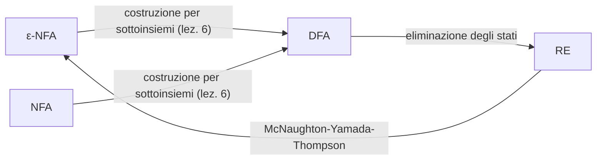

Le frecce verso i DFA sono note dalla lezione 6. Mancano le due che coinvolgono le espressioni regolari.

> [!important] Teorema: equivalenza tra automi ed espressioni regolari
> 1. Per ogni DFA $A$ si può costruire un'espressione regolare $R$ tale che $L(R) = L(A)$.
> 2. Per ogni espressione regolare $R$ si può costruire un ε-NFA $A$ tale che $L(A) = L(R)$.
>
> Insieme ai risultati della lezione 6:
> $$\mathcal{L}(RE) = \mathcal{L}(\text{DFA}) = \mathcal{L}(\text{NFA}) = \mathcal{L}(\epsilon\text{-NFA}).$$

La seconda freccia spiega finalmente perché si sono introdotti gli NFA e gli ε-NFA. Passare da un'espressione regolare direttamente a un DFA a volte è facile, e un essere umano spesso ci riesce senza grossi errori, ma farlo in modo **algoritmico** è più complicato. Passando per un ε-NFA diventa semplice, e non si perde nulla rispetto alla tesi, perché ε-NFA e DFA hanno la stessa potenza riconoscitiva: dall'ε-NFA si arriva a un DFA, «e il gioco è fatto».

> [!tip] Approfondimento — Il teorema di Kleene
> #approfondimento
> L'equivalenza tra espressioni regolari e automi a stati finiti è nota come **teorema di Kleene**. Stephen C. Kleene la dimostrò nel 1956 nel saggio *Representation of Events in Nerve Nets and Finite Automata*, pubblicato nella raccolta *Automata Studies* curata da Shannon e McCarthy [@kleene1956], in un linguaggio diverso da quello moderno: Kleene parlava di «eventi regolari». La stella prende il nome da lui. La presentazione delle slide segue il libro di Hopcroft, Motwani e Ullman [@hopcroft2007].

Il docente aggiunge una nota «per cultura personale», per prevenire un'obiezione. Convertire un'espressione regolare in ε-NFA e poi in DFA con la costruzione per sottoinsiemi può far esplodere il numero degli stati, come si è visto nella [[Lezione 06 - Equivalenza tra automi ed espressioni regolari#Il prezzo: l'esplosione esponenziale|lezione 6]]. Chi dovesse implementare una ricerca basata su espressioni regolari, come fa il comando `grep` di Unix, che cerca nei file non una parola precisa ma le righe che contengono stringhe descritte da un'espressione, può però **simulare direttamente l'ε-NFA**, senza convertirlo, e senza un'esplosione esponenziale della memoria. L'algoritmo si studia nei corsi di compilatori. Per i linguaggi trattati nel corso, conclude il docente, il problema non si pone.

> [!tip] Approfondimento — La simulazione di Thompson
> #approfondimento
> Il metodo a cui allude il docente risale all'articolo di Ken Thompson *Regular Expression Search Algorithm*, pubblicato nel 1968 su *Communications of the ACM* [@thompson1968]. L'idea è quella già usata nella lezione 6 per definire $\hat{\delta}$ negli ε-NFA: invece di precalcolare tutti i sottoinsiemi di stati, come fa la costruzione per sottoinsiemi, si tiene in memoria solo l'insieme degli stati attivi, lo si aggiorna a ogni simbolo letto e lo si chiude rispetto alle transizioni su $\epsilon$. L'insieme non contiene mai più stati di quanti ne abbia l'automa, e quindi la memoria cresce linearmente con la dimensione dell'ε-NFA. Il programma Python più sotto, nella funzione `accepts`, fa esattamente questo.

## Da automa a espressione regolare: l'eliminazione degli stati

### L'idea

Si parte da un automa e si **eliminano progressivamente gli stati**. Eliminando uno stato $s$, tutti i percorsi che passavano per $s$ non esistono più nell'automa risultante. Perché il linguaggio riconosciuto resti lo stesso, bisogna «riagganciare» gli stati che si trovavano agli estremi di quei percorsi, in modo che le stringhe che passavano per $s$ vengano comunque riconosciute.

Il problema è che i percorsi «bucati» coinvolgono in generale **stringhe**, non singoli simboli, e possono essere **infiniti**, a causa dei cicli. La soluzione è lavorare con una generalizzazione degli automi in cui le transizioni sono etichettate da **espressioni regolari** invece che da simboli. Non è un problema per l'automa di partenza: ogni simbolo è già un'espressione regolare, e due archi tra gli stessi stati su simboli diversi, per esempio 0 e 1, diventano un solo arco etichettato $0 + 1$.

### Il passo di eliminazione

Il cuore della costruzione è il passo che elimina un singolo stato $s$. Lo stato $s$ può avere un ciclo su sé stesso, etichettato $S$. Gli stati $q_1, \dots, q_k$ sono i **predecessori** di $s$, collegati a $s$ da archi etichettati $Q_1, \dots, Q_k$. Gli stati $p_1, \dots, p_m$ sono i **successori** di $s$, diversi da $s$, raggiunti con archi etichettati $P_1, \dots, P_m$. Infine ci possono essere collegamenti **diretti**, che non passano per $s$: l'arco da $q_i$ a $p_j$ è etichettato $R_{ij}$.

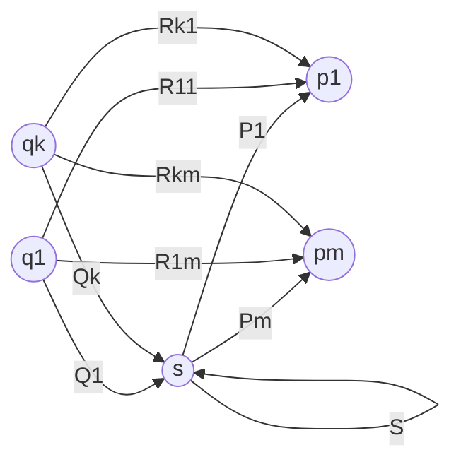

Prima di procedere il docente chiede a che cosa corrisponda, in un'espressione regolare, un **ciclo** dell'automa. Il ciclo è una ripetizione, potenzialmente infinita, e tra unione, concatenazione e chiusura l'operatore che dà la ripetizione è la **stella**. Dopo l'eliminazione l'automa diventa:

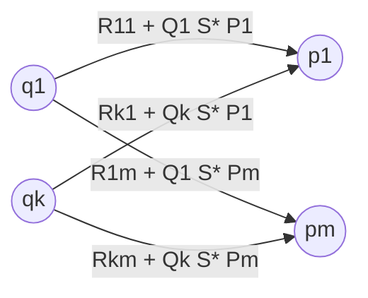

> [!important] Regola di eliminazione di uno stato
> Eliminando lo stato $s$, per ogni predecessore $q_i$ e ogni successore $p_j$ l'arco da $q_i$ a $p_j$ diventa
> $$R_{ij} + Q_i\, S^*\, P_j .$$
> Da $q_i$ a $p_j$ si poteva andare direttamente ($R_{ij}$), oppure passando per $s$: arrivarci con $Q_i$, girare sul ciclo un numero qualsiasi di volte, anche zero ($S^*$), e uscire con $P_j$.

Guardando solo la coppia $q_1, p_1$: da $q_1$ a $p_1$ si andava «diretto, secco» con $R_{11}$, oppure con $Q_1$, eventualmente facendo un po' di giri su $s$, poi $P_1$. Tutti questi percorsi sono riassunti da $R_{11} + Q_1 S^* P_1$. L'espressione regolare rende conto esattamente della situazione di partenza. Il docente lascia un po' di tempo per «metabolizzare» la figura, che ha molti indici, e invita a fare domande.

> [!warning] Indici nella slide 46
> Il testo della slide chiama i successori «$p_1, \dots, p_k$», mentre le figure, coerentemente con la spiegazione orale, usano $p_1, \dots, p_m$. Il numero dei successori non è necessariamente uguale a quello dei predecessori: va usato $m$. La svista è presente anche nella versione aggiornata delle slide.

> [!tip] Approfondimento — Archi mancanti e semplificazioni
> #approfondimento
> La regola presuppone che tutti gli archi $R_{ij}$, $Q_i$, $P_j$ e $S$ esistano. Nel libro da cui sono tratte le slide, un arco mancante si tratta come un arco etichettato $\emptyset$ [@hopcroft2007]. Le identità dei linguaggi viste nella [[Lezione 02 - Architettura di un interprete e linguaggi formali|lezione 2]] permettono poi di semplificare: $\emptyset$ è l'elemento neutro dell'unione e l'elemento assorbente della concatenazione, quindi $\emptyset + E = E$ e $\emptyset E = E \emptyset = \emptyset$; inoltre $\emptyset^* = \epsilon$, perché la chiusura contiene sempre la stringa vuota. Così, se manca il collegamento diretto, l'arco nuovo è solo $Q_i S^* P_j$; se manca il ciclo su $s$, è $R_{ij} + Q_i P_j$; se manca l'arco da $q_i$ a $s$, il percorso attraverso $s$ non contribuisce e l'arco resta $R_{ij}$.

### Lo schema generale

Il procedimento completo, per un automa $A = (Q, \Sigma, \delta, q_0, F)$, è il seguente.

1. Per ogni stato finale $q \in F$, si eliminano **tutti gli stati tranne $q_0$ e $q$**.
2. Se $q \neq q_0$, resta un automa con due stati, nella forma seguente.
3. Se $q = q_0$, resta un automa con un solo stato, iniziale e finale.
4. L'espressione regolare di $A$ è la **somma** delle espressioni ottenute per i singoli stati finali.

> [!warning] Come leggere il primo passo
> Le slide dicono: «per ogni stato $q \in F$, applicare il procedimento di riduzione». Il docente avverte che la frase si presta a un equivoco: la riduzione non si applica allo stato finale $q$, ma, per ogni stato finale, si **riducono tutti gli altri**, compresi gli altri stati finali, che in quel momento vengono trattati come stati qualsiasi. L'esempio più sotto chiarisce il punto.

Nel caso $q \neq q_0$ l'automa ridotto è:

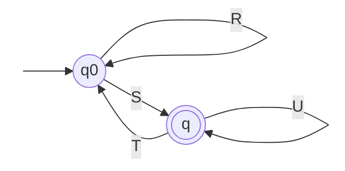

Le quattro etichette sono espressioni regolari, e alcune potrebbero mancare (cioè valere $\emptyset$). Quali stringhe portano dallo stato iniziale allo stato finale, lasciandovi l'automa alla fine? Il ragionamento del docente, ricostruito al termine della discussione in aula, è il seguente. Si può girare un po' di volte sullo stato iniziale con $R$. Oppure si può andare nello stato finale con $S$, girarci un po' con $U^*$, e tornare indietro con $T$: anche $SU^*T$ riporta allo stato iniziale. Queste due possibilità si possono alternare un numero qualsiasi di volte: $(R + SU^*T)^*$. Alla fine bisogna andare nello stato finale con $S$ ed eventualmente girarci con $U^*$, senza più usare $T$, che farebbe uscire dallo stato finale.

> [!important] Espressione per l'automa a due stati
> $$(R + SU^*T)^*\,SU^* .$$
> Nel caso $q = q_0$, con un solo stato iniziale e finale con ciclo $R$, l'espressione è $R^*$.

> [!warning] La slide 47, corretta in aula
> Nella versione delle slide usata in aula la slide conteneva più errori, che il docente ha «debuggato» alla lavagna. Nella figura il ciclo sullo stato finale era etichettato $S$ invece di $U$. Nell'espressione mancava l'apice sulla stella dopo la parentesi, che appariva come una concatenazione, e c'era una parentesi chiusa di troppo. Il docente ha riconosciuto di essere stato ingannato in un primo momento dalla figura sbagliata e ha ricostruito l'espressione in più tentativi, prima di convincersi di quella corretta, $(R + SU^*T)^*SU^*$, che ha indicato come la forma da sostituire nelle slide. Nella versione aggiornata del pacchetto la figura è corretta (il ciclo è $U$) e la stella è al suo posto, ma la parentesi di troppo alla fine, «$(R + SU^*T)^*SU^*)$», è rimasta. L'espressione è stata verificata al calcolatore, sostituendo a $R$, $S$, $T$, $U$ quattro simboli distinti e confrontando il risultato con il linguaggio dell'automa su tutte le stringhe fino alla lunghezza 9. Con la figura sbagliata ($S$ al posto di $U$) il linguaggio sarebbe diverso. Un'espressione equivalente, anch'essa verificata, è $R^*SU^*(TR^*SU^*)^*$.

Nel caso $q = q_0$, eliminati tutti gli altri stati, lo stato iniziale coincide con quello finale, e l'espressione è banalmente $R^*$, dove $R$ etichetta il ciclo che resta.

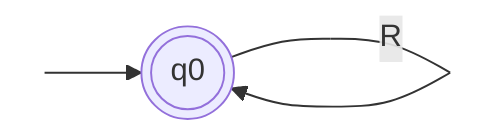

### Esempio: dagli NFA alle espressioni regolari

La costruzione, osserva il docente, si applica tranquillamente anche agli **NFA**, e l'esempio delle slide parte proprio da un NFA. L'automa ha due stati finali, $C$ e $D$:

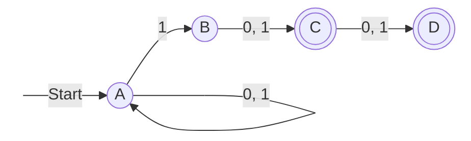

Lo stato $A$ può leggere qualsiasi prefisso, poi indovina il momento giusto per leggere un 1 e passare a $B$; da lì mancano uno o due simboli qualsiasi per arrivare in $C$ o in $D$. Il linguaggio è quindi quello delle stringhe binarie in cui il **penultimo o il terzultimo simbolo è 1**. Le slide lo scrivono $\{w : w = x1b \text{ oppure } w = x1bc,\ x \in \{0,1\}^*,\ b, c \in \{0, 1\}\}$.

**Primo passo: le etichette diventano espressioni regolari.** Le coppie di archi su 0 e su 1 diventano archi etichettati $0 + 1$.

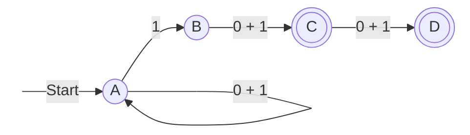

**Secondo passo: si elimina $B$.** Lo stato $B$ non è né iniziale né finale, e quindi va eliminato comunque, sia lavorando per $C$ sia lavorando per $D$. Ha un solo predecessore, $A$, e un solo successore, $C$, senza ciclo e senza arco diretto da $A$ a $C$; l'arco nuovo è quindi $1(0 + 1)$. Le stringhe che passavano per $B$ sono esattamente quelle che iniziano con 1 e proseguono con 0 o 1.

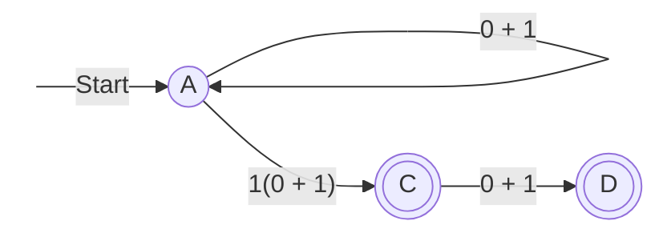

**Terzo passo: si lavora per $D$, eliminando $C$.** L'arco da $A$ a $D$ diventa $1(0 + 1)(0 + 1)$, e resta l'automa a due stati $A_D$, con $R = 0 + 1$, $S = 1(0+1)(0+1)$ e $T$, $U$ mancanti.

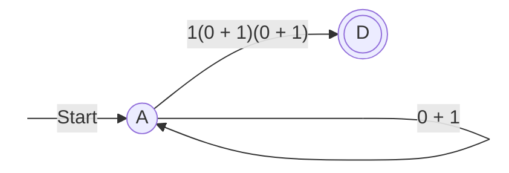

Con $T = U = \emptyset$ si ha $U^* = \epsilon$ e $SU^*T = \emptyset$, quindi la formula generale dà $(0 + 1)^*\,1(0 + 1)(0 + 1)$.

**Quarto passo: si lavora per $C$, eliminando $D$.** Si torna all'automa senza $B$ e si elimina $D$. Poiché $D$ non ha successori, eliminarlo non aggiunge archi: si cancella e basta. Resta l'automa $A_C$:

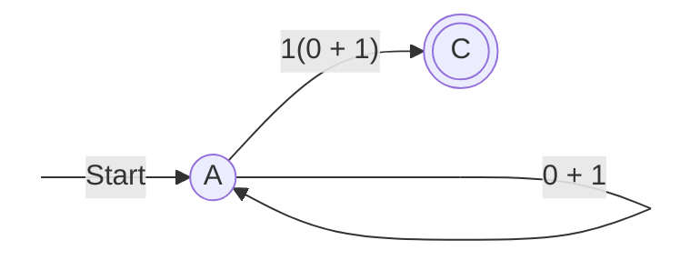

con espressione $(0 + 1)^*\,1(0 + 1)$.

**Ultimo passo: la somma.** L'espressione dell'automa è la somma delle due:
$$
(0 + 1)^*\,1(0 + 1)(0 + 1) \;+\; (0 + 1)^*\,1(0 + 1).
$$
Si può poi **fattorizzare**, perché i due termini hanno in comune il prefisso $(0 + 1)^*1(0 + 1)$:
$$
(0 + 1)^*\,1(0 + 1)\,\big(\epsilon + 0 + 1\big).
$$
Le due espressioni sono state confrontate con l'NFA e con la descrizione «penultimo o terzultimo simbolo uguale a 1» su tutte le stringhe binarie fino alla lunghezza 12, con esito positivo.

> [!warning] La fattorizzazione detta a voce
> Nella trascrizione la fattorizzazione proposta a voce dal docente non è ricostruibile con certezza. Quella riportata sopra è una fattorizzazione corretta della somma che compare nelle slide. Si noti il fattore $\epsilon + 0 + 1$: il termine $\epsilon$ è indispensabile, perché senza di esso si perderebbero le stringhe che finiscono in $C$.

### Osservazioni finali

Le slide aggiungono due osservazioni. La prima: uno stato che non è né iniziale né finale viene eliminato in **tutti** gli automi costruiti per i singoli stati finali, e quindi lo si può eliminare una volta per tutte all'inizio, come si è fatto con $B$. Le espressioni diverse nascono solo quando si eliminano stati finali. La seconda: si possono ottenere altri risparmi organizzando bene le eliminazioni. Se ci sono tre stati finali $p$, $q$ ed $r$, dall'automa $A_{pqr}$ che li contiene tutti si può eliminare $p$, e usare l'automa risultante $A_{qr}$ per ottenere le espressioni di $q$ e di $r$; tornando ad $A_{pqr}$ ed eliminando $q$ ed $r$ si ottiene l'automa $A_p$ per l'espressione di $p$.

In sintesi: si parte dall'automa, anche non deterministico; si trasformano le etichette in espressioni regolari; si eliminano tutti gli stati che non sono né iniziali né finali; per ogni stato finale si eliminano gli altri stati finali e si costruisce l'espressione per quello stato; infine si sommano le espressioni.

## Da espressione regolare a automa: la costruzione di McNaughton-Yamada-Thompson

> [!important] Teorema (McNaughton-Yamada-Thompson)
> Per ogni espressione regolare $R$ si può costruire un ε-NFA $A$ tale che $L(A) = L(R)$.

La costruzione porta il nome dei suoi proponenti, e il docente la paragona al **Lego**: a partire dall'espressione regolare si costruisce l'automa assemblando mattoncini. Qui si capisce perché gli ε-NFA sono stati introdotti: l'automa prodotto è un ε-NFA, e le transizioni su $\epsilon$ sono la «colla» che tiene insieme i mattoncini. La dimostrazione è per **induzione strutturale** sull'espressione, la tecnica della [[Lezione 04 - Tecniche deduttive e automi a stati finiti#Induzione strutturale|lezione 4]]: si costruisce un automa per ogni caso base della definizione delle espressioni regolari e si mostra come combinare gli automi delle sottoespressioni per ogni operatore.

### I casi base

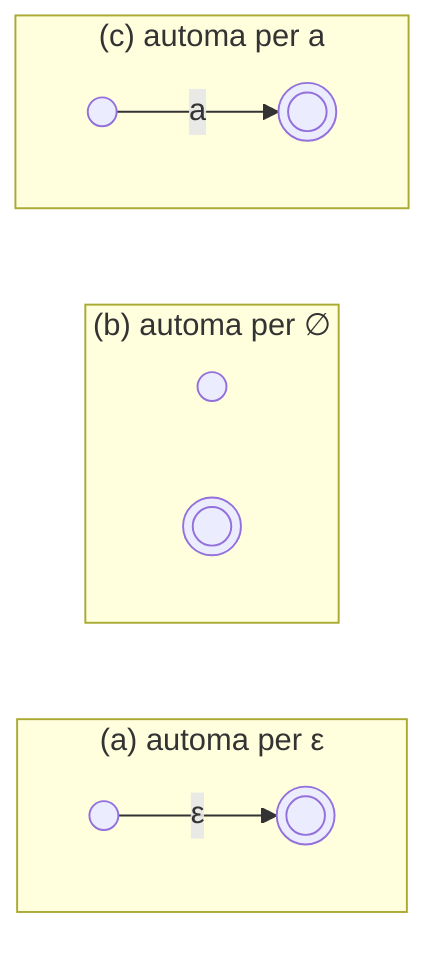

In ciascun mattoncino lo stato a sinistra è iniziale e quello a destra finale.

- **(a)** L'automa per $\epsilon$ va dallo stato iniziale a quello finale con una transizione su $\epsilon$: riconosce la sola stringa vuota.
- **(b)** L'automa per $\emptyset$ ha uno stato finale **non collegato** a quello iniziale: per definizione non riconosce alcuna stringa. È, dice il docente, una specie di «circuito aperto».
- **(c)** L'automa per un simbolo $a$ va dallo stato iniziale a quello finale leggendo $a$: riconosce la sola stringa $a$.

### I passi induttivi

Si suppone di avere già gli automi per le espressioni $R$ ed $S$, rappresentati come blocchi con uno stato iniziale e uno finale. Li si collega con transizioni su $\epsilon$. Lo stato finale dell'automa composto non è più quello dei blocchi, ma è **fuori**, collegato con transizioni su $\epsilon$: gli stati finali dei blocchi diventano stati ordinari.

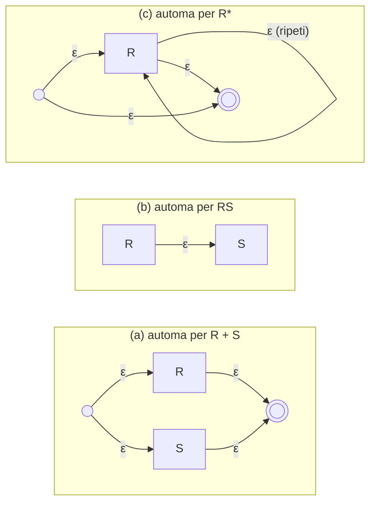

- **(a) Unione $R + S$.** Un nuovo stato iniziale va con $\epsilon$ agli stati iniziali di $R$ e di $S$; i loro stati finali vanno con $\epsilon$ a un nuovo stato finale. L'automa decide in modo non deterministico, senza consumare simboli, se entrare in $R$ o in $S$. Se la stringa appartiene a $L(R)$, esiste un percorso attraverso $R$ che porta allo stato finale; se appartiene a $L(S)$, ne esiste uno attraverso $S$; se non appartiene a nessuno dei due, non esiste alcun percorso, e la stringa non viene riconosciuta.
- **(b) Concatenazione $RS$.** Lo stato finale di $R$ va con $\epsilon$ allo stato iniziale di $S$; l'iniziale è quello di $R$ e il finale quello di $S$. L'automa riconosce un prefisso in $R$ e poi, in modo non deterministico, un suffisso in $S$. Se nessuna scomposizione della stringa ha il prefisso in $L(R)$ e il suffisso in $L(S)$, non c'è percorso verso lo stato finale. In questo caso, osserva il docente, lo stato finale non viene spostato fuori.
- **(c) Chiusura $R^*$.** Un nuovo stato iniziale va con $\epsilon$ sia all'iniziale di $R$ sia a un nuovo stato finale; il finale di $R$ va con $\epsilon$ sia al nuovo finale sia di nuovo all'iniziale di $R$. L'arco diretto dal nuovo iniziale al nuovo finale serve a riconoscere la stringa vuota: magari $L(R)$ non la conteneva, ma $L(R^*)$ la contiene sempre. L'arco all'indietro, nel diagramma l'anello «ripeti» sul blocco, va dallo stato finale di $R$ al suo stato iniziale, e permette di ripetere $R$ tutte le volte che serve.

In ogni caso, se la stringa appartiene al linguaggio dell'espressione esiste un percorso verso lo stato finale, e se non vi appartiene non esiste: è la logica dell'accettazione non deterministica vista nella [[Lezione 04 - Tecniche deduttive e automi a stati finiti|lezione 4]].

> [!tip] Approfondimento — Gli invarianti della costruzione
> #approfondimento
> Nel libro di Hopcroft, Motwani e Ullman la dimostrazione rafforza l'enunciato con tre proprietà che ogni automa costruito soddisfa: ha **esattamente uno stato finale**, **nessun arco entra nello stato iniziale** e **nessun arco esce dallo stato finale** [@hopcroft2007]. Sono le proprietà che rendono lecite le giunzioni dei passi induttivi. Senza di esse, per esempio, l'arco all'indietro della chiusura potrebbe creare percorsi che rientrano in un'altra parte dell'automa e accettano stringhe che non dovrebbero. Le tre proprietà si sono verificate anche sull'automa dell'esempio seguente.

> [!tip] Approfondimento — Gli autori della costruzione
> #approfondimento
> La costruzione unisce due contributi. Robert McNaughton e Hisao Yamada presentarono nel 1960 un metodo per passare dalle espressioni regolari ai grafi di stato degli automi, nell'articolo *Regular Expressions and State Graphs for Automata* [@mcnaughton1960]. Ken Thompson, nell'articolo del 1968 già citato, costruiva l'automa assemblando frammenti con transizioni vuote, nella forma oggi più diffusa [@thompson1968].

### Esempio: $(0 + 1)^*1(0 + 1)$

Le slide trasformano l'espressione $(0 + 1)^*1(0 + 1)$, simile a quella dell'esempio precedente. Descrive le stringhe che iniziano con una sequenza qualsiasi di 0 e 1, anche vuota, poi hanno un 1, e terminano con uno 0 o un 1. Finiscono quindi sempre con due simboli, di cui il primo è 1: è il linguaggio delle stringhe con il **penultimo simbolo uguale a 1**. Si vede proprio il Lego:

1. il mattoncino per $0 + 1$, ottenuto dagli automi per 0 e per 1 con il passo dell'unione;
2. il mattoncino per $(0 + 1)^*$, con l'arco all'indietro che permette di ripetere $0 + 1$ e quello diretto che riconosce la stringa vuota, che $0 + 1$ da solo non riconoscerebbe;
3. l'automa completo: $(0 + 1)^*$, una transizione su $\epsilon$, l'automa per 1, una transizione su $\epsilon$, l'automa per $0 + 1$.

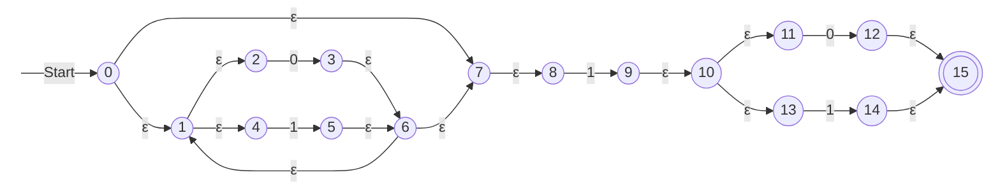

Gli stati da 0 a 7 realizzano $(0 + 1)^*$ (gli stati da 1 a 6 sono l'unione $0 + 1$), gli stati 8 e 9 il simbolo 1, gli stati da 10 a 15 l'ultimo $0 + 1$. L'automa ha 16 stati e 19 transizioni, di cui 14 su $\epsilon$. L'automa così ottenuto è un ε-NFA, e un ε-NFA è equivalente a un DFA: il cerchio dello schema iniziale si chiude.

Il programma seguente realizza la costruzione in Python seguendo le cinque regole e simula l'ε-NFA risultante con le chiusure ε della lezione 6. È stato usato per verificare l'esempio: produce un automa con 16 stati e 19 transizioni, che accetta esattamente le stringhe descritte da $(0 + 1)^*1(0 + 1)$ (confronto su tutte le stringhe binarie fino alla lunghezza 10), con nessun arco entrante nello stato iniziale e nessun arco uscente da quello finale.

```python
import itertools, re

counter = 0
def new_state():
    global counter
    counter += 1
    return counter - 1

# Un frammento è una terna (iniziale, finale, archi);
# un arco è (p, simbolo, q), con simbolo None per ε.
def symbol(a):                       # caso base (c)
    s, f = new_state(), new_state()
    return (s, f, [(s, a, f)])

def union(R, S):                     # passo (a)
    s, f = new_state(), new_state()
    return (s, f, R[2] + S[2] + [(s, None, R[0]), (s, None, S[0]),
                                 (R[1], None, f), (S[1], None, f)])

def concat(R, S):                    # passo (b)
    return (R[0], S[1], R[2] + S[2] + [(R[1], None, S[0])])

def star(R):                         # passo (c)
    s, f = new_state(), new_state()
    return (s, f, R[2] + [(s, None, R[0]), (R[1], None, R[0]),
                          (R[1], None, f), (s, None, f)])

# (0 + 1)* 1 (0 + 1)
start, final, edges = concat(concat(star(union(symbol('0'), symbol('1'))),
                                    symbol('1')),
                             union(symbol('0'), symbol('1')))

def eclose(states):                  # chiusura rispetto alle transizioni su ε
    closure, stack = set(states), list(states)
    while stack:
        p = stack.pop()
        for (a, x, b) in edges:
            if a == p and x is None and b not in closure:
                closure.add(b)
                stack.append(b)
    return closure

def accepts(w):                      # simulazione diretta dell'ε-NFA
    current = eclose({start})
    for ch in w:
        current = eclose({b for (a, x, b) in edges if a in current and x == ch})
    return final in current

assert all(accepts(w) == bool(re.fullmatch('(0|1)*1(0|1)', w))
           for k in range(11) for w in map(''.join, itertools.product('01', repeat=k)))
```

## Verso i limiti dei linguaggi regolari

Ora si sa passare dalle espressioni regolari agli automi e viceversa. Il docente si ferma qui, perché la lezione è stata densa, e anticipa la prossima: si vedrà un risultato «che magari ci aspettavamo», cioè che la potenza delle espressioni regolari nel descrivere linguaggi, e quella degli automi a stati finiti nel riconoscerli, è **limitata**. Esistono linguaggi che non sono regolari, e si imparerà a dimostrarlo. Questo obbligherà a introdurre automi e formalismi descrittivi più potenti. Ci saranno altri due passi: i **linguaggi liberi dal contesto** e poi i linguaggi generali, con le **macchine di Turing**, dove si arriverà a quello che si ritiene essere il modello più generale di calcolo, «con tutti i problemi che questo comporta».

## In sintesi

Gli automi sono gli algoritmi che risolvono il word problem dei linguaggi regolari; le espressioni regolari ne sono la specifica. Nelle espressioni regolari va tenuta distinta la sintassi (i simboli $\epsilon$, $\emptyset$, $+$, $.$, $^*$) dalla semantica (i linguaggi), e il linguaggio vuoto $\emptyset$ dal linguaggio $\{\epsilon\}$. L'unione corrisponde all'unione dei linguaggi, la concatenazione a prefisso più suffisso, la chiusura alla ripetizione arbitraria, che permette di descrivere linguaggi infiniti. In un interprete l'analisi lessicale è specificata da espressioni regolari e realizzata da automi, che si possono generare automaticamente.

Le espressioni regolari descrivono esattamente i linguaggi riconosciuti dagli automi a stati finiti (teorema di Kleene). Da un automa, anche non deterministico, si ottiene un'espressione eliminando gli stati: si etichettano gli archi con espressioni regolari, e l'eliminazione di uno stato $s$ trasforma l'arco da $q_i$ a $p_j$ in $R_{ij} + Q_i S^* P_j$. Per ogni stato finale $q$ si riduce l'automa a $q_0$ e $q$, ottenendo $(R + SU^*T)^*SU^*$, oppure $R^*$ se $q = q_0$, e si sommano le espressioni dei diversi stati finali. Da un'espressione si ottiene un ε-NFA con la costruzione di McNaughton-Yamada-Thompson, per induzione strutturale: mattoncini per $\epsilon$, $\emptyset$ e i simboli, collegati con transizioni su $\epsilon$ per unione, concatenazione e chiusura. La prossima lezione mostrerà che esistono linguaggi non regolari.
