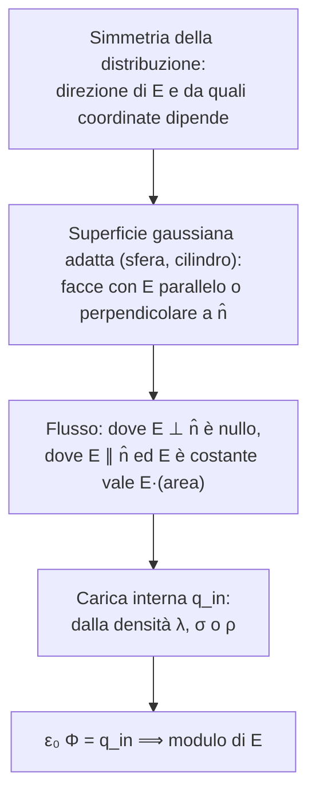

# Lezione 6 — Applicazioni del teorema di Gauss

Questa lezione è interamente dedicata alle applicazioni del teorema di Gauss introdotto nella [[Fisica 2 - Lezione 05 - Teorema di Gauss|lezione 5]]. Si calcolano i campi delle configurazioni "standard": piano conduttore infinito, filo infinito, guscio sferico, sfera piena carica uniformemente e lamina sottile non conduttrice. Si determina la carica indotta su un guscio conduttore e si studia la sovrapposizione dei campi di due lamine parallele. Seguono due esercizi: una pallina carica in equilibrio vicino a una lamina e il campo nella cavità sferica di una sfera carica. Le convenzioni di colore delle figure sono quelle indicate nella lezione 5.

## Riepilogo e strategia

Il teorema di Gauss afferma che il flusso del campo elettrico attraverso una superficie chiusa, la superficie gaussiana, moltiplicato per $\varepsilon_0$, è uguale alla somma algebrica delle cariche interne:

$$
\varepsilon_0\oint \vec E\cdot d\vec A = q_{\text{in}} .
$$

"Algebrica" vuol dire che le cariche si prendono con il loro segno. Quando la superficie gaussiana si può scegliere in modo semplice, il teorema permette di calcolare il campo elettrico in situazioni in cui, con la sola legge di Coulomb, non si saprebbe farlo. Tutte le applicazioni della lezione seguono lo stesso schema. Il docente lo riassume come una buona prassi: **prima si stabilisce, se possibile, la direzione del campo, poi se ne calcola il modulo**.

Le superfici più usate sono la sfera e il cilindro. A volte serve un cubo o un parallelepipedo, ma sono situazioni più rare.

## Piano conduttore infinito

Si considera un conduttore carico la cui faccia è **piana**. Conta solo che la faccia sia piana: il resto del conduttore può avere lo spessore che si vuole. Ci si chiede quale campo generi. Il modo più semplice di calcolarlo è il teorema di Gauss; altrimenti bisognerebbe passare per integrali bidimensionali.

Si suppone che il piano sia **infinito**. In fisica questo non indica un limite matematico, ma una condizione pratica: le dimensioni del piano sono molto grandi rispetto alla distanza a cui si calcola il campo. Se ci si trova vicino al piano e lontano dai bordi, gli effetti dei bordi si possono trascurare e il piano si tratta come infinito.

### Direzione: l'argomento di simmetria

Si prende un punto $P$ esterno al conduttore e un elemento di carica del piano. Il campo che quell'elemento genera in $P$ è diretto lungo la congiungente, verso l'esterno. Poiché il piano è infinito e carico uniformemente, esiste sempre un elemento simmetrico, con la stessa carica, in posizione speculare rispetto al piede della perpendicolare da $P$. È "il trucchetto che abbiamo visto un sacco di volte". Le componenti dei due campi parallele al piano sono uguali e opposte e si cancellano; sopravvivono solo quelle perpendicolari.

![[F2-L06-simmetria-piano.svg]]

La simmetria del piano infinito dice quindi che **il campo è sempre perpendicolare alla superficie del piano**. Dice anche che il campo non può dipendere dalla posizione lungo il piano. Nemmeno l'altezza a cui ci si trova conta: il campo in $P$ è uguale al campo in qualsiasi altro punto alla stessa o a diversa distanza, perché un piano infinito appare uguale da qualunque punto.

### Modulo: il cilindro gaussiano

Si sceglie una superficie gaussiana con due facce parallele alla superficie del conduttore: un cilindro, o anche un parallelepipedo, con basi di area $A$ di forma qualsiasi. Una base sta **dentro** il conduttore, l'altra fuori. Il flusso si calcola faccia per faccia.

- **Superficie laterale (3).** Il campo è perpendicolare al piano, quindi parallelo alla superficie laterale, cioè perpendicolare al suo versore normale in ogni punto: $\Phi_3 = 0$.
- **Base interna (1).** All'interno di un conduttore, in condizioni statiche, il campo è nullo, come visto nella lezione 5: se ci fosse un campo, le cariche si muoverebbero. Quindi $\Phi_1 = 0$.
- **Base esterna (2).** Il campo è perpendicolare alla base, quindi parallelo al versore normale, e per simmetria è costante su tutta la base. Esce dall'integrale e resta l'area:
  $$
  \Phi_2 = \int_2 \vec E\cdot d\vec A = \int_2 E\,dA = E\int_2 dA = EA .
  $$

Il flusso totale è quindi $EA$. Resta da calcolare la carica dentro il cilindro. In un conduttore le cariche stanno solo sulla superficie, come mostrato nella lezione 5, quindi conta solo la porzione di superficie del conduttore racchiusa dal cilindro, che ha area $A$. Per i piani, e in generale per gli oggetti infiniti, non si dà la carica, che sarebbe infinita, ma la **densità di carica superficiale** $\sigma = dq/dA$, che per un piano carico uniformemente vale $Q/A$. La carica racchiusa è $q_{\text{in}} = \sigma A$, e il teorema di Gauss dà

$$
\varepsilon_0\,EA = \sigma A \quad\Longrightarrow\quad E = \frac{\sigma}{\varepsilon_0}.
$$

![[F2-L06-piano-conduttore.svg]]

> [!important] Campo di un piano conduttore carico
> $$
> E = \frac{\sigma}{\varepsilon_0}
> $$
> perpendicolare alla superficie, uscente per $\sigma>0$, **uniforme**: non dipende dalla distanza dal piano, ma solo dalla densità di carica. Una volta ricavato, non va ricalcolato ogni volta.

Uno studente ha chiesto se la base 1 sia davvero interna, visto che il piano è stato disegnato sottile. Il docente ha risposto che il conduttore va pensato come un **blocco** con un certo spessore: una base del cilindro sta nel materiale e l'altra fuori. Il risultato offre anche un modo per generare un campo elettrico uniforme: usare un piano, approssimativamente infinito, carico uniformemente.

> [!tip] Approfondimento — Conduttore e lamina: nessuna contraddizione #approfondimento
> Più avanti si troverà che una lamina sottile **non conduttrice** con densità $\sigma$ genera un campo $\sigma/(2\varepsilon_0)$, la metà. Le due formule non sono in conflitto, perché $\sigma$ indica cose diverse. Per il conduttore, $\sigma$ è la densità sulla **singola faccia** considerata, e dalla parte opposta il campo è nullo. Se una lastra conduttrice isolata porta in totale una carica per unità di area $\sigma_{\text{tot}}$, per simmetria questa si divide a metà tra le due facce. Ciascuna faccia ha $\sigma_{\text{tot}}/2$, e fuori dalla lastra il campo vale $\sigma_{\text{tot}}/(2\varepsilon_0)$, esattamente come per una lamina sottile con la stessa carica totale.

## Filo infinito carico

Si consideri un filo rettilineo infinito, carico positivamente. Essendo unidimensionale, è caratterizzato da una **densità di carica lineare** $\lambda = dq/dl$, che per un filo carico uniformemente vale $q/L$. Si vuole il campo a distanza $r$ dal filo.

**Direzione.** C'è di nuovo simmetria, e il discorso è lo stesso del piano. A ogni elemento del filo corrisponde un elemento speculare rispetto al piede della perpendicolare dal punto. Le componenti dei loro campi parallele al filo si cancellano e resta solo quella perpendicolare. Il campo è quindi **radiale**: perpendicolare al filo e diretto verso l'esterno. Poiché il filo è infinito, il campo non può dipendere dalla posizione lungo il filo, ma solo dalla distanza $r$.

**Superficie gaussiana.** Si sceglie un cilindro coassiale al filo, di raggio $r$ e altezza $h$.

- **Basi (1 e 2).** Il campo è radiale, quindi parallelo alle basi e perpendicolare alla loro normale: $\vec E\cdot d\vec A = 0$, e $\Phi_1 = \Phi_2 = 0$.
- **Superficie laterale (3).** La normale è radiale e uscente, cioè ha la stessa direzione e lo stesso verso del campo. Il campo dipende solo da $r$, che è lo stesso in ogni punto della superficie laterale, quindi è costante ed esce dall'integrale. L'area laterale del cilindro è la circonferenza per l'altezza, $2\pi r h$:
  $$
  \Phi_3 = \int_3 \vec E\cdot d\vec A = E\int_3 dA = E\,2\pi r h .
  $$

![[F2-L06-filo-infinito.svg]]

**Carica interna.** Il cilindro racchiude un tratto di filo lungo $h$, quindi $q_{\text{in}} = \lambda h$. Il teorema di Gauss dà

$$
\varepsilon_0\,E\,2\pi r h = \lambda h \quad\Longrightarrow\quad E = \frac{\lambda}{2\pi\varepsilon_0\,r}.
$$

L'altezza $h$ si semplifica, come deve: è una scelta arbitraria della superficie gaussiana.

> [!important] Campo di un filo infinito carico uniformemente
> $$
> E = \frac{\lambda}{2\pi\varepsilon_0\,r} = \frac{2k\lambda}{r}
> $$
> radiale, perpendicolare al filo. Decresce come $1/r$ allontanandosi dal filo, più lentamente del campo di una carica puntiforme, che va come $1/r^2$.

> [!warning] Discrepanze negli appunti sul filo
> Negli appunti a mano il risultato è scritto $E = \lambda/(E\,\varepsilon_0\,2\pi r)$, con una $E$ di troppo al denominatore. Nel file "Flusso.md" manca invece $\varepsilon_0$: dalla riga $\varepsilon_0\,2\pi r h E = \lambda h$ si ricava $E = \lambda/(2\pi\varepsilon_0 r)$, non $\lambda/(2\pi r)$.

## Guscio sferico carico

> [!example] Testo
> Un guscio sferico di raggio $R$ porta una carica $+q$ distribuita uniformemente. Determinare il campo elettrico in funzione della distanza $r$ dal centro, da $r = 0$ fino all'esterno.

Senza il teorema di Gauss il problema sarebbe un "macello", commenta il docente. Si può fare, perché l'ha fatto Newton (per la gravità), "però Newton era Newton". Bisognerebbe prendere un elemento di superficie sferica, calcolarne il campo in un punto, scriverlo in funzione dei due angoli della sfera e integrare tutto: un calcolo noiosissimo e difficile. Con il teorema di Gauss si usano superfici sferiche concentriche. Per simmetria il campo è radiale e dipende solo da $r$, quindi su ogni sfera concentrica $\vec E\cdot d\vec A = E\,dA$ ed $E$ è costante.

- **All'interno ($r < R$).** La sfera gaussiana non racchiude cariche, quindi il flusso è nullo:
  $$
  \varepsilon_0\,E\,4\pi r^2 = 0 \quad\Longrightarrow\quad E = 0 .
  $$
  Dentro una sfera carica cava il campo è nullo, a qualsiasi distanza dal centro.
- **All'esterno ($r > R$).** La sfera gaussiana racchiude tutta la carica $q$:
  $$
  \varepsilon_0\,E\,4\pi r^2 = q \quad\Longrightarrow\quad E = \frac{1}{4\pi\varepsilon_0}\,\frac{q}{r^2}.
  $$

![[F2-L06-guscio-sferico.svg]]

Il grafico richiesto mostra un campo nullo fino a $R$, poi un **salto** attraversando il guscio. Il valore massimo si ha appena fuori dal guscio, $E_{\max} = q/(4\pi\varepsilon_0R^2)$, perché lì $r$ è il più piccolo possibile. Poi il campo decresce come $1/r^2$.

> [!tip] Una precisazione sul ragionamento
> A lezione si dice che "il fatto che il flusso sia zero impone che il campo all'interno sia zero". Da solo, un flusso nullo non basta: un campo potrebbe entrare da una parte della superficie e uscire dall'altra. Qui la conclusione vale grazie alla **simmetria sferica**. Il campo è radiale e ha lo stesso modulo su tutta la sfera, quindi il flusso è $E\cdot 4\pi r^2$, e se questo è zero deve essere zero $E$.

> [!tip] Approfondimento — Il teorema del guscio di Newton #approfondimento
> Il risultato che il docente attribuisce a Newton è noto come **teorema del guscio**, ed è dimostrato nei *Principia* (Libro I, Proposizioni 70 e 71). Un guscio sferico omogeneo non esercita alcuna forza gravitazionale su un corpo al suo interno, mentre all'esterno attrae come se tutta la massa fosse concentrata nel centro. Vale identicamente per la forza elettrica, perché anche questa va come $1/r^2$ [@schmid2012].

## Sfera piena carica uniformemente

> [!example] Testo
> Una sfera piena di raggio $R$ porta una carica totale $q$ distribuita **uniformemente nel volume**, con densità di carica volumica $\rho = q/V$ costante. Studiare il campo in funzione della distanza $r$ dal centro.

Una carica distribuita uniformemente in tutto il volume indica che la sfera **non è un conduttore**: in un conduttore la carica andrebbe sulla superficie. Il docente indica la densità prima con $\chi$ e poi con $\rho$, che è il simbolo usato nel seguito.

Il ragionamento è lo stesso del guscio, cioè superfici sferiche e simmetria sferica. Cambia la carica racchiusa: ora, al crescere del raggio della superficie gaussiana, si ingloba sempre più carica, e anche il membro destro del teorema dipende da $r$.

- **All'interno ($r < R$).** Il flusso è quello di sempre, $\varepsilon_0 E\,4\pi r^2$. La carica racchiusa $q'$ si ricava dal rapporto tra i volumi. La densità è la stessa, quindi
  $$
  q = \rho\,\tfrac43\pi R^3,\qquad q' = \rho\,\tfrac43\pi r^3 \quad\Longrightarrow\quad \frac{q'}{q} = \frac{r^3}{R^3},\qquad q' = q\left(\frac{r}{R}\right)^3 .
  $$
  Sul bordo, $r = R$, si ritrova $q' = q$, come deve essere. Sostituendo:
  $$
  E = \frac{q'}{4\pi\varepsilon_0 r^2} = \frac{q}{4\pi\varepsilon_0 r^2}\,\frac{r^3}{R^3} = \frac{q\,r}{4\pi\varepsilon_0 R^3}.
  $$
- **All'esterno ($r > R$).** Paradossalmente è il caso più semplice. La superficie gaussiana ingloba tutta la carica, e il campo è quello di una carica puntiforme $q$ posta nel centro:
  $$
  E = \frac{q}{4\pi\varepsilon_0 r^2}.
  $$

![[F2-L06-sfera-piena.svg]]

All'interno il campo **cresce linearmente** con $r$, perché la carica inglobata aumenta come $r^3$ mentre l'area della sfera aumenta come $r^2$. Raggiunge il valore $E(R) = q/(4\pi\varepsilon_0R^2)$ sul bordo, dove le due espressioni coincidono, e poi decresce come $1/r^2$. A differenza del guscio, il campo è **continuo**: non c'è alcun salto.

> [!warning] Discrepanza negli appunti (.md)
> Nel file "Flusso.md" questo esercizio è intitolato "Sfera conduttrice". Come detto a lezione, una sfera con carica distribuita uniformemente nel volume **non** è un conduttore: in una sfera conduttrice la carica starebbe sulla superficie e il campo interno sarebbe nullo, come per il guscio. Nello stesso file la densità è scritta "$\chi = d/v$"; si intende $\chi = q/V$.

## Carica indotta su un guscio conduttore neutro

> [!example] Testo
> Un guscio sferico conduttore di raggio $R$, sottile ma con un certo spessore, è **neutro**. All'interno della cavità, a distanza $R/2$ dal centro, si pone una carica negativa $-q$. Calcolare la carica indotta sulla superficie interna del guscio.

Il guscio è un conduttore, quindi le sue cariche si spostano. La carica negativa attira cariche positive, che si accumulano sulla superficie interna. Per calcolarne il valore si usa il "trucchetto" visto nella lezione 5: il teorema di Gauss, ricordando che dentro il conduttore il campo è nullo.

Si prende una superficie gaussiana **interna al conduttore**, cioè nel suo spessore, vicinissima alla superficie interna. Su di essa il campo è zero ovunque, quindi il flusso è zero. Per il teorema di Gauss la carica interna alla superficie gaussiana deve essere zero. Quella carica è la somma della carica indotta sulla superficie interna e della carica inserita:

$$
q_{\text{ind}} + (-q) = 0 \quad\Longrightarrow\quad q_{\text{ind}} = +q .
$$

![[F2-L06-carica-indotta-guscio.svg]]

Le cariche si ridistribuiscono in modo anche complicato: la carica $-q$ non è al centro, quindi la carica indotta è più concentrata dal lato più vicino. Il teorema di Gauss non dice come si distribuiscono, ma dice con certezza quanto valgono in totale: sulla superficie interna c'è una carica uguale e opposta a quella inserita, in modo che il campo dentro il conduttore sia nullo.

> [!tip] Approfondimento — E la superficie esterna? #approfondimento
> Il guscio è complessivamente neutro. Se sulla superficie interna c'è $+q$, sulla superficie esterna deve comparire $-q$. Nei testi si mostra che questa carica si distribuisce **uniformemente**, qualunque sia la posizione della carica nella cavità. Il motivo è che il conduttore "scherma" l'esterno da ciò che accade dentro la cavità. All'esterno il campo è quindi quello di una carica puntiforme $-q$ posta nel centro del guscio.

Alla fine della lezione il docente torna su questo esercizio per aggiungere un'osservazione legata a un altro problema, che rimanda alla lezione successiva perché troppo difficile. La trascrizione si interrompe proprio all'inizio di questa ripresa.

## Lamina sottile non conduttrice

Si considera ora un piano sottile **non conduttore**, carico positivamente con densità uniforme $\sigma = Q/A$. Il calcolo, dice il docente, è esattamente lo stesso del piano conduttore. Per simmetria il campo è perpendicolare al piano e uscente, **da entrambi i lati**: prendendo due elementi simmetrici, le componenti parallele al piano si bilanciano.

Si sceglie un cilindro gaussiano che attraversa la lamina, con le due basi da parti opposte. Questa volta entrambe le basi sono all'esterno, in una regione dove il campo esiste.

- **Superficie laterale (3).** Il campo è sempre perpendicolare alla normale: $\Phi_3 = 0$.
- **Base 2.** Il campo è parallelo alla normale e, non dipendendo dalla distanza, costante: $\Phi_2 = EA$.
- **Base 1.** Il campo punta in verso opposto, perché esce dalla lamina anche da quella parte, ma anche la normale uscente è opposta. Campo e normale sono di nuovo paralleli e concordi: $\Phi_1 = EA$.

Il flusso totale è $2EA$, e la carica racchiusa è $\sigma A$:

$$
\varepsilon_0\cdot 2EA = \sigma A \quad\Longrightarrow\quad E = \frac{\sigma}{2\varepsilon_0}.
$$

![[F2-L06-lamina-non-conduttrice.svg]]

> [!important] Campo di una lamina sottile non conduttrice
> $$
> E = \frac{\sigma}{2\varepsilon_0}
> $$
> perpendicolare alla lamina, uscente da entrambi i lati per $\sigma>0$, uniforme. Rispetto al piano conduttore cambia solo il fattore 2 al denominatore. È lo stesso risultato ottenuto nella [[Fisica 2 - Lezione 03 - Distribuzioni continue di carica|lezione 3]] come limite del disco carico, $2\pi k\sigma = \sigma/(2\varepsilon_0)$.

> [!tip] Perché i flussi delle due basi non si annullano
> Durante la pausa alcuni studenti si chiedevano perché i flussi delle basi 1 e 2 si sommino, visto che i campi hanno versi opposti. La risposta è che il flusso dipende dal prodotto scalare tra campo e normale **uscente**. Sulla base 1 si invertono sia il campo sia la normale, quindi il prodotto scalare resta positivo. Il docente aggiunge che non si tratta di forze che si bilanciano: "la forza non è una conseguenza del flusso".

## Due lamine parallele

Il campo di una lamina non dipende dalla distanza ed è definito in tutto lo spazio, a parte l'approssimazione di lamina infinita. Il campo di più lamine si ottiene allora con il principio di sovrapposizione, regione per regione. Si considerano due lamine parallele con densità di carica uguale in modulo, ciascuna con un campo $\sigma/(2\varepsilon_0)$.

- **Stesso segno ($+\sigma$, $+\sigma$).** Tra le due lamine i campi sono uguali e opposti e si annullano. All'esterno sono concordi e si sommano, dando $2\cdot\sigma/(2\varepsilon_0) = \sigma/\varepsilon_0$.
- **Segno opposto ($+\sigma$, $-\sigma$).** Il campo della lamina negativa entra nella lamina. Tra le due lamine i campi sono concordi e si sommano, dando $\sigma/\varepsilon_0$. All'esterno sono uguali e opposti e si annullano.

![[F2-L06-due-lamine.svg]]

La seconda configurazione è un modo per generare un campo elettrico **uniforme confinato** in una regione limitata dello spazio, quella tra le due facce parallele, mentre fuori il campo si annulla.

> [!tip] Anticipazione #approfondimento
> La configurazione con due lamine di carica opposta è lo schema del **condensatore a facce piane parallele**, trattato nella [[Zen/Anno 2/Fisica 2/generated/Lezione 8 - CLAUDE|lezione 8]].

## Esercizio: pallina carica appesa vicino a una lamina

> [!example] Testo (dati dagli appunti)
> Una pallina di massa $m = 1\ \mathrm{mg}$ e carica $q = 2\cdot10^{-8}\ \mathrm C$ è appesa a un filo inestensibile vicino a una lamina verticale non conduttrice, infinita, carica positivamente. All'equilibrio il filo forma un angolo $\theta = 30^\circ$ con la lamina. Quanto vale la densità di carica $\sigma$ della lamina?

Il campo della lamina è già noto e, come dice il docente, una volta calcolato si usa senza rifarlo ogni volta: $E = \sigma/(2\varepsilon_0)$. Sulla pallina agiscono tre forze.

- **Forza elettrica.** $F = qE = q\sigma/(2\varepsilon_0)$, orizzontale. La pallina e la lamina sono entrambe positive, quindi la forza è repulsiva.
- **Peso.** $P = mg$, verticale verso il basso.
- **Tensione del filo.** $\vec T$, diretta lungo il filo.

Si scompongono peso e forza elettrica in una componente lungo il filo e una perpendicolare al filo:

$$
P_\parallel = mg\cos\theta,\quad P_\perp = mg\sin\theta,\qquad F_\parallel = F\sin\theta,\quad F_\perp = F\cos\theta .
$$

L'angolo tra la forza elettrica e la perpendicolare al filo vale $\theta$, perché la forza elettrica forma $90^\circ - \theta$ con il filo. Alla lavagna il docente scrive inizialmente le componenti scambiate e poi si corregge. Le componenti lungo il filo non interessano, perché sono bilanciate dalla tensione del filo inestensibile. Per l'equilibrio basta bilanciare quelle perpendicolari:

$$
mg\sin\theta = F\cos\theta = \frac{q\sigma}{2\varepsilon_0}\cos\theta
\quad\Longrightarrow\quad
\sigma = \frac{2\varepsilon_0\,mg}{q}\tan\theta .
$$

Con i dati, $m = 10^{-6}\ \mathrm{kg}$:

$$
\sigma = \frac{2\,(8{,}85\cdot10^{-12})\,(10^{-6})\,(9{,}8)}{2\cdot10^{-8}}\cdot\tan30^\circ \simeq 5{,}0\cdot10^{-9}\ \mathrm{C/m^2}.
$$

![[F2-L06-pallina-appesa.svg]]

Il docente osserva che dell'elettromagnetismo non c'era quasi nulla da fare: calcolato il campo, la forza è $qE$, e il resto è un bilanciamento di forze da Fisica 1. Il risultato si può scrivere anche come $\tan\theta = F/(mg)$.

> [!warning] Ordine di grandezza negli appunti
> Negli appunti a mano il risultato sembra scritto $5\cdot10^{-4}\ \mathrm{C/m^2}$, ma l'esponente è poco leggibile. Con $m = 1\ \mathrm{mg} = 10^{-6}\ \mathrm{kg}$ e $q = 2\cdot10^{-8}\ \mathrm C$ si ottiene $\sigma \simeq 5{,}0\cdot10^{-9}\ \mathrm{C/m^2}$. A verifica, il campo vale $E = \sigma/(2\varepsilon_0) \simeq 283\ \mathrm{N/C}$ e la forza $qE \simeq 5{,}7\cdot10^{-6}\ \mathrm N$; diviso per il peso $mg = 9{,}8\cdot10^{-6}\ \mathrm N$ dà $0{,}577 = \tan30^\circ$.

## Esercizio: sfera carica con una cavità sferica

> [!example] Testo
> Una sfera è carica uniformemente con densità volumica $\rho = q/V$.
> 1. Detto $\vec r$ il vettore che va dal centro della sfera a un punto interno $P$, dimostrare che $\vec E = \rho\,\vec r/(3\varepsilon_0)$.
> 2. Nella sfera si pratica una cavità sferica vuota, il cui centro è individuato dal vettore $\vec a$ a partire dal centro della sfera. Dimostrare che il campo all'interno della cavità è $\vec E = \rho\,\vec a/(3\varepsilon_0)$.

**Punto 1.** È il conto già fatto per la sfera piena, "forse oggi l'ho calcolato già 3-4 volte", scherza il docente. Si prende una superficie gaussiana sferica passante per $P$. Il campo è radiale e costante sulla superficie, quindi il flusso è $\varepsilon_0 E\,4\pi r^2$, mentre la carica interna è $\rho\cdot\tfrac43\pi r^3$:

$$
\varepsilon_0\,E\,4\pi r^2 = \rho\,\frac43\pi r^3 \quad\Longrightarrow\quad E = \frac{\rho\,r}{3\varepsilon_0}.
$$

Il campo ha la stessa direzione e lo stesso verso del vettore $\vec r$, perché entrambi sono radiali. Il risultato si può quindi scrivere subito in forma vettoriale: $\vec E = \rho\,\vec r/(3\varepsilon_0)$. È la stessa espressione ottenuta per la sfera piena, $q r/(4\pi\varepsilon_0R^3)$, con $q = \rho\,\tfrac43\pi R^3$.

**Punto 2: l'idea della sovrapposizione.** Il problema suggerisce di usare il principio di sovrapposizione. Una cavità vuota si può pensare come la sovrapposizione di due distribuzioni: la sfera grande piena, carica con densità $+\rho$, e una sfera piccola, grande quanto la cavità, carica con densità $-\rho$. Nella regione della cavità le due densità si sommano e danno zero. È lo stesso ragionamento usato nella [[Fisica 2 - Lezione 04 - Dipolo in campo elettrico e flusso|lezione 4]] per il disco con un foro, pensato come un disco positivo pieno più un disco negativo.

**I due campi.** Si prende un punto $P$ dentro la cavità. Rispetto al centro della sfera grande è individuato da $\vec r$, rispetto al centro della cavità da $\vec r_c$.

- La sfera grande ($+\rho$) genera in $P$ il campo del punto 1: $\vec E_+ = \rho\,\vec r/(3\varepsilon_0)$.
- La sfera piccola ($-\rho$) genera lo stesso tipo di campo, con due differenze: la densità ha segno opposto e la distanza va misurata dal suo centro. Quindi $\vec E_- = -\rho\,\vec r_c/(3\varepsilon_0)$. Il segno meno tiene conto del fatto che, essendo la carica negativa, il campo è diretto in verso opposto a $\vec r_c$, cioè verso il centro della cavità.

Il campo totale è la somma:

$$
\vec E = \vec E_+ + \vec E_- = \frac{\rho}{3\varepsilon_0}\left(\vec r - \vec r_c\right).
$$

**La geometria.** Resta da mostrare che $\vec r - \vec r_c = \vec a$. Dalla figura, $\vec r = \vec a + \vec r_c$. Il docente lo verifica in due modi, per ripassare sia i vettori sia la regola del parallelogramma.

1. **Per componenti.** Si sceglie l'asse $x$ lungo $\vec a$, cosa sempre possibile, quindi $\vec a = a\,\hat\imath$. Si scompongono $\vec r = r_x\hat\imath + r_y\hat\jmath$ e $\vec r_c = r_{c,x}\hat\imath + r_{c,y}\hat\jmath$. Per costruzione $r_y = r_{c,y}$ e $r_x = a + r_{c,x}$. Quindi
   $$
   \vec r - \vec r_c = \left(r_x - r_{c,x}\right)\hat\imath + \left(r_y - r_{c,y}\right)\hat\jmath = a\,\hat\imath = \vec a .
   $$
2. **Con la regola del parallelogramma.** Per sottrarre $\vec r_c$ si somma $-\vec r_c$. Si costruisce il parallelogramma con lati $\vec r$ e $-\vec r_c$, e la diagonale che rappresenta la differenza coincide con $\vec a$.

Il risultato è quello richiesto:

$$
\vec E_{\text{cavità}} = \frac{\rho\,\vec a}{3\varepsilon_0}.
$$

![[F2-L06-sfera-con-cavita.svg]]

> [!important] Campo nella cavità sferica
> All'interno di una cavità sferica praticata in una sfera carica uniformemente, il campo è **uniforme**: in ogni punto della cavità è diretto lungo $\vec a$, la congiungente tra il centro della sfera e il centro della cavità, e ha modulo costante $\rho a/(3\varepsilon_0)$.

Il docente sottolinea due cose. Un esercizio di questo tipo sarebbe infattibile senza il teorema di Gauss e il principio di sovrapposizione. E il risultato non è affatto banale: si toglie una parte della sfera e, nella regione vuota, il campo ha la stessa direzione e la stessa intensità in ogni punto, al centro della cavità come vicino al bordo.

> [!warning] Fine della trascrizione
> La trascrizione (Parte 1) si interrompe mentre il docente riprende l'esercizio del guscio conduttore con la carica $-q$ per aggiungere un'osservazione. Se esiste una seconda parte della registrazione, la integrerò qui.
