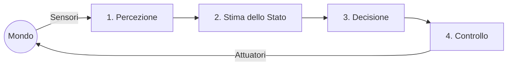

```yaml
---
lezione: 1
data: 2026-09-24
argomenti: [autonomia, architetture di controllo, robotica probabilistica, cinematica diretta, cinematica inversa, vincoli non olonomi, guida differenziale]
---

```

# Lezione 1: Autonomia, Architetture Decisionali e Cinematica della Guida Differenziale

## Cos'è un Robot Autonomo?

Un robot è definito autonomo nella misura in cui è capace di decidere autonomamente le azioni da intraprendere per raggiungere un obiettivo, all'interno di un ambiente che non conosce completamente a priori. A differenza dei sistemi industriali classici, un robot autonomo non si limita a eseguire una sequenza pre-programmata di punti nello spazio, né riceve esternamente la specifica del percorso di dettaglio: è il robot stesso a dover computare il "come" muoversi, compensando le variazioni in tempo reale dell'ambiente circostante.

Indipendentemente dall'epoca storica o dalla complessità del sistema, l'operato di un robot autonomo è descrivibile tramite un continuo anello di retroazione (feedback loop) composto da quattro competenze fondamentali:

1. **Percezione**: Acquisizione di dati dal mondo tramite i sensori per passare dal segnale grezzo al significato (es. riconoscere un ostacolo).


2. **Stima dello Stato**: Localizzazione del robot all'interno dell'ambiente e costruzione/aggiornamento del modello o mappa del mondo circostante.


3. **Decisione (Pianificazione)**: Computazione logica su cosa convenga fare per avvicinarsi all'obiettivo.


4. **Controllo**: Traduzione dell'intento decisionale in comandi fisici (es. tensioni, impulsi, velocità) inviati agli attuatori per alterare fisicamente lo stato del mondo.




## Scala dei Livelli di Autonomia e Storia della Robotica

Nel corso degli ultimi settant'anni, l'ingegneria robotica ha progressivamente innalzato il livello di astrazione e indipendenza delle macchine. Tali livelli possono essere schematizzati in sei grandi fasi storiche e concettuali.

### L0 e L1: Dalla Teleoperazione all'Esecuzione Cieca

* **L0 (Nulla)**: È l'operatore umano a chiudere interamente l'anello di percezione, decisione e controllo. Tipico dei manipolatori teleoperati degli anni '50.


* **L1 (Esecuzione)**: Il sistema ripete ciecamente una sequenza fissa senza percepire l'ambiente. Ne è l'archetipo *Unimate* (1961), il primo braccio robotico industriale programmato per punti, che operava senza alcun adattamento alle deviazioni esterne.


### L2: Il Paradigma Reattivo

Nel tentativo di aggirare l'altissimo costo computazionale della creazione di mappe, l'approccio reattivo accoppia direttamente i sensori agli attuatori senza mantenere una rappresentazione simbolica (modello) del mondo.
I precursori furono le tartarughe di Grey Walter (Elmer ed Elsie, 1948), capaci di muoversi verso la luce ed evitare ostacoli tramite soli circuiti analogici a valvole.
Questa filosofia ha portato negli anni '80 a due pietre miliari:

1. I **Campi di Potenziale Artificiale (Khatib, 1986)**: L'obiettivo agisce come una carica attrattiva (pozzo di potenziale) e gli ostacoli, percepiti tipicamente tramite veloci letture sonar ad ultrasuoni, come cariche repulsive. Il robot computa il gradiente istantaneo come somma vettoriale di forze per orientare la sua direzione.


2. La **Subsumption Architecture (Brooks, 1986)**: Il robot è organizzato a "strati di competenza" concorrenti e sovrapposti (es. "vaga", "esplora", "evita ostacoli"), i quali non condividono alcuna mappa centralizzata. I layer superiori possono inibire temporaneamente (subsume) i comandi dei layer inferiori, garantendo reazioni immediate nell'ordine dei millisecondi.


> [!tip] Approfondimento: I veicoli di Braitenberg
> #approfondimento
> Valentino Braitenberg, nel suo celebre lavoro teorico, dimostrò come comportamenti apparentemente complessi e finalizzati (es. paura, aggressione, amore) potessero emergere da macchine cablate con estrema semplicità. Un "veicolo" con due sensori luminosi incrociati direttamente sui motori (sensore sinistro che pilota la ruota destra e viceversa) tenderà automaticamente a curvare verso la sorgente luminosa (comportamento "aggressivo/esplorativo") accelerando in prossimità della luce, senza alcun bisogno di un cervello centrale o di calcolo logico.
> 
> 

### L3: Il Paradigma Deliberativo in Ambienti Noti

In netto contrasto con l'approccio reattivo, l'architettura *Sense-Plan-Act* presuppone la costruzione esplicita di un modello simbolico del mondo prima di agire.
*Shakey* (1966-1972) è il prototipo classico di questa era: in un "mondo giocattolo" artificialmente preparato, estraeva bordi visivi per mappare la stanza, per poi usare un pianificatore logico (STRIPS) e algoritmi di ricerca (A*) per generare i piani. Il grande limite di questi sistemi (evidenziato dallo *Stanford Cart*, 1979) era la lentezza estrema della percezione visiva, che vincolava il robot a muoversi a scatti calcolando stereoscopie in tempi incompatibili con la reazione ad ambienti dinamici reali.

> [!important] L'Architettura Ibrida
> Nessuno dei due paradigmi estremi (puro reattivo o puro deliberativo) è risultato sufficiente da solo. Lo standard affermatosi dalla metà degli anni '90 è l'**Architettura Ibrida a Tre Livelli**. Tale architettura disaccoppia le scale temporali:
> 
> 
> * **Deliberativo**: Pianifica a lungo termine su modelli simbolici (secondi/minuti).
> 
> 
> * **Esecutivo (Sequencer)**: Traduce i piani discreti in sequenze di stati (100 ms).
> 
> 
> * **Reattivo**: Modula i motori per il controllo e l'evitamento collisioni a bassissima latenza (millisecondi).
> 
> 
> 
> 

### L4: Robotica Probabilistica e Navigazione Non Strutturata

Riconosciuta l'impossibilità di operare con misure perfette, a fine anni '80 si passa alla *robotica probabilistica*: il robot smette di credere ciecamente ai sensori e accetta l'incertezza intrinseca del mondo.
Si introducono le **griglie di occupazione (occupancy grids)** (Moravec ed Elfes, 1985), matrici in cui ogni cella contiene la probabilità (aggiornata in modo iterativo) di essere occupata da un ostacolo, integrando molteplici letture imperfette (es. dai coni dei sensori sonar).

Da qui emerge il concetto chiave della robotica mobile moderna: lo **SLAM (Simultaneous Localization and Mapping)**, ovvero il problema computazionale di costruire la mappa di un ambiente ignoto mentre si stima contemporaneamente la propria posa (localizzazione) al suo interno.
La soluzione più celebre per il problema della "localizzazione globale" o del "robot rapito" è la **Localizzazione Monte Carlo (MCL, 1999)**. Essa rappresenta la posa incerta del robot non con un singolo vettore, ma con una nuvola di "particelle" stocastiche sparse nella mappa; ogni spostamento (odometria) allarga le particelle, e ogni misurazione (laser/sonar) pesa negativamente le particelle incompatibili con l'osservazione, facendole addensare esclusivamente dove la posa reale è più probabile. Tali tecniche sono state alla base dei primi grandi robot museali in spazi pubblici, come RHINO (1997) e MINERVA (1998).

> [!tip] ROS (Robot Operating System)
> Nonostante il nome, non è un vero sistema operativo ma un *middleware* framework (2010). ROS standardizza lo sviluppo robotico suddividendo i processi in "nodi" indipendenti che comunicano tramite lo scambio asincrono di "messaggi". Ha permesso l'esplosione della collaborazione globale condividendo pacchetti software pronti per SLAM, navigazione e cinematica.
> 
> 

### L5: Modelli Generativi e VLA

Oggi la robotica incorpora modelli VLA (Vision-Language-Action) capaci di connettere un task verbale ("portami un bicchiere") alla visione del mondo per generare direttamente *policy* continue di controllo per i giunti. Tali modelli, sfruttando reti pre-addestrate su enormi volumi di testo e video provenienti dal web, superano il dizionario chiuso dei classificatori storici come YOLO, arrivando ad un'autonomia "embodied" che include astrazione semantica e ragionamento probabilistico a lungo orizzonte.

---

## Cinematica del Robot a Guida Differenziale

Per passare dalla decisione teorica al movimento reale nel mondo, è necessario studiare la cinematica della piattaforma. Prenderemo in esame il caso del **robot a guida differenziale**.

### Geometria e Convenzioni

Il telaio si fonda su tre punti d'appoggio per garantire stabilità isostatica: due ruote motrici indipendenti poste sul medesimo assale, e una terza ruota folle (o *caster*) passiva per l'equilibrio. Poiché la ruota folle si auto-orienta per seguire l'inerzia generata dalle motrici, essa non viene modellizzata nelle equazioni di stato primarie.

* **Variabili Architetturali**:


* $r_L, r_R$: Raggi efficaci delle ruote motrici sinistra e destra. Il concetto di "raggio efficace" sottolinea che imperfezioni fisiche (es. consumo del battistrada, carico sbilanciato) comportano parametri reali diversi da quelli nominali, generando errori sistematici in odometria.
* $b$: Interasse efficace (la distanza tra i punti di contatto effettivi delle due ruote motrici).


* **Sistemi di Riferimento (Frame)**:


* **Mondo ($W$)**: $\{x_W, y_W\}$ fisso rispetto all'ambiente.
* **Corpo (Body, $B$)**: $\{x_B, y_B\}$ solidale al robot. L'origine $P$ si trova a metà dell'assale delle due ruote motrici, con l'asse $x_B$ orientato in avanti verso il moto e l'asse $y_B$ laterale a sinistra.


* **Posa del Corpo**:
Completamente definita dal vettore $q = \begin{bmatrix} x & y & \theta \end{bmatrix}^T$, dove $\theta$ indica l'orientamento globale dell'asse $x_B$ rispetto all'asse $x_W$.


* **Twist di Velocità**:
Raccoglie le derivate temporali espresse sul frame locale Body, indicato con $\xi = \begin{bmatrix} v & 0 & \omega \end{bmatrix}^T$.


### Il Vincolo Non Olonomo (di Puro Rotolamento)

Se idealizziamo le ruote e impediamo lo slittamento, il robot è costretto ad avanzare lungo il suo asse longitudinale e non può mai subire uno scorrimento laterale istantaneo.
Tale restrizione meccanica è espressa dicendo che la velocità lungo l'asse laterale $y_B$ è rigorosamente nulla:


$$v_{y_B} = -\dot{x}\sin\theta + \dot{y}\cos\theta = 0$$

> [!example] Dimostrazione intuitiva del vincolo non olonomo
> Immaginiamo che il robot sia orientato esattamente a $\theta = 45^\circ$ nel sistema mondo.
> Sappiamo che $\sin(45^\circ) = \cos(45^\circ) = \frac{\sqrt{2}}{2}$.
> L'equazione del vincolo diventa:
> 
> 
> 
> $$-\dot{x}\frac{\sqrt{2}}{2} + \dot{y}\frac{\sqrt{2}}{2} = 0 \implies \dot{x} = \dot{y}$$
> 
> 
> 
> Questo significa che, affinché non vi sia traslazione laterale rispetto alle proprie ruote, nel frame globale la componente di velocità $x$ e la componente $y$ devono essere identiche, confermando l'avanzamento sulla diagonale imposta dall'angolo di $45^\circ$.
> 
> 

Un vincolo la cui forma differenziale non può essere integrata per produrre una equazione solo in termini di coordinate posizionali $(x, y, \theta)$ è detto **non olonomo**. Implica fisicamente che il robot non può traslare "a granchio" di fianco, pur potendo, eseguendo opportune manovre composte, posizionarsi in qualsiasi coordinata o orientamento finale.

### Modello Diretto (Equazioni di Stato)

Proiettando il twist di velocità dal frame Body al frame Mondo tramite le trasformazioni trigonometriche classiche, otteniamo il sistema di equazioni differenziali non-lineari che governa lo stato cinematico:


$$\dot{x} = v \cos\theta$$

$$\dot{y} = v \sin\theta$$

$$\dot{\theta} = \omega$$


Queste dipendenze esplicitano come, a fronte degli ingressi ideali costanti di controllo $u = [v, \omega]^T$, le posizioni nel mondo $\dot{x}$ e $\dot{y}$ siano dipendenti in modo non lineare dall'orientamento corrente $\theta$.

### Cinematica Diretta e Inversa

L'interfaccia tra il "cervello" algoritmico del robot e le dinamiche dei motori avviene calcolando il mappaggio tra lo spazio cartesiano del corpo solido $(v, \omega)$ e lo spazio dei giunti rotazionali $(\dot{\phi}_L, \dot{\phi}_R)$.

Innanzitutto calcoliamo le velocità lineari istantanee dei punti di contatto al suolo (nell'assunzione di puro rotolamento):

* Ruota Sinistra: $v_L = r_L \dot{\phi}_L$
* Ruota Destra: $v_R = r_R \dot{\phi}_R$

La **Cinematica Diretta** computa come si sposta il punto $P$ (che avanza a una velocità pari alla media delle ruote) e quanto rapidamente ruota il telaio (pari alla discrepanza tangenziale divisa per l'interasse):


$$v = \frac{v_R + v_L}{2} = \frac{r_R\dot{\phi}_R + r_L\dot{\phi}_L}{2}$$

$$\omega = \frac{v_R - v_L}{b} = \frac{r_R\dot{\phi}_R - r_L\dot{\phi}_L}{b}$$

Espressa nella forma matriciale canonica del modello:


$$\begin{bmatrix} v \\ \omega \end{bmatrix} = \begin{bmatrix} \frac{r_L}{2} & \frac{r_R}{2} \\ -\frac{r_L}{b} & \frac{r_R}{b} \end{bmatrix} \begin{bmatrix} \dot{\phi}_L \\ \dot{\phi}_R \end{bmatrix}$$

Se il centro algoritmico decide a quale coppia $(v, \omega)$ il veicolo deve trovarsi, esegue l'inversione analitica di tale mappaggio, ricavando la **Cinematica Inversa**. La risoluzione analitica del sistema per incognite $(\dot{\phi}_L, \dot{\phi}_R)$ fornisce:


$$\dot{\phi}_L = \frac{v - \frac{b \omega}{2}}{r_L}$$

$$\dot{\phi}_R = \frac{v + \frac{b \omega}{2}}{r_R}$$

Quando i motori vengono eccitati, se le due velocità sono uguali ($v_R = v_L \implies \omega = 0$), il raggio della traiettoria è infinito e il veicolo descrive una linea retta. Se assumono segni discorsi e uguale magnitudo ($v_R = -v_L \implies v = 0$), il robot compie un pivot stazionario (rotazione sul posto). Nel regime generale, per moti in cui $v$ e $\omega$ sono costanti, l'intero asse vettoriale gira rigidamente attorno ad un **Centro Istantaneo di Curvatura (ICC)**, con raggio:


$$R = \frac{v}{\omega} = \frac{b}{2} \cdot \frac{v_R + v_L}{v_R - v_L}$$