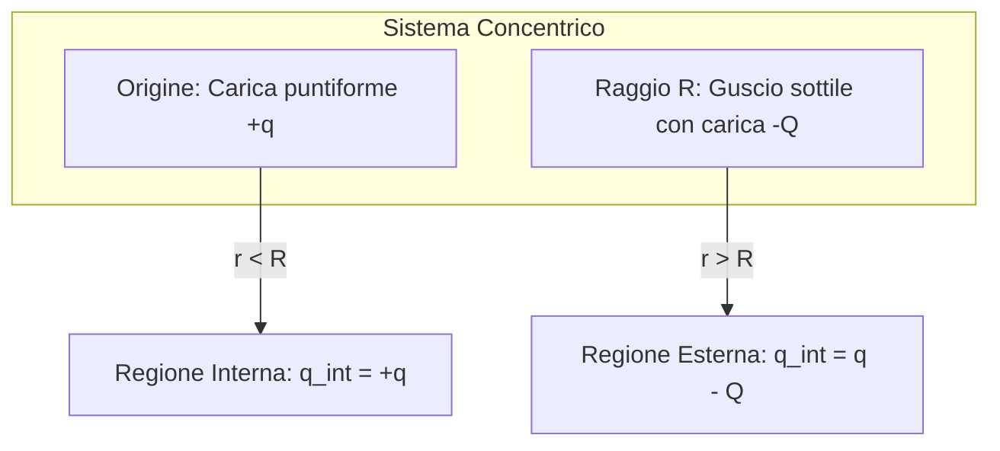

# Lezione 5 — Flusso del campo elettrico, Teorema di Gauss e proprietà dei conduttori

La lezione sviluppa il passaggio dai metodi di integrazione diretta della forza di Coulomb allo strumento fondamentale dell'elettrostatica integrale: il **Teorema di Gauss**. Nella prima parte viene formalizzato il concetto di flusso di un campo vettoriale attraverso superfici chiuse, illustrando il calcolo esplicito nel caso di un cubo immerso in un campo disomogeneo. Nella seconda parte viene enunciato il Teorema di Gauss, fornendone una dimostrazione geometrica per superfici sferiche basata sul concetto di **angolo solido**. Infine, il teorema viene applicato all'analisi di gusci sferici concentrici e utilizzato per dedurre le proprietà fondamentali dei **conduttori in equilibrio elettrostatico**, in particolare la nullità del campo interno e la localizzazione superficiale della carica netta.

## Riepilogo: dove eravamo rimasti

Nelle lezioni precedenti è stata introdotta la formulazione locale dell'elettrostatica: a partire dalla [[Elettrostatica#Coulomb|legge di Coulomb]], il [[Campo elettrico|campo elettrico]] $\vec{E}$ è stato definito come la forza per unità di carica di prova $q_0$:

$$\vec{E} = \frac{\vec{F}}{q_0} = \frac{1}{4\pi\varepsilon_0}\frac{q}{r^2}\,\hat{r}$$

Per distribuzioni continue di carica (lineari $\lambda$, superficiali $\sigma$ o volumetriche), il calcolo del campo vettoriale richiede l'integrazione diretta dei contributi infinitesimi $d\vec{E}$:

$$\vec{E} = \int \frac{1}{4\pi\varepsilon_0}\frac{dq}{r^2}\,\hat{r}$$

Come evidenziato negli esempi dell'[[Campo elettrico#Anello|anello]] e del [[Campo elettrico#Cerchio|disco carico]], il calcolo esplicito di tali integrali risulta rapidamente proibitivo non appena si perde l'allineamento lungo assi di simmetria privilegiati. Risulta quindi necessario un approccio alternativo basato sulle proprietà di flusso del campo vettoriale.

## Flusso del campo elettrico

### Definizione geometrica e analitica

Data una superficie orientabile $S$, a ogni elemento infinitesimo di area $dA$ si associa un vettore superficie $d\vec{A}$ definito da:

$$d\vec{A} = \hat{n}\,dA$$

dove $\hat{n}$ è il versore normale locale. Per convenzione universale, nel caso di **superfici chiuse** il versore normale $\hat{n}$ è scelto sempre **uscente** dal volume racchiuso dalla superficie.

Il flusso infinitesimo $d\Phi_E$ del campo elettrico $\vec{E}$ attraverso l'elemento $dA$ è dato dal prodotto scalare:

$$d\Phi_E = \vec{E} \cdot d\vec{A} = |\vec{E}|\,dA\,\cos\theta$$

dove $\theta$ rappresenta l'angolo formato tra la direzione locale del campo $\vec{E}$ e la normale uscente $\hat{n}$. Il flusso totale attraverso una superficie chiusa $S$ è dato dall'integrale di superficie:

$$\Phi_E = \oint_S \vec{E} \cdot d\vec{A}$$

In generale, l'integrazione su una superficie arbitraria non è risolvibile analiticamente; tuttavia, in presenza di particolari simmetrie spaziali (sferica, cilindrica, piana), l'integrale si riduce a un prodotto algebrico elementare.

```mermaid
graph LR
    subgraph "Orientazione elemento di superficie"
    dA["Elemento dA"] --> n["Versore normale uscente n"]
    dA --> E["Campo elettrico E"]
    n -. "Angolo θ" .- E
    end
````

### Esercizio: Flusso attraverso la superficie di un cubo

Viene proposto il calcolo del flusso del campo elettrico attraverso la superficie chiusa di un cubo di spigolo $L = 2\text{ m}$, posizionato con le facce parallele ai piani cartesiani e delimitato lungo l'asse $x$ dall'intervallo $x \in [1, 3]\text{ m}$.

  

Il campo elettrico assegnato è espresso in forma normalizzata rispetto a un valore di riferimento $E_0$:

  

$$\frac{\vec{E}}{E_0} = 3x\,\hat{i} + 4\,\hat{j}$$

Il campo presenta una componente lungo $x$ che cresce linearmente con la coordinata spaziale, una componente lungo $y$ costante e una componente lungo $z$ identicamente nulla ($E_z = 0$).

  


```mermaid
graph TD
    Cubo["Superficie chiusa del Cubo (6 facce)"]
    Cubo --> Fz["Facce parallele a xy (±k): Φ = 0"]
    Cubo --> Fy["Facce parallele a xz (±j): Φ_sup + Φ_inf = 0"]
    Cubo --> Fx["Facce parallele a yz (±i): Φ_dx + Φ_sx ≠ 0"]
```

Il flusso totale corrisponde alla somma dei flussi calcolati sulle sei facce poliedriche, ciascuna avente area $A = L^2 = (2\text{ m})^2 = 4\text{ m}^2$:

  

1. **Facce perpendicolari all'asse $z$ (anteriore e posteriore):**
    
    I versori normali uscenti sono $\hat{n} = \pm\hat{k}$. Poiché il campo non ha componente lungo $z$:
    
      
    
    $$\vec{E} \cdot (\pm\hat{k}) = 0 \implies \Phi_{z+} = \Phi_{z-} = 0$$
    
2. **Facce perpendicolari all'asse $y$ (superiore e inferiore):**
    
      
    - Per la faccia superiore ($y_{sup}$), la normale è $\hat{n} = +\hat{j}$:
        
          
        
        $$\Phi_{sup} = \int_{sup} \vec{E} \cdot (\hat{j}\,dA) = 4E_0 \int_{sup} dA = +4E_0 A$$
        
    - Per la faccia inferiore ($y_{inf}$), la normale uscente punta verso il basso: $\hat{n} = -\hat{j}$:
        
          
        
        $$\Phi_{inf} = \int_{inf} \vec{E} \cdot (-\hat{j}\,dA) = -4E_0 \int_{inf} dA = -4E_0 A$$
        
    - Il contributo combinato lungo l'asse $y$ si annulla esattamente per bilanciamento vettoriale:
        
          
        
        $$\Phi_y = \Phi_{sup} + \Phi_{inf} = 4E_0 A - 4E_0 A = 0$$
        
3. **Facce perpendicolari all'asse $x$ (destra e sinistra):**
    
    Lungo ciascuna di queste facce la coordinata $x$ è fissata, rendendo la componente $E_x$ uniforme sull'intera superficie della faccia:
    
      
    - **Faccia sinistra ($x_{L} = 1\text{ m}$):** versore normale uscente $\hat{n} = -\hat{i}$:
        
          
        
        $$\Phi_{L} = \int_{L} \vec{E}(x_L) \cdot (-\hat{i}\,dA) = -3x_L E_0 \int_{L} dA = -3(1) E_0 A = -3 E_0 A$$
        
    - **Faccia destra ($x_{R} = 3\text{ m}$):** versore normale uscente $\hat{n} = +\hat{i}$:
        
          
        
        $$\Phi_{R} = \int_{R} \vec{E}(x_R) \cdot (+\hat{i}\,dA) = +3x_R E_0 \int_{R} dA = +3(3) E_0 A = +9 E_0 A$$
        

Sommando i contributi:

  

$$\Phi_{tot} = \Phi_L + \Phi_R = 3E_0 A\,(x_R - x_L) = 3E_0 (4\text{ m}^2)(3\text{ m} - 1\text{ m}) = 24 E_0\text{ N}\cdot\text{m}^2/\text{C}$$

> [!important] Significato fisico del flusso netto
> 
> Il fatto che il flusso totale attraverso il cubo sia non nullo ($\Phi_{tot} = 24 E_0 > 0$) implica necessariamente che all'interno del volume cubico sia racchiusa una sorgente netta di linee di campo, ossia una carica elettrica netta positiva. Se il campo fosse stato uniforme anche lungo $x$, il flusso entrante dalla faccia sinistra avrebbe compensato esattamente quello uscente dalla faccia destra, producendo un flusso netto nullo.
> 
>   

## Il Teorema di Gauss

### Enunciato formale

> [!important] Teorema di Gauss
> 
> Il flusso del campo elettrico $\vec{E}$ attraverso una qualsiasi superficie chiusa $S$ (denominata **superficie gaussiana**) è proporzionale alla somma algebrica delle cariche elettriche $q_{int}$ racchiuse all'interno della superficie:
> 
>   
> 
> $$\Phi_E = \oint_S \vec{E} \cdot d\vec{A} = \frac{q_{int}}{\varepsilon_0}$$
> 
> o, equivalentemente:
> 
>   
> 
> $$\varepsilon_0 \oint_S \vec{E} \cdot d\vec{A} = q_{int}$$
> 
> dove $\varepsilon_0 \approx 8.854 \times 10^{-12}\text{ C}^2/(\text{N}\cdot\text{m}^2)$ è la costante di permittività dielettrica del vuoto, legata alla costante di Coulomb $K$ dalla relazione:
> 
>   
> 
> $$K = \frac{1}{4\pi\varepsilon_0}$$

L'aspetto cardine del teorema risiede nelle seguenti proprietà:

  

- **Somma algebrica:** Le cariche interne si sommano con il rispettivo segno ($q_{int} = \sum q_i$). Se una superficie racchiude dipoli o distribuzioni con cariche positive e negative di eguale valore assoluto, il flusso netto attraverso di essa è nullo.
    
      
    
- **Invarianza rispetto alle cariche esterne:** Eventuali cariche situate al di fuori della superficie gaussiana generano linee di campo che entrano nella superficie e ne riescono interamente. Il loro contributo locale al flusso è diverso da zero, ma l'integrale complessivo sulla superficie chiusa si annulla identicamente.
    
      
    
- **Arbitrarietà della superficie:** La superficie gaussiana è un'astrazione geometrica priva di vincoli materiali: può assumere qualsiasi forma o estensione senza che il valore del flusso totale vari, purché non cambi l'ammontare di carica racchiuso.
    
      
    

### Dimostrazione geometrica mediante l'angolo solido

La dimostrazione generale del teorema richiede il teorema della divergenza (o teorema di Ostrogradskij-Gauss). Tuttavia, per una singola carica puntiforme $q$ posta nell'origine, è possibile darne una derivazione analitica diretta tramite l'estensione dell'angolo piano all'angolo solido tridimensionale.

  

Si consideri un elemento di superficie sferica centrato nella carica. In coordinate angolari, un settore infinitesimo è sotteso da due archi di cerchio ortogonali:

  

$$dl_1 = R\,d\omega_1, \qquad dl_2 = R\,d\omega_2$$

L'elemento di area sferica $dA$ associato all'angolo solido $d\Omega$ è dato da:

  

$$dA = dl_1\,dl_2 = R^2\,d\omega_1\,d\omega_2 = R^2\,d\Omega$$

dove $d\Omega = d\omega_1\,d\omega_2$ (in coordinate sferiche standard: $d\Omega = \sin\theta\,d\theta\,d\phi$).

  

Si confrontino ora due superfici sferiche concentriche di raggi differenti, $R_1$ e $R_2$ ($R_1 < R_2$), intercettate dal medesimo cono di angolo solido infinitesimo $d\Omega$:

  

$$\begin{aligned} dA_1 &= R_1^2\,d\Omega \\ dA_2 &= R_2^2\,d\Omega \end{aligned}$$

Poiché il campo coulombiano generato dalla carica puntiforme è puramente radiale ($\vec{E} \parallel \hat{n}$), il prodotto scalare si riduce al prodotto ordinario dei moduli. Il flusso infinitesimo attraverso la porzione $dA_1$ sulla prima sfera vale:

  

$$d\Phi_1 = E(R_1)\,dA_1 = \left(K\frac{q}{R_1^2}\right) \left(R_1^2\,d\Omega\right) = K q\,d\Omega$$

Analogamente, per la seconda sfera a distanza $R_2$:

  

$$d\Phi_2 = E(R_2)\,dA_2 = \left(K\frac{q}{R_2^2}\right) \left(R_2^2\,d\Omega\right) = K q\,d\Omega$$

I fattori $R_1^2$ e $R_2^2$ a denominatore (provenienti dalla caduta quadratica del campo coulombiano) si semplificano esattamente con i termini $R_1^2$ e $R_2^2$ a numeratore (derivanti dall'espansione quadratica dell'area con la distanza). Di conseguenza:

  

$$d\Phi_1 = d\Phi_2 = K q\,d\Omega$$

Integrando sull'intero angolo solido che racchiude lo spazio ($\Omega_{tot} = 4\pi\text{ sr}$):

  

$$\Phi_E = \oint d\Phi = K q \oint d\Omega = \left(\frac{1}{4\pi\varepsilon_0}\right) q\,(4\pi) = \frac{q}{\varepsilon_0}$$

> [!important] Origine fisica del Teorema di Gauss
> 
> Il Teorema di Gauss è una conseguenza diretta della legge dell'inverso del quadrato della distanza ($1/r^2$). Se la forza elettrostatica cadesse con una potenza diversa da 2 (ad esempio $1/r^{2+\delta}$), il flusso attraverso superfici concentriche dipenderebbe dal raggio e il teorema non sussisterebbe.
> 
>   

### Derivazione della Legge di Coulomb dal Teorema di Gauss

La legge di Coulomb e il teorema di Gauss sono logicamente intercambiabili in condizioni elettrostatiche. Assumendo a priori il Teorema di Gauss, la legge di Coulomb si ricava per simmetria:

  

1. Si consideri una carica puntiforme isolata $+q$. Poiché la sorgente non presenta direzioni spaziali privilegiate, per **simmetria sferica** il campo elettrico può essere unicamente radiale e il suo modulo può dipendere esclusivamente dalla distanza $r$ dal centro:
    
      
    
    $$\vec{E}(\vec{r}) = E(r)\,\hat{r}$$
    
2. Si sceglie come superficie gaussiana una sfera di raggio $r$ concentrica alla carica. In ogni punto della superficie:
    
      
    
    $$\vec{E} \cdot d\vec{A} = E(r)\,dA$$
    
3. Poiché $E(r)$ è costante su tutti i punti della sfera a raggio fisso $r$, esso può essere estratto dall'integrale:
    
      
    
    $$\oint_S \vec{E} \cdot d\vec{A} = E(r) \oint_S dA = E(r)\,(4\pi r^2)$$
    
4. Uguagliando al secondo membro del Teorema di Gauss:
    
      
    
    $$\varepsilon_0\,E(r)\,(4\pi r^2) = q \implies E(r) = \frac{1}{4\pi\varepsilon_0}\frac{q}{r^2}$$
    

> [!tip] Approfondimento — Gauss come prima equazione fondamentale di Maxwell #approfondimento
> 
> Sebbene Coulomb e Gauss siano equivalenti in elettrostatica, nella fisica classica è la **Legge di Gauss** ad assumere rango fondamentale, costituendo la prima delle quattro equazioni di Maxwell (in forma differenziale: $\nabla \cdot \vec{E} = \frac{\rho}{\varepsilon_0}$). A differenza della formulazione di Coulomb, che presuppone un'azione istantanea a distanza incompatibile con la relatività ristretta, la legge di Gauss si estende immutata anche a cariche in moto accelerato e a campi elettromagnetici dipendenti dal tempo.
> 
>   

## Applicazioni: Distribuzioni a simmetria sferica

### Esercizio: Carica puntiforme e guscio sferico carico concentrico

Si consideri un sistema composto da una carica puntiforme positiva $+q$ collocata nell'origine e da un guscio sferico sottile concentrico di raggio $R$, su cui è depositata uniformemente una carica netta negativa $-Q$. Si richiede di determinare l'espressione analitica del campo elettrico in funzione della distanza $r$ dal centro.

  

Snippet di codice



#### 1. Regione interna ($r < R$)

Si sceglie una superficie gaussiana sferica $S_1$ di raggio $r < R$ concentrica al sistema.

  

- L'unica carica racchiusa da $S_1$ è la carica puntiforme centrale: $q_{int} = +q$.
    
      
    
- La carica superficiale $-Q$ del guscio esterno non appartiene al volume interno e non contribuisce al flusso.
    
      
    
- Applicando Gauss:
    
      
    
    $$\varepsilon_0 \oint_{S_1} \vec{E} \cdot d\vec{A} = \varepsilon_0 E_1(r)\,(4\pi r^2) = q$$
    
    $$E_1(r) = \frac{1}{4\pi\varepsilon_0}\frac{q}{r^2}$$
    

> [!warning] Inapplicabilità del calcolo diretto di Coulomb
> 
> Se si tentasse di calcolare il campo in un punto interno generico mediante la legge di Coulomb, occorrerebbe sommare vettorialmente il contributo della carica centrale e integrare i campi infinitesimi generati da ogni elemento d'area del guscio sferico. Poiché il punto interno è eccentrico rispetto agli elementi della sfera, la distanza $r'$ varia punto per punto, rendendo l'integrale vettoriale estremamente gravoso. Il Teorema di Gauss aggira interamente l'integrazione garantendo che il contributo netto del guscio interno sia identicamente nullo.
> 
>   

#### 2. Regione esterna ($r > R$)

Si sceglie una superficie gaussiana sferica $S_2$ di raggio $r > R$.

  

- La carica netta inclusa all'interno di $S_2$ è data dalla somma algebrica della carica centrale e di quella del guscio:
    
      
    
    $$q_{int} = q + (-Q) = q - Q$$
    
- Applicando il teorema:
    
      
    
    $$\varepsilon_0 E_2(r)\,(4\pi r^2) = q - Q \implies E_2(r) = \frac{1}{4\pi\varepsilon_0}\frac{q - Q}{r^2}$$
    

Il verso del campo all'esterno è determinato dal bilancio algebrico delle cariche:

  

- Se $|q| > |Q|$: la carica netta è positiva, il campo è radiale **uscente**.
    
      
    
- Se $|q| < |Q|$: la carica netta è negativa, il campo è radiale **entrante**.
    
      
    
- Se $q = Q$: la carica netta racchiusa è nulla e il campo elettrico all'esterno del guscio svanisce identicamente ($E_2(r) = 0$).
    
      
    

## Proprietà elettrostatiche dei conduttori

Un conduttore è un materiale contenente un numero elevato di portatori di carica liberi di muoversi. In condizioni statiche (assenza di generatori di f.e.m. o correnti stazionarie), il sistema evolve verso uno stato di **equilibrio elettrostatico**. Il Teorema di Gauss consente di ricavare le leggi di distribuzione spaziale della carica in tali corpi.

  

### 1. Campo elettrico nullo all'interno del materiale

All'interno di un conduttore all'equilibrio elettrostatico, il campo elettrico microscopico macro-mediato deve essere identicamente nullo in ogni punto:

  

$$\vec{E}_{int} = 0$$

La motivazione risiede nel bilancio energetico e nella dinamica dei portatori:

  

1. Se all'interno del conduttore esistesse un campo $\vec{E} \neq 0$, ogni portatore libero subirebbe una forza $\vec{F} = q\vec{E}$, instaurando un moto ordinato di cariche (corrente elettrica).
    
      
    
2. Poiché i conduttori reali possiedono una resistività finita, il moto di tali cariche dissiperebbe continuamente energia sotto forma di calore per effetto Joule.
    
      
    
3. In un corpo isolato, in assenza di una sorgente esterna continua di energia, le correnti transitorie si smorzano rapidamente, conducendo a una configurazione stazionaria in cui il moto netto cessa: la condizione di equilibrio statico impone $\vec{J} = \sigma_c \vec{E} = 0$, da cui discende necessariamente $\vec{E} = 0$.
    
      
    


### 2. Localizzazione superficiale della carica in eccesso

Se un conduttore isolato viene caricato (iniettando un eccesso di carica netta $q$), come si dispongono le cariche all'equilibrio?

  

Si consideri una superficie gaussiana $S$ scelta arbitrariamente all'interno del conduttore, posta a distanza infinitesima al di sotto della superficie esterna del corpo, in modo da racchiudere l'intero volume massivo.

  

- Poiché la superficie $S$ si trova interamente all'interno del reticolo del conduttore, in ogni suo punto il campo elettrico è nullo: $\vec{E} = 0$.
    
      
    
- Di conseguenza, il flusso totale attraverso $S$ è identicamente nullo:
    
      
    
    $$\Phi_E = \oint_S \vec{E} \cdot d\vec{A} = 0$$
    
- Per il Teorema di Gauss, la carica netta interna deve essere nulla:
    
      
    
    $$q_{int} = \varepsilon_0 \Phi_E = 0$$
    

Poiché questo risultato vale per qualunque superficie interna comunque vicina al bordo, ne consegue che:

  

> [!important] Teorema della carica superficiale
> 
> In un conduttore all'equilibrio elettrostatico, la carica netta in eccesso non può stazionare all'interno del volume massivo e deve distribuirsi **esclusivamente sulla superficie esterna** del conduttore stesso.
> 
>   

### 3. Conduttore con cavità vuota (schermo elettrostatico)

Si consideri un conduttore massivo al cui interno sia presente una cavità priva di cariche elettriche. Ci si domanda se una frazione della carica netta possa depositarsi sulla superficie libera interna della cavità.

  

Si traccia una superficie gaussiana $S_{cav}$ interamente contenuta nel materiale conduttore, che avvolga la cavità tenendosi a distanza infinitesima dalla parete interna.

  

1. La superficie $S_{cav}$ risiede nel materiale conduttore, dove $\vec{E} = 0$, implicando che il flusso sia nullo: $\Phi_E = 0$.
    
      
    
2. Per Gauss, la carica totale racchiusa da $S_{cav}$ deve essere zero: $q_{int} = 0$.
    
      
    
3. Poiché la cavità è vuota, sulla parete interna non può accumularsi alcuna carica netta:
    
      
    
    $$q_{parete} = 0$$
    

Tutta la carica netta è vincolata a migrare sulla sola superficie esterna del blocco conduttore. Questo principio costituisce il fondamento teorico dello **schermo elettrostatico** (gabbia di Faraday): lo spazio interno a una cavità metallica chiusa è completamente schermato da campi elettrostatici esterni.

  

## In sintesi

Il flusso del campo elettrico quantifica il numero netto di linee di forza che attraversano una superficie orientata ed è formalizzato dall'integrale del prodotto scalare tra il campo vettoriale e la normale locale uscente. Nel caso di superfici chiuse a geometria poliedrica prive di simmetrie continue, come il cubo analizzato, il calcolo si ottiene scomponendo l'integrale sulle singole facce piane: componenti di campo ortogonali ai versori normali generano flussi nulli, mentre componenti disomogenee lungo le normali producono un flusso netto globale che rivela la presenza di sorgenti interne.

  

Il Teorema di Gauss stabilisce che il flusso totale attraverso una qualsiasi superficie chiusa è pari al rapporto tra la carica netta interna e la permittività dielettrica del vuoto. La dimostrazione basata sull'angolo solido chiarisce il legame intimo tra la validità del teorema e la dipendenza quadratica inversa della legge di Coulomb. Il teorema costituisce uno strumento algebrico immediato per il calcolo dei campi in sistemi a simmetria sferica, piana o cilindrica, rendendo trattabili problemi altrimenti non integrabili direttamente.

  

Applicato ai materiali conduttori, Gauss dimostra che la condizione fisica di equilibrio elettrostatico — che richiede la rigorosa nullità del campo elettrico all'interno del metallo per prevenire dissipazioni resistive continue — impone la scomparsa di qualsiasi densità volumica di carica interna. Tutte le cariche nette in eccesso migrano forzatamente verso la superficie esterna del corpo, lasciando neutre e prive di carica anche eventuali pareti di cavità interne vuote.