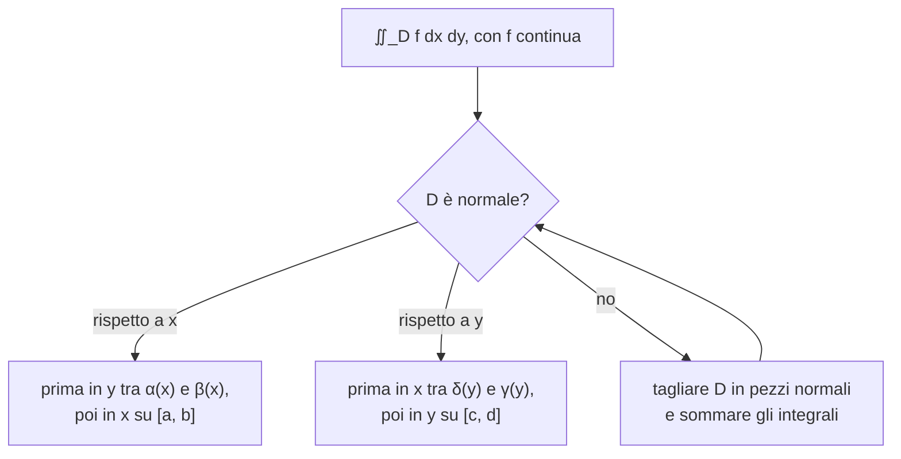

# Lezione 10 — Integrali doppi secondo Riemann e formule di riduzione

La lezione introduce gli **integrali multipli**, partendo dal caso di due variabili. Si richiama la costruzione dell'integrale di Riemann in una variabile tramite funzioni a gradini, e la si generalizza a funzioni definite su un rettangolo del piano: si partiziona il rettangolo in piastrelle, si costruiscono le somme inferiori e superiori, e si dice che la funzione è integrabile se l'estremo superiore delle prime coincide con l'estremo inferiore delle seconde. Si dimostra che le funzioni continue su un rettangolo sono integrabili e si enuncia l'estensione a domini più generali. La parte operativa è affidata ai **domini normali** e alle **formule di riduzione**, che trasformano un integrale doppio in due integrali in una variabile calcolati uno dopo l'altro. La lezione si chiude con due esempi svolti e un esercizio proposto.

> [!note] Fonti di questa lezione
> Fonti: la trascrizione (parte 1), gli appunti manuali della lezione e le note del docente nella versione del 12 ottobre 2026 [@pinamonti2026, §2.2–§2.2.2], che contengono anche gli esempi svolti a lezione e il testo completo dell'esercizio finale. L'intestazione della trascrizione riporta come data il 25 ottobre, il file degli appunti manuali il 23 ottobre: si è usata la seconda data. Le figure sono costruite per rappresentare ciò che il docente descrive e disegna alla lavagna.

## Dall'integrale in una variabile all'integrale doppio

### Il caso di una variabile

Si parte da una funzione $g : [a, b] \to \mathbb{R}$. Dal corso di Analisi 1 si sa che l'integrale di $g$ su $[a, b]$ è l'area della regione del piano compresa tra il grafico e l'asse delle $x$, presa con il segno: le parti in cui la funzione è negativa contano negativamente. Si conoscono molte regole per calcolare gli integrali, ma qual è davvero la procedura che li definisce? Bisogna capirlo, perché è proprio questa procedura che va generalizzata alle funzioni di più variabili.

L'idea è la seguente. La regione sotto il grafico è complicata, e non se ne sa calcolare direttamente l'area. Si partiziona allora l'intervallo delle $x$, non necessariamente in parti uguali, e su ogni pezzo si approssima la funzione con funzioni più semplici, **costanti a tratti**: una che sta sempre sotto il grafico e una che sta sempre sopra. Per queste funzioni l'area è facile, perché è una somma di rettangoli, base per altezza. L'area sotto la funzione a gradini che sta sopra approssima l'integrale dall'alto, quella sotto la funzione a gradini che sta sotto lo approssima dal basso; più si raffina la partizione, più le due approssimazioni si avvicinano al valore dell'integrale.

<svg viewBox="0 0 500 270" width="500" style="display:block;margin:1em auto;max-width:100%;height:auto;font-family:inherit" xmlns="http://www.w3.org/2000/svg"><rect x="50" y="72" width="84" height="153" fill="#2e9e6a" fill-opacity="0.10" stroke="#2e9e6a" stroke-width="1.4"/><rect x="50" y="127.5" width="84" height="97.5" fill="#d98a1c" fill-opacity="0.18" stroke="#d98a1c" stroke-width="1.4"/><rect x="134" y="72" width="84" height="153" fill="#2e9e6a" fill-opacity="0.10" stroke="#2e9e6a" stroke-width="1.4"/><rect x="134" y="112.7" width="84" height="112.3" fill="#d98a1c" fill-opacity="0.18" stroke="#d98a1c" stroke-width="1.4"/><rect x="218" y="112.7" width="84" height="112.3" fill="#2e9e6a" fill-opacity="0.10" stroke="#2e9e6a" stroke-width="1.4"/><rect x="218" y="129.5" width="84" height="95.5" fill="#d98a1c" fill-opacity="0.18" stroke="#d98a1c" stroke-width="1.4"/><rect x="302" y="39.2" width="84" height="185.8" fill="#2e9e6a" fill-opacity="0.10" stroke="#2e9e6a" stroke-width="1.4"/><rect x="302" y="117.3" width="84" height="107.7" fill="#d98a1c" fill-opacity="0.18" stroke="#d98a1c" stroke-width="1.4"/><rect x="386" y="18.4" width="84" height="206.6" fill="#2e9e6a" fill-opacity="0.10" stroke="#2e9e6a" stroke-width="1.4"/><rect x="386" y="39.2" width="84" height="185.8" fill="#d98a1c" fill-opacity="0.18" stroke="#d98a1c" stroke-width="1.4"/><polyline points="50,127.5 52.1,125.3 54.2,123.1 56.3,120.9 58.4,118.7 60.6,116.6 62.7,114.4 64.8,112.3 66.9,110.2 69,108.1 71.1,106.1 73.2,104.1 75.3,102.1 77.4,100.2 79.5,98.3 81.7,96.4 83.8,94.7 85.9,92.9 88,91.2 90.1,89.6 92.2,88.1 94.3,86.6 96.4,85.1 98.5,83.7 100.7,82.4 102.8,81.2 104.9,80.1 107,79 109.1,78 111.2,77 113.3,76.2 115.4,75.4 117.5,74.7 119.6,74.1 121.8,73.5 123.9,73.1 126,72.7 128.1,72.4 130.2,72.2 132.3,72 134.4,72 136.5,72 138.6,72.1 140.8,72.3 142.9,72.5 145,72.9 147.1,73.3 149.2,73.7 151.3,74.3 153.4,74.9 155.5,75.6 157.6,76.3 159.7,77.1 161.9,78 164,78.9 166.1,79.9 168.2,80.9 170.3,82 172.4,83.1 174.5,84.3 176.6,85.5 178.7,86.8 180.9,88.1 183,89.4 185.1,90.7 187.2,92.1 189.3,93.5 191.4,94.9 193.5,96.3 195.6,97.8 197.7,99.2 199.8,100.7 202,102.1 204.1,103.6 206.2,105 208.3,106.4 210.4,107.8 212.5,109.2 214.6,110.6 216.7,111.9 218.8,113.3 221,114.6 223.1,115.8 225.2,117 227.3,118.2 229.4,119.3 231.5,120.4 233.6,121.5 235.7,122.4 237.8,123.4 239.9,124.3 242.1,125.1 244.2,125.8 246.3,126.5 248.4,127.1 250.5,127.7 252.6,128.1 254.7,128.6 256.8,128.9 258.9,129.2 261.1,129.3 263.2,129.4 265.3,129.5 267.4,129.4 269.5,129.3 271.6,129.1 273.7,128.8 275.8,128.4 277.9,128 280.1,127.4 282.2,126.8 284.3,126.1 286.4,125.4 288.5,124.5 290.6,123.6 292.7,122.6 294.8,121.5 296.9,120.3 299,119.1 301.2,117.8 303.3,116.5 305.4,115 307.5,113.5 309.6,112 311.7,110.4 313.8,108.7 315.9,106.9 318,105.2 320.2,103.3 322.3,101.4 324.4,99.5 326.5,97.5 328.6,95.5 330.7,93.5 332.8,91.4 334.9,89.3 337,87.2 339.1,85.1 341.3,82.9 343.4,80.7 345.5,78.5 347.6,76.3 349.7,74.1 351.8,71.9 353.9,69.7 356,67.6 358.1,65.4 360.3,63.2 362.4,61.1 364.5,58.9 366.6,56.8 368.7,54.7 370.8,52.7 372.9,50.7 375,48.7 377.1,46.8 379.2,44.9 381.4,43.1 383.5,41.3 385.6,39.5 387.7,37.8 389.8,36.2 391.9,34.6 394,33.1 396.1,31.7 398.2,30.3 400.4,29 402.5,27.8 404.6,26.6 406.7,25.5 408.8,24.5 410.9,23.6 413,22.7 415.1,21.9 417.2,21.2 419.3,20.6 421.5,20 423.6,19.6 425.7,19.2 427.8,18.9 429.9,18.6 432,18.5 434.1,18.4 436.2,18.4 438.3,18.5 440.5,18.7 442.6,19 444.7,19.3 446.8,19.7 448.9,20.1 451,20.7 453.1,21.3 455.2,22 457.3,22.7 459.4,23.5 461.6,24.4 463.7,25.3 465.8,26.3 467.9,27.3 470,28.4" fill="none" stroke="currentColor" stroke-width="2.3" stroke-opacity="1.0"/><line x1="29" y1="225" x2="512" y2="225" stroke="currentColor" stroke-width="1.0"/><polygon points="512,225 505.8,228.3 505.8,221.7" fill="currentColor"/><line x1="50" y1="236.2" x2="50" y2="18.8" stroke="currentColor" stroke-width="1.0"/><polygon points="50,18.8 53.3,24.9 46.7,24.9" fill="currentColor"/><text x="512" y="241" font-size="13" text-anchor="end" fill="currentColor" font-style="italic">x</text><text x="58" y="26.8" font-size="12" text-anchor="start" fill="currentColor" font-style="italic">g(x)</text><text x="50" y="243" font-size="13" text-anchor="middle" fill="currentColor" font-style="italic">a</text><text x="470" y="243" font-size="13" text-anchor="middle" fill="currentColor" font-style="italic">b</text><text x="250" y="264" font-size="11" text-anchor="middle" fill="currentColor">verde: funzione a gradini sopra g (somma superiore); arancione: sotto g (somma inferiore)</text></svg>

### Funzioni di due variabili su un rettangolo

Si considera ora una funzione $f : A \subseteq \mathbb{R}^n \to \mathbb{R}$. Per semplicità si discute il caso $n = 2$, perché per $n \geq 3$ la procedura è "di fatto automatica". Si semplifica anche la forma del dominio: invece di un dominio generico si considera il **rettangolo**
$$Q = [a, b] \times [c, d],$$
prodotto cartesiano di un intervallo sull'asse $x$ e di uno sull'asse $y$, contenuto nel dominio di $f$.

Su ogni punto di $Q$ la funzione assume un valore; disegnando questi valori sull'asse $z$ si ottiene "un fazzoletto, un lenzuolo dispiegato nello spazio", il grafico di $f$. Se in una variabile l'integrale è un'area, per una funzione di due variabili l'integrale sarà il **volume** della regione compresa tra il lenzuolo e il piano $z = 0$, preso con il segno.

<svg viewBox="0 0 540 330" width="540" style="display:block;margin:1em auto;max-width:100%;height:auto;font-family:inherit" xmlns="http://www.w3.org/2000/svg"><path d="M 215,235 L 363.9,282.3 L 447,239.1 L 298.1,191.7 Z" fill="#3b82f6" fill-opacity="0.08" stroke="#3b82f6" stroke-width="1.2"/><line x1="215" y1="235" x2="401.2" y2="294.2" stroke="currentColor" stroke-width="1.0"/><polygon points="401.2,294.2 394.3,295.4 396.3,289.2" fill="currentColor"/><text x="405.2" y="298.2" font-size="13" text-anchor="start" fill="currentColor" font-style="italic">x</text><line x1="215" y1="235" x2="327.2" y2="176.6" stroke="currentColor" stroke-width="1.0"/><polygon points="327.2,176.6 323.2,182.4 320.2,176.5" fill="currentColor"/><text x="331.2" y="180.6" font-size="13" text-anchor="start" fill="currentColor" font-style="italic">y</text><line x1="215" y1="235" x2="215" y2="56.2" stroke="currentColor" stroke-width="1.0"/><polygon points="215,56.2 218.3,62.4 211.7,62.4" fill="currentColor"/><text x="219" y="60.2" font-size="13" text-anchor="start" fill="currentColor" font-style="italic">z</text><path d="M 312.1,238 L 333.4,244.7 L 333.4,117.8 L 312.1,111.1 Z" fill="#2e9e6a" fill-opacity="0.22" stroke="#2e9e6a" stroke-width="1.1"/><path d="M 333.4,244.7 L 350,236.1 L 350,109.2 L 333.4,117.8 Z" fill="#2e9e6a" fill-opacity="0.22" stroke="#2e9e6a" stroke-width="1.1"/><path d="M 312.1,111.1 L 333.4,117.8 L 350,109.2 L 328.7,102.4 Z" fill="#2e9e6a" fill-opacity="0.22" stroke="#2e9e6a" stroke-width="1.1"/><polyline points="215,142.5 217.1,141.4 219.3,140.3 221.4,139.2 223.5,138.1 225.7,137 227.8,135.8 229.9,134.7 232,133.6 234.2,132.5 236.3,131.4 238.4,130.3 240.6,129.2 242.7,128.1 244.8,127 247,125.9 249.1,124.8 251.2,123.6 253.4,122.5 255.5,121.4 257.6,120.3 259.8,119.2 261.9,118.1 264,117 266.1,115.9 268.3,114.8 270.4,113.7 272.5,112.5 274.7,111.4 276.8,110.3 278.9,109.2 281.1,108.1 283.2,107 285.3,105.9 287.5,104.8 289.6,103.7 291.7,102.6 293.9,101.5 296,100.3 298.1,99.2" fill="none" stroke="currentColor" stroke-width="0.8" stroke-opacity="0.45"/><polyline points="225.6,136.4 227.8,135.3 229.9,134.2 232,133.2 234.2,132.1 236.3,131.1 238.4,130.1 240.6,129.1 242.7,128.2 244.8,127.2 246.9,126.3 249.1,125.4 251.2,124.5 253.3,123.6 255.5,122.8 257.6,121.9 259.7,121.1 261.9,120.3 264,119.5 266.1,118.7 268.3,117.9 270.4,117.1 272.5,116.4 274.7,115.6 276.8,114.9 278.9,114.1 281,113.4 283.2,112.7 285.3,111.9 287.4,111.2 289.6,110.5 291.7,109.8 293.8,109.1 296,108.3 298.1,107.6 300.2,106.9 302.4,106.2 304.5,105.4 306.6,104.7 308.8,103.9" fill="none" stroke="currentColor" stroke-width="0.8" stroke-opacity="0.45"/><polyline points="236.3,130.8 238.4,129.7 240.5,128.6 242.7,127.6 244.8,126.7 246.9,125.7 249.1,124.8 251.2,124 253.3,123.1 255.5,122.3 257.6,121.6 259.7,120.9 261.8,120.2 264,119.5 266.1,118.9 268.2,118.3 270.4,117.7 272.5,117.2 274.6,116.7 276.8,116.2 278.9,115.7 281,115.3 283.2,114.8 285.3,114.4 287.4,114 289.6,113.6 291.7,113.2 293.8,112.9 295.9,112.5 298.1,112.2 300.2,111.8 302.3,111.5 304.5,111.1 306.6,110.7 308.7,110.4 310.9,110 313,109.6 315.1,109.3 317.3,108.9 319.4,108.4" fill="none" stroke="currentColor" stroke-width="0.8" stroke-opacity="0.45"/><polyline points="246.9,126.1 249,125 251.2,124 253.3,123 255.4,122.1 257.6,121.2 259.7,120.4 261.8,119.7 264,118.9 266.1,118.3 268.2,117.7 270.4,117.1 272.5,116.6 274.6,116.2 276.8,115.7 278.9,115.4 281,115 283.1,114.7 285.3,114.4 287.4,114.2 289.5,114 291.7,113.8 293.8,113.7 295.9,113.6 298.1,113.5 300.2,113.4 302.3,113.3 304.5,113.2 306.6,113.2 308.7,113.2 310.8,113.1 313,113.1 315.1,113.1 317.2,113 319.4,113 321.5,112.9 323.6,112.9 325.8,112.8 327.9,112.7 330,112.6" fill="none" stroke="currentColor" stroke-width="0.8" stroke-opacity="0.45"/><polyline points="257.6,122.7 259.7,121.6 261.8,120.6 263.9,119.7 266.1,118.8 268.2,118 270.3,117.2 272.5,116.6 274.6,116 276.7,115.4 278.9,114.9 281,114.5 283.1,114.1 285.3,113.8 287.4,113.6 289.5,113.3 291.7,113.2 293.8,113.1 295.9,113 298,113 300.2,113 302.3,113 304.4,113.1 306.6,113.2 308.7,113.3 310.8,113.5 313,113.7 315.1,113.9 317.2,114.1 319.4,114.3 321.5,114.5 323.6,114.7 325.7,114.9 327.9,115.2 330,115.4 332.1,115.6 334.3,115.7 336.4,115.9 338.5,116 340.7,116.2" fill="none" stroke="currentColor" stroke-width="0.8" stroke-opacity="0.45"/><polyline points="268.2,120.9 270.3,119.8 272.5,118.8 274.6,117.9 276.7,117.1 278.8,116.3 281,115.6 283.1,115 285.2,114.4 287.4,114 289.5,113.6 291.6,113.2 293.8,113 295.9,112.7 298,112.6 300.2,112.5 302.3,112.5 304.4,112.5 306.6,112.5 308.7,112.6 310.8,112.8 312.9,113 315.1,113.2 317.2,113.5 319.3,113.8 321.5,114.1 323.6,114.4 325.7,114.8 327.9,115.2 330,115.5 332.1,115.9 334.3,116.3 336.4,116.7 338.5,117.1 340.6,117.5 342.8,117.8 344.9,118.2 347,118.5 349.2,118.8 351.3,119.1" fill="none" stroke="currentColor" stroke-width="0.8" stroke-opacity="0.45"/><polyline points="278.8,120.9 281,119.9 283.1,118.9 285.2,118 287.4,117.1 289.5,116.4 291.6,115.7 293.7,115.1 295.9,114.6 298,114.2 300.1,113.8 302.3,113.5 304.4,113.3 306.5,113.1 308.7,113 310.8,112.9 312.9,113 315.1,113 317.2,113.2 319.3,113.3 321.5,113.5 323.6,113.8 325.7,114.1 327.8,114.4 330,114.8 332.1,115.2 334.2,115.6 336.4,116 338.5,116.5 340.6,116.9 342.8,117.4 344.9,117.9 347,118.3 349.2,118.8 351.3,119.3 353.4,119.7 355.5,120.1 357.7,120.5 359.8,120.9 361.9,121.2" fill="none" stroke="currentColor" stroke-width="0.8" stroke-opacity="0.45"/><polyline points="289.5,122.9 291.6,121.8 293.7,120.8 295.9,119.9 298,119.1 300.1,118.3 302.3,117.6 304.4,117 306.5,116.5 308.6,116.1 310.8,115.7 312.9,115.4 315,115.1 317.2,115 319.3,114.8 321.4,114.8 323.6,114.8 325.7,114.8 327.8,114.9 330,115.1 332.1,115.3 334.2,115.5 336.4,115.8 338.5,116.1 340.6,116.5 342.7,116.8 344.9,117.2 347,117.6 349.1,118.1 351.3,118.5 353.4,119 355.5,119.4 357.7,119.8 359.8,120.3 361.9,120.7 364.1,121.1 366.2,121.5 368.3,121.9 370.5,122.3 372.6,122.6" fill="none" stroke="currentColor" stroke-width="0.8" stroke-opacity="0.45"/><polyline points="300.1,126.7 302.2,125.6 304.4,124.6 306.5,123.7 308.6,122.9 310.8,122.1 312.9,121.4 315,120.7 317.2,120.2 319.3,119.7 321.4,119.2 323.5,118.9 325.7,118.5 327.8,118.3 329.9,118.1 332.1,118 334.2,117.9 336.3,117.8 338.5,117.9 340.6,117.9 342.7,118 344.9,118.2 347,118.3 349.1,118.5 351.3,118.8 353.4,119 355.5,119.3 357.6,119.6 359.8,119.9 361.9,120.2 364,120.6 366.2,120.9 368.3,121.2 370.4,121.5 372.6,121.8 374.7,122.1 376.8,122.4 379,122.7 381.1,122.9 383.2,123.1" fill="none" stroke="currentColor" stroke-width="0.8" stroke-opacity="0.45"/><polyline points="310.7,132.3 312.9,131.2 315,130.2 317.1,129.2 319.3,128.4 321.4,127.5 323.5,126.8 325.7,126.1 327.8,125.4 329.9,124.8 332.1,124.3 334.2,123.8 336.3,123.4 338.4,123 340.6,122.7 342.7,122.4 344.8,122.2 347,122 349.1,121.8 351.2,121.7 353.4,121.7 355.5,121.6 357.6,121.6 359.8,121.6 361.9,121.7 364,121.7 366.2,121.8 368.3,121.9 370.4,122 372.5,122.1 374.7,122.2 376.8,122.3 378.9,122.5 381.1,122.6 383.2,122.7 385.3,122.8 387.5,122.9 389.6,122.9 391.7,123 393.9,123" fill="none" stroke="currentColor" stroke-width="0.8" stroke-opacity="0.45"/><polyline points="321.4,139.4 323.5,138.3 325.6,137.2 327.8,136.2 329.9,135.3 332,134.4 334.2,133.6 336.3,132.8 338.4,132 340.6,131.3 342.7,130.6 344.8,130 347,129.4 349.1,128.9 351.2,128.4 353.3,127.9 355.5,127.5 357.6,127.1 359.7,126.7 361.9,126.4 364,126.1 366.1,125.8 368.3,125.5 370.4,125.3 372.5,125 374.7,124.8 376.8,124.6 378.9,124.4 381.1,124.3 383.2,124.1 385.3,123.9 387.4,123.8 389.6,123.6 391.7,123.4 393.8,123.3 396,123.1 398.1,122.9 400.2,122.7 402.4,122.5 404.5,122.2" fill="none" stroke="currentColor" stroke-width="0.8" stroke-opacity="0.45"/><polyline points="332,147.6 334.2,146.5 336.3,145.4 338.4,144.4 340.5,143.4 342.7,142.4 344.8,141.5 346.9,140.6 349.1,139.7 351.2,138.8 353.3,138 355.5,137.2 357.6,136.4 359.7,135.7 361.9,134.9 364,134.2 366.1,133.6 368.2,132.9 370.4,132.3 372.5,131.7 374.6,131 376.8,130.5 378.9,129.9 381,129.3 383.2,128.8 385.3,128.3 387.4,127.7 389.6,127.2 391.7,126.7 393.8,126.2 396,125.7 398.1,125.2 400.2,124.7 402.3,124.2 404.5,123.6 406.6,123.1 408.7,122.6 410.9,122.1 413,121.5 415.1,121" fill="none" stroke="currentColor" stroke-width="0.8" stroke-opacity="0.45"/><polyline points="342.7,156.5 344.8,155.4 346.9,154.3 349.1,153.2 351.2,152.2 353.3,151.1 355.4,150.1 357.6,149 359.7,148 361.8,147 364,146 366.1,145 368.2,144 370.4,143 372.5,142.1 374.6,141.1 376.8,140.2 378.9,139.2 381,138.3 383.1,137.3 385.3,136.4 387.4,135.5 389.5,134.6 391.7,133.7 393.8,132.8 395.9,131.9 398.1,131 400.2,130.1 402.3,129.2 404.5,128.3 406.6,127.4 408.7,126.6 410.9,125.7 413,124.8 415.1,123.9 417.2,123 419.4,122.1 421.5,121.2 423.6,120.3 425.8,119.4" fill="none" stroke="currentColor" stroke-width="0.8" stroke-opacity="0.45"/><polyline points="353.3,165.7 355.4,164.6 357.6,163.5 359.7,162.4 361.8,161.2 364,160.1 366.1,158.9 368.2,157.8 370.3,156.6 372.5,155.4 374.6,154.2 376.7,153 378.9,151.8 381,150.6 383.1,149.4 385.3,148.2 387.4,146.9 389.5,145.7 391.7,144.4 393.8,143.2 395.9,141.9 398,140.7 400.2,139.4 402.3,138.2 404.4,136.9 406.6,135.6 408.7,134.3 410.8,133.1 413,131.8 415.1,130.5 417.2,129.2 419.4,127.9 421.5,126.7 423.6,125.4 425.8,124.1 427.9,122.8 430,121.6 432.1,120.3 434.3,119 436.4,117.7" fill="none" stroke="currentColor" stroke-width="0.8" stroke-opacity="0.45"/><polyline points="363.9,174.7 366.1,173.6 368.2,172.5 370.3,171.3 372.5,170.1 374.6,168.8 376.7,167.6 378.9,166.3 381,165 383.1,163.6 385.2,162.3 387.4,160.9 389.5,159.5 391.6,158 393.8,156.5 395.9,155.1 398,153.6 400.2,152 402.3,150.5 404.4,148.9 406.6,147.4 408.7,145.8 410.8,144.2 413,142.5 415.1,140.9 417.2,139.3 419.3,137.6 421.5,136 423.6,134.3 425.7,132.7 427.9,131 430,129.3 432.1,127.7 434.3,126 436.4,124.4 438.5,122.7 440.7,121.1 442.8,119.4 444.9,117.8 447,116.2" fill="none" stroke="currentColor" stroke-width="0.8" stroke-opacity="0.45"/><polyline points="215,142.5 218.8,140.3 222.6,138.1 226.5,136 230.3,133.9 234.1,131.9 237.9,130 241.7,128.2 245.6,126.6 249.4,125.2 253.2,123.9 257,122.8 260.8,121.9 264.6,121.3 268.5,120.9 272.3,120.7 276.1,120.7 279.9,121 283.7,121.6 287.6,122.4 291.4,123.4 295.2,124.7 299,126.2 302.8,128 306.7,130 310.5,132.1 314.3,134.5 318.1,137 321.9,139.8 325.7,142.6 329.6,145.6 333.4,148.7 337.2,151.9 341,155.1 344.8,158.4 348.7,161.7 352.5,165 356.3,168.3 360.1,171.6 363.9,174.7" fill="none" stroke="currentColor" stroke-width="0.8" stroke-opacity="0.45"/><polyline points="220.9,139.4 224.8,137.2 228.6,135.1 232.4,132.9 236.2,130.9 240,128.9 243.8,127.1 247.7,125.3 251.5,123.7 255.3,122.3 259.1,121.1 262.9,120 266.8,119.1 270.6,118.5 274.4,118.1 278.2,117.9 282,118 285.9,118.3 289.7,118.8 293.5,119.6 297.3,120.6 301.1,121.9 305,123.4 308.8,125.2 312.6,127.1 316.4,129.3 320.2,131.6 324,134.2 327.9,136.8 331.7,139.7 335.5,142.6 339.3,145.7 343.1,148.9 347,152.1 350.8,155.3 354.6,158.6 358.4,161.9 362.2,165.2 366.1,168.4 369.9,171.5" fill="none" stroke="currentColor" stroke-width="0.8" stroke-opacity="0.45"/><polyline points="226.9,136.3 230.7,134.2 234.5,132.1 238.3,130.1 242.1,128.1 246,126.2 249.8,124.4 253.6,122.8 257.4,121.3 261.2,119.9 265.1,118.7 268.9,117.7 272.7,116.9 276.5,116.3 280.3,115.9 284.2,115.7 288,115.8 291.8,116.1 295.6,116.7 299.4,117.4 303.2,118.5 307.1,119.7 310.9,121.2 314.7,122.9 318.5,124.8 322.3,126.9 326.2,129.2 330,131.7 333.8,134.3 337.6,137.1 341.4,140 345.3,142.9 349.1,146 352.9,149.2 356.7,152.3 360.5,155.5 364.4,158.7 368.2,161.9 372,165.1 375.8,168.1" fill="none" stroke="currentColor" stroke-width="0.8" stroke-opacity="0.45"/><polyline points="232.8,133.2 236.6,131.3 240.4,129.3 244.3,127.4 248.1,125.6 251.9,123.8 255.7,122.1 259.5,120.6 263.4,119.2 267.2,117.9 271,116.8 274.8,115.9 278.6,115.1 282.5,114.6 286.3,114.3 290.1,114.1 293.9,114.2 297.7,114.6 301.5,115.1 305.4,115.9 309.2,116.9 313,118.1 316.8,119.5 320.6,121.2 324.5,123 328.3,125 332.1,127.2 335.9,129.6 339.7,132.1 343.6,134.8 347.4,137.5 351.2,140.4 355,143.3 358.8,146.3 362.7,149.4 366.5,152.4 370.3,155.5 374.1,158.6 377.9,161.6 381.7,164.5" fill="none" stroke="currentColor" stroke-width="0.8" stroke-opacity="0.45"/><polyline points="238.7,130.1 242.6,128.4 246.4,126.6 250.2,124.9 254,123.2 257.8,121.6 261.7,120.1 265.5,118.7 269.3,117.5 273.1,116.3 276.9,115.4 280.8,114.5 284.6,113.9 288.4,113.4 292.2,113.2 296,113.1 299.8,113.2 303.7,113.6 307.5,114.1 311.3,114.9 315.1,115.8 318.9,117 322.8,118.4 326.6,119.9 330.4,121.7 334.2,123.6 338,125.7 341.9,127.9 345.7,130.3 349.5,132.8 353.3,135.4 357.1,138 360.9,140.8 364.8,143.6 368.6,146.5 372.4,149.4 376.2,152.2 380,155.1 383.9,157.9 387.7,160.7" fill="none" stroke="currentColor" stroke-width="0.8" stroke-opacity="0.45"/><polyline points="244.7,127.1 248.5,125.5 252.3,124 256.1,122.5 260,121.1 263.8,119.7 267.6,118.4 271.4,117.2 275.2,116.1 279.1,115.2 282.9,114.3 286.7,113.7 290.5,113.1 294.3,112.8 298.1,112.6 302,112.6 305.8,112.8 309.6,113.1 313.4,113.7 317.2,114.4 321.1,115.3 324.9,116.4 328.7,117.7 332.5,119.2 336.3,120.8 340.2,122.6 344,124.5 347.8,126.6 351.6,128.7 355.4,131 359.2,133.4 363.1,135.9 366.9,138.4 370.7,141 374.5,143.6 378.3,146.3 382.2,148.9 386,151.5 389.8,154.1 393.6,156.7" fill="none" stroke="currentColor" stroke-width="0.8" stroke-opacity="0.45"/><polyline points="250.6,124 254.4,122.7 258.3,121.5 262.1,120.2 265.9,119.1 269.7,118 273.5,116.9 277.4,115.9 281.2,115.1 285,114.3 288.8,113.7 292.6,113.2 296.4,112.8 300.3,112.5 304.1,112.5 307.9,112.5 311.7,112.8 315.5,113.1 319.4,113.7 323.2,114.4 327,115.3 330.8,116.3 334.6,117.5 338.5,118.8 342.3,120.3 346.1,121.9 349.9,123.7 353.7,125.5 357.5,127.5 361.4,129.5 365.2,131.7 369,133.9 372.8,136.2 376.6,138.5 380.5,140.8 384.3,143.2 388.1,145.5 391.9,147.9 395.7,150.2 399.6,152.5" fill="none" stroke="currentColor" stroke-width="0.8" stroke-opacity="0.45"/><polyline points="256.6,120.9 260.4,119.9 264.2,119 268,118.1 271.8,117.2 275.7,116.4 279.5,115.6 283.3,114.9 287.1,114.3 290.9,113.8 294.7,113.3 298.6,113 302.4,112.8 306.2,112.7 310,112.7 313.8,112.9 317.7,113.2 321.5,113.6 325.3,114.1 329.1,114.8 332.9,115.6 336.8,116.6 340.6,117.6 344.4,118.8 348.2,120.1 352,121.6 355.8,123.1 359.7,124.7 363.5,126.5 367.3,128.3 371.1,130.1 374.9,132 378.8,134 382.6,136 386.4,138 390.2,140.1 394,142.1 397.9,144.2 401.7,146.2 405.5,148.1" fill="none" stroke="currentColor" stroke-width="0.8" stroke-opacity="0.45"/><polyline points="262.5,117.8 266.3,117.2 270.1,116.6 274,116 277.8,115.5 281.6,115 285.4,114.5 289.2,114.1 293,113.8 296.9,113.5 300.7,113.3 304.5,113.1 308.3,113.1 312.1,113.2 316,113.3 319.8,113.5 323.6,113.9 327.4,114.3 331.2,114.9 335.1,115.5 338.9,116.3 342.7,117.1 346.5,118.1 350.3,119.1 354.1,120.3 358,121.5 361.8,122.8 365.6,124.2 369.4,125.6 373.2,127.1 377.1,128.7 380.9,130.3 384.7,132 388.5,133.6 392.3,135.3 396.2,137 400,138.7 403.8,140.4 407.6,142.1 411.4,143.7" fill="none" stroke="currentColor" stroke-width="0.8" stroke-opacity="0.45"/><polyline points="268.4,114.7 272.2,114.5 276.1,114.2 279.9,114 283.7,113.8 287.5,113.7 291.3,113.5 295.2,113.4 299,113.4 302.8,113.4 306.6,113.4 310.4,113.5 314.3,113.6 318.1,113.9 321.9,114.1 325.7,114.5 329.5,114.9 333.4,115.4 337.2,115.9 341,116.5 344.8,117.2 348.6,118 352.4,118.8 356.3,119.7 360.1,120.6 363.9,121.6 367.7,122.7 371.5,123.8 375.4,125 379.2,126.2 383,127.4 386.8,128.7 390.6,130 394.5,131.3 398.3,132.6 402.1,133.9 405.9,135.2 409.7,136.6 413.5,137.9 417.4,139.2" fill="none" stroke="currentColor" stroke-width="0.8" stroke-opacity="0.45"/><polyline points="274.4,111.6 278.2,111.8 282,111.9 285.8,112.1 289.6,112.3 293.5,112.4 297.3,112.7 301.1,112.9 304.9,113.1 308.7,113.4 312.6,113.7 316.4,114 320.2,114.3 324,114.7 327.8,115.1 331.6,115.6 335.5,116.1 339.3,116.6 343.1,117.1 346.9,117.7 350.7,118.3 354.6,119 358.4,119.7 362.2,120.4 366,121.1 369.8,121.9 373.7,122.7 377.5,123.6 381.3,124.4 385.1,125.3 388.9,126.2 392.8,127.1 396.6,128 400.4,128.9 404.2,129.9 408,130.8 411.8,131.8 415.7,132.7 419.5,133.6 423.3,134.6" fill="none" stroke="currentColor" stroke-width="0.8" stroke-opacity="0.45"/><polyline points="280.3,108.5 284.1,109.1 287.9,109.6 291.8,110.2 295.6,110.7 299.4,111.3 303.2,111.8 307,112.4 310.9,112.9 314.7,113.5 318.5,114 322.3,114.6 326.1,115.1 329.9,115.7 333.8,116.2 337.6,116.8 341.4,117.3 345.2,117.9 349,118.4 352.9,119 356.7,119.5 360.5,120.1 364.3,120.6 368.1,121.2 372,121.7 375.8,122.3 379.6,122.8 383.4,123.4 387.2,123.9 391,124.5 394.9,125 398.7,125.5 402.5,126.1 406.3,126.6 410.1,127.2 414,127.7 417.8,128.3 421.6,128.8 425.4,129.4 429.2,129.9" fill="none" stroke="currentColor" stroke-width="0.8" stroke-opacity="0.45"/><polyline points="286.2,105.4 290.1,106.4 293.9,107.3 297.7,108.2 301.5,109.2 305.3,110.1 309.2,111 313,111.9 316.8,112.7 320.6,113.5 324.4,114.4 328.2,115.1 332.1,115.9 335.9,116.6 339.7,117.3 343.5,118 347.3,118.6 351.2,119.2 355,119.7 358.8,120.2 362.6,120.7 366.4,121.1 370.3,121.6 374.1,121.9 377.9,122.3 381.7,122.6 385.5,122.9 389.3,123.2 393.2,123.4 397,123.6 400.8,123.8 404.6,124 408.4,124.2 412.3,124.3 416.1,124.5 419.9,124.6 423.7,124.8 427.5,125 431.4,125.1 435.2,125.3" fill="none" stroke="currentColor" stroke-width="0.8" stroke-opacity="0.45"/><polyline points="292.2,102.3 296,103.7 299.8,105 303.6,106.3 307.5,107.6 311.3,108.9 315.1,110.1 318.9,111.3 322.7,112.4 326.5,113.6 330.4,114.6 334.2,115.6 338,116.6 341.8,117.5 345.6,118.3 349.5,119.1 353.3,119.7 357.1,120.4 360.9,120.9 364.7,121.4 368.6,121.8 372.4,122.1 376.2,122.4 380,122.6 383.8,122.8 387.6,122.9 391.5,122.9 395.3,122.9 399.1,122.8 402.9,122.7 406.7,122.6 410.6,122.4 414.4,122.2 418.2,122 422,121.8 425.8,121.6 429.7,121.3 433.5,121.1 437.3,120.9 441.1,120.7" fill="none" stroke="currentColor" stroke-width="0.8" stroke-opacity="0.45"/><polyline points="298.1,99.2 301.9,100.9 305.8,102.6 309.6,104.3 313.4,105.9 317.2,107.5 321,109.1 324.8,110.6 328.7,112.1 332.5,113.5 336.3,114.8 340.1,116 343.9,117.1 347.8,118.2 351.6,119.1 355.4,120 359.2,120.7 363,121.4 366.9,121.9 370.7,122.4 374.5,122.7 378.3,123 382.1,123.1 385.9,123.2 389.8,123.1 393.6,123 397.4,122.8 401.2,122.5 405,122.2 408.9,121.8 412.7,121.3 416.5,120.8 420.3,120.2 424.1,119.7 428,119.1 431.8,118.5 435.6,117.9 439.4,117.3 443.2,116.7 447,116.2" fill="none" stroke="currentColor" stroke-width="0.8" stroke-opacity="0.45"/><line x1="215" y1="235" x2="215" y2="142.5" stroke="currentColor" stroke-opacity="0.5" stroke-dasharray="4 3"/><line x1="363.9" y1="282.3" x2="363.9" y2="174.7" stroke="currentColor" stroke-opacity="0.5" stroke-dasharray="4 3"/><line x1="447" y1="239.1" x2="447" y2="116.2" stroke="currentColor" stroke-opacity="0.5" stroke-dasharray="4 3"/><line x1="298.1" y1="191.7" x2="298.1" y2="99.2" stroke="currentColor" stroke-opacity="0.5" stroke-dasharray="4 3"/><text x="300.7" y="289.4" font-size="12" text-anchor="end" fill="#3b82f6">Q = [a, b] × [c, d]</text><text x="447" y="104.2" font-size="12" text-anchor="end" fill="currentColor">grafico di f</text><text x="20" y="40" font-size="12" text-anchor="start" fill="#2e9e6a">colonna di base Q<tspan baseline-shift='sub' font-size='9'>jk</tspan> e altezza M<tspan baseline-shift='sub' font-size='9'>jk</tspan></text><line x1="120" y1="46" x2="331.4" y2="115.8" stroke="#2e9e6a" stroke-width="1"/><text x="270" y="322" font-size="11" text-anchor="middle" fill="currentColor">l'integrale doppio misura il volume sotto il grafico (con segno), approssimato da colonne</text></svg>

> [!tip] Approfondimento — Parte positiva e parte negativa
> #approfondimento Le note del docente precisano il significato del segno. Se $f \geq 0$, l'integrale è il volume dell'insieme $V = \{(\mathbf{x}, z) : \mathbf{x} \in D,\ 0 \leq z \leq f(\mathbf{x})\}$. In generale si scrive $f = f_+ - f_-$, dove $f_+ = \max(f, 0)$ coincide con $f$ dove $f \geq 0$ ed è nulla altrove, e $f_- = \max(-f, 0)$; entrambe sono non negative, e l'integrale di $f$ è l'integrale di $f_+$ meno l'integrale di $f_-$, cioè il volume sopra il piano meno il volume sotto [@pinamonti2026, §2.2].

## Partizioni e somme

### La partizione del rettangolo

Il primo passo è costruire l'analogo degli istogrammi: bisogna partizionare sia l'intervallo sull'asse $x$ sia quello sull'asse $y$. Si sceglie una partizione $D_1$ di $[a, b]$ e una partizione $D_2$ di $[c, d]$, con un numero di punti in generale diverso:
$$D_1 : \ a = x_0 < x_1 < \dots < x_{r-1} < x_r = b, \qquad D_2 : \ c = y_0 < y_1 < \dots < y_{s-1} < y_s = d .$$
Tracciando le rette verticali per gli $x_j$ e quelle orizzontali per gli $y_k$ si ottiene una famiglia di rettangolini, le "piastrelle". La partizione del rettangolo è il prodotto cartesiano $D = D_1 \times D_2$. Per individuare una piastrella servono due indici: con
$$I_j = [x_{j-1}, x_j], \qquad J_k = [y_{k-1}, y_k],$$
la piastrella $(j, k)$ è
$$Q_{jk} = I_j \times J_k .$$

<svg viewBox="0 0 440 320" width="440" style="display:block;margin:1em auto;max-width:100%;height:auto;font-family:inherit" xmlns="http://www.w3.org/2000/svg"><line x1="40" y1="285" x2="420" y2="285" stroke="currentColor" stroke-width="1.0"/><polygon points="420,285 413.8,288.3 413.8,281.7" fill="currentColor"/><line x1="50" y1="300" x2="50" y2="30" stroke="currentColor" stroke-width="1.0"/><polygon points="50,30 53.3,36.2 46.7,36.2" fill="currentColor"/><text x="418" y="302" font-size="13" text-anchor="end" fill="currentColor" font-style="italic">x</text><text x="58" y="36" font-size="13" text-anchor="start" fill="currentColor" font-style="italic">y</text><rect x="70" y="70" width="300" height="185" fill="#3b82f6" fill-opacity="0.06" stroke="currentColor" stroke-width="1.4"/><line x1="120" y1="70" x2="120" y2="255" stroke="#3b82f6" stroke-width="1"/><line x1="185" y1="70" x2="185" y2="255" stroke="#3b82f6" stroke-width="1"/><line x1="230" y1="70" x2="230" y2="255" stroke="#3b82f6" stroke-width="1"/><line x1="300" y1="70" x2="300" y2="255" stroke="#3b82f6" stroke-width="1"/><line x1="70" y1="210" x2="370" y2="210" stroke="#d98a1c" stroke-width="1"/><line x1="70" y1="160" x2="370" y2="160" stroke="#d98a1c" stroke-width="1"/><line x1="70" y1="115" x2="370" y2="115" stroke="#d98a1c" stroke-width="1"/><rect x="185" y="160" width="45" height="50" fill="#2e9e6a" fill-opacity="0.35" stroke="#2e9e6a" stroke-width="1.6"/><text x="207.5" y="189" font-size="12" text-anchor="middle" fill="#2e9e6a">Q<tspan baseline-shift='sub' font-size='9'>jk</tspan></text><line x1="70" y1="281" x2="70" y2="289" stroke="currentColor"/><text x="70" y="303" font-size="11" text-anchor="middle" fill="currentColor">a = x<tspan baseline-shift='sub' font-size='9'>0</tspan></text><line x1="120" y1="281" x2="120" y2="289" stroke="currentColor"/><line x1="185" y1="281" x2="185" y2="289" stroke="currentColor"/><text x="185" y="303" font-size="11" text-anchor="middle" fill="currentColor">x<tspan baseline-shift='sub' font-size='9'>j−1</tspan></text><line x1="230" y1="281" x2="230" y2="289" stroke="currentColor"/><text x="230" y="303" font-size="11" text-anchor="middle" fill="currentColor">x<tspan baseline-shift='sub' font-size='9'>j</tspan></text><line x1="300" y1="281" x2="300" y2="289" stroke="currentColor"/><line x1="370" y1="281" x2="370" y2="289" stroke="currentColor"/><text x="370" y="303" font-size="11" text-anchor="middle" fill="currentColor">x<tspan baseline-shift='sub' font-size='9'>r</tspan> = b</text><line x1="46" y1="255" x2="54" y2="255" stroke="currentColor"/><text x="44" y="259" font-size="11" text-anchor="end" fill="currentColor">c = y<tspan baseline-shift='sub' font-size='9'>0</tspan></text><line x1="54" y1="255" x2="70" y2="255" stroke="currentColor" stroke-opacity="0.25" stroke-dasharray="3 3"/><line x1="46" y1="210" x2="54" y2="210" stroke="currentColor"/><text x="44" y="214" font-size="11" text-anchor="end" fill="currentColor">y<tspan baseline-shift='sub' font-size='9'>k−1</tspan></text><line x1="54" y1="210" x2="70" y2="210" stroke="currentColor" stroke-opacity="0.25" stroke-dasharray="3 3"/><line x1="46" y1="160" x2="54" y2="160" stroke="currentColor"/><text x="44" y="164" font-size="11" text-anchor="end" fill="currentColor">y<tspan baseline-shift='sub' font-size='9'>k</tspan></text><line x1="54" y1="160" x2="70" y2="160" stroke="currentColor" stroke-opacity="0.25" stroke-dasharray="3 3"/><line x1="46" y1="115" x2="54" y2="115" stroke="currentColor"/><line x1="54" y1="115" x2="70" y2="115" stroke="currentColor" stroke-opacity="0.25" stroke-dasharray="3 3"/><line x1="46" y1="70" x2="54" y2="70" stroke="currentColor"/><text x="44" y="74" font-size="11" text-anchor="end" fill="currentColor">y<tspan baseline-shift='sub' font-size='9'>s</tspan> = d</text><line x1="54" y1="70" x2="70" y2="70" stroke="currentColor" stroke-opacity="0.25" stroke-dasharray="3 3"/><text x="378" y="84" font-size="13" text-anchor="start" fill="currentColor" font-style="italic">Q</text></svg>

Il rettangolo è l'unione di tutte le piastrelle, e le aree si calcolano subito:
$$Q = \bigcup_{j=1}^{r}\bigcup_{k=1}^{s} Q_{jk}, \qquad A(Q) = (b - a)(d - c), \qquad A(Q_{jk}) = \Delta x_j\, \Delta y_k,$$
dove $\Delta x_j = x_j - x_{j-1}$ e $\Delta y_k = y_k - y_{k-1}$ sono le lunghezze dei lati della piastrella.

### Estremi inferiori e superiori

Sia ora $f : Q \to \mathbb{R}$ **limitata**. Avendo in mente il disegno in una variabile, si cercano in ogni piastrella l'estremo inferiore e l'estremo superiore della funzione. Si indicano con
$$m = \inf_{\mathbf{x} \in Q} f(\mathbf{x}), \qquad M = \sup_{\mathbf{x} \in Q} f(\mathbf{x})$$
gli estremi su tutto il rettangolo, e con
$$m_{jk} = \inf_{\mathbf{x} \in Q_{jk}} f(\mathbf{x}), \qquad M_{jk} = \sup_{\mathbf{x} \in Q_{jk}} f(\mathbf{x})$$
quelli sulla singola piastrella. Poiché l'estremo inferiore su un dominio più piccolo non può essere minore di quello sul dominio grande, e analogamente per l'estremo superiore, vale la catena
$$m \leq m_{jk} \leq f(\mathbf{x}) \leq M_{jk} \leq M \qquad \text{per ogni } \mathbf{x} \in Q_{jk}.$$

### Somme inferiori e superiori

Le funzioni costanti a tratti che valgono $m_{jk}$ (o $M_{jk}$) sulla piastrella $Q_{jk}$ approssimano $f$ dal basso (o dall'alto). Il volume sotto di esse è una somma di volumi di parallelepipedi: area di base per altezza, con l'altezza presa con il segno.

> [!important] Definizione — Somma superiore e somma inferiore
> Data $f : Q \to \mathbb{R}$ limitata e la partizione $D = D_1 \times D_2$ di $Q$, la **somma superiore** e la **somma inferiore** di $f$ adattate a $D$ sono
> $$S_{\sup}(D, f) = \sum_{j=1}^{r}\sum_{k=1}^{s} M_{jk}\, \Delta x_j\, \Delta y_k, \qquad S_{\inf}(D, f) = \sum_{j=1}^{r}\sum_{k=1}^{s} m_{jk}\, \Delta x_j\, \Delta y_k .$$
>
> [@pinamonti2026, Def. 2.2.1]

Per la catena di disuguaglianze precedente, moltiplicando per le aree e sommando,
$$m\,(b - a)(d - c) \ \leq\ S_{\inf}(D, f) \ \leq\ S_{\sup}(D, f) \ \leq\ M\,(b - a)(d - c).$$

### Raffinamento

Si **raffina** la partizione $D$: si aggiungono tacche sia sull'asse $x$ sia sull'asse $y$, ottenendo una partizione $D'$ che contiene tutti i punti di $D$ e altri ancora ($D \subseteq D'$). La funzione a gradini costruita su $D'$ approssima meglio la funzione, quindi
$$S_{\inf}(D, f) \ \leq\ S_{\inf}(D', f) \ \leq\ S_{\sup}(D', f) \ \leq\ S_{\sup}(D, f).$$
Il docente lo spiega con un disegno in una variabile: su un intervallino la somma inferiore usa il minimo su tutto l'intervallino; dividendolo in due, su una delle due metà il minimo resta lo stesso, sull'altra può solo crescere, e la nuova funzione a gradini sta sopra la vecchia.

<svg viewBox="0 0 520 210" width="520" style="display:block;margin:1em auto;max-width:100%;height:auto;font-family:inherit" xmlns="http://www.w3.org/2000/svg"><rect x="30" y="116.7" width="200" height="53.3" fill="#d98a1c" fill-opacity="0.22" stroke="#d98a1c" stroke-width="1.4"/><polyline points="30,72.6 31.7,74.2 33.4,75.8 35,77.4 36.7,79 38.4,80.5 40.1,82 41.8,83.5 43.4,84.9 45.1,86.3 46.8,87.7 48.5,89 50.2,90.3 51.8,91.6 53.5,92.8 55.2,94.1 56.9,95.2 58.6,96.4 60.3,97.5 61.9,98.6 63.6,99.6 65.3,100.7 67,101.7 68.7,102.6 70.3,103.5 72,104.4 73.7,105.3 75.4,106.1 77.1,106.9 78.7,107.7 80.4,108.4 82.1,109.1 83.8,109.8 85.5,110.5 87.1,111.1 88.8,111.7 90.5,112.2 92.2,112.7 93.9,113.2 95.5,113.7 97.2,114.1 98.9,114.5 100.6,114.8 102.3,115.1 103.9,115.4 105.6,115.7 107.3,115.9 109,116.1 110.7,116.3 112.4,116.4 114,116.5 115.7,116.6 117.4,116.7 119.1,116.7 120.8,116.6 122.4,116.6 124.1,116.5 125.8,116.4 127.5,116.2 129.2,116.1 130.8,115.9 132.5,115.6 134.2,115.3 135.9,115 137.6,114.7 139.2,114.3 140.9,113.9 142.6,113.5 144.3,113 146,112.5 147.6,112 149.3,111.4 151,110.8 152.7,110.2 154.4,109.6 156.1,108.9 157.7,108.2 159.4,107.4 161.1,106.6 162.8,105.8 164.5,105 166.1,104.1 167.8,103.2 169.5,102.2 171.2,101.3 172.9,100.3 174.5,99.2 176.2,98.2 177.9,97.1 179.6,95.9 181.3,94.8 182.9,93.6 184.6,92.4 186.3,91.1 188,89.8 189.7,88.5 191.3,87.2 193,85.8 194.7,84.4 196.4,82.9 198.1,81.4 199.7,79.9 201.4,78.4 203.1,76.8 204.8,75.2 206.5,73.6 208.2,71.9 209.8,70.2 211.5,68.5 213.2,66.7 214.9,64.9 216.6,63.1 218.2,61.2 219.9,59.4 221.6,57.4 223.3,55.5 225,53.5 226.6,51.5 228.3,49.4 230,47.4" fill="none" stroke="currentColor" stroke-width="2.2" stroke-opacity="1.0"/><line x1="20" y1="170" x2="250" y2="170" stroke="currentColor" stroke-width="1.0"/><polygon points="250,170 243.8,173.3 243.8,166.7" fill="currentColor"/><text x="130" y="195" font-size="11.5" text-anchor="middle" fill="currentColor">partizione D</text><rect x="290" y="116.7" width="100" height="53.3" fill="#d98a1c" fill-opacity="0.22" stroke="#d98a1c" stroke-width="1.4"/><rect x="390" y="116" width="100" height="54" fill="#d98a1c" fill-opacity="0.22" stroke="#d98a1c" stroke-width="1.4"/><polyline points="290,72.6 291.7,74.2 293.4,75.8 295,77.4 296.7,79 298.4,80.5 300.1,82 301.8,83.5 303.4,84.9 305.1,86.3 306.8,87.7 308.5,89 310.2,90.3 311.8,91.6 313.5,92.8 315.2,94.1 316.9,95.2 318.6,96.4 320.3,97.5 321.9,98.6 323.6,99.6 325.3,100.7 327,101.7 328.7,102.6 330.3,103.5 332,104.4 333.7,105.3 335.4,106.1 337.1,106.9 338.7,107.7 340.4,108.4 342.1,109.1 343.8,109.8 345.5,110.5 347.1,111.1 348.8,111.7 350.5,112.2 352.2,112.7 353.9,113.2 355.5,113.7 357.2,114.1 358.9,114.5 360.6,114.8 362.3,115.1 363.9,115.4 365.6,115.7 367.3,115.9 369,116.1 370.7,116.3 372.4,116.4 374,116.5 375.7,116.6 377.4,116.7 379.1,116.7 380.8,116.6 382.4,116.6 384.1,116.5 385.8,116.4 387.5,116.2 389.2,116.1 390.8,115.9 392.5,115.6 394.2,115.3 395.9,115 397.6,114.7 399.2,114.3 400.9,113.9 402.6,113.5 404.3,113 406,112.5 407.6,112 409.3,111.4 411,110.8 412.7,110.2 414.4,109.6 416.1,108.9 417.7,108.2 419.4,107.4 421.1,106.6 422.8,105.8 424.5,105 426.1,104.1 427.8,103.2 429.5,102.2 431.2,101.3 432.9,100.3 434.5,99.2 436.2,98.2 437.9,97.1 439.6,95.9 441.3,94.8 442.9,93.6 444.6,92.4 446.3,91.1 448,89.8 449.7,88.5 451.3,87.2 453,85.8 454.7,84.4 456.4,82.9 458.1,81.4 459.7,79.9 461.4,78.4 463.1,76.8 464.8,75.2 466.5,73.6 468.2,71.9 469.8,70.2 471.5,68.5 473.2,66.7 474.9,64.9 476.6,63.1 478.2,61.2 479.9,59.4 481.6,57.4 483.3,55.5 485,53.5 486.6,51.5 488.3,49.4 490,47.4" fill="none" stroke="currentColor" stroke-width="2.2" stroke-opacity="1.0"/><line x1="280" y1="170" x2="510" y2="170" stroke="currentColor" stroke-width="1.0"/><polygon points="510,170 503.8,173.3 503.8,166.7" fill="currentColor"/><text x="390" y="195" font-size="11.5" text-anchor="middle" fill="currentColor">partizione D′ ⊃ D (un punto in più)</text><text x="260" y="22" font-size="11" text-anchor="middle" fill="#d98a1c">aggiungendo punti la somma inferiore cresce (e la superiore decresce)</text></svg>

> [!tip] Approfondimento — Perché il raffinamento migliora le somme
> #approfondimento Se una piastrella $Q_{jk}$ di $D$ viene divisa in piastrelle più piccole $Q'_1, \dots, Q'_p$ di $D'$, l'estremo inferiore su ciascuna $Q'_i \subseteq Q_{jk}$ è almeno $m_{jk}$. Quindi
> $$\sum_{i=1}^{p} \inf_{Q'_i} f \cdot A(Q'_i) \ \geq\ m_{jk}\sum_{i=1}^{p} A(Q'_i) = m_{jk}\, A(Q_{jk}),$$
> e sommando su tutte le piastrelle $S_{\inf}(D', f) \geq S_{\inf}(D, f)$. Lo stesso ragionamento con gli estremi superiori dà $S_{\sup}(D', f) \leq S_{\sup}(D, f)$.

## Integrabilità secondo Riemann

### Estremo superiore delle somme inferiori ed estremo inferiore delle somme superiori

Per arrivare all'integrale si calcola l'estremo superiore delle somme inferiori e l'estremo inferiore delle somme superiori, su tutte le possibili partizioni $D$ del rettangolo (l'insieme delle partizioni si indica con $\mathcal{P}$): al raffinarsi della partizione le somme inferiori crescono e quelle superiori decrescono. Per le relazioni viste,
$$\sup_{D \in \mathcal{P}} S_{\inf}(D, f) \ \leq\ \inf_{D \in \mathcal{P}} S_{\sup}(D, f),$$
e restano due possibilità: (a) i due numeri coincidono, e il valore comune è l'integrale; (b) il primo è strettamente minore del secondo, e la funzione non è integrabile.

> [!tip] Approfondimento — Somme di partizioni diverse
> #approfondimento La disuguaglianza $\sup S_{\inf} \leq \inf S_{\sup}$ richiede un argomento in più, perché confronta somme costruite su partizioni **diverse**. Date due partizioni $D$ e $\tilde{D}$, si considera il **raffinamento comune** $D'' = D \cup \tilde{D}$, ottenuto mettendo insieme le tacche di entrambe sui due assi. Per l'approfondimento precedente
> $$S_{\inf}(D, f) \leq S_{\inf}(D'', f) \leq S_{\sup}(D'', f) \leq S_{\sup}(\tilde{D}, f).$$
> Quindi ogni somma inferiore è minore o uguale di ogni somma superiore; passando all'estremo superiore a sinistra e all'estremo inferiore a destra si ottiene la disuguaglianza.

> [!important] Definizione — Funzione integrabile secondo Riemann
> Una funzione limitata $f : Q \subseteq \mathbb{R}^2 \to \mathbb{R}$, con $Q = [a, b] \times [c, d]$, è **integrabile secondo Riemann** se
> $$\sup_{D \in \mathcal{P}} S_{\inf}(D, f) = \inf_{D \in \mathcal{P}} S_{\sup}(D, f) = I .$$
> Il valore comune $I$ si chiama **integrale** di $f$ su $Q$ e si indica con
> $$I = I(Q, f) = \iint_Q f(x, y)\, dx\, dy = \int_Q f(\mathbf{x})\, d^2\mathbf{x}.$$
> $Q$ è il dominio di integrazione e $f$ la funzione integranda.
>
> [@pinamonti2026, Def. 2.2.2]

Il doppio simbolo di integrale ricorda che il dominio ha dimensione 2; quando questo è chiaro si usa anche un solo simbolo, con $d^2\mathbf{x}$. Sono tutte notazioni equivalenti.

### Funzioni non integrabili

Può davvero succedere che i due estremi non coincidano? Purtroppo sì, e il docente lo mostra già in una variabile. Si consideri la funzione limitata che vale 1 sui numeri razionali e 0 sugli irrazionali (detta **funzione di Dirichlet**). È altamente discontinua: vicino a ogni razionale c'è un irrazionale e viceversa, e "se la disegni sembra una riga, ma ci sono tanti valori dove vale zero". Comunque si partizioni l'intervallo, su ogni intervallino l'estremo superiore è 1 e l'estremo inferiore è 0: le somme superiori valgono sempre la lunghezza dell'intervallo, quelle inferiori sempre 0, e non coincideranno mai.

Diverso è il caso di una funzione costante uguale a 1 ovunque tranne in un unico punto, dove vale 0. Lì basta prendere un intervallino abbastanza piccolo attorno al punto "cattivo": il suo contributo alla differenza tra le somme è piccolo quanto si vuole, e la funzione risulta integrabile.

> [!example] Esempio (aggiunto) — Un punto non cambia l'integrale
> Sia $h : [0, 1] \to \mathbb{R}$ con $h(x) = 1$ per $x \neq \tfrac12$ e $h(\tfrac12) = 0$. Per una partizione in cui $\tfrac12$ cade in un solo intervallino, di lunghezza $\eta$, l'estremo inferiore vale 0 solo su quell'intervallino e 1 altrove, mentre l'estremo superiore vale sempre 1. Quindi
> $$S_{\sup} = 1, \qquad S_{\inf} = 1 - \eta, \qquad S_{\sup} - S_{\inf} = \eta,$$
> che si può rendere piccolo a piacere. La funzione è integrabile, con integrale 1: modificare il valore in un punto non cambia l'integrale.

### Le funzioni continue sono integrabili

La definizione è "tutt'altro che operativa". Prima di renderla operativa, ci si convince che esistono funzioni automaticamente integrabili: sono le funzioni continue.

> [!important] Teorema — Integrabilità delle funzioni continue
> Sia $f : Q \to \mathbb{R}$ con $Q = [a, b] \times [c, d]$. Se $f$ è continua su $Q$, allora $f$ è integrabile secondo Riemann.
>
> [@pinamonti2026, Teor. 2.2.1]

La funzione di Dirichlet non è continua in nessun punto, quindi non rientra in questo teorema. La dimostrazione è analoga a quella in una variabile.

**Dimostrazione.** $Q$ è prodotto cartesiano di intervalli chiusi e limitati, quindi è chiuso e limitato, cioè compatto; lo stesso vale per ogni piastrella $Q_{jk}$. Una funzione continua su un compatto è, per il teorema di Heine–Cantor, **uniformemente continua**: per ogni $\varepsilon > 0$ esiste $\delta_\varepsilon > 0$ tale che, per ogni $\mathbf{x}, \mathbf{y} \in Q$,
$$|\mathbf{x} - \mathbf{y}| < \delta_\varepsilon \quad\Longrightarrow\quad |f(\mathbf{x}) - f(\mathbf{y})| < \varepsilon,$$
indipendentemente da dove si trovano i punti: se i punti sono vicini, i valori della funzione sono vicini.

*Partizione adattata.* Fissato $\varepsilon$, si costruisce una partizione $D = D_1 \times D_2$ con passi
$$\Delta x_j < \frac{\delta_\varepsilon}{2}, \qquad \Delta y_k < \frac{\delta_\varepsilon}{2} \qquad \text{per ogni } j, k .$$
Allora due punti $\mathbf{z}_1, \mathbf{z}_2$ della stessa piastrella $Q_{jk}$ distano meno di $\delta_\varepsilon$: le differenze delle loro coordinate sono controllate dai lati della piastrella, e
$$|\mathbf{z}_1 - \mathbf{z}_2|^2 < \Big(\frac{\delta_\varepsilon}{2}\Big)^2 + \Big(\frac{\delta_\varepsilon}{2}\Big)^2 = \frac{\delta_\varepsilon^2}{2} < \delta_\varepsilon^2 .$$
Quindi $|f(\mathbf{z}_1) - f(\mathbf{z}_2)| < \varepsilon$ per ogni coppia di punti della stessa piastrella.

*Massimo e minimo su ogni piastrella.* Poiché $f$ è continua e $Q_{jk}$ è compatto, per il teorema di Weierstrass l'estremo superiore e l'estremo inferiore sono raggiunti: esistono $\mathbf{z}_1, \mathbf{z}_2 \in Q_{jk}$ con
$$M_{jk} = \max_{Q_{jk}} f = f(\mathbf{z}_1), \qquad m_{jk} = \min_{Q_{jk}} f = f(\mathbf{z}_2).$$
Non sono valori qualunque, ma valori assunti dalla funzione in punti della piastrella; per quanto appena visto,
$$M_{jk} - m_{jk} < \varepsilon \qquad \text{per ogni piastrella}.$$

*Stima della differenza delle somme.* Le due somme sono costruite sulla stessa partizione, quindi si possono raccogliere le aree:
$$S_{\sup}(D, f) - S_{\inf}(D, f) = \sum_{j}\sum_{k} \big(M_{jk} - m_{jk}\big)\, \Delta x_j\, \Delta y_k \ \leq\ \varepsilon \sum_{j}\sum_{k} A(Q_{jk}) = \varepsilon\, A(Q) = \varepsilon\,(b - a)(d - c),$$
perché la somma delle aree di tutte le piastrelle è l'area del rettangolo.

*Conclusione.* L'estremo inferiore delle somme superiori è minore o uguale di $S_{\sup}(D, f)$, e l'estremo superiore delle somme inferiori è maggiore o uguale di $S_{\inf}(D, f)$; quindi
$$0 \ \leq\ \inf_{\mathcal{P}} S_{\sup} - \sup_{\mathcal{P}} S_{\inf} \ \leq\ S_{\sup}(D, f) - S_{\inf}(D, f) \ \leq\ \varepsilon\,(b - a)(d - c).$$
Il membro centrale non dipende né da $\varepsilon$ né dalla partizione, mentre $\varepsilon$ è arbitrario: facendolo tendere a zero si ottiene che la differenza è nulla, cioè $f$ è integrabile. $\blacksquare$

> [!example] Esempio (aggiunto) — Somme inferiori e superiori di $f(x, y) = xy$ sul quadrato unitario
> Sia $f(x, y) = xy$ su $Q = [0, 1]^2$ e sia $D_N$ la partizione in $N \times N$ quadratini uguali di lato $\tfrac1N$. Poiché $f$ cresce in entrambe le variabili, sul quadratino $[\tfrac{j-1}{N}, \tfrac{j}{N}] \times [\tfrac{k-1}{N}, \tfrac{k}{N}]$ il minimo è nel vertice in basso a sinistra e il massimo in quello in alto a destra:
> $$S_{\inf}(D_N, f) = \frac{1}{N^2}\sum_{j,k=1}^{N} \frac{(j - 1)(k - 1)}{N^2} = \Big(\frac{N - 1}{2N}\Big)^2, \qquad S_{\sup}(D_N, f) = \Big(\frac{N + 1}{2N}\Big)^2 .$$
> Per $N \to \infty$ entrambe tendono a $\tfrac14$, che è il valore dell'integrale; si verifica anche con le formule di riduzione più avanti: $\int_0^1\!\int_0^1 xy\, dy\, dx = \tfrac12 \cdot \tfrac12$.

```chart
type: line
labels: ["N = 1", "N = 2", "N = 4", "N = 8", "N = 16", "N = 32", "N = 64"]
series:
  - title: "S_sup(D_N, xy)"
    data: [1.0000, 0.5625, 0.3906, 0.3164, 0.2822, 0.2659, 0.2579]
  - title: "S_inf(D_N, xy)"
    data: [0.0000, 0.0625, 0.1406, 0.1914, 0.2197, 0.2346, 0.2422]
  - title: "integrale = 0.25"
    data: [0.25, 0.25, 0.25, 0.25, 0.25, 0.25, 0.25]
width: 80%
fill: false
beginAtZero: true
```

### Domini più generali

Il risultato si estende a domini che non sono rettangoli.

> [!important] Proposizione — Integrabilità su domini regolari
> Sia $f : A \subseteq \mathbb{R}^2 \to \mathbb{R}$ e sia $D$ un dominio con $\overline{D} \subseteq A$, tale che:
> - $D$ è aperto;
> - la chiusura $\overline{D}$ è limitata;
> - il bordo $\partial D$ è una curva regolare a tratti, con un **numero finito** di tratti.
>
> Se $f$ è continua su $\overline{D}$, allora $f$ è integrabile secondo Riemann su $D$.
>
> [@pinamonti2026, Prop. 2.2.1]

Anche se il bordo è complicato, ad esempio a forma di stella, purché sia fatto di un numero finito di tratti regolari la funzione continua è integrabile. Il docente non dimostra la proposizione.

> [!note] Che cosa vuol dire integrare su un dominio che non è un rettangolo
> A lezione non viene detto esplicitamente; le note del docente lo precisano così. Se $D$ è limitato, si trova un rettangolo $Q$ che lo contiene, e si estende $f$ a $Q$ ponendola uguale a zero fuori da $D$:
> $$\tilde{f}(\mathbf{x}) = \begin{cases} f(\mathbf{x}) & \mathbf{x} \in D \\ 0 & \mathbf{x} \in Q \setminus D \end{cases}, \qquad \int_D f\, d^2\mathbf{x} := \int_Q \tilde{f}\, d^2\mathbf{x}.$$
> La funzione estesa è in generale discontinua sul bordo di $D$; la proposizione garantisce che, se il bordo è regolare a tratti, queste discontinuità non impediscono l'integrabilità [@pinamonti2026, §2.2].

## Domini normali e formule di riduzione

### Domini normali

Per calcolare davvero gli integrali, se non si sa nulla del dominio è complicato. Nella pratica si usano i **domini normali**.

**Normale rispetto all'asse $x$.** Si fissa un intervallo $[a, b]$ delle $x$ e si tracciano le rette verticali $x = a$ e $x = b$; sopra e sotto, invece di due rette orizzontali, ci sono i grafici di due funzioni continue $\alpha(x) \leq \beta(x)$. Il dominio è la regione compresa tra le due:
$$E = \big\{(x, y) \in \mathbb{R}^2 \ : \ x \in [a, b],\ \ \alpha(x) \leq y \leq \beta(x)\big\}, \qquad \alpha, \beta \in C^0([a, b]).$$
Si chiama normale rispetto alle $x$ perché la costruzione parte da un intervallo delle $x$.

**Normale rispetto all'asse $y$.** Si scambiano i ruoli: si fissa un intervallo $[c, d]$ delle $y$, e le $x$ sono comprese tra due funzioni continue della $y$:
$$\tilde{E} = \big\{(x, y) \in \mathbb{R}^2 \ : \ y \in [c, d],\ \ \delta(y) \leq x \leq \gamma(y)\big\}, \qquad \delta, \gamma \in C^0([c, d]).$$

<svg viewBox="0 0 640 300" width="640" style="display:block;margin:1em auto;max-width:100%;height:auto;font-family:inherit" xmlns="http://www.w3.org/2000/svg"><path d="M 82,198.4 L 84.1,197.8 L 86.2,197.2 L 88.4,196.7 L 90.5,196.2 L 92.6,195.8 L 94.7,195.3 L 96.8,194.9 L 99,194.6 L 101.1,194.3 L 103.2,194 L 105.3,193.7 L 107.5,193.5 L 109.6,193.3 L 111.7,193.2 L 113.8,193.1 L 115.9,193 L 118.1,193 L 120.2,193 L 122.3,193.1 L 124.4,193.1 L 126.5,193.3 L 128.7,193.4 L 130.8,193.6 L 132.9,193.9 L 135,194.1 L 137.2,194.4 L 139.3,194.8 L 141.4,195.2 L 143.5,195.6 L 145.6,196 L 147.8,196.5 L 149.9,197 L 152,197.5 L 154.1,198.1 L 156.2,198.7 L 158.4,199.3 L 160.5,200 L 162.6,200.6 L 164.7,201.3 L 166.8,202.1 L 169,202.8 L 171.1,203.6 L 173.2,204.4 L 175.3,205.2 L 177.5,206 L 179.6,206.8 L 181.7,207.6 L 183.8,208.5 L 185.9,209.4 L 188.1,210.2 L 190.2,211.1 L 192.3,212 L 194.4,212.9 L 196.5,213.8 L 198.7,214.7 L 200.8,215.6 L 202.9,216.4 L 205,217.3 L 207.2,218.2 L 209.3,219.1 L 211.4,219.9 L 213.5,220.8 L 215.6,221.6 L 217.8,222.4 L 219.9,223.2 L 222,224 L 224.1,224.8 L 226.2,225.6 L 228.4,226.3 L 230.5,227 L 232.6,227.7 L 234.7,228.4 L 236.8,229 L 239,229.6 L 241.1,230.2 L 243.2,230.7 L 245.3,231.3 L 247.5,231.8 L 249.6,232.2 L 251.7,232.6 L 253.8,233 L 255.9,233.4 L 258.1,233.7 L 260.2,234 L 262.3,234.3 L 264.4,234.5 L 266.5,234.7 L 268.7,234.8 L 270.8,234.9 L 272.9,235 L 275,235 L 277.2,235 L 279.3,234.9 L 281.4,234.9 L 283.5,234.7 L 285.6,234.6 L 287.8,234.4 L 289.9,234.2 L 292,233.9 L 292,83.3 L 289.9,84.4 L 287.8,85.4 L 285.6,86.5 L 283.5,87.5 L 281.4,88.5 L 279.3,89.4 L 277.2,90.4 L 275,91.3 L 272.9,92.1 L 270.8,93 L 268.7,93.8 L 266.5,94.6 L 264.4,95.3 L 262.3,96.1 L 260.2,96.7 L 258.1,97.4 L 255.9,98 L 253.8,98.6 L 251.7,99.2 L 249.6,99.7 L 247.5,100.2 L 245.3,100.7 L 243.2,101.1 L 241.1,101.5 L 239,101.9 L 236.8,102.2 L 234.7,102.5 L 232.6,102.8 L 230.5,103 L 228.4,103.2 L 226.2,103.4 L 224.1,103.5 L 222,103.6 L 219.9,103.7 L 217.8,103.7 L 215.6,103.7 L 213.5,103.7 L 211.4,103.7 L 209.3,103.6 L 207.2,103.5 L 205,103.3 L 202.9,103.1 L 200.8,102.9 L 198.7,102.7 L 196.5,102.5 L 194.4,102.2 L 192.3,101.9 L 190.2,101.5 L 188.1,101.2 L 185.9,100.8 L 183.8,100.4 L 181.7,100 L 179.6,99.6 L 177.5,99.1 L 175.3,98.6 L 173.2,98.1 L 171.1,97.6 L 169,97.1 L 166.8,96.6 L 164.7,96 L 162.6,95.4 L 160.5,94.9 L 158.4,94.3 L 156.2,93.7 L 154.1,93.1 L 152,92.4 L 149.9,91.8 L 147.8,91.2 L 145.6,90.6 L 143.5,89.9 L 141.4,89.3 L 139.3,88.7 L 137.2,88 L 135,87.4 L 132.9,86.8 L 130.8,86.1 L 128.7,85.5 L 126.5,84.9 L 124.4,84.3 L 122.3,83.7 L 120.2,83.1 L 118.1,82.5 L 115.9,81.9 L 113.8,81.4 L 111.7,80.8 L 109.6,80.3 L 107.5,79.8 L 105.3,79.3 L 103.2,78.8 L 101.1,78.3 L 99,77.9 L 96.8,77.4 L 94.7,77 L 92.6,76.7 L 90.5,76.3 L 88.4,76 L 86.2,75.7 L 84.1,75.4 L 82,75.1 Z" fill="#3b82f6" fill-opacity="0.18" stroke="#3b82f6" stroke-width="1.3"/><line x1="33" y1="250" x2="327" y2="250" stroke="currentColor" stroke-width="1.0"/><polygon points="327,250 320.8,253.3 320.8,246.7" fill="currentColor"/><line x1="40" y1="262" x2="40" y2="28" stroke="currentColor" stroke-width="1.0"/><polygon points="40,28 43.3,34.2 36.7,34.2" fill="currentColor"/><text x="327" y="266" font-size="13" text-anchor="end" fill="currentColor" font-style="italic">x</text><text x="48" y="36" font-size="13" text-anchor="start" fill="currentColor" font-style="italic">y</text><line x1="82" y1="250" x2="82" y2="198.4" stroke="currentColor" stroke-opacity="0.4" stroke-dasharray="3 3"/><text x="82" y="268" font-size="13" text-anchor="middle" fill="currentColor" font-style="italic">a</text><line x1="292" y1="250" x2="292" y2="233.9" stroke="currentColor" stroke-opacity="0.4" stroke-dasharray="3 3"/><text x="292" y="268" font-size="13" text-anchor="middle" fill="currentColor" font-style="italic">b</text><text x="159" y="86.4" font-size="12" text-anchor="middle" fill="#3b82f6">y = β(x)</text><text x="222" y="242" font-size="12" text-anchor="middle" fill="#3b82f6">y = α(x)</text><line x1="187" y1="209.8" x2="187" y2="101" stroke="#e05a47" stroke-width="2.2"/><text x="193" y="155.4" font-size="11" text-anchor="start" fill="#e05a47">x fissato</text><text x="180" y="290" font-size="12" text-anchor="middle" fill="currentColor">E: normale rispetto a x</text><path d="M 410.1,220 L 410.7,218.2 L 411.4,216.5 L 412,214.7 L 412.5,213 L 413.1,211.2 L 413.5,209.5 L 414,207.7 L 414.4,205.9 L 414.7,204.2 L 415,202.4 L 415.3,200.7 L 415.5,198.9 L 415.7,197.2 L 415.9,195.4 L 416,193.6 L 416,191.9 L 416,190.1 L 415.9,188.4 L 415.8,186.6 L 415.7,184.8 L 415.5,183.1 L 415.3,181.3 L 415,179.6 L 414.7,177.8 L 414.3,176.1 L 413.9,174.3 L 413.5,172.5 L 413,170.8 L 412.5,169 L 411.9,167.3 L 411.3,165.5 L 410.7,163.8 L 410,162 L 409.3,160.2 L 408.5,158.5 L 407.8,156.7 L 407,155 L 406.2,153.2 L 405.3,151.5 L 404.5,149.7 L 403.6,147.9 L 402.7,146.2 L 401.7,144.4 L 400.8,142.7 L 399.8,140.9 L 398.9,139.2 L 397.9,137.4 L 396.9,135.6 L 395.9,133.9 L 395,132.1 L 394,130.4 L 393,128.6 L 392,126.8 L 391,125.1 L 390.1,123.3 L 389.1,121.6 L 388.2,119.8 L 387.3,118.1 L 386.4,116.3 L 385.5,114.5 L 384.6,112.8 L 383.8,111 L 383,109.3 L 382.2,107.5 L 381.4,105.8 L 380.7,104 L 380,102.2 L 379.3,100.5 L 378.7,98.7 L 378.1,97 L 377.5,95.2 L 377,93.5 L 376.5,91.7 L 376,89.9 L 375.6,88.2 L 375.3,86.4 L 375,84.7 L 374.7,82.9 L 374.5,81.2 L 374.3,79.4 L 374.1,77.6 L 374.1,75.9 L 374,74.1 L 374,72.4 L 374.1,70.6 L 374.1,68.8 L 374.3,67.1 L 374.5,65.3 L 374.7,63.6 L 375,61.8 L 375.3,60.1 L 375.7,58.3 L 376.1,56.5 L 376.5,54.8 L 377,53 L 377.5,51.3 L 378.1,49.5 L 378.7,47.8 L 379.3,46 L 512.2,46 L 511.5,47.8 L 510.8,49.5 L 510.1,51.3 L 509.5,53 L 508.8,54.8 L 508.2,56.5 L 507.6,58.3 L 507,60.1 L 506.5,61.8 L 505.9,63.6 L 505.4,65.3 L 504.9,67.1 L 504.5,68.8 L 504,70.6 L 503.6,72.4 L 503.3,74.1 L 502.9,75.9 L 502.6,77.6 L 502.3,79.4 L 502.1,81.2 L 501.9,82.9 L 501.7,84.7 L 501.6,86.4 L 501.5,88.2 L 501.5,89.9 L 501.5,91.7 L 501.5,93.5 L 501.5,95.2 L 501.6,97 L 501.8,98.7 L 502,100.5 L 502.2,102.2 L 502.5,104 L 502.8,105.8 L 503.1,107.5 L 503.5,109.3 L 503.9,111 L 504.4,112.8 L 504.9,114.5 L 505.4,116.3 L 506,118.1 L 506.6,119.8 L 507.3,121.6 L 508,123.3 L 508.8,125.1 L 509.5,126.8 L 510.3,128.6 L 511.2,130.4 L 512.1,132.1 L 513,133.9 L 513.9,135.6 L 514.9,137.4 L 515.9,139.2 L 517,140.9 L 518,142.7 L 519.1,144.4 L 520.3,146.2 L 521.4,147.9 L 522.6,149.7 L 523.8,151.5 L 525,153.2 L 526.2,155 L 527.5,156.7 L 528.8,158.5 L 530.1,160.2 L 531.4,162 L 532.7,163.8 L 534,165.5 L 535.4,167.3 L 536.7,169 L 538.1,170.8 L 539.4,172.5 L 540.8,174.3 L 542.2,176.1 L 543.6,177.8 L 544.9,179.6 L 546.3,181.3 L 547.7,183.1 L 549,184.8 L 550.4,186.6 L 551.7,188.4 L 553.1,190.1 L 554.4,191.9 L 555.7,193.6 L 557,195.4 L 558.3,197.2 L 559.6,198.9 L 560.8,200.7 L 562.1,202.4 L 563.3,204.2 L 564.5,205.9 L 565.6,207.7 L 566.8,209.5 L 567.9,211.2 L 569,213 L 570,214.7 L 571.1,216.5 L 572.1,218.2 L 573,220 Z" fill="#2e9e6a" fill-opacity="0.18" stroke="#2e9e6a" stroke-width="1.3"/><line x1="353" y1="250" x2="619" y2="250" stroke="currentColor" stroke-width="1.0"/><polygon points="619,250 612.8,253.3 612.8,246.7" fill="currentColor"/><line x1="360" y1="262" x2="360" y2="28" stroke="currentColor" stroke-width="1.0"/><polygon points="360,28 363.3,34.2 356.7,34.2" fill="currentColor"/><text x="619" y="266" font-size="13" text-anchor="end" fill="currentColor" font-style="italic">x</text><text x="368" y="36" font-size="13" text-anchor="start" fill="currentColor" font-style="italic">y</text><line x1="360" y1="220" x2="410.1" y2="220" stroke="currentColor" stroke-opacity="0.4" stroke-dasharray="3 3"/><text x="354" y="224" font-size="13" text-anchor="end" fill="currentColor" font-style="italic">c</text><line x1="360" y1="46" x2="379.3" y2="46" stroke="currentColor" stroke-opacity="0.4" stroke-dasharray="3 3"/><text x="354" y="50" font-size="13" text-anchor="end" fill="currentColor" font-style="italic">d</text><text x="393.2" y="122" font-size="12" text-anchor="start" fill="#2e9e6a">x = δ(y)</text><text x="549.7" y="182" font-size="12" text-anchor="start" fill="#2e9e6a">x = γ(y)</text><line x1="397.1" y1="136" x2="514.1" y2="136" stroke="#e05a47" stroke-width="2.2"/><text x="475.6" y="152" font-size="11" text-anchor="middle" fill="#e05a47">y fissato</text><text x="479" y="290" font-size="12" text-anchor="middle" fill="currentColor">Ẽ: normale rispetto a y</text></svg>

Le aree di questi domini si calcolano con un integrale in una variabile:
$$A(E) = \int_a^b \big(\beta(x) - \alpha(x)\big)\, dx, \qquad A(\tilde{E}) = \int_c^d \big(\gamma(y) - \delta(y)\big)\, dy .$$
Nel secondo caso si integra rispetto a $y$, perché ora le "altezze" sono orizzontali.

### Le formule di riduzione

> [!important] Proposizione — Formule di riduzione
> Sia $f$ continua su un dominio normale. Se $E$ è normale rispetto alle $x$,
> $$\iint_E f(x, y)\, dx\, dy = \int_a^b \bigg(\int_{\alpha(x)}^{\beta(x)} f(x, y)\, dy\bigg)\, dx ;$$
> se $\tilde{E}$ è normale rispetto alle $y$,
> $$\iint_{\tilde{E}} f(x, y)\, dx\, dy = \int_c^d \bigg(\int_{\delta(y)}^{\gamma(y)} f(x, y)\, dx\bigg)\, dy .$$
>
> [@pinamonti2026, Prop. 2.2.2 e Prop. 2.2.3]

Per un dominio normale rispetto alle $x$ l'idea è questa: si fissa una $x$ generica e si guarda la funzione lungo il segmento verticale da $\alpha(x)$ a $\beta(x)$. Su quel segmento si calcola l'integrale in $y$, trattando $x$ come un parametro fissato: è l'integrale di una funzione di una sola variabile, e anche i suoi estremi dipendono da $x$. "Ho scelto la $x$, faccio l'integrale; sposto la $x$, faccio l'integrale; li faccio tutti." Il risultato è una funzione della sola $x$, che si integra poi su $[a, b]$. Il processo di integrazione in una variabile viene così iterato due volte. Per un dominio normale rispetto alle $y$ si procede allo stesso modo, ma "affettando" il dominio in orizzontale: prima si integra in $x$ tra $\delta(y)$ e $\gamma(y)$ a $y$ fissato, poi in $y$.

Il docente non dimostra la proposizione: si può provare che una funzione continua su un dominio normale è integrabile e che le formule di riduzione ne forniscono davvero l'integrale, e nella pratica si useranno queste formule per calcolare gli integrali doppi.

> [!tip] Approfondimento — L'idea della dimostrazione
> #approfondimento Le note del docente dimostrano le formule (in una parte segnata come facoltativa). Si estende $f$ a zero su un rettangolo $Q = [a, b] \times [A, B]$ che contiene $E$, e si considera una partizione di $Q$. Sulla striscia verticale $[x_{j-1}, x_j] \times [A, B]$, per ogni $x$ fissato, la funzione $y \mapsto \tilde{f}(x, y)$ sta tra le funzioni a gradini che valgono $m_{jk}$ e $M_{jk}$ sulle piastrelle; integrando in $y$ e poi in $x$ si ottiene
> $$S_{\inf}(D, \tilde{f}) \ \leq\ \int_a^b \bigg(\int_{\alpha(x)}^{\beta(x)} f(x, y)\, dy\bigg)\, dx \ \leq\ S_{\sup}(D, \tilde{f})$$
> per ogni partizione $D$. Poiché la funzione è integrabile, l'unico numero compreso tra tutte le somme inferiori e tutte le somme superiori è l'integrale doppio, e la formula è dimostrata [@pinamonti2026, Prop. 2.2.3].

> [!tip] Approfondimento — Il principio di Cavalieri
> #approfondimento Per $f \geq 0$ la formula di riduzione ha un'interpretazione geometrica. L'integrale interno $\int_{\alpha(x)}^{\beta(x)} f(x, y)\, dy$ è l'area della "fetta" del solido sotto il grafico tagliata dal piano verticale di ascissa $x$; il volume si ottiene integrando le aree delle fette al variare di $x$. È la versione integrale del principio di Cavalieri: due solidi le cui sezioni con piani paralleli hanno sempre la stessa area hanno lo stesso volume.

### Domini non normali: tagliare

Che cosa si fa se il dominio non è normale né rispetto alle $x$ né rispetto alle $y$? Le formule di riduzione richiedono tagli dritti, verticali o orizzontali, agli estremi. Si usa allora il fatto che l'integrale su un dominio diviso in pezzi disgiunti è la somma degli integrali sui pezzi: "prendiamo la taglierina e tagliamo il dominio" con alcuni tagli verticali o orizzontali, in modo che ogni pezzo sia normale rispetto alle $x$ o rispetto alle $y$. Non importa se in qualche punto le due funzioni di bordo coincidono: il pezzo resta un dominio normale.

<svg viewBox="0 0 460 310" width="460" style="display:block;margin:1em auto;max-width:100%;height:auto;font-family:inherit" xmlns="http://www.w3.org/2000/svg"><path d="M 346.1,145 L 346.9,142.9 L 347.5,140.8 L 348,138.7 L 348.3,136.5 L 348.4,134.4 L 348.4,132.2 L 348.2,130.1 L 347.8,128 L 347.4,125.9 L 346.8,123.8 L 346.1,121.8 L 345.3,119.8 L 344.3,117.8 L 343.4,115.8 L 342.3,113.9 L 341.2,112 L 340,110.1 L 338.8,108.3 L 337.5,106.4 L 336.2,104.7 L 334.9,102.9 L 333.6,101.1 L 332.2,99.4 L 330.9,97.7 L 329.6,95.9 L 328.2,94.2 L 326.9,92.5 L 325.5,90.8 L 324.2,89.1 L 322.8,87.4 L 321.4,85.8 L 320,84.1 L 318.6,82.4 L 317.2,80.7 L 315.7,79.1 L 314.2,77.5 L 312.6,75.8 L 311.1,74.3 L 309.4,72.7 L 307.7,71.2 L 305.9,69.8 L 304.1,68.4 L 302.2,67.1 L 300.2,65.9 L 298.1,64.7 L 296,63.7 L 293.8,62.7 L 291.6,61.9 L 289.3,61.2 L 286.9,60.6 L 284.5,60.1 L 282,59.7 L 279.4,59.5 L 276.9,59.5 L 274.3,59.5 L 271.7,59.7 L 269.1,60 L 266.5,60.5 L 263.9,61.1 L 261.4,61.8 L 258.8,62.6 L 256.3,63.5 L 253.9,64.5 L 251.5,65.6 L 249.1,66.7 L 246.9,67.9 L 244.7,69.2 L 242.5,70.4 L 240.5,71.7 L 238.5,73 L 236.6,74.2 L 234.7,75.4 L 233,76.6 L 231.2,77.7 L 229.6,78.7 L 228,79.6 L 226.4,80.4 L 224.9,81.1 L 223.3,81.7 L 221.8,82.1 L 220.3,82.4 L 218.7,82.6 L 217.2,82.7 L 215.5,82.6 L 213.9,82.3 L 212.1,81.9 L 210.3,81.4 L 208.4,80.8 L 206.4,80.1 L 204.3,79.2 L 202.1,78.3 L 199.8,77.3 L 197.4,76.3 L 194.8,75.1 L 192.1,74 L 189.4,72.8 L 186.5,71.7 L 183.5,70.6 L 180.4,69.5 L 177.2,68.5 L 173.9,67.5 L 170.6,66.6 L 167.2,65.9 L 163.8,65.2 L 160.3,64.7 L 156.9,64.4 L 153.5,64.2 L 150.1,64.1 L 146.8,64.3 L 143.5,64.6 L 140.3,65.1 L 137.3,65.8 L 134.3,66.6 L 131.5,67.7 L 128.9,68.9 L 126.4,70.3 L 124.2,71.8 L 122.1,73.5 L 120.2,75.4 L 118.5,77.4 L 117.1,79.5 L 115.9,81.7 L 114.9,84.1 L 114.1,86.5 L 113.5,89 L 113.2,91.6 L 113.1,94.2 L 113.1,96.8 L 113.4,99.4 L 113.8,102.1 L 114.4,104.8 L 115.2,107.4 L 116.1,110 L 117.1,112.6 L 118.2,115.1 L 119.4,117.6 L 120.6,120 L 121.9,122.4 L 123.3,124.7 L 124.6,126.9 L 126,129 L 127.4,131.1 L 128.7,133.2 L 130,135.1 L 131.3,137 L 132.4,138.9 L 133.6,140.7 L 134.6,142.4 L 135.6,144.2 L 136.5,145.8 L 137.3,147.5 L 138,149.1 L 138.7,150.7 L 139.3,152.3 L 139.8,153.9 L 140.2,155.5 L 140.6,157.1 L 141,158.7 L 141.3,160.3 L 141.5,161.9 L 141.8,163.5 L 142,165.1 L 142.3,166.7 L 142.5,168.4 L 142.8,170 L 143.1,171.7 L 143.4,173.4 L 143.8,175 L 144.2,176.7 L 144.7,178.3 L 145.3,179.9 L 145.9,181.5 L 146.7,183.1 L 147.5,184.7 L 148.3,186.2 L 149.3,187.7 L 150.3,189.2 L 151.4,190.6 L 152.6,192 L 153.8,193.3 L 155.1,194.6 L 156.4,195.9 L 157.8,197.1 L 159.3,198.3 L 160.7,199.4 L 162.2,200.5 L 163.8,201.6 L 165.3,202.7 L 166.8,203.7 L 168.4,204.7 L 169.9,205.8 L 171.5,206.8 L 173,207.9 L 174.5,208.9 L 176,210 L 177.5,211.2 L 178.9,212.3 L 180.4,213.5 L 181.8,214.8 L 183.2,216.1 L 184.6,217.5 L 186.1,219 L 187.5,220.5 L 188.9,222.1 L 190.4,223.7 L 191.8,225.4 L 193.3,227.2 L 194.9,229 L 196.5,230.8 L 198.1,232.7 L 199.8,234.7 L 201.6,236.6 L 203.5,238.6 L 205.4,240.5 L 207.4,242.5 L 209.5,244.4 L 211.7,246.2 L 214,248 L 216.3,249.8 L 218.8,251.4 L 221.3,252.9 L 223.9,254.3 L 226.6,255.6 L 229.3,256.7 L 232.1,257.6 L 234.9,258.4 L 237.8,259 L 240.6,259.3 L 243.5,259.5 L 246.4,259.5 L 249.2,259.3 L 252,258.8 L 254.7,258.1 L 257.4,257.2 L 260,256.1 L 262.6,254.8 L 265,253.3 L 267.3,251.6 L 269.4,249.7 L 271.5,247.6 L 273.4,245.4 L 275.1,243 L 276.7,240.5 L 278.2,237.9 L 279.5,235.2 L 280.6,232.5 L 281.6,229.6 L 282.4,226.8 L 283.1,223.9 L 283.7,221 L 284.2,218.1 L 284.5,215.3 L 284.8,212.5 L 285,209.7 L 285.1,207.1 L 285.1,204.5 L 285.2,202 L 285.2,199.7 L 285.2,197.4 L 285.2,195.3 L 285.3,193.3 L 285.4,191.4 L 285.6,189.6 L 285.9,188 L 286.3,186.5 L 286.8,185.1 L 287.4,183.8 L 288.1,182.7 L 289,181.6 L 290,180.6 L 291.1,179.7 L 292.4,178.8 L 293.9,178 L 295.5,177.3 L 297.2,176.5 L 299.1,175.8 L 301,175.1 L 303.1,174.4 L 305.3,173.6 L 307.6,172.8 L 309.9,172 L 312.3,171.1 L 314.8,170.2 L 317.3,169.2 L 319.7,168.1 L 322.2,167 L 324.6,165.7 L 327,164.4 L 329.3,163 L 331.6,161.5 L 333.7,160 L 335.8,158.3 L 337.7,156.6 L 339.5,154.8 L 341.1,153 L 342.6,151 L 343.9,149.1 L 345.1,147.1 L 346.1,145 Z" fill="#3b82f6" fill-opacity="0.12" stroke="currentColor" stroke-width="1.6"/><line x1="230" y1="25" x2="230" y2="265" stroke="#e05a47" stroke-width="1.8" stroke-dasharray="7 4"/><line x1="80" y1="145" x2="380" y2="145" stroke="#e05a47" stroke-width="1.8" stroke-dasharray="7 4"/><text x="285" y="95" font-size="14" text-anchor="middle" fill="currentColor" font-style="italic">D₁</text><text x="175" y="95" font-size="14" text-anchor="middle" fill="currentColor" font-style="italic">D₂</text><text x="175" y="200" font-size="14" text-anchor="middle" fill="currentColor" font-style="italic">D₃</text><text x="285" y="200" font-size="14" text-anchor="middle" fill="currentColor" font-style="italic">D₄</text><text x="230" y="286" font-size="11" text-anchor="middle" fill="currentColor">tagli rossi: D = D₁ ∪ D₂ ∪ D₃ ∪ D₄, ogni pezzo è normale;</text><text x="230" y="302" font-size="11" text-anchor="middle" fill="currentColor">l'integrale su D è la somma degli integrali sui pezzi</text></svg>



## Esempi

### Esempio 1: $f(x, y) = 2xy$ sotto la sinusoide

> [!example] Esempio — $\displaystyle\iint_A 2xy\, dx\, dy$ con $A = \{(x, y) : 0 \leq x \leq 2\pi,\ -2 \leq y \leq \sin x\}$
> **Il dominio.** Le $x$ hanno estremi fissi, $0$ e $2\pi$; le $y$ stanno tra $\alpha(x) = -2$ e $\beta(x) = \sin x$. Il dominio è quindi normale rispetto alle $x$. Il suo bordo è regolare a tratti: il segmento $y = -2$, i due segmenti verticali $x = 0$ e $x = 2\pi$ e l'arco di sinusoide. Per $x = 0$ le $y$ vanno da $-2$ a $0$, per $x = \pi/2$ da $-2$ a $1$, per $x = 3\pi/2$ da $-2$ a $-1$.
>
> <svg viewBox="0 0 520 250" width="520" style="display:block;margin:1em auto;max-width:100%;height:auto;font-family:inherit" xmlns="http://www.w3.org/2000/svg"><path d="M 40,75 L 42.1,73.6 L 44.3,72.2 L 46.4,70.7 L 48.6,69.3 L 50.7,67.9 L 52.9,66.5 L 55,65.1 L 57.2,63.8 L 59.3,62.4 L 61.5,61 L 63.6,59.7 L 65.8,58.4 L 67.9,57 L 70.1,55.7 L 72.2,54.5 L 74.4,53.2 L 76.5,52 L 78.6,50.8 L 80.8,49.6 L 82.9,48.4 L 85.1,47.3 L 87.2,46.2 L 89.4,45.1 L 91.5,44.1 L 93.7,43.1 L 95.8,42.1 L 98,41.1 L 100.1,40.2 L 102.3,39.3 L 104.4,38.5 L 106.6,37.7 L 108.7,36.9 L 110.9,36.1 L 113,35.5 L 115.1,34.8 L 117.3,34.2 L 119.4,33.6 L 121.6,33.1 L 123.7,32.6 L 125.9,32.1 L 128,31.7 L 130.2,31.3 L 132.3,31 L 134.5,30.7 L 136.6,30.5 L 138.8,30.3 L 140.9,30.2 L 143.1,30.1 L 145.2,30 L 147.4,30 L 149.5,30 L 151.6,30.1 L 153.8,30.2 L 155.9,30.4 L 158.1,30.6 L 160.2,30.9 L 162.4,31.2 L 164.5,31.5 L 166.7,31.9 L 168.8,32.3 L 171,32.8 L 173.1,33.3 L 175.3,33.9 L 177.4,34.5 L 179.6,35.1 L 181.7,35.8 L 183.9,36.5 L 186,37.3 L 188.1,38.1 L 190.3,38.9 L 192.4,39.8 L 194.6,40.7 L 196.7,41.6 L 198.9,42.6 L 201,43.6 L 203.2,44.6 L 205.3,45.7 L 207.5,46.7 L 209.6,47.9 L 211.8,49 L 213.9,50.2 L 216.1,51.4 L 218.2,52.6 L 220.3,53.8 L 222.5,55.1 L 224.6,56.4 L 226.8,57.7 L 228.9,59 L 231.1,60.4 L 233.2,61.7 L 235.4,63.1 L 237.5,64.4 L 239.7,65.8 L 241.8,67.2 L 244,68.6 L 246.1,70 L 248.3,71.5 L 250.4,72.9 L 252.6,74.3 L 254.7,75.7 L 256.8,77.1 L 259,78.5 L 261.1,80 L 263.3,81.4 L 265.4,82.8 L 267.6,84.2 L 269.7,85.6 L 271.9,86.9 L 274,88.3 L 276.2,89.6 L 278.3,91 L 280.5,92.3 L 282.6,93.6 L 284.8,94.9 L 286.9,96.2 L 289.1,97.4 L 291.2,98.6 L 293.3,99.8 L 295.5,101 L 297.6,102.1 L 299.8,103.3 L 301.9,104.3 L 304.1,105.4 L 306.2,106.4 L 308.4,107.4 L 310.5,108.4 L 312.7,109.3 L 314.8,110.2 L 317,111.1 L 319.1,111.9 L 321.3,112.7 L 323.4,113.5 L 325.6,114.2 L 327.7,114.9 L 329.8,115.5 L 332,116.1 L 334.1,116.7 L 336.3,117.2 L 338.4,117.7 L 340.6,118.1 L 342.7,118.5 L 344.9,118.8 L 347,119.1 L 349.2,119.4 L 351.3,119.6 L 353.5,119.8 L 355.6,119.9 L 357.8,120 L 359.9,120 L 362.1,120 L 364.2,119.9 L 366.3,119.8 L 368.5,119.7 L 370.6,119.5 L 372.8,119.3 L 374.9,119 L 377.1,118.7 L 379.2,118.3 L 381.4,117.9 L 383.5,117.4 L 385.7,116.9 L 387.8,116.4 L 390,115.8 L 392.1,115.2 L 394.3,114.5 L 396.4,113.9 L 398.6,113.1 L 400.7,112.3 L 402.8,111.5 L 405,110.7 L 407.1,109.8 L 409.3,108.9 L 411.4,107.9 L 413.6,106.9 L 415.7,105.9 L 417.9,104.9 L 420,103.8 L 422.2,102.7 L 424.3,101.6 L 426.5,100.4 L 428.6,99.2 L 430.8,98 L 432.9,96.8 L 435.1,95.5 L 437.2,94.3 L 439.3,93 L 441.5,91.6 L 443.6,90.3 L 445.8,89 L 447.9,87.6 L 450.1,86.2 L 452.2,84.9 L 454.4,83.5 L 456.5,82.1 L 458.7,80.7 L 460.8,79.3 L 463,77.8 L 465.1,76.4 L 467.3,75 L 467.3,165 L 40,165 Z" fill="#3b82f6" fill-opacity="0.2" stroke="#3b82f6" stroke-width="1.3"/><line x1="26.4" y1="75" x2="509.2" y2="75" stroke="currentColor" stroke-width="1.0"/><polygon points="509.2,75 503,78.3 503,71.7" fill="currentColor"/><line x1="40" y1="192" x2="40" y2="12" stroke="currentColor" stroke-width="1.0"/><polygon points="40,12 43.3,18.2 36.7,18.2" fill="currentColor"/><text x="509.2" y="91" font-size="13" text-anchor="end" fill="currentColor" font-style="italic">x</text><text x="48" y="20" font-size="13" text-anchor="start" fill="currentColor" font-style="italic">y</text><text x="34" y="169" font-size="12" text-anchor="end" fill="currentColor">−2</text><text x="34" y="34" font-size="12" text-anchor="end" fill="currentColor">1</text><line x1="37" y1="30" x2="43" y2="30" stroke="currentColor"/><text x="467.3" y="67" font-size="12" text-anchor="middle" fill="currentColor">2π</text><text x="253.6" y="67" font-size="12" text-anchor="middle" fill="currentColor">π</text><text x="146.8" y="22" font-size="12" text-anchor="middle" fill="#3b82f6">y = sin x</text><line x1="325.6" y1="165" x2="325.6" y2="114.2" stroke="#e05a47" stroke-width="2"/><text x="331.6" y="138" font-size="11" text-anchor="start" fill="#e05a47">y da −2 a sin x</text><text x="260" y="240" font-size="11.5" text-anchor="middle" fill="currentColor">A = {0 ≤ x ≤ 2π, −2 ≤ y ≤ sin x}, normale rispetto a x</text></svg>
>
> **Riduzione.** Con la formula di riduzione rispetto alle $x$, si integra prima in $y$ con $x$ fissato (la primitiva di $y$ è $y^2/2$):
> $$\iint_A 2xy\, dx\, dy = \int_0^{2\pi}\bigg(\int_{-2}^{\sin x} 2xy\, dy\bigg)\, dx = \int_0^{2\pi} 2x\,\Big[\frac{y^2}{2}\Big]_{-2}^{\sin x} dx = \int_0^{2\pi} x\,\big(\sin^2 x - 4\big)\, dx .$$
> **Integrale in $x$.** Il termine $x\sin^2 x$ non è immediato; senza il quadrato basterebbe integrare per parti. Si usa la formula di duplicazione del coseno: da $\cos 2x = \cos^2 x - \sin^2 x$ e $1 = \cos^2 x + \sin^2 x$, sottraendo,
> $$\cos 2x - 1 = -2\sin^2 x, \qquad \sin^2 x = \frac{1 - \cos 2x}{2}.$$
> L'integrale diventa
> $$\int_0^{2\pi}\Big(\frac{x}{2} - \frac{x\cos 2x}{2} - 4x\Big)\, dx = -\frac{7}{2}\Big[\frac{x^2}{2}\Big]_0^{2\pi} - \frac12\int_0^{2\pi} x\cos 2x\, dx .$$
> Il primo termine vale $-\tfrac72 \cdot 2\pi^2 = -7\pi^2$. Il secondo si integra per parti, derivando $x$ e integrando $\cos 2x$ in $\tfrac{\sin 2x}{2}$:
> $$\int_0^{2\pi} x\cos 2x\, dx = \Big[x\,\frac{\sin 2x}{2}\Big]_0^{2\pi} - \int_0^{2\pi} \frac{\sin 2x}{2}\, dx = 0 + \Big[\frac{\cos 2x}{4}\Big]_0^{2\pi} = 0 .$$
> Il termine di bordo si annulla perché $\sin 0 = \sin 4\pi = 0$, e l'ultimo integrale è nullo per la periodicità del coseno. Quindi
> $$\iint_A 2xy\, dx\, dy = -7\pi^2 .$$
> Il risultato è negativo: la maggior parte del dominio sta nel semipiano $y < 0$, dove l'integranda $2xy$ è negativa (essendo $x \geq 0$) [@pinamonti2026, §2.2.2].

### Esempio 2: $f(x, y) = \dfrac{\sin x}{x}$ su un triangolo

> [!example] Esempio — $\displaystyle\iint_D \frac{\sin x}{x}\, dx\, dy$ sul triangolo di vertici $(0, 0)$, $(\pi, 0)$, $(\pi, 1)$
> **Il dominio.** Le $x$ vanno da $0$ a $\pi$; le $y$ partono da $0$ e arrivano alla retta che passa per l'origine e per $(\pi, 1)$. La sua pendenza non è 1 ma $\tfrac1\pi$, in modo che per $x = \pi$ valga 1: la retta è $y = x/\pi$, e
> $$D = \Big\{(x, y) \ : \ 0 \leq x \leq \pi,\ \ 0 \leq y \leq \frac{x}{\pi}\Big\}.$$
> Un triangolo è normale sia rispetto alle $x$ sia rispetto alle $y$: si può scegliere l'ordine di integrazione. Il docente chiede quale ordine convenga, e integra prima in $y$.
>
> <svg viewBox="0 0 400 220" width="400" style="display:block;margin:1em auto;max-width:100%;height:auto;font-family:inherit" xmlns="http://www.w3.org/2000/svg"><path d="M 50,180 L 332.7,180 L 332.7,60 Z" fill="#3b82f6" fill-opacity="0.22" stroke="#3b82f6" stroke-width="1.3"/><line x1="36.5" y1="180" x2="374" y2="180" stroke="currentColor" stroke-width="1.0"/><polygon points="374,180 367.8,183.3 367.8,176.7" fill="currentColor"/><line x1="50" y1="192" x2="50" y2="18" stroke="currentColor" stroke-width="1.0"/><polygon points="50,18 53.3,24.2 46.7,24.2" fill="currentColor"/><text x="374" y="196" font-size="13" text-anchor="end" fill="currentColor" font-style="italic">x</text><text x="58" y="26" font-size="13" text-anchor="start" fill="currentColor" font-style="italic">y</text><text x="332.7" y="198" font-size="12" text-anchor="middle" fill="currentColor">π</text><circle cx="332.7" cy="60" r="3.5" fill="currentColor"/><text x="340.7" y="64" font-size="12" text-anchor="start" fill="currentColor">(π, 1)</text><text x="185" y="110" font-size="12" text-anchor="end" fill="#3b82f6">y = x/π</text><line x1="248" y1="180" x2="248" y2="96" stroke="#e05a47" stroke-width="2"/><text x="200" y="212" font-size="11" text-anchor="middle" fill="currentColor">D = {0 ≤ x ≤ π, 0 ≤ y ≤ x/π}: il triangolo è normale rispetto a x e a y</text></svg>
>
> **Riduzione.** L'integranda non dipende da $y$, quindi l'integrale interno è l'integrale di una costante:
> $$\iint_D \frac{\sin x}{x}\, dx\, dy = \int_0^\pi \bigg(\int_0^{x/\pi} \frac{\sin x}{x}\, dy\bigg)\, dx = \int_0^\pi \frac{\sin x}{x}\cdot\frac{x}{\pi}\, dx = \frac{1}{\pi}\int_0^\pi \sin x\, dx .$$
> L'integrale del seno è meno il coseno: $\big[-\cos x\big]_0^\pi = -\cos\pi + \cos 0 = 1 + 1 = 2$. Quindi
> $$\iint_D \frac{\sin x}{x}\, dx\, dy = \frac{2}{\pi} \approx 0{,}64 .$$
> [@pinamonti2026, §2.2.2]

> [!tip] Approfondimento — Perché l'ordine di integrazione conta
> #approfondimento Vedendo il triangolo come dominio normale rispetto alle $y$, cioè $0 \leq y \leq 1$ e $\pi y \leq x \leq \pi$, la formula di riduzione darebbe
> $$\int_0^1\bigg(\int_{\pi y}^{\pi} \frac{\sin x}{x}\, dx\bigg)\, dy,$$
> ma la funzione $\frac{\sin x}{x}$ non ha una primitiva esprimibile con funzioni elementari: l'integrale interno non si sa calcolare in forma chiusa. Integrando prima in $y$, invece, il fattore $\frac{1}{x}$ viene cancellato dalla lunghezza $\frac{x}{\pi}$ del segmento verticale, e il calcolo diventa immediato. Le due formule danno lo stesso risultato, ma in un ordine il calcolo è elementare e nell'altro no. Si osservi infine che $\frac{\sin x}{x}$ non è definita in $x = 0$, ma vi si estende con continuità ponendola uguale a 1, perché $\lim_{x \to 0}\frac{\sin x}{x} = 1$: la funzione estesa è continua sul triangolo e il teorema di integrabilità si applica.

### Esercizio proposto

Alla fine della lezione il docente propone un esercizio da svolgere a casa, definendo due regioni del piano entrambe normali rispetto alle $x$:
$$A_1 = \big\{(x, y) \ : \ 0 \leq x \leq 1,\ \ x^2 \leq y \leq x\big\}, \qquad A_2 = \big\{(x, y) \ : \ 1 \leq x \leq 2,\ \ x \leq y \leq x^2\big\}.$$
Sono le regioni comprese tra la retta $y = x$ e la parabola $y = x^2$: per $0 \leq x \leq 1$ la parabola sta sotto la retta, per $1 \leq x \leq 2$ sopra. La funzione da integrare non si capisce dalla trascrizione; le note del docente propongono lo stesso esercizio con $f(x, y) = x + 2y$ [@pinamonti2026, §2.2.2].

<svg viewBox="0 0 380 330" width="380" style="display:block;margin:1em auto;max-width:100%;height:auto;font-family:inherit" xmlns="http://www.w3.org/2000/svg"><path d="M 50,290 L 52.2,288.9 L 54.4,287.9 L 56.6,286.8 L 58.8,285.8 L 61,284.7 L 63.2,283.7 L 65.4,282.6 L 67.6,281.6 L 69.8,280.5 L 72,279.5 L 74.2,278.4 L 76.4,277.4 L 78.6,276.3 L 80.8,275.3 L 83.1,274.2 L 85.3,273.2 L 87.5,272.1 L 89.7,271.1 L 91.9,270 L 94.1,269 L 96.3,267.9 L 98.5,266.9 L 100.7,265.8 L 102.9,264.8 L 105.1,263.7 L 107.3,262.7 L 109.5,261.6 L 111.7,260.6 L 113.9,259.5 L 116.1,258.5 L 118.3,257.4 L 120.5,256.4 L 122.7,255.3 L 124.9,254.3 L 127.1,253.2 L 129.3,252.2 L 131.5,251.1 L 133.7,250.1 L 135.9,249 L 138.1,248 L 140.3,246.9 L 142.5,245.9 L 144.7,244.8 L 146.9,243.8 L 149.2,242.7 L 151.4,241.7 L 153.6,240.6 L 155.8,239.6 L 158,238.5 L 160.2,237.5 L 162.4,236.4 L 164.6,235.4 L 166.8,234.3 L 169,233.3 L 171.2,232.2 L 173.4,231.2 L 175.6,230.1 L 177.8,229.1 L 180,228 L 180,228 L 177.8,230.1 L 175.6,232.1 L 173.4,234.1 L 171.2,236.1 L 169,238.1 L 166.8,240 L 164.6,241.8 L 162.4,243.7 L 160.2,245.5 L 158,247.2 L 155.8,249 L 153.6,250.7 L 151.4,252.3 L 149.2,253.9 L 146.9,255.5 L 144.7,257.1 L 142.5,258.6 L 140.3,260.1 L 138.1,261.5 L 135.9,262.9 L 133.7,264.3 L 131.5,265.6 L 129.3,266.9 L 127.1,268.2 L 124.9,269.4 L 122.7,270.6 L 120.5,271.8 L 118.3,272.9 L 116.1,274 L 113.9,275 L 111.7,276 L 109.5,277 L 107.3,278 L 105.1,278.9 L 102.9,279.7 L 100.7,280.6 L 98.5,281.4 L 96.3,282.1 L 94.1,282.9 L 91.9,283.6 L 89.7,284.2 L 87.5,284.9 L 85.3,285.4 L 83.1,286 L 80.8,286.5 L 78.6,287 L 76.4,287.4 L 74.2,287.8 L 72,288.2 L 69.8,288.6 L 67.6,288.9 L 65.4,289.1 L 63.2,289.4 L 61,289.6 L 58.8,289.7 L 56.6,289.8 L 54.4,289.9 L 52.2,290 L 50,290 Z" fill="#2e9e6a" fill-opacity="0.25" stroke="#2e9e6a" stroke-width="1.3"/><path d="M 180,228 L 182.2,225.9 L 184.4,223.7 L 186.6,221.5 L 188.8,219.3 L 191,217 L 193.2,214.7 L 195.4,212.4 L 197.6,210 L 199.8,207.6 L 202,205.2 L 204.2,202.7 L 206.4,200.2 L 208.6,197.7 L 210.8,195.1 L 213.1,192.5 L 215.3,189.8 L 217.5,187.1 L 219.7,184.4 L 221.9,181.6 L 224.1,178.8 L 226.3,176 L 228.5,173.1 L 230.7,170.2 L 232.9,167.3 L 235.1,164.3 L 237.3,161.3 L 239.5,158.3 L 241.7,155.2 L 243.9,152.1 L 246.1,148.9 L 248.3,145.7 L 250.5,142.5 L 252.7,139.2 L 254.9,136 L 257.1,132.6 L 259.3,129.3 L 261.5,125.9 L 263.7,122.4 L 265.9,118.9 L 268.1,115.4 L 270.3,111.9 L 272.5,108.3 L 274.7,104.7 L 276.9,101 L 279.2,97.4 L 281.4,93.6 L 283.6,89.9 L 285.8,86.1 L 288,82.3 L 290.2,78.4 L 292.4,74.5 L 294.6,70.6 L 296.8,66.6 L 299,62.6 L 301.2,58.5 L 303.4,54.4 L 305.6,50.3 L 307.8,46.2 L 310,42 L 310,166 L 307.8,167.1 L 305.6,168.1 L 303.4,169.2 L 301.2,170.2 L 299,171.3 L 296.8,172.3 L 294.6,173.4 L 292.4,174.4 L 290.2,175.5 L 288,176.5 L 285.8,177.6 L 283.6,178.6 L 281.4,179.7 L 279.2,180.7 L 276.9,181.8 L 274.7,182.8 L 272.5,183.9 L 270.3,184.9 L 268.1,186 L 265.9,187 L 263.7,188.1 L 261.5,189.1 L 259.3,190.2 L 257.1,191.2 L 254.9,192.3 L 252.7,193.3 L 250.5,194.4 L 248.3,195.4 L 246.1,196.5 L 243.9,197.5 L 241.7,198.6 L 239.5,199.6 L 237.3,200.7 L 235.1,201.7 L 232.9,202.8 L 230.7,203.8 L 228.5,204.9 L 226.3,205.9 L 224.1,207 L 221.9,208 L 219.7,209.1 L 217.5,210.1 L 215.3,211.2 L 213.1,212.2 L 210.8,213.3 L 208.6,214.3 L 206.4,215.4 L 204.2,216.4 L 202,217.5 L 199.8,218.5 L 197.6,219.6 L 195.4,220.6 L 193.2,221.7 L 191,222.7 L 188.8,223.8 L 186.6,224.8 L 184.4,225.9 L 182.2,226.9 L 180,228 Z" fill="#3b82f6" fill-opacity="0.22" stroke="#3b82f6" stroke-width="1.3"/><line x1="37" y1="290" x2="368.5" y2="290" stroke="currentColor" stroke-width="1.0"/><polygon points="368.5,290 362.3,293.3 362.3,286.7" fill="currentColor"/><line x1="50" y1="302.4" x2="50" y2="17.2" stroke="currentColor" stroke-width="1.0"/><polygon points="50,17.2 53.3,23.4 46.7,23.4" fill="currentColor"/><text x="368.5" y="306" font-size="13" text-anchor="end" fill="currentColor" font-style="italic">x</text><text x="58" y="25.2" font-size="13" text-anchor="start" fill="currentColor" font-style="italic">y</text><polyline points="50,290 336,153.6" fill="none" stroke="currentColor" stroke-width="1.2" stroke-opacity="0.7"/><polyline points="50,290 53.4,290 56.7,289.8 60.1,289.6 63.5,289.3 66.9,289 70.2,288.5 73.6,288 77,287.3 80.4,286.6 83.7,285.8 87.1,284.9 90.5,284 93.9,282.9 97.2,281.8 100.6,280.6 104,279.3 107.3,277.9 110.7,276.5 114.1,274.9 117.5,273.3 120.8,271.6 124.2,269.8 127.6,267.9 131,266 134.3,263.9 137.7,261.8 141.1,259.6 144.5,257.3 147.8,254.9 151.2,252.4 154.6,249.9 157.9,247.2 161.3,244.5 164.7,241.7 168.1,238.9 171.4,235.9 174.8,232.8 178.2,229.7 181.6,226.5 184.9,223.2 188.3,219.8 191.7,216.4 195.1,212.8 198.4,209.2 201.8,205.5 205.2,201.7 208.6,197.8 211.9,193.8 215.3,189.8 218.7,185.6 222,181.4 225.4,177.1 228.8,172.7 232.2,168.3 235.5,163.7 238.9,159.1 242.3,154.4 245.7,149.6 249,144.7 252.4,139.7 255.8,134.7 259.2,129.5 262.5,124.3 265.9,119 269.3,113.6 272.6,108.1 276,102.6 279.4,97 282.8,91.2 286.1,85.4 289.5,79.5 292.9,73.6 296.3,67.5 299.6,61.4 303,55.2 306.4,48.9 309.8,42.5 313.1,36 316.5,29.4" fill="none" stroke="currentColor" stroke-width="1.2" stroke-opacity="0.7"/><text x="180" y="308" font-size="12" text-anchor="middle" fill="currentColor">1</text><line x1="180" y1="290" x2="180" y2="228" stroke="currentColor" stroke-opacity="0.35" stroke-dasharray="3 3"/><text x="310" y="308" font-size="12" text-anchor="middle" fill="currentColor">2</text><line x1="310" y1="290" x2="310" y2="42" stroke="currentColor" stroke-opacity="0.35" stroke-dasharray="3 3"/><text x="44" y="46" font-size="12" text-anchor="end" fill="currentColor">4</text><text x="340" y="153.6" font-size="12" text-anchor="start" fill="currentColor">y = x</text><text x="320.5" y="29.6" font-size="12" text-anchor="start" fill="currentColor">y = x²</text><text x="130.6" y="257" font-size="13" text-anchor="middle" fill="#2e9e6a" font-style="italic">A₁</text><text x="251.5" y="173.1" font-size="13" text-anchor="middle" fill="#3b82f6" font-style="italic">A₂</text></svg>

> [!example] Soluzione (aggiunta) — $f(x, y) = x + 2y$ su $A_1$ e $A_2$
> Una primitiva di $x + 2y$ rispetto a $y$ è $xy + y^2$.
>
> **Su $A_1$:**
> $$\int_0^1\bigg(\int_{x^2}^{x} (x + 2y)\, dy\bigg) dx = \int_0^1 \Big[xy + y^2\Big]_{x^2}^{x} dx = \int_0^1 \big(2x^2 - x^3 - x^4\big)\, dx = \frac23 - \frac14 - \frac15 = \frac{13}{60}.$$
> **Su $A_2$:**
> $$\int_1^2\bigg(\int_{x}^{x^2} (x + 2y)\, dy\bigg) dx = \int_1^2 \big(x^3 + x^4 - 2x^2\big)\, dx = \Big[\frac{x^4}{4} + \frac{x^5}{5} - \frac{2x^3}{3}\Big]_1^2 = \frac{15}{4} + \frac{31}{5} - \frac{14}{3} = \frac{317}{60}.$$
> Con $f \equiv 1$ si ottengono invece le aree delle due regioni: $A(A_1) = \int_0^1 (x - x^2)\, dx = \tfrac16$ e $A(A_2) = \int_1^2 (x^2 - x)\, dx = \tfrac56$.

> [!warning] Note sulle fonti della lezione
> - Nella trascrizione il risultato del primo esempio è reso come "0,7 pi greco alla seconda" e quello del secondo come "2 diviso 3": sono errori di trascrizione per $-7\pi^2$ e $\tfrac{2}{\pi}$, i valori riportati negli appunti manuali e nelle note del docente.
> - Le note del docente affermano che "una funzione limitata su un compatto ammette, per il teorema di Weierstrass, massimo e minimo": il teorema di Weierstrass richiede la continuità, e per una funzione solo limitata esistono in generale soltanto estremo superiore e inferiore (che è infatti ciò che le note usano subito dopo, con $\inf$ e $\sup$).
> - Nelle note del docente il dominio normale rispetto alle $y$ è scritto come $\gamma(y) \leq x \leq \delta(y)$, con i nomi delle due funzioni scambiati rispetto alla lezione ($\delta(y) \leq x \leq \gamma(y)$). Sono solo nomi; qui si è seguita la notazione della lezione.
> - Nella dimostrazione dell'integrabilità delle funzioni continue, nelle note del docente la condizione sulle $y$ è scritta $y_k - y_{k-1} < \delta/2$ (senza l'indice $\varepsilon$) e una delle somme compare con un indice ripetuto; negli appunti manuali la condizione $|\mathbf{z}_1 - \mathbf{z}_2|^2 < (\delta/2)^2 + (\delta/2)^2 < \delta^2$ è scritta correttamente.
