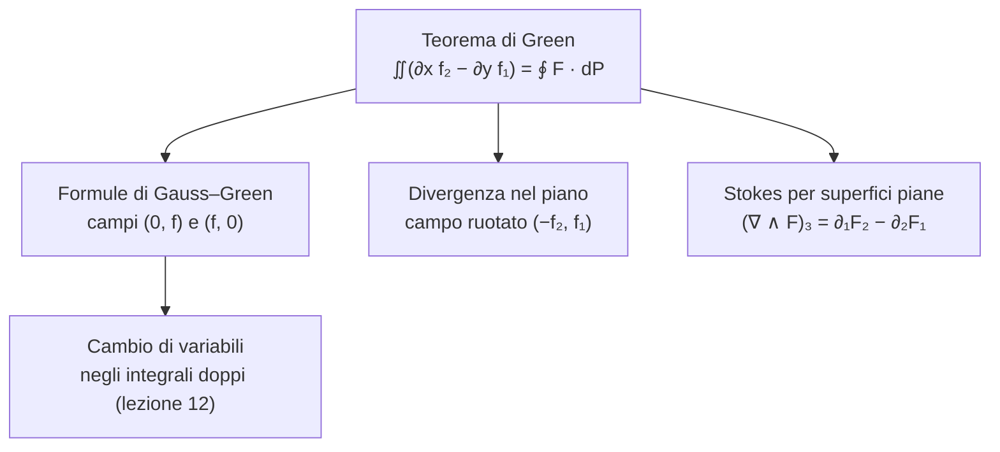

# Lezione 11 — Teorema di Green, divergenza e rotore

Nella [[MM L10 - Integrali doppi e formule di riduzione|lezione 10]] si è visto come calcolare un integrale doppio su un dominio normale. Questa lezione mostra che certi integrali doppi si possono trasformare in integrali di linea lungo il bordo del dominio, che sono integrali in una sola variabile e quindi spesso più semplici. Il risultato centrale è il **teorema di Green**: da esso discendono le **formule di Gauss–Green**, il **teorema della divergenza** nel piano, il **teorema di Stokes** per superfici piane e, nella lezione successiva, la formula del **cambio di variabili** negli integrali doppi. Lungo la strada si introducono gli operatori **gradiente**, **divergenza**, **laplaciano** e **rotore**, che compaiono continuamente in fisica e in ingegneria, ad esempio nelle equazioni di Maxwell.

> [!note] Fonti di questa lezione
> Fonti: la trascrizione (parte 1), gli appunti manuali e le note del docente nella versione del 12 ottobre 2026 [@pinamonti2026, §2.2.3–§2.2.4]. La registrazione si interrompe mentre il docente imposta un esempio di cambio di variabili su un settore circolare; lo svolgimento riportato alla fine è aggiunto e delimitato come tale. Le figure sono costruite per rappresentare ciò che il docente disegna alla lavagna.

## Il bordo orientato di un dominio normale

Si riprende un dominio normale rispetto alle $x$, con una richiesta di regolarità in più rispetto alla lezione 10: le funzioni che lo delimitano devono essere **derivabili con continuità**, perché servirà calcolarne le derivate.
$$D = \big\{(x, y) \ : \ x \in [a, b],\ \ \alpha(x) \leq y \leq \beta(x)\big\}, \qquad \alpha, \beta \in C^1([a, b]).$$
Un punto $(x, y)$ sta in $D$ se la sua ascissa sta in $[a, b]$ e la sua ordinata è compresa tra $\alpha(x)$ e $\beta(x)$.

Il bordo $\partial D$ è formato da quattro pezzi: il grafico di $\alpha$ in basso ($\gamma_1$), il segmento verticale $x = b$ ($\gamma_2$), il grafico di $\beta$ in alto ($\gamma_3$) e il segmento verticale $x = a$ ($\gamma_4$). Ciascun pezzo è una curva regolare (alcuni sono dritti), quindi $\partial D = \gamma_1 \cup \gamma_2 \cup \gamma_3 \cup \gamma_4$ è una **curva chiusa regolare a tratti**. In ogni punto del bordo, tranne nei quattro punti di raccordo, si possono calcolare il versore tangente e il versore normale. Si sceglie di percorrere il bordo in **senso antiorario**; il **versore normale uscente** $\hat{\mathbf{n}}$, perpendicolare al bordo e rivolto verso l'esterno di $D$, si ottiene ruotando il versore tangente $\hat{\mathbf{t}}$ di $90°$ in **senso orario**. Nei punti di raccordo tangente e normale sono ambigui, ma si tratta di un numero finito di punti, che non contano negli integrali.

<svg viewBox="0 0 600 330" width="600" style="display:block;margin:1em auto;max-width:100%;height:auto;font-family:inherit" xmlns="http://www.w3.org/2000/svg"><path d="M 107.5,219.3 L 110.7,218.8 L 113.9,218.4 L 117.1,218 L 120.3,217.7 L 123.5,217.4 L 126.7,217.2 L 129.9,217 L 133,216.9 L 136.2,216.8 L 139.4,216.8 L 142.6,216.8 L 145.8,216.8 L 149,216.9 L 152.2,217.1 L 155.4,217.3 L 158.6,217.5 L 161.8,217.8 L 165,218.2 L 168.2,218.6 L 171.4,219 L 174.6,219.5 L 177.8,220 L 180.9,220.5 L 184.1,221.1 L 187.3,221.8 L 190.5,222.5 L 193.7,223.2 L 196.9,223.9 L 200.1,224.7 L 203.3,225.5 L 206.5,226.3 L 209.7,227.1 L 212.9,228 L 216.1,228.9 L 219.3,229.8 L 222.5,230.7 L 225.7,231.7 L 228.8,232.6 L 232,233.6 L 235.2,234.6 L 238.4,235.5 L 241.6,236.5 L 244.8,237.5 L 248,238.4 L 251.2,239.4 L 254.4,240.3 L 257.6,241.3 L 260.8,242.2 L 264,243.1 L 267.2,244 L 270.4,244.9 L 273.6,245.7 L 276.7,246.6 L 279.9,247.4 L 283.1,248.1 L 286.3,248.9 L 289.5,249.6 L 292.7,250.2 L 295.9,250.9 L 299.1,251.5 L 302.3,252 L 305.5,252.5 L 308.7,253 L 311.9,253.5 L 315.1,253.8 L 318.3,254.2 L 321.4,254.5 L 324.6,254.7 L 327.8,254.9 L 331,255.1 L 334.2,255.2 L 337.4,255.2 L 340.6,255.2 L 343.8,255.2 L 347,255.1 L 350.2,255 L 353.4,254.8 L 356.6,254.6 L 359.8,254.3 L 363,253.9 L 366.2,253.6 L 369.3,253.1 L 372.5,252.7 L 375.7,252.2 L 378.9,251.6 L 382.1,251 L 385.3,250.4 L 388.5,249.8 L 391.7,249.1 L 394.9,248.3 L 398.1,247.6 L 401.3,246.8 L 404.5,246 L 407.7,245.1 L 410.9,244.3 L 414.1,243.4 L 417.2,242.5 L 420.4,241.5 L 423.6,240.6 L 426.8,239.7 L 430,238.7 L 433.2,237.7 L 436.4,236.8 L 439.6,235.8 L 442.8,234.8 L 446,233.9 L 449.2,232.9 L 452.4,231.9 L 455.6,231 L 458.8,230.1 L 462,229.2 L 465.1,228.3 L 468.3,227.4 L 471.5,226.5 L 474.7,225.7 L 477.9,224.9 L 481.1,224.1 L 484.3,223.4 L 487.5,222.6 L 487.5,131.2 L 484.3,131.9 L 481.1,132.7 L 477.9,133.6 L 474.7,134.4 L 471.5,135.3 L 468.3,136.2 L 465.1,137.2 L 462,138.1 L 458.8,139.1 L 455.6,140.1 L 452.4,141.1 L 449.2,142.1 L 446,143.2 L 442.8,144.2 L 439.6,145.2 L 436.4,146.3 L 433.2,147.3 L 430,148.4 L 426.8,149.5 L 423.6,150.5 L 420.4,151.5 L 417.2,152.6 L 414.1,153.6 L 410.9,154.6 L 407.7,155.6 L 404.5,156.6 L 401.3,157.5 L 398.1,158.5 L 394.9,159.4 L 391.7,160.3 L 388.5,161.1 L 385.3,162 L 382.1,162.8 L 378.9,163.5 L 375.7,164.3 L 372.5,165 L 369.3,165.6 L 366.2,166.3 L 363,166.9 L 359.8,167.4 L 356.6,167.9 L 353.4,168.4 L 350.2,168.8 L 347,169.1 L 343.8,169.5 L 340.6,169.7 L 337.4,169.9 L 334.2,170.1 L 331,170.2 L 327.8,170.3 L 324.6,170.3 L 321.4,170.3 L 318.3,170.2 L 315.1,170 L 311.9,169.8 L 308.7,169.6 L 305.5,169.3 L 302.3,168.9 L 299.1,168.5 L 295.9,168.1 L 292.7,167.5 L 289.5,167 L 286.3,166.3 L 283.1,165.7 L 279.9,164.9 L 276.7,164.2 L 273.6,163.3 L 270.4,162.5 L 267.2,161.5 L 264,160.6 L 260.8,159.6 L 257.6,158.5 L 254.4,157.4 L 251.2,156.3 L 248,155.1 L 244.8,153.9 L 241.6,152.6 L 238.4,151.3 L 235.2,150 L 232,148.6 L 228.8,147.2 L 225.7,145.8 L 222.5,144.4 L 219.3,142.9 L 216.1,141.4 L 212.9,139.9 L 209.7,138.4 L 206.5,136.8 L 203.3,135.3 L 200.1,133.7 L 196.9,132.1 L 193.7,130.5 L 190.5,128.9 L 187.3,127.3 L 184.1,125.7 L 180.9,124.1 L 177.8,122.5 L 174.6,120.9 L 171.4,119.3 L 168.2,117.7 L 165,116.1 L 161.8,114.6 L 158.6,113 L 155.4,111.5 L 152.2,110 L 149,108.5 L 145.8,107 L 142.6,105.6 L 139.4,104.2 L 136.2,102.8 L 133,101.4 L 129.9,100.1 L 126.7,98.8 L 123.5,97.6 L 120.3,96.3 L 117.1,95.2 L 113.9,94 L 110.7,92.9 L 107.5,91.9 Z" fill="#3b82f6" fill-opacity="0.15" stroke="none" stroke-width="1.3"/><line x1="41" y1="280" x2="573" y2="280" stroke="currentColor" stroke-width="1.0"/><polygon points="573,280 566.8,283.3 566.8,276.7" fill="currentColor"/><line x1="60" y1="296.5" x2="60" y2="38" stroke="currentColor" stroke-width="1.0"/><polygon points="60,38 63.3,44.2 56.7,44.2" fill="currentColor"/><text x="573" y="296" font-size="13" text-anchor="end" fill="currentColor" font-style="italic">x</text><text x="68" y="46" font-size="13" text-anchor="start" fill="currentColor" font-style="italic">y</text><line x1="107.5" y1="280" x2="107.5" y2="219.3" stroke="currentColor" stroke-opacity="0.35" stroke-dasharray="3 3"/><text x="107.5" y="298" font-size="13" text-anchor="middle" fill="currentColor" font-style="italic">a</text><line x1="487.5" y1="280" x2="487.5" y2="222.6" stroke="currentColor" stroke-opacity="0.35" stroke-dasharray="3 3"/><text x="487.5" y="298" font-size="13" text-anchor="middle" fill="currentColor" font-style="italic">b</text><polyline points="107.5,219.3 110.7,218.8 113.9,218.4 117.1,218 120.3,217.7 123.5,217.4 126.7,217.2 129.9,217 133,216.9 136.2,216.8 139.4,216.8 142.6,216.8 145.8,216.8 149,216.9 152.2,217.1 155.4,217.3 158.6,217.5 161.8,217.8 165,218.2 168.2,218.6 171.4,219 174.6,219.5 177.8,220 180.9,220.5 184.1,221.1 187.3,221.8 190.5,222.5 193.7,223.2 196.9,223.9 200.1,224.7 203.3,225.5 206.5,226.3 209.7,227.1 212.9,228 216.1,228.9 219.3,229.8 222.5,230.7 225.7,231.7 228.8,232.6 232,233.6 235.2,234.6 238.4,235.5 241.6,236.5 244.8,237.5 248,238.4 251.2,239.4 254.4,240.3 257.6,241.3 260.8,242.2 264,243.1 267.2,244 270.4,244.9 273.6,245.7 276.7,246.6 279.9,247.4 283.1,248.1 286.3,248.9 289.5,249.6 292.7,250.2 295.9,250.9 299.1,251.5 302.3,252 305.5,252.5 308.7,253 311.9,253.5 315.1,253.8 318.3,254.2 321.4,254.5 324.6,254.7 327.8,254.9 331,255.1 334.2,255.2 337.4,255.2 340.6,255.2 343.8,255.2 347,255.1 350.2,255 353.4,254.8 356.6,254.6 359.8,254.3 363,253.9 366.2,253.6 369.3,253.1 372.5,252.7 375.7,252.2 378.9,251.6 382.1,251 385.3,250.4 388.5,249.8 391.7,249.1 394.9,248.3 398.1,247.6 401.3,246.8 404.5,246 407.7,245.1 410.9,244.3 414.1,243.4 417.2,242.5 420.4,241.5 423.6,240.6 426.8,239.7 430,238.7 433.2,237.7 436.4,236.8 439.6,235.8 442.8,234.8 446,233.9 449.2,232.9 452.4,231.9 455.6,231 458.8,230.1 462,229.2 465.1,228.3 468.3,227.4 471.5,226.5 474.7,225.7 477.9,224.9 481.1,224.1 484.3,223.4 487.5,222.6" fill="none" stroke="#d98a1c" stroke-width="2.4" stroke-opacity="1.0"/><text x="307" y="274.8" font-size="13" text-anchor="start" fill="#d98a1c" font-style="italic">γ<tspan baseline-shift='sub' font-size='9'>1</tspan></text><polyline points="487.5,222.6 487.5,220.3 487.5,218 487.5,215.6 487.5,213.3 487.5,210.9 487.5,208.6 487.5,206.2 487.5,203.9 487.5,201.5 487.5,199.2 487.5,196.8 487.5,194.5 487.5,192.2 487.5,189.8 487.5,187.5 487.5,185.1 487.5,182.8 487.5,180.4 487.5,178.1 487.5,175.7 487.5,173.4 487.5,171 487.5,168.7 487.5,166.4 487.5,164 487.5,161.7 487.5,159.3 487.5,157 487.5,154.6 487.5,152.3 487.5,149.9 487.5,147.6 487.5,145.3 487.5,142.9 487.5,140.6 487.5,138.2 487.5,135.9 487.5,133.5 487.5,131.2" fill="none" stroke="#d98a1c" stroke-width="2.4" stroke-opacity="1.0"/><text x="495.5" y="164.5" font-size="13" text-anchor="start" fill="#d98a1c" font-style="italic">γ<tspan baseline-shift='sub' font-size='9'>2</tspan></text><polyline points="487.5,131.2 484.3,131.9 481.1,132.7 477.9,133.6 474.7,134.4 471.5,135.3 468.3,136.2 465.1,137.2 462,138.1 458.8,139.1 455.6,140.1 452.4,141.1 449.2,142.1 446,143.2 442.8,144.2 439.6,145.2 436.4,146.3 433.2,147.3 430,148.4 426.8,149.5 423.6,150.5 420.4,151.5 417.2,152.6 414.1,153.6 410.9,154.6 407.7,155.6 404.5,156.6 401.3,157.5 398.1,158.5 394.9,159.4 391.7,160.3 388.5,161.1 385.3,162 382.1,162.8 378.9,163.5 375.7,164.3 372.5,165 369.3,165.6 366.2,166.3 363,166.9 359.8,167.4 356.6,167.9 353.4,168.4 350.2,168.8 347,169.1 343.8,169.5 340.6,169.7 337.4,169.9 334.2,170.1 331,170.2 327.8,170.3 324.6,170.3 321.4,170.3 318.3,170.2 315.1,170 311.9,169.8 308.7,169.6 305.5,169.3 302.3,168.9 299.1,168.5 295.9,168.1 292.7,167.5 289.5,167 286.3,166.3 283.1,165.7 279.9,164.9 276.7,164.2 273.6,163.3 270.4,162.5 267.2,161.5 264,160.6 260.8,159.6 257.6,158.5 254.4,157.4 251.2,156.3 248,155.1 244.8,153.9 241.6,152.6 238.4,151.3 235.2,150 232,148.6 228.8,147.2 225.7,145.8 222.5,144.4 219.3,142.9 216.1,141.4 212.9,139.9 209.7,138.4 206.5,136.8 203.3,135.3 200.1,133.7 196.9,132.1 193.7,130.5 190.5,128.9 187.3,127.3 184.1,125.7 180.9,124.1 177.8,122.5 174.6,120.9 171.4,119.3 168.2,117.7 165,116.1 161.8,114.6 158.6,113 155.4,111.5 152.2,110 149,108.5 145.8,107 142.6,105.6 139.4,104.2 136.2,102.8 133,101.4 129.9,100.1 126.7,98.8 123.5,97.6 120.3,96.3 117.1,95.2 113.9,94 110.7,92.9 107.5,91.9" fill="none" stroke="#d98a1c" stroke-width="2.4" stroke-opacity="1.0"/><text x="212" y="129.5" font-size="13" text-anchor="start" fill="#d98a1c" font-style="italic">γ<tspan baseline-shift='sub' font-size='9'>3</tspan></text><polyline points="107.5,91.9 107.5,95.2 107.5,98.4 107.5,101.7 107.5,105 107.5,108.2 107.5,111.5 107.5,114.8 107.5,118 107.5,121.3 107.5,124.6 107.5,127.8 107.5,131.1 107.5,134.4 107.5,137.6 107.5,140.9 107.5,144.2 107.5,147.4 107.5,150.7 107.5,154 107.5,157.2 107.5,160.5 107.5,163.8 107.5,167 107.5,170.3 107.5,173.6 107.5,176.8 107.5,180.1 107.5,183.4 107.5,186.6 107.5,189.9 107.5,193.2 107.5,196.4 107.5,199.7 107.5,203 107.5,206.2 107.5,209.5 107.5,212.8 107.5,216 107.5,219.3" fill="none" stroke="#d98a1c" stroke-width="2.4" stroke-opacity="1.0"/><text x="99.5" y="170" font-size="13" text-anchor="end" fill="#d98a1c" font-style="italic">γ<tspan baseline-shift='sub' font-size='9'>4</tspan></text><polygon points="289.5,249.6 280.8,251.9 282.7,243.7" fill="#d98a1c"/><polygon points="487.5,171 491.7,179 483.3,179" fill="#d98a1c"/><polygon points="289.5,167 298.1,164.1 296.6,172.5" fill="#d98a1c"/><polygon points="107.5,163.8 103.3,155.8 111.7,155.8" fill="#d98a1c"/><text x="383" y="152.6" font-size="12" text-anchor="middle" fill="#3b82f6">y = β(x)</text><text x="174" y="239.4" font-size="12" text-anchor="middle" fill="#3b82f6">y = α(x)</text><line x1="335.5" y1="170.1" x2="285.7" y2="174.5" stroke="#e05a47" stroke-width="2"/><polygon points="285.7,174.5 292.4,170.1 293.1,177.6" fill="#e05a47"/><line x1="335.5" y1="170.1" x2="331.5" y2="125.2" stroke="#2e9e6a" stroke-width="2"/><polygon points="331.5,125.2 335.9,131.9 328.4,132.6" fill="#2e9e6a"/><text x="281.7" y="166.5" font-size="14" text-anchor="end" fill="#e05a47">t̂</text><text x="337.5" y="123.2" font-size="14" text-anchor="start" fill="#2e9e6a">n̂</text><circle cx="335.5" cy="170.1" r="3" fill="currentColor"/><text x="212" y="175.5" font-size="15" text-anchor="middle" fill="currentColor" font-style="italic">D</text><text x="300" y="322" font-size="10.5" text-anchor="middle" fill="currentColor">arancione: ∂D percorso in senso antiorario; t̂ tangente, n̂ normale uscente = t̂ ruotato di 90° in senso orario</text></svg>

Più in generale, un **dominio regolare** del piano è un aperto limitato $D$ il cui bordo $\partial D$ è una curva chiusa regolare a tratti; quando si integra una funzione $f$ su di esso si chiede anche che la chiusura $\overline{D}$ sia contenuta nel dominio di $f$. Il dominio normale appena descritto è un dominio regolare, e ogni dominio regolare si può decomporre in un numero finito di domini normali rispetto alle $x$ o rispetto alle $y$ [@pinamonti2026, §2.2.3].

## Il teorema di Green

> [!important] Teorema — Green
> Sia $D$ un aperto limitato il cui bordo $\partial D$ è una curva chiusa regolare a tratti, **orientata in senso antiorario**, e sia $\overline{D} = D \cup \partial D \subseteq A$. Sia $F = (f_1, f_2) : A \subseteq \mathbb{R}^2 \to \mathbb{R}^2$ un campo vettoriale di classe $C^1(A)$. Allora
> $$\iint_D \Big(\frac{\partial f_2}{\partial x} - \frac{\partial f_1}{\partial y}\Big)\, dx\, dy = \int_{\partial D} F \cdot dP .$$
>
> [@pinamonti2026, Teor. 2.2.2]

A sinistra c'è un integrale doppio di una combinazione delle derivate delle componenti; a destra l'**integrale di linea** del campo lungo il bordo, definito nella [[MM L09 - Lunghezza, ascissa curvilinea, integrali curvilinei e di linea|lezione 9]]. L'integrale di linea non dipende dalla parametrizzazione del bordo, ma dipende dal verso di percorrenza: per questo è essenziale l'orientazione antioraria. Dal teorema di Green discenderanno quasi tutti i risultati della lezione, e per questo il docente spende del tempo per dimostrarlo con cura.

### Dimostrazione per un dominio normale rispetto alle $x$

**Il bordo parametrizzato.** Si parametrizzano i quattro tratti del bordo:
$$\begin{aligned}
\gamma_1(x) &= \big(x,\, \alpha(x)\big), & x &\in [a, b], & \gamma_1'(x) &= \big(1,\, \alpha'(x)\big),\\
\gamma_2(y) &= (b,\, y), & y &\in [\alpha(b), \beta(b)], & \gamma_2'(y) &= (0,\, 1),\\
\gamma_3^-(x) &= \big(x,\, \beta(x)\big), & x &\in [a, b], & {\gamma_3^-}'(x) &= \big(1,\, \beta'(x)\big),\\
\gamma_4^-(y) &= (a,\, y), & y &\in [\alpha(a), \beta(a)], & {\gamma_4^-}'(y) &= (0,\, 1).
\end{aligned}$$
Per $\gamma_3$ e $\gamma_4$ "per comodità" si usa una parametrizzazione che li percorre nel **verso sbagliato** (da sinistra a destra e dal basso in alto); il segno meno nel nome lo ricorda, e i corrispondenti integrali di linea andranno presi con il segno cambiato. Il prodotto scalare di $F = (f_1, f_2)$ con un vettore $(v_1, v_2)$ è $f_1 v_1 + f_2 v_2$, quindi
$$\begin{aligned}
\int_{\partial D} F \cdot dP ={}& \int_a^b f_1\big(x, \alpha(x)\big)\, dx + \int_a^b f_2\big(x, \alpha(x)\big)\,\alpha'(x)\, dx + \int_{\alpha(b)}^{\beta(b)} f_2(b, y)\, dy\\
&- \int_a^b f_1\big(x, \beta(x)\big)\, dx - \int_a^b f_2\big(x, \beta(x)\big)\,\beta'(x)\, dx - \int_{\alpha(a)}^{\beta(a)} f_2(a, y)\, dy .
\end{aligned}$$
Sono sei contributi: due dipendono da $f_1$ e quattro da $f_2$.

**I termini con $f_1$.** Si sommano i due termini che contengono $f_1$: sono integrali sullo stesso intervallo, e per $x$ fissato la differenza $f_1(x, \alpha(x)) - f_1(x, \beta(x))$ si scrive, con il teorema fondamentale del calcolo nella variabile $y$ (con $x$ che fa da parametro), come
$$f_1\big(x, \alpha(x)\big) - f_1\big(x, \beta(x)\big) = -\int_{\alpha(x)}^{\beta(x)} \frac{\partial f_1}{\partial y}(x, y)\, dy .$$
Integrando in $x$ si riconosce una formula di riduzione della lezione 10:
$$\int_a^b \Big(f_1\big(x, \alpha(x)\big) - f_1\big(x, \beta(x)\big)\Big)\, dx = -\int_a^b\bigg(\int_{\alpha(x)}^{\beta(x)} \frac{\partial f_1}{\partial y}\, dy\bigg)\, dx = -\iint_D \frac{\partial f_1}{\partial y}\, dx\, dy ,$$
che è esattamente il termine con $f_1$ del teorema.

**I termini con $f_2$.** Qui serve "un po' di taglio e cucito". Si chiamano
$$I_1 = \int_a^b f_2\big(x, \alpha(x)\big)\,\alpha'(x)\, dx, \quad I_2 = \int_{\alpha(b)}^{\beta(b)} f_2(b, y)\, dy, \quad I_3 = -\int_a^b f_2\big(x, \beta(x)\big)\,\beta'(x)\, dx, \quad I_4 = -\int_{\alpha(a)}^{\beta(a)} f_2(a, y)\, dy,$$
e si vuole provare che $I_1 + I_2 + I_3 + I_4 = \iint_D \frac{\partial f_2}{\partial x}\, dx\, dy$. Si introduce la **funzione ausiliaria** di una variabile
$$\psi(x) = \int_{\alpha(x)}^{\beta(x)} f_2(x, y)\, dy .$$
$I_2$ e $I_4$ si assomigliano: $I_2 = \psi(b)$ e $I_4 = -\psi(a)$. Quindi, di nuovo con il teorema fondamentale del calcolo,
$$I_2 + I_4 = \psi(b) - \psi(a) = \int_a^b \psi'(x)\, dx .$$
Per derivare $\psi$ bisogna tenere conto che $x$ compare tre volte: nell'integranda e nei due estremi. La dipendenza dall'integranda si tratta con la derivazione sotto il segno di integrale della [[MM L05 - Massimi e minimi, derivazione sotto integrale|lezione 5]]; per quella dagli estremi si valuta la funzione nell'estremo e si moltiplica per la derivata dell'estremo, con il segno meno per l'estremo inferiore:
$$\psi'(x) = \int_{\alpha(x)}^{\beta(x)} \frac{\partial f_2}{\partial x}(x, y)\, dy + f_2\big(x, \beta(x)\big)\,\beta'(x) - f_2\big(x, \alpha(x)\big)\,\alpha'(x) .$$
Integrando in $x$, il primo pezzo è proprio il termine cercato, e gli altri due sono, a meno del segno, $I_3$ e $I_1$:
$$I_2 + I_4 = \iint_D \frac{\partial f_2}{\partial x}\, dx\, dy - I_3 - I_1 .$$
Portando $I_1$ e $I_3$ dall'altra parte si ottiene la tesi per i termini con $f_2$.

La fatica fatta, osserva il docente, "ci permetterà di non doverla mai più rifare": ci si è convinti che il teorema vale per i domini normali, e non c'è bisogno di verificarlo ogni volta.

### Domini normali rispetto alle $y$ e domini generici

Per un dominio normale rispetto alle $y$ la dimostrazione è analoga: "basta girare la lavagna". Per un dominio regolare generico si usa di nuovo la taglierina della lezione 10: lo si divide in un numero finito di domini normali $D_1, \dots, D_k$ con tagli orizzontali o verticali, si applica il teorema a ciascun pezzo e si somma.
$$\iint_D \big(\partial_x f_2 - \partial_y f_1\big)\, dx\, dy = \sum_i \iint_{D_i} \big(\partial_x f_2 - \partial_y f_1\big)\, dx\, dy = \sum_i \int_{\partial D_i} F \cdot dP .$$
A destra compaiono anche i bordi interni, i tagli, che non fanno parte del bordo di $D$. Ma ogni taglio appartiene al bordo di **due** pezzi adiacenti, ed è percorso una volta in un verso e una volta nel verso opposto: i due contributi si cancellano. Rimane solo il bordo esterno, percorso una volta sola in senso antiorario, e il teorema è dimostrato per ogni dominio regolare.

<svg viewBox="0 0 520 260" width="520" style="display:block;margin:1em auto;max-width:100%;height:auto;font-family:inherit" xmlns="http://www.w3.org/2000/svg"><path d="M 467.5,120 L 468.5,118.4 L 469.2,116.7 L 469.9,115 L 470.4,113.4 L 470.7,111.7 L 470.8,110 L 470.9,108.3 L 470.7,106.7 L 470.4,105 L 470,103.3 L 469.5,101.7 L 468.8,100 L 468.1,98.4 L 467.2,96.8 L 466.2,95.2 L 465.1,93.6 L 463.9,92 L 462.6,90.5 L 461.3,89 L 459.9,87.4 L 458.4,85.9 L 456.9,84.5 L 455.4,83 L 453.8,81.5 L 452.1,80.1 L 450.5,78.7 L 448.8,77.3 L 447,75.9 L 445.3,74.5 L 443.6,73.1 L 441.8,71.7 L 440,70.4 L 438.3,69 L 436.5,67.6 L 434.7,66.3 L 432.9,65 L 431.1,63.6 L 429.3,62.3 L 427.5,60.9 L 425.7,59.6 L 423.8,58.3 L 422,57 L 420.1,55.6 L 418.2,54.3 L 416.3,53 L 414.3,51.7 L 412.3,50.4 L 410.3,49.2 L 408.2,47.9 L 406.1,46.6 L 404,45.4 L 401.8,44.2 L 399.5,43 L 397.1,41.9 L 394.8,40.8 L 392.3,39.7 L 389.8,38.6 L 387.2,37.6 L 384.5,36.7 L 381.8,35.7 L 379,34.9 L 376.2,34.1 L 373.3,33.3 L 370.3,32.6 L 367.2,32 L 364.1,31.4 L 361,30.9 L 357.8,30.5 L 354.5,30.1 L 351.2,29.8 L 347.9,29.6 L 344.5,29.5 L 341.2,29.4 L 337.8,29.4 L 334.3,29.5 L 330.9,29.7 L 327.5,29.9 L 324,30.2 L 320.6,30.6 L 317.2,31 L 313.9,31.5 L 310.5,32 L 307.2,32.6 L 303.9,33.2 L 300.7,33.9 L 297.5,34.7 L 294.4,35.4 L 291.4,36.2 L 288.4,37 L 285.4,37.9 L 282.5,38.7 L 279.7,39.6 L 277,40.4 L 274.3,41.3 L 271.7,42.1 L 269.1,43 L 266.6,43.8 L 264.2,44.5 L 261.8,45.3 L 259.4,46 L 257.1,46.6 L 254.8,47.2 L 252.6,47.8 L 250.4,48.3 L 248.2,48.7 L 246,49.1 L 243.8,49.4 L 241.6,49.7 L 239.4,49.8 L 237.2,49.9 L 234.9,50 L 232.6,49.9 L 230.3,49.8 L 227.9,49.7 L 225.4,49.4 L 222.9,49.1 L 220.3,48.8 L 217.6,48.4 L 214.9,47.9 L 212,47.4 L 209.1,46.8 L 206.1,46.2 L 202.9,45.6 L 199.7,44.9 L 196.3,44.2 L 192.9,43.5 L 189.4,42.8 L 185.7,42.1 L 182,41.4 L 178.2,40.7 L 174.2,40 L 170.2,39.4 L 166.2,38.7 L 162,38.2 L 157.8,37.6 L 153.6,37.1 L 149.3,36.7 L 144.9,36.3 L 140.6,36 L 136.2,35.8 L 131.9,35.7 L 127.5,35.6 L 123.2,35.6 L 118.9,35.7 L 114.7,35.9 L 110.5,36.2 L 106.4,36.6 L 102.4,37.1 L 98.5,37.6 L 94.7,38.3 L 91,39.1 L 87.5,40 L 84.1,40.9 L 80.8,42 L 77.7,43.1 L 74.8,44.4 L 72.1,45.7 L 69.5,47.1 L 67.1,48.5 L 65,50.1 L 63,51.7 L 61.2,53.4 L 59.6,55.1 L 58.3,56.9 L 57.1,58.7 L 56.1,60.6 L 55.4,62.5 L 54.8,64.5 L 54.4,66.4 L 54.2,68.4 L 54.2,70.4 L 54.3,72.5 L 54.6,74.5 L 55.1,76.5 L 55.7,78.5 L 56.4,80.5 L 57.3,82.5 L 58.3,84.5 L 59.4,86.4 L 60.6,88.4 L 61.8,90.3 L 63.2,92.2 L 64.6,94 L 66,95.8 L 67.5,97.6 L 69,99.4 L 70.5,101.1 L 72.1,102.8 L 73.6,104.4 L 75.1,106.1 L 76.6,107.7 L 78.1,109.2 L 79.5,110.7 L 80.9,112.2 L 82.2,113.7 L 83.5,115.1 L 84.7,116.5 L 85.9,117.9 L 87,119.3 L 88,120.7 L 89,122 L 89.9,123.4 L 90.7,124.7 L 91.5,126 L 92.2,127.3 L 92.9,128.6 L 93.5,129.9 L 94,131.2 L 94.5,132.5 L 95,133.8 L 95.4,135.1 L 95.8,136.4 L 96.2,137.7 L 96.5,139 L 96.9,140.3 L 97.3,141.6 L 97.6,143 L 98,144.3 L 98.4,145.6 L 98.8,147 L 99.3,148.3 L 99.8,149.6 L 100.3,151 L 100.9,152.3 L 101.5,153.6 L 102.2,155 L 103,156.3 L 103.8,157.6 L 104.7,158.9 L 105.7,160.2 L 106.7,161.5 L 107.9,162.7 L 109.1,164 L 110.3,165.2 L 111.7,166.4 L 113.1,167.6 L 114.6,168.7 L 116.1,169.9 L 117.8,171 L 119.5,172.1 L 121.2,173.1 L 123,174.2 L 124.9,175.2 L 126.8,176.2 L 128.8,177.1 L 130.7,178.1 L 132.8,179 L 134.8,179.9 L 136.9,180.8 L 139,181.7 L 141.1,182.6 L 143.3,183.4 L 145.4,184.3 L 147.5,185.1 L 149.7,185.9 L 151.8,186.8 L 153.9,187.6 L 156,188.4 L 158.1,189.3 L 160.2,190.2 L 162.3,191 L 164.4,191.9 L 166.5,192.8 L 168.5,193.8 L 170.5,194.7 L 172.6,195.7 L 174.6,196.7 L 176.6,197.8 L 178.6,198.8 L 180.7,199.9 L 182.7,201.1 L 184.8,202.2 L 186.8,203.4 L 188.9,204.6 L 191,205.9 L 193.1,207.2 L 195.3,208.5 L 197.5,209.8 L 199.8,211.2 L 202.1,212.5 L 204.5,213.9 L 206.9,215.3 L 209.4,216.7 L 211.9,218.1 L 214.6,219.5 L 217.3,220.9 L 220,222.3 L 222.9,223.7 L 225.8,225 L 228.8,226.3 L 231.9,227.6 L 235.1,228.8 L 238.3,230 L 241.6,231.1 L 245,232.1 L 248.4,233.1 L 251.9,234 L 255.5,234.9 L 259.1,235.6 L 262.7,236.3 L 266.4,236.9 L 270.2,237.3 L 273.9,237.7 L 277.7,238 L 281.5,238.1 L 285.2,238.2 L 289,238.1 L 292.7,237.9 L 296.4,237.7 L 300.1,237.2 L 303.7,236.7 L 307.2,236.1 L 310.7,235.3 L 314.1,234.5 L 317.5,233.5 L 320.7,232.4 L 323.8,231.2 L 326.9,229.9 L 329.8,228.5 L 332.6,227 L 335.2,225.5 L 337.7,223.8 L 340.1,222.1 L 342.4,220.3 L 344.5,218.5 L 346.5,216.6 L 348.4,214.6 L 350.1,212.6 L 351.7,210.6 L 353.1,208.5 L 354.4,206.4 L 355.6,204.3 L 356.7,202.2 L 357.7,200.1 L 358.5,198 L 359.3,196 L 359.9,193.9 L 360.5,191.9 L 361,189.9 L 361.5,187.9 L 361.9,186 L 362.3,184.1 L 362.6,182.3 L 363,180.5 L 363.3,178.8 L 363.6,177.2 L 364,175.6 L 364.3,174 L 364.7,172.6 L 365.2,171.2 L 365.7,169.8 L 366.3,168.6 L 367,167.3 L 367.8,166.2 L 368.6,165.1 L 369.6,164 L 370.6,163.1 L 371.8,162.1 L 373.1,161.2 L 374.5,160.4 L 376,159.6 L 377.7,158.8 L 379.5,158 L 381.4,157.3 L 383.4,156.6 L 385.6,155.9 L 387.8,155.2 L 390.2,154.6 L 392.6,153.9 L 395.2,153.2 L 397.9,152.5 L 400.6,151.8 L 403.4,151.1 L 406.3,150.4 L 409.2,149.6 L 412.2,148.8 L 415.2,148 L 418.2,147.2 L 421.3,146.3 L 424.3,145.3 L 427.3,144.4 L 430.3,143.4 L 433.3,142.3 L 436.2,141.2 L 439.1,140.1 L 441.8,138.9 L 444.5,137.6 L 447.1,136.4 L 449.7,135.1 L 452.1,133.7 L 454.3,132.3 L 456.5,130.9 L 458.5,129.4 L 460.4,127.9 L 462.1,126.4 L 463.7,124.8 L 465.1,123.2 L 466.4,121.6 L 467.5,120 Z" fill="#3b82f6" fill-opacity="0.1" stroke="currentColor" stroke-width="1.8"/><polygon points="422,57 431.9,58.3 426.4,65.9" fill="currentColor"/><polygon points="127.5,35.6 136.5,31.1 136.2,40.5" fill="currentColor"/><polygon points="123,174.2 113,173.7 117.8,165.6" fill="currentColor"/><polygon points="362.3,184.1 365.1,193.7 355.9,191.8" fill="currentColor"/><line x1="254" y1="45.3" x2="254" y2="235.6" stroke="#e05a47" stroke-width="1.8"/><line x1="266" y1="45.3" x2="266" y2="235.6" stroke="#2e9e6a" stroke-width="1.8"/><polygon points="254,150 249.8,142.1 258.2,142.1" fill="#e05a47"/><polygon points="266,90 270.2,97.9 261.8,97.9" fill="#2e9e6a"/><text x="140" y="125" font-size="15" text-anchor="middle" fill="currentColor" font-style="italic">D₁</text><text x="380" y="125" font-size="15" text-anchor="middle" fill="currentColor" font-style="italic">D₂</text><text x="246" y="180" font-size="11" text-anchor="end" fill="#e05a47">come bordo di D₁</text><text x="274" y="180" font-size="11" text-anchor="start" fill="#2e9e6a">come bordo di D₂</text><text x="260" y="250" font-size="11" text-anchor="middle" fill="currentColor">il segmento interno è percorso due volte in versi opposti: i due contributi si cancellano</text></svg>

> [!tip] Approfondimento — Calcolare un'area con un integrale di linea
> #approfondimento Scegliendo un campo con $\partial_x f_2 - \partial_y f_1 = 1$, l'integrale doppio diventa l'area di $D$. Con $F = \tfrac12(-y, x)$ si ottiene
> $$A(D) = \frac12 \int_{\partial D} (x\, dy - y\, dx).$$
> Per l'ellisse $x = a\cos t$, $y = b\sin t$, $t \in [0, 2\pi]$ (percorsa in senso antiorario):
> $$A = \frac12\int_0^{2\pi}\big(a\cos t \cdot b\cos t + b\sin t \cdot a\sin t\big)\, dt = \frac12\int_0^{2\pi} ab\, dt = \pi a b .$$
> È il principio su cui funziona il **planimetro**, lo strumento meccanico che misura l'area di una figura disegnata percorrendone il contorno.

## Le formule di Gauss–Green

Le formule di Gauss–Green sono un corollario del teorema di Green, e riguardano funzioni **scalari** invece che campi vettoriali.

> [!important] Corollario — Formule di Gauss–Green
> Sotto le stesse ipotesi su $D$, sia $f : A \subseteq \mathbb{R}^2 \to \mathbb{R}$ di classe $C^1(A)$. Allora
> $$\iint_D \frac{\partial f}{\partial x}\, dx\, dy = \int_{\partial D} f\, dy, \qquad \iint_D \frac{\partial f}{\partial y}\, dx\, dy = -\int_{\partial D} f\, dx .$$
>
> [@pinamonti2026, Cor. 2.2.1]

Il segno meno nella seconda formula non va dimenticato. Gli integrali a destra vanno intesi come integrali di linea con un solo differenziale (lezione 9): data una parametrizzazione $t \mapsto (x(t), y(t))$ del bordo che rispetta l'orientazione,
$$\int_{\partial D} f\, dy = \int_a^b f\big(x(t), y(t)\big)\, \frac{dy}{dt}(t)\, dt .$$

**Dimostrazione.** Basta applicare due volte il teorema di Green a campi particolari: al campo $F = (0, f)$ per la prima formula (allora $\partial_x f_2 - \partial_y f_1 = \partial_x f$ e $F \cdot dP = f\, dy$), e al campo $G = (f, 0)$ per la seconda (allora $\partial_x g_2 - \partial_y g_1 = -\partial_y f$ e $G \cdot dP = f\, dx$). $\blacksquare$

## Gradiente, divergenza e laplaciano

Per arrivare al teorema della divergenza servono alcune definizioni.

> [!important] Definizione — Gradiente, divergenza, laplaciano
> - Data $f : D \subseteq \mathbb{R}^n \to \mathbb{R}$ di classe $C^1(D)$, il **gradiente** è il campo vettoriale
> $$\nabla f = \operatorname{grad} f = \Big(\frac{\partial f}{\partial x_1}, \dots, \frac{\partial f}{\partial x_n}\Big) = \sum_{k=1}^{n} \frac{\partial f}{\partial x_k}\, \mathbf{e}_k .$$
> - Dato un campo vettoriale $F : D \subseteq \mathbb{R}^n \to \mathbb{R}^n$ di classe $C^1(D)$, la **divergenza** è la funzione scalare
> $$\nabla \cdot F = \operatorname{div} F = \frac{\partial F_1}{\partial x_1} + \dots + \frac{\partial F_n}{\partial x_n} = \sum_{k=1}^{n} \frac{\partial F_k}{\partial x_k} .$$
> - Data $f : D \subseteq \mathbb{R}^n \to \mathbb{R}$ di classe $C^2(D)$, il **laplaciano** è
> $$\Delta f = \nabla \cdot \nabla f = \sum_{k=1}^{n} \frac{\partial^2 f}{\partial x_k^2} .$$
>
> [@pinamonti2026, Def. 2.2.3]

Il gradiente parte da uno scalare e produce un vettore, che indica la direzione di massima crescita della funzione (lezione 6); se $f$ è di classe $C^1$, il gradiente è solo di classe $C^0$, perché si è già "speso" una derivata. La divergenza fa l'opposto: parte da un vettore e produce uno scalare. Nel simbolo $\nabla \cdot F$ il puntino, che ricorda il prodotto scalare, "non va dimenticato": senza puntino si scriverebbe un'altra cosa. In due dimensioni, con $F = (f_1, f_2)$,
$$\nabla \cdot F = \partial_x f_1 + \partial_y f_2 .$$
Combinando le due operazioni si ottiene il laplaciano, che parte da uno scalare e arriva a uno scalare.

> [!example] Esempio (aggiunto) — Un campo radiale
> Per $F(x, y) = (x, y)$ si ha $\nabla \cdot F = 1 + 1 = 2$. Per $f(x, y) = x^2 + y^2$ si ha $\nabla f = (2x, 2y)$ e $\Delta f = 2 + 2 = 4$. Per $f(x, y) = x^2 - y^2$ invece $\Delta f = 2 - 2 = 0$: le funzioni con laplaciano nullo si chiamano **armoniche**.

## Il teorema della divergenza nel piano

> [!important] Teorema — Divergenza (2D)
> Sia $D$ un dominio aperto limitato il cui bordo $\partial D$ è una curva regolare a tratti, e sia $F : \overline{D} \to \mathbb{R}^2$ di classe $C^1$. Allora
> $$\iint_D \nabla \cdot F\, dx\, dy = \int_{\partial D} F \cdot \hat{\mathbf{n}}\, ds ,$$
> dove $\hat{\mathbf{n}}$ è, punto per punto, il versore normale uscente.
>
> [@pinamonti2026, Teor. 2.2.3]

Invece dell'integrale doppio della divergenza, "che è sempre fastidioso", si può calcolare un integrale lungo il bordo. Attenzione: questo **non** è un integrale di linea, ma un **integrale curvilineo** (lezione 9) della funzione scalare $F \cdot \hat{\mathbf{n}}$, cioè della componente del campo normale al bordo. Questa quantità si chiama **flusso** di $F$ attraverso il bordo. Come ogni integrale curvilineo non dipende dal verso di percorrenza: l'informazione sul verso è "nascosta" nella scelta di $\hat{\mathbf{n}}$ uscente.

**Dimostrazione.** Con $F = (f_1, f_2)$,
$$\iint_D \nabla \cdot F\, dx\, dy = \iint_D \big(\partial_x f_1 + \partial_y f_2\big)\, dx\, dy .$$
Questa espressione ricorda il teorema di Green, ma lì c'era la seconda componente derivata rispetto a $x$ e meno la prima derivata rispetto a $y$. Si introduce allora il **campo ausiliario**
$$G = (g_1, g_2) = (-f_2,\ f_1),$$
ottenuto scambiando le componenti e mettendo un segno meno. Allora $\partial_x g_2 - \partial_y g_1 = \partial_x f_1 + \partial_y f_2$, e per il teorema di Green
$$\iint_D \nabla \cdot F\, dx\, dy = \iint_D \big(\partial_x g_2 - \partial_y g_1\big)\, dx\, dy = \int_{\partial D} G \cdot dP .$$
Per calcolare l'integrale di linea si usa la parametrizzazione con l'**ascissa curvilinea** $s \mapsto (x(s), y(s))$ del bordo, orientata in senso antiorario: con essa il vettore tangente è già un versore, $\hat{\mathbf{t}} = (x'(s), y'(s))$. Quindi
$$\int_{\partial D} G \cdot dP = \int \big(g_1 x'(s) + g_2 y'(s)\big)\, ds = \int \big(f_1\, y'(s) - f_2\, x'(s)\big)\, ds = \int (f_1, f_2) \cdot \big(y'(s), -x'(s)\big)\, ds .$$
Il vettore $(y'(s), -x'(s))$ è $\hat{\mathbf{t}}$ ruotato di $90°$ in senso orario, cioè proprio il versore normale uscente $\hat{\mathbf{n}}$. Si ottiene $\int_{\partial D} F \cdot \hat{\mathbf{n}}\, ds$. $\blacksquare$

Il docente propone anche una lettura geometrica. Il campo $G$ è $F$ ruotato di $90°$ in senso antiorario. Se si ruotano due vettori nello stesso modo, il loro prodotto scalare non cambia; applicando a $G$ e a $\hat{\mathbf{t}}$ la rotazione inversa (oraria), $G$ torna a essere $F$ e $\hat{\mathbf{t}}$ diventa $\hat{\mathbf{n}}$: quindi $G \cdot \hat{\mathbf{t}} = F \cdot \hat{\mathbf{n}}$. "Se non hai voglia di pensare alle rotazioni, poco male", ma bisogna ricordarsi di scambiare le componenti nel modo giusto.

<svg viewBox="0 0 460 230" width="460" style="display:block;margin:1em auto;max-width:100%;height:auto;font-family:inherit" xmlns="http://www.w3.org/2000/svg"><line x1="120" y1="120" x2="190" y2="80" stroke="#e05a47" stroke-width="2.2"/><polygon points="190,80 185.2,87.6 181,80.3" fill="#e05a47"/><line x1="120" y1="120" x2="160" y2="190" stroke="#2e9e6a" stroke-width="2.2"/><polygon points="160,190 152.4,185.2 159.7,181" fill="#2e9e6a"/><text x="196" y="78" font-size="12" text-anchor="start" fill="#e05a47">t̂ = (x′(s), y′(s))</text><text x="166" y="198" font-size="12" text-anchor="start" fill="#2e9e6a">n̂ = (y′(s), −x′(s))</text><path d="M 148,104 A 32 32 0 0 1 136,148" fill="none" stroke="currentColor" stroke-width="1"/><text x="160" y="130" font-size="11" text-anchor="start" fill="currentColor">−90°</text><circle cx="120" cy="120" r="3" fill="currentColor"/><line x1="300" y1="140" x2="375" y2="110" stroke="#3b82f6" stroke-width="2.2"/><polygon points="375,110 369.2,116.9 366.1,109" fill="#3b82f6"/><line x1="300" y1="140" x2="330" y2="65" stroke="#d98a1c" stroke-width="2.2"/><polygon points="330,65 331,73.9 323.1,70.8" fill="#d98a1c"/><text x="380" y="110" font-size="12" text-anchor="start" fill="#3b82f6">f = (f₁, f₂)</text><text x="334" y="60" font-size="12" text-anchor="start" fill="#d98a1c">g = (−f₂, f₁)</text><path d="M 333,127 A 36 36 0 0 0 314,107" fill="none" stroke="currentColor" stroke-width="1"/><text x="336" y="110" font-size="11" text-anchor="start" fill="currentColor">+90°</text><circle cx="300" cy="140" r="3" fill="currentColor"/><text x="230" y="222" font-size="10.5" text-anchor="middle" fill="currentColor">ruotando entrambi i vettori allo stesso modo il prodotto scalare non cambia: g · t̂ = f · n̂</text></svg>

> [!tip] Approfondimento — Il teorema di Gauss dell'elettromagnetismo
> #approfondimento Il docente anticipa un'applicazione fisica (che verrà ripresa in tre dimensioni nella lezione 14). La prima equazione di Maxwell lega la divergenza del campo elettrico alla densità di carica $\rho$; nel vuoto, in unità del Sistema Internazionale, $\nabla \cdot \mathbf{E} = \rho / \varepsilon_0$. Integrando su una regione e applicando il teorema della divergenza, l'integrale della divergenza diventa il **flusso** del campo elettrico attraverso il bordo, mentre l'integrale di $\rho$ è la carica totale contenuta: è il **teorema di Gauss**, secondo cui il flusso uscente del campo elettrico è proporzionale alla carica racchiusa.

## Il rotore e il teorema di Stokes nel piano

> [!important] Definizione — Rotore
> Dato un campo vettoriale $F = (F_1, F_2, F_3) : D \subseteq \mathbb{R}^3 \to \mathbb{R}^3$ di classe $C^1(D)$, il **rotore** è il campo vettoriale $\nabla \wedge F = \operatorname{rot} F : D \to \mathbb{R}^3$ con componenti
> $$(\nabla \wedge F)_1 = \partial_2 F_3 - \partial_3 F_2, \qquad (\nabla \wedge F)_2 = \partial_3 F_1 - \partial_1 F_3, \qquad (\nabla \wedge F)_3 = \partial_1 F_2 - \partial_2 F_1 .$$
>
> [@pinamonti2026, Def. 2.2.4]

Il simbolo ricorda quello del gradiente e della divergenza, ma con il prodotto vettoriale $\wedge$ in mezzo. Il rotore, definito in questo modo, ha senso solo in tre dimensioni. Per ricordare le componenti si parte dalla terza, $\partial_1 F_2 - \partial_2 F_1$, e si **permutano ciclicamente** gli indici $1 \to 2 \to 3 \to 1$: la successione è $1, 2, 3$, "non $1, 3, 2$". Formalmente, è il "determinante"
$$\nabla \wedge F = \det\begin{pmatrix} \mathbf{e}_1 & \mathbf{e}_2 & \mathbf{e}_3 \\ \partial_1 & \partial_2 & \partial_3 \\ F_1 & F_2 & F_3 \end{pmatrix}.$$

La terza componente del rotore, $\partial_1 F_2 - \partial_2 F_1$, è proprio la combinazione che compare nel teorema di Green. Quindi il teorema di Green si può rileggere come un caso particolare del **teorema di Stokes**.

> [!important] Teorema — Stokes per superfici piane
> Sia $D \subseteq \mathbb{R}^2$ come nelle ipotesi del teorema di Green e sia $F : D \times [-\varepsilon, \varepsilon] \subseteq \mathbb{R}^3 \to \mathbb{R}^3$ di classe $C^1$. Allora
> $$\iint_D (\nabla \wedge F) \cdot \mathbf{e}_3\, (x, y, 0)\, dx\, dy = \int_{\partial D} F(\cdot, 0) \cdot dP ,$$
> con $\partial D$ pensato nel piano $z = 0$ e orientato in senso antiorario.
>
> [@pinamonti2026, Teor. 2.2.4]

Il dominio piano $D$ viene "ispessito" in $D \times [-\varepsilon, \varepsilon]$ solo perché il campo sia definito su un aperto di $\mathbb{R}^3$ e il rotore abbia senso. **Dimostrazione.** Poiché $(\nabla \wedge F) \cdot \mathbf{e}_3 = \partial_1 F_2 - \partial_2 F_1$, basta restringere a $z = 0$ e applicare il teorema di Green alle prime due componenti. $\blacksquare$ Nella lezione 14 il teorema verrà esteso a superfici curve nello spazio.

## Verso il cambio di variabili negli integrali doppi

Nell'ultima parte il docente introduce il problema del cambio di variabili, che verrà dimostrato nella lezione successiva. Si vuole calcolare $\iint_D f(x, y)\, dx\, dy$ usando, invece di $x$ e $y$, altre coordinate $u$ e $v$. Si costruisce una mappa $\Phi : T \to D$, $\Phi(u, v) = (x(u, v), y(u, v))$, invertibile e di classe $C^2$, e la funzione $\tilde{f} = f \circ \Phi$ sul nuovo dominio $T$. In generale
$$\iint_D f\, dx\, dy \neq \iint_T \tilde{f}\, du\, dv ,$$
così come in una variabile, cambiando variabile di integrazione, bisogna inserire la derivata di una variabile rispetto all'altra. In due variabili le derivate di una coppia di coordinate rispetto all'altra sono quattro, e il fattore giusto è il modulo del determinante della matrice jacobiana:
$$\iint_D f(x, y)\, dx\, dy = \iint_T \tilde{f}(u, v)\, \big|\det J_\Phi(u, v)\big|\, du\, dv, \qquad \det J_\Phi = \partial_u x\, \partial_v y - \partial_v x\, \partial_u y .$$
L'enunciato preciso e la dimostrazione, che usa ancora una volta il teorema di Green, sono nella [[MM L12 - Cambio di variabili e integrali tripli|lezione 12]] [@pinamonti2026, Teor. 2.2.5].

L'ultimo esempio che il docente imposta è un integrale su un settore circolare di raggio $R$ e apertura $\Theta$, un dominio che "fa abbastanza schifo" in coordinate cartesiane perché le sue frontiere non sono comode né in $x$ né in $y$. È l'esercizio proposto nelle note del docente, che qui si risolve con le coordinate polari.

> [!warning] Sezione ricostruita — inizio
> La registrazione si interrompe all'inizio dell'esempio. Il testo è quello dell'esercizio delle note del docente [@pinamonti2026, §2.2.4]; lo svolgimento è aggiunto e usa la formula di cambio di variabili enunciata sopra.

> [!example] Esercizio — $\displaystyle\iint_D x^2\, dx\, dy$ su un settore di corona circolare
> $$D = \Big\{(x, y) \ : \ r^2 \leq x^2 + y^2 \leq R^2,\ \ x \geq 0,\ \ y \geq 0,\ \ \frac{y}{x} \leq \tan\Theta\Big\}, \qquad 0 < \Theta < \frac{\pi}{2}.$$
> In coordinate polari $x = \rho\cos\theta$, $y = \rho\sin\theta$, il dominio diventa il rettangolo $T = [r, R] \times [0, \Theta]$, e $\det J = \rho$ (calcolato nella [[MM L07 - Funzione inversa e moltiplicatori di Lagrange|lezione 7]]). Quindi
> $$\iint_D x^2\, dx\, dy = \int_0^\Theta\!\!\int_r^R \rho^2\cos^2\theta\; \rho\, d\rho\, d\theta = \frac{R^4 - r^4}{4}\int_0^\Theta \cos^2\theta\, d\theta = \frac{R^4 - r^4}{4}\Big(\frac{\Theta}{2} + \frac{\sin 2\Theta}{4}\Big),$$
> dove si è usato $\cos^2\theta = \tfrac{1 + \cos 2\theta}{2}$, la formula di duplicazione vista nella lezione 10.

> [!warning] Sezione ricostruita — fine

> [!warning] Note sulle fonti della lezione
> - Nella dimostrazione del teorema di Green, nelle note del docente: la parametrizzazione di $\gamma_2$ è scritta "$(b, y), \beta(b)]$"; l'estremo superiore del primo integrale in $y$ è $\beta(y)$ anziché $\beta(x)$; nella (2.14) il membro di sinistra è $\varphi(a) - \varphi(b)$ anziché $\varphi(b) - \varphi(a)$ (le conclusioni successive usano il segno corretto). Nell'enunciato manca la $d$ in $F \cdot dP$.
> - Nella Definizione 2.2.4 delle note il rotore è detto "funzione a valori reali", ma è un campo vettoriale, come scritto subito dopo.
> - Negli appunti manuali la regolarità di $\alpha$ e $\beta$ è indicata come $C^1$, coerentemente con la lezione; la trascrizione riporta "classe 5", errore di riconoscimento vocale per "classe $C^1$" (e, più avanti, per "classe $C^2$").
