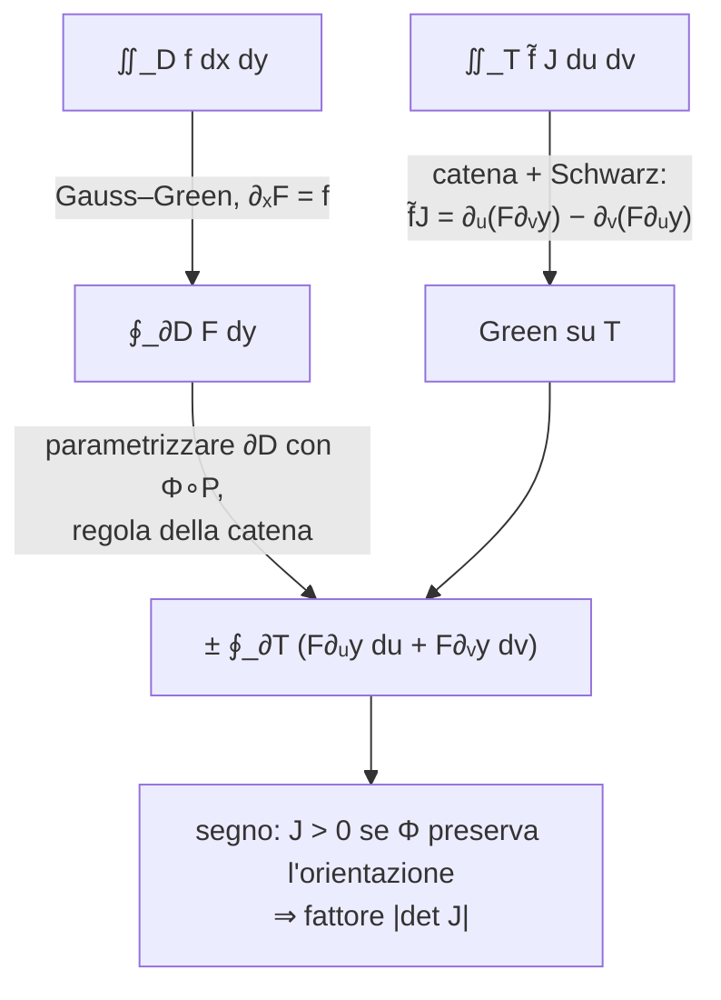

# Lezione 12 — Cambio di variabili negli integrali doppi e integrali tripli

La lezione dimostra la formula di **cambio di variabili** negli integrali doppi, enunciata alla fine della [[MM L11 - Teorema di Green, divergenza e rotore|lezione 11]]: per passare da coordinate $(x, y)$ a coordinate $(u, v)$ bisogna moltiplicare l'integranda per il modulo del determinante jacobiano della trasformazione. La dimostrazione usa le formule di Gauss–Green e il teorema di Green. Segue un esercizio in cui si calcola un flusso con il teorema della divergenza e le coordinate polari. La seconda parte estende la teoria agli **integrali tripli**: definizione, domini normali in tre dimensioni, formule di riduzione e cambio di variabili, con il calcolo del volume di una porzione di guscio sferico in coordinate sferiche.

> [!warning] Fonti di questa lezione
> Per questa lezione **non è disponibile la trascrizione**. La nota è costruita sugli appunti manuali della lezione, che riportano i passaggi fatti a lavagna, e sulle note del docente nella versione del 12 ottobre 2026 [@pinamonti2026, §2.2.4–§2.2.5], che hanno la precedenza come fonte. I commenti discorsivi che collegano i passaggi sono quindi una ricostruzione, coerente con i materiali ma non con le parole del docente. La data non compare nei materiali: è dedotta dal calendario delle lezioni (il venerdì tra la lezione 11 e la lezione 13). Le figure sono costruite per illustrare i passaggi degli appunti.

## Cambio di variabili negli integrali doppi

### L'enunciato

Siano $T$ e $D$ due domini regolari del piano: aperti limitati il cui bordo è una curva chiusa regolare a tratti. Sia $\Phi : T \to D$ una trasformazione di coordinate
$$\Phi(u, v) = \big(x(u, v),\ y(u, v)\big),$$
invertibile, di classe $C^2$ e con determinante jacobiano mai nullo. Data $f : D \to \mathbb{R}$ si costruisce $\tilde{f} = f \circ \Phi : T \to \mathbb{R}$, cioè $\tilde{f}(u, v) = f\big(x(u, v), y(u, v)\big)$: è la stessa funzione, letta nelle nuove coordinate.

<svg viewBox="0 0 620 250" width="620" style="display:block;margin:1em auto;max-width:100%;height:auto;font-family:inherit" xmlns="http://www.w3.org/2000/svg"><line x1="40" y1="210" x2="260" y2="210" stroke="currentColor" stroke-width="1.0"/><polygon points="260,210 253.8,213.3 253.8,206.7" fill="currentColor"/><line x1="50" y1="222" x2="50" y2="20" stroke="currentColor" stroke-width="1.0"/><polygon points="50,20 53.3,26.2 46.7,26.2" fill="currentColor"/><text x="258" y="228" font-size="13" text-anchor="end" fill="currentColor" font-style="italic">u</text><text x="58" y="28" font-size="13" text-anchor="start" fill="currentColor" font-style="italic">v</text><path d="M 233.1,115 L 234,113.2 L 234.8,111.5 L 235.5,109.6 L 236,107.8 L 236.4,105.9 L 236.6,104 L 236.7,102.1 L 236.6,100.2 L 236.4,98.3 L 236,96.4 L 235.4,94.5 L 234.7,92.7 L 233.8,90.9 L 232.7,89.2 L 231.5,87.5 L 230.2,85.9 L 228.7,84.4 L 227,82.9 L 225.3,81.5 L 223.4,80.2 L 221.4,79 L 219.3,77.9 L 217.2,76.9 L 215,76 L 212.7,75.2 L 210.4,74.5 L 208,73.8 L 205.6,73.3 L 203.3,72.8 L 200.9,72.4 L 198.5,72.1 L 196.2,71.8 L 193.8,71.6 L 191.5,71.4 L 189.3,71.3 L 187.1,71.2 L 184.9,71.2 L 182.8,71.1 L 180.7,71.1 L 178.6,71.1 L 176.6,71 L 174.7,71 L 172.7,70.9 L 170.8,70.9 L 168.9,70.8 L 167,70.7 L 165.2,70.5 L 163.3,70.4 L 161.4,70.2 L 159.5,70 L 157.6,69.7 L 155.7,69.5 L 153.7,69.2 L 151.7,68.9 L 149.7,68.6 L 147.6,68.4 L 145.4,68.1 L 143.2,67.8 L 141,67.6 L 138.7,67.4 L 136.4,67.3 L 134,67.2 L 131.6,67.1 L 129.2,67.2 L 126.7,67.3 L 124.3,67.4 L 121.8,67.7 L 119.3,68.1 L 116.9,68.5 L 114.5,69.1 L 112.1,69.7 L 109.7,70.5 L 107.5,71.3 L 105.3,72.3 L 103.2,73.4 L 101.1,74.5 L 99.2,75.8 L 97.5,77.2 L 95.8,78.6 L 94.3,80.1 L 92.9,81.7 L 91.7,83.4 L 90.6,85.1 L 89.7,86.9 L 88.9,88.7 L 88.3,90.6 L 87.9,92.5 L 87.6,94.4 L 87.5,96.3 L 87.5,98.2 L 87.6,100.1 L 87.9,101.9 L 88.3,103.8 L 88.8,105.6 L 89.4,107.4 L 90.1,109.2 L 90.9,110.9 L 91.7,112.6 L 92.6,114.2 L 93.6,115.8 L 94.6,117.3 L 95.6,118.8 L 96.6,120.3 L 97.6,121.7 L 98.6,123.1 L 99.6,124.4 L 100.6,125.8 L 101.6,127.1 L 102.5,128.3 L 103.4,129.6 L 104.2,130.9 L 105,132.2 L 105.8,133.5 L 106.6,134.7 L 107.3,136 L 108,137.4 L 108.7,138.7 L 109.4,140.1 L 110,141.5 L 110.7,142.9 L 111.4,144.4 L 112.1,145.9 L 112.9,147.4 L 113.7,148.9 L 114.5,150.5 L 115.4,152.1 L 116.4,153.7 L 117.4,155.2 L 118.5,156.8 L 119.7,158.4 L 121,160 L 122.5,161.5 L 124,163 L 125.6,164.4 L 127.3,165.8 L 129.1,167.1 L 131,168.4 L 133,169.5 L 135.1,170.6 L 137.3,171.6 L 139.6,172.5 L 141.9,173.2 L 144.3,173.9 L 146.8,174.4 L 149.2,174.8 L 151.8,175.1 L 154.3,175.2 L 156.8,175.2 L 159.4,175.1 L 161.9,174.8 L 164.4,174.4 L 166.8,173.9 L 169.3,173.3 L 171.6,172.6 L 173.9,171.8 L 176.1,170.9 L 178.3,169.8 L 180.3,168.7 L 182.3,167.6 L 184.2,166.4 L 186,165.1 L 187.7,163.8 L 189.3,162.4 L 190.8,161 L 192.3,159.6 L 193.7,158.2 L 195,156.8 L 196.2,155.4 L 197.4,154 L 198.6,152.6 L 199.7,151.3 L 200.7,149.9 L 201.8,148.6 L 202.8,147.4 L 203.8,146.1 L 204.9,144.9 L 205.9,143.7 L 207,142.5 L 208,141.3 L 209.1,140.2 L 210.3,139.1 L 211.4,138 L 212.6,136.8 L 213.9,135.7 L 215.2,134.6 L 216.5,133.4 L 217.8,132.3 L 219.1,131.1 L 220.5,129.8 L 221.9,128.6 L 223.3,127.3 L 224.7,125.9 L 226,124.5 L 227.3,123 L 228.6,121.5 L 229.9,120 L 231,118.4 L 232.1,116.7 L 233.1,115 Z" fill="#d98a1c" fill-opacity="0.15" stroke="#d98a1c" stroke-width="1.6"/><polygon points="196.2,71.8 204.6,68.6 203.5,77" fill="#d98a1c"/><polygon points="122.5,161.5 114,158.3 120.4,152.7" fill="#d98a1c"/><text x="215" y="50" font-size="15" text-anchor="start" fill="#d98a1c" font-style="italic">T</text><line x1="360" y1="210" x2="580" y2="210" stroke="currentColor" stroke-width="1.0"/><polygon points="580,210 573.8,213.3 573.8,206.7" fill="currentColor"/><line x1="370" y1="222" x2="370" y2="20" stroke="currentColor" stroke-width="1.0"/><polygon points="370,20 373.3,26.2 366.7,26.2" fill="currentColor"/><text x="578" y="228" font-size="13" text-anchor="end" fill="currentColor" font-style="italic">x</text><text x="378" y="28" font-size="13" text-anchor="start" fill="currentColor" font-style="italic">y</text><path d="M 560.3,115 L 560.4,113.1 L 560.3,111.2 L 560.1,109.3 L 559.6,107.4 L 559,105.6 L 558.3,103.7 L 557.3,102 L 556.2,100.2 L 555,98.6 L 553.7,97 L 552.2,95.4 L 550.6,93.9 L 548.9,92.5 L 547.1,91.2 L 545.2,89.9 L 543.3,88.7 L 541.3,87.6 L 539.3,86.6 L 537.3,85.6 L 535.2,84.7 L 533.1,83.9 L 531.1,83.1 L 529,82.4 L 527,81.7 L 525,81 L 523,80.4 L 521,79.8 L 519.1,79.2 L 517.2,78.6 L 515.4,78.1 L 513.6,77.5 L 511.8,76.9 L 510.1,76.4 L 508.4,75.8 L 506.7,75.1 L 505,74.5 L 503.4,73.8 L 501.7,73.1 L 500.1,72.4 L 498.4,71.6 L 496.7,70.9 L 495,70.1 L 493.2,69.3 L 491.4,68.4 L 489.5,67.6 L 487.6,66.8 L 485.7,66 L 483.7,65.2 L 481.6,64.4 L 479.5,63.7 L 477.3,63 L 475,62.3 L 472.7,61.7 L 470.3,61.2 L 467.9,60.7 L 465.4,60.4 L 462.9,60.1 L 460.4,59.9 L 457.9,59.8 L 455.3,59.9 L 452.8,60 L 450.3,60.3 L 447.8,60.7 L 445.3,61.2 L 442.9,61.8 L 440.6,62.5 L 438.3,63.4 L 436.1,64.4 L 434,65.5 L 432.1,66.6 L 430.2,67.9 L 428.4,69.3 L 426.8,70.8 L 425.3,72.3 L 423.9,73.9 L 422.7,75.6 L 421.6,77.3 L 420.7,79.1 L 419.8,80.9 L 419.1,82.7 L 418.6,84.5 L 418.1,86.4 L 417.8,88.2 L 417.6,90.1 L 417.5,91.9 L 417.4,93.7 L 417.5,95.5 L 417.6,97.2 L 417.7,98.9 L 417.9,100.6 L 418.2,102.2 L 418.4,103.9 L 418.7,105.4 L 419,107 L 419.3,108.5 L 419.6,110 L 419.8,111.4 L 420.1,112.9 L 420.3,114.3 L 420.4,115.7 L 420.6,117.1 L 420.7,118.5 L 420.7,119.9 L 420.8,121.4 L 420.8,122.8 L 420.7,124.3 L 420.7,125.7 L 420.7,127.2 L 420.6,128.8 L 420.6,130.3 L 420.5,131.9 L 420.5,133.6 L 420.5,135.3 L 420.6,137 L 420.7,138.7 L 420.9,140.4 L 421.2,142.2 L 421.5,144 L 422,145.8 L 422.5,147.6 L 423.1,149.4 L 423.9,151.2 L 424.8,153 L 425.8,154.7 L 426.9,156.4 L 428.2,158 L 429.6,159.6 L 431.1,161.2 L 432.8,162.6 L 434.6,164 L 436.4,165.3 L 438.4,166.5 L 440.5,167.5 L 442.7,168.5 L 445,169.4 L 447.3,170.1 L 449.7,170.7 L 452.2,171.2 L 454.7,171.6 L 457.2,171.8 L 459.8,171.9 L 462.3,171.9 L 464.9,171.8 L 467.4,171.6 L 469.9,171.3 L 472.3,170.8 L 474.8,170.3 L 477.1,169.7 L 479.4,169 L 481.7,168.3 L 483.9,167.5 L 486,166.6 L 488,165.7 L 490,164.8 L 491.9,163.8 L 493.8,162.8 L 495.6,161.9 L 497.3,160.9 L 499,159.9 L 500.7,158.9 L 502.3,158 L 503.9,157.1 L 505.4,156.2 L 507,155.3 L 508.5,154.4 L 510.1,153.6 L 511.6,152.8 L 513.2,152 L 514.8,151.3 L 516.4,150.5 L 518.1,149.8 L 519.7,149.1 L 521.5,148.4 L 523.2,147.7 L 525,146.9 L 526.8,146.2 L 528.7,145.4 L 530.6,144.6 L 532.5,143.8 L 534.4,142.9 L 536.3,142 L 538.3,141 L 540.2,140 L 542.1,138.9 L 544,137.7 L 545.8,136.5 L 547.6,135.2 L 549.3,133.8 L 550.9,132.4 L 552.4,130.9 L 553.9,129.3 L 555.2,127.7 L 556.4,126 L 557.4,124.2 L 558.3,122.5 L 559.1,120.6 L 559.7,118.8 L 560.1,116.9 L 560.3,115 Z" fill="#3b82f6" fill-opacity="0.15" stroke="#3b82f6" stroke-width="1.6"/><polygon points="511.8,76.9 520.7,75.3 518.1,83.4" fill="#3b82f6"/><polygon points="438.4,166.5 429.5,165.8 434,158.6" fill="#3b82f6"/><text x="535" y="50" font-size="15" text-anchor="start" fill="#3b82f6" font-style="italic">D</text><circle cx="160" cy="120" r="3.5" fill="currentColor"/><text x="166" y="136" font-size="11" text-anchor="start" fill="currentColor">(u, v)</text><circle cx="480" cy="110" r="3.5" fill="currentColor"/><text x="486" y="126" font-size="11" text-anchor="start" fill="currentColor">(x, y) = Φ(u, v)</text><path d="M 230,60 Q 300,10 380,60" fill="none" stroke="currentColor" stroke-width="1.6"/><polygon points="380,60 371,59.8 375.1,52.4" fill="currentColor"/><text x="305" y="22" font-size="15" text-anchor="middle" fill="currentColor" font-style="italic">Φ</text><text x="310" y="246" font-size="11" text-anchor="middle" fill="currentColor">Φ è invertibile, di classe C², e manda il bordo ∂T nel bordo ∂D</text></svg>

> [!important] Teorema — Cambio di variabili negli integrali doppi
> Siano $T, D \subseteq \mathbb{R}^2$ domini aperti limitati con bordi curve regolari a tratti, e sia $\Phi : T \to D$ invertibile, di classe $C^2$, con $\det J_\Phi \neq 0$. Sia $f : D \to \mathbb{R}$ integrabile su $D$. Allora
> $$\iint_{D = \Phi(T)} f(x, y)\, dx\, dy = \iint_T \tilde{f}(u, v)\, \big|\det J_\Phi(u, v)\big|\, du\, dv, \qquad \tilde{f} = f \circ \Phi .$$
>
> [@pinamonti2026, Teor. 2.2.5]

Qui
$$J_\Phi = \begin{pmatrix} \partial_u x & \partial_v x \\ \partial_u y & \partial_v y \end{pmatrix}, \qquad J := \det J_\Phi = \partial_u x\, \partial_v y - \partial_v x\, \partial_u y .$$
Il fattore $|\det J_\Phi|$ ha un significato geometrico: per il differenziale, un rettangolino $du \times dv$ nel piano $(u, v)$ viene mandato approssimativamente nel parallelogramma generato da $\partial_u\Phi\, du$ e $\partial_v\Phi\, dv$, la cui area è $|\det J_\Phi|\, du\, dv$. Il determinante misura di quanto la trasformazione dilata o contrae le aree.

### Dimostrazione

Si dimostra la formula per $f$ di classe $C^1$ su un aperto $A$ che contiene $\overline{D}$, come negli appunti.

**Passo 1: dall'integrale doppio su $D$ a un integrale di linea.** Si sceglie una **primitiva di $f$ rispetto a $x$**, cioè una funzione ausiliaria $F$ con
$$\partial_x F(x, y) = f(x, y) .$$
Per la prima formula di Gauss–Green (lezione 11),
$$\iint_D f\, dx\, dy = \iint_D \partial_x F\, dx\, dy = \int_{\partial D} F\, dy .$$

**Passo 2: si porta l'integrale di linea su $\partial T$.** Poiché $\Phi$ è di classe $C^2$ e invertibile, manda l'interno di $T$ nell'interno di $D$ e il bordo nel bordo: $\Phi(\partial T) = \partial D$. Sia $P(t) = (u(t), v(t))$, $t \in [a, b]$, una parametrizzazione di $\partial T$ che ne rispetta l'orientazione antioraria. Componendo con $\Phi$ si ottiene una parametrizzazione di $\partial D$,
$$\Phi\big(P(t)\big) = \Big(x\big(u(t), v(t)\big),\ y\big(u(t), v(t)\big)\Big),$$
che però **non è detto** che rispetti l'orientazione di $\partial D$: $\Phi$ potrebbe invertirla. Per la regola della catena $\frac{dy}{dt} = \partial_u y\, \frac{du}{dt} + \partial_v y\, \frac{dv}{dt}$, quindi
$$\iint_D f\, dx\, dy = \pm \int_a^b F\Big(\partial_u y\, \frac{du}{dt} + \partial_v y\, \frac{dv}{dt}\Big)\, dt = \pm \int_{\partial T} \big((F\,\partial_u y)\, du + (F\,\partial_v y)\, dv\big), \tag{1}$$
con il segno $+$ se $\Phi \circ P$ rispetta l'orientazione di $\partial D$ e $-$ altrimenti. L'ultima espressione è l'integrale di linea lungo $\partial T$ del campo $G = (F\,\partial_u y,\ F\,\partial_v y)$, dove $F$ è valutata in $\Phi(u, v)$.

**Passo 3: si calcola $\tilde{f}\, J$.** Si studia l'integrale $\iint_T \tilde{f}\, J\, du\, dv$. Per definizione di $F$,
$$\tilde{f}\, J = \partial_x F\,\big(\partial_u x\, \partial_v y - \partial_v x\, \partial_u y\big).$$
Per la regola della catena applicata a $F(x(u, v), y(u, v))$,
$$\partial_u F = \partial_x F\, \partial_u x + \partial_y F\, \partial_u y, \qquad \partial_v F = \partial_x F\, \partial_v x + \partial_y F\, \partial_v y,$$
da cui $\partial_x F\, \partial_u x = \partial_u F - \partial_y F\, \partial_u y$ e $\partial_x F\, \partial_v x = \partial_v F - \partial_y F\, \partial_v y$. Sostituendo, i termini con $\partial_y F$ si cancellano:
$$\tilde{f}\, J = \partial_u F\, \partial_v y - \partial_y F\, \partial_u y\, \partial_v y - \partial_v F\, \partial_u y + \partial_y F\, \partial_v y\, \partial_u y = \partial_u F\, \partial_v y - \partial_v F\, \partial_u y .$$
Infine si "aggiunge e toglie" la derivata seconda di $y$:
$$\tilde{f}\, J = \partial_u\big(F\, \partial_v y\big) - \partial_v\big(F\, \partial_u y\big) - F\,\big(\partial_u\partial_v y - \partial_v\partial_u y\big) = \partial_u\big(F\, \partial_v y\big) - \partial_v\big(F\, \partial_u y\big),$$
perché il termine tra parentesi è nullo per il **teorema di Schwarz** della [[MM L04 - Teorema di Schwarz e formula di Taylor|lezione 4]]: è qui che serve l'ipotesi $\Phi \in C^2$.

**Passo 4: di nuovo Green.** L'espressione ottenuta ha la forma $\partial_u g_2 - \partial_v g_1$ con proprio il campo $G = (g_1, g_2) = (F\,\partial_u y,\ F\,\partial_v y)$ del passo 2. Per il teorema di Green su $T$,
$$\iint_T \tilde{f}\, J\, du\, dv = \int_{\partial T} \big((F\,\partial_u y)\, du + (F\,\partial_v y)\, dv\big). \tag{2}$$

**Passo 5: il segno.** Confrontando (1) e (2):
$$\iint_D f\, dx\, dy = \pm \iint_T \tilde{f}\, J\, du\, dv,$$
con $+$ se $\Phi$ preserva l'orientazione del bordo e $-$ se la inverte. Per sistemare il segno si sceglie $f = 1$: a sinistra c'è l'area di $D$, che è positiva, quindi
$$0 \leq \iint_D dx\, dy = \pm \iint_T J\, du\, dv .$$
$J$ è continua e non si annulla mai su $T$, quindi ha segno costante: $J > 0$ se $\Phi$ **preserva** l'orientazione, $J < 0$ se la **inverte**. In entrambi i casi $\pm J = |J|$, e l'ambiguità di segno sparisce sostituendo $J$ con $|J|$. $\blacksquare$

> [!tip] Approfondimento — Il caso di una variabile
> #approfondimento In una variabile la formula diventa $\int_{\varphi(a)}^{\varphi(b)} f(x)\, dx = \int_a^b f(\varphi(t))\, \varphi'(t)\, dt$, senza modulo. La differenza è solo apparente: se $\varphi$ è decrescente, $\varphi(a) > \varphi(b)$ e l'integrale a sinistra ha gli estremi "rovesciati"; riscrivendolo sull'intervallo $[\varphi(b), \varphi(a)]$ nel verso giusto si cambia segno e compare $|\varphi'(t)|$. Il segno di $\varphi'$ codifica esattamente se la trasformazione conserva o inverte l'orientazione dell'intervallo, come $\det J_\Phi$ nel piano.

## Esercizio: flusso di un campo uscente dal disco unitario

> [!example] Esercizio — Flusso di $F(x, y) = (x^2, y)$ uscente da $B(0, 1)$ attraverso $C(0, 1)$
> Sia $B(0, 1) = \{(x, y) : x^2 + y^2 < 1\}$ il disco unitario e $C(0, 1) = \partial B(0, 1)$ la circonferenza unitaria. Si vuole il flusso di $F$ uscente dal disco,
> $$\int_{\partial B} F \cdot \hat{\mathbf{n}}\, ds .$$
> **Teorema della divergenza.** Si ha $\nabla \cdot F = \partial_x (x^2) + \partial_y (y) = 2x + 1$, quindi
> $$\int_{\partial B} F \cdot \hat{\mathbf{n}}\, ds = \iint_{B(0, 1)} (2x + 1)\, dx\, dy .$$
> **Coordinate polari.** Con $\Phi(r, \theta) = (r\cos\theta,\ r\sin\theta)$,
> $$J_\Phi = \begin{pmatrix} \cos\theta & -r\sin\theta \\ \sin\theta & r\cos\theta \end{pmatrix}, \qquad J = r\cos^2\theta + r\sin^2\theta = r, \qquad |J| = r,$$
> e il disco corrisponde a $r \in [0, 1]$, $\theta \in [0, 2\pi]$:
> $$I = \int_0^{2\pi}\!\!\int_0^1 (2r\cos\theta + 1)\, r\, dr\, d\theta = \int_0^{2\pi} 2\cos\theta\, d\theta \int_0^1 r^2\, dr + \int_0^{2\pi} d\theta \int_0^1 r\, dr = 0 + 2\pi \cdot \frac12 = \pi .$$
> Il primo termine si annulla perché l'integrale del coseno su un periodo è zero.

<svg viewBox="0 0 380 380" width="380" style="display:block;margin:1em auto;max-width:100%;height:auto;font-family:inherit" xmlns="http://www.w3.org/2000/svg"><line x1="16" y1="185" x2="370" y2="185" stroke="currentColor" stroke-width="1.0"/><polygon points="370,185 363.8,188.3 363.8,181.7" fill="currentColor"/><line x1="190" y1="353" x2="190" y2="11" stroke="currentColor" stroke-width="1.0"/><polygon points="190,11 193.3,17.2 186.7,17.2" fill="currentColor"/><text x="370" y="201" font-size="13" text-anchor="end" fill="currentColor" font-style="italic">x</text><text x="198" y="19" font-size="13" text-anchor="start" fill="currentColor" font-style="italic">y</text><path d="M 310,185 L 309.9,180.3 L 309.6,175.5 L 309.2,170.8 L 308.5,166.1 L 307.7,161.4 L 306.6,156.8 L 305.4,152.2 L 304.1,147.7 L 302.5,143.2 L 300.8,138.8 L 298.8,134.5 L 296.8,130.2 L 294.5,126 L 292.1,121.9 L 289.5,118 L 286.8,114.1 L 283.9,110.3 L 280.9,106.7 L 277.7,103.1 L 274.4,99.7 L 271,96.5 L 267.4,93.3 L 263.8,90.3 L 260,87.5 L 256.1,84.8 L 252,82.3 L 247.9,79.9 L 243.7,77.7 L 239.5,75.7 L 235.1,73.8 L 230.7,72.1 L 226.2,70.6 L 221.6,69.2 L 217,68.1 L 212.4,67.1 L 207.7,66.3 L 203,65.7 L 198.3,65.3 L 193.6,65.1 L 188.8,65 L 184.1,65.1 L 179.3,65.5 L 174.6,66 L 169.9,66.7 L 165.3,67.6 L 160.7,68.6 L 156.1,69.9 L 151.6,71.3 L 147.1,72.9 L 142.7,74.7 L 138.4,76.7 L 134.2,78.8 L 130,81.1 L 125.9,83.5 L 122,86.1 L 118.1,88.9 L 114.4,91.8 L 110.8,94.9 L 107.3,98.1 L 103.9,101.4 L 100.7,104.9 L 97.6,108.5 L 94.6,112.2 L 91.8,116 L 89.2,119.9 L 86.7,124 L 84.3,128.1 L 82.2,132.3 L 80.2,136.6 L 78.4,141 L 76.7,145.4 L 75.2,150 L 73.9,154.5 L 72.8,159.1 L 71.9,163.8 L 71.1,168.5 L 70.6,173.2 L 70.2,177.9 L 70,182.6 L 70,187.4 L 70.2,192.1 L 70.6,196.8 L 71.1,201.5 L 71.9,206.2 L 72.8,210.9 L 73.9,215.5 L 75.2,220 L 76.7,224.6 L 78.4,229 L 80.2,233.4 L 82.2,237.7 L 84.3,241.9 L 86.7,246 L 89.2,250.1 L 91.8,254 L 94.6,257.8 L 97.6,261.5 L 100.7,265.1 L 103.9,268.6 L 107.3,271.9 L 110.8,275.1 L 114.4,278.2 L 118.1,281.1 L 122,283.9 L 125.9,286.5 L 130,288.9 L 134.2,291.2 L 138.4,293.3 L 142.7,295.3 L 147.1,297.1 L 151.6,298.7 L 156.1,300.1 L 160.7,301.4 L 165.3,302.4 L 169.9,303.3 L 174.6,304 L 179.3,304.5 L 184.1,304.9 L 188.8,305 L 193.6,304.9 L 198.3,304.7 L 203,304.3 L 207.7,303.7 L 212.4,302.9 L 217,301.9 L 221.6,300.8 L 226.2,299.4 L 230.7,297.9 L 235.1,296.2 L 239.5,294.3 L 243.7,292.3 L 247.9,290.1 L 252,287.7 L 256.1,285.2 L 260,282.5 L 263.8,279.7 L 267.4,276.7 L 271,273.5 L 274.4,270.3 L 277.7,266.9 L 280.9,263.3 L 283.9,259.7 L 286.8,255.9 L 289.5,252 L 292.1,248.1 L 294.5,244 L 296.8,239.8 L 298.8,235.5 L 300.8,231.2 L 302.5,226.8 L 304.1,222.3 L 305.4,217.8 L 306.6,213.2 L 307.7,208.6 L 308.5,203.9 L 309.2,199.2 L 309.6,194.5 L 309.9,189.7 L 310,185 Z" fill="#3b82f6" fill-opacity="0.1" stroke="#3b82f6" stroke-width="2"/><line x1="40" y1="335" x2="58.7" y2="350" stroke="currentColor" stroke-opacity="0.5" stroke-width="0.9"/><polygon points="58.7,350 53.8,349.1 56.8,345.4" fill="currentColor"/><line x1="40" y1="275" x2="61.6" y2="285.4" stroke="currentColor" stroke-opacity="0.5" stroke-width="0.9"/><polygon points="61.6,285.4 56.6,285.6 58.7,281.4" fill="currentColor"/><line x1="40" y1="215" x2="63.7" y2="218.8" stroke="currentColor" stroke-opacity="0.5" stroke-width="0.9"/><polygon points="63.7,218.8 59,220.4 59.7,215.8" fill="currentColor"/><line x1="40" y1="155" x2="63.7" y2="151.2" stroke="currentColor" stroke-opacity="0.5" stroke-width="0.9"/><polygon points="63.7,151.2 59.7,154.2 59,149.6" fill="currentColor"/><line x1="40" y1="95" x2="61.6" y2="84.6" stroke="currentColor" stroke-opacity="0.5" stroke-width="0.9"/><polygon points="61.6,84.6 58.7,88.6 56.6,84.4" fill="currentColor"/><line x1="40" y1="35" x2="58.7" y2="20" stroke="currentColor" stroke-opacity="0.5" stroke-width="0.9"/><polygon points="58.7,20 56.8,24.6 53.8,20.9" fill="currentColor"/><line x1="100" y1="335" x2="109.8" y2="356.9" stroke="currentColor" stroke-opacity="0.5" stroke-width="0.9"/><polygon points="109.8,356.9 105.9,353.8 110.2,351.9" fill="currentColor"/><line x1="100" y1="275" x2="113.5" y2="293" stroke="currentColor" stroke-opacity="0.5" stroke-width="0.9"/><polygon points="113.5,293 109,290.9 112.7,288.1" fill="currentColor"/><line x1="100" y1="215" x2="113.5" y2="221" stroke="currentColor" stroke-opacity="0.5" stroke-width="0.9"/><polygon points="113.5,221 108.5,221.4 110.4,217.1" fill="currentColor"/><line x1="100" y1="155" x2="113.5" y2="149" stroke="currentColor" stroke-opacity="0.5" stroke-width="0.9"/><polygon points="113.5,149 110.4,152.9 108.5,148.6" fill="currentColor"/><line x1="100" y1="95" x2="113.5" y2="77" stroke="currentColor" stroke-opacity="0.5" stroke-width="0.9"/><polygon points="113.5,77 112.7,81.9 109,79.1" fill="currentColor"/><line x1="100" y1="35" x2="109.8" y2="13.1" stroke="currentColor" stroke-opacity="0.5" stroke-width="0.9"/><polygon points="109.8,13.1 110.2,18.1 105.9,16.2" fill="currentColor"/><line x1="160" y1="335" x2="161.2" y2="359" stroke="currentColor" stroke-opacity="0.5" stroke-width="0.9"/><polygon points="161.2,359 158.6,354.7 163.3,354.4" fill="currentColor"/><line x1="160" y1="275" x2="161.5" y2="293" stroke="currentColor" stroke-opacity="0.5" stroke-width="0.9"/><polygon points="161.5,293 158.8,288.8 163.5,288.4" fill="currentColor"/><line x1="160" y1="215" x2="161.5" y2="221" stroke="currentColor" stroke-opacity="0.5" stroke-width="0.9"/><polygon points="161.5,221 158.2,217.3 162.7,216.1" fill="currentColor"/><line x1="160" y1="155" x2="161.5" y2="149" stroke="currentColor" stroke-opacity="0.5" stroke-width="0.9"/><polygon points="161.5,149 162.7,153.9 158.2,152.7" fill="currentColor"/><line x1="160" y1="95" x2="161.5" y2="77" stroke="currentColor" stroke-opacity="0.5" stroke-width="0.9"/><polygon points="161.5,77 163.5,81.6 158.8,81.2" fill="currentColor"/><line x1="160" y1="35" x2="161.2" y2="11" stroke="currentColor" stroke-opacity="0.5" stroke-width="0.9"/><polygon points="161.2,11 163.3,15.6 158.6,15.3" fill="currentColor"/><line x1="220" y1="335" x2="221.2" y2="359" stroke="currentColor" stroke-opacity="0.5" stroke-width="0.9"/><polygon points="221.2,359 218.6,354.7 223.3,354.4" fill="currentColor"/><line x1="220" y1="275" x2="221.5" y2="293" stroke="currentColor" stroke-opacity="0.5" stroke-width="0.9"/><polygon points="221.5,293 218.8,288.8 223.5,288.4" fill="currentColor"/><line x1="220" y1="215" x2="221.5" y2="221" stroke="currentColor" stroke-opacity="0.5" stroke-width="0.9"/><polygon points="221.5,221 218.2,217.3 222.7,216.1" fill="currentColor"/><line x1="220" y1="155" x2="221.5" y2="149" stroke="currentColor" stroke-opacity="0.5" stroke-width="0.9"/><polygon points="221.5,149 222.7,153.9 218.2,152.7" fill="currentColor"/><line x1="220" y1="95" x2="221.5" y2="77" stroke="currentColor" stroke-opacity="0.5" stroke-width="0.9"/><polygon points="221.5,77 223.5,81.6 218.8,81.2" fill="currentColor"/><line x1="220" y1="35" x2="221.2" y2="11" stroke="currentColor" stroke-opacity="0.5" stroke-width="0.9"/><polygon points="221.2,11 223.3,15.6 218.6,15.3" fill="currentColor"/><line x1="280" y1="335" x2="289.8" y2="356.9" stroke="currentColor" stroke-opacity="0.5" stroke-width="0.9"/><polygon points="289.8,356.9 285.9,353.8 290.2,351.9" fill="currentColor"/><line x1="280" y1="275" x2="293.5" y2="293" stroke="currentColor" stroke-opacity="0.5" stroke-width="0.9"/><polygon points="293.5,293 289,290.9 292.7,288.1" fill="currentColor"/><line x1="280" y1="215" x2="293.5" y2="221" stroke="currentColor" stroke-opacity="0.5" stroke-width="0.9"/><polygon points="293.5,221 288.5,221.4 290.4,217.1" fill="currentColor"/><line x1="280" y1="155" x2="293.5" y2="149" stroke="currentColor" stroke-opacity="0.5" stroke-width="0.9"/><polygon points="293.5,149 290.4,152.9 288.5,148.6" fill="currentColor"/><line x1="280" y1="95" x2="293.5" y2="77" stroke="currentColor" stroke-opacity="0.5" stroke-width="0.9"/><polygon points="293.5,77 292.7,81.9 289,79.1" fill="currentColor"/><line x1="280" y1="35" x2="289.8" y2="13.1" stroke="currentColor" stroke-opacity="0.5" stroke-width="0.9"/><polygon points="289.8,13.1 290.2,18.1 285.9,16.2" fill="currentColor"/><line x1="340" y1="335" x2="358.7" y2="350" stroke="currentColor" stroke-opacity="0.5" stroke-width="0.9"/><polygon points="358.7,350 353.8,349.1 356.8,345.4" fill="currentColor"/><line x1="340" y1="275" x2="361.6" y2="285.4" stroke="currentColor" stroke-opacity="0.5" stroke-width="0.9"/><polygon points="361.6,285.4 356.6,285.6 358.7,281.4" fill="currentColor"/><line x1="340" y1="215" x2="363.7" y2="218.8" stroke="currentColor" stroke-opacity="0.5" stroke-width="0.9"/><polygon points="363.7,218.8 359,220.4 359.7,215.8" fill="currentColor"/><line x1="340" y1="155" x2="363.7" y2="151.2" stroke="currentColor" stroke-opacity="0.5" stroke-width="0.9"/><polygon points="363.7,151.2 359.7,154.2 359,149.6" fill="currentColor"/><line x1="340" y1="95" x2="361.6" y2="84.6" stroke="currentColor" stroke-opacity="0.5" stroke-width="0.9"/><polygon points="361.6,84.6 358.7,88.6 356.6,84.4" fill="currentColor"/><line x1="340" y1="35" x2="358.7" y2="20" stroke="currentColor" stroke-opacity="0.5" stroke-width="0.9"/><polygon points="358.7,20 356.8,24.6 353.8,20.9" fill="currentColor"/><line x1="304.6" y1="149.5" x2="333.3" y2="140.7" stroke="#2e9e6a" stroke-width="1.8"/><polygon points="333.3,140.7 328.4,145.6 326.4,139.4" fill="#2e9e6a"/><line x1="246" y1="78.9" x2="260" y2="52.3" stroke="#2e9e6a" stroke-width="1.8"/><polygon points="260,52.3 260,59.3 254.2,56.3" fill="#2e9e6a"/><line x1="154.5" y1="70.4" x2="145.7" y2="41.7" stroke="#2e9e6a" stroke-width="1.8"/><polygon points="145.7,41.7 150.6,46.6 144.4,48.6" fill="#2e9e6a"/><line x1="83.9" y1="129" x2="57.3" y2="115" stroke="#2e9e6a" stroke-width="1.8"/><polygon points="57.3,115 64.3,115 61.3,120.8" fill="#2e9e6a"/><line x1="75.4" y1="220.5" x2="46.7" y2="229.3" stroke="#2e9e6a" stroke-width="1.8"/><polygon points="46.7,229.3 51.6,224.4 53.6,230.6" fill="#2e9e6a"/><line x1="134" y1="291.1" x2="120" y2="317.7" stroke="#2e9e6a" stroke-width="1.8"/><polygon points="120,317.7 120,310.7 125.8,313.7" fill="#2e9e6a"/><line x1="225.5" y1="299.6" x2="234.3" y2="328.3" stroke="#2e9e6a" stroke-width="1.8"/><polygon points="234.3,328.3 229.4,323.4 235.6,321.4" fill="#2e9e6a"/><line x1="296.1" y1="241" x2="322.7" y2="255" stroke="#2e9e6a" stroke-width="1.8"/><polygon points="322.7,255 315.7,255 318.7,249.2" fill="#2e9e6a"/><text x="316" y="323" font-size="14" text-anchor="start" fill="#2e9e6a">n̂</text><text x="52" y="47" font-size="12" text-anchor="start" fill="#3b82f6">B(0, 1)</text><text x="190" y="372" font-size="11" text-anchor="middle" fill="currentColor">grigio: F(x, y) = (x², y); verde: normale uscente dal disco</text></svg>

> [!example] Verifica (aggiunta) — Calcolo diretto del flusso
> Sulla circonferenza, parametrizzata da $(\cos\theta, \sin\theta)$ con ascissa curvilinea $s = \theta$, il versore normale uscente è $\hat{\mathbf{n}} = (\cos\theta, \sin\theta)$. Quindi
> $$F \cdot \hat{\mathbf{n}} = \cos^2\theta\cdot\cos\theta + \sin\theta\cdot\sin\theta = \cos^3\theta + \sin^2\theta, \qquad \int_0^{2\pi} \big(\cos^3\theta + \sin^2\theta\big)\, d\theta = 0 + \pi = \pi,$$
> in accordo con il teorema della divergenza ($\cos^3\theta$ ha integrale nullo su un periodo, e l'integrale di $\sin^2\theta$ su un periodo vale $\pi$).

## Integrali tripli

### Definizione e integrabilità

Per una funzione $f : E \subseteq \mathbb{R}^3 \to \mathbb{R}$, con $E$ prodotto cartesiano di tre intervalli chiusi e limitati, valgono le definizioni date nel caso bidimensionale: si partiziona il parallelepipedo in parallelepipedi più piccoli, si costruiscono somme inferiori e superiori, e $f$ è integrabile se l'estremo superiore delle prime coincide con l'estremo inferiore delle seconde. L'integrale si indica con
$$\iiint_E f\, dx\, dy\, dz \qquad\text{oppure}\qquad \int_E f\, d^3\mathbf{x},$$
e valgono condizioni di integrabilità analoghe a quelle in due dimensioni: ad esempio, le funzioni continue sono integrabili [@pinamonti2026, §2.2.5].

### Domini normali e formule di riduzione

Per il calcolo esplicito si usano formule di riduzione analoghe al caso bidimensionale.

> [!important] Definizione e proposizione — Dominio normale rispetto a $(x, y)$
> Un dominio $E \subseteq \mathbb{R}^3$ è **normale rispetto a $(x, y)$** se esistono un dominio $D \subseteq \mathbb{R}^2$ e due funzioni continue $\alpha, \beta : D \to \mathbb{R}$ tali che
> $$E = \big\{(x, y, z) \in \mathbb{R}^3 \ : \ (x, y) \in D,\ \ \alpha(x, y) \leq z \leq \beta(x, y)\big\}.$$
> Per una funzione continua su un dominio di questo tipo
> $$\iiint_E f\, dx\, dy\, dz = \iint_D \bigg(\int_{\alpha(x, y)}^{\beta(x, y)} f(x, y, z)\, dz\bigg)\, dx\, dy .$$
>
> [@pinamonti2026, §2.2.5]

Il dominio è contenuto nel "cilindro" $D \times \mathbb{R}$, tra la superficie inferiore $z = \alpha(x, y)$ e quella superiore $z = \beta(x, y)$. Per ogni punto $(x, y)$ di $D$ si integra in $z$ lungo il segmento verticale; il risultato è una funzione $G(x, y)$ delle sole $(x, y)$, che si integra poi su $D$ con i metodi della lezione 10.

<svg viewBox="0 0 460 330" width="460" style="display:block;margin:1em auto;max-width:100%;height:auto;font-family:inherit" xmlns="http://www.w3.org/2000/svg"><line x1="220" y1="255" x2="417.5" y2="297.7" stroke="currentColor" stroke-width="1.0"/><polygon points="417.5,297.7 410.7,299.6 412.1,293.2" fill="currentColor"/><text x="422.5" y="301.7" font-size="13" text-anchor="start" fill="currentColor" font-style="italic">x</text><line x1="220" y1="255" x2="280" y2="216.1" stroke="currentColor" stroke-width="1.0"/><polygon points="280,216.1 276.6,222.2 273,216.7" fill="currentColor"/><text x="285" y="220.1" font-size="13" text-anchor="start" fill="currentColor" font-style="italic">y</text><line x1="220" y1="255" x2="220" y2="77" stroke="currentColor" stroke-width="1.0"/><polygon points="220,77 223.3,83.2 216.7,83.2" fill="currentColor"/><text x="225" y="81" font-size="13" text-anchor="start" fill="currentColor" font-style="italic">z</text><path d="M 374.5,280.6 L 375.9,279.6 L 377.2,278.6 L 378.3,277.5 L 379.2,276.4 L 379.9,275.3 L 380.4,274.2 L 380.8,273.1 L 380.9,271.9 L 380.9,270.8 L 380.6,269.6 L 380.2,268.5 L 379.6,267.4 L 378.8,266.3 L 377.8,265.2 L 376.6,264.2 L 375.2,263.1 L 373.7,262.2 L 372,261.2 L 370.2,260.3 L 368.2,259.4 L 366,258.6 L 363.8,257.9 L 361.4,257.2 L 358.9,256.5 L 356.3,255.9 L 353.6,255.4 L 350.8,254.9 L 347.9,254.6 L 345,254.2 L 342,254 L 339,253.8 L 336,253.7 L 332.9,253.7 L 329.9,253.7 L 326.8,253.8 L 323.8,254 L 320.9,254.2 L 317.9,254.6 L 315.1,254.9 L 312.3,255.4 L 309.6,255.9 L 307,256.5 L 304.5,257.2 L 302.1,257.9 L 299.8,258.6 L 297.7,259.4 L 295.7,260.3 L 293.8,261.2 L 292.1,262.2 L 290.6,263.1 L 289.3,264.2 L 288.1,265.2 L 287.1,266.3 L 286.3,267.4 L 285.7,268.5 L 285.2,269.6 L 285,270.8 L 284.9,271.9 L 285.1,273.1 L 285.4,274.2 L 285.9,275.3 L 286.7,276.4 L 287.6,277.5 L 288.7,278.6 L 289.9,279.6 L 291.4,280.6 L 293,281.6 L 294.7,282.5 L 296.6,283.4 L 298.7,284.3 L 300.9,285 L 303.3,285.8 L 305.7,286.4 L 308.3,287.1 L 310.9,287.6 L 313.7,288.1 L 316.5,288.5 L 319.4,288.9 L 322.3,289.2 L 325.3,289.4 L 328.4,289.5 L 331.4,289.6 L 334.4,289.6 L 337.5,289.5 L 340.5,289.4 L 343.5,289.2 L 346.4,288.9 L 349.3,288.5 L 352.2,288.1 L 354.9,287.6 L 357.6,287.1 L 360.1,286.4 L 362.6,285.8 L 364.9,285 L 367.1,284.3 L 369.2,283.4 L 371.1,282.5 L 372.9,281.6 L 374.5,280.6 Z" fill="currentColor" fill-opacity="0.06" stroke="currentColor" stroke-width="1.2"/><text x="382.5" y="290.6" font-size="13" text-anchor="start" fill="currentColor" font-style="italic">D</text><line x1="378.4" y1="277.4" x2="378.4" y2="136.3" stroke="currentColor" stroke-opacity="0.3" stroke-dasharray="3 3"/><line x1="346.9" y1="254.4" x2="346.9" y2="129.5" stroke="currentColor" stroke-opacity="0.3" stroke-dasharray="3 3"/><line x1="286.6" y1="266.9" x2="286.6" y2="151.9" stroke="currentColor" stroke-opacity="0.3" stroke-dasharray="3 3"/><line x1="317.1" y1="288.6" x2="317.1" y2="158.2" stroke="currentColor" stroke-opacity="0.3" stroke-dasharray="3 3"/><line x1="329.3" y1="223.1" x2="329.3" y2="133.3" stroke="#3b82f6" stroke-width="1.4"/><line x1="336.6" y1="258.9" x2="336.6" y2="154.1" stroke="#3b82f6" stroke-width="1.4"/><path d="M 374.5,241.7 L 375.9,239.6 L 377.2,237.4 L 378.3,235.3 L 379.2,233.2 L 379.9,231.1 L 380.4,229.1 L 380.8,227.2 L 380.9,225.4 L 380.9,223.7 L 380.6,222.2 L 380.2,220.8 L 379.6,219.6 L 378.8,218.5 L 377.8,217.6 L 376.6,216.8 L 375.2,216.2 L 373.7,215.8 L 372,215.5 L 370.2,215.4 L 368.2,215.4 L 366,215.6 L 363.8,215.9 L 361.4,216.3 L 358.9,216.7 L 356.3,217.3 L 353.6,217.9 L 350.8,218.5 L 347.9,219.2 L 345,219.9 L 342,220.5 L 339,221.2 L 336,221.8 L 332.9,222.4 L 329.9,223 L 326.8,223.4 L 323.8,223.8 L 320.9,224.2 L 317.9,224.5 L 315.1,224.7 L 312.3,224.8 L 309.6,224.8 L 307,224.8 L 304.5,224.8 L 302.1,224.6 L 299.8,224.5 L 297.7,224.3 L 295.7,224.1 L 293.8,223.9 L 292.1,223.8 L 290.6,223.6 L 289.3,223.5 L 288.1,223.5 L 287.1,223.5 L 286.3,223.6 L 285.7,223.9 L 285.2,224.2 L 285,224.6 L 284.9,225.1 L 285.1,225.8 L 285.4,226.6 L 285.9,227.5 L 286.7,228.6 L 287.6,229.8 L 288.7,231.1 L 289.9,232.5 L 291.4,234 L 293,235.6 L 294.7,237.2 L 296.6,239 L 298.7,240.7 L 300.9,242.5 L 303.3,244.3 L 305.7,246.1 L 308.3,247.8 L 310.9,249.5 L 313.7,251.1 L 316.5,252.6 L 319.4,254 L 322.3,255.3 L 325.3,256.4 L 328.4,257.3 L 331.4,258.1 L 334.4,258.6 L 337.5,259 L 340.5,259.2 L 343.5,259.1 L 346.4,258.8 L 349.3,258.4 L 352.2,257.7 L 354.9,256.8 L 357.6,255.7 L 360.1,254.4 L 362.6,253 L 364.9,251.4 L 367.1,249.6 L 369.2,247.8 L 371.1,245.8 L 372.9,243.8 L 374.5,241.7 Z" fill="#2e9e6a" fill-opacity="0.18" stroke="#2e9e6a" stroke-width="1.6"/><path d="M 374.5,139.3 L 375.9,138.3 L 377.2,137.4 L 378.3,136.5 L 379.2,135.6 L 379.9,134.7 L 380.4,133.8 L 380.8,133.1 L 380.9,132.3 L 380.9,131.6 L 380.6,130.9 L 380.2,130.3 L 379.6,129.8 L 378.8,129.3 L 377.8,128.8 L 376.6,128.5 L 375.2,128.2 L 373.7,127.9 L 372,127.7 L 370.2,127.6 L 368.2,127.5 L 366,127.5 L 363.8,127.6 L 361.4,127.7 L 358.9,127.9 L 356.3,128.2 L 353.6,128.5 L 350.8,128.9 L 347.9,129.3 L 345,129.8 L 342,130.4 L 339,131 L 336,131.7 L 332.9,132.4 L 329.9,133.1 L 326.8,133.9 L 323.8,134.8 L 320.9,135.6 L 317.9,136.6 L 315.1,137.5 L 312.3,138.4 L 309.6,139.4 L 307,140.4 L 304.5,141.4 L 302.1,142.5 L 299.8,143.5 L 297.7,144.5 L 295.7,145.5 L 293.8,146.5 L 292.1,147.6 L 290.6,148.5 L 289.3,149.5 L 288.1,150.5 L 287.1,151.4 L 286.3,152.3 L 285.7,153.1 L 285.2,153.9 L 285,154.7 L 284.9,155.4 L 285.1,156.1 L 285.4,156.7 L 285.9,157.3 L 286.7,157.8 L 287.6,158.3 L 288.7,158.7 L 289.9,159.1 L 291.4,159.4 L 293,159.6 L 294.7,159.7 L 296.6,159.8 L 298.7,159.9 L 300.9,159.8 L 303.3,159.7 L 305.7,159.6 L 308.3,159.3 L 310.9,159 L 313.7,158.7 L 316.5,158.3 L 319.4,157.8 L 322.3,157.3 L 325.3,156.7 L 328.4,156 L 331.4,155.4 L 334.4,154.6 L 337.5,153.8 L 340.5,153 L 343.5,152.2 L 346.4,151.3 L 349.3,150.4 L 352.2,149.4 L 354.9,148.4 L 357.6,147.4 L 360.1,146.4 L 362.6,145.4 L 364.9,144.4 L 367.1,143.4 L 369.2,142.4 L 371.1,141.3 L 372.9,140.3 L 374.5,139.3 Z" fill="#3b82f6" fill-opacity="0.18" stroke="#3b82f6" stroke-width="1.6"/><text x="366.3" y="122.2" font-size="12" text-anchor="start" fill="#3b82f6">z = β(x, y)</text><text x="382.3" y="225.3" font-size="12" text-anchor="start" fill="#2e9e6a">z = α(x, y)</text><circle cx="325.5" cy="267.4" r="3" fill="currentColor"/><line x1="325.5" y1="225.2" x2="325.5" y2="141.7" stroke="#e05a47" stroke-width="2.4"/><text x="331.5" y="281.4" font-size="11" text-anchor="start" fill="currentColor">(x, y)</text><text x="230" y="322" font-size="11" text-anchor="middle" fill="currentColor">per ogni (x, y) ∈ D si integra in z sul segmento rosso, poi si integra su D</text></svg>

### Cambio di variabili

Vale una formula analoga a quella in due dimensioni. Se $\Phi : T \subseteq \mathbb{R}^3 \to E \subseteq \mathbb{R}^3$, $(x, y, z) = \Phi(u, v, w)$, è una trasformazione di coordinate di classe $C^2$ e invertibile con $\Phi(T) = E$,
$$\iiint_E f(x, y, z)\, dx\, dy\, dz = \iiint_T \tilde{f}(u, v, w)\, \big|\det J_\Phi\big|\, du\, dv\, dw, \qquad \tilde{f} = f \circ \Phi .$$
[@pinamonti2026, §2.2.5]

### Esempio: volume di una porzione di guscio sferico

> [!example] Esempio — Volume di $E = \{(x, y, z) : r^2 \leq x^2 + y^2 + z^2 \leq R^2,\ x, y, z \geq 0\}$
> È la parte del guscio compreso tra le sfere di raggio $r$ e $R > r$ che sta nel primo ottante. Il volume è $\iiint_E 1\, dx\, dy\, dz$.
>
> **Coordinate sferiche.** Il punto $P = (x, y, z)$ si descrive con la distanza $\rho$ dall'origine, l'angolo $\theta$ tra il raggio $OP$ e l'asse $z$, e l'angolo $\varphi$ tra la proiezione $P'$ di $P$ sul piano $xy$ e l'asse $x$:
> $$x = \rho\sin\theta\cos\varphi, \qquad y = \rho\sin\theta\sin\varphi, \qquad z = \rho\cos\theta .$$
> Il dominio diventa il parallelepipedo $T = \{(\rho, \theta, \varphi) : r \leq \rho \leq R,\ 0 \leq \theta \leq \tfrac{\pi}{2},\ 0 \leq \varphi \leq \tfrac{\pi}{2}\}$.
>
> **Jacobiano.**
> $$J_\Phi = \begin{pmatrix} \sin\theta\cos\varphi & \rho\cos\theta\cos\varphi & -\rho\sin\theta\sin\varphi \\ \sin\theta\sin\varphi & \rho\cos\theta\sin\varphi & \rho\sin\theta\cos\varphi \\ \cos\theta & -\rho\sin\theta & 0 \end{pmatrix}, \qquad \det J_\Phi = \rho^2\cos^2\theta\sin\theta + \rho^2\sin^3\theta = \rho^2\sin\theta .$$
> Sviluppando lungo la terza riga: $\cos\theta \cdot \rho^2\sin\theta\cos\theta\,(\cos^2\varphi + \sin^2\varphi) + \rho\sin\theta \cdot \rho\sin^2\theta\,(\cos^2\varphi + \sin^2\varphi)$. In $T$ si ha $\sin\theta \geq 0$, quindi $|\det J_\Phi| = \rho^2\sin\theta$.
>
> **Volume.**
> $$\mathrm{Vol}(E) = \iiint_T \rho^2\sin\theta\, d\rho\, d\theta\, d\varphi = \int_r^R \rho^2\, d\rho \int_0^{\pi/2}\sin\theta\, d\theta \int_0^{\pi/2} d\varphi = \frac{R^3 - r^3}{3}\cdot 1\cdot\frac{\pi}{2} = \frac{\pi}{6}\big(R^3 - r^3\big).$$
> **Controllo.** Per $r \to 0$ si ottiene $\tfrac{\pi}{6}R^3$, il volume di un ottavo di sfera; moltiplicando per gli otto ottanti si ritrova $\tfrac{8\pi}{6}R^3 = \tfrac43\pi R^3$, il volume della sfera.

<svg viewBox="0 0 420 330" width="420" style="display:block;margin:1em auto;max-width:100%;height:auto;font-family:inherit" xmlns="http://www.w3.org/2000/svg"><line x1="190" y1="250" x2="344.8" y2="287.1" stroke="currentColor" stroke-width="1.0"/><polygon points="344.8,287.1 338,288.8 339.6,282.4" fill="currentColor"/><text x="349.8" y="291.1" font-size="13" text-anchor="start" fill="currentColor" font-style="italic">x</text><line x1="190" y1="250" x2="298.4" y2="197" stroke="currentColor" stroke-width="1.0"/><polygon points="298.4,197 294.3,202.7 291.4,196.8" fill="currentColor"/><text x="303.4" y="201" font-size="13" text-anchor="start" fill="currentColor" font-style="italic">y</text><line x1="190" y1="250" x2="190" y2="85.6" stroke="currentColor" stroke-width="1.0"/><polygon points="190,85.6 193.3,91.7 186.7,91.7" fill="currentColor"/><text x="195" y="89.6" font-size="13" text-anchor="start" fill="currentColor" font-style="italic">z</text><line x1="190" y1="250" x2="281.5" y2="144.4" stroke="#3b82f6" stroke-width="2.2"/><line x1="190" y1="250" x2="281.5" y2="240.7" stroke="currentColor" stroke-dasharray="4 3"/><line x1="281.5" y1="144.4" x2="281.5" y2="240.7" stroke="currentColor" stroke-dasharray="4 3"/><polyline points="190,204 191.6,204.4 193.2,204.9 194.7,205.4 196.3,206 197.9,206.7 199.4,207.5 201,208.3 202.5,209.2 204,210.2 205.4,211.2 206.9,212.3 208.3,213.4 209.7,214.6 211.1,215.9 212.4,217.2 213.7,218.5 215,219.9 216.2,221.4 217.4,222.9" fill="none" stroke="#e05a47" stroke-width="1.4" stroke-opacity="1.0"/><polyline points="190,204 191.9,203.8 193.7,203.7 195.5,203.7 197.4,203.8 199.2,203.9 201,204.1 202.8,204.4 204.6,204.7 206.3,205.2 208.1,205.7 209.8,206.2 211.4,206.8 213.1,207.5 214.7,208.3 216.2,209.1 217.7,210 219.2,211 220.6,212 222,213.1" fill="none" stroke="#e05a47" stroke-width="1.4" stroke-opacity="1.0"/><polyline points="235.9,261 237.3,260.2 238.7,259.5 240,258.7 241.1,257.8 242.1,257 243,256.1 243.8,255.3 244.5,254.4 245,253.5 245.5,252.6 245.8,251.7 245.9,250.8 246,249.9 245.9,249 245.7,248.1 245.4,247.2 244.9,246.3 244.4,245.4 243.7,244.5" fill="none" stroke="#2e9e6a" stroke-width="1.4" stroke-opacity="1.0"/><text x="216.1" y="192.7" font-size="13" text-anchor="start" fill="#e05a47" font-style="italic">θ</text><text x="259.1" y="267.8" font-size="13" text-anchor="start" fill="#2e9e6a" font-style="italic">φ</text><circle cx="281.5" cy="144.4" r="4" fill="currentColor"/><text x="289.5" y="140.4" font-size="12" text-anchor="start" fill="currentColor">P = (x, y, z)</text><text x="262" y="186.1" font-size="13" text-anchor="start" fill="#3b82f6" font-style="italic">ρ</text><circle cx="281.5" cy="240.7" r="3" fill="currentColor"/><text x="287.5" y="254.7" font-size="12" text-anchor="start" fill="currentColor">P′</text><text x="210" y="322" font-size="12" text-anchor="middle" fill="currentColor">x = ρ sin θ cos φ,  y = ρ sin θ sin φ,  z = ρ cos θ</text></svg>

> [!tip] Approfondimento — Le coordinate cilindriche
> #approfondimento Un'altra trasformazione molto usata è quella delle coordinate cilindriche $x = r\cos\theta$, $y = r\sin\theta$, $z = z$, cioè le coordinate polari nel piano $xy$ con la quota invariata. La matrice jacobiana è a blocchi e il determinante è quello delle coordinate polari, $\det J = r$. Ad esempio il volume del cilindro di raggio $R$ e altezza $h$ è $\int_0^h\!\int_0^{2\pi}\!\int_0^R r\, dr\, d\theta\, dz = \pi R^2 h$.

> [!warning] Note sulle fonti della lezione
> - Nell'introduzione della sezione 2.2.4 delle note del docente compare "$\det J_\Phi \neq\!= 0$" e "una nuova funzione $\tilde{\tilde f} : T \to D$": la funzione cercata va da $T$ a $\mathbb{R}$. Nell'enunciato del Teorema 2.2.5 l'integranda a destra è scritta $f(u, v)\,|\det J(u, v)|$, da intendere come $\tilde{f}(u, v) = f(\Phi(u, v))$, come negli appunti manuali.
> - Nella sezione 2.2.5 delle note si legge "$(x, y, x) = \Phi(u, v, w)$" per $(x, y, z)$.
> - Negli appunti manuali il dominio normale in tre dimensioni è disegnato con $\alpha$ sopra e $\beta$ sotto, mentre la definizione e la formula di riduzione usano $\alpha \leq z \leq \beta$: si è seguita la definizione.
