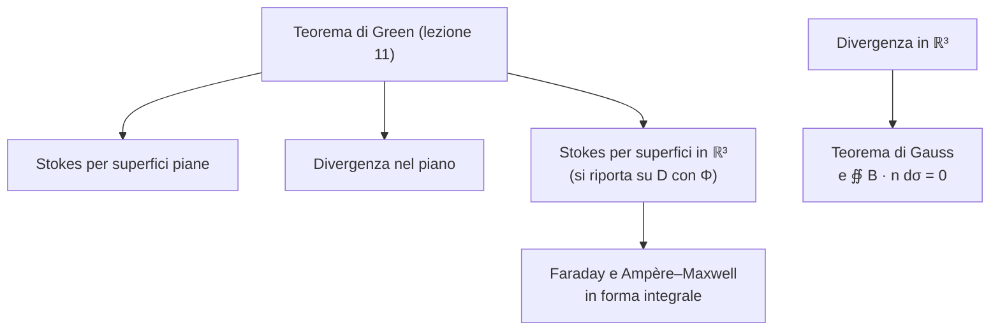

# Lezione 14 — Teorema di Stokes, teorema della divergenza e teorema di Pappo–Guldino

La lezione chiude la parte del corso tenuta dal prof. Pinamonti. Si enunciano i due grandi teoremi del calcolo integrale in tre dimensioni: il **teorema di Stokes**, che lega il flusso del rotore di un campo attraverso una superficie alla circuitazione del campo lungo il bordo, e il **teorema della divergenza**, che lega l'integrale della divergenza su una regione al flusso uscente dal suo bordo. Entrambi servono a scrivere in forma integrale le **equazioni di Maxwell**. Si dimostra poi il teorema di Stokes, riconducendolo al teorema di Green della [[MM L11 - Teorema di Green, divergenza e rotore|lezione 11]]. L'ultima parte dimostra il primo **teorema di Pappo–Guldino** sull'area delle superfici di rotazione, con un esercizio.

> [!note] Fonti di questa lezione
> Fonti: la trascrizione (parte 1), gli appunti manuali e le note del docente nella versione del 12 ottobre 2026 [@pinamonti2026, §2.3, Teor. 2.3.1–2.3.3]. Durante la pausa la registrazione è rimasta attiva: quei minuti non contengono materiale della lezione e non sono riportati. La dimostrazione del teorema della divergenza in tre dimensioni non è stata svolta a lezione; è riportata come approfondimento dalle note del docente, dove è segnata come facoltativa. Le figure sono costruite per rappresentare ciò che il docente disegna alla lavagna.

## Il teorema di Stokes

### Le ipotesi

Il docente elenca con cura le ipotesi, tutte necessarie: se ne manca una, ad esempio se la superficie ha uno spigolo e non si possono calcolare le derivate seconde, "non è detto che il teorema sia verificato".

- **La superficie.** $\Phi : D \subseteq \mathbb{R}^2 \to \mathbb{R}^3$ è una superficie regolare (lezione 13): la jacobiana ha rango massimo, cioè $\partial_u\Phi \wedge \partial_v\Phi \neq \mathbf{0}$. Per questo teorema serve una regolarità in più: $\Phi$ deve essere di classe $C^2$.
- **Il dominio dei parametri.** $D$ è limitato (non si considerano superfici che arrivano all'infinito) e il suo bordo $\partial D$ è una **curva chiusa regolare a tratti**, percorsa in senso antiorario.
- **Il campo.** $F : A \subseteq \mathbb{R}^3 \to \mathbb{R}^3$ è un campo vettoriale di classe $C^1(A)$ su un aperto $A$, così che se ne possa calcolare il rotore.
- **Compatibilità.** Il sostegno della superficie è contenuto nel dominio del campo: $R_\Phi \subseteq A$.

Si indica con $S = R_\Phi = \Phi(D)$ la superficie e con $\partial S = \Phi(\partial D)$ il suo bordo.

> [!important] Teorema — Stokes
> Sotto le ipotesi precedenti,
> $$\iint_S (\nabla \wedge F)\cdot\hat{\mathbf{n}}\; d\sigma = \int_{\partial S} F\cdot dP, \qquad \hat{\mathbf{n}} = \frac{\partial_u\Phi\wedge\partial_v\Phi}{\big|\partial_u\Phi\wedge\partial_v\Phi\big|} .$$
> A sinistra c'è il **flusso del rotore** di $F$ attraverso la superficie, a destra l'**integrale di linea** (la circuitazione) di $F$ lungo il bordo orientato.
>
> [@pinamonti2026, Teor. 2.3.1]

**L'orientazione.** Il versore normale è perpendicolare alla superficie in ogni punto; resta da fissarne il verso, che deve essere **concorde** con il verso di percorrenza del bordo. Tutta questa informazione è già codificata nella parametrizzazione: si percorre $\partial D$ in senso antiorario nel piano $(u, v)$, e questo fissa automaticamente sia il verso di percorrenza di $\partial S$ sia il verso di $\hat{\mathbf{n}}$, dato dal prodotto vettoriale nell'ordine "derivata rispetto al primo parametro, poi rispetto al secondo". "Se usi questa regola non devi pensare a niente, il verso viene automaticamente giusto"; geometricamente è la **regola della mano destra**: con il pollice lungo $\hat{\mathbf{n}}$, le dita indicano il verso del bordo. Se si cambia orientazione, si devono cambiare entrambi.

<svg viewBox="0 0 600 300" width="600" style="display:block;margin:1em auto;max-width:100%;height:auto;font-family:inherit" xmlns="http://www.w3.org/2000/svg"><line x1="26" y1="240" x2="215" y2="240" stroke="currentColor" stroke-width="1.0"/><polygon points="215,240 208.8,243.3 208.8,236.7" fill="currentColor"/><line x1="40" y1="254" x2="40" y2="58" stroke="currentColor" stroke-width="1.0"/><polygon points="40,58 43.3,64.2 36.7,64.2" fill="currentColor"/><text x="215" y="256" font-size="13" text-anchor="end" fill="currentColor" font-style="italic">u</text><text x="48" y="66" font-size="13" text-anchor="start" fill="currentColor" font-style="italic">v</text><polyline points="61,219 180,219 180,100 61,100 61,219" fill="none" stroke="#d98a1c" stroke-width="2.2" stroke-opacity="1.0"/><polygon points="120.5,219 112.6,223.2 112.6,214.8" fill="#d98a1c"/><polygon points="180,159.5 184.2,167.4 175.8,167.4" fill="#d98a1c"/><polygon points="120.5,100 128.4,95.8 128.4,104.2" fill="#d98a1c"/><polygon points="61,159.5 56.8,151.6 65.2,151.6" fill="#d98a1c"/><text x="117" y="163" font-size="15" text-anchor="middle" fill="currentColor" font-style="italic">D</text><polyline points="403.4,166.5 405.4,164.8 407.4,163.1 409.4,161.4 411.4,159.6 413.4,157.8 415.4,156 417.4,154.2 419.4,152.3 421.4,150.5 423.4,148.7 425.4,147 427.4,145.2 429.4,143.6 431.4,142 433.4,140.4 435.4,139 437.4,137.6 439.4,136.3 441.4,135.1 443.4,134 445.4,133 447.4,132.1 449.4,131.2 451.4,130.4 453.4,129.7 455.4,129 457.4,128.4 459.4,127.8 461.4,127.2 463.4,126.6 465.4,126 467.4,125.4 469.4,124.8 471.4,124.1 473.4,123.4 475.4,122.7 477.4,121.9 479.4,121.1 481.4,120.3" fill="none" stroke="#3b82f6" stroke-width="0.7" stroke-opacity="0.45"/><polyline points="403.4,166.5 406.3,166.9 409.1,167.2 412,167.5 414.9,167.8 417.7,168.1 420.6,168.3 423.4,168.5 426.3,168.8 429.1,169 432,169.3 434.8,169.5 437.7,169.9 440.6,170.3 443.4,170.7 446.3,171.2 449.1,171.8 452,172.5 454.8,173.3 457.7,174.1 460.6,175.1 463.4,176.1 466.3,177.2 469.1,178.4 472,179.7 474.8,181 477.7,182.4 480.6,183.8 483.4,185.2 486.3,186.7 489.1,188.2 492,189.6 494.8,191.1 497.7,192.5 500.5,193.9 503.4,195.3 506.3,196.6 509.1,197.9 512,199.1 514.8,200.4" fill="none" stroke="#3b82f6" stroke-width="0.7" stroke-opacity="0.45"/><polyline points="417.4,168 419.4,166 421.4,163.9 423.4,161.7 425.4,159.4 427.4,157.1 429.4,154.8 431.4,152.5 433.4,150.1 435.4,147.8 437.4,145.5 439.4,143.2 441.4,141.1 443.4,139 445.4,137.1 447.4,135.2 449.4,133.6 451.4,132.1 453.4,130.7 455.4,129.5 457.4,128.5 459.4,127.7 461.4,127 463.4,126.4 465.4,126 467.4,125.7 469.4,125.4 471.4,125.3 473.4,125.2 475.4,125.1 477.4,125 479.4,124.9 481.4,124.9 483.4,124.7 485.4,124.5 487.4,124.3 489.4,124 491.4,123.6 493.4,123.2 495.4,122.6" fill="none" stroke="#3b82f6" stroke-width="0.7" stroke-opacity="0.45"/><polyline points="413.2,158 416,158 418.9,158 421.7,157.8 424.6,157.6 427.5,157.4 430.3,157.1 433.2,156.8 436,156.5 438.9,156.2 441.7,156 444.6,155.8 447.5,155.7 450.3,155.7 453.2,155.8 456,156 458.9,156.4 461.7,156.9 464.6,157.7 467.5,158.5 470.3,159.6 473.2,160.8 476,162.1 478.9,163.6 481.7,165.2 484.6,167 487.4,168.8 490.3,170.7 493.2,172.6 496,174.6 498.9,176.6 501.7,178.6 504.6,180.5 507.4,182.4 510.3,184.3 513.2,186.1 516,187.9 518.9,189.5 521.7,191.1 524.6,192.7" fill="none" stroke="#3b82f6" stroke-width="0.7" stroke-opacity="0.45"/><polyline points="431.3,169.2 433.3,166.7 435.3,164.1 437.3,161.4 439.3,158.6 441.3,155.7 443.3,152.8 445.3,149.8 447.3,146.9 449.3,143.9 451.3,141.1 453.3,138.3 455.3,135.6 457.3,133.1 459.3,130.7 461.3,128.6 463.3,126.7 465.3,125 467.3,123.6 469.3,122.4 471.3,121.5 473.3,120.8 475.3,120.4 477.3,120.2 479.3,120.2 481.3,120.3 483.3,120.6 485.3,121 487.3,121.5 489.3,122 491.3,122.6 493.3,123.1 495.3,123.6 497.3,124 499.3,124.4 501.3,124.7 503.3,124.8 505.3,124.9 507.3,124.8 509.3,124.7" fill="none" stroke="#3b82f6" stroke-width="0.7" stroke-opacity="0.45"/><polyline points="422.9,149.2 425.8,148.7 428.6,148.2 431.5,147.5 434.4,146.8 437.2,145.9 440.1,145.1 442.9,144.2 445.8,143.3 448.6,142.4 451.5,141.6 454.3,140.8 457.2,140.2 460.1,139.7 462.9,139.5 465.8,139.4 468.6,139.5 471.5,139.9 474.3,140.5 477.2,141.4 480.1,142.5 482.9,143.9 485.8,145.5 488.6,147.4 491.5,149.4 494.3,151.6 497.2,154 500.1,156.4 502.9,158.9 505.8,161.5 508.6,164.1 511.5,166.7 514.3,169.3 517.2,171.7 520,174.2 522.9,176.5 525.8,178.7 528.6,180.8 531.5,182.8 534.3,184.7" fill="none" stroke="#3b82f6" stroke-width="0.7" stroke-opacity="0.45"/><polyline points="445.2,171 447.2,168.2 449.2,165.2 451.2,162.1 453.2,158.8 455.2,155.5 457.2,152.1 459.2,148.7 461.2,145.3 463.2,141.9 465.2,138.6 467.2,135.3 469.2,132.3 471.2,129.4 473.2,126.8 475.2,124.4 477.2,122.3 479.2,120.5 481.2,119 483.2,117.8 485.2,117 487.2,116.5 489.2,116.2 491.2,116.3 493.2,116.6 495.2,117.1 497.2,117.8 499.2,118.6 501.2,119.6 503.2,120.6 505.2,121.6 507.2,122.6 509.2,123.5 511.2,124.4 513.2,125.2 515.2,125.9 517.2,126.4 519.2,126.8 521.2,127.1 523.2,127.2" fill="none" stroke="#3b82f6" stroke-width="0.7" stroke-opacity="0.45"/><polyline points="432.7,141 435.5,140.2 438.4,139.3 441.2,138.2 444.1,137 447,135.7 449.8,134.4 452.7,133 455.5,131.7 458.4,130.3 461.2,129.1 464.1,127.9 467,126.9 469.8,126.1 472.7,125.5 475.5,125.1 478.4,125.1 481.2,125.3 484.1,125.9 487,126.8 489.8,128 492.7,129.6 495.5,131.4 498.4,133.5 501.2,135.8 504.1,138.4 506.9,141.2 509.8,144 512.7,147 515.5,150.1 518.4,153.1 521.2,156.2 524.1,159.2 526.9,162.1 529.8,165 532.7,167.7 535.5,170.3 538.4,172.7 541.2,175 544.1,177.2" fill="none" stroke="#3b82f6" stroke-width="0.7" stroke-opacity="0.45"/><polyline points="459.1,174.6 461.1,171.6 463.1,168.6 465.1,165.3 467.1,162 469.1,158.6 471.1,155.1 473.1,151.6 475.1,148 477.1,144.5 479.1,141.1 481.1,137.8 483.1,134.6 485.1,131.7 487.1,128.9 489.1,126.5 491.1,124.3 493.1,122.5 495.1,121 497.1,119.8 499.1,119 501.1,118.5 503.1,118.4 505.1,118.5 507.1,118.9 509.1,119.5 511.1,120.3 513.1,121.2 515.1,122.2 517.1,123.3 519.1,124.5 521.1,125.6 523.1,126.7 525.1,127.6 527.1,128.5 529.1,129.3 531.1,129.9 533.1,130.4 535.1,130.7 537.1,130.9" fill="none" stroke="#3b82f6" stroke-width="0.7" stroke-opacity="0.45"/><polyline points="442.4,134.6 445.3,133.7 448.1,132.6 451,131.5 453.9,130.2 456.7,128.8 459.6,127.4 462.4,125.9 465.3,124.4 468.1,123 471,121.6 473.9,120.3 476.7,119.2 479.6,118.3 482.4,117.6 485.3,117.3 488.1,117.2 491,117.4 493.8,117.9 496.7,118.8 499.6,120.1 502.4,121.6 505.3,123.5 508.1,125.7 511,128.1 513.8,130.8 516.7,133.6 519.6,136.6 522.4,139.7 525.3,142.8 528.1,146 531,149.2 533.8,152.3 536.7,155.3 539.6,158.3 542.4,161.1 545.3,163.8 548.1,166.3 551,168.7 553.8,170.9" fill="none" stroke="#3b82f6" stroke-width="0.7" stroke-opacity="0.45"/><polyline points="473.1,180.2 475.1,177.5 477.1,174.6 479.1,171.7 481.1,168.6 483.1,165.5 485.1,162.3 487.1,159 489.1,155.8 491.1,152.6 493.1,149.4 495.1,146.4 497.1,143.5 499.1,140.8 501.1,138.2 503.1,136 505.1,133.9 507.1,132.2 509.1,130.7 511.1,129.5 513.1,128.7 515.1,128.1 517.1,127.8 519.1,127.7 521.1,127.9 523.1,128.3 525.1,128.8 527.1,129.5 529.1,130.2 531.1,131 533.1,131.9 535.1,132.7 537.1,133.4 539.1,134.2 541.1,134.8 543.1,135.3 545.1,135.7 547.1,135.9 549.1,136.1 551.1,136.1" fill="none" stroke="#3b82f6" stroke-width="0.7" stroke-opacity="0.45"/><polyline points="452.2,130.1 455,129.5 457.9,128.7 460.7,127.8 463.6,126.8 466.5,125.7 469.3,124.6 472.2,123.4 475,122.2 477.9,121 480.7,119.9 483.6,119 486.5,118.1 489.3,117.4 492.2,117 495,116.7 497.9,116.7 500.7,117 503.6,117.6 506.5,118.5 509.3,119.7 512.2,121.2 515,122.9 517.9,124.9 520.7,127.2 523.6,129.6 526.4,132.2 529.3,134.9 532.2,137.7 535,140.5 537.9,143.4 540.7,146.3 543.6,149.1 546.4,151.9 549.3,154.5 552.2,157.1 555,159.5 557.9,161.8 560.7,164 563.6,166.1" fill="none" stroke="#3b82f6" stroke-width="0.7" stroke-opacity="0.45"/><polyline points="487,187.1 489,184.8 491,182.4 493,179.9 495,177.4 497,174.8 499,172.1 501,169.5 503,166.8 505,164.1 507,161.5 509,159 511,156.6 513,154.3 515,152.1 517,150.1 519,148.3 521,146.7 523,145.3 525,144.2 527,143.2 529,142.4 531,141.9 533,141.5 535,141.3 537,141.2 539,141.3 541,141.4 543,141.6 545,141.9 547,142.1 549,142.4 551,142.6 553,142.8 555,142.9 557,142.9 559,142.8 561,142.7 563,142.5 565,142.1" fill="none" stroke="#3b82f6" stroke-width="0.7" stroke-opacity="0.45"/><polyline points="461.9,127 464.8,126.8 467.6,126.5 470.5,126 473.4,125.5 476.2,125 479.1,124.4 481.9,123.8 484.8,123.2 487.6,122.6 490.5,122 493.4,121.5 496.2,121.2 499.1,120.9 501.9,120.8 504.8,120.9 507.6,121.1 510.5,121.6 513.3,122.2 516.2,123.1 519.1,124.2 521.9,125.5 524.8,127 527.6,128.7 530.5,130.5 533.3,132.5 536.2,134.6 539.1,136.8 541.9,139.1 544.8,141.4 547.6,143.7 550.5,146 553.3,148.2 556.2,150.5 559.1,152.6 561.9,154.7 564.8,156.7 567.6,158.6 570.5,160.4 573.3,162.1" fill="none" stroke="#3b82f6" stroke-width="0.7" stroke-opacity="0.45"/><polyline points="500.9,194.1 502.9,192.2 504.9,190.3 506.9,188.3 508.9,186.3 510.9,184.3 512.9,182.2 514.9,180.1 516.9,178.1 518.9,176 520.9,174 522.9,172 524.9,170 526.9,168.1 528.9,166.4 530.9,164.7 532.9,163.1 534.9,161.7 536.9,160.4 538.9,159.2 540.9,158.1 542.9,157.2 544.9,156.4 546.9,155.7 548.9,155.1 550.9,154.5 552.9,154.1 554.9,153.7 556.9,153.3 558.9,153 560.9,152.6 562.9,152.3 564.9,151.9 566.9,151.6 568.9,151.1 570.9,150.7 572.9,150.2 574.9,149.6 576.9,149 578.9,148.3" fill="none" stroke="#3b82f6" stroke-width="0.7" stroke-opacity="0.45"/><polyline points="471.7,124 474.5,124.2 477.4,124.4 480.3,124.5 483.1,124.5 486,124.5 488.8,124.5 491.7,124.5 494.5,124.4 497.4,124.4 500.2,124.4 503.1,124.5 506,124.6 508.8,124.8 511.7,125.1 514.5,125.4 517.4,125.9 520.2,126.5 523.1,127.3 526,128.1 528.8,129.1 531.7,130.3 534.5,131.5 537.4,132.8 540.2,134.3 543.1,135.8 546,137.4 548.8,139 551.7,140.7 554.5,142.4 557.4,144.2 560.2,145.9 563.1,147.6 565.9,149.3 568.8,150.9 571.7,152.5 574.5,154 577.4,155.5 580.2,156.9 583.1,158.3" fill="none" stroke="#3b82f6" stroke-width="0.7" stroke-opacity="0.45"/><polyline points="514.8,200.4 516.8,198.8 518.8,197.3 520.8,195.7 522.8,194.1 524.8,192.5 526.8,190.8 528.8,189.2 530.8,187.5 532.8,185.9 534.8,184.3 536.8,182.7 538.8,181.1 540.8,179.6 542.8,178.1 544.8,176.7 546.8,175.3 548.8,174 550.8,172.7 552.8,171.5 554.8,170.4 556.8,169.3 558.8,168.3 560.8,167.3 562.8,166.4 564.8,165.5 566.8,164.7 568.8,163.9 570.8,163.1 572.8,162.3 574.8,161.6 576.8,160.8 578.8,160 580.8,159.2 582.8,158.4 584.8,157.5 586.8,156.7 588.8,155.8 590.8,154.9 592.8,153.9" fill="none" stroke="#3b82f6" stroke-width="0.7" stroke-opacity="0.45"/><polyline points="481.4,120.3 484.3,120.8 487.1,121.3 490,121.8 492.9,122.2 495.7,122.7 498.6,123.1 501.4,123.5 504.3,123.9 507.1,124.3 510,124.8 512.9,125.2 515.7,125.7 518.6,126.2 521.4,126.8 524.3,127.4 527.1,128.1 530,128.8 532.8,129.6 535.7,130.5 538.6,131.4 541.4,132.3 544.3,133.4 547.1,134.5 550,135.6 552.8,136.8 555.7,138 558.6,139.3 561.4,140.5 564.3,141.8 567.1,143.1 570,144.4 572.8,145.6 575.7,146.9 578.6,148.1 581.4,149.3 584.3,150.5 587.1,151.7 590,152.8 592.8,153.9" fill="none" stroke="#3b82f6" stroke-width="0.7" stroke-opacity="0.45"/><polyline points="403.4,166.5 407.3,167 411.1,167.4 415,167.8 418.8,168.2 422.6,168.5 426.5,168.8 430.3,169.1 434.2,169.5 438,169.9 441.8,170.4 445.7,171.1 449.5,171.9 453.4,172.9 457.2,174 461,175.2 464.9,176.7 468.7,178.3 472.6,180 476.4,181.8 480.3,183.7 484.1,185.6 487.9,187.6 491.8,189.5 495.6,191.5 499.5,193.4 503.3,195.2 507.1,197 511,198.7 514.8,200.4 514.8,200.4 517.5,198.3 520.2,196.2 522.9,194 525.6,191.8 528.3,189.6 531,187.4 533.7,185.2 536.3,183.1 539,181 541.7,178.9 544.4,177 547.1,175.1 549.8,173.3 552.5,171.7 555.2,170.2 557.9,168.8 560.6,167.4 563.2,166.2 565.9,165.1 568.6,164 571.3,162.9 574,161.9 576.7,160.8 579.4,159.8 582.1,158.7 584.8,157.6 587.5,156.4 590.1,155.2 592.8,153.9 592.8,153.9 589,152.4 585.2,150.9 581.3,149.3 577.5,147.6 573.6,146 569.8,144.3 565.9,142.5 562.1,140.8 558.3,139.1 554.4,137.5 550.6,135.9 546.7,134.3 542.9,132.9 539.1,131.5 535.2,130.3 531.4,129.2 527.5,128.2 523.7,127.3 519.8,126.5 516,125.8 512.2,125.1 508.3,124.5 504.5,124 500.6,123.4 496.8,122.8 493,122.3 489.1,121.7 485.3,121 481.4,120.3 481.4,120.3 478.7,121.4 476.1,122.5 473.4,123.4 470.7,124.4 468,125.2 465.3,126 462.6,126.8 459.9,127.6 457.2,128.4 454.5,129.3 451.8,130.3 449.2,131.3 446.5,132.5 443.8,133.8 441.1,135.3 438.4,137 435.7,138.8 433,140.7 430.3,142.8 427.6,145.1 424.9,147.4 422.3,149.8 419.6,152.2 416.9,154.7 414.2,157.1 411.5,159.5 408.8,161.9 406.1,164.2 403.4,166.5" fill="none" stroke="#d98a1c" stroke-width="2.2" stroke-opacity="1.0"/><polygon points="464.9,176.7 456,178 458.8,170" fill="#d98a1c"/><polygon points="557.9,168.8 552.9,176.3 548.9,168.9" fill="#d98a1c"/><polygon points="531.4,129.2 540.2,127.5 537.7,135.5" fill="#d98a1c"/><polygon points="438.4,137 443.1,129.3 447.4,136.6" fill="#d98a1c"/><line x1="492.6" y1="119.4" x2="492.6" y2="68.6" stroke="#2e9e6a" stroke-width="2.2"/><polygon points="492.6,68.6 496.8,76.6 488.3,76.6" fill="#2e9e6a"/><text x="498.6" y="68.6" font-size="14" text-anchor="start" fill="#2e9e6a">n̂</text><text x="522.8" y="216.5" font-size="13" text-anchor="start" fill="#d98a1c" font-style="italic">∂S</text><text x="478" y="118.4" font-size="13" text-anchor="end" fill="#3b82f6" font-style="italic">S = Φ(D)</text><path d="M 200,120 Q 250,80 300,110" fill="none" stroke="currentColor" stroke-width="1.5"/><polygon points="300,110 291.1,111 294.2,103.1" fill="currentColor"/><text x="250" y="84" font-size="15" text-anchor="middle" fill="currentColor" font-style="italic">Φ</text><text x="300" y="292" font-size="11" text-anchor="middle" fill="currentColor">∂D antiorario ⇒ orientazione di ∂S; n̂ dato dalla regola della mano destra</text></svg>

Il teorema vale "qualunque sia la superficie" con quel bordo: il flusso del rotore dipende solo dal bordo e dalla sua orientazione.

### Applicazione: la legge di Faraday in forma integrale

Una delle equazioni di Maxwell, la **legge di Faraday**, dice che il rotore del campo elettrico è legato alla variazione nel tempo del campo magnetico:
$$\nabla\wedge\mathbf{E} = -\frac{\partial\mathbf{B}}{\partial t} .$$
È una legge che vale punto per punto nello spazio. Fissata una superficie $S$ con tutte le proprietà richieste, si calcola il flusso di entrambi i membri:
$$\iint_S (\nabla\wedge\mathbf{E})\cdot\hat{\mathbf{n}}\; d\sigma = -\iint_S \frac{\partial\mathbf{B}}{\partial t}\cdot\hat{\mathbf{n}}\; d\sigma .$$
Per il teorema di Stokes il membro di sinistra è la **circuitazione** del campo elettrico lungo il bordo:
$$\int_{\partial S}\mathbf{E}\cdot dP = -\iint_S \frac{\partial\mathbf{B}}{\partial t}\cdot\hat{\mathbf{n}}\; d\sigma .$$
In parole: la circuitazione del campo elettrico lungo una curva chiusa è uguale, a meno del segno, alla variazione nel tempo del flusso del campo magnetico attraverso una superficie che ha quella curva come bordo. Per arrivare a questa forma integrale è necessario il teorema di Stokes.

## Il teorema della divergenza

Il teorema della divergenza, già visto nel piano nella lezione 11, non parte da una superficie ma da una **regione** dello spazio.

> [!important] Teorema — Divergenza (3D)
> Sia $T \subseteq \mathbb{R}^3$ un dominio regolare: limitato, con bordo $\partial T$ che è una superficie regolare a tratti. Sia $F$ un campo vettoriale di classe $C^1$ su $T$. Allora
> $$\iiint_T \nabla\cdot F\; d^3\mathbf{x} = \iint_{\partial T} F\cdot\hat{\mathbf{n}}\; d\sigma ,$$
> dove $\hat{\mathbf{n}}$ è, punto per punto, il versore normale **uscente** da $T$.
>
> [@pinamonti2026, Teor. 2.3.2]

La regione può essere una sfera, un cilindro o qualcosa di più complicato; il suo bordo è una superficie chiusa. L'ambiguità sul verso della normale si risolve richiedendo che punti verso l'**esterno** della regione. In parole: l'integrale della divergenza su $T$ è il **flusso uscente** del campo attraverso il bordo.

<svg viewBox="0 0 380 300" width="380" style="display:block;margin:1em auto;max-width:100%;height:auto;font-family:inherit" xmlns="http://www.w3.org/2000/svg"><path d="M 319.6,145 L 320.5,142.8 L 321.3,140.6 L 322,138.4 L 322.6,136.2 L 323.1,133.9 L 323.5,131.6 L 323.9,129.3 L 324.1,127 L 324.2,124.7 L 324.2,122.3 L 324.1,120 L 323.9,117.7 L 323.6,115.4 L 323.1,113.1 L 322.6,110.8 L 321.9,108.5 L 321.1,106.3 L 320.1,104.1 L 319.1,101.9 L 317.9,99.7 L 316.6,97.6 L 315.2,95.6 L 313.7,93.6 L 312.1,91.6 L 310.4,89.7 L 308.6,87.9 L 306.7,86.1 L 304.6,84.4 L 302.5,82.8 L 300.3,81.3 L 298.1,79.8 L 295.7,78.4 L 293.3,77 L 290.8,75.8 L 288.3,74.6 L 285.7,73.5 L 283.1,72.5 L 280.4,71.5 L 277.7,70.7 L 274.9,69.9 L 272.2,69.2 L 269.4,68.6 L 266.6,68 L 263.8,67.5 L 261,67.1 L 258.2,66.8 L 255.4,66.5 L 252.6,66.3 L 249.9,66.1 L 247.1,66 L 244.4,65.9 L 241.8,65.9 L 239.1,65.9 L 236.5,66 L 233.9,66.1 L 231.4,66.2 L 228.9,66.4 L 226.4,66.5 L 224,66.7 L 221.6,66.9 L 219.2,67.1 L 216.9,67.3 L 214.7,67.5 L 212.4,67.7 L 210.2,67.9 L 208.1,68.1 L 205.9,68.3 L 203.8,68.5 L 201.7,68.6 L 199.6,68.7 L 197.6,68.8 L 195.6,68.9 L 193.5,69 L 191.5,69 L 189.5,69 L 187.5,69 L 185.5,68.9 L 183.4,68.9 L 181.4,68.8 L 179.3,68.7 L 177.2,68.5 L 175.1,68.4 L 173,68.2 L 170.9,68 L 168.7,67.8 L 166.5,67.6 L 164.2,67.4 L 161.9,67.2 L 159.6,67 L 157.2,66.8 L 154.8,66.6 L 152.4,66.4 L 149.9,66.3 L 147.4,66.2 L 144.8,66 L 142.2,66 L 139.6,65.9 L 136.9,65.9 L 134.2,66 L 131.5,66.1 L 128.7,66.2 L 126,66.4 L 123.2,66.6 L 120.4,67 L 117.6,67.3 L 114.8,67.8 L 112,68.3 L 109.2,68.9 L 106.5,69.6 L 103.7,70.3 L 101,71.1 L 98.3,72 L 95.6,73 L 93,74 L 90.4,75.2 L 87.9,76.4 L 85.5,77.7 L 83.1,79.1 L 80.8,80.5 L 78.6,82 L 76.4,83.6 L 74.3,85.3 L 72.4,87 L 70.5,88.8 L 68.7,90.7 L 67.1,92.6 L 65.5,94.6 L 64,96.6 L 62.7,98.7 L 61.5,100.8 L 60.4,103 L 59.4,105.2 L 58.5,107.4 L 57.8,109.6 L 57.1,111.9 L 56.6,114.2 L 56.2,116.5 L 56,118.8 L 55.8,121.2 L 55.8,123.5 L 55.8,125.8 L 56,128.1 L 56.3,130.4 L 56.7,132.7 L 57.1,135 L 57.7,137.3 L 58.4,139.5 L 59.1,141.7 L 60,143.9 L 60.9,146.1 L 61.8,148.2 L 62.9,150.3 L 64,152.3 L 65.2,154.4 L 66.4,156.4 L 67.6,158.3 L 68.9,160.2 L 70.3,162.1 L 71.7,164 L 73.1,165.8 L 74.5,167.5 L 76,169.3 L 77.4,171 L 78.9,172.7 L 80.4,174.3 L 81.9,175.9 L 83.4,177.5 L 84.9,179.1 L 86.4,180.6 L 87.9,182.2 L 89.4,183.7 L 90.8,185.2 L 92.3,186.6 L 93.8,188.1 L 95.2,189.5 L 96.7,191 L 98.1,192.4 L 99.6,193.9 L 101,195.3 L 102.5,196.7 L 103.9,198.1 L 105.3,199.5 L 106.7,201 L 108.2,202.4 L 109.6,203.8 L 111.1,205.2 L 112.5,206.7 L 114,208.1 L 115.5,209.5 L 117,210.9 L 118.5,212.4 L 120.1,213.8 L 121.6,215.2 L 123.3,216.6 L 124.9,218 L 126.6,219.4 L 128.3,220.8 L 130,222.2 L 131.8,223.5 L 133.6,224.9 L 135.5,226.2 L 137.4,227.5 L 139.4,228.7 L 141.4,230 L 143.4,231.2 L 145.5,232.3 L 147.6,233.5 L 149.8,234.5 L 152,235.6 L 154.3,236.6 L 156.6,237.5 L 159,238.4 L 161.3,239.2 L 163.8,240 L 166.2,240.6 L 168.7,241.3 L 171.2,241.8 L 173.8,242.3 L 176.3,242.8 L 178.9,243.1 L 181.5,243.4 L 184.1,243.6 L 186.7,243.7 L 189.3,243.8 L 192,243.8 L 194.6,243.7 L 197.2,243.5 L 199.8,243.3 L 202.4,243 L 205,242.6 L 207.5,242.1 L 210,241.6 L 212.5,241 L 215,240.3 L 217.5,239.6 L 219.9,238.8 L 222.2,237.9 L 224.6,237 L 226.8,236.1 L 229.1,235.1 L 231.3,234 L 233.5,232.9 L 235.6,231.8 L 237.6,230.6 L 239.7,229.4 L 241.6,228.1 L 243.6,226.8 L 245.5,225.5 L 247.3,224.2 L 249.1,222.9 L 250.9,221.5 L 252.6,220.1 L 254.3,218.7 L 255.9,217.3 L 257.6,215.9 L 259.1,214.5 L 260.7,213.1 L 262.2,211.6 L 263.8,210.2 L 265.3,208.8 L 266.7,207.4 L 268.2,205.9 L 269.7,204.5 L 271.1,203.1 L 272.5,201.7 L 274,200.3 L 275.4,198.8 L 276.8,197.4 L 278.3,196 L 279.7,194.6 L 281.1,193.1 L 282.6,191.7 L 284,190.3 L 285.5,188.8 L 287,187.4 L 288.4,185.9 L 289.9,184.4 L 291.4,182.9 L 292.9,181.4 L 294.4,179.9 L 295.9,178.3 L 297.4,176.7 L 298.9,175.1 L 300.4,173.5 L 301.8,171.8 L 303.3,170.1 L 304.8,168.4 L 306.2,166.7 L 307.6,164.9 L 309,163 L 310.4,161.2 L 311.7,159.3 L 313,157.3 L 314.2,155.4 L 315.4,153.4 L 316.6,151.3 L 317.6,149.2 L 318.7,147.1 L 319.6,145 Z" fill="#3b82f6" fill-opacity="0.14" stroke="#3b82f6" stroke-width="1.8"/><ellipse cx="190" cy="150" rx="118" ry="28" fill="none" stroke="#3b82f6" stroke-opacity="0.45" stroke-dasharray="5 4"/><line x1="319.6" y1="145" x2="351.2" y2="157.6" stroke="#2e9e6a" stroke-width="1.8"/><polygon points="351.2,157.6 344.2,158.4 346.6,152.3" fill="#2e9e6a"/><line x1="280.4" y1="71.5" x2="290.6" y2="39.1" stroke="#2e9e6a" stroke-width="1.8"/><polygon points="290.6,39.1 291.9,46 285.6,44" fill="#2e9e6a"/><line x1="187.5" y1="69" x2="188.2" y2="35" stroke="#2e9e6a" stroke-width="1.8"/><polygon points="188.2,35 191.4,41.2 184.8,41.1" fill="#2e9e6a"/><line x1="93" y1="74" x2="79.2" y2="42.9" stroke="#2e9e6a" stroke-width="1.8"/><polygon points="79.2,42.9 84.8,47.3 78.7,49.9" fill="#2e9e6a"/><line x1="62.9" y1="150.3" x2="33" y2="166.4" stroke="#2e9e6a" stroke-width="1.8"/><polygon points="33,166.4 36.8,160.6 40,166.4" fill="#2e9e6a"/><line x1="117" y1="210.9" x2="93.8" y2="235.8" stroke="#2e9e6a" stroke-width="1.8"/><polygon points="93.8,235.8 95.6,229 100.4,233.5" fill="#2e9e6a"/><line x1="199.8" y1="243.3" x2="203.9" y2="277" stroke="#2e9e6a" stroke-width="1.8"/><polygon points="203.9,277 199.9,271.3 206.5,270.5" fill="#2e9e6a"/><line x1="274" y1="200.3" x2="297.9" y2="224.4" stroke="#2e9e6a" stroke-width="1.8"/><polygon points="297.9,224.4 291.2,222.3 295.9,217.7" fill="#2e9e6a"/><text x="190" y="135" font-size="16" text-anchor="middle" fill="currentColor" font-style="italic">T</text><text x="290" y="27" font-size="12" text-anchor="start" fill="#2e9e6a">n̂ uscente</text><text x="190" y="292" font-size="10.5" text-anchor="middle" fill="currentColor">∂T è una superficie chiusa (regolare a tratti), con normale rivolta verso l'esterno</text></svg>

> [!example] Esempio (aggiunto) — Il campo radiale sulla palla
> Per $F(x, y, z) = (x, y, z)$ si ha $\nabla\cdot F = 3$, quindi sulla palla di raggio $R$
> $$\iiint_{B_R} 3\; d^3\mathbf{x} = 3\cdot\frac43\pi R^3 = 4\pi R^3 ,$$
> che coincide con il flusso uscente calcolato direttamente nella [[MM L13 - Superfici, area e integrali di superficie|lezione 13]].

### Applicazione: il teorema di Gauss

La prima equazione di Maxwell dice che la divergenza del campo elettrico è proporzionale alla densità di carica $\rho$, che può essere positiva o negativa:
$$\nabla\cdot\mathbf{E} = \frac{\rho}{\varepsilon_0} .$$
Integrando entrambi i membri su una regione $T$ e applicando il teorema della divergenza al membro di sinistra,
$$\iint_{\partial T}\mathbf{E}\cdot\hat{\mathbf{n}}\; d\sigma = \frac{1}{\varepsilon_0}\iiint_T \rho\; d^3\mathbf{x} = \frac{Q_T}{\varepsilon_0} .$$
È il **teorema di Gauss**: il flusso del campo elettrico uscente dal bordo di una regione chiusa dipende solo dalla carica totale $Q_T$ contenuta all'interno. In questa legge ci sono due informazioni distinte: quella **fisica**, la prima equazione di Maxwell, e quella **matematica**, il teorema della divergenza.

Le quattro equazioni di Maxwell (nel vuoto, in unità del Sistema Internazionale) sono
$$\nabla\cdot\mathbf{E} = \frac{\rho}{\varepsilon_0}, \qquad \nabla\cdot\mathbf{B} = 0, \qquad \nabla\wedge\mathbf{E} = -\frac{\partial\mathbf{B}}{\partial t}, \qquad \nabla\wedge\mathbf{B} = \mu_0\Big(\mathbf{j} + \varepsilon_0\frac{\partial\mathbf{E}}{\partial t}\Big).$$
Due riguardano la divergenza e si scrivono in forma integrale con il teorema della divergenza: dalla seconda segue che il flusso del campo magnetico attraverso **qualunque** superficie chiusa è nullo. Due riguardano il rotore e si scrivono in forma integrale con il teorema di Stokes: dalla quarta (legge di Ampère–Maxwell) segue che la circuitazione del campo magnetico lungo una curva chiusa è legata al flusso della corrente e della variazione del campo elettrico attraverso una superficie che ha quella curva come bordo. Per calcolare esplicitamente tutti questi integrali bastano le tecniche viste nel corso: per gli integrali tripli si scompone la regione in domini normali; per i flussi si usa una parametrizzazione regolare della superficie, come nella lezione 13.

## Dimostrazione del teorema di Stokes

L'idea, come per i teoremi nel piano, è ricondursi al teorema di Green: entrambi i membri si riscrivono come integrali sul dominio dei parametri $D$, che è un aperto del piano.

**Passo 1: il flusso del rotore come integrale su $D$.** Per la definizione di flusso (lezione 13), il modulo del prodotto vettoriale si semplifica con quello che normalizza $\hat{\mathbf{n}}$:
$$I^S := \iint_S (\nabla\wedge F)\cdot\hat{\mathbf{n}}\; d\sigma = \iint_D (\nabla\wedge F)\big(\Phi(u, v)\big)\cdot\big(\partial_u\Phi\wedge\partial_v\Phi\big)\; du\, dv .$$
Il rotore va valutato nei punti della superficie, cioè composto con $\Phi(u, v) = \big(x_1(u, v), x_2(u, v), x_3(u, v)\big)$.

**Passo 2: la circuitazione come integrale di linea su $\partial D$.** Si sceglie una parametrizzazione $t \in [a, b] \mapsto \big(u(t), v(t)\big)$ di $\partial D$ che ne rispetta l'orientazione antioraria; componendo con $\Phi$ si ottiene la parametrizzazione $t \mapsto \Phi\big(u(t), v(t)\big)$ di $\partial S$. Quindi
$$I^d := \int_{\partial S} F\cdot dP = \int_a^b F\big(\Phi(u(t), v(t))\big)\cdot\frac{d}{dt}\Phi\big(u(t), v(t)\big)\; dt .$$
Per la regola della catena $\frac{d}{dt}\Phi = \partial_u\Phi\,\frac{du}{dt} + \partial_v\Phi\,\frac{dv}{dt}$, un vettore tangente alla superficie. Quindi
$$I^d = \int_a^b\Big(F\cdot\partial_u\Phi\,\frac{du}{dt} + F\cdot\partial_v\Phi\,\frac{dv}{dt}\Big)\, dt = \int_{\partial D}\big(f_1\, du + f_2\, dv\big), \qquad f_1 = F\cdot\partial_u\Phi,\ \ f_2 = F\cdot\partial_v\Phi .$$
È l'integrale di linea lungo $\partial D$ del campo piano $(f_1, f_2)$, dove $f_1$ e $f_2$ dipendono da $(u, v)$ "in modo complicato" attraverso $F$ e $\Phi$.

**Passo 3: il teorema di Green.** "Qui viene in mente subito il teorema di Green":
$$I^d = \iint_D\big(\partial_u f_2 - \partial_v f_1\big)\; du\, dv = \iint_D\Big(\partial_u\big(F\cdot\partial_v\Phi\big) - \partial_v\big(F\cdot\partial_u\Phi\big)\Big)\; du\, dv .$$
Derivando i prodotti,
$$\partial_u\big(F\cdot\partial_v\Phi\big) - \partial_v\big(F\cdot\partial_u\Phi\big) = \partial_u F\cdot\partial_v\Phi - \partial_v F\cdot\partial_u\Phi + F\cdot\big(\partial_u\partial_v\Phi - \partial_v\partial_u\Phi\big).$$
L'ultimo termine è nullo per il **teorema di Schwarz**: è qui che serve la condizione $\Phi \in C^2$, "la famosa condizione $C^2$" che garantisce che l'ordine delle derivate non conta.

**Passo 4: confronto delle integrande.** I due integrali $I^S$ e $I^d$ sono ora entrambi su $D$; il teorema è dimostrato se le integrande coincidono, cioè se
$$\partial_u F\cdot\partial_v\Phi - \partial_v F\cdot\partial_u\Phi = (\nabla\wedge F)\cdot\big(\partial_u\Phi\wedge\partial_v\Phi\big). \tag{*}$$
Il controllo è "superficialmente" plausibile: da entrambe le parti compaiono solo derivate prime di $F$. Sulla superficie $F = F\big(\Phi(u, v)\big)$, quindi per la regola della catena
$$\partial_u F_i = \sum_{j=1}^{3}\partial_j F_i\;\partial_u\Phi_j ,$$
e lo stesso per $\partial_v$. Scrivendo i prodotti scalari in componenti,
$$\partial_u F\cdot\partial_v\Phi - \partial_v F\cdot\partial_u\Phi = \sum_{i, j}\Big(\partial_u\Phi_j\,\partial_j F_i\,\partial_v\Phi_i - \partial_v\Phi_j\,\partial_j F_i\,\partial_u\Phi_i\Big).$$
Gli indici di somma sono "muti" e si possono rinominare: nel secondo termine si scambia $i$ con $j$, così che entrambi contengano $\partial_u\Phi_j\,\partial_v\Phi_i$:
$$\partial_u F\cdot\partial_v\Phi - \partial_v F\cdot\partial_u\Phi = \sum_{i, j}\partial_u\Phi_j\,\big(\partial_j F_i - \partial_i F_j\big)\,\partial_v\Phi_i .$$
Quando $i = j$ la parentesi è nulla; restano le coppie $(1, 2), (2, 1), (1, 3), (3, 1), (2, 3), (3, 2)$. Si considerano le coppie $(1, 2)$ e $(2, 1)$:
$$\partial_u\Phi_2\,\big(\partial_2 F_1 - \partial_1 F_2\big)\,\partial_v\Phi_1 + \partial_u\Phi_1\,\big(\partial_1 F_2 - \partial_2 F_1\big)\,\partial_v\Phi_2 = \big(\partial_1 F_2 - \partial_2 F_1\big)\big(\partial_u\Phi_1\,\partial_v\Phi_2 - \partial_u\Phi_2\,\partial_v\Phi_1\big).$$
Il primo fattore è la terza componente del rotore, $(\nabla\wedge F)_3 = \partial_1 F_2 - \partial_2 F_1$; il secondo è la terza componente del prodotto vettoriale, $(\partial_u\Phi\wedge\partial_v\Phi)_3 = \partial_u\Phi_1\,\partial_v\Phi_2 - \partial_u\Phi_2\,\partial_v\Phi_1$. Quindi le coppie $(1, 2)$ e $(2, 1)$ danno $(\nabla\wedge F)_3\,(\partial_u\Phi\wedge\partial_v\Phi)_3$. **Permutando ciclicamente** gli indici $1, 2, 3$, le altre coppie danno i prodotti delle prime e delle seconde componenti. Sommando si ottiene il prodotto scalare $(\nabla\wedge F)\cdot(\partial_u\Phi\wedge\partial_v\Phi)$, cioè $(*)$, e quindi $I^S = I^d$. $\blacksquare$

> [!example] Esempio (aggiunto) — Verifica su una semisfera
> Sia $F = (-y, x, 0)$, con $\nabla\wedge F = (0, 0, 2)$, e sia $S$ la semisfera superiore di raggio $R$, parametrizzata da $\Phi(\theta, \varphi) = (R\sin\theta\cos\varphi, R\sin\theta\sin\varphi, R\cos\theta)$ con $\theta \in [0, \pi/2]$, $\varphi \in [0, 2\pi]$. La terza componente di $\partial_\theta\Phi\wedge\partial_\varphi\Phi$ è $R^2\sin\theta\cos\theta$, quindi
> $$\iint_S(\nabla\wedge F)\cdot\hat{\mathbf{n}}\, d\sigma = \int_0^{2\pi}\!\!\int_0^{\pi/2} 2R^2\sin\theta\cos\theta\; d\theta\, d\varphi = 2\pi R^2 .$$
> Il bordo è la circonferenza di raggio $R$ nel piano $z = 0$, percorsa in senso antiorario (con la normale verso l'alto), lungo la quale $F\cdot dP = R^2\, d\varphi$: la circuitazione vale $2\pi R^2$. Lo stesso risultato si ottiene sul disco piano di raggio $R$ che ha lo stesso bordo: $\iint 2\, dx\, dy = 2\pi R^2$, come previsto dal fatto che il flusso del rotore dipende solo dal bordo.

> [!tip] Approfondimento — Dimostrazione del teorema della divergenza in tre dimensioni
> #approfondimento Le note del docente ne danno una dimostrazione (segnata come facoltativa) quando $T$ si decompone in domini normali rispetto a ciascuna coppia di variabili [@pinamonti2026, Teor. 2.3.2]. Si tratta un termine alla volta della divergenza, ad esempio $\partial_3 F_3$, su un dominio normale rispetto a $(x, y)$, $\tilde{T} = \{(x, y) \in D,\ f_-(x, y) \leq z \leq f_+(x, y)\}$. Per la formula di riduzione e il teorema fondamentale del calcolo,
> $$\iiint_{\tilde T}\partial_3 F_3\; d^3\mathbf{x} = \iint_D\Big(F_3\big(x, y, f_+(x, y)\big) - F_3\big(x, y, f_-(x, y)\big)\Big)\, dx\, dy .$$
> Il bordo di $\tilde{T}$ è formato dalla faccia superiore $z = f_+$, da quella inferiore $z = f_-$ e da una faccia laterale. Sulla faccia laterale la normale è orizzontale, quindi $n_3 = 0$. Le facce superiore e inferiore sono superfici cartesiane: con la normale uscente si trova $n_3\, d\sigma = +dx\, dy$ sopra e $n_3\, d\sigma = -dx\, dy$ sotto. Quindi $\iint_{\partial\tilde T}F_3\, n_3\, d\sigma$ coincide con il membro di destra. Sommando sui domini normali e ripetendo per $F_1$ (con domini normali rispetto a $(y, z)$) e $F_2$ (rispetto a $(x, z)$) si ottiene il teorema.

> [!tip] Approfondimento — Un unico teorema
> #approfondimento Il teorema fondamentale del calcolo, il teorema di Green, il teorema di Stokes e il teorema della divergenza sono casi particolari di un unico risultato, che nel linguaggio delle **forme differenziali** si scrive $\int_M d\omega = \int_{\partial M}\omega$: l'integrale di una "derivata" su un dominio è uguale all'integrale della funzione sul bordo del dominio [@rudin1976, cap. 10]. In una variabile il "bordo" dell'intervallo $[a, b]$ sono i due punti $a$ e $b$, e si ritrova $\int_a^b f' = f(b) - f(a)$.

## Superfici di rotazione: il primo teorema di Pappo–Guldino

### L'enunciato

Nell'ultima mezz'ora il docente dimostra una formula che rende "molto facile" calcolare l'area di superfici che sembrerebbero complicate.

> [!important] Teorema — Pappo–Guldino (area delle superfici di rotazione)
> L'area $A$ di una superficie di rotazione, ottenuta ruotando di un angolo $\alpha \in (0, 2\pi]$ una curva regolare piana $\gamma$ attorno a un asse complanare a $\gamma$ ed esterno alla curva, è
> $$A = \alpha\, d\, L,$$
> dove $L$ è la lunghezza della curva e $d$ la distanza del **baricentro** di $\gamma$ dall'asse di rotazione.
>
> [@pinamonti2026, Teor. 2.3.3]

L'angolo è misurato in radianti; ad esempio, ruotando di $30°$ si ha $\alpha = \pi/6$.

### Lunghezza e baricentro della curva

Si pone la curva nel piano $xz$ ($y = 0$) e si ruota attorno all'asse $z$:
$$\gamma(t) = \big(r(t),\ 0,\ z(t)\big), \qquad t \in [a, b], \qquad r(t) > 0 .$$
La condizione $r(t) > 0$ esprime che l'asse è esterno alla curva. La derivata è $\dot\gamma = (\dot r, 0, \dot z)$, dove il puntino indica la derivata rispetto a $t$, e la lunghezza (lezione 9) è
$$L = \int_a^b\sqrt{\dot r^2 + \dot z^2}\; dt .$$
Il **baricentro** di una curva omogenea è il punto medio delle posizioni dei suoi punti, in cui ogni punto è pesato con l'elemento di lunghezza: non basta mediare rispetto al tempo, bisogna tenere conto della velocità con cui si percorre la curva. Interessa solo la sua distanza dall'asse $z$, cioè la coordinata $x$, che è un integrale curvilineo diviso per la lunghezza:
$$d = x_B = \frac{1}{L}\int_a^b r(t)\,\sqrt{\dot r^2 + \dot z^2}\; dt .$$

> [!tip] Approfondimento — Baricentro e densità
> #approfondimento Le note del docente definiscono il baricentro in generale come media delle posizioni pesata con la densità di massa $\rho$: per un solido che occupa la regione $D$, $\mathbf{x}_B = \frac{1}{m(D)}\iiint_D \mathbf{x}\,\rho(\mathbf{x})\, d^3\mathbf{x}$ con $m(D) = \iiint_D\rho\, d^3\mathbf{x}$; per una curva, gli integrali tripli sono sostituiti da integrali curvilinei, $m(\gamma) = \int_a^b\rho\,|\dot\gamma|\, dt$. Se la densità è costante, il baricentro dipende solo dalla geometria, e per una curva omogenea si ottiene la formula usata sopra [@pinamonti2026, §2.3.2].

### Dimostrazione

Si parametrizza la superficie con due parametri: la posizione $t$ lungo la curva e l'angolo di rotazione $\theta$. Guardando dall'alto, ogni punto della curva, a distanza $r(t)$ dall'asse, descrive un arco di circonferenza; la quota non cambia:
$$\Phi(t, \theta) = \big(r(t)\cos\theta,\ r(t)\sin\theta,\ z(t)\big), \qquad t \in [a, b],\ \ \theta \in [0, \alpha].$$

<svg viewBox="0 0 460 350" width="460" style="display:block;margin:1em auto;max-width:100%;height:auto;font-family:inherit" xmlns="http://www.w3.org/2000/svg"><line x1="170" y1="280" x2="428.3" y2="317.2" stroke="currentColor" stroke-width="0.9"/><polygon points="428.3,317.2 421.7,319.6 422.6,313.1" fill="currentColor"/><text x="433.3" y="321.2" font-size="13" text-anchor="start" fill="currentColor" font-style="italic">x</text><line x1="170" y1="280" x2="277.8" y2="208.6" stroke="currentColor" stroke-width="0.9"/><polygon points="277.8,208.6 274.4,214.7 270.8,209.3" fill="currentColor"/><text x="282.8" y="212.6" font-size="13" text-anchor="start" fill="currentColor" font-style="italic">y</text><line x1="170" y1="280" x2="170" y2="73.1" stroke="currentColor" stroke-width="0.9"/><polygon points="170,73.1 173.3,79.3 166.7,79.3" fill="currentColor"/><text x="175" y="77.1" font-size="13" text-anchor="start" fill="currentColor" font-style="italic">z</text><polyline points="238,155.3 240.7,163.7 243.5,171.6 246.3,179 249.1,186 251.8,192.5 254.6,198.6 257.4,204.3 260.2,209.7 262.9,214.6 265.7,219.2 268.5,223.4 271.3,227.3 274,230.9 276.8,234.2 279.6,237.1 282.4,239.8 285.1,242.2 287.9,244.3 290.7,246.2 293.5,247.8 296.2,249.2 299,250.3 301.8,251.2 304.6,251.8 307.3,252.2 310.1,252.4 312.9,252.3 315.7,252 318.4,251.4 321.2,250.6 324,249.5 326.8,248.2 329.5,246.6 332.3,244.7 335.1,242.5 337.9,240.1 340.6,237.3 343.4,234.2 346.2,230.8 348.9,227 351.7,222.9 354.5,218.3 357.3,213.4 360,208.1 362.8,202.4 365.6,196.2 368.4,189.6 371.1,182.5 373.9,174.9" fill="none" stroke="#3b82f6" stroke-width="0.8" stroke-opacity="0.5"/><polyline points="242.5,151.5 245.4,159.7 248.4,167.5 251.3,174.7 254.3,181.6 257.2,187.9 260.2,193.9 263.2,199.4 266.1,204.6 269.1,209.4 272,213.8 275,217.9 277.9,221.6 280.9,225.1 283.9,228.2 286.8,231 289.8,233.5 292.7,235.8 295.7,237.7 298.6,239.4 301.6,240.9 304.6,242.1 307.5,243.1 310.5,243.8 313.4,244.3 316.4,244.5 319.3,244.5 322.3,244.3 325.3,243.8 328.2,243.1 331.2,242.1 334.1,240.9 337.1,239.4 340,237.7 343,235.6 346,233.3 348.9,230.7 351.9,227.8 354.8,224.5 357.8,220.9 360.7,217 363.7,212.7 366.7,208 369.6,202.9 372.6,197.5 375.5,191.6 378.5,185.2 381.4,178.5 384.4,171.2 387.4,163.5" fill="none" stroke="#3b82f6" stroke-width="0.8" stroke-opacity="0.5"/><polyline points="244.7,147.5 247.8,155.6 250.8,163.1 253.9,170.3 256.9,176.9 260,183.1 263,188.9 266.1,194.3 269.1,199.3 272.2,203.9 275.2,208.2 278.3,212.1 281.3,215.7 284.4,219 287.4,221.9 290.5,224.6 293.5,226.9 296.6,229 299.6,230.8 302.7,232.4 305.7,233.7 308.8,234.7 311.8,235.5 314.9,236.1 317.9,236.4 321,236.5 324,236.3 327.1,235.9 330.1,235.3 333.2,234.4 336.2,233.3 339.3,231.9 342.3,230.2 345.4,228.3 348.4,226.1 351.5,223.6 354.5,220.8 357.6,217.7 360.6,214.3 363.7,210.6 366.7,206.5 369.8,202 372.8,197.2 375.9,191.9 378.9,186.3 382,180.3 385,173.8 388.1,166.8 391.1,159.4 394.2,151.5" fill="none" stroke="#3b82f6" stroke-width="0.8" stroke-opacity="0.5"/><polyline points="244.7,143.4 247.8,151.3 250.8,158.8 253.9,165.7 256.9,172.2 260,178.3 263,183.9 266,189.1 269.1,193.9 272.1,198.4 275.2,202.5 278.2,206.2 281.3,209.7 284.3,212.8 287.4,215.5 290.4,218 293.5,220.2 296.5,222.1 299.6,223.8 302.6,225.2 305.7,226.3 308.7,227.2 311.8,227.8 314.8,228.2 317.9,228.4 320.9,228.3 324,227.9 327,227.4 330.1,226.6 333.1,225.5 336.2,224.2 339.2,222.7 342.3,220.9 345.3,218.8 348.4,216.4 351.4,213.8 354.5,210.8 357.5,207.6 360.6,204 363.6,200.1 366.7,195.8 369.7,191.2 372.8,186.2 375.8,180.8 378.9,175 381.9,168.8 385,162.1 388,155 391.1,147.4 394.1,139.3" fill="none" stroke="#3b82f6" stroke-width="0.8" stroke-opacity="0.5"/><polyline points="242.4,139.5 245.4,147.2 248.3,154.5 251.3,161.2 254.2,167.6 257.2,173.4 260.1,178.9 263.1,184 266.1,188.7 269,192.9 272,196.9 274.9,200.5 277.9,203.7 280.8,206.7 283.8,209.3 286.7,211.6 289.7,213.6 292.7,215.4 295.6,216.9 298.6,218.1 301.5,219 304.5,219.8 307.4,220.2 310.4,220.5 313.3,220.5 316.3,220.2 319.2,219.7 322.2,219 325.2,218 328.1,216.8 331.1,215.4 334,213.7 337,211.7 339.9,209.4 342.9,206.9 345.8,204.1 348.8,201 351.8,197.6 354.7,193.8 357.7,189.7 360.6,185.3 363.6,180.5 366.5,175.4 369.5,169.8 372.4,163.8 375.4,157.5 378.4,150.6 381.3,143.4 384.3,135.6 387.2,127.4" fill="none" stroke="#3b82f6" stroke-width="0.8" stroke-opacity="0.5"/><polyline points="237.9,135.7 240.7,143.2 243.4,150.3 246.2,157 249,163.1 251.8,168.9 254.5,174.2 257.3,179.1 260.1,183.6 262.8,187.7 265.6,191.5 268.4,195 271.2,198.1 273.9,200.8 276.7,203.3 279.5,205.5 282.2,207.3 285,208.9 287.8,210.3 290.6,211.3 293.3,212.1 296.1,212.7 298.9,213 301.6,213.1 304.4,212.9 307.2,212.5 310,211.9 312.7,211 315.5,209.9 318.3,208.5 321,206.9 323.8,205 326.6,202.9 329.4,200.5 332.1,197.8 334.9,194.9 337.7,191.6 340.4,188 343.2,184.1 346,179.9 348.8,175.3 351.5,170.3 354.3,165 357.1,159.3 359.8,153.2 362.6,146.7 365.4,139.7 368.2,132.3 370.9,124.4 373.7,116" fill="none" stroke="#3b82f6" stroke-width="0.8" stroke-opacity="0.5"/><polyline points="231.3,132.2 233.8,139.6 236.3,146.5 238.8,153 241.3,159.1 243.8,164.7 246.3,169.8 248.8,174.6 251.3,179 253.8,183 256.3,186.6 258.8,189.9 261.3,192.8 263.9,195.5 266.4,197.8 268.9,199.8 271.4,201.5 273.9,203 276.4,204.2 278.9,205.1 281.4,205.8 283.9,206.2 286.4,206.4 288.9,206.3 291.4,206 293.9,205.5 296.4,204.7 298.9,203.6 301.4,202.4 303.9,200.9 306.4,199.1 308.9,197.1 311.4,194.8 313.9,192.3 316.4,189.5 318.9,186.3 321.4,182.9 323.9,179.2 326.4,175.2 328.9,170.8 331.4,166.1 333.9,161 336.4,155.5 338.9,149.7 341.4,143.4 343.9,136.7 346.4,129.6 348.9,122 351.4,114 353.9,105.5" fill="none" stroke="#3b82f6" stroke-width="0.8" stroke-opacity="0.5"/><polyline points="222.9,129.1 225,136.4 227.2,143.2 229.3,149.6 231.5,155.5 233.6,160.9 235.8,166 238,170.6 240.1,174.9 242.3,178.7 244.4,182.2 246.6,185.4 248.7,188.2 250.9,190.7 253.1,192.9 255.2,194.8 257.4,196.4 259.5,197.8 261.7,198.8 263.9,199.6 266,200.2 268.2,200.4 270.3,200.5 272.5,200.3 274.6,199.9 276.8,199.2 279,198.3 281.1,197.1 283.3,195.8 285.4,194.1 287.6,192.2 289.7,190.1 291.9,187.7 294.1,185 296.2,182.1 298.4,178.8 300.5,175.3 302.7,171.4 304.8,167.3 307,162.8 309.2,157.9 311.3,152.7 313.5,147.1 315.6,141.1 317.8,134.8 319.9,127.9 322.1,120.7 324.3,113 326.4,104.8 328.6,96.2" fill="none" stroke="#3b82f6" stroke-width="0.8" stroke-opacity="0.5"/><polyline points="212.8,126.5 214.5,133.7 216.3,140.4 218,146.6 219.8,152.4 221.5,157.8 223.3,162.7 225,167.3 226.8,171.4 228.5,175.2 230.3,178.6 232,181.6 233.7,184.4 235.5,186.8 237.2,188.9 239,190.6 240.7,192.1 242.5,193.4 244.2,194.3 246,195 247.7,195.4 249.5,195.6 251.2,195.6 253,195.3 254.7,194.7 256.4,194 258.2,192.9 259.9,191.7 261.7,190.2 263.4,188.5 265.2,186.5 266.9,184.2 268.7,181.7 270.4,178.9 272.2,175.9 273.9,172.5 275.7,168.9 277.4,164.9 279.2,160.7 280.9,156.1 282.6,151.1 284.4,145.8 286.1,140.1 287.9,134 289.6,127.5 291.4,120.6 293.1,113.2 294.9,105.4 296.6,97.2 298.4,88.4" fill="none" stroke="#3b82f6" stroke-width="0.8" stroke-opacity="0.5"/><polyline points="238,155.3 239.4,154.3 240.7,153.2 241.8,152.2 242.8,151.1 243.6,150 244.2,148.9 244.6,147.8 244.9,146.7 245,145.5 244.9,144.4 244.7,143.3 244.2,142.2 243.6,141.1 242.9,140 241.9,138.9 240.8,137.9 239.5,136.8 238.1,135.8 236.5,134.8 234.7,133.8 232.8,132.8 230.8,131.9 228.6,131 226.3,130.2 223.8,129.4 221.2,128.6 218.5,127.8 215.7,127.1 212.8,126.5" fill="none" stroke="#3b82f6" stroke-width="0.8" stroke-opacity="0.5"/><polyline points="265.2,218.3 267.2,216.9 269,215.4 270.6,213.9 271.9,212.4 273,210.9 273.9,209.3 274.5,207.8 274.9,206.2 275,204.6 274.9,203.1 274.5,201.5 273.9,200 273.1,198.4 272,196.9 270.7,195.4 269.1,193.9 267.3,192.4 265.3,191 263.1,189.6 260.6,188.2 258,186.9 255.1,185.6 252,184.3 248.8,183.1 245.3,182 241.7,180.9 237.9,179.8 234,178.9 229.9,177.9" fill="none" stroke="#3b82f6" stroke-width="0.8" stroke-opacity="0.5"/><polyline points="292.4,247.2 295,245.4 297.3,243.5 299.3,241.6 301,239.6 302.4,237.6 303.6,235.7 304.3,233.7 304.8,231.7 305,229.6 304.9,227.6 304.4,225.6 303.6,223.6 302.5,221.6 301.1,219.7 299.4,217.7 297.4,215.8 295.2,213.9 292.6,212.1 289.7,210.3 286.5,208.5 283.1,206.8 279.4,205.1 275.5,203.5 271.3,202 266.9,200.5 262.2,199.1 257.3,197.8 252.3,196.5 247,195.3" fill="none" stroke="#3b82f6" stroke-width="0.8" stroke-opacity="0.5"/><polyline points="319.5,251.1 322.7,248.9 325.6,246.6 328,244.2 330.1,241.8 331.9,239.4 333.2,237 334.2,234.6 334.8,232.1 335,229.7 334.8,227.2 334.3,224.7 333.3,222.3 332,219.9 330.3,217.5 328.2,215.1 325.8,212.8 323,210.4 319.8,208.2 316.3,206 312.4,203.8 308.2,201.7 303.7,199.7 298.9,197.7 293.8,195.9 288.4,194.1 282.7,192.3 276.8,190.7 270.6,189.1 264.1,187.7" fill="none" stroke="#3b82f6" stroke-width="0.8" stroke-opacity="0.5"/><polyline points="346.7,230 350.5,227.4 353.9,224.7 356.8,221.9 359.3,219.1 361.3,216.3 362.9,213.4 364.1,210.5 364.8,207.6 365,204.7 364.8,201.8 364.1,198.9 363,196 361.4,193.1 359.4,190.3 357,187.5 354.1,184.7 350.8,182 347,179.3 342.9,176.7 338.3,174.2 333.4,171.7 328.1,169.3 322.4,167 316.3,164.7 309.9,162.6 303.2,160.6 296.2,158.6 288.8,156.8 281.2,155.1" fill="none" stroke="#3b82f6" stroke-width="0.8" stroke-opacity="0.5"/><polyline points="373.9,174.9 378.3,171.8 382.1,168.7 385.5,165.5 388.4,162.2 390.7,159 392.6,155.7 393.9,152.3 394.7,149 395,145.6 394.8,142.3 394,138.9 392.7,135.6 390.9,132.3 388.6,129 385.7,125.8 382.4,122.6 378.6,119.4 374.3,116.3 369.5,113.3 364.2,110.4 358.5,107.5 352.4,104.8 345.8,102.1 338.8,99.5 331.4,97.1 323.7,94.7 315.6,92.5 307.1,90.4 298.4,88.4" fill="none" stroke="#3b82f6" stroke-width="0.8" stroke-opacity="0.5"/><polyline points="238,155.3 240.7,163.7 243.5,171.6 246.3,179 249.1,186 251.8,192.5 254.6,198.6 257.4,204.3 260.2,209.7 262.9,214.6 265.7,219.2 268.5,223.4 271.3,227.3 274,230.9 276.8,234.2 279.6,237.1 282.4,239.8 285.1,242.2 287.9,244.3 290.7,246.2 293.5,247.8 296.2,249.2 299,250.3 301.8,251.2 304.6,251.8 307.3,252.2 310.1,252.4 312.9,252.3 315.7,252 318.4,251.4 321.2,250.6 324,249.5 326.8,248.2 329.5,246.6 332.3,244.7 335.1,242.5 337.9,240.1 340.6,237.3 343.4,234.2 346.2,230.8 348.9,227 351.7,222.9 354.5,218.3 357.3,213.4 360,208.1 362.8,202.4 365.6,196.2 368.4,189.6 371.1,182.5 373.9,174.9" fill="none" stroke="#e05a47" stroke-width="2.6" stroke-opacity="1.0"/><text x="379.9" y="174.9" font-size="14" text-anchor="start" fill="#e05a47" font-style="italic">γ</text><polyline points="238,289.8 239.4,288.8 240.7,287.7 241.8,286.7 242.8,285.6 243.6,284.5 244.2,283.4 244.6,282.3 244.9,281.2 245,280 244.9,278.9 244.7,277.8 244.2,276.7 243.6,275.6 242.9,274.5 241.9,273.4 240.8,272.4 239.5,271.3 238.1,270.3 236.5,269.3 234.7,268.3 232.8,267.3 230.8,266.4 228.6,265.5 226.3,264.7 223.8,263.9 221.2,263.1 218.5,262.3 215.7,261.6 212.8,261" fill="none" stroke="#2e9e6a" stroke-width="1.6" stroke-opacity="1.0"/><text x="253.3" y="287.1" font-size="13" text-anchor="start" fill="#2e9e6a" font-style="italic">α</text><circle cx="305.9" cy="206.9" r="4" fill="#d98a1c"/><line x1="170" y1="187.3" x2="305.9" y2="206.9" stroke="#d98a1c" stroke-width="1.4" stroke-dasharray="5 3"/><text x="238" y="198.9" font-size="13" text-anchor="middle" fill="#d98a1c" font-style="italic">d</text><text x="230" y="342" font-size="10.5" text-anchor="middle" fill="currentColor">rosso: la curva γ nel piano xz; blu: la superficie ottenuta ruotandola di α attorno all'asse z</text></svg>

I vettori tangenti sono
$$\partial_t\Phi = \big(\dot r\cos\theta,\ \dot r\sin\theta,\ \dot z\big), \qquad \partial_\theta\Phi = \big(-r\sin\theta,\ r\cos\theta,\ 0\big).$$
Sono perpendicolari: $\partial_t\Phi\cdot\partial_\theta\Phi = -r\dot r\cos\theta\sin\theta + r\dot r\sin\theta\cos\theta = 0$. Le lunghezze sono
$$|\partial_t\Phi|^2 = \dot r^2\cos^2\theta + \dot r^2\sin^2\theta + \dot z^2 = \dot r^2 + \dot z^2, \qquad |\partial_\theta\Phi|^2 = r^2\sin^2\theta + r^2\cos^2\theta = r^2 .$$
La prima forma fondamentale è diagonale:
$$A = \begin{pmatrix}\dot r^2 + \dot z^2 & 0 \\ 0 & r^2\end{pmatrix}, \qquad \sqrt{\det A} = r\,\sqrt{\dot r^2 + \dot z^2} .$$
Quindi l'area è
$$A = \int_0^\alpha\!\!\int_a^b r(t)\,\sqrt{\dot r^2 + \dot z^2}\; dt\, d\theta = \alpha\int_a^b r(t)\,\sqrt{\dot r^2 + \dot z^2}\; dt,$$
perché l'integranda non dipende da $\theta$, e l'integrale in $\theta$ di una costante da $0$ ad $\alpha$ dà il fattore $\alpha$. L'integrale rimasto è, per la formula del baricentro, $d\cdot L$:
$$A = \alpha\, d\, L . \qquad \blacksquare$$

> [!example] Esempio (aggiunto) — Il toro
> Ruotando di $2\pi$ una circonferenza di raggio $\varrho$ il cui centro dista $R > \varrho$ dall'asse, il baricentro della circonferenza è il centro, quindi $d = R$, e $L = 2\pi\varrho$. L'area del toro è
> $$A = 2\pi\cdot R\cdot 2\pi\varrho = 4\pi^2 R\varrho .$$

### Esercizio

> [!example] Esercizio — Area della superficie ottenuta ruotando di $\alpha$ la curva $t \mapsto \big(2 + t,\ 0,\ \tfrac23(t^2 + 1)^{3/2}\big)$, $t \in [-1, 1]$
> Il docente lo assegna osservando che il metodo più facile è usare la formula di Pappo–Guldino. Svolgimento (aggiunto). Si ha $r(t) = 2 + t \in [1, 3]$, quindi l'asse $z$ è esterno alla curva, e
> $$\dot r = 1, \qquad \dot z = \frac23\cdot\frac32\,(t^2 + 1)^{1/2}\cdot 2t = 2t\sqrt{t^2 + 1} .$$
> L'elemento di lunghezza si semplifica perché sotto radice c'è un quadrato perfetto:
> $$\sqrt{\dot r^2 + \dot z^2} = \sqrt{1 + 4t^2(t^2 + 1)} = \sqrt{4t^4 + 4t^2 + 1} = 2t^2 + 1 .$$
> Quindi
> $$L = \int_{-1}^{1}(2t^2 + 1)\, dt = \frac43 + 2 = \frac{10}{3}, \qquad d\,L = \int_{-1}^{1}(2 + t)(2t^2 + 1)\, dt = \int_{-1}^{1}\big(4t^2 + 2\big)\, dt = \frac83 + 4 = \frac{20}{3},$$
> dove i termini dispari $2t^3$ e $t$ hanno integrale nullo sull'intervallo simmetrico. La distanza del baricentro dall'asse è $d = 2$, e l'area è
> $$A = \alpha\cdot\frac{20}{3} .$$
> Per $\alpha = 2\pi$ (rotazione completa) si ottiene $A = \tfrac{40\pi}{3}$.

Con questa lezione si conclude la parte del corso tenuta dal prof. Pinamonti. Dalla lezione successiva il corso prosegue con il prof. Marco Benini, che tratterà l'analisi di Fourier.

> [!warning] Note sulle fonti della lezione
> - **Costanti nelle equazioni di Maxwell.** Negli appunti manuali la prima equazione è scritta $\nabla\cdot\mathbf{E} = \varepsilon_0\rho$; in unità del Sistema Internazionale è $\nabla\cdot\mathbf{E} = \rho/\varepsilon_0$, e di conseguenza il flusso è $Q/\varepsilon_0$. A lezione il docente dice esplicitamente di non curarsi delle costanti ("c'è una costante di proporzionalità, mettila nel modo che vuoi"), che qui sono riportate nella forma standard.
> - **Esercizio di Pappo–Guldino.** Nella trascrizione la terza componente della curva è resa come "$\tfrac23(t^2 + 1)$ alla terza"; negli appunti manuali è $\tfrac23(t^2 + 1)^{3/2}$, che è la forma per cui l'elemento di lunghezza diventa un polinomio.
> - Nella dimostrazione del teorema di Stokes delle note del docente, la seconda somma della (2.27) è scritta con gli stessi indici della prima ($\partial_u\Phi_j\,\partial_j F_i\,\partial_v\Phi_i$ invece di $\partial_v\Phi_j\,\partial_j F_i\,\partial_u\Phi_i$) e nell'ultima riga compare $\partial_v\Phi_2$ al posto di $\partial_v\Phi_j$; i passaggi riportati sopra seguono la lezione e gli appunti manuali. Nell'enunciato le note chiedono $D$ "chiuso semplice connesso".
> - Le note del docente enunciano il teorema di Pappo–Guldino per $\alpha \in (0, 2\pi)$; la dimostrazione vale anche per $\alpha = 2\pi$, il caso della rotazione completa.
