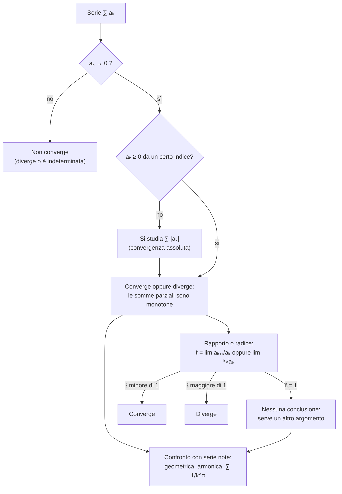

# Lezione 15 — Richiami sulle serie numeriche, coefficienti di Fourier e funzioni regolari a tratti

Con la [[MM L14 - Teorema di Stokes, divergenza e Pappo-Guldino|lezione 14]] si è chiusa la parte del corso dedicata al calcolo differenziale e integrale in più variabili; da questa lezione il corso prosegue con il prof. Marco Benini, che tratterà prima le **serie di Fourier** e poi l'analisi complessa. La lezione è introduttiva. La prima parte richiama le **serie numeriche**: la successione delle somme parziali, il significato di serie convergente, divergente e indeterminata, la **condizione necessaria per la convergenza**, il comportamento delle **serie a termini non negativi** e tre esempi fondamentali (serie geometrica, serie armonica, serie armonica generalizzata), seguiti dai **criteri del confronto, del rapporto e della radice**. La seconda parte imposta il problema delle serie di Fourier: che cos'è una **serie trigonometrica**, perché ha senso solo per funzioni periodiche, come si definiscono i **coefficienti di Fourier** e quali ipotesi di regolarità serviranno, cioè le funzioni **continue a tratti** e **di classe $C^1$ a tratti**. La lezione si chiude con una versione del teorema fondamentale del calcolo integrale valida per queste funzioni.

> [!note] Fonti di questa lezione
> Fonti: la trascrizione (parte 1), registrata il 9 novembre 2026, e gli appunti manuali "Lezione del 09/11/26" (4 pagine). **Le dispense del prof. Benini non sono presenti nel progetto**: il docente dice che sono su AulaWeb e coincidono con quelle dell'anno precedente, corrette rispetto alla prima versione. Enunciati e definizioni seguono quindi la lezione e gli appunti; se le dispense verranno aggiunte, andranno confrontate con questa nota. Molte formule scritte alla lavagna non sono pronunciate e mancano nella trascrizione: sono riprese dagli appunti. L'ultima parte della lezione, il lemma sul teorema fondamentale del calcolo generalizzato, non è nella registrazione (gli ultimi minuti contengono solo conversazioni laterali, omesse): segue gli appunti manuali, e il docente lo richiama come già visto all'inizio della lezione 16. Negli approfondimenti si usano anche la dispensa di supporto [@morro2023] e [@rudin1976]. Le figure sono costruite per rappresentare ciò che il docente disegna alla lavagna.

## La seconda parte del corso

Il docente presenta il programma della sua parte: prima le serie di Fourier, poi l'analisi complessa. Le serie di Fourier non richiedono nulla di quanto visto con il prof. Pinamonti e si sarebbero potute trattare anche prima; l'analisi complessa invece deve venire dopo, perché userà tra l'altro le formule di Green della [[MM L11 - Teorema di Green, divergenza e rotore|lezione 11]]. Se ne parlerà dopo due o tre settimane. Il metodo di esposizione sarà quello classico: definizione, osservazione, teorema, dimostrazione, lemma, proposizione.

## Richiami sulle serie numeriche

### Somme parziali e somma di una serie

Il punto di partenza è una successione di numeri $(a_k)$. Per ora i termini sono reali; in qualche occasione serviranno numeri complessi, ma questo non cambia le definizioni. A una successione si associa una seconda successione, quella delle **somme parziali**, il cui termine $n$-esimo è la somma dei primi termini fino all'indice $n$.

> [!important] Definizione — Somme parziali e somma di una serie
> Data una successione $(a_k) \subseteq \mathbb{R}$, la **successione delle somme parziali** $(S_n)$ è definita da
> $$S_n := \sum_{k=1}^{n} a_k .$$
> Se il limite di $(S_n)$ esiste, si definisce **somma della serie** di termine generale $a_k$ il numero (o il simbolo $\pm\infty$)
> $$\sum_{k=1}^{+\infty} a_k := \lim_{n\to+\infty} S_n = \lim_{n\to+\infty} \sum_{k=1}^{n} a_k .$$

Il simbolo $:=$ significa "è definito come": ciò che sta dalla parte dei due punti è definito da ciò che sta dall'altra parte. La notazione $\sum_{k=1}^{+\infty}$ si spiega da sola: si calcola il limite per $n \to +\infty$ e $n$ è l'estremo superiore della somma, quindi si fanno sparire $n$ e il limite e si scrive $+\infty$ al posto dell'estremo superiore. Va però ricordato che il simbolo indica un limite, non una "somma di infiniti termini" in senso algebrico.

L'indice iniziale $1$ non ha nulla di speciale. A seconda della successione la somma partirà da $k = 0$, da $k = 1$ o da un altro indice, ad esempio $k = 7$: l'indice iniziale della somma parziale è quello da cui parte la successione. Come si vedrà, per stabilire se una serie converge l'indice iniziale non conta, perché un numero finito di termini iniziali si somma comunque e dà un numero.

### Serie convergenti, divergenti e indeterminate

Il limite di $(S_n)$ può esistere finito, esistere ed essere $+\infty$ o $-\infty$, oppure non esistere. Le tre possibilità danno nome a tre tipi di serie.

> [!important] Definizione — Carattere di una serie
> - Se $\lim_{n\to+\infty} S_n$ esiste finito, la serie si dice **convergente**.
> - Se $\lim_{n\to+\infty} S_n = +\infty$ oppure $-\infty$, la serie si dice **divergente**.
> - Se $\lim_{n\to+\infty} S_n$ non esiste, la serie si dice **indeterminata**.

Determinare il carattere di una serie significa stabilire in quale dei tre casi ci si trova. Tre esempi elementari mostrano che tutti e tre i casi si presentano.

> [!example] Esempio — Una serie indeterminata: $a_k = (-1)^k$
> Le somme parziali sono
> $$S_n = \sum_{k=1}^{n} (-1)^k = -1 + 1 - 1 + 1 - \dots + (-1)^n = \begin{cases} 0 & \text{se } n \text{ è pari}, \\ -1 & \text{se } n \text{ è dispari}. \end{cases}$$
> Il primo termine si cancella con il secondo, il terzo con il quarto, e così via: se $n$ è pari si cancellano tutti, se $n$ è dispari resta l'ultimo, che vale $-1$. La successione $(S_n)$ oscilla tra $0$ e $-1$: ha due sottosuccessioni costanti, quindi convergenti, ma con limiti diversi ($0$ sugli indici pari, $-1$ su quelli dispari). Dunque $(S_n)$ non ammette limite e la serie è indeterminata.

> [!example] Esempio — Una serie convergente e una divergente
> Se $a_k = 0$ per ogni $k$, si somma zero a sé stesso $n$ volte e $S_n = 0$ per ogni $n$: la serie converge, con somma $0$.
> Se $a_k = 1$ per ogni $k$, si ha $S_n = \sum_{k=1}^{n} 1 = n$, che tende a $+\infty$: la serie diverge.

Alla richiesta di un esempio di serie convergente, a lezione è stata proposta anche $\sum 1/k^2$, che converge davvero ma, osserva il docente, è già un esempio "difficile": verrà trattata più avanti come caso della serie armonica generalizzata.

### Una condizione necessaria per la convergenza

In generale stabilire se una serie converge, diverge o è indeterminata è difficile, ma ci sono criteri che aiutano. Il primo è una condizione necessaria: se la serie converge, qualcosa deve succedere per forza ai suoi termini.

> [!important] Proposizione — Condizione necessaria per la convergenza
> Se la serie $\sum_{k=1}^{+\infty} a_k$ converge, allora la successione $(a_k)$ è **infinitesima**, cioè
> $$\lim_{k\to+\infty} a_k = 0 .$$

**Dimostrazione.** Si confrontano due somme parziali consecutive. Per definizione,
$$S_{n+1} - S_n = \sum_{k=1}^{n+1} a_k - \sum_{k=1}^{n} a_k = a_{n+1},$$
perché togliendo dalla somma fino a $n+1$ la somma fino a $n$ resta solo il termine $(n+1)$-esimo. Si passa al limite. Per ipotesi $(S_n)$ converge alla somma $S$ della serie, e anche $(S_{n+1})$ converge a $S$, perché è la stessa successione spostata di un passo e lo spostamento non cambia il limite. Per la regola sul limite di una differenza di successioni convergenti,
$$\lim_{n\to+\infty} a_{n+1} = \lim_{n\to+\infty} S_{n+1} - \lim_{n\to+\infty} S_n = \sum_{k=1}^{+\infty} a_k - \sum_{k=1}^{+\infty} a_k = 0 . \qquad \blacksquare$$

Nella pratica la proposizione si usa "al contrario", come criterio di non convergenza: se la successione dei termini non tende a zero, la serie non converge, e quindi è divergente oppure indeterminata. La condizione non è sufficiente: la serie armonica, studiata più avanti, ha termini infinitesimi ma diverge.

### Serie a termini non negativi

Il docente dice che la condizione necessaria non verrà usata spesso nel corso. Più importanti sono le **serie a termini non negativi**, cioè con $a_k \ge 0$ per ogni $k$ (spesso, con un piccolo abuso, dette "a termini positivi"). I motivi sono due: per queste serie esistono criteri di convergenza potenti, e le serie con termini di segno qualsiasi si possono spesso studiare passando ai moduli. La serie dei moduli $\sum |a_k|$ è a termini non negativi, e un teorema (che il docente cita senza enunciarlo, il criterio della convergenza assoluta) garantisce che se converge la serie dei moduli converge anche la serie di partenza.

> [!important] Proposizione — Serie a termini non negativi
> Se $a_k \ge 0$ per ogni $k$, la serie $\sum_{k=1}^{+\infty} a_k$ converge oppure diverge a $+\infty$: non può essere indeterminata.

**Dimostrazione.** La successione delle somme parziali è monotona non decrescente: si sommano numeri maggiori o uguali a zero, quindi aggiungendo un termine la somma resta costante o cresce, $S_{n+1} = S_n + a_{n+1} \ge S_n$. Una successione monotona non decrescente ha sempre limite: se è limitata converge (al suo estremo superiore, che qui è un numero maggiore o uguale a zero), altrimenti diverge a $+\infty$. Non ci sono altre possibilità. $\blacksquare$

Per una serie a termini non negativi, quindi, il limite della successione delle somme parziali esiste sempre, ed è questo il fatto che verrà usato in tutti gli esempi che seguono: resta solo da capire se è finito.

## Tre esempi fondamentali

### La serie geometrica

Sia $r \in \mathbb{R}$, detto **ragione**. La serie geometrica ha termini $a_0 = 1$ e $a_k = r^k$ per $k \ge 1$, e parte dall'indice $0$. Il docente separa il termine $a_0$ per evitare dubbi nel caso $r = 0$, dove si dovrebbe leggere $0^0$: la convenzione tacita, che verrà sempre usata, è che $x^0$ è la funzione costante $1$, quindi $r^0 = 1$ qualunque sia $r$. Le somme parziali sono
$$S_n = \sum_{k=0}^{n} r^k = 1 + r + r^2 + \dots + r^{n-1} + r^n .$$

**Formula per le somme parziali.** Moltiplicando $S_n$ per $1 - r$ si ottiene una somma "telescopica", in cui quasi tutti i termini si cancellano:
$$\big(1 + r + \dots + r^{n-1} + r^n\big)(1 - r) = (1 - r) + (r - r^2) + \dots + (r^{n-1} - r^n) + (r^n - r^{n+1}) = 1 - r^{n+1}.$$
Il secondo termine di ogni binomio cancella il primo del binomio successivo, a catena, fino al penultimo binomio; sopravvivono solo il primo termine del primo binomio e il secondo termine dell'ultimo. Quindi, per $r \neq 1$,
$$S_n = \frac{1 - r^{n+1}}{1 - r} . \tag{1}$$
Per $r = 1$ la formula non si può usare, ma il caso è già noto: i termini valgono tutti $1$, $S_n = n + 1$ e la serie diverge a $+\infty$.

**Caso $|r| \ge 1$.** Si ha $|a_k| = |r|^k \ge 1$ per ogni $k$: i termini non tendono a zero, quindi per la condizione necessaria la serie non converge. Se $r \ge 1$ la serie è a termini positivi, quindi non potendo convergere diverge a $+\infty$.

Se $r \le -1$ i moduli dei termini non tendono a zero, ma i segni si alternano, e la serie risulta indeterminata. Per verificarlo si osserva che dalla somma $S_{n+1}$ si può raccogliere un fattore $r$ in tutti i termini tranne il primo:
$$S_{n+1} = 1 + r + \dots + r^{n+1} = 1 + r\,\big(1 + r + \dots + r^n\big) = 1 + r\,S_n .$$
Si parte da $S_0 = a_0 = 1 \ge 1$. Poiché $r \le -1$, si ha $S_1 = 1 + r S_0 \le 1 - 1 = 0$. Ragionando allo stesso modo (passaggio formalizzato qui per induzione): se $S_n \ge 1$, allora $r S_n \le -S_n \le -1$ e $S_{n+1} \le 0$; se $S_n \le 0$, allora $r S_n \ge 0$ e $S_{n+1} \ge 1$. Quindi le somme parziali di indice pari sono tutte $\ge 1$ e quelle di indice dispari sono tutte $\le 0$. Una successione così non ammette limite: un limite finito o $+\infty$ è incompatibile con i termini dispari, un limite finito o $-\infty$ con i termini pari. Il caso tipico è $r = -1$, l'esempio indeterminato visto sopra: ora la somma parte da $k = 0$, quindi le somme parziali oscillano tra $1$ e $0$ invece che tra $0$ e $-1$.

**Caso $-1 < r < 1$.** Sono rimasti i valori di $r$ con $|r| < 1$, per i quali $r \neq 1$ e vale la formula (1). Una potenza con base di modulo minore di $1$ tende a zero al crescere dell'esponente, quindi $r^{n+1} \to 0$ e
$$\lim_{n\to+\infty} S_n = \frac{1 - \lim_{n\to+\infty} r^{n+1}}{1 - r} = \frac{1}{1 - r} .$$

> [!important] Proposizione — Serie geometrica
> La serie geometrica $\sum_{k=0}^{+\infty} r^k$ di ragione $r \in \mathbb{R}$
> - converge per $-1 < r < 1$, con somma $\displaystyle\sum_{k=0}^{+\infty} r^k = \frac{1}{1 - r}$;
> - diverge a $+\infty$ per $r \ge 1$;
> - è indeterminata per $r \le -1$.

| Ragione | Termini | Somme parziali | Carattere |
|---|---|---|---|
| $r \ge 1$ | non infinitesimi, positivi | crescono senza limite | diverge a $+\infty$ |
| $-1 < r < 1$ | infinitesimi | $\frac{1 - r^{n+1}}{1 - r} \to \frac{1}{1-r}$ | converge a $\frac{1}{1-r}$ |
| $r \le -1$ | non infinitesimi, segni alterni | pari $\ge 1$, dispari $\le 0$ | indeterminata |

> [!example] Esempio (aggiunto) — Due serie geometriche convergenti
> Per $r = \tfrac12$: $\sum_{k=0}^{+\infty} \big(\tfrac12\big)^k = \frac{1}{1 - 1/2} = 2$. Per $r = -\tfrac12$: $\sum_{k=0}^{+\infty} \big(-\tfrac12\big)^k = \frac{1}{1 + 1/2} = \frac23$; qui i termini cambiano segno, ma il loro modulo tende a zero abbastanza in fretta e le somme parziali oscillano attorno a $\tfrac23$ con oscillazioni sempre più piccole.

### La serie armonica

La **serie armonica** ha termini $a_k = \frac1k > 0$:
$$\sum_{k=1}^{+\infty} \frac1k .$$
I termini tendono a zero, quindi la condizione necessaria non esclude la convergenza. La serie è a termini positivi, quindi converge oppure diverge. Chiesto agli studenti di scommettere, il docente conferma la scommessa sulla divergenza: per dimostrarla bisogna far vedere che la serie diverge "meglio" di qualcosa che già si sa divergere, cioè trovare una minorazione delle somme parziali con una quantità che tende a $+\infty$.

**Il confronto con un integrale.** Se $k \le x \le k+1$, allora $\frac1k \ge \frac1x$. Integrando questa disuguaglianza sull'intervallo $[k, k+1]$, dove vale per ogni $x$, si ottiene
$$\frac1k = \int_k^{k+1} \frac1k \, dx \ \ge\ \int_k^{k+1} \frac1x \, dx . \tag{2}$$
Il primo passaggio è il trucco della dimostrazione: $\frac1k$ è l'integrale della funzione costante $\frac1k$ su un intervallo di lunghezza $1$. Geometricamente, $\frac1k$ è l'area di un rettangolo di base $[k, k+1]$ e altezza $\frac1k$, che sta sopra il grafico di $\frac1x$ (figura, a sinistra).

<svg viewBox="0 0 660 300" width="660" style="display:block;margin:1em auto;max-width:100%;height:auto;font-family:inherit" xmlns="http://www.w3.org/2000/svg"><rect x="74.0" y="60.0" width="44.0" height="175.0" fill="#3b82f6" fill-opacity="0.2" stroke="#3b82f6" stroke-width="1"/><rect x="118.0" y="147.5" width="44.0" height="87.5" fill="#3b82f6" fill-opacity="0.2" stroke="#3b82f6" stroke-width="1"/><rect x="162.0" y="176.7" width="44.0" height="58.3" fill="#3b82f6" fill-opacity="0.2" stroke="#3b82f6" stroke-width="1"/><rect x="206.0" y="191.2" width="44.0" height="43.8" fill="#3b82f6" fill-opacity="0.2" stroke="#3b82f6" stroke-width="1"/><rect x="250.0" y="200.0" width="44.0" height="35.0" fill="#3b82f6" fill-opacity="0.2" stroke="#3b82f6" stroke-width="1"/><polyline points="74.0,60.0 74.9,63.4 75.8,66.7 76.6,69.9 77.5,73.0 78.4,75.9 79.3,78.8 80.2,81.5 81.0,84.1 81.9,86.7 82.8,89.2 83.7,91.6 84.6,93.9 85.4,96.1 86.3,98.3 87.2,100.4 88.1,102.4 89.0,104.4 89.8,106.3 90.7,108.2 91.6,110.0 92.5,111.8 93.4,113.5 94.2,115.1 95.1,116.8 96.0,118.3 96.9,119.9 97.8,121.4 98.6,122.8 99.5,124.2 100.4,125.6 101.3,127.0 102.2,128.3 103.0,129.6 103.9,130.8 104.8,132.1 105.7,133.3 106.6,134.4 107.4,135.6 108.3,136.7 109.2,137.8 110.1,138.8 111.0,139.9 111.8,140.9 112.7,141.9 113.6,142.9 114.5,143.9 115.4,144.8 116.2,145.7 117.1,146.6 118.0,147.5 118.9,148.4 119.8,149.2 120.6,150.0 121.5,150.9 122.4,151.7 123.3,152.5 124.2,153.2 125.0,154.0 125.9,154.7 126.8,155.5 127.7,156.2 128.6,156.9 129.4,157.6 130.3,158.2 131.2,158.9 132.1,159.6 133.0,160.2 133.8,160.8 134.7,161.5 135.6,162.1 136.5,162.7 137.4,163.3 138.2,163.9 139.1,164.4 140.0,165.0 140.9,165.6 141.8,166.1 142.6,166.6 143.5,167.2 144.4,167.7 145.3,168.2 146.2,168.7 147.0,169.2 147.9,169.7 148.8,170.2 149.7,170.7 150.6,171.1 151.4,171.6 152.3,172.1 153.2,172.5 154.1,172.9 155.0,173.4 155.8,173.8 156.7,174.2 157.6,174.7 158.5,175.1 159.4,175.5 160.2,175.9 161.1,176.3 162.0,176.7 162.9,177.1 163.8,177.4 164.6,177.8 165.5,178.2 166.4,178.5 167.3,178.9 168.2,179.3 169.0,179.6 169.9,180.0 170.8,180.3 171.7,180.7 172.6,181.0 173.4,181.3 174.3,181.6 175.2,182.0 176.1,182.3 177.0,182.6 177.8,182.9 178.7,183.2 179.6,183.5 180.5,183.8 181.4,184.1 182.2,184.4 183.1,184.7 184.0,185.0 184.9,185.3 185.8,185.6 186.6,185.8 187.5,186.1 188.4,186.4 189.3,186.7 190.2,186.9 191.0,187.2 191.9,187.4 192.8,187.7 193.7,188.0 194.6,188.2 195.4,188.5 196.3,188.7 197.2,188.9 198.1,189.2 199.0,189.4 199.8,189.7 200.7,189.9 201.6,190.1 202.5,190.4 203.4,190.6 204.2,190.8 205.1,191.0 206.0,191.2 206.9,191.5 207.8,191.7 208.6,191.9 209.5,192.1 210.4,192.3 211.3,192.5 212.2,192.7 213.0,192.9 213.9,193.1 214.8,193.3 215.7,193.5 216.6,193.7 217.4,193.9 218.3,194.1 219.2,194.3 220.1,194.5 221.0,194.7 221.8,194.9 222.7,195.0 223.6,195.2 224.5,195.4 225.4,195.6 226.2,195.8 227.1,195.9 228.0,196.1 228.9,196.3 229.8,196.5 230.6,196.6 231.5,196.8 232.4,197.0 233.3,197.1 234.2,197.3 235.0,197.4 235.9,197.6 236.8,197.8 237.7,197.9 238.6,198.1 239.4,198.2 240.3,198.4 241.2,198.5 242.1,198.7 243.0,198.8 243.8,199.0 244.7,199.1 245.6,199.3 246.5,199.4 247.4,199.6 248.2,199.7 249.1,199.9 250.0,200.0 250.9,200.1 251.8,200.3 252.6,200.4 253.5,200.6 254.4,200.7 255.3,200.8 256.2,201.0 257.0,201.1 257.9,201.2 258.8,201.3 259.7,201.5 260.6,201.6 261.4,201.7 262.3,201.9 263.2,202.0 264.1,202.1 265.0,202.2 265.8,202.4 266.7,202.5 267.6,202.6 268.5,202.7 269.4,202.8 270.2,202.9 271.1,203.1 272.0,203.2 272.9,203.3 273.8,203.4 274.6,203.5 275.5,203.6 276.4,203.8 277.3,203.9 278.2,204.0 279.0,204.1 279.9,204.2 280.8,204.3 281.7,204.4 282.6,204.5 283.4,204.6 284.3,204.7 285.2,204.8 286.1,204.9 287.0,205.0 287.8,205.1 288.7,205.2 289.6,205.3 290.5,205.4 291.4,205.5 292.2,205.6 293.1,205.7 294.0,205.8 294.9,205.9 295.8,206.0 296.6,206.1 297.5,206.2 298.4,206.3 299.3,206.4 300.2,206.5 301.0,206.6 301.9,206.7 302.8,206.8 303.7,206.9 304.6,207.0 305.4,207.0 306.3,207.1 307.2,207.2 308.1,207.3 309.0,207.4 309.8,207.5 310.7,207.6 311.6,207.7" fill="none" stroke="#e05a47" stroke-width="2"/><line x1="30.0" y1="235.0" x2="315.6" y2="235.0" stroke="currentColor" stroke-width="1.2" stroke-opacity="1"/><polygon points="320.4,235.0 314.4,232.0 314.4,238.0" fill="currentColor"/><line x1="30.0" y1="235.0" x2="30.0" y2="26.3" stroke="currentColor" stroke-width="1.2" stroke-opacity="1"/><polygon points="30.0,21.5 27.0,27.5 33.0,27.5" fill="currentColor"/><line x1="74.0" y1="232.0" x2="74.0" y2="238.0" stroke="currentColor" stroke-width="1.2" stroke-opacity="1"/><text x="74.0" y="251.0" font-size="11" text-anchor="middle" fill="currentColor">1</text><line x1="118.0" y1="232.0" x2="118.0" y2="238.0" stroke="currentColor" stroke-width="1.2" stroke-opacity="1"/><text x="118.0" y="251.0" font-size="11" text-anchor="middle" fill="currentColor">2</text><line x1="162.0" y1="232.0" x2="162.0" y2="238.0" stroke="currentColor" stroke-width="1.2" stroke-opacity="1"/><text x="162.0" y="251.0" font-size="11" text-anchor="middle" fill="currentColor">3</text><line x1="206.0" y1="232.0" x2="206.0" y2="238.0" stroke="currentColor" stroke-width="1.2" stroke-opacity="1"/><text x="206.0" y="251.0" font-size="11" text-anchor="middle" fill="currentColor">4</text><line x1="250.0" y1="232.0" x2="250.0" y2="238.0" stroke="currentColor" stroke-width="1.2" stroke-opacity="1"/><text x="250.0" y="251.0" font-size="11" text-anchor="middle" fill="currentColor">5</text><line x1="294.0" y1="232.0" x2="294.0" y2="238.0" stroke="currentColor" stroke-width="1.2" stroke-opacity="1"/><text x="294.0" y="251.0" font-size="11" text-anchor="middle" fill="currentColor">6</text><text x="320.4" y="251.0" font-size="12" text-anchor="middle" fill="currentColor" font-style="italic">x</text><text x="22.0" y="64.0" font-size="11" text-anchor="end" fill="currentColor">1</text><line x1="27.0" y1="60.0" x2="33.0" y2="60.0" stroke="currentColor" stroke-width="1.2" stroke-opacity="1"/><text x="165.0" y="22.0" font-size="12.5" text-anchor="middle" fill="currentColor">serie armonica: rettangoli sopra la curva</text><text x="131.2" y="126.5" font-size="12.5" text-anchor="start" fill="#e05a47" font-style="italic">y = 1/x</text><rect x="404.0" y="191.2" width="44.0" height="43.8" fill="#3b82f6" fill-opacity="0.2" stroke="#3b82f6" stroke-width="1"/><rect x="448.0" y="215.6" width="44.0" height="19.4" fill="#3b82f6" fill-opacity="0.2" stroke="#3b82f6" stroke-width="1"/><rect x="492.0" y="224.1" width="44.0" height="10.9" fill="#3b82f6" fill-opacity="0.2" stroke="#3b82f6" stroke-width="1"/><rect x="536.0" y="228.0" width="44.0" height="7.0" fill="#3b82f6" fill-opacity="0.2" stroke="#3b82f6" stroke-width="1"/><rect x="580.0" y="230.1" width="44.0" height="4.9" fill="#3b82f6" fill-opacity="0.2" stroke="#3b82f6" stroke-width="1"/><polyline points="404.0,60.0 404.9,66.8 405.8,73.2 406.6,79.3 407.5,85.0 408.4,90.4 409.3,95.5 410.2,100.3 411.0,104.9 411.9,109.3 412.8,113.5 413.7,117.4 414.6,121.2 415.4,124.8 416.3,128.2 417.2,131.4 418.1,134.6 419.0,137.5 419.8,140.4 420.7,143.1 421.6,145.7 422.5,148.2 423.4,150.6 424.2,152.9 425.1,155.1 426.0,157.2 426.9,159.3 427.8,161.2 428.6,163.1 429.5,164.9 430.4,166.6 431.3,168.3 432.2,169.9 433.0,171.5 433.9,173.0 434.8,174.4 435.7,175.8 436.6,177.2 437.4,178.5 438.3,179.8 439.2,181.0 440.1,182.2 441.0,183.3 441.8,184.4 442.7,185.5 443.6,186.5 444.5,187.5 445.4,188.5 446.2,189.4 447.1,190.4 448.0,191.2 448.9,192.1 449.8,192.9 450.6,193.8 451.5,194.6 452.4,195.3 453.3,196.1 454.2,196.8 455.0,197.5 455.9,198.2 456.8,198.8 457.7,199.5 458.6,200.1 459.4,200.7 460.3,201.3 461.2,201.9 462.1,202.5 463.0,203.0 463.8,203.6 464.7,204.1 465.6,204.6 466.5,205.1 467.4,205.6 468.2,206.1 469.1,206.5 470.0,207.0 470.9,207.4 471.8,207.9 472.6,208.3 473.5,208.7 474.4,209.1 475.3,209.5 476.2,209.9 477.0,210.3 477.9,210.6 478.8,211.0 479.7,211.3 480.6,211.7 481.4,212.0 482.3,212.4 483.2,212.7 484.1,213.0 485.0,213.3 485.8,213.6 486.7,213.9 487.6,214.2 488.5,214.5 489.4,214.8 490.2,215.0 491.1,215.3 492.0,215.6 492.9,215.8 493.8,216.1 494.6,216.3 495.5,216.6 496.4,216.8 497.3,217.0 498.2,217.3 499.0,217.5 499.9,217.7 500.8,217.9 501.7,218.1 502.6,218.3 503.4,218.5 504.3,218.7 505.2,218.9 506.1,219.1 507.0,219.3 507.8,219.5 508.7,219.7 509.6,219.9 510.5,220.0 511.4,220.2 512.2,220.4 513.1,220.5 514.0,220.7 514.9,220.9 515.8,221.0 516.6,221.2 517.5,221.3 518.4,221.5 519.3,221.6 520.2,221.8 521.0,221.9 521.9,222.1 522.8,222.2 523.7,222.4 524.6,222.5 525.4,222.6 526.3,222.8 527.2,222.9 528.1,223.0 529.0,223.1 529.8,223.3 530.7,223.4 531.6,223.5 532.5,223.6 533.4,223.7 534.2,223.8 535.1,224.0 536.0,224.1 536.9,224.2 537.8,224.3 538.6,224.4 539.5,224.5 540.4,224.6 541.3,224.7 542.2,224.8 543.0,224.9 543.9,225.0 544.8,225.1 545.7,225.2 546.6,225.3 547.4,225.4 548.3,225.4 549.2,225.5 550.1,225.6 551.0,225.7 551.8,225.8 552.7,225.9 553.6,226.0 554.5,226.0 555.4,226.1 556.2,226.2 557.1,226.3 558.0,226.4 558.9,226.4 559.8,226.5 560.6,226.6 561.5,226.7 562.4,226.7 563.3,226.8 564.2,226.9 565.0,226.9 565.9,227.0 566.8,227.1 567.7,227.1 568.6,227.2 569.4,227.3 570.3,227.3 571.2,227.4 572.1,227.5 573.0,227.5 573.8,227.6 574.7,227.7 575.6,227.7 576.5,227.8 577.4,227.8 578.2,227.9 579.1,227.9 580.0,228.0 580.9,228.1 581.8,228.1 582.6,228.2 583.5,228.2 584.4,228.3 585.3,228.3 586.2,228.4 587.0,228.4 587.9,228.5 588.8,228.5 589.7,228.6 590.6,228.6 591.4,228.7 592.3,228.7 593.2,228.8 594.1,228.8 595.0,228.9 595.8,228.9 596.7,229.0 597.6,229.0 598.5,229.0 599.4,229.1 600.2,229.1 601.1,229.2 602.0,229.2 602.9,229.3 603.8,229.3 604.6,229.3 605.5,229.4 606.4,229.4 607.3,229.5 608.2,229.5 609.0,229.5 609.9,229.6 610.8,229.6 611.7,229.7 612.6,229.7 613.4,229.7 614.3,229.8 615.2,229.8 616.1,229.8 617.0,229.9 617.8,229.9 618.7,229.9 619.6,230.0 620.5,230.0 621.4,230.0 622.2,230.1 623.1,230.1 624.0,230.1 624.9,230.2 625.8,230.2 626.6,230.2 627.5,230.3 628.4,230.3 629.3,230.3 630.2,230.4 631.0,230.4 631.9,230.4 632.8,230.4 633.7,230.5 634.6,230.5 635.4,230.5 636.3,230.6 637.2,230.6 638.1,230.6 639.0,230.6 639.8,230.7 640.7,230.7 641.6,230.7" fill="none" stroke="#e05a47" stroke-width="2"/><line x1="360.0" y1="235.0" x2="645.6" y2="235.0" stroke="currentColor" stroke-width="1.2" stroke-opacity="1"/><polygon points="650.4,235.0 644.4,232.0 644.4,238.0" fill="currentColor"/><line x1="360.0" y1="235.0" x2="360.0" y2="26.3" stroke="currentColor" stroke-width="1.2" stroke-opacity="1"/><polygon points="360.0,21.5 357.0,27.5 363.0,27.5" fill="currentColor"/><line x1="404.0" y1="232.0" x2="404.0" y2="238.0" stroke="currentColor" stroke-width="1.2" stroke-opacity="1"/><text x="404.0" y="251.0" font-size="11" text-anchor="middle" fill="currentColor">1</text><line x1="448.0" y1="232.0" x2="448.0" y2="238.0" stroke="currentColor" stroke-width="1.2" stroke-opacity="1"/><text x="448.0" y="251.0" font-size="11" text-anchor="middle" fill="currentColor">2</text><line x1="492.0" y1="232.0" x2="492.0" y2="238.0" stroke="currentColor" stroke-width="1.2" stroke-opacity="1"/><text x="492.0" y="251.0" font-size="11" text-anchor="middle" fill="currentColor">3</text><line x1="536.0" y1="232.0" x2="536.0" y2="238.0" stroke="currentColor" stroke-width="1.2" stroke-opacity="1"/><text x="536.0" y="251.0" font-size="11" text-anchor="middle" fill="currentColor">4</text><line x1="580.0" y1="232.0" x2="580.0" y2="238.0" stroke="currentColor" stroke-width="1.2" stroke-opacity="1"/><text x="580.0" y="251.0" font-size="11" text-anchor="middle" fill="currentColor">5</text><line x1="624.0" y1="232.0" x2="624.0" y2="238.0" stroke="currentColor" stroke-width="1.2" stroke-opacity="1"/><text x="624.0" y="251.0" font-size="11" text-anchor="middle" fill="currentColor">6</text><text x="650.4" y="251.0" font-size="12" text-anchor="middle" fill="currentColor" font-style="italic">x</text><text x="352.0" y="64.0" font-size="11" text-anchor="end" fill="currentColor">1</text><line x1="357.0" y1="60.0" x2="363.0" y2="60.0" stroke="currentColor" stroke-width="1.2" stroke-opacity="1"/><text x="495.0" y="22.0" font-size="12.5" text-anchor="middle" fill="currentColor">α = 2: rettangoli sotto la curva (k ≥ 2)</text><text x="423.8" y="103.8" font-size="12.5" text-anchor="start" fill="#e05a47" font-style="italic">y = 1/x²</text><text x="330.0" y="272.0" font-size="10.5" text-anchor="middle" fill="currentColor">blu: rettangoli di base 1 e altezza 1/k (a sinistra, su [k, k+1]) o 1/k² (a destra, su [k−1, k]); rosso: la funzione</text><text x="330.0" y="287.0" font-size="10.5" text-anchor="middle" fill="currentColor">confrontata. La somma delle aree dei rettangoli è la somma parziale; l'area sotto la curva rossa è l'integrale.</text></svg>

Si sommano le disuguaglianze (2) per $k = 1, \dots, n$: sono tutte nello stesso verso, quindi la somma delle disuguaglianze è ancora una disuguaglianza. A destra compaiono gli integrali di $\frac1x$ su intervalli consecutivi $[1, 2], [2, 3], \dots, [n, n+1]$, che per l'additività dell'integrale si riuniscono in un solo integrale da $1$ a $n+1$:
$$S_n = \sum_{k=1}^{n} \frac1k \ \ge\ \sum_{k=1}^{n} \int_k^{k+1} \frac1x \, dx = \int_1^2 \frac1x \, dx + \int_2^3 \frac1x \, dx + \dots + \int_n^{n+1} \frac1x \, dx = \int_1^{n+1} \frac1x \, dx = \ln(n+1),$$
perché $\ln x$ è una primitiva di $\frac1x$ e $\ln 1 = 0$. Dunque $S_n \ge \ln(n+1)$ per ogni $n$.

**Passaggio al limite.** Il limite di $(S_n)$ esiste perché la serie è a termini positivi, e il limite di $\ln(n+1)$ è $+\infty$: il logaritmo cresce lentamente, ma diverge. Per il teorema del confronto per i limiti, il limite della successione più grande è maggiore o uguale a quello della più piccola:
$$\lim_{n\to+\infty} S_n \ \ge\ \lim_{n\to+\infty} \ln(n+1) = +\infty \quad\Longrightarrow\quad \sum_{k=1}^{+\infty} \frac1k = +\infty .$$

> [!important] Proposizione — Serie armonica
> La serie armonica $\displaystyle\sum_{k=1}^{+\infty} \frac1k$ diverge a $+\infty$. Più precisamente, $S_n \ge \ln(n+1)$ per ogni $n \ge 1$.

La serie armonica è l'esempio standard che mostra che la condizione necessaria non è sufficiente: i termini tendono a zero, ma non abbastanza in fretta.

### La serie armonica generalizzata

Sia ora $\alpha > 1$ e $a_k = \frac{1}{k^\alpha}$. Rispetto alla serie armonica i termini sono infinitesimi "un po' più velocemente", e questa volta ci si aspetta la convergenza. La serie è di nuovo a termini positivi, quindi il limite delle somme parziali esiste; resta da capire se è finito. Per dimostrare la convergenza la strategia è opposta a quella di prima: far vedere che la serie converge "meglio" di qualcosa che converge, cioè cercare una maggiorazione delle somme parziali.

**Il confronto con un integrale, nell'altro verso.** Invece dell'intervallo $[k, k+1]$ si usa quello precedente, $[k-1, k]$, così che la stima tra $\frac1k$ e $\frac1x$ si rovescia: se $k - 1 \le x \le k$, allora $\frac1k \le \frac1x$, e quindi, elevando alla $\alpha > 0$, $\frac{1}{k^\alpha} \le \frac{1}{x^\alpha}$. Integrando su $[k-1, k]$:
$$\frac{1}{k^\alpha} = \int_{k-1}^{k} \frac{1}{k^\alpha} \, dx \ \le\ \int_{k-1}^{k} \frac{1}{x^\alpha} \, dx . \tag{3}$$
Ora il rettangolo di base $[k-1, k]$ e altezza $\frac{1}{k^\alpha}$ sta sotto il grafico di $\frac{1}{x^\alpha}$ (figura, a destra).

La stima (3) per $k = 1$ richiederebbe l'integrale di $\frac{1}{x^\alpha}$ da $0$ a $1$, che con $\alpha > 1$ è infinito e rende la maggiorazione inutile. Per evitare questo fastidio il primo termine si scrive a parte, e la (3) si usa solo per $k \ge 2$. Con l'additività dell'integrale:
$$S_n = \sum_{k=1}^{n} \frac{1}{k^\alpha} = 1 + \sum_{k=2}^{n} \frac{1}{k^\alpha} \ \le\ 1 + \sum_{k=2}^{n} \int_{k-1}^{k} \frac{1}{x^\alpha} \, dx = 1 + \int_1^n \frac{1}{x^\alpha} \, dx .$$

**Il calcolo dell'integrale.** Una primitiva di $x^{-\alpha}$ è $\frac{x^{-\alpha+1}}{-\alpha+1}$: derivando, l'esponente $-\alpha + 1$ scende e si semplifica con il denominatore, e resta $x^{-\alpha}$. Cambiando segno a numeratore e denominatore per avere a denominatore la quantità positiva $\alpha - 1$, si scambiano anche gli estremi di valutazione:
$$\int_1^n x^{-\alpha} \, dx = \Big[\frac{x^{1-\alpha}}{1-\alpha}\Big]_1^n = \frac{1}{\alpha - 1}\Big(1 - n^{1-\alpha}\Big) = \frac{1}{\alpha-1}\Big(1 - \frac{1}{n^{\alpha-1}}\Big).$$
Quindi
$$S_n \ \le\ 1 + \frac{1}{\alpha-1}\Big(1 - \frac{1}{n^{\alpha-1}}\Big) \ \le\ 1 + \frac{1}{\alpha - 1} = \frac{\alpha}{\alpha-1} .$$
Il punto cruciale è l'ipotesi $\alpha > 1$: l'esponente $\alpha - 1$ è positivo, quindi $n^{\alpha-1} \to +\infty$ e il suo reciproco tende a zero. Per $\alpha = 1$ questo calcolo non ha senso (la primitiva sarebbe il logaritmo, e si ritroverebbe la divergenza della serie armonica).

**Conclusione.** Le somme parziali formano una successione non decrescente e limitata dall'alto da $\frac{\alpha}{\alpha-1}$, quindi convergono. Il docente sottolinea un punto che è facile fraintendere: il calcolo **non** dà la somma della serie, ma solo una sua stima dall'alto.

> [!important] Proposizione — Serie armonica generalizzata
> Per $\alpha > 1$ la serie $\displaystyle\sum_{k=1}^{+\infty} \frac{1}{k^\alpha}$ converge, e
> $$\sum_{k=1}^{+\infty} \frac{1}{k^\alpha} \ \le\ \frac{\alpha}{\alpha - 1} .$$

Il grafico seguente confronta, per $n = 1, \dots, 20$, le somme parziali della serie armonica con la minorazione $\ln(n+1)$ e le somme parziali di $\sum 1/k^2$ con la maggiorazione $1 + \big(1 - \tfrac1n\big) = 2 - \tfrac1n$ ottenuta sopra per $\alpha = 2$ (valori calcolati, arrotondati alla terza cifra). Le prime crescono senza fermarsi, come il logaritmo; le seconde restano sotto $2$.

```chart
type: line
labels: [1, 2, 3, 4, 5, 6, 7, 8, 9, 10, 11, 12, 13, 14, 15, 16, 17, 18, 19, 20]
series:
  - title: somme parziali di 1/k
    data: [1.0, 1.5, 1.833, 2.083, 2.283, 2.45, 2.593, 2.718, 2.829, 2.929, 3.02, 3.103, 3.18, 3.252, 3.318, 3.381, 3.44, 3.495, 3.548, 3.598]
  - title: ln(n+1)
    data: [0.693, 1.099, 1.386, 1.609, 1.792, 1.946, 2.079, 2.197, 2.303, 2.398, 2.485, 2.565, 2.639, 2.708, 2.773, 2.833, 2.89, 2.944, 2.996, 3.045]
  - title: somme parziali di 1/k^2
    data: [1.0, 1.25, 1.361, 1.424, 1.464, 1.491, 1.512, 1.527, 1.54, 1.55, 1.558, 1.565, 1.571, 1.576, 1.58, 1.584, 1.588, 1.591, 1.594, 1.596]
  - title: 2 - 1/n
    data: [1.0, 1.5, 1.667, 1.75, 1.8, 1.833, 1.857, 1.875, 1.889, 1.9, 1.909, 1.917, 1.923, 1.929, 1.933, 1.938, 1.941, 1.944, 1.947, 1.95]
width: 80%
fill: false
beginAtZero: true
```

> [!tip] Approfondimento — Quanto vale $\sum 1/k^2$
> #approfondimento La stima della lezione dà $\sum_{k=1}^{+\infty} \frac{1}{k^2} \le 2$. Il valore esatto è $\frac{\pi^2}{6} \approx 1{,}645$, il risultato del cosiddetto problema di Basilea, ottenuto da Eulero. È proprio con le serie di Fourier che lo si ricava in modo elementare: la dispensa di supporto sviluppa in serie di Fourier la funzione $x^2$ su $[-\pi, \pi]$, ottiene $x^2 = \frac{\pi^2}{3} + 4\sum_{k\ge1} \frac{(-1)^k}{k^2}\cos kx$ e, valutando in $x = \pi$, ricava $\sum_{k\ge 1} \frac{1}{k^2} = \frac{\pi^2}{6}$ [@morro2023, §5.1.3, §5.2]. Le somme parziali del grafico sopra si avvicinano lentamente a questo valore (per $n = 20$ si ha $1{,}596$; per $n = 100$, $1{,}635$).

## Criteri di convergenza per serie a termini non negativi

Le serie a termini non negativi hanno criteri di convergenza piuttosto efficaci. Il docente ne richiama tre. In tutti, le ipotesi sul segno e le disuguaglianze tra termini possono essere violate da un numero finito di termini iniziali senza che la conclusione cambi: i primi dieci, o diecimila, termini si sommano a parte e danno un numero, e il carattere della serie dipende solo da ciò che succede dopo, tolto un numero finito di indici.

### Criterio del confronto

> [!important] Teorema — Criterio del confronto
> Siano $(a_k)$ e $(b_k)$ due successioni a termini non negativi con $a_k \le b_k$ per ogni $k$. Allora:
> 1. se $\sum_{k=1}^{+\infty} b_k$ converge, anche $\sum_{k=1}^{+\infty} a_k$ converge;
> 2. se $\sum_{k=1}^{+\infty} a_k$ diverge, anche $\sum_{k=1}^{+\infty} b_k$ diverge.

Il docente lo giustifica a parole: se converge la serie più grande, converge "a maggior ragione" quella più piccola; se diverge la più piccola, diverge a maggior ragione la più grande. Non ci sono altre possibilità, perché le serie sono a termini non negativi e possono solo convergere o divergere.

**Dimostrazione (formalizzazione aggiunta).** Siano $S_n = \sum_{k=1}^n a_k$ e $T_n = \sum_{k=1}^n b_k$. Da $a_k \le b_k$ segue $S_n \le T_n$ per ogni $n$. Entrambe le successioni sono monotone non decrescenti e quindi hanno limite, e per il teorema del confronto per i limiti $\lim S_n \le \lim T_n$. Se $\lim T_n$ è finito lo è anche $\lim S_n$, che è la prima affermazione; se $\lim S_n = +\infty$ allora $\lim T_n = +\infty$, che è la seconda. $\blacksquare$

Se la disuguaglianza $a_k \le b_k$ vale solo da un certo indice in poi, le due conclusioni restano vere. Può invece cambiare il confronto tra le somme: non è più detto che $\sum a_k \le \sum b_k$, perché i termini iniziali in cui la disuguaglianza è violata possono invertire l'ordine delle due somme.

> [!example] Esempio (aggiunto) — La serie armonica generalizzata con $\alpha \le 1$
> Se $0 < \alpha \le 1$, per $k \ge 1$ si ha $k^\alpha \le k$, quindi $\frac{1}{k^\alpha} \ge \frac1k$. La serie armonica diverge, quindi per il criterio del confronto (seconda affermazione) diverge anche $\sum 1/k^\alpha$. Insieme alla proposizione precedente: $\sum_{k\ge1} 1/k^\alpha$ converge se e solo se $\alpha > 1$.

### Criterio del rapporto

Per una successione a termini positivi ci si può chiedere come varia $a_{k+1}$ rispetto al suo predecessore $a_k$: il rapporto $\frac{a_{k+1}}{a_k}$ è maggiore di $1$ se la successione sta crescendo, uguale a $1$ se resta costante, minore di $1$ se sta decrescendo. Il criterio del rapporto guarda il limite di questo rapporto.

> [!important] Teorema — Criterio del rapporto
> Sia $(a_k)$ una successione a termini positivi e supponiamo che esista finito
> $$\ell := \lim_{k\to+\infty} \frac{a_{k+1}}{a_k} \in [0, +\infty) .$$
> Allora:
> - se $\ell < 1$, la serie $\sum_{k=1}^{+\infty} a_k$ converge;
> - se $\ell > 1$, la serie $\sum_{k=1}^{+\infty} a_k$ diverge.

Il limite, se esiste finito, è necessariamente $\ge 0$, perché numeratore e denominatore sono positivi: al peggio vale zero. Se $\ell < 1$ la successione, da un certo punto in poi, decresce almeno come una progressione geometrica di ragione minore di $1$, e la serie converge per confronto con la serie geometrica; se $\ell > 1$ i termini finiscono per crescere e non possono tendere a zero.

### Criterio della radice

> [!important] Teorema — Criterio della radice
> Sia $(a_k)$ una successione a termini non negativi e supponiamo che esista finito
> $$\ell := \lim_{k\to+\infty} \sqrt[k]{a_k} \in [0, +\infty) .$$
> Allora:
> - se $\ell < 1$, la serie $\sum_{k=1}^{+\infty} a_k$ converge;
> - se $\ell > 1$, la serie $\sum_{k=1}^{+\infty} a_k$ diverge.

Anche qui il limite, se esiste, è $\ge 0$, perché le radici di numeri non negativi sono non negative. L'idea è la stessa: se $\ell < 1$, da un certo indice $\sqrt[k]{a_k} < r$ per un $r < 1$, cioè $a_k < r^k$, e la serie si confronta con la serie geometrica di ragione $r$.

> [!example] Esempio (aggiunto) — Una serie studiata con i due criteri
> Sia $a_k = \frac{k}{2^k}$. Con il rapporto: $\frac{a_{k+1}}{a_k} = \frac{k+1}{2^{k+1}}\cdot\frac{2^k}{k} = \frac{k+1}{2k} \to \frac12 < 1$. Con la radice: $\sqrt[k]{a_k} = \frac{\sqrt[k]{k}}{2} \to \frac12 < 1$, perché $\sqrt[k]{k} = e^{\ln k / k} \to e^0 = 1$. In entrambi i casi la serie converge (la sua somma, che i criteri non danno, è $2$).

### Il caso $\ell = 1$

> [!important] Osservazione — Quando $\ell = 1$ i criteri non dicono nulla
> Se il limite $\ell$ del criterio del rapporto o della radice vale $1$, il criterio non permette di concludere: esistono serie con $\ell = 1$ che convergono e serie con $\ell = 1$ che divergono.

Il docente precisa che i criteri non tacciono "perché sono scarsi", ma perché davvero con $\ell = 1$ può succedere di tutto. L'esempio è la serie armonica generalizzata $\sum 1/k^\alpha$, che converge per $\alpha > 1$ e diverge per $\alpha = 1$. Con il criterio del rapporto,
$$\lim_{k\to+\infty} \frac{\;\frac{1}{(k+1)^\alpha}\;}{\frac{1}{k^\alpha}} = \lim_{k\to+\infty} \Big(\frac{k}{k+1}\Big)^\alpha = \Big(\lim_{k\to+\infty} \frac{k}{k+1}\Big)^\alpha = 1,$$
qualunque sia $\alpha$. Con il criterio della radice si scrive la potenza come esponenziale, $k = e^{\ln k}$, e si usa la continuità dell'esponenziale per portare il limite all'esponente:
$$\lim_{k\to+\infty} \sqrt[k]{\frac{1}{k^\alpha}} = \lim_{k\to+\infty} k^{-\alpha/k} = \lim_{k\to+\infty} \exp\Big(-\frac{\alpha}{k}\ln k\Big) = \exp\Big(\lim_{k\to+\infty} -\frac{\alpha\ln k}{k}\Big) = e^0 = 1 .$$
Il limite all'esponente è zero perché il logaritmo tende a $+\infty$ più lentamente di qualsiasi potenza positiva, in particolare di $k$. In entrambi i casi si ottiene $\ell = 1$ sia per $\alpha = 1$ (serie divergente) sia per $\alpha > 1$ (serie convergente): i due criteri non hanno modo di distinguere le due situazioni.

La mappa seguente riassume come si combinano gli strumenti di questa prima parte quando si studia una serie.



> [!tip] Approfondimento — Dimostrazioni dei criteri del rapporto e della radice
> #approfondimento A lezione i due criteri sono solo enunciati. Le dimostrazioni sono un confronto con la serie geometrica. Per il rapporto con $\ell < 1$: scelto $r$ con $\ell < r < 1$, per la definizione di limite esiste un indice $\nu$ tale che $\frac{a_{k+1}}{a_k} < r$ per $k \ge \nu$; allora $a_k \le a_\nu r^{k-\nu}$ per $k \ge \nu$, e la serie dei termini da $\nu$ in poi è maggiorata da $a_\nu\sum_{j \ge 0} r^j = \frac{a_\nu}{1-r}$. Se $\ell > 1$, da un certo indice $a_{k+1} > a_k$, la successione è crescente e positiva, non tende a zero e la serie diverge. Per la radice con $\ell < 1$: scelto $r$ con $\ell < r < 1$, da un certo indice $\sqrt[k]{a_k} < r$, cioè $a_k < r^k$, e si conclude per confronto con la serie geometrica; se $\ell > 1$, da un certo indice $a_k > 1$ e i termini non tendono a zero. Queste dimostrazioni sono nella dispensa di supporto [@morro2023, §5.1.4]. I due criteri non sono indipendenti: se il limite del rapporto esiste, esiste anche quello della radice e coincide con esso, quindi il criterio della radice si applica in tutti i casi in cui si applica quello del rapporto (ma non viceversa) [@rudin1976, Teor. 3.37]. Nella pratica il rapporto è spesso più comodo da calcolare, ad esempio con i fattoriali.

## Verso le serie di Fourier

### Il problema: scomporre un segnale in componenti sinusoidali

Il docente motiva il problema con due esempi concreti. Il primo: un dispositivo elettronico riceve in ingresso un segnale sinusoidale di una certa frequenza e restituisce in uscita un segnale complicato. Per capire che cosa il dispositivo fa al segnale, una cosa ragionevole da fare è scomporre l'uscita in componenti sinusoidali e vedere quanto pesa ciascuna: questo significa sviluppare il segnale in uscita in serie di Fourier. Il secondo, in ambito biomedico: un neurone è sottoposto a stimoli esterni che variano nel tempo, e per capire come risponde si analizzano in serie di Fourier i segnali elettrici che produce.

Astraendo dai contesti concreti, data una funzione $f$ si vuole costruire una **serie trigonometrica**, cioè una serie di funzioni della forma
$$\frac12 a_0 + \sum_{k=1}^{+\infty} \big(a_k\cos(kx) + b_k\sin(kx)\big), \qquad a_k, b_k \in \mathbb{R}, \tag{4}$$
con coefficienti scelti in modo opportuno. La convenzione del docente è che il termine costante compaia con metà dell'ampiezza, $\frac12 a_0$; il motivo diventerà chiaro con la definizione dei coefficienti.

Costruire una serie trigonometrica di per sé è facile: con tutti i coefficienti nulli si ottiene la serie identicamente nulla, che è una perfetta serie trigonometrica ma non ha nulla a che vedere con $f$. L'obiettivo è un altro: scegliere i coefficienti in modo che la serie converga e che converga, "quasi", a $f$. Il "quasi" verrà precisato nel **teorema di Fourier**, con ipotesi di regolarità su $f$. Intuitivamente: se $f$ non è abbastanza regolare la costruzione non funziona; se è "un po' regolare, ma non regolarissima", si possono costruire i coefficienti in modo che la serie converga al valore di $f$ in tutti i punti in cui $f$ è continua; nei punti in cui $f$ ha un salto non c'è modo di ottenere il valore di $f$, e ci si accontenta che la serie converga al punto medio del salto.

### Periodicità e segnali di durata finita

Se la serie (4) converge, la sua somma è necessariamente una funzione $2\pi$-periodica: coseno e seno con frequenze intere sono $2\pi$-periodici, la costante lo è, e quindi lo è tutto ciò che si ottiene con una serie trigonometrica. Non c'è speranza, dunque, di rappresentare in questo modo una funzione che non sia $2\pi$-periodica.

L'obiezione naturale è che il segnale del neurone non è affatto $2\pi$-periodico. Ma nella realtà si procede così: si accende il rivelatore a un certo istante, lo si spegne dopo un tempo $T$ (tre secondi, cinque minuti, a seconda del problema) e si analizza il segnale registrato in quell'intervallo. Ciò che si sviluppa davvero in serie di Fourier è il segnale **esteso per periodicità**, cioè ripetuto identico su ogni intervallo di lunghezza $T$: un segnale $T$-periodico.

<svg viewBox="0 0 600 210" width="600" style="display:block;margin:1em auto;max-width:100%;height:auto;font-family:inherit" xmlns="http://www.w3.org/2000/svg"><line x1="36.0" y1="110.0" x2="574.7" y2="110.0" stroke="currentColor" stroke-width="1.2" stroke-opacity="1"/><polygon points="579.5,110.0 573.5,107.0 573.5,113.0" fill="currentColor"/><line x1="300.0" y1="174.0" x2="300.0" y2="38.8" stroke="currentColor" stroke-width="1.2" stroke-opacity="1"/><polygon points="300.0,34.0 297.0,40.0 303.0,40.0" fill="currentColor"/><polyline points="135.0,98.0 136.1,96.3 137.2,94.8 138.3,93.5 139.4,92.4 140.5,91.5 141.6,90.8 142.7,90.3 143.8,90.0 144.9,89.8 146.0,89.7 147.1,89.8 148.2,90.0 149.3,90.3 150.4,90.7 151.5,91.2 152.6,91.7 153.7,92.2 154.8,92.8 155.9,93.4 157.0,93.9 158.1,94.4 159.2,94.9 160.3,95.3 161.4,95.6 162.5,95.8 163.6,95.9 164.7,95.9 165.8,95.8 166.9,95.5 168.0,95.1 169.1,94.6 170.2,93.9 171.3,93.1 172.4,92.2 173.5,91.1 174.6,89.9 175.7,88.6 176.8,87.2 177.9,85.7 179.0,84.1 180.1,82.4 181.2,80.7 182.3,79.0 183.4,77.2 184.5,75.4 185.6,73.7 186.7,72.0 187.8,70.3 188.9,68.7 190.0,67.3 191.1,65.9 192.2,64.6 193.3,63.5 194.4,62.6 195.5,61.8 196.6,61.2 197.7,60.9 198.8,60.7 199.9,60.8 201.0,61.0 202.1,61.5 203.2,62.3 204.3,63.2 205.4,64.4 206.5,65.9 207.6,67.5 208.7,69.4 209.8,71.4 210.9,73.7 212.0,76.1 213.1,78.7 214.2,81.4 215.3,84.3 216.4,87.3 217.5,90.4 218.6,93.5 219.7,96.7 220.8,99.9 221.9,103.1 223.0,106.3 224.1,109.5 225.2,112.5 226.3,115.5 227.4,118.4 228.5,121.2 229.6,123.8 230.7,126.3 231.8,128.5 232.9,130.6 234.0,132.5 235.1,134.1 236.2,135.5 237.3,136.7 238.4,137.7 239.5,138.4 240.6,138.8 241.7,139.0 242.8,139.0 243.9,138.7 245.0,138.2 246.1,137.4 247.2,136.5 248.3,135.3 249.4,134.0 250.5,132.5 251.6,130.8 252.7,129.0 253.8,127.1 254.9,125.1 256.0,123.0 257.1,120.8 258.2,118.6 259.3,116.3 260.4,114.1 261.5,111.9 262.6,109.7 263.7,107.6 264.8,105.5 265.9,103.5 267.0,101.6 268.1,99.8 269.2,98.2 270.3,96.6 271.4,95.2 272.5,94.0 273.6,92.9 274.7,91.9 275.8,91.1 276.9,90.4 278.0,89.9 279.1,89.4 280.2,89.2 281.3,89.0 282.4,89.0 283.5,89.0 284.6,89.1 285.7,89.3 286.8,89.6 287.9,89.9 289.0,90.2 290.1,90.5 291.2,90.8 292.3,91.1 293.4,91.3 294.5,91.4 295.6,91.5 296.7,91.4 297.8,91.3 298.9,91.0 300.0,90.6" fill="none" stroke="#3b82f6" stroke-width="1.6" stroke-dasharray="6 4"/><polyline points="300.0,98.0 301.1,96.3 302.2,94.8 303.3,93.5 304.4,92.4 305.5,91.5 306.6,90.8 307.7,90.3 308.8,90.0 309.9,89.8 311.0,89.7 312.1,89.8 313.2,90.0 314.3,90.3 315.4,90.7 316.5,91.2 317.6,91.7 318.7,92.2 319.8,92.8 320.9,93.4 322.0,93.9 323.1,94.4 324.2,94.9 325.3,95.3 326.4,95.6 327.5,95.8 328.6,95.9 329.7,95.9 330.8,95.8 331.9,95.5 333.0,95.1 334.1,94.6 335.2,93.9 336.3,93.1 337.4,92.2 338.5,91.1 339.6,89.9 340.7,88.6 341.8,87.2 342.9,85.7 344.0,84.1 345.1,82.4 346.2,80.7 347.3,79.0 348.4,77.2 349.5,75.4 350.6,73.7 351.7,72.0 352.8,70.3 353.9,68.7 355.0,67.3 356.1,65.9 357.2,64.6 358.3,63.5 359.4,62.6 360.5,61.8 361.6,61.2 362.7,60.9 363.8,60.7 364.9,60.8 366.0,61.0 367.1,61.5 368.2,62.3 369.3,63.2 370.4,64.4 371.5,65.9 372.6,67.5 373.7,69.4 374.8,71.4 375.9,73.7 377.0,76.1 378.1,78.7 379.2,81.4 380.3,84.3 381.4,87.3 382.5,90.4 383.6,93.5 384.7,96.7 385.8,99.9 386.9,103.1 388.0,106.3 389.1,109.5 390.2,112.5 391.3,115.5 392.4,118.4 393.5,121.2 394.6,123.8 395.7,126.3 396.8,128.5 397.9,130.6 399.0,132.5 400.1,134.1 401.2,135.5 402.3,136.7 403.4,137.7 404.5,138.4 405.6,138.8 406.7,139.0 407.8,139.0 408.9,138.7 410.0,138.2 411.1,137.4 412.2,136.5 413.3,135.3 414.4,134.0 415.5,132.5 416.6,130.8 417.7,129.0 418.8,127.1 419.9,125.1 421.0,123.0 422.1,120.8 423.2,118.6 424.3,116.3 425.4,114.1 426.5,111.9 427.6,109.7 428.7,107.6 429.8,105.5 430.9,103.5 432.0,101.6 433.1,99.8 434.2,98.2 435.3,96.6 436.4,95.2 437.5,94.0 438.6,92.9 439.7,91.9 440.8,91.1 441.9,90.4 443.0,89.9 444.1,89.4 445.2,89.2 446.3,89.0 447.4,89.0 448.5,89.0 449.6,89.1 450.7,89.3 451.8,89.6 452.9,89.9 454.0,90.2 455.1,90.5 456.2,90.8 457.3,91.1 458.4,91.3 459.5,91.4 460.6,91.5 461.7,91.4 462.8,91.3 463.9,91.0 465.0,90.6" fill="none" stroke="#e05a47" stroke-width="2.2"/><polyline points="465.0,98.0 466.1,96.3 467.2,94.8 468.3,93.5 469.4,92.4 470.5,91.5 471.6,90.8 472.7,90.3 473.8,90.0 474.9,89.8 476.0,89.7 477.1,89.8 478.2,90.0 479.3,90.3 480.4,90.7 481.5,91.2 482.6,91.7 483.7,92.2 484.8,92.8 485.9,93.4 487.0,93.9 488.1,94.4 489.2,94.9 490.3,95.3 491.4,95.6 492.5,95.8 493.6,95.9 494.7,95.9 495.8,95.8 496.9,95.5 498.0,95.1 499.1,94.6 500.2,93.9 501.3,93.1 502.4,92.2 503.5,91.1 504.6,89.9 505.7,88.6 506.8,87.2 507.9,85.7 509.0,84.1 510.1,82.4 511.2,80.7 512.3,79.0 513.4,77.2 514.5,75.4 515.6,73.7 516.7,72.0 517.8,70.3 518.9,68.7 520.0,67.3 521.1,65.9 522.2,64.6 523.3,63.5 524.4,62.6 525.5,61.8 526.6,61.2 527.7,60.9 528.8,60.7 529.9,60.8 531.0,61.0 532.1,61.5 533.2,62.3 534.3,63.2 535.4,64.4 536.5,65.9 537.6,67.5 538.7,69.4 539.8,71.4 540.9,73.7 542.0,76.1 543.1,78.7 544.2,81.4 545.3,84.3 546.4,87.3 547.5,90.4 548.6,93.5 549.7,96.7 550.8,99.9 551.9,103.1 553.0,106.3 554.1,109.5 555.2,112.5 556.3,115.5 557.4,118.4 558.5,121.2 559.6,123.8 560.7,126.3" fill="none" stroke="#3b82f6" stroke-width="1.6" stroke-dasharray="6 4"/><line x1="135.0" y1="106.0" x2="135.0" y2="114.0" stroke="currentColor" stroke-width="1.2" stroke-opacity="1"/><line x1="300.0" y1="106.0" x2="300.0" y2="114.0" stroke="currentColor" stroke-width="1.2" stroke-opacity="1"/><line x1="465.0" y1="106.0" x2="465.0" y2="114.0" stroke="currentColor" stroke-width="1.2" stroke-opacity="1"/><text x="465.0" y="128.0" font-size="12" text-anchor="middle" fill="currentColor" font-style="italic">T</text><text x="135.0" y="128.0" font-size="12" text-anchor="middle" fill="currentColor" font-style="italic">−T</text><text x="294.0" y="128.0" font-size="12" text-anchor="end" fill="currentColor">0</text><text x="579.5" y="128.0" font-size="12" text-anchor="middle" fill="currentColor" font-style="italic">t</text><text x="300.0" y="182.0" font-size="10.5" text-anchor="middle" fill="currentColor">rosso: il segnale registrato sull'intervallo [0, T];</text><text x="300.0" y="196.0" font-size="10.5" text-anchor="middle" fill="currentColor">blu tratteggiato: le sue copie traslate di multipli di T, cioè l'estensione periodica che si analizza davvero</text></svg>

Per passare dal periodo $2\pi$ al periodo $T$ basta riscalare l'argomento delle funzioni trigonometriche, scrivendo $\cos\big(\tfrac{2\pi}{T}kt\big)$ e $\sin\big(\tfrac{2\pi}{T}kt\big)$ al posto di $\cos(kt)$ e $\sin(kt)$; se la registrazione non parte dall'istante $0$ ma da un istante $t_0$, si aggiunge uno sfasamento, sostituendo $t$ con $t - t_0$. Per non appesantire formule che saranno già pesanti, nel corso si lavorerà sempre con funzioni $2\pi$-periodiche; più avanti si dedicherà del tempo a tradurre una serie di Fourier $2\pi$-periodica in una $T$-periodica e sfasata, e viceversa. Secondo il docente è letteralmente un esercizio di traduzione: la parte concettuale del teorema di Fourier è tutta nel caso $2\pi$-periodico, e il resto è una "decorazione" utile nella pratica che non aggiunge nulla alla matematica del problema.

### I coefficienti di Fourier

La prima cosa da stabilire è come scegliere in modo intelligente i coefficienti $a_0, a_1, a_2, \dots, b_1, b_2, \dots$.

> [!important] Definizione — Coefficienti di Fourier
> Sia $f: \mathbb{R} \to \mathbb{R}$ una funzione $2\pi$-periodica e integrabile sul periodo $[-\pi, \pi]$. Si dicono **coefficienti di Fourier** di $f$ i numeri
> $$a_0 := \frac1\pi\int_{-\pi}^{\pi} f(t)\, dt, \qquad a_k := \frac1\pi\int_{-\pi}^{\pi} f(t)\cos(kt)\, dt, \qquad b_k := \frac1\pi\int_{-\pi}^{\pi} f(t)\sin(kt)\, dt, \qquad k \ge 1 .$$
> La serie trigonometrica (4) costruita con questi coefficienti è la **serie di Fourier** di $f$.

La periodicità si chiede subito, perché come si è visto una serie trigonometrica non può produrre altro che funzioni $2\pi$-periodiche. Le ipotesi della definizione bastano a garantire che i coefficienti abbiano senso: $a_0$ è l'integrale di $f$ sul periodo, che esiste per ipotesi, e $a_k$, $b_k$ sono integrali del prodotto di una funzione integrabile per coseno o seno, funzioni continue e quindi integrabili; il prodotto di funzioni integrabili è integrabile.

L'integrabilità su $[-\pi, \pi]$ implica quella su qualunque altro periodo. Su $[\pi, 3\pi]$ è ovvia, perché per periodicità la funzione è la stessa. Su un intervallo come $[0, 2\pi]$ basta un gioco di "taglia e cuci": $[0, 2\pi]$ si spezza in $[0, \pi]$ e $[\pi, 2\pi]$, e il secondo pezzo, traslato di $-2\pi$, diventa $[-\pi, 0]$. In questo modo si vede che l'integrale di una funzione periodica su un periodo non dipende da quale periodo si sceglie [@morro2023, §5.2]; nella definizione dei coefficienti si può quindi integrare su un qualunque intervallo di lunghezza $2\pi$.

Una conseguenza della convenzione sul termine costante: la formula di $a_k$ con $k = 0$, dato che $\cos 0 = 1$, restituisce proprio $a_0$, e il termine costante della serie è
$$\frac12 a_0 = \frac{1}{2\pi}\int_{-\pi}^{\pi} f(t)\, dt,$$
cioè il **valor medio** di $f$ sul periodo. Il fattore $\frac12$ in (4) serve a far sì che un'unica formula valga per tutti gli $a_k$, compreso $a_0$.

Il docente sottolinea che, a questo punto, la scelta dei coefficienti è una **speranza**: che inseriti nella serie (4) producano una serie convergente e che converga proprio a $f$, nel senso detto sopra. Dimostrare che è così, sotto opportune ipotesi di regolarità su $f$, è il contenuto del teorema di Fourier.

> [!tip] Approfondimento — Perché proprio questi coefficienti
> #approfondimento Una motivazione euristica (non svolta a lezione) viene dalle relazioni di ortogonalità delle funzioni trigonometriche: per interi $k, m \ge 1$,
> $$\int_{-\pi}^{\pi} \cos(kt)\cos(mt)\, dt = \int_{-\pi}^{\pi} \sin(kt)\sin(mt)\, dt = \begin{cases} \pi & k = m \\ 0 & k \neq m \end{cases}, \qquad \int_{-\pi}^{\pi} \cos(kt)\sin(mt)\, dt = 0,$$
> e inoltre $\int_{-\pi}^{\pi}\cos(kt)\,dt = \int_{-\pi}^{\pi}\sin(kt)\,dt = 0$. Se si sapesse già che $f$ è somma della serie (4) e che si può integrare termine a termine, moltiplicando per $\cos(mt)$ e integrando su $[-\pi, \pi]$ sopravviverebbe solo il termine con $k = m$, e si troverebbe $\int_{-\pi}^{\pi} f(t)\cos(mt)\,dt = \pi a_m$; analogamente con il seno si troverebbe $\pi b_m$, e integrando $f$ e basta si troverebbe $\pi a_0$, grazie al fattore $\frac12$. I coefficienti di Fourier sono quindi gli unici possibili *se* la rappresentazione esiste; che esista è un'altra questione, ed è quella risolta dal teorema di Fourier.

> [!example] Esempio (aggiunto) — I coefficienti di Fourier dell'onda a dente di sega
> Sia $f$ la funzione $2\pi$-periodica che vale $f(t) = t$ per $-\pi < t < \pi$ (il valore nei punti $\pm\pi, \pm3\pi, \dots$ non influisce sugli integrali). La funzione è dispari su $(-\pi, \pi)$, quindi $f(t)\cos(kt)$ è dispari e $a_k = 0$ per ogni $k \ge 0$. Per $b_k$, integrando per parti,
> $$b_k = \frac1\pi\int_{-\pi}^{\pi} t\sin(kt)\, dt = \frac1\pi\Big[-\frac{t\cos(kt)}{k}\Big]_{-\pi}^{\pi} + \frac{1}{\pi k}\int_{-\pi}^{\pi}\cos(kt)\, dt = -\frac{2\cos(k\pi)}{k} + 0 = \frac{2(-1)^{k+1}}{k} .$$
> La serie di Fourier è quindi $2\sum_{k\ge1} \frac{(-1)^{k+1}}{k}\sin(kt) = 2\big(\sin t - \tfrac12\sin 2t + \tfrac13\sin 3t - \dots\big)$. Con gli strumenti di questa lezione non si sa ancora se converga né a che cosa; la figura mostra la somma parziale con i primi cinque termini, che già segue l'andamento di $f$ e nei punti di salto vale $0$, il punto medio del salto.

<svg viewBox="0 0 600 230" width="600" style="display:block;margin:1em auto;max-width:100%;height:auto;font-family:inherit" xmlns="http://www.w3.org/2000/svg"><line x1="12.0" y1="105.0" x2="583.2" y2="105.0" stroke="currentColor" stroke-width="1.2" stroke-opacity="1"/><polygon points="588.0,105.0 582.0,102.0 582.0,108.0" fill="currentColor"/><line x1="300.0" y1="197.4" x2="300.0" y2="13.0" stroke="currentColor" stroke-width="1.2" stroke-opacity="1"/><polygon points="300.0,8.2 297.0,14.2 303.0,14.2" fill="currentColor"/><polyline points="21.0,171.4 205.8,35.9" fill="none" stroke="#3b82f6" stroke-width="2"/><polyline points="205.8,174.1 394.2,35.9" fill="none" stroke="#3b82f6" stroke-width="2"/><polyline points="394.2,174.1 579.0,38.6" fill="none" stroke="#3b82f6" stroke-width="2"/><polyline points="21.0,131.7 21.9,137.8 22.9,143.5 23.8,148.9 24.7,153.9 25.6,158.3 26.6,162.3 27.5,165.7 28.4,168.5 29.4,170.8 30.3,172.6 31.2,173.8 32.2,174.5 33.1,174.6 34.0,174.3 34.9,173.6 35.9,172.5 36.8,171.1 37.7,169.3 38.7,167.4 39.6,165.2 40.5,163.0 41.5,160.6 42.4,158.3 43.3,156.0 44.2,153.7 45.2,151.6 46.1,149.6 47.0,147.7 48.0,146.1 48.9,144.7 49.8,143.5 50.8,142.5 51.7,141.8 52.6,141.2 53.6,140.9 54.5,140.7 55.4,140.7 56.3,140.8 57.3,141.1 58.2,141.4 59.1,141.7 60.1,142.1 61.0,142.4 61.9,142.7 62.8,143.0 63.8,143.1 64.7,143.1 65.6,143.0 66.6,142.8 67.5,142.3 68.4,141.8 69.4,141.1 70.3,140.2 71.2,139.2 72.1,138.0 73.1,136.8 74.0,135.5 74.9,134.0 75.9,132.6 76.8,131.1 77.7,129.6 78.7,128.1 79.6,126.7 80.5,125.3 81.4,124.0 82.4,122.9 83.3,121.8 84.2,120.8 85.2,120.0 86.1,119.3 87.0,118.7 88.0,118.3 88.9,117.9 89.8,117.7 90.7,117.5 91.7,117.4 92.6,117.4 93.5,117.4 94.5,117.5 95.4,117.5 96.3,117.5 97.3,117.4 98.2,117.3 99.1,117.1 100.0,116.9 101.0,116.5 101.9,116.0 102.8,115.4 103.8,114.6 104.7,113.8 105.6,112.8 106.6,111.8 107.5,110.6 108.4,109.4 109.3,108.1 110.3,106.8 111.2,105.4 112.1,104.1 113.1,102.7 114.0,101.4 114.9,100.1 115.9,98.9 116.8,97.8 117.7,96.8 118.7,95.9 119.6,95.1 120.5,94.4 121.4,93.8 122.4,93.4 123.3,93.0 124.2,92.8 125.2,92.6 126.1,92.5 127.0,92.5 127.9,92.5 128.9,92.5 129.8,92.6 130.7,92.6 131.7,92.5 132.6,92.4 133.5,92.3 134.5,92.0 135.4,91.6 136.3,91.1 137.2,90.5 138.2,89.7 139.1,88.8 140.0,87.8 141.0,86.7 141.9,85.5 142.8,84.2 143.8,82.8 144.7,81.3 145.6,79.9 146.5,78.4 147.5,76.9 148.4,75.4 149.3,74.0 150.3,72.7 151.2,71.5 152.1,70.4 153.1,69.5 154.0,68.7 154.9,68.0 155.8,67.5 156.8,67.1 157.7,66.9 158.6,66.9 159.6,66.9 160.5,67.1 161.4,67.4 162.4,67.7 163.3,68.0 164.2,68.4 165.1,68.7 166.1,69.0 167.0,69.2 167.9,69.3 168.9,69.2 169.8,69.0 170.7,68.6 171.7,68.0 172.6,67.2 173.5,66.1 174.5,64.8 175.4,63.3 176.3,61.6 177.2,59.7 178.2,57.7 179.1,55.5 180.0,53.2 181.0,50.8 181.9,48.5 182.8,46.2 183.8,44.0 184.7,41.9 185.6,40.0 186.5,38.4 187.5,37.0 188.4,36.1 189.3,35.5 190.3,35.4 191.2,35.7 192.1,36.6 193.0,38.0 194.0,39.9 194.9,42.5 195.8,45.5 196.8,49.1 197.7,53.3 198.6,57.9 199.6,63.0 200.5,68.5 201.4,74.4 202.4,80.6 203.3,87.1 204.2,93.7 205.1,100.5 206.1,107.3 207.0,114.1 207.9,120.8 208.9,127.3 209.8,133.6 210.7,139.6 211.6,145.3 212.6,150.5 213.5,155.3 214.4,159.6 215.4,163.4 216.3,166.6 217.2,169.3 218.2,171.4 219.1,173.0 220.0,174.1 220.9,174.6 221.9,174.6 222.8,174.2 223.7,173.3 224.7,172.1 225.6,170.6 226.5,168.8 227.5,166.7 228.4,164.5 229.3,162.2 230.2,159.9 231.2,157.5 232.1,155.2 233.0,153.0 234.0,150.9 234.9,149.0 235.8,147.2 236.8,145.6 237.7,144.3 238.6,143.2 239.5,142.2 240.5,141.6 241.4,141.1 242.3,140.8 243.3,140.7 244.2,140.7 245.1,140.9 246.1,141.2 247.0,141.5 247.9,141.8 248.8,142.2 249.8,142.5 250.7,142.8 251.6,143.0 252.6,143.1 253.5,143.1 254.4,142.9 255.4,142.6 256.3,142.2 257.2,141.6 258.1,140.8 259.1,139.9 260.0,138.8 260.9,137.7 261.9,136.4 262.8,135.0 263.7,133.6 264.7,132.1 265.6,130.6 266.5,129.1 267.4,127.7 268.4,126.3 269.3,124.9 270.2,123.7 271.2,122.5 272.1,121.5 273.0,120.5 274.0,119.8 274.9,119.1 275.8,118.6 276.8,118.1 277.7,117.8 278.6,117.6 279.5,117.5 280.5,117.4 281.4,117.4 282.3,117.4 283.3,117.5 284.2,117.5 285.1,117.5 286.1,117.4 287.0,117.3 287.9,117.1 288.8,116.7 289.8,116.3 290.7,115.8 291.6,115.1 292.6,114.4 293.5,113.5 294.4,112.5 295.3,111.4 296.3,110.3 297.2,109.0 298.1,107.7 299.1,106.4 300.0,105.0 300.9,103.6 301.9,102.3 302.8,101.0 303.7,99.7 304.6,98.6 305.6,97.5 306.5,96.5 307.4,95.6 308.4,94.9 309.3,94.2 310.2,93.7 311.2,93.3 312.1,92.9 313.0,92.7 313.9,92.6 314.9,92.5 315.8,92.5 316.7,92.5 317.7,92.6 318.6,92.6 319.5,92.6 320.5,92.5 321.4,92.4 322.3,92.2 323.2,91.9 324.2,91.4 325.1,90.9 326.0,90.2 327.0,89.5 327.9,88.5 328.8,87.5 329.8,86.3 330.7,85.1 331.6,83.7 332.6,82.3 333.5,80.9 334.4,79.4 335.3,77.9 336.3,76.4 337.2,75.0 338.1,73.6 339.1,72.3 340.0,71.2 340.9,70.1 341.9,69.2 342.8,68.4 343.7,67.8 344.6,67.4 345.6,67.1 346.5,66.9 347.4,66.9 348.4,67.0 349.3,67.2 350.2,67.5 351.1,67.8 352.1,68.2 353.0,68.5 353.9,68.8 354.9,69.1 355.8,69.3 356.7,69.3 357.7,69.2 358.6,68.9 359.5,68.4 360.5,67.8 361.4,66.8 362.3,65.7 363.2,64.4 364.2,62.8 365.1,61.0 366.0,59.1 367.0,57.0 367.9,54.8 368.8,52.5 369.8,50.1 370.7,47.8 371.6,45.5 372.5,43.3 373.5,41.2 374.4,39.4 375.3,37.9 376.3,36.7 377.2,35.8 378.1,35.4 379.1,35.4 380.0,35.9 380.9,37.0 381.8,38.6 382.8,40.7 383.7,43.4 384.6,46.6 385.6,50.4 386.5,54.7 387.4,59.5 388.4,64.7 389.3,70.4 390.2,76.4 391.1,82.7 392.1,89.2 393.0,95.9 393.9,102.7 394.9,109.5 395.8,116.3 396.7,122.9 397.7,129.4 398.6,135.6 399.5,141.5 400.4,147.0 401.4,152.1 402.3,156.7 403.2,160.9 404.2,164.5 405.1,167.5 406.0,170.1 407.0,172.0 407.9,173.4 408.8,174.3 409.7,174.6 410.7,174.5 411.6,173.9 412.5,173.0 413.5,171.6 414.4,170.0 415.3,168.1 416.2,166.0 417.2,163.8 418.1,161.5 419.0,159.2 420.0,156.8 420.9,154.5 421.8,152.3 422.8,150.3 423.7,148.4 424.6,146.7 425.6,145.2 426.5,143.9 427.4,142.8 428.3,142.0 429.3,141.4 430.2,141.0 431.1,140.8 432.1,140.7 433.0,140.8 433.9,141.0 434.8,141.3 435.8,141.6 436.7,142.0 437.6,142.3 438.6,142.6 439.5,142.9 440.4,143.1 441.4,143.1 442.3,143.1 443.2,142.9 444.1,142.5 445.1,142.0 446.0,141.3 446.9,140.5 447.9,139.6 448.8,138.5 449.7,137.3 450.7,136.0 451.6,134.6 452.5,133.1 453.4,131.6 454.4,130.1 455.3,128.7 456.2,127.2 457.2,125.8 458.1,124.5 459.0,123.3 460.0,122.2 460.9,121.2 461.8,120.3 462.8,119.5 463.7,118.9 464.6,118.4 465.5,118.0 466.5,117.7 467.4,117.6 468.3,117.5 469.3,117.4 470.2,117.4 471.1,117.5 472.0,117.5 473.0,117.5 473.9,117.5 474.8,117.4 475.8,117.2 476.7,117.0 477.6,116.6 478.6,116.2 479.5,115.6 480.4,114.9 481.4,114.1 482.3,113.2 483.2,112.2 484.1,111.1 485.1,109.9 486.0,108.6 486.9,107.3 487.9,105.9 488.8,104.6 489.7,103.2 490.6,101.9 491.6,100.6 492.5,99.4 493.4,98.2 494.4,97.2 495.3,96.2 496.2,95.4 497.2,94.6 498.1,94.0 499.0,93.5 499.9,93.1 500.9,92.9 501.8,92.7 502.7,92.6 503.7,92.5 504.6,92.5 505.5,92.5 506.5,92.6 507.4,92.6 508.3,92.6 509.2,92.5 510.2,92.3 511.1,92.1 512.0,91.7 513.0,91.3 513.9,90.7 514.8,90.0 515.8,89.2 516.7,88.2 517.6,87.1 518.5,86.0 519.5,84.7 520.4,83.3 521.3,81.9 522.3,80.4 523.2,78.9 524.1,77.4 525.1,76.0 526.0,74.5 526.9,73.2 527.8,72.0 528.8,70.8 529.7,69.8 530.6,68.9 531.6,68.2 532.5,67.7 533.4,67.2 534.4,67.0 535.3,66.9 536.2,66.9 537.1,67.0 538.1,67.3 539.0,67.6 539.9,67.9 540.9,68.3 541.8,68.6 542.7,68.9 543.7,69.2 544.6,69.3 545.5,69.3 546.5,69.1 547.4,68.8 548.3,68.2 549.2,67.5 550.2,66.5 551.1,65.3 552.0,63.9 553.0,62.3 553.9,60.4 554.8,58.4 555.8,56.3 556.7,54.0 557.6,51.7 558.5,49.4 559.5,47.0 560.4,44.8 561.3,42.6 562.3,40.7 563.2,38.9 564.1,37.5 565.0,36.4 566.0,35.7 566.9,35.4 567.8,35.5 568.8,36.2 569.7,37.4 570.6,39.2 571.6,41.5 572.5,44.3 573.4,47.7 574.3,51.7 575.3,56.1 576.2,61.1 577.1,66.5 578.1,72.2 579.0,78.3" fill="none" stroke="#e05a47" stroke-width="1.6"/><line x1="205.8" y1="102.0" x2="205.8" y2="108.0" stroke="currentColor" stroke-width="1.2" stroke-opacity="1"/><text x="197.8" y="120.0" font-size="11.5" text-anchor="middle" fill="currentColor">−π</text><line x1="394.2" y1="102.0" x2="394.2" y2="108.0" stroke="currentColor" stroke-width="1.2" stroke-opacity="1"/><text x="402.2" y="120.0" font-size="11.5" text-anchor="middle" fill="currentColor">π</text><circle cx="205.8" cy="105.0" r="3.2" fill="#2e9e6a"/><circle cx="394.2" cy="105.0" r="3.2" fill="#2e9e6a"/><line x1="297.0" y1="35.9" x2="303.0" y2="35.9" stroke="currentColor" stroke-width="1.2" stroke-opacity="1"/><text x="294.0" y="39.9" font-size="11.5" text-anchor="end" fill="currentColor">π</text><text x="588.0" y="120.0" font-size="12" text-anchor="middle" fill="currentColor" font-style="italic">t</text><text x="300.0" y="200.0" font-size="10.5" text-anchor="middle" fill="currentColor">blu: f(t) = t su (−π, π) estesa per periodicità; rosso: la somma parziale con i primi 5 termini</text><text x="300.0" y="214.0" font-size="10.5" text-anchor="middle" fill="currentColor">della sua serie di Fourier; verde: nei punti di salto la somma parziale vale 0, il punto medio del salto</text></svg>

## Funzioni continue a tratti e di classe $C^1$ a tratti

Per enunciare il teorema di Fourier bisogna precisare la regolarità richiesta a $f$. È una parte tecnica, che richiede una definizione "per la quale ci vuole pazienza".

### Funzioni continue a tratti

> [!important] Definizione — Funzione continua a tratti
> Una funzione $f: [a, b] \to \mathbb{R}$ si dice **continua a tratti** se l'intervallo $[a, b]$ può essere suddiviso in un numero finito di sottointervalli $[a_i, b_i] \subseteq [a, b]$, adiacenti, tali che per ogni $i$:
> - la restrizione $f|_{(a_i, b_i)}$ ai punti interni del sottointervallo è continua;
> - esistono finiti i limiti monolateri agli estremi
> $$f(a_i^+) := \lim_{x\to a_i^+} f(x), \qquad f(b_i^-) := \lim_{x\to b_i^-} f(x) .$$

I sottointervalli sono **adiacenti**: il primo comincia in $a$, cioè $a_0 = a$; il secondo comincia dove finisce il primo, $a_1 = b_0$; poi $a_2 = b_1$, $a_3 = b_2$ e così via, fino all'ultimo, che termina in $b$, $b_N = b$. Ogni estremo intermedio appartiene a due sottointervalli consecutivi; solo $a$ e $b$ appartengono a uno solo. L'intervallo $[a, b]$ è stato "tagliato a fette" in un numero finito di pezzi.

Per calcolare i limiti monolateri basta la restrizione di $f$ ai punti interni: il limite per $x \to a_i^+$ si fa arrivando da destra, quindi usando solo valori di $f$ in $(a_i, b_i)$, e il limite per $x \to b_i^-$ arrivando da sinistra, con gli stessi valori.

Il nome si spiega da sé: in ciascun tratto la funzione è continua, e agli estremi dei tratti ha limiti finiti. Ciò che la definizione **non** chiede è che il limite da sinistra e quello da destra in un punto di raccordo coincidano, né che coincidano con il valore della funzione in quel punto, che può essere qualsiasi. Le funzioni continue a tratti sono quindi continue dappertutto tranne che in un numero finito di punti, dove hanno al più una **discontinuità di salto**.

> [!example] Esempio — Una funzione continua a tratti con due tratti
> Nel disegno del docente (riprodotto negli appunti) il dominio si taglia in due sottointervalli, $[a_0, b_0]$ e $[a_1, b_1]$ con $b_0 = a_1$. La restrizione di $f$ ai punti interni di ciascuno è continua (è difficile dedurre la continuità da un grafico, ma era l'intenzione del disegno), e i quattro limiti $f(a_0^+)$, $f(b_0^-)$, $f(a_1^+)$, $f(b_1^-)$ esistono finiti. In $b_0 = a_1$ il limite da sinistra e quello da destra sono diversi, e il valore $f(b_0)$ può non coincidere con nessuno dei due.

<svg viewBox="0 0 480 240" width="480" style="display:block;margin:1em auto;max-width:100%;height:auto;font-family:inherit" xmlns="http://www.w3.org/2000/svg"><line x1="28.0" y1="160.0" x2="457.2" y2="160.0" stroke="currentColor" stroke-width="1.2" stroke-opacity="1"/><polygon points="462.0,160.0 456.0,157.0 456.0,163.0" fill="currentColor"/><line x1="70.0" y1="182.5" x2="70.0" y2="47.8" stroke="currentColor" stroke-width="1.2" stroke-opacity="1"/><polygon points="70.0,43.0 67.0,49.0 73.0,49.0" fill="currentColor"/><polyline points="70.0,85.8 72.2,85.8 74.4,85.8 76.6,85.9 78.8,86.1 80.9,86.2 83.1,86.5 85.3,86.7 87.5,87.0 89.7,87.3 91.9,87.7 94.1,88.1 96.2,88.5 98.4,89.0 100.6,89.5 102.8,90.0 105.0,90.5 107.2,91.1 109.4,91.7 111.6,92.3 113.8,93.0 115.9,93.7 118.1,94.4 120.3,95.1 122.5,95.8 124.7,96.5 126.9,97.3 129.1,98.1 131.2,98.8 133.4,99.6 135.6,100.4 137.8,101.2 140.0,102.0 142.2,102.7 144.4,103.5 146.6,104.3 148.8,105.1 150.9,105.8 153.1,106.6 155.3,107.3 157.5,108.1 159.7,108.8 161.9,109.5 164.1,110.1 166.2,110.8 168.4,111.4 170.6,112.0 172.8,112.6 175.0,113.1 177.2,113.6 179.4,114.1 181.6,114.6 183.8,115.0 185.9,115.4 188.1,115.7 190.3,116.1 192.5,116.3 194.7,116.6 196.9,116.8 199.1,117.0 201.2,117.1 203.4,117.2 205.6,117.2 207.8,117.2 210.0,117.2 212.2,117.2 214.4,117.1 216.6,116.9 218.8,116.7 220.9,116.5 223.1,116.2 225.3,116.0 227.5,115.6 229.7,115.3 231.9,114.9 234.1,114.4 236.2,114.0 238.4,113.5 240.6,112.9 242.8,112.4 245.0,111.8" fill="none" stroke="#3b82f6" stroke-width="2"/><polyline points="245.0,146.5 247.2,146.5 249.4,146.5 251.6,146.4 253.8,146.4 255.9,146.3 258.1,146.2 260.3,146.1 262.5,146.0 264.7,145.9 266.9,145.7 269.1,145.5 271.2,145.4 273.4,145.2 275.6,144.9 277.8,144.7 280.0,144.5 282.2,144.2 284.4,143.9 286.6,143.6 288.8,143.3 290.9,143.0 293.1,142.6 295.3,142.2 297.5,141.8 299.7,141.4 301.9,141.0 304.1,140.6 306.2,140.1 308.4,139.6 310.6,139.1 312.8,138.6 315.0,138.1 317.2,137.5 319.4,137.0 321.6,136.4 323.8,135.8 325.9,135.1 328.1,134.5 330.3,133.8 332.5,133.1 334.7,132.4 336.9,131.6 339.1,130.9 341.2,130.1 343.4,129.3 345.6,128.5 347.8,127.6 350.0,126.7 352.2,125.8 354.4,124.9 356.6,124.0 358.8,123.0 360.9,122.0 363.1,121.0 365.3,119.9 367.5,118.8 369.7,117.7 371.9,116.6 374.1,115.4 376.2,114.2 378.4,113.0 380.6,111.8 382.8,110.5 385.0,109.2 387.2,107.9 389.4,106.5 391.6,105.1 393.8,103.7 395.9,102.2 398.1,100.7 400.3,99.2 402.5,97.7 404.7,96.1 406.9,94.4 409.1,92.8 411.2,91.1 413.4,89.3 415.6,87.6 417.8,85.8 420.0,83.9" fill="none" stroke="#3b82f6" stroke-width="2"/><circle cx="70.0" cy="85.8" r="3.5" fill="none" stroke="#3b82f6" stroke-width="1.4"/><circle cx="245.0" cy="111.8" r="3.5" fill="none" stroke="#3b82f6" stroke-width="1.4"/><circle cx="245.0" cy="146.5" r="3.5" fill="none" stroke="#3b82f6" stroke-width="1.4"/><circle cx="420.0" cy="83.9" r="3.5" fill="none" stroke="#3b82f6" stroke-width="1.4"/><circle cx="245.0" cy="129.4" r="3.5" fill="#e05a47"/><line x1="245.0" y1="160.0" x2="245.0" y2="111.8" stroke="currentColor" stroke-width="0.8" stroke-dasharray="3 3" stroke-opacity="1"/><line x1="420.0" y1="160.0" x2="420.0" y2="83.9" stroke="currentColor" stroke-width="0.8" stroke-dasharray="3 3" stroke-opacity="1"/><text x="74.0" y="176.0" font-size="11.5" text-anchor="start" fill="currentColor" font-style="italic">a = a<tspan baseline-shift='sub' font-size='9'>0</tspan></text><text x="245.0" y="176.0" font-size="11.5" text-anchor="middle" fill="currentColor" font-style="italic">b<tspan baseline-shift='sub' font-size='9'>0</tspan> = a<tspan baseline-shift='sub' font-size='9'>1</tspan></text><text x="420.0" y="176.0" font-size="11.5" text-anchor="middle" fill="currentColor" font-style="italic">b<tspan baseline-shift='sub' font-size='9'>1</tspan> = b</text><text x="237.0" y="103.8" font-size="11.5" text-anchor="end" fill="#3b82f6" font-style="italic">f(b<tspan baseline-shift='sub' font-size='9'>0</tspan><tspan baseline-shift='super' font-size='9'>−</tspan>)</text><text x="237.0" y="151.5" font-size="11.5" text-anchor="end" fill="#3b82f6" font-style="italic">f(a<tspan baseline-shift='sub' font-size='9'>1</tspan><tspan baseline-shift='super' font-size='9'>+</tspan>)</text><text x="254.0" y="133.4" font-size="11.5" text-anchor="start" fill="#e05a47" font-style="italic">f(b<tspan baseline-shift='sub' font-size='9'>0</tspan>)</text><text x="240.0" y="198.0" font-size="10.5" text-anchor="middle" fill="currentColor">blu: f sui due sottointervalli, continua all'interno, con limiti finiti agli estremi;</text><text x="240.0" y="212.0" font-size="10.5" text-anchor="middle" fill="currentColor">cerchietti vuoti: i limiti monolateri; rosso: il valore di f nel punto di raccordo,</text><text x="240.0" y="226.0" font-size="10.5" text-anchor="middle" fill="currentColor">che può essere qualsiasi</text></svg>

Sono invece esclusi, ad esempio (osservazione aggiunta), gli asintoti verticali, come $\frac1x$ vicino a $0$, e le oscillazioni senza limite, come $\sin\frac1x$ vicino a $0$: in entrambi i casi manca un limite monolatero finito.

### Funzioni di classe $C^1$ a tratti

Per il teorema di Fourier serve un po' più di regolarità: si chiede che la funzione sia derivabile con continuità sui singoli tratti e che anche la derivata abbia limiti finiti agli estremi.

> [!important] Definizione — Funzione di classe $C^1$ a tratti
> Una funzione $f: [a, b] \to \mathbb{R}$ si dice **di classe $C^1$ a tratti** se l'intervallo $[a, b]$ può essere suddiviso in un numero finito di sottointervalli $[a_i, b_i] \subseteq [a, b]$, adiacenti, tali che per ogni $i$:
> - la restrizione $f|_{(a_i, b_i)}$ è di classe $C^1$;
> - esistono finiti i limiti monolateri agli estremi di $f$ e della sua derivata:
> $$f(a_i^+) := \lim_{x\to a_i^+} f(x), \qquad f(b_i^-) := \lim_{x\to b_i^-} f(x),$$
> $$f'(a_i^+) := \lim_{x\to a_i^+} f'(x), \qquad f'(b_i^-) := \lim_{x\to b_i^-} f'(x) .$$

Per calcolare $f'(a_i^+)$ serve la derivata in un intorno destro di $a_i$, e c'è: $f$ è di classe $C^1$ su tutto $(a_i, b_i)$, che è un particolare intorno destro di $a_i$; analogamente per $f'(b_i^-)$. Si noti che $f'(a_i^+)$ è il limite della derivata, non la derivata destra in $a_i$ (che in un punto di salto non esiste nemmeno). Una funzione di classe $C^1$ a tratti è in particolare continua a tratti, ma i tagli possono dover essere di più.

> [!example] Esempio — Quanti tagli servono
> Alla lavagna il docente disegna una funzione con tre punti "difettosi" $c_1 < c_2 < c_3$ e chiede in quanti tratti tagliarla. In $c_1$ la funzione è continua, ma le pendenze da sinistra e da destra sono diverse (uno **spigolo**): salta solo la derivata. In $c_2$ c'è un salto della funzione, ma le pendenze dai due lati coincidono: salta solo la funzione. In $c_3$ va male tutto: salto della funzione e cambio di pendenza.
> - Per far vedere che la funzione è **continua a tratti** bastano i tagli in $c_2$ e $c_3$, cioè tre sottointervalli: in $c_1$ la funzione è continua e non serve tagliare.
> - Per far vedere che è **di classe $C^1$ a tratti** serve anche il taglio in $c_1$, a causa del cambio di derivata: almeno quattro sottointervalli.
>
> Si potrebbero aggiungere altri tagli inutili, ma non servono. Il caso di $c_3$ è la singolarità più grave che una funzione di classe $C^1$ a tratti può presentare.

<svg viewBox="0 0 560 250" width="560" style="display:block;margin:1em auto;max-width:100%;height:auto;font-family:inherit" xmlns="http://www.w3.org/2000/svg"><line x1="21.4" y1="170.0" x2="549.8" y2="170.0" stroke="currentColor" stroke-width="1.2" stroke-opacity="1"/><polygon points="554.6,170.0 548.6,167.0 548.6,173.0" fill="currentColor"/><line x1="40.0" y1="185.2" x2="40.0" y2="38.0" stroke="currentColor" stroke-width="1.2" stroke-opacity="1"/><polygon points="40.0,33.2 37.0,39.2 43.0,39.2" fill="currentColor"/><polyline points="40.0,147.2 164.0,101.6" fill="none" stroke="#3b82f6" stroke-width="2.2"/><polyline points="164.0,101.6 288.0,139.6" fill="none" stroke="#3b82f6" stroke-width="2.2"/><polyline points="288.0,71.2 412.0,109.2" fill="none" stroke="#3b82f6" stroke-width="2.2"/><polyline points="412.0,147.2 523.6,85.6" fill="none" stroke="#3b82f6" stroke-width="2.2"/><polyline points="232.2,122.5 288.0,139.6" fill="none" stroke="#3b82f6" stroke-width="1" stroke-dasharray="2 3"/><line x1="164.0" y1="181.4" x2="164.0" y2="40.8" stroke="#d98a1c" stroke-width="1.3" stroke-dasharray="5 4" stroke-opacity="1"/><text x="164.0" y="195.4" font-size="12" text-anchor="middle" fill="#d98a1c" font-style="italic">c<tspan baseline-shift='sub' font-size='9'>1</tspan></text><line x1="288.0" y1="181.4" x2="288.0" y2="40.8" stroke="#2e9e6a" stroke-width="1.3" stroke-dasharray="5 4" stroke-opacity="1"/><text x="288.0" y="195.4" font-size="12" text-anchor="middle" fill="#2e9e6a" font-style="italic">c<tspan baseline-shift='sub' font-size='9'>2</tspan></text><line x1="412.0" y1="181.4" x2="412.0" y2="40.8" stroke="#2e9e6a" stroke-width="1.3" stroke-dasharray="5 4" stroke-opacity="1"/><text x="412.0" y="195.4" font-size="12" text-anchor="middle" fill="#2e9e6a" font-style="italic">c<tspan baseline-shift='sub' font-size='9'>3</tspan></text><circle cx="288.0" cy="139.6" r="3.2" fill="none" stroke="#3b82f6" stroke-width="1.4"/><circle cx="288.0" cy="71.2" r="3.2" fill="none" stroke="#3b82f6" stroke-width="1.4"/><circle cx="412.0" cy="109.2" r="3.2" fill="none" stroke="#3b82f6" stroke-width="1.4"/><circle cx="412.0" cy="147.2" r="3.2" fill="none" stroke="#3b82f6" stroke-width="1.4"/><text x="164.0" y="34.8" font-size="11" text-anchor="middle" fill="#d98a1c">spigolo</text><text x="288.0" y="34.8" font-size="11" text-anchor="middle" fill="#2e9e6a">salto, stessa pendenza</text><text x="422.0" y="34.8" font-size="11" text-anchor="middle" fill="#2e9e6a">salto e spigolo</text><text x="42.0" y="186.0" font-size="12" text-anchor="start" fill="currentColor" font-style="italic">a</text><text x="523.6" y="186.0" font-size="12" text-anchor="middle" fill="currentColor" font-style="italic">b</text><text x="280.0" y="218.0" font-size="10.5" text-anchor="middle" fill="currentColor">verde: tagli necessari già per la continuità a tratti (3 sottointervalli);</text><text x="280.0" y="232.0" font-size="10.5" text-anchor="middle" fill="currentColor">arancione: taglio in più richiesto per la classe C¹ a tratti, dove salta solo la derivata (4 sottointervalli)</text></svg>

Anche l'onda a dente di sega dell'esempio precedente, ristretta a un periodo $[-\pi, \pi]$, è di classe $C^1$ a tratti (un solo tratto, con derivata costante $1$); estesa per periodicità ha salti nei punti $\pm\pi, \pm3\pi, \dots$, ed è di classe $C^1$ a tratti su ogni intervallo limitato.

### Il teorema fondamentale del calcolo generalizzato

L'ultimo risultato della lezione estende il teorema fondamentale del calcolo integrale alle funzioni continue e di classe $C^1$ a tratti. Servirà per generalizzare l'integrazione per parti, uno strumento che comparirà nel calcolo dei coefficienti di Fourier e nella dimostrazione del teorema di Fourier.

> [!important] Lemma — Teorema fondamentale del calcolo "generalizzato"
> Sia $g: [a, b] \to \mathbb{R}$ **continua** e di classe $C^1$ a tratti. Allora
> $$\int_a^b g'(x)\, dx = g(b) - g(a) .$$

La derivata $g'$ può non essere definita in un numero finito di punti, quelli in cui salta; questo non crea problemi, perché un numero finito di punti non cambia il valore di un integrale.

**Dimostrazione.** Siano $a_0 = a$, $b_0 = a_1$, $b_1 = a_2$, …, $b_N = b$ gli estremi della suddivisione rispetto alla quale $g$ è di classe $C^1$ a tratti. Per l'additività dell'integrale e il teorema fondamentale del calcolo applicato su ciascun sottointervallo,
$$\int_a^b g'(x)\, dx = \sum_{i=0}^{N} \int_{a_i}^{b_i} g'(x)\, dx = \sum_{i=0}^{N} \big(g(b_i) - g(a_i)\big).$$
Scrivendo la somma per esteso, dall'ultimo termine al primo,
$$\big(g(b_N) - g(a_N)\big) + \big(g(b_{N-1}) - g(a_{N-1})\big) + \dots + \big(g(b_1) - g(a_1)\big) + \big(g(b_0) - g(a_0)\big),$$
e ricordando che $b_{i} = a_{i+1}$, ogni $-g(a_{i+1})$ si cancella con il $+g(b_i)$ del termine successivo: la somma è telescopica e restano solo $g(b_N) = g(b)$ e $-g(a_0) = -g(a)$. $\blacksquare$

Il passaggio delicato, che negli appunti è indicato solo con il rimando al teorema fondamentale del calcolo, è l'uguaglianza $\int_{a_i}^{b_i} g' = g(b_i) - g(a_i)$ su un singolo sottointervallo, dove $g'$ è nota solo all'interno (precisazione aggiunta). Per $\varepsilon > 0$ piccolo, su $[a_i + \varepsilon, b_i - \varepsilon]$ la funzione $g$ è di classe $C^1$ e il teorema fondamentale classico dà
$$\int_{a_i+\varepsilon}^{b_i-\varepsilon} g'(x)\, dx = g(b_i - \varepsilon) - g(a_i + \varepsilon).$$
Per $\varepsilon \to 0^+$ il membro di sinistra tende a $\int_{a_i}^{b_i} g'$, perché $g'$ è continua in $(a_i, b_i)$ con limiti finiti agli estremi, quindi limitata; il membro di destra tende a $g(b_i) - g(a_i)$ **perché $g$ è continua**. È qui che serve l'ipotesi di continuità di $g$ su tutto $[a, b]$: se $g$ fosse solo continua a tratti, al limite comparirebbero $g(b_i^-)$ e $g(a_i^+)$, e la somma non sarebbe più telescopica.

> [!example] Esempio (aggiunto) — L'ipotesi di continuità non si può togliere
> Sia $g(x) = 0$ per $0 \le x < 1$ e $g(x) = 1$ per $1 \le x \le 2$. La funzione è di classe $C^1$ a tratti su $[0, 2]$ (due tratti, su ciascuno costante), con $g' = 0$ fuori dal punto $1$. Quindi $\int_0^2 g'(x)\, dx = 0$, mentre $g(2) - g(0) = 1$: la tesi del lemma è falsa, perché $g$ non è continua. Al contrario, per $g(x) = |x|$ su $[-1, 2]$, continua con uno spigolo in $0$, si ha $\int_{-1}^{2} g' = \int_{-1}^{0}(-1)\, dx + \int_0^2 1\, dx = -1 + 2 = 1 = g(2) - g(-1)$, come previsto.

> [!warning] Note sulle fonti della lezione
> - **Dispense del docente assenti.** Le dispense del prof. Benini (su AulaWeb) non sono nel progetto: definizioni ed enunciati seguono la lezione e gli appunti, e non è stato possibile verificarli sul materiale ufficiale.
> - **Ultima parte non registrata.** Il lemma sul teorema fondamentale del calcolo generalizzato e la sua dimostrazione non compaiono nella trascrizione, che negli ultimi minuti contiene solo conversazioni laterali: sono presi dagli appunti manuali (pag. 4). Nella dimostrazione degli appunti gli estremi dell'integrale nella prima somma sono scritti in modo confuso (con $a_0$ e $b_N$ sovrapposti a $a_i$ e $b_i$); qui la somma è scritta come $\sum_i \int_{a_i}^{b_i}$. La giustificazione del passaggio su un singolo sottointervallo è aggiunta.
> - **Errore negli appunti manuali (caso $\ell = 1$).** Nell'osservazione sui criteri del rapporto e della radice gli appunti scrivono che $\sum 1/k^\alpha$ "converge per $\alpha = 1$". Per $\alpha = 1$ la serie (armonica) diverge; il punto della lezione è che il limite vale $1$ sia per $\alpha = 1$ (serie divergente) sia per $\alpha > 1$ (serie convergente).
> - **Definizione di serie convergente negli appunti.** Gli appunti scrivono "se il limite esiste si parla di serie convergente", senza "finito"; la lezione precisa "se il limite esiste finito". Negli appunti compare anche $|a_n| = |r|^k$ con indici misti, da leggere $|a_k| = |r|^k$.
> - **Errori di calcolo corretti a lezione.** Nel calcolo dell'integrale per la serie armonica generalizzata il docente sbaglia due volte alla lavagna il segno dell'esponente nel passare da $x^{-\alpha+1}$ al reciproco di una potenza, e poi corregge; la nota riporta la versione corretta, $\int_1^n x^{-\alpha}\,dx = \frac{1}{\alpha-1}\big(1 - n^{1-\alpha}\big)$, e la stima $S_n \le \frac{\alpha}{\alpha-1}$, che coincide con quella degli appunti.
> - **Riscalamento del periodo.** A voce il docente dice di mettere "$3$ secondi diviso $2\pi$" davanti all'argomento per rendere la serie periodica di $3$ secondi; letta alla lettera la frase è ambigua. Per il periodo $T$ l'argomento corretto è $\frac{2\pi}{T}kt$ (equivalentemente, $t$ va diviso per $\frac{T}{2\pi}$), che è la forma usata nella nota.
> - **Convergenza nei punti di salto.** Nella trascrizione la frase sul comportamento della serie nei punti di salto si interrompe ("mi accontenterò che la serie converge…"); è completata con "al punto medio del salto", che è quanto afferma il teorema di Fourier enunciato più avanti nel corso.
> - **Errori di riconoscimento nella trascrizione**, ricostruiti dal contesto: "professor Vinalotti" = prof. Pinamonti; "formule di Grimm" = formule di Green; "serie di forie" o "di porie" = serie di Fourier; "classici uno a tratti" = classe $C^1$ a tratti; "converte" = converge; "corruzioni" = correzioni (delle dispense).
> - Il criterio del rapporto richiede termini strettamente positivi (si divide per $a_k$), quello della radice termini non negativi: le due formulazioni, come negli appunti, sono state mantenute.
