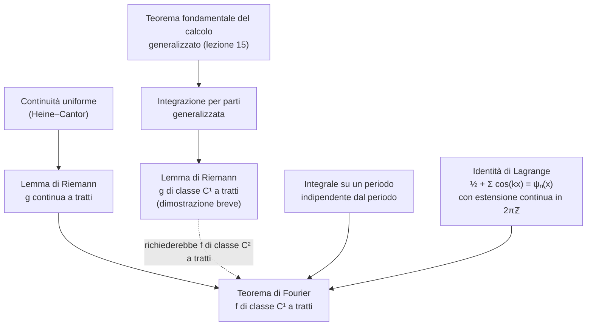

# Lezione 16 — Integrazione per parti generalizzata, lemma di Riemann e identità trigonometrica di Lagrange

Nella [[MM L15 - Serie numeriche e coefficienti di Fourier|lezione 15]] sono stati introdotti i coefficienti di Fourier, le funzioni **continue a tratti** e **di classe $C^1$ a tratti**, e il teorema fondamentale del calcolo integrale nella versione "generalizzata" a queste classi di funzioni. Questa lezione prepara gli strumenti per la dimostrazione del **teorema di Fourier**, che arriverà nella lezione successiva. Gli ingredienti sono quattro. Il primo è l'**integrazione per parti generalizzata**, che estende la formula usuale alle funzioni continue e $C^1$ a tratti. Il secondo, il più importante, è il **lemma di Riemann**: l'integrale di una funzione continua a tratti moltiplicata per $\sin(\lambda x)$ o $\cos(\lambda x)$ tende a zero per $\lambda \to +\infty$; se ne vedono due dimostrazioni, una generale basata sulla **continuità uniforme** e una più breve, che richiede però una regolarità in più. Gli ultimi due sono due fatti elementari che servono in due passaggi diversi della dimostrazione di Fourier: l'**integrale di una funzione periodica su un periodo** non dipende dal periodo scelto, e l'**identità trigonometrica di Lagrange** permette di scrivere in forma chiusa la somma $\tfrac12 + \sum_{k=1}^n \cos(kx)$, purché il secondo membro sia inteso come estensione continua nei multipli di $2\pi$.

> [!warning] Fonti di questa lezione
> **Unica fonte primaria: la trascrizione** (parte 1). Nel progetto **non ci sono note del docente** per la parte del prof. Benini (a lezione il docente fa riferimento a un suo PDF, che non è disponibile), quindi gli enunciati non portano citazioni alle note del docente. **Gli appunti manuali ricevuti non coprono questa lezione**: quelli del 09/11 si fermano al teorema fondamentale del calcolo generalizzato (lezione 15), quelli del 16/11 cominciano con l'enunciato del teorema di Fourier (lezione 17); sono stati usati solo per allineare la notazione delle definizioni. La registrazione ha molti vuoti nei punti in cui il docente scrive alla lavagna senza parlare: formule ed enunciati sono stati completati dal contesto e confrontati con la dispensa di riferimento di Fisica matematica, che tratta gli stessi risultati con la stessa impostazione [@morro2023, §5.2]. I passaggi aggiunti sono segnalati nel testo. Le conversazioni laterali, la pausa e i commenti organizzativi sono omessi. **La data è dedotta**: l'intestazione della trascrizione riporta il 14 novembre 2026, che è un sabato; come per le altre lezioni del venerdì, la registrazione risulta datata il giorno dopo la lezione, che si colloca quindi venerdì 13 novembre. Le figure sono costruite per rappresentare ciò che il docente disegna o descrive alla lavagna.

## Integrazione per parti generalizzata

Il docente apre ricapitolando la lezione 15. Una funzione **continua a tratti** su $[a, b]$ è continua su ciascuno dei sottointervalli di una partizione finita e ammette limiti destro e sinistro finiti agli estremi di ciascun sottointervallo: nei punti di raccordo può quindi avere dei **salti**. Una funzione **di classe $C^1$ a tratti** è di classe $C^1$ su ciascuno dei sottointervalli, con limiti monolateri finiti sia della funzione sia della derivata: può avere salti sia nella funzione sia nella derivata. Se in più è **continua**, i salti della funzione spariscono e restano solo eventuali "spigoli", cioè punti in cui la derivata destra e la derivata sinistra esistono ma sono diverse. Per queste ultime funzioni vale il teorema fondamentale del calcolo nella forma $\int_a^b g'(x)\, dx = g(b) - g(a)$, dimostrato nella lezione 15. Il passo successivo è l'integrazione per parti nello stesso senso generalizzato.

> [!important] Teorema — Integrazione per parti generalizzata
> Siano $f, g : [a, b] \to \mathbb{R}$ continue e di classe $C^1$ a tratti. Allora
> $$\int_a^b f'(x)\, g(x)\, dx = f(b)\, g(b) - f(a)\, g(a) - \int_a^b f(x)\, g'(x)\, dx .$$

**Il significato di $f'$ e $g'$.** Le derivate $f'$ e $g'$ non sono definite ovunque: in un numero finito di punti le due funzioni hanno solo una derivata destra e una sinistra, non necessariamente uguali. Questo non crea problemi, perché un insieme finito di punti isolati ha **misura nulla** per l'integrale: modificare (o lasciare indefinita) l'integranda in un numero finito di punti non cambia il valore dell'integrale. In quei punti si può dare a $f'$ un valore qualsiasi, ad esempio il limite destro della derivata; le integrande $f' g$ e $f g'$ sono allora funzioni continue a tratti, quindi integrabili.

**Dimostrazione.** L'idea è applicare il teorema fondamentale del calcolo generalizzato al prodotto $fg$ e usare la regola di Leibniz.

1. **$fg$ è continua**, come prodotto di funzioni continue.
2. **$fg$ è di classe $C^1$ a tratti.** Siano $P_f$ e $P_g$ le partizioni di $[a, b]$ associate a $f$ e a $g$. Si prende la partizione che contiene tutti i punti dell'una e dell'altra, più fine di entrambe: su ciascuno dei suoi sottointervalli aperti sia $f$ sia $g$ sono di classe $C^1$, quindi lo è anche $fg$, e agli estremi esistono finiti i limiti monolateri di $f$, $g$, $f'$, $g'$, quindi anche quelli di $fg$ e di $(fg)' = f'g + fg'$. In altre parole, una delle due funzioni può avere uno spigolo in certi punti e l'altra in altri punti; tagliando in **tutti** quei punti si sistemano entrambe.
3. **Teorema fondamentale generalizzato.** Applicato a $fg$, continua e $C^1$ a tratti, dà
$$\int_a^b (fg)'(x)\, dx = f(b)\, g(b) - f(a)\, g(a) .$$
4. **Regola di Leibniz.** Tolti i punti, in numero finito, in cui $f$ o $g$ non è derivabile, in ogni altro punto vale $(fg)' = f' g + f g'$. Poiché quei punti non contano per l'integrale,
$$\int_a^b (fg)'(x)\, dx = \int_a^b f'(x)\, g(x)\, dx + \int_a^b f(x)\, g'(x)\, dx .$$
Uguagliando i due secondi membri e portando $\int_a^b f g'$ a destra si ottiene la tesi. $\blacksquare$

Il docente presenta questo risultato come uno strumento tecnico; il "primo teorema interessante" della lezione è il lemma che segue, nella cui seconda dimostrazione l'integrazione per parti generalizzata viene usata subito.

## Il lemma di Riemann

> [!important] Lemma — Riemann
> Sia $g : [a, b] \to \mathbb{R}$ continua a tratti. Allora
> $$\lim_{\lambda \to +\infty} \int_a^b g(x)\, \sin(\lambda x)\, dx = 0, \qquad \lim_{\lambda \to +\infty} \int_a^b g(x)\, \cos(\lambda x)\, dx = 0 .$$

Il docente sottolinea che, pur essendo un risultato importante, si chiama "lemma" per ragioni storiche. Per ogni $\lambda$ fissato l'integrale è un numero, che dipende da $\lambda$: lo si indica con $I(\lambda)$, e il lemma afferma che $I(\lambda) \to 0$ quando $\lambda \to +\infty$.

**Perché è plausibile.** Al crescere di $\lambda$ la funzione $\sin(\lambda x)$ oscilla sempre più rapidamente: il suo periodo è $2\pi/\lambda$. Su un intervallo lungo un periodo la funzione $g$, se è continua, varia pochissimo, e quindi $g(x)\sin(\lambda x)$ è quasi uguale a una costante per $\sin(\lambda x)$, il cui integrale su un periodo è nullo. Le "gobbe" positive e negative dell'integranda hanno aree quasi uguali e si compensano, come nella figura. La dimostrazione rende quantitativo proprio questo ragionamento.

<svg viewBox="0 0 620 280" width="620" style="display:block;margin:1em auto;max-width:100%;height:auto;font-family:inherit" xmlns="http://www.w3.org/2000/svg"><line x1="40.0" y1="130.0" x2="601.0" y2="130.0" stroke="currentColor" stroke-width="1.0"/><polygon points="608.0,130.0 601.0,133.2 601.0,126.8" fill="currentColor"/><line x1="50.0" y1="225.0" x2="50.0" y2="25.0" stroke="currentColor" stroke-width="1.0"/><polygon points="50.0,18.0 53.1,25.0 46.9,25.0" fill="currentColor"/><text x="606.0" y="122.0" font-size="13" text-anchor="middle" fill="currentColor" font-style="italic">x</text><text x="60.0" y="24.0" font-size="13" text-anchor="start" fill="currentColor" font-style="italic">y</text><polygon points="50.0,130.0 50.0,130.0 51.1,124.4 52.2,118.8 53.4,113.3 54.5,108.1 55.6,103.2 56.8,98.8 57.9,94.9 59.0,91.6 60.1,89.1 61.2,87.2 62.4,86.2 63.5,86.0 64.6,86.6 65.8,88.1 66.9,90.3 68.0,93.4 69.1,97.2 70.2,101.7 71.4,106.7 72.5,112.3 73.6,118.3 74.8,124.5 74.8,130.0" fill="#3b82f6" fill-opacity="0.2" stroke="none"/><polygon points="74.8,130.0 74.8,124.5 75.9,131.0 77.0,137.5 78.1,143.9 79.2,150.2 80.4,156.1 81.5,161.6 82.6,166.5 83.8,170.9 84.9,174.4 86.0,177.2 87.1,179.1 88.2,180.1 89.4,180.2 90.5,179.3 91.6,177.4 92.8,174.6 93.9,171.0 95.0,166.5 96.1,161.3 97.2,155.4 98.4,149.0 99.5,142.2 100.6,135.1 100.6,130.0" fill="#e05a47" fill-opacity="0.2" stroke="none"/><polygon points="100.6,130.0 100.6,135.1 101.8,127.8 102.9,120.5 104.0,113.3 105.1,106.3 106.2,99.7 107.4,93.7 108.5,88.3 109.6,83.6 110.8,79.8 111.9,76.9 113.0,75.0 114.1,74.1 115.2,74.3 116.4,75.5 117.5,77.8 118.6,81.1 119.8,85.3 120.9,90.4 122.0,96.4 123.1,103.0 124.2,110.1 125.4,117.7 126.5,125.6 126.5,130.0" fill="#3b82f6" fill-opacity="0.2" stroke="none"/><polygon points="126.5,130.0 126.5,125.6 127.6,133.7 128.8,141.7 129.9,149.6 131.0,157.1 132.1,164.2 133.2,170.7 134.4,176.4 135.5,181.3 136.6,185.3 137.8,188.3 138.9,190.1 140.0,190.9 141.1,190.4 142.2,188.9 143.4,186.2 144.5,182.4 145.6,177.6 146.8,171.9 147.9,165.3 149.0,158.0 150.1,150.2 151.2,141.9 152.4,133.4 152.4,130.0" fill="#e05a47" fill-opacity="0.2" stroke="none"/><polygon points="152.4,130.0 152.4,133.4 153.5,124.7 154.6,116.1 155.8,107.8 156.9,99.8 158.0,92.3 159.1,85.5 160.2,79.5 161.4,74.5 162.5,70.5 163.6,67.5 164.8,65.8 165.9,65.3 167.0,66.0 168.1,67.9 169.2,71.0 170.4,75.2 171.5,80.5 172.6,86.7 173.8,93.8 174.9,101.6 176.0,110.0 177.1,118.8 178.2,127.8 178.2,130.0" fill="#3b82f6" fill-opacity="0.2" stroke="none"/><polygon points="178.2,130.0 178.2,127.8 179.4,136.9 180.5,145.9 181.6,154.6 182.8,162.9 183.9,170.6 185.0,177.6 186.1,183.6 187.2,188.7 188.4,192.7 189.5,195.5 190.6,197.0 191.8,197.3 192.9,196.3 194.0,194.1 195.1,190.6 196.2,186.0 197.4,180.3 198.5,173.7 199.6,166.2 200.8,158.0 201.9,149.3 203.0,140.1 204.1,130.8 204.1,130.0" fill="#e05a47" fill-opacity="0.2" stroke="none"/><polygon points="204.1,130.0 204.1,130.8 205.2,121.5 206.4,112.3 207.5,103.4 208.6,95.0 209.8,87.2 210.9,80.3 212.0,74.2 213.1,69.3 214.2,65.5 215.4,62.9 216.5,61.5 217.6,61.5 218.8,62.7 219.9,65.2 221.0,69.0 222.1,73.9 223.2,79.9 224.4,86.8 225.5,94.6 226.6,103.0 227.8,111.9 228.9,121.2 228.9,130.0" fill="#3b82f6" fill-opacity="0.2" stroke="none"/><polygon points="228.9,130.0 228.9,121.2 230.0,130.6 231.1,140.0 232.2,149.3 233.4,158.1 234.5,166.5 235.6,174.1 236.8,180.9 237.9,186.8 239.0,191.5 240.1,195.1 241.2,197.5 242.4,198.6 243.5,198.4 244.6,196.9 245.7,194.1 246.9,190.1 248.0,185.0 249.1,178.9 250.2,171.8 251.4,164.0 252.5,155.5 253.6,146.6 254.8,137.3 254.8,130.0" fill="#e05a47" fill-opacity="0.2" stroke="none"/><polygon points="254.8,130.0 254.8,137.3 255.9,128.0 257.0,118.7 258.1,109.6 259.2,100.9 260.4,92.8 261.5,85.4 262.6,78.9 263.8,73.3 264.9,68.8 266.0,65.5 267.1,63.5 268.2,62.6 269.4,63.1 270.5,64.8 271.6,67.7 272.8,71.9 273.9,77.1 275.0,83.2 276.1,90.3 277.2,98.1 278.4,106.4 279.5,115.2 280.6,124.2 280.6,130.0" fill="#3b82f6" fill-opacity="0.2" stroke="none"/><polygon points="280.6,130.0 280.6,124.2 281.8,133.4 282.9,142.4 284.0,151.1 285.1,159.5 286.2,167.2 287.4,174.2 288.5,180.4 289.6,185.6 290.8,189.7 291.9,192.7 293.0,194.5 294.1,195.0 295.2,194.3 296.4,192.5 297.5,189.4 298.6,185.2 299.8,180.1 300.9,173.9 302.0,167.0 303.1,159.4 304.2,151.3 305.4,142.9 306.5,134.2 306.5,130.0" fill="#e05a47" fill-opacity="0.2" stroke="none"/><polygon points="306.5,130.0 306.5,134.2 307.6,125.5 308.8,116.9 309.9,108.6 311.0,100.7 312.1,93.4 313.2,86.9 314.4,81.2 315.5,76.4 316.6,72.7 317.8,70.0 318.9,68.6 320.0,68.2 321.1,69.1 322.2,71.1 323.4,74.2 324.5,78.3 325.6,83.4 326.8,89.3 327.9,96.0 329.0,103.3 330.1,111.0 331.2,119.1 332.4,127.3 332.4,130.0" fill="#3b82f6" fill-opacity="0.2" stroke="none"/><polygon points="332.4,130.0 332.4,127.3 333.5,135.5 334.6,143.6 335.8,151.4 336.9,158.7 338.0,165.4 339.1,171.5 340.2,176.7 341.4,181.0 342.5,184.3 343.6,186.6 344.8,187.8 345.9,187.9 347.0,186.9 348.1,184.8 349.2,181.8 350.4,177.7 351.5,172.8 352.6,167.1 353.8,160.8 354.9,153.9 356.0,146.6 357.1,139.0 358.2,131.3 358.2,130.0" fill="#e05a47" fill-opacity="0.2" stroke="none"/><polygon points="358.2,130.0 358.2,131.3 359.4,123.7 360.5,116.2 361.6,109.0 362.8,102.3 363.9,96.1 365.0,90.6 366.1,85.9 367.2,82.0 368.4,79.1 369.5,77.1 370.6,76.2 371.8,76.2 372.9,77.3 374.0,79.4 375.1,82.4 376.2,86.3 377.4,91.0 378.5,96.4 379.6,102.4 380.8,108.8 381.9,115.7 383.0,122.7 384.1,129.8 384.1,130.0" fill="#3b82f6" fill-opacity="0.2" stroke="none"/><polygon points="384.1,130.0 384.1,129.8 385.2,136.9 386.4,143.8 387.5,150.4 388.6,156.6 389.8,162.3 390.9,167.3 392.0,171.5 393.1,175.0 394.2,177.5 395.4,179.2 396.5,179.9 397.6,179.7 398.8,178.6 399.9,176.5 401.0,173.6 402.1,169.9 403.2,165.4 404.4,160.3 405.5,154.7 406.6,148.7 407.8,142.3 408.9,135.8 408.9,130.0" fill="#e05a47" fill-opacity="0.2" stroke="none"/><polygon points="408.9,130.0 408.9,135.8 410.0,129.1 411.1,122.6 412.3,116.2 413.4,110.1 414.5,104.5 415.6,99.3 416.8,94.8 417.9,90.9 419.0,87.8 420.1,85.6 421.2,84.1 422.4,83.6 423.5,83.9 424.6,85.1 425.8,87.1 426.9,89.9 428.0,93.5 429.1,97.7 430.2,102.5 431.4,107.8 432.5,113.5 433.6,119.4 434.8,125.6 434.8,130.0" fill="#3b82f6" fill-opacity="0.2" stroke="none"/><polygon points="434.8,130.0 434.8,125.6 435.9,131.7 437.0,137.8 438.1,143.8 439.2,149.4 440.4,154.7 441.5,159.4 442.6,163.6 443.8,167.1 444.9,169.9 446.0,172.0 447.1,173.2 448.2,173.6 449.4,173.2 450.5,172.0 451.6,170.1 452.7,167.3 453.9,163.9 455.0,159.8 456.1,155.3 457.3,150.2 458.4,144.8 459.5,139.1 460.6,133.3 460.6,130.0" fill="#e05a47" fill-opacity="0.2" stroke="none"/><polygon points="460.6,130.0 460.6,133.3 461.8,127.5 462.9,121.7 464.0,116.1 465.1,110.7 466.2,105.8 467.4,101.3 468.5,97.4 469.6,94.1 470.8,91.5 471.9,89.6 473.0,88.5 474.1,88.2 475.2,88.6 476.4,89.8 477.5,91.8 478.6,94.5 479.8,97.9 480.9,101.8 482.0,106.3 483.1,111.2 484.2,116.5 485.4,122.0 486.5,127.6 486.5,130.0" fill="#3b82f6" fill-opacity="0.2" stroke="none"/><polygon points="486.5,130.0 486.5,127.6 487.6,133.3 488.8,138.9 489.9,144.4 491.0,149.6 492.1,154.3 493.2,158.7 494.4,162.5 495.5,165.7 496.6,168.2 497.7,169.9 498.9,171.0 500.0,171.2 501.1,170.7 502.3,169.5 503.4,167.4 504.5,164.7 505.6,161.3 506.8,157.4 507.9,152.9 509.0,147.9 510.1,142.7 511.2,137.2 512.4,131.5 512.4,130.0" fill="#e05a47" fill-opacity="0.2" stroke="none"/><polygon points="512.4,130.0 512.4,131.5 513.5,125.8 514.6,120.2 515.8,114.7 516.9,109.6 518.0,104.8 519.1,100.4 520.2,96.6 521.4,93.5 522.5,91.0 523.6,89.2 524.8,88.3 525.9,88.0 527.0,88.6 528.1,90.0 529.2,92.1 530.4,95.0 531.5,98.5 532.6,102.6 533.8,107.2 534.9,112.3 536.0,117.8 537.1,123.5 538.2,129.3 538.2,130.0" fill="#3b82f6" fill-opacity="0.2" stroke="none"/><polygon points="538.2,130.0 538.2,129.3 539.4,135.2 540.5,141.0 541.6,146.7 542.8,152.0 543.9,157.0 545.0,161.4 546.1,165.3 547.2,168.6 548.4,171.1 549.5,172.9 550.6,173.9 551.8,174.0 552.9,173.3 554.0,171.8 555.1,169.5 556.2,166.4 557.4,162.7 558.5,158.3 559.6,153.3 560.8,147.9 561.9,142.0 563.0,136.0 563.0,130.0" fill="#e05a47" fill-opacity="0.2" stroke="none"/><polygon points="563.0,130.0 563.0,136.0 564.1,129.7 565.2,123.5 566.4,117.3 567.5,111.3 568.6,105.7 569.8,100.4 570.9,95.7 572.0,91.6 573.1,88.2 574.2,85.5 575.4,83.7 576.5,82.8 577.6,82.7 578.8,83.5 579.9,85.2 581.0,87.8 582.1,91.2 583.2,95.4 584.4,100.2 585.5,105.6 586.6,111.6 587.8,117.9 588.9,124.5 588.9,130.0" fill="#3b82f6" fill-opacity="0.2" stroke="none"/><polygon points="588.9,130.0 588.9,124.5 590.0,131.3 590.0,130.0" fill="#e05a47" fill-opacity="0.2" stroke="none"/><polyline points="50.0,130.0 51.1,124.4 52.2,118.8 53.4,113.3 54.5,108.1 55.6,103.2 56.8,98.8 57.9,94.9 59.0,91.6 60.1,89.1 61.2,87.2 62.4,86.2 63.5,86.0 64.6,86.6 65.8,88.1 66.9,90.3 68.0,93.4 69.1,97.2 70.2,101.7 71.4,106.7 72.5,112.3 73.6,118.3 74.8,124.5 75.9,131.0 77.0,137.5 78.1,143.9 79.2,150.2 80.4,156.1 81.5,161.6 82.6,166.5 83.8,170.9 84.9,174.4 86.0,177.2 87.1,179.1 88.2,180.1 89.4,180.2 90.5,179.3 91.6,177.4 92.8,174.6 93.9,171.0 95.0,166.5 96.1,161.3 97.2,155.4 98.4,149.0 99.5,142.2 100.6,135.1 101.8,127.8 102.9,120.5 104.0,113.3 105.1,106.3 106.2,99.7 107.4,93.7 108.5,88.3 109.6,83.6 110.8,79.8 111.9,76.9 113.0,75.0 114.1,74.1 115.2,74.3 116.4,75.5 117.5,77.8 118.6,81.1 119.8,85.3 120.9,90.4 122.0,96.4 123.1,103.0 124.2,110.1 125.4,117.7 126.5,125.6 127.6,133.7 128.8,141.7 129.9,149.6 131.0,157.1 132.1,164.2 133.2,170.7 134.4,176.4 135.5,181.3 136.6,185.3 137.8,188.3 138.9,190.1 140.0,190.9 141.1,190.4 142.2,188.9 143.4,186.2 144.5,182.4 145.6,177.6 146.8,171.9 147.9,165.3 149.0,158.0 150.1,150.2 151.2,141.9 152.4,133.4 153.5,124.7 154.6,116.1 155.8,107.8 156.9,99.8 158.0,92.3 159.1,85.5 160.2,79.5 161.4,74.5 162.5,70.5 163.6,67.5 164.8,65.8 165.9,65.3 167.0,66.0 168.1,67.9 169.2,71.0 170.4,75.2 171.5,80.5 172.6,86.7 173.8,93.8 174.9,101.6 176.0,110.0 177.1,118.8 178.2,127.8 179.4,136.9 180.5,145.9 181.6,154.6 182.8,162.9 183.9,170.6 185.0,177.6 186.1,183.6 187.2,188.7 188.4,192.7 189.5,195.5 190.6,197.0 191.8,197.3 192.9,196.3 194.0,194.1 195.1,190.6 196.2,186.0 197.4,180.3 198.5,173.7 199.6,166.2 200.8,158.0 201.9,149.3 203.0,140.1 204.1,130.8 205.2,121.5 206.4,112.3 207.5,103.4 208.6,95.0 209.8,87.2 210.9,80.3 212.0,74.2 213.1,69.3 214.2,65.5 215.4,62.9 216.5,61.5 217.6,61.5 218.8,62.7 219.9,65.2 221.0,69.0 222.1,73.9 223.2,79.9 224.4,86.8 225.5,94.6 226.6,103.0 227.8,111.9 228.9,121.2 230.0,130.6 231.1,140.0 232.2,149.3 233.4,158.1 234.5,166.5 235.6,174.1 236.8,180.9 237.9,186.8 239.0,191.5 240.1,195.1 241.2,197.5 242.4,198.6 243.5,198.4 244.6,196.9 245.7,194.1 246.9,190.1 248.0,185.0 249.1,178.9 250.2,171.8 251.4,164.0 252.5,155.5 253.6,146.6 254.8,137.3 255.9,128.0 257.0,118.7 258.1,109.6 259.2,100.9 260.4,92.8 261.5,85.4 262.6,78.9 263.8,73.3 264.9,68.8 266.0,65.5 267.1,63.5 268.2,62.6 269.4,63.1 270.5,64.8 271.6,67.7 272.8,71.9 273.9,77.1 275.0,83.2 276.1,90.3 277.2,98.1 278.4,106.4 279.5,115.2 280.6,124.2 281.8,133.4 282.9,142.4 284.0,151.1 285.1,159.5 286.2,167.2 287.4,174.2 288.5,180.4 289.6,185.6 290.8,189.7 291.9,192.7 293.0,194.5 294.1,195.0 295.2,194.3 296.4,192.5 297.5,189.4 298.6,185.2 299.8,180.1 300.9,173.9 302.0,167.0 303.1,159.4 304.2,151.3 305.4,142.9 306.5,134.2 307.6,125.5 308.8,116.9 309.9,108.6 311.0,100.7 312.1,93.4 313.2,86.9 314.4,81.2 315.5,76.4 316.6,72.7 317.8,70.0 318.9,68.6 320.0,68.2 321.1,69.1 322.2,71.1 323.4,74.2 324.5,78.3 325.6,83.4 326.8,89.3 327.9,96.0 329.0,103.3 330.1,111.0 331.2,119.1 332.4,127.3 333.5,135.5 334.6,143.6 335.8,151.4 336.9,158.7 338.0,165.4 339.1,171.5 340.2,176.7 341.4,181.0 342.5,184.3 343.6,186.6 344.8,187.8 345.9,187.9 347.0,186.9 348.1,184.8 349.2,181.8 350.4,177.7 351.5,172.8 352.6,167.1 353.8,160.8 354.9,153.9 356.0,146.6 357.1,139.0 358.2,131.3 359.4,123.7 360.5,116.2 361.6,109.0 362.8,102.3 363.9,96.1 365.0,90.6 366.1,85.9 367.2,82.0 368.4,79.1 369.5,77.1 370.6,76.2 371.8,76.2 372.9,77.3 374.0,79.4 375.1,82.4 376.2,86.3 377.4,91.0 378.5,96.4 379.6,102.4 380.8,108.8 381.9,115.7 383.0,122.7 384.1,129.8 385.2,136.9 386.4,143.8 387.5,150.4 388.6,156.6 389.8,162.3 390.9,167.3 392.0,171.5 393.1,175.0 394.2,177.5 395.4,179.2 396.5,179.9 397.6,179.7 398.8,178.6 399.9,176.5 401.0,173.6 402.1,169.9 403.2,165.4 404.4,160.3 405.5,154.7 406.6,148.7 407.8,142.3 408.9,135.8 410.0,129.1 411.1,122.6 412.3,116.2 413.4,110.1 414.5,104.5 415.6,99.3 416.8,94.8 417.9,90.9 419.0,87.8 420.1,85.6 421.2,84.1 422.4,83.6 423.5,83.9 424.6,85.1 425.8,87.1 426.9,89.9 428.0,93.5 429.1,97.7 430.2,102.5 431.4,107.8 432.5,113.5 433.6,119.4 434.8,125.6 435.9,131.7 437.0,137.8 438.1,143.8 439.2,149.4 440.4,154.7 441.5,159.4 442.6,163.6 443.8,167.1 444.9,169.9 446.0,172.0 447.1,173.2 448.2,173.6 449.4,173.2 450.5,172.0 451.6,170.1 452.7,167.3 453.9,163.9 455.0,159.8 456.1,155.3 457.3,150.2 458.4,144.8 459.5,139.1 460.6,133.3 461.8,127.5 462.9,121.7 464.0,116.1 465.1,110.7 466.2,105.8 467.4,101.3 468.5,97.4 469.6,94.1 470.8,91.5 471.9,89.6 473.0,88.5 474.1,88.2 475.2,88.6 476.4,89.8 477.5,91.8 478.6,94.5 479.8,97.9 480.9,101.8 482.0,106.3 483.1,111.2 484.2,116.5 485.4,122.0 486.5,127.6 487.6,133.3 488.8,138.9 489.9,144.4 491.0,149.6 492.1,154.3 493.2,158.7 494.4,162.5 495.5,165.7 496.6,168.2 497.7,169.9 498.9,171.0 500.0,171.2 501.1,170.7 502.3,169.5 503.4,167.4 504.5,164.7 505.6,161.3 506.8,157.4 507.9,152.9 509.0,147.9 510.1,142.7 511.2,137.2 512.4,131.5 513.5,125.8 514.6,120.2 515.8,114.7 516.9,109.6 518.0,104.8 519.1,100.4 520.2,96.6 521.4,93.5 522.5,91.0 523.6,89.2 524.8,88.3 525.9,88.0 527.0,88.6 528.1,90.0 529.2,92.1 530.4,95.0 531.5,98.5 532.6,102.6 533.8,107.2 534.9,112.3 536.0,117.8 537.1,123.5 538.2,129.3 539.4,135.2 540.5,141.0 541.6,146.7 542.8,152.0 543.9,157.0 545.0,161.4 546.1,165.3 547.2,168.6 548.4,171.1 549.5,172.9 550.6,173.9 551.8,174.0 552.9,173.3 554.0,171.8 555.1,169.5 556.2,166.4 557.4,162.7 558.5,158.3 559.6,153.3 560.8,147.9 561.9,142.0 563.0,136.0 564.1,129.7 565.2,123.5 566.4,117.3 567.5,111.3 568.6,105.7 569.8,100.4 570.9,95.7 572.0,91.6 573.1,88.2 574.2,85.5 575.4,83.7 576.5,82.8 577.6,82.7 578.8,83.5 579.9,85.2 581.0,87.8 582.1,91.2 583.2,95.4 584.4,100.2 585.5,105.6 586.6,111.6 587.8,117.9 588.9,124.5 590.0,131.3" fill="none" stroke="currentColor" stroke-width="1.1"/><polyline points="50.0,89.2 51.1,88.9 52.2,88.6 53.4,88.4 54.5,88.1 55.6,87.8 56.8,87.5 57.9,87.2 59.0,87.0 60.1,86.7 61.2,86.4 62.4,86.1 63.5,85.8 64.6,85.6 65.8,85.3 66.9,85.0 68.0,84.7 69.1,84.5 70.2,84.2 71.4,83.9 72.5,83.6 73.6,83.4 74.8,83.1 75.9,82.8 77.0,82.5 78.1,82.3 79.2,82.0 80.4,81.7 81.5,81.5 82.6,81.2 83.8,80.9 84.9,80.6 86.0,80.4 87.1,80.1 88.2,79.9 89.4,79.6 90.5,79.3 91.6,79.1 92.8,78.8 93.9,78.5 95.0,78.3 96.1,78.0 97.2,77.8 98.4,77.5 99.5,77.3 100.6,77.0 101.8,76.8 102.9,76.5 104.0,76.3 105.1,76.0 106.2,75.8 107.4,75.5 108.5,75.3 109.6,75.0 110.8,74.8 111.9,74.6 113.0,74.3 114.1,74.1 115.2,73.9 116.4,73.6 117.5,73.4 118.6,73.2 119.8,72.9 120.9,72.7 122.0,72.5 123.1,72.3 124.2,72.0 125.4,71.8 126.5,71.6 127.6,71.4 128.8,71.2 129.9,71.0 131.0,70.8 132.1,70.5 133.2,70.3 134.4,70.1 135.5,69.9 136.6,69.7 137.8,69.5 138.9,69.3 140.0,69.1 141.1,68.9 142.2,68.8 143.4,68.6 144.5,68.4 145.6,68.2 146.8,68.0 147.9,67.8 149.0,67.7 150.1,67.5 151.2,67.3 152.4,67.1 153.5,67.0 154.6,66.8 155.8,66.6 156.9,66.5 158.0,66.3 159.1,66.2 160.2,66.0 161.4,65.8 162.5,65.7 163.6,65.5 164.8,65.4 165.9,65.3 167.0,65.1 168.1,65.0 169.2,64.8 170.4,64.7 171.5,64.6 172.6,64.4 173.8,64.3 174.9,64.2 176.0,64.1 177.1,63.9 178.2,63.8 179.4,63.7 180.5,63.6 181.6,63.5 182.8,63.4 183.9,63.3 185.0,63.2 186.1,63.1 187.2,63.0 188.4,62.9 189.5,62.8 190.6,62.7 191.8,62.6 192.9,62.5 194.0,62.4 195.1,62.4 196.2,62.3 197.4,62.2 198.5,62.1 199.6,62.1 200.8,62.0 201.9,61.9 203.0,61.9 204.1,61.8 205.2,61.8 206.4,61.7 207.5,61.7 208.6,61.6 209.8,61.6 210.9,61.5 212.0,61.5 213.1,61.4 214.2,61.4 215.4,61.4 216.5,61.3 217.6,61.3 218.8,61.3 219.9,61.3 221.0,61.2 222.1,61.2 223.2,61.2 224.4,61.2 225.5,61.2 226.6,61.2 227.8,61.2 228.9,61.2 230.0,61.2 231.1,61.2 232.2,61.2 233.4,61.2 234.5,61.2 235.6,61.2 236.8,61.2 237.9,61.2 239.0,61.3 240.1,61.3 241.2,61.3 242.4,61.3 243.5,61.4 244.6,61.4 245.7,61.4 246.9,61.5 248.0,61.5 249.1,61.5 250.2,61.6 251.4,61.6 252.5,61.7 253.6,61.7 254.8,61.8 255.9,61.8 257.0,61.9 258.1,62.0 259.2,62.0 260.4,62.1 261.5,62.2 262.6,62.2 263.8,62.3 264.9,62.4 266.0,62.4 267.1,62.5 268.2,62.6 269.4,62.7 270.5,62.8 271.6,62.9 272.8,62.9 273.9,63.0 275.0,63.1 276.1,63.2 277.2,63.3 278.4,63.4 279.5,63.5 280.6,63.6 281.8,63.7 282.9,63.8 284.0,63.9 285.1,64.0 286.2,64.2 287.4,64.3 288.5,64.4 289.6,64.5 290.8,64.6 291.9,64.7 293.0,64.9 294.1,65.0 295.2,65.1 296.4,65.2 297.5,65.4 298.6,65.5 299.8,65.6 300.9,65.8 302.0,65.9 303.1,66.0 304.2,66.2 305.4,66.3 306.5,66.5 307.6,66.6 308.8,66.7 309.9,66.9 311.0,67.0 312.1,67.2 313.2,67.3 314.4,67.5 315.5,67.6 316.6,67.8 317.8,67.9 318.9,68.1 320.0,68.2 321.1,68.4 322.2,68.6 323.4,68.7 324.5,68.9 325.6,69.0 326.8,69.2 327.9,69.4 329.0,69.5 330.1,69.7 331.2,69.9 332.4,70.0 333.5,70.2 334.6,70.4 335.8,70.5 336.9,70.7 338.0,70.9 339.1,71.0 340.2,71.2 341.4,71.4 342.5,71.6 343.6,71.7 344.8,71.9 345.9,72.1 347.0,72.3 348.1,72.4 349.2,72.6 350.4,72.8 351.5,73.0 352.6,73.1 353.8,73.3 354.9,73.5 356.0,73.7 357.1,73.8 358.2,74.0 359.4,74.2 360.5,74.4 361.6,74.6 362.8,74.7 363.9,74.9 365.0,75.1 366.1,75.3 367.2,75.4 368.4,75.6 369.5,75.8 370.6,76.0 371.8,76.2 372.9,76.3 374.0,76.5 375.1,76.7 376.2,76.9 377.4,77.0 378.5,77.2 379.6,77.4 380.8,77.6 381.9,77.8 383.0,77.9 384.1,78.1 385.2,78.3 386.4,78.4 387.5,78.6 388.6,78.8 389.8,79.0 390.9,79.1 392.0,79.3 393.1,79.5 394.2,79.6 395.4,79.8 396.5,80.0 397.6,80.1 398.8,80.3 399.9,80.5 401.0,80.6 402.1,80.8 403.2,81.0 404.4,81.1 405.5,81.3 406.6,81.4 407.8,81.6 408.9,81.8 410.0,81.9 411.1,82.1 412.3,82.2 413.4,82.4 414.5,82.5 415.6,82.7 416.8,82.8 417.9,83.0 419.0,83.1 420.1,83.3 421.2,83.4 422.4,83.5 423.5,83.7 424.6,83.8 425.8,84.0 426.9,84.1 428.0,84.2 429.1,84.4 430.2,84.5 431.4,84.6 432.5,84.7 433.6,84.9 434.8,85.0 435.9,85.1 437.0,85.2 438.1,85.4 439.2,85.5 440.4,85.6 441.5,85.7 442.6,85.8 443.8,85.9 444.9,86.0 446.0,86.1 447.1,86.2 448.2,86.3 449.4,86.5 450.5,86.5 451.6,86.6 452.7,86.7 453.9,86.8 455.0,86.9 456.1,87.0 457.3,87.1 458.4,87.2 459.5,87.3 460.6,87.4 461.8,87.4 462.9,87.5 464.0,87.6 465.1,87.7 466.2,87.7 467.4,87.8 468.5,87.9 469.6,87.9 470.8,88.0 471.9,88.0 473.0,88.1 474.1,88.2 475.2,88.2 476.4,88.3 477.5,88.3 478.6,88.3 479.8,88.4 480.9,88.4 482.0,88.5 483.1,88.5 484.2,88.5 485.4,88.6 486.5,88.6 487.6,88.6 488.8,88.6 489.9,88.7 491.0,88.7 492.1,88.7 493.2,88.7 494.4,88.7 495.5,88.7 496.6,88.7 497.7,88.7 498.9,88.7 500.0,88.7 501.1,88.7 502.3,88.7 503.4,88.7 504.5,88.7 505.6,88.7 506.8,88.7 507.9,88.7 509.0,88.6 510.1,88.6 511.2,88.6 512.4,88.6 513.5,88.5 514.6,88.5 515.8,88.5 516.9,88.4 518.0,88.4 519.1,88.3 520.2,88.3 521.4,88.2 522.5,88.2 523.6,88.1 524.8,88.1 525.9,88.0 527.0,87.9 528.1,87.9 529.2,87.8 530.4,87.7 531.5,87.7 532.6,87.6 533.8,87.5 534.9,87.4 536.0,87.3 537.1,87.3 538.2,87.2 539.4,87.1 540.5,87.0 541.6,86.9 542.8,86.8 543.9,86.7 545.0,86.6 546.1,86.5 547.2,86.4 548.4,86.3 549.5,86.1 550.6,86.0 551.8,85.9 552.9,85.8 554.0,85.7 555.1,85.5 556.2,85.4 557.4,85.3 558.5,85.1 559.6,85.0 560.8,84.9 561.9,84.7 563.0,84.6 564.1,84.4 565.2,84.3 566.4,84.1 567.5,84.0 568.6,83.8 569.8,83.7 570.9,83.5 572.0,83.4 573.1,83.2 574.2,83.0 575.4,82.9 576.5,82.7 577.6,82.5 578.8,82.3 579.9,82.2 581.0,82.0 582.1,81.8 583.2,81.6 584.4,81.4 585.5,81.3 586.6,81.1 587.8,80.9 588.9,80.7 590.0,80.5" fill="none" stroke="#2e9e6a" stroke-width="1.4" stroke-dasharray="5 4"/><polyline points="50.0,170.8 51.1,171.1 52.2,171.4 53.4,171.6 54.5,171.9 55.6,172.2 56.8,172.5 57.9,172.8 59.0,173.0 60.1,173.3 61.2,173.6 62.4,173.9 63.5,174.2 64.6,174.4 65.8,174.7 66.9,175.0 68.0,175.3 69.1,175.5 70.2,175.8 71.4,176.1 72.5,176.4 73.6,176.6 74.8,176.9 75.9,177.2 77.0,177.5 78.1,177.7 79.2,178.0 80.4,178.3 81.5,178.5 82.6,178.8 83.8,179.1 84.9,179.4 86.0,179.6 87.1,179.9 88.2,180.1 89.4,180.4 90.5,180.7 91.6,180.9 92.8,181.2 93.9,181.5 95.0,181.7 96.1,182.0 97.2,182.2 98.4,182.5 99.5,182.7 100.6,183.0 101.8,183.2 102.9,183.5 104.0,183.7 105.1,184.0 106.2,184.2 107.4,184.5 108.5,184.7 109.6,185.0 110.8,185.2 111.9,185.4 113.0,185.7 114.1,185.9 115.2,186.1 116.4,186.4 117.5,186.6 118.6,186.8 119.8,187.1 120.9,187.3 122.0,187.5 123.1,187.7 124.2,188.0 125.4,188.2 126.5,188.4 127.6,188.6 128.8,188.8 129.9,189.0 131.0,189.2 132.1,189.5 133.2,189.7 134.4,189.9 135.5,190.1 136.6,190.3 137.8,190.5 138.9,190.7 140.0,190.9 141.1,191.1 142.2,191.2 143.4,191.4 144.5,191.6 145.6,191.8 146.8,192.0 147.9,192.2 149.0,192.3 150.1,192.5 151.2,192.7 152.4,192.9 153.5,193.0 154.6,193.2 155.8,193.4 156.9,193.5 158.0,193.7 159.1,193.8 160.2,194.0 161.4,194.2 162.5,194.3 163.6,194.5 164.8,194.6 165.9,194.7 167.0,194.9 168.1,195.0 169.2,195.2 170.4,195.3 171.5,195.4 172.6,195.6 173.8,195.7 174.9,195.8 176.0,195.9 177.1,196.1 178.2,196.2 179.4,196.3 180.5,196.4 181.6,196.5 182.8,196.6 183.9,196.7 185.0,196.8 186.1,196.9 187.2,197.0 188.4,197.1 189.5,197.2 190.6,197.3 191.8,197.4 192.9,197.5 194.0,197.6 195.1,197.6 196.2,197.7 197.4,197.8 198.5,197.9 199.6,197.9 200.8,198.0 201.9,198.1 203.0,198.1 204.1,198.2 205.2,198.2 206.4,198.3 207.5,198.3 208.6,198.4 209.8,198.4 210.9,198.5 212.0,198.5 213.1,198.6 214.2,198.6 215.4,198.6 216.5,198.7 217.6,198.7 218.8,198.7 219.9,198.7 221.0,198.8 222.1,198.8 223.2,198.8 224.4,198.8 225.5,198.8 226.6,198.8 227.8,198.8 228.9,198.8 230.0,198.8 231.1,198.8 232.2,198.8 233.4,198.8 234.5,198.8 235.6,198.8 236.8,198.8 237.9,198.8 239.0,198.7 240.1,198.7 241.2,198.7 242.4,198.7 243.5,198.6 244.6,198.6 245.7,198.6 246.9,198.5 248.0,198.5 249.1,198.5 250.2,198.4 251.4,198.4 252.5,198.3 253.6,198.3 254.8,198.2 255.9,198.2 257.0,198.1 258.1,198.0 259.2,198.0 260.4,197.9 261.5,197.8 262.6,197.8 263.8,197.7 264.9,197.6 266.0,197.6 267.1,197.5 268.2,197.4 269.4,197.3 270.5,197.2 271.6,197.1 272.8,197.1 273.9,197.0 275.0,196.9 276.1,196.8 277.2,196.7 278.4,196.6 279.5,196.5 280.6,196.4 281.8,196.3 282.9,196.2 284.0,196.1 285.1,196.0 286.2,195.8 287.4,195.7 288.5,195.6 289.6,195.5 290.8,195.4 291.9,195.3 293.0,195.1 294.1,195.0 295.2,194.9 296.4,194.8 297.5,194.6 298.6,194.5 299.8,194.4 300.9,194.2 302.0,194.1 303.1,194.0 304.2,193.8 305.4,193.7 306.5,193.5 307.6,193.4 308.8,193.3 309.9,193.1 311.0,193.0 312.1,192.8 313.2,192.7 314.4,192.5 315.5,192.4 316.6,192.2 317.8,192.1 318.9,191.9 320.0,191.8 321.1,191.6 322.2,191.4 323.4,191.3 324.5,191.1 325.6,191.0 326.8,190.8 327.9,190.6 329.0,190.5 330.1,190.3 331.2,190.1 332.4,190.0 333.5,189.8 334.6,189.6 335.8,189.5 336.9,189.3 338.0,189.1 339.1,189.0 340.2,188.8 341.4,188.6 342.5,188.4 343.6,188.3 344.8,188.1 345.9,187.9 347.0,187.7 348.1,187.6 349.2,187.4 350.4,187.2 351.5,187.0 352.6,186.9 353.8,186.7 354.9,186.5 356.0,186.3 357.1,186.2 358.2,186.0 359.4,185.8 360.5,185.6 361.6,185.4 362.8,185.3 363.9,185.1 365.0,184.9 366.1,184.7 367.2,184.6 368.4,184.4 369.5,184.2 370.6,184.0 371.8,183.8 372.9,183.7 374.0,183.5 375.1,183.3 376.2,183.1 377.4,183.0 378.5,182.8 379.6,182.6 380.8,182.4 381.9,182.2 383.0,182.1 384.1,181.9 385.2,181.7 386.4,181.6 387.5,181.4 388.6,181.2 389.8,181.0 390.9,180.9 392.0,180.7 393.1,180.5 394.2,180.4 395.4,180.2 396.5,180.0 397.6,179.9 398.8,179.7 399.9,179.5 401.0,179.4 402.1,179.2 403.2,179.0 404.4,178.9 405.5,178.7 406.6,178.6 407.8,178.4 408.9,178.2 410.0,178.1 411.1,177.9 412.3,177.8 413.4,177.6 414.5,177.5 415.6,177.3 416.8,177.2 417.9,177.0 419.0,176.9 420.1,176.7 421.2,176.6 422.4,176.5 423.5,176.3 424.6,176.2 425.8,176.0 426.9,175.9 428.0,175.8 429.1,175.6 430.2,175.5 431.4,175.4 432.5,175.3 433.6,175.1 434.8,175.0 435.9,174.9 437.0,174.8 438.1,174.6 439.2,174.5 440.4,174.4 441.5,174.3 442.6,174.2 443.8,174.1 444.9,174.0 446.0,173.9 447.1,173.8 448.2,173.7 449.4,173.5 450.5,173.5 451.6,173.4 452.7,173.3 453.9,173.2 455.0,173.1 456.1,173.0 457.3,172.9 458.4,172.8 459.5,172.7 460.6,172.6 461.8,172.6 462.9,172.5 464.0,172.4 465.1,172.3 466.2,172.3 467.4,172.2 468.5,172.1 469.6,172.1 470.8,172.0 471.9,172.0 473.0,171.9 474.1,171.8 475.2,171.8 476.4,171.7 477.5,171.7 478.6,171.7 479.8,171.6 480.9,171.6 482.0,171.5 483.1,171.5 484.2,171.5 485.4,171.4 486.5,171.4 487.6,171.4 488.8,171.4 489.9,171.3 491.0,171.3 492.1,171.3 493.2,171.3 494.4,171.3 495.5,171.3 496.6,171.3 497.7,171.3 498.9,171.3 500.0,171.3 501.1,171.3 502.3,171.3 503.4,171.3 504.5,171.3 505.6,171.3 506.8,171.3 507.9,171.3 509.0,171.4 510.1,171.4 511.2,171.4 512.4,171.4 513.5,171.5 514.6,171.5 515.8,171.5 516.9,171.6 518.0,171.6 519.1,171.7 520.2,171.7 521.4,171.8 522.5,171.8 523.6,171.9 524.8,171.9 525.9,172.0 527.0,172.1 528.1,172.1 529.2,172.2 530.4,172.3 531.5,172.3 532.6,172.4 533.8,172.5 534.9,172.6 536.0,172.7 537.1,172.7 538.2,172.8 539.4,172.9 540.5,173.0 541.6,173.1 542.8,173.2 543.9,173.3 545.0,173.4 546.1,173.5 547.2,173.6 548.4,173.7 549.5,173.9 550.6,174.0 551.8,174.1 552.9,174.2 554.0,174.3 555.1,174.5 556.2,174.6 557.4,174.7 558.5,174.9 559.6,175.0 560.8,175.1 561.9,175.3 563.0,175.4 564.1,175.6 565.2,175.7 566.4,175.9 567.5,176.0 568.6,176.2 569.8,176.3 570.9,176.5 572.0,176.6 573.1,176.8 574.2,177.0 575.4,177.1 576.5,177.3 577.6,177.5 578.8,177.7 579.9,177.8 581.0,178.0 582.1,178.2 583.2,178.4 584.4,178.6 585.5,178.7 586.6,178.9 587.8,179.1 588.9,179.3 590.0,179.5" fill="none" stroke="#2e9e6a" stroke-width="1.4" stroke-dasharray="5 4"/><text x="586.0" y="72.5" font-size="12" text-anchor="end" fill="#2e9e6a" font-style="italic">g(x)</text><text x="586.0" y="197.5" font-size="12" text-anchor="end" fill="#2e9e6a" font-style="italic">−g(x)</text><text x="44.0" y="146.0" font-size="12" text-anchor="end" fill="currentColor" font-style="italic">a</text><text x="594.0" y="146.0" font-size="12" text-anchor="start" fill="currentColor" font-style="italic">b</text><text x="310.0" y="268.0" font-size="10.5" text-anchor="middle" fill="currentColor">Grafico di g(x) sin(λx) con λ grande: blu aree positive, rosso aree negative; tratteggio verde: ±g(x).</text></svg>

**Il ruolo nel teorema di Fourier.** Il docente anticipa come verrà usato il lemma. Nella dimostrazione del teorema di Fourier, dopo una serie di manipolazioni algebriche, la differenza tra la somma parziale della serie e il valore a cui deve convergere si scrive come somma di integrali della forma $\int \Phi(y)\, \sin\big((n + \tfrac12) y\big)\, dy$. Si controlla che il prefattore $\Phi$ sia una funzione continua a tratti; a quel punto il lemma di Riemann, con $\lambda = n + \tfrac12 \to +\infty$, garantisce che quegli integrali tendono a zero, cioè che la serie di Fourier converge. Si noti che il lemma è enunciato per $\lambda$ reale che tende a $+\infty$, non solo per valori interi: nella dimostrazione di Fourier servono proprio i valori semi-interi $n + \tfrac12$.

### Dimostrazione per funzioni continue a tratti

Si dimostra solo il caso del seno: quello del coseno è sostanzialmente identico, e alla fine si indica l'unica modifica da fare. Poiché $\lambda$ deve tendere a $+\infty$, ci si può restringere a un intorno di $+\infty$, dove tutti i numeri sono positivi: si suppone quindi $\lambda > 0$.

**Passo 1: riduzione a un tratto di continuità.** Siccome $g$ è continua a tratti, esiste una partizione finita di $[a, b]$ tale che $g$ sia continua su ciascuno dei sottointervalli, con eventuali salti nei punti di raccordo. Per l'additività, l'integrale su $[a, b]$ è la somma di un numero finito di "fettine", ciascuna estesa a un sottointervallo su cui $g$ è continua. Se si dimostra che ogni fettina tende a zero, anche la somma, che ha un numero finito di addendi, tende a zero. Basta quindi considerare un singolo tratto di continuità $[\tilde a, \tilde b] \subseteq [a, b]$ e dimostrare che
$$I(\lambda) = \int_{\tilde a}^{\tilde b} g(x)\, \sin(\lambda x)\, dx \longrightarrow 0 \qquad (\lambda \to +\infty).$$
Una precisazione (aggiunta): $g$ è continua sull'intervallo aperto $(\tilde a, \tilde b)$ e ha limiti monolateri finiti agli estremi, ma il suo valore in $\tilde a$ e in $\tilde b$ potrebbe non coincidere con quei limiti. Ridefinendo $g$ in $\tilde a$ e in $\tilde b$ come $g(\tilde a^+)$ e $g(\tilde b^-)$ si ottiene una funzione continua sull'intervallo chiuso, e l'integrale non cambia perché si sono modificati due soli punti. Si può quindi supporre $g$ **continua su $[\tilde a, \tilde b]$**.

**Passo 2: suddivisione in $n$ parti uguali.** Si divide $[\tilde a, \tilde b]$ in $n$ intervallini della stessa lunghezza $\frac{\tilde b - \tilde a}{n}$, con estremi
$$a_i = \tilde a + i\,\frac{\tilde b - \tilde a}{n}, \qquad i = 0, 1, \dots, n, \qquad a_0 = \tilde a, \quad a_n = \tilde b .$$
Gli intervallini sono $[a_i, a_{i+1}]$ con $i = 0, \dots, n - 1$. Il numero $n$ per ora è qualunque: verrà scelto **a posteriori**, abbastanza grande, e tutta la costruzione dipende da questa scelta. Per l'additività dell'integrale
$$I(\lambda) = \sum_{i=0}^{n-1} \int_{a_i}^{a_{i+1}} g(x)\, \sin(\lambda x)\, dx .$$

**Passo 3: confronto con un valore di $g$ in ciascun intervallino.** In ciascun intervallino si sceglie un punto $\xi_i \in [a_i, a_{i+1}]$, in modo arbitrario, e si scrive $g(x) = g(\xi_i) + \big(g(x) - g(\xi_i)\big)$. Il docente stesso osserva che "sembra una cosa sciocca da fare", perché si è aggiunto e tolto lo stesso termine; l'utilità sta nel pensare $g$ come la somma del suo valore costante $g(\xi_i)$ e dello scarto $g(x) - g(\xi_i)$, che sarà piccolo. Si ottiene
$$I(\lambda) = \sum_{i=0}^{n-1} g(\xi_i) \int_{a_i}^{a_{i+1}} \sin(\lambda x)\, dx \;+\; \sum_{i=0}^{n-1} \int_{a_i}^{a_{i+1}} \big(g(x) - g(\xi_i)\big)\, \sin(\lambda x)\, dx .$$
Nel primo addendo resta solo il seno da integrare, e lo si fa esplicitamente: $\sin(\lambda x)$ è la derivata di $-\frac{1}{\lambda}\cos(\lambda x)$ (il fattore $\frac1\lambda$ compensa la $\lambda$ che esce derivando $\cos(\lambda x)$, il segno meno compensa quello della derivata del coseno). Quindi
$$\int_{a_i}^{a_{i+1}} \sin(\lambda x)\, dx = \frac{1}{\lambda}\big(\cos(\lambda a_i) - \cos(\lambda a_{i+1})\big),$$
con l'estremo sinistro meno l'estremo destro perché il segno meno è stato riassorbito invertendo l'ordine. In conclusione
$$I(\lambda) = \frac{1}{\lambda}\sum_{i=0}^{n-1} g(\xi_i)\big(\cos(\lambda a_i) - \cos(\lambda a_{i+1})\big) + \sum_{i=0}^{n-1} \int_{a_i}^{a_{i+1}} \big(g(x) - g(\xi_i)\big)\, \sin(\lambda x)\, dx .$$

**Passo 4: passaggio ai moduli.** Dire che $I(\lambda) \to 0$ equivale a dire che $|I(\lambda)| \to 0$, quindi conviene stimare il modulo. Si usano, nell'ordine, la disuguaglianza triangolare (il modulo di una somma è al più la somma dei moduli, sia per i due addendi sia dentro ciascuna sommatoria), il fatto che il modulo di un integrale è al più l'integrale del modulo, e il fatto che seno e coseno sono limitati da 1 in modulo:
$$\begin{aligned}
|I(\lambda)| &\le \frac{1}{\lambda}\sum_{i=0}^{n-1} |g(\xi_i)|\,\big(|\cos(\lambda a_i)| + |\cos(\lambda a_{i+1})|\big) + \sum_{i=0}^{n-1} \int_{a_i}^{a_{i+1}} |g(x) - g(\xi_i)|\,|\sin(\lambda x)|\, dx \\
&\le \frac{2}{\lambda}\sum_{i=0}^{n-1} |g(\xi_i)| + \sum_{i=0}^{n-1} \int_{a_i}^{a_{i+1}} |g(x) - g(\xi_i)|\, dx ,
\end{aligned}$$
dove il $2$ viene da $1 + 1$. Fin qui, come osserva il docente, si sono fatte solo operazioni che non richiedono di pensare alla funzione $g$; ora bisogna usarne le proprietà.

<svg viewBox="0 0 620 300" width="620" style="display:block;margin:1em auto;max-width:100%;height:auto;font-family:inherit" xmlns="http://www.w3.org/2000/svg"><line x1="40.0" y1="230.0" x2="591.0" y2="230.0" stroke="currentColor" stroke-width="1.0"/><polygon points="598.0,230.0 591.0,233.2 591.0,226.8" fill="currentColor"/><line x1="50.0" y1="245.0" x2="50.0" y2="29.0" stroke="currentColor" stroke-width="1.0"/><polygon points="50.0,22.0 53.1,29.0 46.9,29.0" fill="currentColor"/><text x="596.0" y="222.0" font-size="13" text-anchor="middle" fill="currentColor" font-style="italic">x</text><polygon points="70.0,107.8 70.0,124.9 71.7,124.2 73.3,123.5 75.0,122.8 76.7,122.1 78.3,121.5 80.0,120.8 81.7,120.1 83.3,119.5 85.0,118.8 86.7,118.2 88.3,117.6 90.0,116.9 91.7,116.3 93.3,115.7 95.0,115.0 96.7,114.4 98.3,113.8 100.0,113.2 101.7,112.6 103.3,112.0 105.0,111.4 106.7,110.8 108.3,110.3 110.0,109.7 111.7,109.1 113.3,108.6 115.0,108.0 116.7,107.5 118.3,107.0 120.0,106.4 121.7,105.9 123.3,105.4 125.0,104.9 126.7,104.4 128.3,103.9 130.0,103.4 131.7,102.9 133.3,102.5 135.0,102.0 136.7,101.6 138.3,101.1 140.0,100.7 141.7,100.3 143.3,99.8 145.0,99.4 146.7,99.0 148.3,98.6 150.0,98.2 151.7,97.8 153.3,97.5 153.3,107.8" fill="#2e9e6a" fill-opacity="0.25" stroke="none"/><rect x="70.0" y="107.8" width="83.3" height="122.2" fill="#d98a1c" fill-opacity="0.12" stroke="#d98a1c" stroke-width="1.6"/><line x1="115.8" y1="230.0" x2="115.8" y2="107.8" stroke="currentColor" stroke-width="0.8" stroke-dasharray="2 3"/><circle cx="115.8" cy="107.8" r="3" fill="#d98a1c"/><circle cx="115.8" cy="230.0" r="2.4" fill="currentColor"/><text x="115.8" y="260.0" font-size="12" text-anchor="middle" fill="currentColor" font-style="italic">ξ<tspan baseline-shift="sub" font-size="9">0</tspan></text><polygon points="153.3,91.9 153.3,97.5 155.0,97.1 156.7,96.8 158.3,96.4 160.0,96.1 161.7,95.8 163.3,95.4 165.0,95.1 166.7,94.8 168.3,94.5 170.0,94.2 171.7,94.0 173.3,93.7 175.0,93.5 176.7,93.2 178.3,93.0 180.0,92.7 181.7,92.5 183.3,92.3 185.0,92.1 186.7,91.9 188.3,91.7 190.0,91.6 191.7,91.4 193.3,91.3 195.0,91.1 196.7,91.0 198.3,90.9 200.0,90.7 201.7,90.6 203.3,90.5 205.0,90.4 206.7,90.4 208.3,90.3 210.0,90.2 211.7,90.2 213.3,90.2 215.0,90.1 216.7,90.1 218.3,90.1 220.0,90.1 221.7,90.1 223.3,90.1 225.0,90.1 226.7,90.2 228.3,90.2 230.0,90.3 231.7,90.3 233.3,90.4 235.0,90.5 236.7,90.6 236.7,91.9" fill="#2e9e6a" fill-opacity="0.25" stroke="none"/><rect x="153.3" y="91.9" width="83.3" height="138.1" fill="#d98a1c" fill-opacity="0.12" stroke="#d98a1c" stroke-width="1.6"/><line x1="186.7" y1="230.0" x2="186.7" y2="91.9" stroke="currentColor" stroke-width="0.8" stroke-dasharray="2 3"/><circle cx="186.7" cy="91.9" r="3" fill="#d98a1c"/><circle cx="186.7" cy="230.0" r="2.4" fill="currentColor"/><text x="186.7" y="260.0" font-size="12" text-anchor="middle" fill="currentColor" font-style="italic">ξ<tspan baseline-shift="sub" font-size="9">1</tspan></text><polygon points="236.7,97.3 236.7,90.6 238.3,90.7 240.0,90.8 241.7,90.9 243.3,91.0 245.0,91.2 246.7,91.3 248.3,91.5 250.0,91.6 251.7,91.8 253.3,92.0 255.0,92.2 256.7,92.4 258.3,92.6 260.0,92.8 261.7,93.0 263.3,93.2 265.0,93.5 266.7,93.7 268.3,94.0 270.0,94.2 271.7,94.5 273.3,94.8 275.0,95.1 276.7,95.3 278.3,95.6 280.0,95.9 281.7,96.3 283.3,96.6 285.0,96.9 286.7,97.3 288.3,97.6 290.0,97.9 291.7,98.3 293.3,98.7 295.0,99.0 296.7,99.4 298.3,99.8 300.0,100.2 301.7,100.6 303.3,101.0 305.0,101.4 306.7,101.8 308.3,102.2 310.0,102.7 311.7,103.1 313.3,103.5 315.0,104.0 316.7,104.4 318.3,104.9 320.0,105.3 320.0,97.3" fill="#2e9e6a" fill-opacity="0.25" stroke="none"/><rect x="236.7" y="97.3" width="83.3" height="132.7" fill="#d98a1c" fill-opacity="0.12" stroke="#d98a1c" stroke-width="1.6"/><line x1="286.7" y1="230.0" x2="286.7" y2="97.3" stroke="currentColor" stroke-width="0.8" stroke-dasharray="2 3"/><circle cx="286.7" cy="97.3" r="3" fill="#d98a1c"/><circle cx="286.7" cy="230.0" r="2.4" fill="currentColor"/><text x="286.7" y="260.0" font-size="12" text-anchor="middle" fill="currentColor" font-style="italic">ξ<tspan baseline-shift="sub" font-size="9">2</tspan></text><polygon points="320.0,112.7 320.0,105.3 321.7,105.8 323.3,106.2 325.0,106.7 326.7,107.2 328.3,107.7 330.0,108.2 331.7,108.6 333.3,109.1 335.0,109.6 336.7,110.1 338.3,110.6 340.0,111.1 341.7,111.7 343.3,112.2 345.0,112.7 346.7,113.2 348.3,113.7 350.0,114.3 351.7,114.8 353.3,115.3 355.0,115.9 356.7,116.4 358.3,116.9 360.0,117.5 361.7,118.0 363.3,118.6 365.0,119.1 366.7,119.6 368.3,120.2 370.0,120.7 371.7,121.3 373.3,121.8 375.0,122.4 376.7,122.9 378.3,123.5 380.0,124.0 381.7,124.6 383.3,125.1 385.0,125.7 386.7,126.2 388.3,126.8 390.0,127.4 391.7,127.9 393.3,128.4 395.0,129.0 396.7,129.5 398.3,130.1 400.0,130.6 401.7,131.2 403.3,131.7 403.3,112.7" fill="#2e9e6a" fill-opacity="0.25" stroke="none"/><rect x="320.0" y="112.7" width="83.3" height="117.3" fill="#d98a1c" fill-opacity="0.12" stroke="#d98a1c" stroke-width="1.6"/><line x1="345.0" y1="230.0" x2="345.0" y2="112.7" stroke="currentColor" stroke-width="0.8" stroke-dasharray="2 3"/><circle cx="345.0" cy="112.7" r="3" fill="#d98a1c"/><circle cx="345.0" cy="230.0" r="2.4" fill="currentColor"/><text x="345.0" y="260.0" font-size="12" text-anchor="middle" fill="currentColor" font-style="italic">ξ<tspan baseline-shift="sub" font-size="9">3</tspan></text><polygon points="403.3,144.3 403.3,131.7 405.0,132.3 406.7,132.8 408.3,133.3 410.0,133.9 411.7,134.4 413.3,134.9 415.0,135.4 416.7,136.0 418.3,136.5 420.0,137.0 421.7,137.5 423.3,138.0 425.0,138.5 426.7,139.0 428.3,139.5 430.0,140.0 431.7,140.5 433.3,141.0 435.0,141.5 436.7,142.0 438.3,142.5 440.0,142.9 441.7,143.4 443.3,143.9 445.0,144.3 446.7,144.8 448.3,145.2 450.0,145.7 451.7,146.1 453.3,146.5 455.0,146.9 456.7,147.4 458.3,147.8 460.0,148.2 461.7,148.6 463.3,149.0 465.0,149.4 466.7,149.7 468.3,150.1 470.0,150.5 471.7,150.9 473.3,151.2 475.0,151.6 476.7,151.9 478.3,152.2 480.0,152.6 481.7,152.9 483.3,153.2 485.0,153.5 486.7,153.8 486.7,144.3" fill="#2e9e6a" fill-opacity="0.25" stroke="none"/><rect x="403.3" y="144.3" width="83.3" height="85.7" fill="#d98a1c" fill-opacity="0.12" stroke="#d98a1c" stroke-width="1.6"/><line x1="445.0" y1="230.0" x2="445.0" y2="144.3" stroke="currentColor" stroke-width="0.8" stroke-dasharray="2 3"/><circle cx="445.0" cy="144.3" r="3" fill="#d98a1c"/><circle cx="445.0" cy="230.0" r="2.4" fill="currentColor"/><text x="445.0" y="260.0" font-size="12" text-anchor="middle" fill="currentColor" font-style="italic">ξ<tspan baseline-shift="sub" font-size="9">4</tspan></text><polygon points="486.7,159.0 486.7,153.8 488.3,154.1 490.0,154.4 491.7,154.7 493.3,154.9 495.0,155.2 496.7,155.4 498.3,155.7 500.0,155.9 501.7,156.1 503.3,156.4 505.0,156.6 506.7,156.8 508.3,157.0 510.0,157.2 511.7,157.3 513.3,157.5 515.0,157.7 516.7,157.8 518.3,158.0 520.0,158.1 521.7,158.2 523.3,158.3 525.0,158.4 526.7,158.5 528.3,158.6 530.0,158.7 531.7,158.8 533.3,158.8 535.0,158.9 536.7,158.9 538.3,159.0 540.0,159.0 541.7,159.0 543.3,159.0 545.0,159.0 546.7,159.0 548.3,159.0 550.0,158.9 551.7,158.9 553.3,158.9 555.0,158.8 556.7,158.7 558.3,158.6 560.0,158.6 561.7,158.5 563.3,158.4 565.0,158.2 566.7,158.1 568.3,158.0 570.0,157.8 570.0,159.0" fill="#2e9e6a" fill-opacity="0.25" stroke="none"/><rect x="486.7" y="159.0" width="83.3" height="71.0" fill="#d98a1c" fill-opacity="0.12" stroke="#d98a1c" stroke-width="1.6"/><line x1="545.0" y1="230.0" x2="545.0" y2="159.0" stroke="currentColor" stroke-width="0.8" stroke-dasharray="2 3"/><circle cx="545.0" cy="159.0" r="3" fill="#d98a1c"/><circle cx="545.0" cy="230.0" r="2.4" fill="currentColor"/><text x="545.0" y="260.0" font-size="12" text-anchor="middle" fill="currentColor" font-style="italic">ξ<tspan baseline-shift="sub" font-size="9">5</tspan></text><line x1="70.0" y1="225" x2="70.0" y2="235" stroke="currentColor" stroke-width="1.2"/><text x="70.0" y="246.0" font-size="12" text-anchor="middle" fill="currentColor" font-style="italic">a<tspan baseline-shift="sub" font-size="9">0</tspan> = ã</text><line x1="153.3" y1="225" x2="153.3" y2="235" stroke="currentColor" stroke-width="1.2"/><text x="153.3" y="246.0" font-size="12" text-anchor="middle" fill="currentColor" font-style="italic">a<tspan baseline-shift="sub" font-size="9">1</tspan></text><line x1="236.7" y1="225" x2="236.7" y2="235" stroke="currentColor" stroke-width="1.2"/><text x="236.7" y="246.0" font-size="12" text-anchor="middle" fill="currentColor" font-style="italic">a<tspan baseline-shift="sub" font-size="9">2</tspan></text><line x1="320.0" y1="225" x2="320.0" y2="235" stroke="currentColor" stroke-width="1.2"/><text x="320.0" y="246.0" font-size="12" text-anchor="middle" fill="currentColor" font-style="italic">a<tspan baseline-shift="sub" font-size="9">3</tspan></text><line x1="403.3" y1="225" x2="403.3" y2="235" stroke="currentColor" stroke-width="1.2"/><text x="403.3" y="246.0" font-size="12" text-anchor="middle" fill="currentColor" font-style="italic">a<tspan baseline-shift="sub" font-size="9">4</tspan></text><line x1="486.7" y1="225" x2="486.7" y2="235" stroke="currentColor" stroke-width="1.2"/><text x="486.7" y="246.0" font-size="12" text-anchor="middle" fill="currentColor" font-style="italic">a<tspan baseline-shift="sub" font-size="9">5</tspan></text><line x1="570.0" y1="225" x2="570.0" y2="235" stroke="currentColor" stroke-width="1.2"/><text x="570.0" y="246.0" font-size="12" text-anchor="middle" fill="currentColor" font-style="italic">a<tspan baseline-shift="sub" font-size="9">n</tspan> = b̃</text><polyline points="70.0,124.9 71.7,124.2 73.3,123.5 75.0,122.8 76.7,122.1 78.3,121.5 80.0,120.8 81.7,120.1 83.3,119.5 85.0,118.8 86.7,118.2 88.3,117.6 90.0,116.9 91.7,116.3 93.3,115.7 95.0,115.0 96.7,114.4 98.3,113.8 100.0,113.2 101.7,112.6 103.3,112.0 105.0,111.4 106.7,110.8 108.3,110.3 110.0,109.7 111.7,109.1 113.3,108.6 115.0,108.0 116.7,107.5 118.3,107.0 120.0,106.4 121.7,105.9 123.3,105.4 125.0,104.9 126.7,104.4 128.3,103.9 130.0,103.4 131.7,102.9 133.3,102.5 135.0,102.0 136.7,101.6 138.3,101.1 140.0,100.7 141.7,100.3 143.3,99.8 145.0,99.4 146.7,99.0 148.3,98.6 150.0,98.2 151.7,97.8 153.3,97.5 155.0,97.1 156.7,96.8 158.3,96.4 160.0,96.1 161.7,95.8 163.3,95.4 165.0,95.1 166.7,94.8 168.3,94.5 170.0,94.2 171.7,94.0 173.3,93.7 175.0,93.5 176.7,93.2 178.3,93.0 180.0,92.7 181.7,92.5 183.3,92.3 185.0,92.1 186.7,91.9 188.3,91.7 190.0,91.6 191.7,91.4 193.3,91.3 195.0,91.1 196.7,91.0 198.3,90.9 200.0,90.7 201.7,90.6 203.3,90.5 205.0,90.4 206.7,90.4 208.3,90.3 210.0,90.2 211.7,90.2 213.3,90.2 215.0,90.1 216.7,90.1 218.3,90.1 220.0,90.1 221.7,90.1 223.3,90.1 225.0,90.1 226.7,90.2 228.3,90.2 230.0,90.3 231.7,90.3 233.3,90.4 235.0,90.5 236.7,90.6 238.3,90.7 240.0,90.8 241.7,90.9 243.3,91.0 245.0,91.2 246.7,91.3 248.3,91.5 250.0,91.6 251.7,91.8 253.3,92.0 255.0,92.2 256.7,92.4 258.3,92.6 260.0,92.8 261.7,93.0 263.3,93.2 265.0,93.5 266.7,93.7 268.3,94.0 270.0,94.2 271.7,94.5 273.3,94.8 275.0,95.1 276.7,95.3 278.3,95.6 280.0,95.9 281.7,96.3 283.3,96.6 285.0,96.9 286.7,97.3 288.3,97.6 290.0,97.9 291.7,98.3 293.3,98.7 295.0,99.0 296.7,99.4 298.3,99.8 300.0,100.2 301.7,100.6 303.3,101.0 305.0,101.4 306.7,101.8 308.3,102.2 310.0,102.7 311.7,103.1 313.3,103.5 315.0,104.0 316.7,104.4 318.3,104.9 320.0,105.3 321.7,105.8 323.3,106.2 325.0,106.7 326.7,107.2 328.3,107.7 330.0,108.2 331.7,108.6 333.3,109.1 335.0,109.6 336.7,110.1 338.3,110.6 340.0,111.1 341.7,111.7 343.3,112.2 345.0,112.7 346.7,113.2 348.3,113.7 350.0,114.3 351.7,114.8 353.3,115.3 355.0,115.9 356.7,116.4 358.3,116.9 360.0,117.5 361.7,118.0 363.3,118.6 365.0,119.1 366.7,119.6 368.3,120.2 370.0,120.7 371.7,121.3 373.3,121.8 375.0,122.4 376.7,122.9 378.3,123.5 380.0,124.0 381.7,124.6 383.3,125.1 385.0,125.7 386.7,126.2 388.3,126.8 390.0,127.4 391.7,127.9 393.3,128.4 395.0,129.0 396.7,129.5 398.3,130.1 400.0,130.6 401.7,131.2 403.3,131.7 405.0,132.3 406.7,132.8 408.3,133.3 410.0,133.9 411.7,134.4 413.3,134.9 415.0,135.4 416.7,136.0 418.3,136.5 420.0,137.0 421.7,137.5 423.3,138.0 425.0,138.5 426.7,139.0 428.3,139.5 430.0,140.0 431.7,140.5 433.3,141.0 435.0,141.5 436.7,142.0 438.3,142.5 440.0,142.9 441.7,143.4 443.3,143.9 445.0,144.3 446.7,144.8 448.3,145.2 450.0,145.7 451.7,146.1 453.3,146.5 455.0,146.9 456.7,147.4 458.3,147.8 460.0,148.2 461.7,148.6 463.3,149.0 465.0,149.4 466.7,149.7 468.3,150.1 470.0,150.5 471.7,150.9 473.3,151.2 475.0,151.6 476.7,151.9 478.3,152.2 480.0,152.6 481.7,152.9 483.3,153.2 485.0,153.5 486.7,153.8 488.3,154.1 490.0,154.4 491.7,154.7 493.3,154.9 495.0,155.2 496.7,155.4 498.3,155.7 500.0,155.9 501.7,156.1 503.3,156.4 505.0,156.6 506.7,156.8 508.3,157.0 510.0,157.2 511.7,157.3 513.3,157.5 515.0,157.7 516.7,157.8 518.3,158.0 520.0,158.1 521.7,158.2 523.3,158.3 525.0,158.4 526.7,158.5 528.3,158.6 530.0,158.7 531.7,158.8 533.3,158.8 535.0,158.9 536.7,158.9 538.3,159.0 540.0,159.0 541.7,159.0 543.3,159.0 545.0,159.0 546.7,159.0 548.3,159.0 550.0,158.9 551.7,158.9 553.3,158.9 555.0,158.8 556.7,158.7 558.3,158.6 560.0,158.6 561.7,158.5 563.3,158.4 565.0,158.2 566.7,158.1 568.3,158.0 570.0,157.8" fill="none" stroke="#3b82f6" stroke-width="2.0"/><text x="574.0" y="151.8" font-size="13" text-anchor="start" fill="#3b82f6" font-style="italic">g(x)</text><text x="310.0" y="288.0" font-size="10.5" text-anchor="middle" fill="currentColor">Blu: g sul tratto di continuità; arancione: valori costanti g(ξᵢ) su [aᵢ, aᵢ₊₁]; verde: scarto |g(x) − g(ξᵢ)|, minore di ε se n è grande.</text></svg>

**Passo 5: due proprietà di $g$.** L'intervallo $[\tilde a, \tilde b]$ è chiuso e limitato e $g$ vi è continua. Ne seguono due fatti.

- **$g$ è limitata** (teorema di Weierstrass): esiste $M > 0$ tale che $|g(x)| \le M$ per ogni $x \in [\tilde a, \tilde b]$.
- **$g$ è uniformemente continua** (teorema di Heine–Cantor, già incontrato nella [[MM L05 - Massimi e minimi, derivazione sotto integrale|lezione 5]]): per ogni $\varepsilon > 0$ esiste $\delta > 0$ tale che, **per ogni** coppia di punti $x_1, x_2 \in [\tilde a, \tilde b]$ con $|x_2 - x_1| < \delta$, si ha $|g(x_2) - g(x_1)| < \varepsilon$.

Il docente richiama la differenza con la continuità. La continuità nel punto $x_1$ dice che per ogni $\varepsilon > 0$ esiste $\delta > 0$ tale che, se $x_2$ dista da $x_1$ meno di $\delta$, allora $g(x_2)$ dista da $g(x_1)$ meno di $\varepsilon$: lì il punto $x_1$ è fissato a priori e $\delta$ può dipendere da esso. Nella continuità uniforme l'unica cosa fissata a priori è $\varepsilon$: si trova un $\delta$ che funziona per **tutte** le coppie di punti abbastanza vicine, ovunque si trovino nell'intervallo. È esattamente ciò che serve qui, perché lo scarto $|g(x) - g(\xi_i)|$ va controllato contemporaneamente in tutti gli intervallini.

**Passo 6: scelta di $n$.** Per usare la continuità uniforme bisogna garantire che $x$ e $\xi_i$ distino meno di $\delta$. Poiché entrambi stanno in $[a_i, a_{i+1}]$, basta che gli intervallini siano più corti di $\delta$:
$$a_{i+1} - a_i = \frac{\tilde b - \tilde a}{n} < \delta \quad\Longleftrightarrow\quad n > \frac{\tilde b - \tilde a}{\delta} .$$
Fissato $\varepsilon > 0$ e trovato il corrispondente $\delta$, si sceglie dunque $n$ maggiore di $\frac{\tilde b - \tilde a}{\delta}$. Allora per ogni $x \in [a_i, a_{i+1}]$ si ha $|x - \xi_i| < \delta$, quindi $|g(x) - g(\xi_i)| < \varepsilon$, e
$$\int_{a_i}^{a_{i+1}} |g(x) - g(\xi_i)|\, dx < \varepsilon\,(a_{i+1} - a_i) = \varepsilon\,\frac{\tilde b - \tilde a}{n} .$$
Inoltre $|g(\xi_i)| \le M$. Sostituendo nella stima del passo 4, le due somme hanno $n$ addendi uguali: la prima vale $n M$, la seconda $n \cdot \varepsilon\frac{\tilde b - \tilde a}{n} = \varepsilon(\tilde b - \tilde a)$. Si arriva così a
$$|I(\lambda)| < \frac{2 n M}{\lambda} + \varepsilon\,(\tilde b - \tilde a) \qquad \text{per ogni } \lambda > 0, \tag{1}$$
dove $n$ dipende da $\varepsilon$ (attraverso $\delta$) ma **non** da $\lambda$.

**Passo 7: conclusione con la definizione di limite.** Si deve dimostrare che per ogni $\tilde\varepsilon > 0$, che rappresenta un intorno arbitrario di $0$, esiste $\Lambda > 0$, che individua l'intorno $(\Lambda, +\infty)$ di $+\infty$, tale che
$$\lambda > \Lambda \quad\Longrightarrow\quad |I(\lambda)| < \tilde\varepsilon .$$
Il secondo membro della (1) ha due addendi: conviene far venire ciascuno minore di $\tilde\varepsilon/2$, così la somma è minore di $\tilde\varepsilon$.

- **Il secondo addendo.** L'$\varepsilon$ della costruzione precedente era arbitrario: lo si sceglie ora con $0 < \varepsilon < \dfrac{\tilde\varepsilon}{2(\tilde b - \tilde a)}$ (ce ne sono in abbondanza), così che $\varepsilon(\tilde b - \tilde a) < \tilde\varepsilon/2$. Con questo $\varepsilon$ la continuità uniforme fornisce $\delta$, e il passo 6 fornisce $n$: da qui in poi $n$ è fissato.
- **Il primo addendo.** Si pone $\Lambda = \dfrac{4 n M}{\tilde\varepsilon}$. Per ogni $\lambda > \Lambda$ si ha $\frac1\lambda < \frac1\Lambda$ e quindi
$$\frac{2 n M}{\lambda} < \frac{2 n M}{\Lambda} = 2 n M \cdot \frac{\tilde\varepsilon}{4 n M} = \frac{\tilde\varepsilon}{2} .$$

Per ogni $\lambda > \Lambda$ la (1) dà allora $|I(\lambda)| < \tilde\varepsilon/2 + \tilde\varepsilon/2 = \tilde\varepsilon$, che è la definizione di $\lim_{\lambda\to+\infty} I(\lambda) = 0$. Per il passo 1 il risultato vale per l'integrale su tutto $[a, b]$. $\blacksquare$

L'ordine delle scelte è essenziale e vale la pena di fissarlo:

| Si sceglie | In funzione di | Perché |
|---|---|---|
| $\varepsilon$ | $\tilde\varepsilon$ | per avere $\varepsilon(\tilde b - \tilde a) < \tilde\varepsilon/2$ |
| $\delta$ | $\varepsilon$ | continuità uniforme di $g$ |
| $n$ | $\delta$ | intervallini più corti di $\delta$ |
| $\Lambda$ | $n$, $M$, $\tilde\varepsilon$ | per avere $2nM/\lambda < \tilde\varepsilon/2$ |

$\Lambda$ si può scegliere solo dopo $n$, perché ne dipende: il primo addendo della (1) cresce con $n$, e si rende piccolo prendendo $\lambda$ grande **dopo** aver fissato quanto fitta è la suddivisione.

**Il caso del coseno** (indicazione aggiunta). Si ripete la stessa costruzione con $\cos(\lambda x) = \frac{d}{dx}\big(\frac1\lambda \sin(\lambda x)\big)$: l'integrale sull'intervallino vale $\frac1\lambda\big(\sin(\lambda a_{i+1}) - \sin(\lambda a_i)\big)$, che in modulo è ancora al più $\frac2\lambda$, e il resto della dimostrazione è identico.

### Una dimostrazione più breve per funzioni di classe C¹ a tratti

Dopo la pausa il docente osserva che, se si aggiunge un po' di regolarità, la dimostrazione diventa molto più semplice. Si supponga $g$ continua e di classe $C^1$ a tratti sul tratto $[\tilde a, \tilde b]$ (se $g$ è $C^1$ a tratti su $[a, b]$, ci si riduce come prima ai tratti in cui $g$ è continua, e su ciascuno di essi $g$ è continua e $C^1$ a tratti). Allora $g$ soddisfa le ipotesi dell'integrazione per parti generalizzata, insieme alla funzione $-\frac1\lambda\cos(\lambda x)$, che è di classe $C^\infty$ e ha per derivata $\sin(\lambda x)$. Scaricando la derivata su $g$:
$$\begin{aligned}
\int_{\tilde a}^{\tilde b} g(x)\, \sin(\lambda x)\, dx &= \Big[-\frac{1}{\lambda}\, g(x)\cos(\lambda x)\Big]_{\tilde a}^{\tilde b} - \int_{\tilde a}^{\tilde b} g'(x)\Big(-\frac{1}{\lambda}\cos(\lambda x)\Big) dx \\
&= \frac{1}{\lambda}\Big( g(\tilde a)\cos(\lambda\tilde a) - g(\tilde b)\cos(\lambda\tilde b) + \int_{\tilde a}^{\tilde b} g'(x)\cos(\lambda x)\, dx \Big).
\end{aligned}$$
Il fattore $\frac1\lambda$ è stato messo in evidenza di proposito: se ciò che resta nella parentesi è limitato, il prodotto tende a zero. Passando ai moduli e usando $|\cos| \le 1$:
$$\left| \int_{\tilde a}^{\tilde b} g(x)\, \sin(\lambda x)\, dx \right| \le \frac{1}{\lambda}\Big( |g(\tilde a)| + |g(\tilde b)| + \int_{\tilde a}^{\tilde b} |g'(x)|\, dx \Big).$$
La parentesi è un numero finito che non dipende da $\lambda$ (l'integrale di $|g'|$ è finito perché $g'$ è continua a tratti, quindi limitata). Passando al limite per $\lambda \to +\infty$, il limite del modulo è minore o uguale a $0$, dunque è $0$, e così il limite dell'integrale. 

Questa dimostrazione dice anche qualcosa in più (osservazione aggiunta): per $g$ di classe $C^1$ a tratti l'integrale tende a zero **almeno come $1/\lambda$**.

> [!example] Esempio (aggiunto) — La funzione costante $g = 1$ su $[0, 1]$
> Il calcolo è esplicito:
> $$I(\lambda) = \int_0^1 \sin(\lambda x)\, dx = \frac{1 - \cos\lambda}{\lambda}, \qquad 0 \le I(\lambda) \le \frac{2}{\lambda} .$$
> L'integrale tende a zero oscillando, e la stima $2/\lambda$ è proprio quella della dimostrazione: $|g(0)| + |g(1)| + \int_0^1 |g'| = 1 + 1 + 0 = 2$. Il grafico riporta $I(\lambda)$ e la stima $2/\lambda$ per $\lambda = 1, 2, \dots, 30$ (valori calcolati).
>
> ```chart
> type: line
> labels: [1,  2,  3,  4,  5,  6,  7,  8,  9,  10,  11,  12,  13,  14,  15,  16,  17,  18,  19,  20,  21,  22,  23,  24,  25,  26,  27,  28,  29,  30]
> series:
>   - title: I(λ) = (1 − cos λ)/λ
>     data: [0.46,  0.708,  0.663,  0.413,  0.143,  0.007,  0.035,  0.143,  0.212,  0.184,  0.091,  0.013,  0.007,  0.062,  0.117,  0.122,  0.075,  0.019,  0.001,  0.03,  0.074,  0.091,  0.067,  0.024,  0.0,  0.014,  0.048,  0.07,  0.06,  0.028]
>   - title: stima 2/λ
>     data: [2.0,  1.0,  0.667,  0.5,  0.4,  0.333,  0.286,  0.25,  0.222,  0.2,  0.182,  0.167,  0.154,  0.143,  0.133,  0.125,  0.118,  0.111,  0.105,  0.1,  0.095,  0.091,  0.087,  0.083,  0.08,  0.077,  0.074,  0.071,  0.069,  0.067]
> width: 80%
> fill: false
> beginAtZero: true
> ```

**Il prezzo da pagare.** La seconda dimostrazione è più comoda, ma costa una derivata. Nel teorema di Fourier il lemma di Riemann viene applicato a funzioni costruite a partire da $f$ tramite rapporti incrementali, che hanno un ordine di regolarità in meno di $f$. Con il lemma per funzioni continue a tratti, il teorema di Fourier richiede che $f$ sia di classe $C^1$ a tratti. Se il lemma fosse dimostrato solo per funzioni di classe $C^1$ a tratti, la dimostrazione di Fourier richiederebbe $f$ di classe $C^2$ a tratti: ogni volta che si semplifica una dimostrazione in questo modo si paga con un po' di regolarità in più nelle ipotesi. La dispensa di riferimento presenta le due dimostrazioni in ordine inverso, prima quella per funzioni con derivata continua a tratti e poi quella generale, e osserva anch'essa che con un'ipotesi su $f''$ si ottiene una regolarità in più per la funzione a cui si applica il lemma [@morro2023, §5.2].

> [!tip] Approfondimento — Riemann, Lebesgue e la disuguaglianza di Bessel
> #approfondimento Il risultato compare nella memoria di Riemann sulla rappresentabilità delle funzioni mediante serie trigonometriche, scritta nel 1854 come tesi di abilitazione a Gottinga e pubblicata postuma nel 1867 [@riemann1867]; nei testi moderni è spesso chiamato **lemma di Riemann–Lebesgue**, perché Lebesgue lo estese alle funzioni integrabili secondo la sua teoria dell'integrazione: vale per ogni $g$ assolutamente integrabile, anche su un intervallo illimitato. Quando la frequenza è intera, $\lambda = k$, il lemma per una funzione $f$ integrabile secondo Riemann su $[-\pi, \pi]$ segue anche dalla **disuguaglianza di Bessel**, che nella normalizzazione del corso si scrive
> $$\frac{a_0^2}{2} + \sum_{k=1}^{\infty}\big(a_k^2 + b_k^2\big) \le \frac{1}{\pi}\int_{-\pi}^{\pi} f(t)^2\, dt :$$
> la serie a primo membro converge, quindi il suo termine generale è infinitesimo e $a_k, b_k \to 0$, che è il lemma per $\lambda = k$ intero [@rudin1976, cap. 8]. Per il teorema di Fourier questo non basta, perché lì servono le frequenze semi-intere $n + \tfrac12$ e integrali su metà periodo: per questo il corso dimostra il lemma per $\lambda$ reale.

## Integrale di una funzione periodica su un periodo

Una funzione $f : \mathbb{R} \to \mathbb{R}$ è **periodica di periodo $T > 0$** (o $T$-periodica) se $f(x + T) = f(x)$ per ogni $x \in \mathbb{R}$. Il docente introduce i due ultimi risultati della lezione come "un paio di ingredienti non troppo profondi", che servono però in due passaggi diversi della dimostrazione del teorema di Fourier.

> [!important] Lemma — Integrale su un periodo
> Sia $f : \mathbb{R} \to \mathbb{R}$ periodica di periodo $T > 0$ e continua a tratti sul periodo $\big[-\tfrac T2, \tfrac T2\big]$. Allora:
> 1. $f$ è continua a tratti su ogni intervallo chiuso e limitato, in particolare su $\big[x - \tfrac T2, x + \tfrac T2\big]$ per ogni $x \in \mathbb{R}$;
> 2. per ogni $x \in \mathbb{R}$
> $$\int_{x - T/2}^{x + T/2} f(t)\, dt = \int_{-T/2}^{T/2} f(t)\, dt .$$

A parole: l'integrale di una funzione $T$-periodica su un periodo **non dipende da quale periodo si sceglie**. La ragione per cui si considera proprio un periodo centrato in un punto $x$ qualsiasi è che nella dimostrazione del teorema di Fourier si vorrà spostare la finestra di integrazione intorno al punto $x$ in cui si studia la convergenza della serie.

**Dimostrazione.**

*Punto 1.* Un intervallo chiuso e limitato qualsiasi si ricopre con un numero finito di intervalli $\big[-\tfrac T2 + kT, \tfrac T2 + kT\big]$, $k \in \mathbb{Z}$, traslati del periodo di riferimento. Su ciascuno di essi $f$ è continua a tratti, perché per la periodicità è la copia traslata di una funzione continua a tratti. Incollando un numero finito di funzioni continue a tratti si ottiene una funzione continua a tratti: la partizione complessiva è l'unione delle partizioni dei pezzi, ed è ancora finita. Questo è più forte di quanto richiesto, e vale in particolare per $\big[x - \tfrac T2, x + \tfrac T2\big]$.

*Punto 2.* Si usa l'additività dell'integrale per far comparire l'intervallo $\big[-\tfrac T2, \tfrac T2\big]$:
$$\int_{x - T/2}^{x + T/2} f(t)\, dt = \int_{x - T/2}^{-T/2} f(t)\, dt + \int_{-T/2}^{T/2} f(t)\, dt + \int_{T/2}^{x + T/2} f(t)\, dt .$$
Il docente fa notare che non si sa se $x$ sia positivo o negativo: nel primo e nel terzo integrale si può star andando "all'indietro", cioè con l'estremo superiore minore di quello inferiore. Non è un problema, perché l'additività vale per integrali orientati, con la convenzione $\int_\beta^\alpha = -\int_\alpha^\beta$. Il secondo integrale è quello voluto; il primo e il terzo si devono cancellare. Nel terzo si fa il cambio di variabile $t' = t - T$: quando $t$ va da $\tfrac T2$ a $x + \tfrac T2$, $t'$ va da $-\tfrac T2$ a $x - \tfrac T2$, e $dt' = dt$. Per la periodicità $f(t' + T) = f(t')$, quindi
$$\int_{T/2}^{x + T/2} f(t)\, dt = \int_{-T/2}^{x - T/2} f(t' + T)\, dt' = \int_{-T/2}^{x - T/2} f(t')\, dt' .$$
Questo integrale ha gli stessi estremi del primo addendo, ma scambiati: è quindi il suo opposto, e i due si cancellano. Resta
$$\int_{x - T/2}^{x + T/2} f(t)\, dt = \int_{-T/2}^{T/2} f(t)\, dt . \qquad \blacksquare$$

<svg viewBox="0 0 640 300" width="640" style="display:block;margin:1em auto;max-width:100%;height:auto;font-family:inherit" xmlns="http://www.w3.org/2000/svg"><line x1="20.0" y1="205.0" x2="613.0" y2="205.0" stroke="currentColor" stroke-width="1.0"/><polygon points="620.0,205.0 613.0,208.2 613.0,201.8" fill="currentColor"/><text x="618.0" y="221.0" font-size="13" text-anchor="middle" fill="currentColor" font-style="italic">t</text><polygon points="290.0,205.0 290.0,162.0 290.8,162.9 291.5,163.7 292.2,164.5 293.0,165.2 293.8,165.8 294.5,166.4 295.2,166.9 296.0,167.2 296.8,167.5 297.5,167.8 298.2,167.9 299.0,167.9 299.8,167.8 300.5,167.6 301.2,167.4 302.0,167.0 302.8,166.6 303.5,166.0 304.2,165.3 305.0,164.6 305.8,163.8 306.5,162.8 307.2,161.8 308.0,160.7 308.8,159.5 309.5,158.3 310.2,157.0 311.0,155.6 311.8,154.1 312.5,152.6 313.2,151.0 314.0,149.3 314.8,147.6 315.5,145.9 316.2,144.1 317.0,142.4 317.8,140.5 318.5,138.7 319.2,136.9 320.0,135.0 320.8,133.1 321.5,131.3 322.2,129.5 323.0,127.6 323.8,125.9 324.5,124.1 325.2,122.4 326.0,120.7 326.8,119.0 327.5,117.4 328.2,115.9 329.0,114.4 329.8,113.0 330.5,111.7 331.2,110.5 332.0,109.3 332.8,108.2 333.5,107.2 334.2,106.2 335.0,105.4 335.8,104.7 336.5,104.0 337.2,103.4 338.0,103.0 338.8,102.6 339.5,102.4 340.2,102.2 341.0,102.1 341.8,102.1 342.5,102.2 343.2,173.3 344.0,173.1 344.8,172.9 345.5,172.7 346.2,172.4 347.0,172.2 347.8,172.0 348.5,171.8 349.2,171.6 350.0,171.4 350.8,171.2 351.5,171.0 352.2,170.8 353.0,170.6 353.8,170.3 354.5,170.1 355.2,169.9 356.0,169.7 356.8,169.5 357.5,169.3 358.2,169.1 359.0,168.9 359.8,168.7 360.5,168.5 361.2,168.2 362.0,168.0 362.8,167.8 363.5,167.6 364.2,167.4 365.0,167.2 365.8,167.0 366.5,166.8 367.2,166.6 368.0,166.4 368.8,166.2 369.5,165.9 370.2,165.7 371.0,165.5 371.8,165.3 372.5,165.1 373.2,164.9 374.0,164.7 374.8,164.5 375.5,164.3 376.2,164.1 377.0,163.8 377.8,163.6 378.5,163.4 379.2,163.2 380.0,163.0 380.8,162.8 381.5,162.6 382.2,162.4 383.0,162.2 383.8,161.9 384.5,161.7 385.2,161.5 386.0,161.3 386.8,161.1 387.5,160.9 388.2,160.7 389.0,160.5 389.8,160.3 390.5,160.1 391.2,159.8 392.0,159.6 392.8,159.4 393.5,159.2 394.2,159.0 395.0,166.5 395.8,164.6 396.5,162.8 397.2,161.0 398.0,159.1 398.8,157.4 399.5,155.6 400.2,153.9 401.0,152.2 401.8,150.5 402.5,148.9 403.2,147.4 404.0,145.9 404.8,144.5 405.5,143.2 406.2,142.0 407.0,140.8 407.8,139.7 408.5,138.7 409.2,137.7 410.0,136.9 410.8,136.2 411.5,135.5 412.2,134.9 413.0,134.5 413.8,134.1 414.5,133.9 415.2,133.7 416.0,133.6 416.8,133.6 417.5,133.7 418.2,134.0 419.0,134.3 419.8,134.6 420.5,135.1 421.2,135.7 422.0,136.3 422.8,137.0 423.5,137.8 424.2,138.6 425.0,139.5 425.8,140.5 426.5,141.5 427.2,142.5 428.0,143.6 428.8,144.8 429.5,145.9 430.2,147.1 431.0,148.3 431.8,149.5 432.5,150.8 433.2,152.0 434.0,153.2 434.8,154.4 435.5,155.6 436.2,156.7 437.0,157.9 437.8,159.0 438.5,160.0 439.2,161.0 440.0,162.0 440.0,205.0" fill="#3b82f6" fill-opacity="0.15" stroke="none"/><polygon points="245.0,205.0 245.0,166.5 245.2,165.9 245.4,165.4 245.7,164.8 245.9,164.3 246.1,163.7 246.3,163.2 246.6,162.6 246.8,162.1 247.0,161.5 247.2,161.0 247.5,160.4 247.7,159.9 247.9,159.3 248.2,158.8 248.4,158.2 248.6,157.7 248.8,157.2 249.1,156.6 249.3,156.1 249.5,155.6 249.7,155.1 249.9,154.5 250.2,154.0 250.4,153.5 250.6,153.0 250.8,152.5 251.1,152.0 251.3,151.5 251.5,151.0 251.8,150.5 252.0,150.1 252.2,149.6 252.4,149.1 252.6,148.6 252.9,148.2 253.1,147.7 253.3,147.3 253.6,146.8 253.8,146.4 254.0,145.9 254.2,145.5 254.4,145.1 254.7,144.7 254.9,144.3 255.1,143.9 255.3,143.5 255.6,143.1 255.8,142.7 256.0,142.3 256.2,142.0 256.5,141.6 256.7,141.2 256.9,140.9 257.1,140.5 257.4,140.2 257.6,139.9 257.8,139.6 258.1,139.3 258.3,139.0 258.5,138.7 258.7,138.4 258.9,138.1 259.2,137.8 259.4,137.6 259.6,137.3 259.9,137.1 260.1,136.8 260.3,136.6 260.5,136.4 260.8,136.2 261.0,135.9 261.2,135.8 261.4,135.6 261.6,135.4 261.9,135.2 262.1,135.1 262.3,134.9 262.6,134.8 262.8,134.6 263.0,134.5 263.2,134.4 263.4,134.3 263.7,134.2 263.9,134.1 264.1,134.0 264.4,133.9 264.6,133.8 264.8,133.8 265.0,133.7 265.2,133.7 265.5,133.7 265.7,133.6 265.9,133.6 266.1,133.6 266.4,133.6 266.6,133.6 266.8,133.6 267.1,133.7 267.3,133.7 267.5,133.7 267.7,133.8 267.9,133.9 268.2,133.9 268.4,134.0 268.6,134.1 268.9,134.2 269.1,134.3 269.3,134.4 269.5,134.5 269.8,134.6 270.0,134.8 270.2,134.9 270.4,135.1 270.6,135.2 270.9,135.4 271.1,135.5 271.3,135.7 271.6,135.9 271.8,136.1 272.0,136.3 272.2,136.5 272.4,136.7 272.7,136.9 272.9,137.1 273.1,137.4 273.4,137.6 273.6,137.8 273.8,138.1 274.0,138.3 274.2,138.6 274.5,138.9 274.7,139.1 274.9,139.4 275.1,139.7 275.4,140.0 275.6,140.3 275.8,140.6 276.1,140.9 276.3,141.2 276.5,141.5 276.7,141.8 276.9,142.1 277.2,142.4 277.4,142.7 277.6,143.1 277.9,143.4 278.1,143.7 278.3,144.1 278.5,144.4 278.8,144.8 279.0,145.1 279.2,145.4 279.4,145.8 279.6,146.2 279.9,146.5 280.1,146.9 280.3,147.2 280.6,147.6 280.8,147.9 281.0,148.3 281.2,148.7 281.4,149.0 281.7,149.4 281.9,149.8 282.1,150.1 282.4,150.5 282.6,150.9 282.8,151.2 283.0,151.6 283.2,152.0 283.5,152.3 283.7,152.7 283.9,153.1 284.1,153.4 284.4,153.8 284.6,154.2 284.8,154.5 285.1,154.9 285.3,155.2 285.5,155.6 285.7,155.9 285.9,156.3 286.2,156.6 286.4,157.0 286.6,157.3 286.9,157.7 287.1,158.0 287.3,158.3 287.5,158.7 287.8,159.0 288.0,159.3 288.2,159.6 288.4,159.9 288.6,160.2 288.9,160.5 289.1,160.8 289.3,161.1 289.6,161.4 289.8,161.7 290.0,162.0 290.0,205.0" fill="#2e9e6a" fill-opacity="0.35" stroke="none"/><polygon points="395.0,205.0 395.0,166.5 395.2,165.9 395.4,165.4 395.7,164.8 395.9,164.3 396.1,163.7 396.4,163.2 396.6,162.6 396.8,162.1 397.0,161.5 397.2,161.0 397.5,160.4 397.7,159.9 397.9,159.3 398.1,158.8 398.4,158.2 398.6,157.7 398.8,157.2 399.1,156.6 399.3,156.1 399.5,155.6 399.7,155.1 399.9,154.5 400.2,154.0 400.4,153.5 400.6,153.0 400.9,152.5 401.1,152.0 401.3,151.5 401.5,151.0 401.8,150.5 402.0,150.1 402.2,149.6 402.4,149.1 402.6,148.6 402.9,148.2 403.1,147.7 403.3,147.3 403.6,146.8 403.8,146.4 404.0,145.9 404.2,145.5 404.4,145.1 404.7,144.7 404.9,144.3 405.1,143.9 405.4,143.5 405.6,143.1 405.8,142.7 406.0,142.3 406.2,142.0 406.5,141.6 406.7,141.2 406.9,140.9 407.1,140.5 407.4,140.2 407.6,139.9 407.8,139.6 408.1,139.3 408.3,139.0 408.5,138.7 408.7,138.4 408.9,138.1 409.2,137.8 409.4,137.6 409.6,137.3 409.9,137.1 410.1,136.8 410.3,136.6 410.5,136.4 410.8,136.2 411.0,135.9 411.2,135.8 411.4,135.6 411.6,135.4 411.9,135.2 412.1,135.1 412.3,134.9 412.6,134.8 412.8,134.6 413.0,134.5 413.2,134.4 413.4,134.3 413.7,134.2 413.9,134.1 414.1,134.0 414.4,133.9 414.6,133.8 414.8,133.8 415.0,133.7 415.2,133.7 415.5,133.7 415.7,133.6 415.9,133.6 416.1,133.6 416.4,133.6 416.6,133.6 416.8,133.6 417.1,133.7 417.3,133.7 417.5,133.7 417.7,133.8 417.9,133.9 418.2,133.9 418.4,134.0 418.6,134.1 418.9,134.2 419.1,134.3 419.3,134.4 419.5,134.5 419.8,134.6 420.0,134.8 420.2,134.9 420.4,135.1 420.6,135.2 420.9,135.4 421.1,135.5 421.3,135.7 421.6,135.9 421.8,136.1 422.0,136.3 422.2,136.5 422.4,136.7 422.7,136.9 422.9,137.1 423.1,137.4 423.4,137.6 423.6,137.8 423.8,138.1 424.0,138.3 424.2,138.6 424.5,138.9 424.7,139.1 424.9,139.4 425.1,139.7 425.4,140.0 425.6,140.3 425.8,140.6 426.1,140.9 426.3,141.2 426.5,141.5 426.7,141.8 427.0,142.1 427.2,142.4 427.4,142.7 427.6,143.1 427.9,143.4 428.1,143.7 428.3,144.1 428.5,144.4 428.8,144.8 429.0,145.1 429.2,145.4 429.4,145.8 429.7,146.2 429.9,146.5 430.1,146.9 430.3,147.2 430.6,147.6 430.8,147.9 431.0,148.3 431.2,148.7 431.5,149.0 431.7,149.4 431.9,149.8 432.1,150.1 432.4,150.5 432.6,150.9 432.8,151.2 433.0,151.6 433.2,152.0 433.5,152.3 433.7,152.7 433.9,153.1 434.2,153.4 434.4,153.8 434.6,154.2 434.8,154.5 435.1,154.9 435.3,155.2 435.5,155.6 435.7,155.9 435.9,156.3 436.2,156.6 436.4,157.0 436.6,157.3 436.9,157.7 437.1,158.0 437.3,158.3 437.5,158.7 437.8,159.0 438.0,159.3 438.2,159.6 438.4,159.9 438.6,160.2 438.9,160.5 439.1,160.8 439.3,161.1 439.6,161.4 439.8,161.7 440.0,162.0 440.0,205.0" fill="#2e9e6a" fill-opacity="0.35" stroke="none"/><polyline points="12.5,152.6 13.3,150.9 14.0,149.2 14.8,147.5 15.6,145.7 16.3,143.9 17.1,142.1 17.9,140.2 18.7,138.3 19.4,136.4 20.2,134.5 21.0,132.6 21.7,130.7 22.5,128.9 23.3,127.0 24.0,125.2 24.8,123.4 25.6,121.6 26.3,119.9 27.1,118.3 27.9,116.7 28.6,115.1 29.4,113.7 30.2,112.3 31.0,110.9 31.7,109.7 32.5,108.6 33.3,107.5 34.0,106.5 34.8,105.6 35.6,104.8 36.3,104.1 37.1,103.6 37.9,103.1 38.6,102.7 39.4,102.4 40.2,102.2 40.9,102.1 41.7,102.1 42.5,102.2" fill="none" stroke="currentColor" stroke-width="1.5"/><polyline points="43.3,173.3 44.0,173.1 44.8,172.9 45.6,172.6 46.3,172.4 47.1,172.2 47.9,172.0 48.6,171.8 49.4,171.6 50.2,171.4 50.9,171.1 51.7,170.9 52.5,170.7 53.2,170.5 54.0,170.3 54.8,170.1 55.6,169.8 56.3,169.6 57.1,169.4 57.9,169.2 58.6,169.0 59.4,168.8 60.2,168.6 60.9,168.3 61.7,168.1 62.5,167.9 63.2,167.7 64.0,167.5 64.8,167.3 65.5,167.0 66.3,166.8 67.1,166.6 67.9,166.4 68.6,166.2 69.4,166.0 70.2,165.8 70.9,165.5 71.7,165.3 72.5,165.1 73.2,164.9 74.0,164.7 74.8,164.5 75.5,164.2 76.3,164.0 77.1,163.8 77.8,163.6 78.6,163.4 79.4,163.2 80.2,163.0 80.9,162.7 81.7,162.5 82.5,162.3 83.2,162.1 84.0,161.9 84.8,161.7 85.5,161.5 86.3,161.2 87.1,161.0 87.8,160.8 88.6,160.6 89.4,160.4 90.1,160.2 90.9,159.9 91.7,159.7 92.5,159.5 93.2,159.3 94.0,159.1 94.8,158.9 95.5,165.2 96.3,163.3 97.1,161.4 97.8,159.6 98.6,157.7 99.4,155.9 100.1,154.1 100.9,152.4 101.7,150.7 102.4,149.1 103.2,147.5 104.0,146.0 104.8,144.5 105.5,143.2 106.3,141.9 107.1,140.7 107.8,139.6 108.6,138.5 109.4,137.6 110.1,136.8 110.9,136.0 111.7,135.4 112.4,134.8 113.2,134.4 114.0,134.0 114.7,133.8 115.5,133.7 116.3,133.6 117.1,133.7 117.8,133.8 118.6,134.1 119.4,134.4 120.1,134.9 120.9,135.4 121.7,136.0 122.4,136.7 123.2,137.4 124.0,138.3 124.7,139.2 125.5,140.1 126.3,141.2 127.0,142.2 127.8,143.3 128.6,144.5 129.4,145.7 130.1,146.9 130.9,148.1 131.7,149.4 132.4,150.6 133.2,151.9 134.0,153.1 134.7,154.4 135.5,155.6 136.3,156.8 137.0,157.9 137.8,159.1 138.6,160.1 139.3,161.2 140.1,162.1 140.9,163.1 141.7,163.9 142.4,164.7 143.2,165.4 144.0,166.0 144.7,166.5 145.5,167.0 146.3,167.4 147.0,167.6 147.8,167.8 148.6,167.9 149.3,167.9 150.1,167.7 150.9,167.5 151.6,167.2 152.4,166.8 153.2,166.2 154.0,165.6 154.7,164.9 155.5,164.1 156.3,163.1 157.0,162.1 157.8,161.0 158.6,159.8 159.3,158.6 160.1,157.2 160.9,155.8 161.6,154.3 162.4,152.7 163.2,151.1 163.9,149.4 164.7,147.7 165.5,146.0 166.2,144.1 167.0,142.3 167.8,140.4 168.6,138.6 169.3,136.7 170.1,134.8 170.9,132.9 171.6,131.0 172.4,129.1 173.2,127.2 173.9,125.4 174.7,123.6 175.5,121.9 176.2,120.1 177.0,118.5 177.8,116.9 178.6,115.3 179.3,113.8 180.1,112.4 180.9,111.1 181.6,109.9 182.4,108.7 183.2,107.6 183.9,106.6 184.7,105.7 185.5,104.9 186.2,104.2 187.0,103.6 187.8,103.1 188.5,102.7 189.3,102.4 190.1,102.2 190.8,102.1 191.6,102.1 192.4,102.2" fill="none" stroke="currentColor" stroke-width="1.5"/><polyline points="193.2,173.3 193.9,173.1 194.7,172.9 195.5,172.7 196.2,172.5 197.0,172.2 197.8,172.0 198.5,171.8 199.3,171.6 200.1,171.4 200.8,171.2 201.6,170.9 202.4,170.7 203.2,170.5 203.9,170.3 204.7,170.1 205.5,169.9 206.2,169.7 207.0,169.4 207.8,169.2 208.5,169.0 209.3,168.8 210.1,168.6 210.8,168.4 211.6,168.2 212.4,167.9 213.1,167.7 213.9,167.5 214.7,167.3 215.4,167.1 216.2,166.9 217.0,166.6 217.8,166.4 218.5,166.2 219.3,166.0 220.1,165.8 220.8,165.6 221.6,165.4 222.4,165.1 223.1,164.9 223.9,164.7 224.7,164.5 225.4,164.3 226.2,164.1 227.0,163.8 227.8,163.6 228.5,163.4 229.3,163.2 230.1,163.0 230.8,162.8 231.6,162.6 232.4,162.3 233.1,162.1 233.9,161.9 234.7,161.7 235.4,161.5 236.2,161.3 237.0,161.0 237.7,160.8 238.5,160.6 239.3,160.4 240.1,160.2 240.8,160.0 241.6,159.8 242.4,159.5 243.1,159.3 243.9,159.1 244.7,158.9 245.4,165.4 246.2,163.5 247.0,161.7 247.7,159.8 248.5,157.9 249.3,156.1 250.0,154.3 250.8,152.6 251.6,150.9 252.3,149.3 253.1,147.7 253.9,146.2 254.7,144.7 255.4,143.3 256.2,142.0 257.0,140.8 257.7,139.7 258.5,138.7 259.3,137.7 260.0,136.9 260.8,136.1 261.6,135.4 262.3,134.9 263.1,134.4 263.9,134.1 264.7,133.8 265.4,133.7 266.2,133.6 267.0,133.7 267.7,133.8 268.5,134.0 269.3,134.4 270.0,134.8 270.8,135.3 271.6,135.9 272.3,136.6 273.1,137.3 273.9,138.2 274.6,139.1 275.4,140.0 276.2,141.0 276.9,142.1 277.7,143.2 278.5,144.4 279.3,145.5 280.0,146.7 280.8,148.0 281.6,149.2 282.3,150.5 283.1,151.7 283.9,153.0 284.6,154.2 285.4,155.4 286.2,156.6 286.9,157.8 287.7,158.9 288.5,160.0 289.2,161.0 290.0,162.0 290.8,162.9 291.6,163.8 292.3,164.6 293.1,165.3 293.9,165.9 294.6,166.5 295.4,166.9 296.2,167.3 296.9,167.6 297.7,167.8 298.5,167.9 299.2,167.9 300.0,167.8 300.8,167.6 301.6,167.2 302.3,166.8 303.1,166.3 303.9,165.7 304.6,165.0 305.4,164.2 306.2,163.3 306.9,162.3 307.7,161.2 308.5,160.0 309.2,158.7 310.0,157.4 310.8,156.0 311.5,154.5 312.3,152.9 313.1,151.3 313.9,149.7 314.6,147.9 315.4,146.2 316.2,144.4 316.9,142.5 317.7,140.7 318.5,138.8 319.2,136.9 320.0,135.0 320.8,133.1 321.5,131.2 322.3,129.3 323.1,127.5 323.8,125.6 324.6,123.8 325.4,122.1 326.1,120.3 326.9,118.7 327.7,117.1 328.5,115.5 329.2,114.0 330.0,112.6 330.8,111.3 331.5,110.0 332.3,108.8 333.1,107.7 333.8,106.7 334.6,105.8 335.4,105.0 336.1,104.3 336.9,103.7 337.7,103.2 338.5,102.8 339.2,102.4 340.0,102.2 340.8,102.1 341.5,102.1 342.3,102.2" fill="none" stroke="currentColor" stroke-width="1.5"/><polyline points="343.1,173.3 343.8,173.1 344.6,172.9 345.4,172.7 346.1,172.5 346.9,172.3 347.7,172.1 348.4,171.8 349.2,171.6 350.0,171.4 350.8,171.2 351.5,171.0 352.3,170.8 353.1,170.5 353.8,170.3 354.6,170.1 355.4,169.9 356.1,169.7 356.9,169.5 357.7,169.3 358.4,169.0 359.2,168.8 360.0,168.6 360.7,168.4 361.5,168.2 362.3,168.0 363.1,167.7 363.8,167.5 364.6,167.3 365.4,167.1 366.1,166.9 366.9,166.7 367.7,166.5 368.4,166.2 369.2,166.0 370.0,165.8 370.7,165.6 371.5,165.4 372.3,165.2 373.0,164.9 373.8,164.7 374.6,164.5 375.3,164.3 376.1,164.1 376.9,163.9 377.7,163.7 378.4,163.4 379.2,163.2 380.0,163.0 380.7,162.8 381.5,162.6 382.3,162.4 383.0,162.1 383.8,161.9 384.6,161.7 385.3,161.5 386.1,161.3 386.9,161.1 387.6,160.9 388.4,160.6 389.2,160.4 390.0,160.2 390.7,160.0 391.5,159.8 392.3,159.6 393.0,159.4 393.8,159.1 394.6,158.9 395.3,165.7 396.1,163.8 396.9,161.9 397.6,160.0 398.4,158.2 399.2,156.3 399.9,154.5 400.7,152.8 401.5,151.1 402.3,149.5 403.0,147.9 403.8,146.3 404.6,144.9 405.3,143.5 406.1,142.2 406.9,141.0 407.6,139.8 408.4,138.8 409.2,137.8 409.9,137.0 410.7,136.2 411.5,135.5 412.2,134.9 413.0,134.5 413.8,134.1 414.6,133.8 415.3,133.7 416.1,133.6 416.9,133.6 417.6,133.8 418.4,134.0 419.2,134.3 419.9,134.7 420.7,135.2 421.5,135.8 422.2,136.5 423.0,137.2 423.8,138.1 424.6,139.0 425.3,139.9 426.1,140.9 426.9,142.0 427.6,143.1 428.4,144.2 429.2,145.4 429.9,146.6 430.7,147.8 431.5,149.1 432.2,150.3 433.0,151.6 433.8,152.8 434.5,154.1 435.3,155.3 436.1,156.5 436.9,157.7 437.6,158.8 438.4,159.9 439.2,160.9 439.9,161.9 440.7,162.8 441.5,163.7 442.2,164.5 443.0,165.2 443.8,165.9 444.5,166.4 445.3,166.9 446.1,167.3 446.8,167.6 447.6,167.8 448.4,167.9 449.1,167.9 449.9,167.8 450.7,167.6 451.5,167.3 452.2,166.9 453.0,166.4 453.8,165.8 454.5,165.1 455.3,164.3 456.1,163.4 456.8,162.4 457.6,161.3 458.4,160.1 459.1,158.9 459.9,157.6 460.7,156.2 461.4,154.7 462.2,153.1 463.0,151.5 463.8,149.9 464.5,148.1 465.3,146.4 466.1,144.6 466.8,142.8 467.6,140.9 468.4,139.0 469.1,137.1 469.9,135.2 470.7,133.3 471.4,131.4 472.2,129.6 473.0,127.7 473.8,125.9 474.5,124.0 475.3,122.3 476.1,120.6 476.8,118.9 477.6,117.3 478.4,115.7 479.1,114.2 479.9,112.8 480.7,111.4 481.4,110.2 482.2,109.0 483.0,107.9 483.7,106.9 484.5,105.9 485.3,105.1 486.1,104.4 486.8,103.8 487.6,103.2 488.4,102.8 489.1,102.5 489.9,102.3 490.7,102.1 491.4,102.1 492.2,102.2" fill="none" stroke="currentColor" stroke-width="1.5"/><polyline points="493.0,173.4 493.7,173.2 494.5,172.9 495.3,172.7 496.0,172.5 496.8,172.3 497.6,172.1 498.4,171.9 499.1,171.6 499.9,171.4 500.7,171.2 501.4,171.0 502.2,170.8 503.0,170.6 503.7,170.4 504.5,170.1 505.3,169.9 506.0,169.7 506.8,169.5 507.6,169.3 508.3,169.1 509.1,168.8 509.9,168.6 510.6,168.4 511.4,168.2 512.2,168.0 513.0,167.8 513.7,167.6 514.5,167.3 515.3,167.1 516.0,166.9 516.8,166.7 517.6,166.5 518.3,166.3 519.1,166.1 519.9,165.8 520.6,165.6 521.4,165.4 522.2,165.2 522.9,165.0 523.7,164.8 524.5,164.5 525.3,164.3 526.0,164.1 526.8,163.9 527.6,163.7 528.3,163.5 529.1,163.3 529.9,163.0 530.6,162.8 531.4,162.6 532.2,162.4 532.9,162.2 533.7,162.0 534.5,161.7 535.2,161.5 536.0,161.3 536.8,161.1 537.6,160.9 538.3,160.7 539.1,160.5 539.9,160.2 540.6,160.0 541.4,159.8 542.2,159.6 542.9,159.4 543.7,159.2 544.5,158.9 545.2,165.9 546.0,164.0 546.8,162.1 547.5,160.2 548.3,158.4 549.1,156.6 549.9,154.8 550.6,153.0 551.4,151.3 552.2,149.7 552.9,148.1 553.7,146.5 554.5,145.1 555.2,143.7 556.0,142.4 556.8,141.1 557.5,140.0 558.3,138.9 559.1,137.9 559.8,137.1 560.6,136.3 561.4,135.6 562.2,135.0 562.9,134.5 563.7,134.1 564.5,133.9 565.2,133.7 566.0,133.6 566.8,133.6 567.5,133.8 568.3,134.0 569.1,134.3 569.8,134.7 570.6,135.2 571.4,135.8 572.1,136.4 572.9,137.2 573.7,138.0 574.5,138.8 575.2,139.8 576.0,140.8 576.8,141.8 577.5,142.9 578.3,144.1 579.1,145.2 579.8,146.4 580.6,147.7 581.4,148.9 582.1,150.2 582.9,151.4 583.7,152.7 584.5,153.9 585.2,155.1 586.0,156.3 586.8,157.5 587.5,158.7 588.3,159.7 589.1,160.8 589.8,161.8 590.6,162.7 591.4,163.6 592.1,164.4 592.9,165.1 593.7,165.8 594.4,166.4 595.2,166.8 596.0,167.2 596.8,167.5 597.5,167.8 598.3,167.9 599.1,167.9 599.8,167.8 600.6,167.6 601.4,167.3 602.1,166.9 602.9,166.4 603.7,165.9 604.4,165.2 605.2,164.4 606.0,163.5 606.7,162.5 607.5,161.4 608.3,160.3 609.0,159.1 609.8,157.7 610.6,156.3 611.4,154.9 612.1,153.3 612.9,151.7 613.7,150.1 614.4,148.4 615.2,146.6 616.0,144.8 616.7,143.0 617.5,141.1 618.3,139.3 619.0,137.4 619.8,135.5 620.6,133.6 621.4,131.7 622.1,129.8 622.9,127.9 623.7,126.1 624.4,124.3 625.2,122.5 626.0,120.8 626.7,119.1 627.5,117.4" fill="none" stroke="currentColor" stroke-width="1.5"/><line x1="245.0" y1="201" x2="245.0" y2="209" stroke="currentColor" stroke-width="1.2"/><line x1="395.0" y1="201" x2="395.0" y2="209" stroke="currentColor" stroke-width="1.2"/><line x1="290.0" y1="201" x2="290.0" y2="209" stroke="currentColor" stroke-width="1.2"/><line x1="440.0" y1="201" x2="440.0" y2="209" stroke="currentColor" stroke-width="1.2"/><text x="245.0" y="223.0" font-size="12" text-anchor="end" fill="currentColor" font-style="italic">−T/2</text><text x="290.0" y="223.0" font-size="12" text-anchor="start" fill="currentColor" font-style="italic">x − T/2</text><text x="395.0" y="223.0" font-size="12" text-anchor="end" fill="currentColor" font-style="italic">T/2</text><text x="440.0" y="223.0" font-size="12" text-anchor="start" fill="currentColor" font-style="italic">x + T/2</text><path d="M 417.5 80 Q 320.0 35 267.5 80" fill="none" stroke="#2e9e6a" stroke-width="1.4"/><line x1="275.5" y1="74.0" x2="272.4" y2="77.1" stroke="#2e9e6a" stroke-width="1.4"/><polygon points="267.5,82.0 270.2,74.8 274.7,79.3" fill="#2e9e6a"/><text x="320.0" y="45.0" font-size="12" text-anchor="middle" fill="#2e9e6a">traslazione di −T</text><text x="320.0" y="270.0" font-size="10.5" text-anchor="middle" fill="currentColor">Blu: finestra [x − T/2, x + T/2]; verde: il pezzo [T/2, x + T/2] che entra a destra è la copia,</text><text x="320.0" y="285.0" font-size="10.5" text-anchor="middle" fill="currentColor">traslata di T, del pezzo [−T/2, x − T/2] che esce a sinistra: i due contributi si compensano.</text></svg>

La dispensa di riferimento enuncia lo stesso fatto per l'intervallo $[x, x + T]$ e lo dimostra mostrando che $\int_{x+h}^{x+h+T} f$ non dipende da $h$, con lo stesso cambio di variabile [@morro2023, §5.2]: è un'altra scelta della finestra, del tutto equivalente.

## L'identità trigonometrica di Lagrange

Il secondo ingrediente è, nelle parole del docente, "un calcolo tediosissimo" che usa solo le formule di addizione di seno e coseno.

> [!important] Proposizione — Identità trigonometrica di Lagrange
> Per ogni intero $n \ge 0$ e per ogni $x \in \mathbb{R}$ che non sia un multiplo intero di $2\pi$,
> $$\frac12 + \sum_{k=1}^{n} \cos(kx) = \frac{\sin\big((n + \tfrac12)\,x\big)}{2\sin\big(\tfrac x2\big)} .$$

Per $n = 0$ la somma è vuota e l'identità si riduce a $\tfrac12 = \tfrac12$ (il docente precisa che, a seconda delle convenzioni, l'enunciato si legge "per ogni numero naturale" oppure "per $0$ e per ogni numero naturale"). I multipli interi di $2\pi$ sono esclusi perché vi si annulla il denominatore $\sin(x/2)$. Il docente avverte anche che il $2$ al denominatore è "il numerino che ci si dimentica": senza di esso l'identità è falsa, come mostra subito il caso $n = 0$.

**Dimostrazione.** A lezione la dimostrazione non è svolta; il docente ne indica la strategia, un'induzione su $n$ che usa le formule di addizione del seno (e forse del coseno) e la relazione $\sin^2 + \cos^2 = 1$. I passaggi che seguono sono aggiunti.

- **Base, $n = 0$:** $\dfrac{\sin(x/2)}{2\sin(x/2)} = \dfrac12$.
- **Passo induttivo.** Si supponga l'identità vera per $n$. Con le formule di addizione, posto $A = (n+1)x$ e $B = \tfrac x2$,
$$\begin{aligned}
\sin\big((n + \tfrac32)x\big) - \sin\big((n + \tfrac12)x\big) &= \sin(A + B) - \sin(A - B) \\
&= 2\cos A\,\sin B = 2\cos\big((n+1)x\big)\sin\big(\tfrac x2\big).
\end{aligned}$$
Dividendo per $2\sin(x/2) \neq 0$ e usando l'ipotesi induttiva,
$$\begin{aligned}
\frac{\sin\big((n + 1 + \tfrac12)x\big)}{2\sin(\tfrac x2)} &= \frac{\sin\big((n + \tfrac12)x\big)}{2\sin(\tfrac x2)} + \cos\big((n+1)x\big) \\
&= \frac12 + \sum_{k=1}^{n} \cos(kx) + \cos\big((n+1)x\big),
\end{aligned}$$
che è l'identità per $n + 1$. $\blacksquare$

> [!tip] Approfondimento — Una dimostrazione telescopica
> #approfondimento La stessa formula di addizione dà una dimostrazione diretta, senza induzione. Per ogni $k \ge 1$ si ha $2\sin\big(\tfrac x2\big)\cos(kx) = \sin\big((k + \tfrac12)x\big) - \sin\big((k - \tfrac12)x\big)$. Sommando per $k = 1, \dots, n$ i termini intermedi si cancellano a due a due (somma telescopica) e resta
> $$2\sin\big(\tfrac x2\big)\sum_{k=1}^{n}\cos(kx) = \sin\big((n + \tfrac12)x\big) - \sin\big(\tfrac x2\big),$$
> da cui, dividendo per $2\sin(x/2)$ e portando $\tfrac12$ a sinistra, l'identità di Lagrange.

Il docente presenta il secondo membro anche come un **nucleo**, legato all'equazione di propagazione del calore. Nella letteratura la funzione $\frac12 + \sum_{k=1}^n \cos(kx)$ è nota come **nucleo di Dirichlet** di ordine $n$ (molti testi lo normalizzano come $1 + 2\sum_{k=1}^n \cos(kx) = \frac{\sin((n+\frac12)x)}{\sin(x/2)}$, il doppio di quello scritto qui): è la funzione che, integrata contro $f$, produce la somma parziale $n$-esima della serie di Fourier, come si vedrà nella lezione successiva. La dispensa di riferimento usa l'identità esattamente in questo modo [@morro2023, §5.2].

> [!tip] Approfondimento — Dalla teoria del calore al nucleo di Dirichlet
> #approfondimento Le serie trigonometriche che oggi portano il suo nome furono usate sistematicamente da Fourier per risolvere l'equazione di propagazione del calore, nella *Théorie analytique de la chaleur* del 1822 [@fourier1822]; il legame tra queste serie e il calore, ricordato a lezione, è quindi all'origine stessa della teoria. Fourier però non dimostrò in modo rigoroso la convergenza delle sue serie. La prima dimostrazione rigorosa si deve a Dirichlet, nel 1829, per funzioni con un numero finito di discontinuità e di massimi e minimi; il suo argomento si basa proprio sulla rappresentazione delle somme parziali come integrali contro la funzione $\frac{\sin((n+\frac12)x)}{\sin(x/2)}$, che per questo porta il suo nome [@dirichlet1829]. Nei testi moderni il nucleo di Dirichlet è definito come $D_N(x) = \sum_{n=-N}^{N} e^{inx}$, che coincide con $1 + 2\sum_{k=1}^{N}\cos(kx)$ [@rudin1976, cap. 8]. Il **nucleo del calore** è invece un oggetto diverso: è la soluzione fondamentale dell'equazione del calore, una gaussiana che si allarga nel tempo.

### Estensione continua nei multipli di 2π

L'osservazione che al docente preme di più è che l'identità **vale anche nei multipli interi di $2\pi$**, a patto di intendere il secondo membro come la sua **estensione continua**. Si indica con
$$\psi_n : \mathbb{R} \setminus 2\pi\mathbb{Z} \to \mathbb{R}, \qquad \psi_n(x) = \frac{\sin\big((n + \tfrac12)x\big)}{2\sin\big(\tfrac x2\big)}$$
la funzione a secondo membro (a lezione semplicemente $\psi$). Sul suo dominio è continua, come quoziente di funzioni continue con denominatore non nullo. Nei punti $2\pi l$, $l \in \mathbb{Z}$, il denominatore si annulla, ma si annulla anche il numeratore: $\sin\big((n + \tfrac12)2\pi l\big) = \sin(2\pi n l + \pi l) = \sin(\pi l) = 0$. Numeratore e denominatore potrebbero quindi tendere a zero "con velocità opportune", e ha senso calcolare il limite del quoziente per $x \to 2\pi l$. Se esiste finito, assegnando a $\psi_n$ in ciascun punto $2\pi l$ il valore del limite si "riempiono i buchi": la funzione è definita su intervalli adiacenti separati da un punto mancante, e se in ogni buco limite destro e limite sinistro coincidono, il valore comune li tappa producendo una nuova funzione continua su tutto $\mathbb{R}$.

**Il calcolo del limite.** Il docente calcola direttamente il limite bilatero: se esiste finito, a maggior ragione esistono finiti il limite destro e il limite sinistro, e coincidono. Con il cambio di variabile $x = y + 2\pi l$ (invertibile, continuo e con inversa continua, quindi i due limiti sono equivalenti), tendere a $2\pi l$ equivale a far tendere $y$ a $0$:
$$\lim_{x \to 2\pi l} \psi_n(x) = \lim_{y \to 0} \frac{\sin\big((n + \tfrac12)y + (n + \tfrac12)2\pi l\big)}{2\sin\big(\tfrac y2 + \pi l\big)} .$$
Con le formule di addizione del seno, numeratore e denominatore diventano
$$\begin{aligned}
\sin\big((n + \tfrac12)y\big)\cos\big((n + \tfrac12)2\pi l\big) &+ \cos\big((n + \tfrac12)y\big)\sin\big((n + \tfrac12)2\pi l\big), \\
2\sin\big(\tfrac y2\big)\cos(\pi l) &+ 2\cos\big(\tfrac y2\big)\sin(\pi l).
\end{aligned}$$
Ora:

- $\sin(\pi l) = 0$, perché $\pi l$ è un multiplo intero di $\pi$: il secondo addendo del denominatore sparisce;
- $(n + \tfrac12)2\pi l = (2n + 1)\pi l$ è ancora un multiplo intero di $\pi$, quindi $\sin\big((n + \tfrac12)2\pi l\big) = 0$: sparisce anche il secondo addendo del numeratore;
- $\cos\big((n + \tfrac12)2\pi l\big) = \cos(2\pi n l + \pi l) = \cos(\pi l)$, perché $2\pi n l$ è un multiplo intero di $2\pi$ e il coseno è $2\pi$-periodico.

Restano $\cos(\pi l)$ al numeratore e al denominatore, che valgono entrambi $+1$ o $-1$ a seconda della parità di $l$ e si semplificano:
$$\lim_{x \to 2\pi l} \psi_n(x) = \lim_{y \to 0} \frac{\sin\big((n + \tfrac12)y\big)}{2\sin\big(\tfrac y2\big)} .$$
In altre parole $\psi_n$ è $2\pi$-periodica, e calcolare il limite in $2\pi l$ è come calcolarlo in $0$. Per quest'ultimo si fanno comparire i limiti notevoli $\frac{\sin t}{t} \to 1$, moltiplicando e dividendo per le quantità mancanti:
$$\frac{\sin\big((n + \tfrac12)y\big)}{2\sin\big(\tfrac y2\big)} = \frac{\sin\big((n + \tfrac12)y\big)}{(n + \tfrac12)y}\cdot\frac{\tfrac y2}{\sin\big(\tfrac y2\big)}\cdot\Big(n + \frac12\Big).$$
Il docente controlla che non manchi né avanzi nulla: $(n + \tfrac12)$ si semplifica con $(n + \tfrac12)$, $y$ con $y$, il $\tfrac12$ di $\tfrac y2$ ricostruisce il $2$ al denominatore. Per $y \to 0$ i primi due fattori tendono a $1$, quindi
$$\lim_{x \to 2\pi l} \psi_n(x) = n + \frac12 \qquad \text{per ogni } l \in \mathbb{Z} .$$

<svg viewBox="0 0 640 300" width="640" style="display:block;margin:1em auto;max-width:100%;height:auto;font-family:inherit" xmlns="http://www.w3.org/2000/svg"><line x1="20.0" y1="200.0" x2="615.0" y2="200.0" stroke="currentColor" stroke-width="1.0"/><polygon points="622.0,200.0 615.0,203.2 615.0,196.8" fill="currentColor"/><line x1="320.0" y1="260.0" x2="320.0" y2="29.0" stroke="currentColor" stroke-width="1.0"/><polygon points="320.0,22.0 323.1,29.0 316.9,29.0" fill="currentColor"/><text x="620.0" y="216.0" font-size="13" text-anchor="middle" fill="currentColor" font-style="italic">x</text><text x="328.0" y="30.0" font-size="12" text-anchor="start" fill="currentColor" font-style="italic">ψ₅(x)</text><line x1="75.0" y1="57.0" x2="565.0" y2="57.0" stroke="#d98a1c" stroke-width="1.1" stroke-dasharray="5 4"/><text x="565.0" y="51.0" font-size="11" text-anchor="end" fill="#d98a1c">n + ½ = 5,5</text><polyline points="75.0,213.0 75.4,212.9 75.8,212.8 76.3,212.5 76.7,212.1 77.2,211.6 77.6,211.0 78.1,210.3 78.5,209.5 79.0,208.6 79.4,207.7 79.9,206.6 80.3,205.6 80.7,204.4 81.2,203.3 81.6,202.1 82.1,200.8 82.5,199.6 83.0,198.4 83.4,197.1 83.9,195.9 84.3,194.8 84.8,193.6 85.2,192.5 85.6,191.5 86.1,190.6 86.5,189.7 87.0,189.0 87.4,188.3 87.9,187.7 88.3,187.2 88.8,186.9 89.2,186.6 89.7,186.5 90.1,186.5 90.5,186.6 91.0,186.8 91.4,187.1 91.9,187.6 92.3,188.2 92.8,188.8 93.2,189.6 93.7,190.5 94.1,191.5 94.6,192.5 95.0,193.6 95.5,194.8 95.9,196.1 96.3,197.3 96.8,198.7 97.2,200.0 97.7,201.4 98.1,202.7 98.6,204.0 99.0,205.3 99.5,206.6 99.9,207.9 100.4,209.0 100.8,210.1 101.2,211.1 101.7,212.1 102.1,212.9 102.6,213.6 103.0,214.3 103.5,214.8 103.9,215.1 104.4,215.4 104.8,215.5 105.3,215.4 105.7,215.3 106.1,215.0 106.6,214.5 107.0,214.0 107.5,213.3 107.9,212.4 108.4,211.5 108.8,210.4 109.3,209.2 109.7,208.0 110.2,206.6 110.6,205.2 111.0,203.7 111.5,202.1 111.9,200.5 112.4,198.9 112.8,197.3 113.3,195.6 113.7,194.0 114.2,192.4 114.6,190.8 115.1,189.3 115.5,187.9 115.9,186.6 116.4,185.3 116.8,184.2 117.3,183.1 117.7,182.2 118.2,181.5 118.6,180.9 119.1,180.4 119.5,180.1 120.0,180.0 120.4,180.1 120.8,180.3 121.3,180.8 121.7,181.4 122.2,182.2 122.6,183.1 123.1,184.2 123.5,185.5 124.0,187.0 124.4,188.6 124.9,190.4 125.3,192.2 125.7,194.2 126.2,196.3 126.6,198.5 127.1,200.8 127.5,203.1 128.0,205.4 128.4,207.8 128.9,210.1 129.3,212.5 129.8,214.8 130.2,217.0 130.6,219.2 131.1,221.2 131.5,223.2 132.0,225.0 132.4,226.6 132.9,228.0 133.3,229.3 133.8,230.3 134.2,231.1 134.7,231.6 135.1,231.9 135.5,231.9 136.0,231.6 136.4,231.1 136.9,230.2 137.3,229.0 137.8,227.5 138.2,225.7 138.7,223.5 139.1,221.1 139.6,218.3 140.0,215.2 140.4,211.8 140.9,208.2 141.3,204.2 141.8,200.0 142.2,195.5 142.7,190.8 143.1,185.9 143.6,180.8 144.0,175.4 144.5,170.0 144.9,164.4 145.4,158.7 145.8,152.9 146.2,147.0 146.7,141.2 147.1,135.3 147.6,129.4 148.0,123.6 148.5,117.9 148.9,112.3 149.4,106.8 149.8,101.5 150.3,96.4 150.7,91.5 151.1,86.9 151.6,82.5 152.0,78.4 152.5,74.6 152.9,71.1 153.4,68.0 153.8,65.3 154.3,62.9 154.7,60.9 155.2,59.3 155.6,58.1 156.0,57.4 156.5,57.0 156.9,57.1 157.4,57.6 157.8,58.5 158.3,59.8 158.7,61.5 159.2,63.6 159.6,66.2 160.1,69.0 160.5,72.3 160.9,75.8 161.4,79.7 161.8,83.9 162.3,88.4 162.7,93.1 163.2,98.1 163.6,103.3 164.1,108.7 164.5,114.2 165.0,119.8 165.4,125.6 165.8,131.4 166.3,137.2 166.7,143.1 167.2,149.0 167.6,154.8 168.1,160.6 168.5,166.3 169.0,171.8 169.4,177.2 169.9,182.5 170.3,187.6 170.7,192.4 171.2,197.0 171.6,201.4 172.1,205.6 172.5,209.4 173.0,213.0 173.4,216.3 173.9,219.3 174.3,221.9 174.8,224.3 175.2,226.3 175.6,228.0 176.1,229.4 176.5,230.5 177.0,231.3 177.4,231.8 177.9,231.9 178.3,231.8 178.8,231.5 179.2,230.8 179.7,230.0 180.1,228.9 180.5,227.6 181.0,226.1 181.4,224.4 181.9,222.5 182.3,220.6 182.8,218.5 183.2,216.3 183.7,214.0 184.1,211.7 184.6,209.4 185.0,207.0 185.4,204.6 185.9,202.3 186.3,200.0 186.8,197.8 187.2,195.6 187.7,193.5 188.1,191.6 188.6,189.8 189.0,188.1 189.5,186.5 189.9,185.1 190.3,183.9 190.8,182.8 191.2,181.9 191.7,181.2 192.1,180.6 192.6,180.2 193.0,180.1 193.5,180.1 193.9,180.2 194.4,180.6 194.8,181.1 195.3,181.7 195.7,182.5 196.1,183.5 196.6,184.5 197.0,185.7 197.5,187.0 197.9,188.4 198.4,189.8 198.8,191.4 199.3,192.9 199.7,194.5 200.2,196.2 200.6,197.8 201.0,199.5 201.5,201.1 201.9,202.7 202.4,204.2 202.8,205.7 203.3,207.1 203.7,208.4 204.2,209.6 204.6,210.8 205.1,211.8 205.5,212.7 205.9,213.5 206.4,214.2 206.8,214.7 207.3,215.1 207.7,215.4 208.2,215.5 208.6,215.5 209.1,215.3 209.5,215.0 210.0,214.6 210.4,214.1 210.8,213.4 211.3,212.6 211.7,211.8 212.2,210.8 212.6,209.8 213.1,208.6 213.5,207.4 214.0,206.2 214.4,204.9 214.9,203.6 215.3,202.3 215.7,200.9 216.2,199.6 216.6,198.2 217.1,196.9 217.5,195.6 218.0,194.4 218.4,193.2 218.9,192.1 219.3,191.1 219.8,190.2 220.2,189.3 220.6,188.6 221.1,188.0 221.5,187.4 222.0,187.0 222.4,186.7 222.9,186.5 223.3,186.4 223.8,186.5 224.2,186.7 224.7,187.0 225.1,187.4 225.5,187.9 226.0,188.5 226.4,189.2 226.9,190.0 227.3,190.9 227.8,191.9 228.2,192.9 228.7,194.0 229.1,195.1 229.6,196.3 230.0,197.5 230.4,198.8 230.9,200.0 231.3,201.2 231.8,202.5 232.2,203.7 232.7,204.8 233.1,205.9 233.6,207.0 234.0,208.0 234.5,208.9 234.9,209.8 235.3,210.5 235.8,211.2 236.2,211.8 236.7,212.2 237.1,212.6 237.6,212.8 238.0,213.0 238.5,213.0 238.9,212.9 239.4,212.7 239.8,212.4 240.2,211.9 240.7,211.4 241.1,210.8 241.6,210.0 242.0,209.2 242.5,208.3 242.9,207.3 243.4,206.3 243.8,205.2 244.3,204.0 244.7,202.9 245.2,201.6 245.6,200.4 246.0,199.2 246.5,197.9 246.9,196.7 247.4,195.5 247.8,194.4 248.3,193.3 248.7,192.2 249.2,191.2 249.6,190.3 250.1,189.5 250.5,188.7 250.9,188.1 251.4,187.5 251.8,187.1 252.3,186.8 252.7,186.5 253.2,186.5 253.6,186.5 254.1,186.6 254.5,186.9 255.0,187.3 255.4,187.8 255.8,188.4 256.3,189.1 256.7,189.9 257.2,190.8 257.6,191.8 258.1,192.9 258.5,194.0 259.0,195.2 259.4,196.5 259.9,197.8 260.3,199.1 260.7,200.4 261.2,201.8 261.6,203.1 262.1,204.5 262.5,205.8 263.0,207.0 263.4,208.2 263.9,209.4 264.3,210.5 264.8,211.5 265.2,212.4 265.6,213.2 266.1,213.9 266.5,214.4 267.0,214.9 267.4,215.2 267.9,215.4 268.3,215.5 268.8,215.4 269.2,215.2 269.7,214.8 270.1,214.4 270.5,213.7 271.0,213.0 271.4,212.1 271.9,211.1 272.3,210.0 272.8,208.8 273.2,207.5 273.7,206.2 274.1,204.7 274.6,203.2 275.0,201.6 275.4,200.0 275.9,198.4 276.3,196.7 276.8,195.1 277.2,193.5 277.7,191.9 278.1,190.3 278.6,188.9 279.0,187.5 279.5,186.1 279.9,184.9 280.3,183.8 280.8,182.8 281.2,182.0 281.7,181.3 282.1,180.7 282.6,180.3 283.0,180.1 283.5,180.0 283.9,180.2 284.4,180.5 284.8,181.0 285.2,181.6 285.7,182.5 286.1,183.5 286.6,184.7 287.0,186.0 287.5,187.5 287.9,189.2 288.4,191.0 288.8,192.9 289.3,194.9 289.7,197.0 290.1,199.2 290.6,201.5 291.0,203.8 291.5,206.2 291.9,208.6 292.4,210.9 292.8,213.3 293.3,215.5 293.7,217.8 294.2,219.9 294.6,221.9 295.1,223.8 295.5,225.5 295.9,227.1 296.4,228.5 296.8,229.6 297.3,230.6 297.7,231.3 298.2,231.8 298.6,231.9 299.1,231.9 299.5,231.5 300.0,230.8 300.4,229.8 300.8,228.5 301.3,226.9 301.7,225.0 302.2,222.7 302.6,220.2 303.1,217.3 303.5,214.1 304.0,210.6 304.4,206.9 304.9,202.8 305.3,198.5 305.7,194.0 306.2,189.2 306.6,184.2 307.1,179.0 307.5,173.6 308.0,168.1 308.4,162.5 308.9,156.8 309.3,150.9 309.8,145.1 310.2,139.2 310.6,133.3 311.1,127.5 311.5,121.7 312.0,116.0 312.4,110.5 312.9,105.1 313.3,99.8 313.8,94.8 314.2,90.0 314.7,85.4 315.1,81.1 315.5,77.1 316.0,73.4 316.4,70.1 316.9,67.1 317.3,64.4 317.8,62.2 318.2,60.3 318.7,58.9 319.1,57.8 319.6,57.2 320.0,57.0 320.4,57.2 320.9,57.8 321.3,58.9 321.8,60.3 322.2,62.2 322.7,64.4 323.1,67.1 323.6,70.1 324.0,73.4 324.5,77.1 324.9,81.1 325.3,85.4 325.8,90.0 326.2,94.8 326.7,99.8 327.1,105.1 327.6,110.5 328.0,116.0 328.5,121.7 328.9,127.5 329.4,133.3 329.8,139.2 330.2,145.1 330.7,150.9 331.1,156.8 331.6,162.5 332.0,168.1 332.5,173.6 332.9,179.0 333.4,184.2 333.8,189.2 334.3,194.0 334.7,198.5 335.1,202.8 335.6,206.9 336.0,210.6 336.5,214.1 336.9,217.3 337.4,220.2 337.8,222.7 338.3,225.0 338.7,226.9 339.2,228.5 339.6,229.8 340.0,230.8 340.5,231.5 340.9,231.9 341.4,231.9 341.8,231.8 342.3,231.3 342.7,230.6 343.2,229.6 343.6,228.5 344.1,227.1 344.5,225.5 344.9,223.8 345.4,221.9 345.8,219.9 346.3,217.8 346.7,215.5 347.2,213.3 347.6,210.9 348.1,208.6 348.5,206.2 349.0,203.8 349.4,201.5 349.9,199.2 350.3,197.0 350.7,194.9 351.2,192.9 351.6,191.0 352.1,189.2 352.5,187.5 353.0,186.0 353.4,184.7 353.9,183.5 354.3,182.5 354.8,181.6 355.2,181.0 355.6,180.5 356.1,180.2 356.5,180.0 357.0,180.1 357.4,180.3 357.9,180.7 358.3,181.3 358.8,182.0 359.2,182.8 359.7,183.8 360.1,184.9 360.5,186.1 361.0,187.5 361.4,188.9 361.9,190.3 362.3,191.9 362.8,193.5 363.2,195.1 363.7,196.7 364.1,198.4 364.6,200.0 365.0,201.6 365.4,203.2 365.9,204.7 366.3,206.2 366.8,207.5 367.2,208.8 367.7,210.0 368.1,211.1 368.6,212.1 369.0,213.0 369.5,213.7 369.9,214.4 370.3,214.8 370.8,215.2 371.2,215.4 371.7,215.5 372.1,215.4 372.6,215.2 373.0,214.9 373.5,214.4 373.9,213.9 374.4,213.2 374.8,212.4 375.2,211.5 375.7,210.5 376.1,209.4 376.6,208.2 377.0,207.0 377.5,205.8 377.9,204.5 378.4,203.1 378.8,201.8 379.3,200.4 379.7,199.1 380.1,197.8 380.6,196.5 381.0,195.2 381.5,194.0 381.9,192.9 382.4,191.8 382.8,190.8 383.3,189.9 383.7,189.1 384.2,188.4 384.6,187.8 385.0,187.3 385.5,186.9 385.9,186.6 386.4,186.5 386.8,186.5 387.3,186.5 387.7,186.8 388.2,187.1 388.6,187.5 389.1,188.1 389.5,188.7 389.9,189.5 390.4,190.3 390.8,191.2 391.3,192.2 391.7,193.3 392.2,194.4 392.6,195.5 393.1,196.7 393.5,197.9 394.0,199.2 394.4,200.4 394.8,201.6 395.3,202.9 395.7,204.0 396.2,205.2 396.6,206.3 397.1,207.3 397.5,208.3 398.0,209.2 398.4,210.0 398.9,210.8 399.3,211.4 399.8,211.9 400.2,212.4 400.6,212.7 401.1,212.9 401.5,213.0 402.0,213.0 402.4,212.8 402.9,212.6 403.3,212.2 403.8,211.8 404.2,211.2 404.7,210.5 405.1,209.8 405.5,208.9 406.0,208.0 406.4,207.0 406.9,205.9 407.3,204.8 407.8,203.7 408.2,202.5 408.7,201.2 409.1,200.0 409.6,198.8 410.0,197.5 410.4,196.3 410.9,195.1 411.3,194.0 411.8,192.9 412.2,191.9 412.7,190.9 413.1,190.0 413.6,189.2 414.0,188.5 414.5,187.9 414.9,187.4 415.3,187.0 415.8,186.7 416.2,186.5 416.7,186.4 417.1,186.5 417.6,186.7 418.0,187.0 418.5,187.4 418.9,188.0 419.4,188.6 419.8,189.3 420.2,190.2 420.7,191.1 421.1,192.1 421.6,193.2 422.0,194.4 422.5,195.6 422.9,196.9 423.4,198.2 423.8,199.6 424.3,200.9 424.7,202.3 425.1,203.6 425.6,204.9 426.0,206.2 426.5,207.4 426.9,208.6 427.4,209.8 427.8,210.8 428.3,211.8 428.7,212.6 429.2,213.4 429.6,214.1 430.0,214.6 430.5,215.0 430.9,215.3 431.4,215.5 431.8,215.5 432.3,215.4 432.7,215.1 433.2,214.7 433.6,214.2 434.1,213.5 434.5,212.7 434.9,211.8 435.4,210.8 435.8,209.6 436.3,208.4 436.7,207.1 437.2,205.7 437.6,204.2 438.1,202.7 438.5,201.1 439.0,199.5 439.4,197.8 439.8,196.2 440.3,194.5 440.7,192.9 441.2,191.4 441.6,189.8 442.1,188.4 442.5,187.0 443.0,185.7 443.4,184.5 443.9,183.5 444.3,182.5 444.7,181.7 445.2,181.1 445.6,180.6 446.1,180.2 446.5,180.1 447.0,180.1 447.4,180.2 447.9,180.6 448.3,181.2 448.8,181.9 449.2,182.8 449.7,183.9 450.1,185.1 450.5,186.5 451.0,188.1 451.4,189.8 451.9,191.6 452.3,193.5 452.8,195.6 453.2,197.8 453.7,200.0 454.1,202.3 454.6,204.6 455.0,207.0 455.4,209.4 455.9,211.7 456.3,214.0 456.8,216.3 457.2,218.5 457.7,220.6 458.1,222.5 458.6,224.4 459.0,226.1 459.5,227.6 459.9,228.9 460.3,230.0 460.8,230.8 461.2,231.5 461.7,231.8 462.1,231.9 462.6,231.8 463.0,231.3 463.5,230.5 463.9,229.4 464.4,228.0 464.8,226.3 465.2,224.3 465.7,221.9 466.1,219.3 466.6,216.3 467.0,213.0 467.5,209.4 467.9,205.6 468.4,201.4 468.8,197.0 469.3,192.4 469.7,187.6 470.1,182.5 470.6,177.2 471.0,171.8 471.5,166.3 471.9,160.6 472.4,154.8 472.8,149.0 473.3,143.1 473.7,137.2 474.2,131.4 474.6,125.6 475.0,119.8 475.5,114.2 475.9,108.7 476.4,103.3 476.8,98.1 477.3,93.1 477.7,88.4 478.2,83.9 478.6,79.7 479.1,75.8 479.5,72.3 479.9,69.0 480.4,66.2 480.8,63.6 481.3,61.5 481.7,59.8 482.2,58.5 482.6,57.6 483.1,57.1 483.5,57.0 484.0,57.4 484.4,58.1 484.8,59.3 485.3,60.9 485.7,62.9 486.2,65.3 486.6,68.0 487.1,71.1 487.5,74.6 488.0,78.4 488.4,82.5 488.9,86.9 489.3,91.5 489.7,96.4 490.2,101.5 490.6,106.8 491.1,112.3 491.5,117.9 492.0,123.6 492.4,129.4 492.9,135.3 493.3,141.2 493.8,147.0 494.2,152.9 494.6,158.7 495.1,164.4 495.5,170.0 496.0,175.4 496.4,180.8 496.9,185.9 497.3,190.8 497.8,195.5 498.2,200.0 498.7,204.2 499.1,208.2 499.6,211.8 500.0,215.2 500.4,218.3 500.9,221.1 501.3,223.5 501.8,225.7 502.2,227.5 502.7,229.0 503.1,230.2 503.6,231.1 504.0,231.6 504.5,231.9 504.9,231.9 505.3,231.6 505.8,231.1 506.2,230.3 506.7,229.3 507.1,228.0 507.6,226.6 508.0,225.0 508.5,223.2 508.9,221.2 509.4,219.2 509.8,217.0 510.2,214.8 510.7,212.5 511.1,210.1 511.6,207.8 512.0,205.4 512.5,203.1 512.9,200.8 513.4,198.5 513.8,196.3 514.3,194.2 514.7,192.2 515.1,190.4 515.6,188.6 516.0,187.0 516.5,185.5 516.9,184.2 517.4,183.1 517.8,182.2 518.3,181.4 518.7,180.8 519.2,180.3 519.6,180.1 520.0,180.0 520.5,180.1 520.9,180.4 521.4,180.9 521.8,181.5 522.3,182.2 522.7,183.1 523.2,184.2 523.6,185.3 524.1,186.6 524.5,187.9 524.9,189.3 525.4,190.8 525.8,192.4 526.3,194.0 526.7,195.6 527.2,197.3 527.6,198.9 528.1,200.5 528.5,202.1 529.0,203.7 529.4,205.2 529.8,206.6 530.3,208.0 530.7,209.2 531.2,210.4 531.6,211.5 532.1,212.4 532.5,213.3 533.0,214.0 533.4,214.5 533.9,215.0 534.3,215.3 534.7,215.4 535.2,215.5 535.6,215.4 536.1,215.1 536.5,214.8 537.0,214.3 537.4,213.6 537.9,212.9 538.3,212.1 538.8,211.1 539.2,210.1 539.6,209.0 540.1,207.9 540.5,206.6 541.0,205.3 541.4,204.0 541.9,202.7 542.3,201.4 542.8,200.0 543.2,198.7 543.7,197.3 544.1,196.1 544.5,194.8 545.0,193.6 545.4,192.5 545.9,191.5 546.3,190.5 546.8,189.6 547.2,188.8 547.7,188.2 548.1,187.6 548.6,187.1 549.0,186.8 549.5,186.6 549.9,186.5 550.3,186.5 550.8,186.6 551.2,186.9 551.7,187.2 552.1,187.7 552.6,188.3 553.0,189.0 553.5,189.7 553.9,190.6 554.4,191.5 554.8,192.5 555.2,193.6 555.7,194.8 556.1,195.9 556.6,197.1 557.0,198.4 557.5,199.6 557.9,200.8 558.4,202.1 558.8,203.3 559.3,204.4 559.7,205.6 560.1,206.6 560.6,207.7 561.0,208.6 561.5,209.5 561.9,210.3 562.4,211.0 562.8,211.6 563.3,212.1 563.7,212.5 564.2,212.8 564.6,212.9 565.0,213.0" fill="none" stroke="#3b82f6" stroke-width="1.6"/><circle cx="156.6" cy="57.0" r="3.6" fill="#e05a47"/><circle cx="320.0" cy="57.0" r="3.6" fill="#e05a47"/><circle cx="483.4" cy="57.0" r="3.6" fill="#e05a47"/><line x1="75.0" y1="196" x2="75.0" y2="204" stroke="currentColor" stroke-width="1.1"/><text x="75.0" y="238.0" font-size="12" text-anchor="middle" fill="currentColor">−3π</text><line x1="156.6" y1="196" x2="156.6" y2="204" stroke="currentColor" stroke-width="1.1"/><text x="156.6" y="238.0" font-size="12" text-anchor="middle" fill="currentColor">−2π</text><line x1="238.3" y1="196" x2="238.3" y2="204" stroke="currentColor" stroke-width="1.1"/><text x="238.3" y="238.0" font-size="12" text-anchor="middle" fill="currentColor">−π</text><line x1="401.7" y1="196" x2="401.7" y2="204" stroke="currentColor" stroke-width="1.1"/><text x="401.7" y="238.0" font-size="12" text-anchor="middle" fill="currentColor">π</text><line x1="483.4" y1="196" x2="483.4" y2="204" stroke="currentColor" stroke-width="1.1"/><text x="483.4" y="238.0" font-size="12" text-anchor="middle" fill="currentColor">2π</text><line x1="565.0" y1="196" x2="565.0" y2="204" stroke="currentColor" stroke-width="1.1"/><text x="565.0" y="238.0" font-size="12" text-anchor="middle" fill="currentColor">3π</text><text x="314.0" y="216.0" font-size="12" text-anchor="end" fill="currentColor">0</text><text x="320.0" y="288.0" font-size="10.5" text-anchor="middle" fill="currentColor">Blu: ψ₅(x) = sin(5,5 x)/(2 sin(x/2)); rosso: valori n + ½ assegnati in 2πℤ dall'estensione continua.</text></svg>

**L'identità vale ovunque.** Si definisce dunque $\psi_n(2\pi l) = n + \tfrac12$, ottenendo una funzione continua su tutto $\mathbb{R}$. In questi punti l'identità di Lagrange è ancora vera: il primo membro vale
$$\frac12 + \sum_{k=1}^{n} \cos(k \cdot 2\pi l) = \frac12 + \sum_{k=1}^{n} 1 = \frac12 + n = \psi_n(2\pi l),$$
perché $\cos(2\pi k l) = 1$. D'ora in poi l'identità trigonometrica di Lagrange si userà in questo senso generalizzato, con l'estensione continua a secondo membro, per ogni $x \in \mathbb{R}$.

**Due conseguenze immediate** (osservazioni aggiunte). Dal primo membro, somma di coseni, si legge subito che $\psi_n$ è **pari** e **$2\pi$-periodica**, come mostra la figura. Inoltre, integrando termine a termine il primo membro su $[0, \pi]$, ogni coseno dà $\int_0^\pi \cos(kx)\, dx = \frac{\sin(k\pi)}{k} = 0$ e resta solo il termine costante:
$$\int_0^\pi \psi_n(x)\, dx = \int_0^\pi \frac12\, dx = \frac\pi2, \qquad \text{e per parità} \qquad \int_{-\pi}^0 \psi_n(x)\, dx = \frac\pi2 .$$
Questi integrali servono nella dimostrazione del teorema di Fourier per isolare i valori $f(x^+)$ e $f(x^-)$ [@morro2023, §5.2].

## Verso il teorema di Fourier

La lezione si chiude annunciando che il passo successivo è la dimostrazione del teorema di Fourier, svolta nella [[MM L17 - Dimostrazione del teorema di Fourier ed esempi|lezione 17]]. La mappa riassume quale risultato serve a quale.



> [!warning] Note sulle fonti della lezione
> - **Data.** L'intestazione della trascrizione riporta il 14 novembre 2026 (sabato). La data della nota, 13 novembre 2026, è dedotta: le registrazioni delle lezioni del venerdì risultano datate il giorno successivo, e nella registrazione si parla del fine settimana come ancora da venire.
> - **Appunti manuali.** Nessuno dei PDF di appunti ricevuti contiene questa lezione; la nota si basa sulla sola trascrizione, completata dove serve con la dispensa di riferimento.
> - **"Nucleo del calore".** Nella trascrizione l'espressione dell'identità di Lagrange è chiamata "nucleo del calore", con un riferimento all'equazione di propagazione del calore. Il nome usuale è **nucleo di Dirichlet**; il nucleo del calore è un oggetto diverso. Dalla registrazione non si può stabilire se si tratti di un errore di riconoscimento vocale o di un lapsus; nella nota si usa il nome usuale e il legame con il calore è spiegato nell'approfondimento storico.
> - **Enunciato dell'identità.** Nella trascrizione la somma è detta "per $i$ che va da $0$" e i punti esclusi sono "i multipli interi di $\pi$" (in parte inudibile). Con un $\tfrac12$ separato la somma parte da $k = 1$ (lo conferma la verifica per $n = 0$ fatta a lezione), e i punti esclusi sono i multipli interi di $2\pi$, gli unici in cui si annulla $\sin(x/2)$; nel seguito della lezione il docente lavora infatti con i punti $2\pi l$.
> - **Seconda dimostrazione del lemma di Riemann.** Nella trascrizione il termine di bordo è reso come "$-g(a)\cos(\lambda a) - g(b)\cos(\lambda b)$"; il calcolo corretto dà $g(\tilde a)\cos(\lambda\tilde a) - g(\tilde b)\cos(\lambda\tilde b)$. La differenza non tocca la stima, che usa solo i moduli.
> - **Continuità agli estremi del tratto.** Nella dimostrazione generale il docente usa che $g$ è continua sull'intervallo chiuso $[\tilde a, \tilde b]$; la precisazione sulla ridefinizione di $g$ negli estremi (che non cambia l'integrale) è aggiunta.
> - **Errori di riconoscimento vocale** ricostruiti dal contesto: "classe cinque a tratti", "classi probabilità" = classe $C^1$ a tratti; "teorema di Corina", "serie di Puglie" = teorema e serie di Fourier; "lemma di Rima" = lemma di Riemann; "rho di b" = punti $\xi_i$ scelti negli intervallini; "per un divided stress" = per il teorema di Weierstrass (interpretazione); "aprile tilde" = $[\tilde a, \tilde b]$.
> - **Dispensa di riferimento** [@morro2023, §5.2]. Enuncia l'identità di Lagrange "per ogni $\alpha \in \mathbb{R}$", il che è corretto solo intendendo il secondo membro come estensione continua nei multipli di $2\pi$, come precisato a lezione. Nella dimostrazione generale del lemma di Riemann sceglie come punti $\xi_i$ gli estremi sinistri $x_i$ degli intervallini (a lezione la scelta è arbitraria), e presenta prima la dimostrazione per $g$ con derivata continua a tratti. Il lemma sull'integrale su un periodo è enunciato per $[x, x + T]$ e dimostrato in un altro modo.
> - **Voci bibliografiche nuove**: `riemann1867`, `dirichlet1829`, `fourier1822`, consegnate in un file `.bib` a parte perché il `.bib` condiviso non è disponibile.
