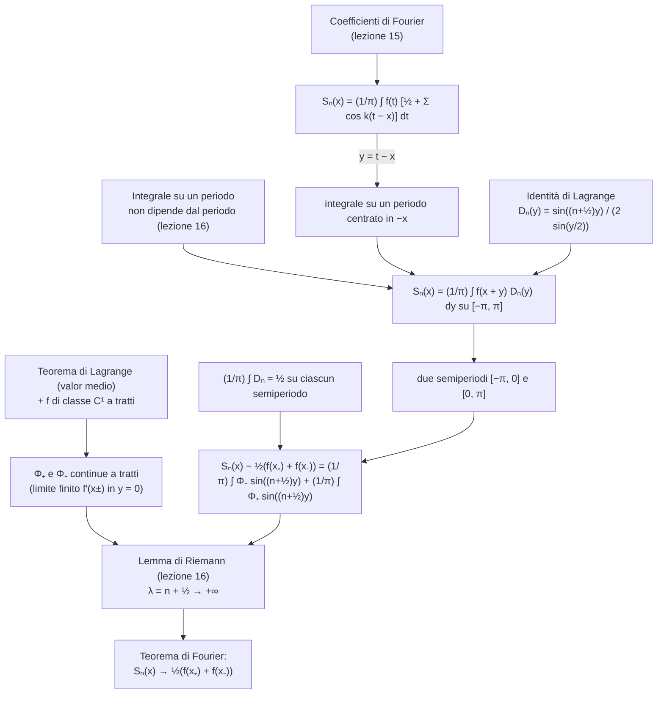

# Lezione 17 — Dimostrazione del teorema di Fourier, notazione esponenziale ed esempi

Nella [[MM L15 - Serie numeriche e coefficienti di Fourier|lezione 15]] sono stati definiti i **coefficienti di Fourier** di una funzione $2\pi$-periodica e le classi delle funzioni continue e di classe $C^1$ a tratti; nella [[MM L16 - Integrazione per parti, lemma di Riemann e identità di Lagrange|lezione 16]] sono stati preparati gli attrezzi tecnici: l'integrazione per parti generalizzata, il **lemma di Riemann**, l'indipendenza dell'integrale di una funzione periodica dal periodo scelto e l'**identità trigonometrica di Lagrange**. Questa lezione mette insieme i pezzi. Si enuncia e si dimostra il **teorema di Fourier**: la serie di Fourier di una funzione $2\pi$-periodica e di classe $C^1$ a tratti converge in ogni punto alla **media tra limite destro e limite sinistro** della funzione, quindi al valore della funzione dove questa è continua e al punto medio del salto dove non lo è. Seguono due osservazioni che semplificano i calcoli: le funzioni **pari** hanno serie di soli coseni e quelle **dispari** di soli seni; la serie si può riscrivere con gli **esponenziali complessi**, purché si prendano **somme parziali simmetriche**. La lezione si chiude con due esempi completi, l'estensione periodica di $x^2$, da cui escono le somme $\sum 1/k^2 = \pi^2/6$ e $\sum (-1)^k/k^2 = -\pi^2/12$, e l'**onda quadra**, da cui esce $\sum_{\ell \geq 0} (-1)^\ell/(2\ell+1) = \pi/4$.

> [!note] Fonti di questa lezione
> La nota si basa sulla trascrizione della registrazione (parte 1, datata 16 novembre 2026) e sugli appunti manuali del 16 novembre 2026 (scansione di 4 pagine, tutte pertinenti a questa lezione). Per la parte del corso tenuta dal prof. Benini non è disponibile materiale del docente: enunciati e definizioni seguono la lezione, controllati sugli appunti. La registrazione comincia mentre il docente sta finendo di scrivere l'enunciato del teorema (l'enunciato completo è negli appunti) e si interrompe durante la verifica delle ipotesi nell'esempio dell'onda quadra: il calcolo dei coefficienti e le conclusioni di quell'esempio seguono gli appunti manuali, e la lezione 18 conferma, nel riepilogo iniziale, che l'esempio è stato completato a lezione. La pausa a metà lezione e alcune conversazioni laterali sono omesse. Le figure sono costruite per rappresentare ciò che il docente disegna alla lavagna; le curve delle somme parziali sono calcolate.

## Il teorema di Fourier

### L'enunciato

Fin qui la serie di Fourier di una funzione $2\pi$-periodica era solo un oggetto *costruito*: dati i coefficienti

$$
a_k = \frac{1}{\pi}\int_{-\pi}^{\pi} f(t)\cos(kt)\, dt \quad (k \geq 0), \qquad b_k = \frac{1}{\pi}\int_{-\pi}^{\pi} f(t)\sin(kt)\, dt \quad (k \geq 1),
$$

si scrive la serie trigonometrica $\tfrac12 a_0 + \sum_{k\geq 1}\big(a_k\cos(kx) + b_k\sin(kx)\big)$, ma niente garantiva che convergesse, né, se converge, che la sua somma avesse qualcosa a che fare con $f$. Il teorema di Fourier risponde a entrambe le domande sotto un'ipotesi di regolarità molto debole, soddisfatta da quasi tutti i segnali che si incontrano in ingegneria (onde quadre, a dente di sega, triangolari, raddrizzate).

> [!important] Teorema — Fourier (convergenza puntuale)
> Sia $f : \mathbb{R} \to \mathbb{R}$ una funzione $2\pi$-periodica e di classe $C^1$ a tratti su ogni periodo. Allora la serie di Fourier
> $$
> \frac12 a_0 + \sum_{k=1}^{+\infty}\big(a_k\cos(kx) + b_k\sin(kx)\big),
> $$
> con $a_0$, $a_k$, $b_k$ coefficienti di Fourier di $f$ ($k$ intero, $k \geq 1$), converge per ogni $x \in \mathbb{R}$ a
> $$
> \frac12\big(f(x_+) + f(x_-)\big),
> $$
> cioè alla media tra i limiti monolateri di $f$ in $x$, dove $f(x_\pm) := \lim_{y \to x^\pm} f(y)$.

Il docente insiste sul fatto che l'ipotesi "di classe $C^1$ a tratti" si può formulare in molti modi equivalenti: su un periodo, su ogni periodo, su ogni intervallo chiuso e limitato. Se $f$ è periodica e di classe $C^1$ a tratti su un periodo, lo è automaticamente su tutti gli altri, che sono copie traslate del primo; e un intervallo chiuso e limitato qualsiasi si ricopre con un numero finito di periodi, su ciascuno dei quali i punti singolari sono in numero finito. Ricordiamo dalla lezione 15 che cosa chiede la definizione: il periodo si divide in un numero finito di sottointervalli, all'interno dei quali $f$ è di classe $C^1$, e agli estremi di ciascun sottointervallo esistono finiti i limiti monolateri sia di $f$ sia di $f'$. In particolare i limiti $f(x_+)$ e $f(x_-)$ che compaiono nella tesi esistono finiti in ogni punto, e lo stesso vale per $f'(x_\pm) := \lim_{y\to x^\pm} f'(y)$, che serviranno nella dimostrazione.

### Continuità e salti

La tesi si legge in modo particolarmente semplice distinguendo due casi.

- Se $f$ è **continua** in $x$, i due limiti monolateri coincidono con $f(x)$ e la serie converge a $\tfrac12\big(f(x) + f(x)\big) = f(x)$: la serie di Fourier *ricostruisce* la funzione.
- Se $f$ ha in $x$ una **discontinuità di salto**, la serie converge al **punto medio del salto**, indipendentemente dal valore che $f$ assume in $x$.

Poiché in ogni periodo i punti di discontinuità sono in numero finito, la serie restituisce $f$ ovunque tranne al più in un numero finito di punti per periodo. Il valore di $f$ nei punti di salto, del resto, non può influire sulla serie: i coefficienti sono integrali, e cambiare una funzione in un numero finito di punti non cambia i suoi integrali.

> [!example] Esempio — Una funzione costante a tratti (ragionamento qualitativo)
> Sia $f$ la funzione $2\pi$-periodica che vale $1$ su $[-\pi, 0)$ e $2$ su $[0, \pi)$: in $-\pi$ vale $1$, resta costante fino a $0$ escluso, in $0$ salta a $2$, resta uguale a $2$ fino a $\pi$ escluso, dove per periodicità torna a valere $1$, e così via.
> - È di classe $C^1$ a tratti: è costante a tratti, quindi a derivata nulla all'interno di ogni tratto, con limiti monolateri finiti agli estremi. È $2\pi$-periodica per costruzione. Il teorema di Fourier si applica.
> - Nei punti interni ai tratti, per esempio in $x = \pi/2$ o in $x = -\pi/2$, la funzione è continua: la serie converge a $f(x)$, cioè a $2$ e a $1$ rispettivamente.
> - In $x = 0$ c'è un salto da $1$ a $2$: la serie converge a $\tfrac12(2 + 1) = \tfrac32$. Lo stesso accade in tutti i multipli interi di $\pi$, dove la funzione salta da $2$ a $1$ o da $1$ a $2$.
>
> È una versione dell'**onda quadra**, che verrà calcolata esplicitamente alla fine della lezione (con quote $0$ e $A$ invece di $1$ e $2$).

<svg viewBox="0 0 600 250" width="600" style="display:block;margin:1em auto;max-width:100%;height:auto;font-family:inherit" xmlns="http://www.w3.org/2000/svg"><line x1="40.0" y1="159.0" x2="588.0" y2="159.0" stroke="currentColor" stroke-width="1"/><polygon points="594.0,159.0 586.0,155.0 586.0,163.0" fill="currentColor"/><line x1="310.0" y1="175.0" x2="310.0" y2="14.0" stroke="currentColor" stroke-width="1"/><polygon points="310.0,8.0 306.0,16.0 314.0,16.0" fill="currentColor"/><line x1="75.2" y1="156.0" x2="75.2" y2="162.0" stroke="currentColor"/><text x="75.2" y="174.0" font-size="11" text-anchor="middle" fill="currentColor">−2π</text><line x1="192.6" y1="156.0" x2="192.6" y2="162.0" stroke="currentColor"/><text x="192.6" y="174.0" font-size="11" text-anchor="middle" fill="currentColor">−π</text><line x1="427.4" y1="156.0" x2="427.4" y2="162.0" stroke="currentColor"/><text x="427.4" y="174.0" font-size="11" text-anchor="middle" fill="currentColor">π</text><line x1="544.8" y1="156.0" x2="544.8" y2="162.0" stroke="currentColor"/><text x="544.8" y="174.0" font-size="11" text-anchor="middle" fill="currentColor">2π</text><line x1="307.0" y1="105.5" x2="313.0" y2="105.5" stroke="currentColor"/><line x1="36.0" y1="105.5" x2="310.0" y2="105.5" stroke="currentColor" stroke-width="0.5" stroke-dasharray="2 3" opacity="0.6"/><text x="32.0" y="109.5" font-size="11" text-anchor="end" fill="currentColor">1</text><line x1="307.0" y1="52.1" x2="313.0" y2="52.1" stroke="currentColor"/><line x1="36.0" y1="52.1" x2="310.0" y2="52.1" stroke="currentColor" stroke-width="0.5" stroke-dasharray="2 3" opacity="0.6"/><text x="32.0" y="56.1" font-size="11" text-anchor="end" fill="currentColor">2</text><line x1="40.0" y1="105.5" x2="75.2" y2="105.5" stroke="#3b82f6" stroke-width="2.4"/><circle cx="75.2" cy="105.5" r="3.5" fill="none" stroke="#3b82f6" stroke-width="1.6"/><line x1="75.2" y1="52.1" x2="192.6" y2="52.1" stroke="#3b82f6" stroke-width="2.4"/><circle cx="75.2" cy="52.1" r="3.5" fill="#3b82f6" stroke="#3b82f6" stroke-width="1.6"/><circle cx="192.6" cy="52.1" r="3.5" fill="none" stroke="#3b82f6" stroke-width="1.6"/><line x1="192.6" y1="105.5" x2="310.0" y2="105.5" stroke="#3b82f6" stroke-width="2.4"/><circle cx="192.6" cy="105.5" r="3.5" fill="#3b82f6" stroke="#3b82f6" stroke-width="1.6"/><circle cx="310.0" cy="105.5" r="3.5" fill="none" stroke="#3b82f6" stroke-width="1.6"/><line x1="310.0" y1="52.1" x2="427.4" y2="52.1" stroke="#3b82f6" stroke-width="2.4"/><circle cx="310.0" cy="52.1" r="3.5" fill="#3b82f6" stroke="#3b82f6" stroke-width="1.6"/><circle cx="427.4" cy="52.1" r="3.5" fill="none" stroke="#3b82f6" stroke-width="1.6"/><line x1="427.4" y1="105.5" x2="544.8" y2="105.5" stroke="#3b82f6" stroke-width="2.4"/><circle cx="427.4" cy="105.5" r="3.5" fill="#3b82f6" stroke="#3b82f6" stroke-width="1.6"/><circle cx="544.8" cy="105.5" r="3.5" fill="none" stroke="#3b82f6" stroke-width="1.6"/><line x1="544.8" y1="52.1" x2="580.0" y2="52.1" stroke="#3b82f6" stroke-width="2.4"/><circle cx="544.8" cy="52.1" r="3.5" fill="#3b82f6" stroke="#3b82f6" stroke-width="1.6"/><circle cx="75.2" cy="78.8" r="4" fill="#d98a1c" stroke="#d98a1c" stroke-width="1.6"/><circle cx="192.6" cy="78.8" r="4" fill="#d98a1c" stroke="#d98a1c" stroke-width="1.6"/><circle cx="310.0" cy="78.8" r="4" fill="#d98a1c" stroke="#d98a1c" stroke-width="1.6"/><circle cx="427.4" cy="78.8" r="4" fill="#d98a1c" stroke="#d98a1c" stroke-width="1.6"/><circle cx="544.8" cy="78.8" r="4" fill="#d98a1c" stroke="#d98a1c" stroke-width="1.6"/><text x="318.0" y="82.8" font-size="11" fill="#d98a1c">3/2</text><text x="300.0" y="213.0" font-size="10.5" text-anchor="middle" fill="currentColor">blu: f, pari a 1 su [−π, 0) e a 2 su [0, π), estesa per periodicità (pallino pieno: valore assunto; vuoto: escluso)</text><text x="300.0" y="227.0" font-size="10.5" text-anchor="middle" fill="currentColor">arancione: nei punti di salto kπ la serie di Fourier converge al punto medio 3/2</text></svg>

## Dimostrazione del teorema di Fourier

La dimostrazione è lunga ma ogni passaggio è elementare; serve soprattutto, come avverte il docente, pazienza. Fissiamo una volta per tutte un punto $x \in \mathbb{R}$: tutto ciò che segue è fatto a $x$ fissato.

### L'obiettivo

Indichiamo con

$$
S_n(x) = \frac12 a_0 + \sum_{k=1}^{n}\big(a_k\cos(kx) + b_k\sin(kx)\big)
$$

la successione delle **somme parziali** della serie di Fourier. Dire che la serie converge a $\tfrac12\big(f(x_+)+f(x_-)\big)$ significa che il limite di $S_n(x)$ per $n \to +\infty$ esiste finito e vale proprio quel numero. In pratica dimostreremo l'affermazione equivalente

$$
\lim_{n\to+\infty}\Big(S_n(x) - \frac12\big(f(x_+) + f(x_-)\big)\Big) = 0 .
$$

La strategia, in quattro mosse, è la seguente: scrivere $S_n(x)$ come un unico integrale; riscrivere nella stessa forma anche il valore medio $\tfrac12\big(f(x_+)+f(x_-)\big)$; fare la differenza, che risulterà una somma di due integrali del tipo $\int g(y)\sin(\lambda y)\, dy$ con $\lambda \to +\infty$; concludere con il lemma di Riemann, dopo averne verificato le ipotesi.

### Le somme parziali come un unico integrale

Sostituiamo in $S_n(x)$ le espressioni integrali dei coefficienti. Tutti i coefficienti hanno la stessa struttura, $\tfrac1\pi\int_{-\pi}^{\pi} f(t)\,(\dots)\, dt$, e la somma è **finita**: poiché l'integrale è lineare, possiamo portare la somma dentro l'integrale. Il docente sottolinea che questo passaggio è lecito proprio perché la somma è finita; per una serie, cioè per un limite, lo scambio con l'integrale non è sempre permesso. Raccogliendo $f(t)$ si ottiene

$$
S_n(x) = \frac1\pi\int_{-\pi}^{\pi} f(t)\Big(\frac12 + \sum_{k=1}^{n}\big(\cos(kt)\cos(kx) + \sin(kt)\sin(kx)\big)\Big)\, dt .
$$

Al posto di $a_0$ è rimasto $1$ (con il suo $\tfrac12$), al posto di $a_k$ il fattore $\cos(kt)$, al posto di $b_k$ il fattore $\sin(kt)$. La formula di sottrazione del coseno, $\cos\alpha\cos\beta + \sin\alpha\sin\beta = \cos(\alpha - \beta)$, compatta la parentesi:

$$
S_n(x) = \frac1\pi\int_{-\pi}^{\pi} f(t)\Big(\frac12 + \sum_{k=1}^{n}\cos\big(k(t-x)\big)\Big)\, dt .
$$

### Traslazione e integrale su un periodo

Poiché $t$ compare solo nella combinazione $t - x$, conviene il cambio di variabile $y = t - x$. L'intervallo di integrazione $[-\pi, \pi]$ in $t$ diventa $[-\pi - x, \pi - x]$ in $y$, e $f(t) = f(x + y)$:

$$
S_n(x) = \frac1\pi\int_{-\pi-x}^{\pi-x} f(x+y)\Big(\frac12 + \sum_{k=1}^{n}\cos(ky)\Big)\, dy .
$$

Ora la variabile è $y$, mentre $x$ è un parametro fissato. L'integrando è $2\pi$-periodico in $y$: $f(x + y)$ lo è perché traslata di una funzione $2\pi$-periodica, e la parentesi è una costante più una somma di coseni $\cos(ky)$ con $k$ intero. L'intervallo $[-\pi - x, \pi - x]$ è un periodo intero, "strano" solo perché centrato in $-x$ anziché in $0$. Per il lemma della lezione 16, l'integrale di una funzione periodica esteso a un periodo non dipende da quale periodo si sceglie; possiamo quindi centrarlo in $0$:

$$
S_n(x) = \frac1\pi\int_{-\pi}^{\pi} f(x+y)\, D_n(y)\, dy, \qquad D_n(y) := \frac12 + \sum_{k=1}^{n}\cos(ky).
$$

La notazione $D_n$ è introdotta qui per brevità (a lezione il docente scrive sempre la somma per esteso).

### L'identità di Lagrange e i due semiperiodi

L'**identità trigonometrica di Lagrange** della lezione 16 dà una forma chiusa per $D_n$:

$$
D_n(y) = \frac12 + \sum_{k=1}^{n}\cos(ky) = \frac{\sin\big((n+\tfrac12)y\big)}{2\sin(\tfrac12 y)} .
$$

Il membro di destra non è definito dove $\sin(\tfrac12 y) = 0$, cioè nei multipli interi di $2\pi$ (nel nostro intervallo, solo in $y = 0$); ma lì ammette estensione continua, con valore $n + \tfrac12$, che coincide con il valore del membro di sinistra. Come concordato nella lezione 16, l'identità si usa in questo senso generalizzato, sottintendendo l'estensione continua; del resto, dentro un integrale il valore in un singolo punto è irrilevante. Dunque

$$
S_n(x) = \frac1\pi\int_{-\pi}^{\pi} f(x+y)\,\frac{\sin\big((n+\tfrac12)y\big)}{2\sin(\tfrac12 y)}\, dy .
$$

Il docente avverte che questo è il punto in cui è facile dimenticare il fattore $2$ al denominatore (a lezione è successo, ed è stato uno studente a farlo notare): senza quel $2$, alla fine "tutto viene il doppio".

La mossa successiva è spezzare l'integrale nei due **semiperiodi** $[-\pi, 0]$ e $[0, \pi]$:

$$
S_n(x) = \frac1\pi\int_{-\pi}^{0} f(x+y)\,\frac{\sin\big((n+\tfrac12)y\big)}{2\sin(\tfrac12 y)}\, dy + \frac1\pi\int_{0}^{\pi} f(x+y)\,\frac{\sin\big((n+\tfrac12)y\big)}{2\sin(\tfrac12 y)}\, dy .
$$

Il motivo è che vogliamo confrontare l'integrale con i due limiti monolateri di $f$ in $x$. Quando $y$ tende a $0$ da sinistra, $x + y$ tende a $x$ da sinistra, e $f(x+y)$ si avvicina a $f(x_-)$; quando $y$ tende a $0$ da destra, $f(x+y)$ si avvicina a $f(x_+)$. Il semiperiodo di sinistra andrà quindi confrontato con $f(x_-)$, quello di destra con $f(x_+)$.

<svg viewBox="0 0 600 290" width="600" style="display:block;margin:1em auto;max-width:100%;height:auto;font-family:inherit" xmlns="http://www.w3.org/2000/svg"><polygon points="74.4,169.4 74.4,159.0 76.0,159.1 77.5,159.3 79.0,159.7 80.5,160.3 82.0,161.0 83.6,161.9 85.1,162.8 86.6,163.9 88.1,165.1 89.6,166.3 91.2,167.6 92.7,169.0 94.2,170.3 95.7,171.6 97.2,172.9 98.8,174.1 100.3,175.3 101.8,176.4 103.3,177.3 104.8,178.2 106.3,178.9 107.9,179.4 109.4,179.8 110.9,180.0 112.4,180.0 113.9,179.9 115.5,179.6 117.0,179.1 118.5,178.5 120.0,177.7 121.5,176.8 123.1,175.8 124.6,174.6 126.1,173.4 127.6,172.0 129.1,170.7 130.7,169.3 132.2,167.8 133.7,166.4 135.2,165.1 136.7,163.8 138.2,162.5 139.8,161.4 141.3,160.4 142.8,159.5 144.3,158.8 145.8,158.2 147.4,157.9 148.9,157.7 150.4,157.7 151.9,157.8 153.4,158.2 155.0,158.8 156.5,159.5 158.0,160.4 159.5,161.5 161.0,162.7 162.6,164.0 164.1,165.4 165.6,166.9 167.1,168.5 168.6,170.1 170.1,171.7 171.7,173.3 173.2,174.9 174.7,176.4 176.2,177.8 177.7,179.1 179.3,180.2 180.8,181.2 182.3,182.0 183.8,182.6 185.3,183.0 186.9,183.2 188.4,183.2 189.9,183.0 191.4,182.5 192.9,181.8 194.5,180.9 196.0,179.7 197.5,178.4 199.0,176.9 200.5,175.3 202.0,173.5 203.6,171.6 205.1,169.7 206.6,167.7 208.1,165.6 209.6,163.6 211.2,161.7 212.7,159.8 214.2,158.0 215.7,156.4 217.2,154.9 218.8,153.6 220.3,152.6 221.8,151.8 223.3,151.3 224.8,151.0 226.4,151.1 227.9,151.4 229.4,152.1 230.9,153.0 232.4,154.3 233.9,155.8 235.5,157.6 237.0,159.7 238.5,162.0 240.0,164.5 241.5,167.2 243.1,170.0 244.6,172.9 246.1,175.9 247.6,178.9 249.1,181.8 250.7,184.7 252.2,187.4 253.7,190.0 255.2,192.3 256.7,194.4 258.3,196.2 259.8,197.6 261.3,198.6 262.8,199.1 264.3,199.2 265.9,198.8 267.4,197.9 268.9,196.5 270.4,194.5 271.9,192.0 273.4,189.0 275.0,185.4 276.5,181.2 278.0,176.6 279.5,171.5 281.0,165.9 282.6,159.9 284.1,153.5 285.6,146.8 287.1,139.8 288.6,132.6 290.2,125.3 291.7,117.8 293.2,110.3 294.7,102.8 296.2,95.4 297.8,88.2 299.3,81.2 300.8,74.5 302.3,68.1 303.8,62.1 305.3,56.6 306.9,51.7 308.4,47.2 309.9,43.4 311.4,40.3 312.9,37.8 314.5,36.0 316.0,34.9 317.5,34.5 317.5,169.4" fill="#2e9e6a" fill-opacity="0.18" stroke="none"/><polygon points="317.5,169.4 317.5,34.5 319.0,34.9 320.5,36.0 322.1,37.8 323.6,40.3 325.1,43.4 326.6,47.2 328.1,51.7 329.7,56.6 331.2,62.1 332.7,68.1 334.2,74.5 335.7,81.2 337.2,88.2 338.8,95.4 340.3,102.8 341.8,110.3 343.3,117.8 344.8,125.3 346.4,132.6 347.9,139.8 349.4,146.8 350.9,153.5 352.4,159.9 354.0,165.9 355.5,171.5 357.0,176.6 358.5,181.2 360.0,185.4 361.6,189.0 363.1,192.0 364.6,194.5 366.1,196.5 367.6,197.9 369.1,198.8 370.7,199.2 372.2,199.1 373.7,198.6 375.2,197.6 376.7,196.2 378.3,194.4 379.8,192.3 381.3,190.0 382.8,187.4 384.3,184.7 385.9,181.8 387.4,178.9 388.9,175.9 390.4,172.9 391.9,170.0 393.5,167.2 395.0,164.5 396.5,162.0 398.0,159.7 399.5,157.6 401.1,155.8 402.6,154.3 404.1,153.0 405.6,152.1 407.1,151.4 408.6,151.1 410.2,151.0 411.7,151.3 413.2,151.8 414.7,152.6 416.2,153.6 417.8,154.9 419.3,156.4 420.8,158.0 422.3,159.8 423.8,161.7 425.4,163.6 426.9,165.6 428.4,167.7 429.9,169.7 431.4,171.6 433.0,173.5 434.5,175.3 436.0,176.9 437.5,178.4 439.0,179.7 440.5,180.9 442.1,181.8 443.6,182.5 445.1,183.0 446.6,183.2 448.1,183.2 449.7,183.0 451.2,182.6 452.7,182.0 454.2,181.2 455.7,180.2 457.3,179.1 458.8,177.8 460.3,176.4 461.8,174.9 463.3,173.3 464.9,171.7 466.4,170.1 467.9,168.5 469.4,166.9 470.9,165.4 472.4,164.0 474.0,162.7 475.5,161.5 477.0,160.4 478.5,159.5 480.0,158.8 481.6,158.2 483.1,157.8 484.6,157.7 486.1,157.7 487.6,157.9 489.2,158.2 490.7,158.8 492.2,159.5 493.7,160.4 495.2,161.4 496.8,162.5 498.3,163.8 499.8,165.1 501.3,166.4 502.8,167.8 504.3,169.3 505.9,170.7 507.4,172.0 508.9,173.4 510.4,174.6 511.9,175.8 513.5,176.8 515.0,177.7 516.5,178.5 518.0,179.1 519.5,179.6 521.1,179.9 522.6,180.0 524.1,180.0 525.6,179.8 527.1,179.4 528.7,178.9 530.2,178.2 531.7,177.3 533.2,176.4 534.7,175.3 536.2,174.1 537.8,172.9 539.3,171.6 540.8,170.3 542.3,169.0 543.8,167.6 545.4,166.3 546.9,165.1 548.4,163.9 549.9,162.8 551.4,161.9 553.0,161.0 554.5,160.3 556.0,159.7 557.5,159.3 559.0,159.1 560.6,159.0 560.6,169.4" fill="#3b82f6" fill-opacity="0.18" stroke="none"/><line x1="55.0" y1="169.4" x2="588.0" y2="169.4" stroke="currentColor" stroke-width="1"/><polygon points="594.0,169.4 586.0,165.4 586.0,173.4" fill="currentColor"/><line x1="317.5" y1="215.0" x2="317.5" y2="14.0" stroke="currentColor" stroke-width="1"/><polygon points="317.5,8.0 313.5,16.0 321.5,16.0" fill="currentColor"/><line x1="74.4" y1="166.4" x2="74.4" y2="172.4" stroke="currentColor"/><text x="74.4" y="228.0" font-size="11" text-anchor="middle" fill="currentColor">−π</text><line x1="196.0" y1="166.4" x2="196.0" y2="172.4" stroke="currentColor"/><text x="196.0" y="228.0" font-size="11" text-anchor="middle" fill="currentColor">−π/2</text><line x1="439.0" y1="166.4" x2="439.0" y2="172.4" stroke="currentColor"/><text x="439.0" y="228.0" font-size="11" text-anchor="middle" fill="currentColor">π/2</text><line x1="560.6" y1="166.4" x2="560.6" y2="172.4" stroke="currentColor"/><text x="560.6" y="228.0" font-size="11" text-anchor="middle" fill="currentColor">π</text><line x1="314.5" y1="34.5" x2="320.5" y2="34.5" stroke="currentColor"/><line x1="51.0" y1="34.5" x2="317.5" y2="34.5" stroke="currentColor" stroke-width="0.5" stroke-dasharray="2 3" opacity="0.6"/><text x="47.0" y="38.5" font-size="11" text-anchor="end" fill="currentColor">n + ½</text><line x1="314.5" y1="127.9" x2="320.5" y2="127.9" stroke="currentColor"/><line x1="51.0" y1="127.9" x2="317.5" y2="127.9" stroke="currentColor" stroke-width="0.5" stroke-dasharray="2 3" opacity="0.6"/><text x="47.0" y="131.9" font-size="11" text-anchor="end" fill="currentColor">2</text><polyline points="74.4,159.0 75.4,159.0 76.4,159.1 77.4,159.3 78.3,159.5 79.3,159.8 80.3,160.2 81.3,160.6 82.2,161.1 83.2,161.7 84.2,162.2 85.1,162.9 86.1,163.6 87.1,164.3 88.1,165.0 89.0,165.8 90.0,166.6 91.0,167.5 91.9,168.3 92.9,169.2 93.9,170.0 94.9,170.9 95.8,171.7 96.8,172.5 97.8,173.3 98.8,174.1 99.7,174.9 100.7,175.6 101.7,176.3 102.6,176.9 103.6,177.5 104.6,178.0 105.6,178.5 106.5,178.9 107.5,179.3 108.5,179.6 109.4,179.8 110.4,179.9 111.4,180.0 112.4,180.0 113.3,180.0 114.3,179.9 115.3,179.7 116.3,179.4 117.2,179.1 118.2,178.7 119.2,178.2 120.1,177.7 121.1,177.1 122.1,176.5 123.1,175.8 124.0,175.0 125.0,174.3 126.0,173.5 126.9,172.6 127.9,171.8 128.9,170.9 129.9,170.0 130.8,169.1 131.8,168.2 132.8,167.3 133.8,166.4 134.7,165.5 135.7,164.6 136.7,163.8 137.6,163.0 138.6,162.2 139.6,161.5 140.6,160.9 141.5,160.2 142.5,159.7 143.5,159.2 144.4,158.7 145.4,158.4 146.4,158.1 147.4,157.9 148.3,157.7 149.3,157.6 150.3,157.7 151.3,157.7 152.2,157.9 153.2,158.1 154.2,158.5 155.1,158.8 156.1,159.3 157.1,159.8 158.1,160.4 159.0,161.1 160.0,161.8 161.0,162.6 161.9,163.4 162.9,164.3 163.9,165.2 164.9,166.2 165.8,167.2 166.8,168.2 167.8,169.2 168.8,170.2 169.7,171.3 170.7,172.3 171.7,173.3 172.6,174.3 173.6,175.3 174.6,176.3 175.6,177.2 176.5,178.0 177.5,178.9 178.5,179.6 179.4,180.3 180.4,181.0 181.4,181.5 182.4,182.0 183.3,182.4 184.3,182.8 185.3,183.0 186.3,183.2 187.2,183.2 188.2,183.2 189.2,183.1 190.1,182.9 191.1,182.6 192.1,182.2 193.1,181.7 194.0,181.1 195.0,180.5 196.0,179.7 196.9,178.9 197.9,178.0 198.9,177.1 199.9,176.0 200.8,174.9 201.8,173.8 202.8,172.6 203.8,171.4 204.7,170.1 205.7,168.9 206.7,167.6 207.6,166.3 208.6,165.0 209.6,163.7 210.6,162.4 211.5,161.2 212.5,160.0 213.5,158.8 214.4,157.7 215.4,156.7 216.4,155.7 217.4,154.8 218.3,154.0 219.3,153.2 220.3,152.6 221.3,152.0 222.2,151.6 223.2,151.3 224.2,151.1 225.1,151.0 226.1,151.0 227.1,151.2 228.1,151.5 229.0,151.9 230.0,152.4 231.0,153.1 231.9,153.8 232.9,154.7 233.9,155.7 234.9,156.9 235.8,158.1 236.8,159.4 237.8,160.9 238.8,162.4 239.7,164.0 240.7,165.7 241.7,167.4 242.6,169.2 243.6,171.1 244.6,172.9 245.6,174.8 246.5,176.7 247.5,178.6 248.5,180.5 249.4,182.4 250.4,184.2 251.4,186.0 252.4,187.8 253.3,189.4 254.3,191.0 255.3,192.4 256.3,193.8 257.2,195.0 258.2,196.1 259.2,197.0 260.1,197.8 261.1,198.5 262.1,198.9 263.1,199.2 264.0,199.2 265.0,199.1 266.0,198.8 266.9,198.2 267.9,197.5 268.9,196.5 269.9,195.3 270.8,193.9 271.8,192.3 272.8,190.4 273.8,188.3 274.7,186.0 275.7,183.4 276.7,180.7 277.6,177.7 278.6,174.6 279.6,171.2 280.6,167.7 281.5,164.0 282.5,160.1 283.5,156.1 284.4,151.9 285.4,147.6 286.4,143.2 287.4,138.7 288.3,134.1 289.3,129.4 290.3,124.7 291.2,119.9 292.2,115.1 293.2,110.3 294.2,105.5 295.1,100.7 296.1,96.0 297.1,91.3 298.1,86.8 299.0,82.3 300.0,77.9 301.0,73.7 301.9,69.6 302.9,65.7 303.9,61.9 304.9,58.3 305.8,55.0 306.8,51.9 307.8,48.9 308.8,46.3 309.7,43.9 310.7,41.7 311.7,39.8 312.6,38.2 313.6,36.9 314.6,35.9 315.6,35.1 316.5,34.7 317.5,34.5 318.5,34.7 319.4,35.1 320.4,35.9 321.4,36.9 322.4,38.2 323.3,39.8 324.3,41.7 325.3,43.9 326.2,46.3 327.2,48.9 328.2,51.9 329.2,55.0 330.1,58.3 331.1,61.9 332.1,65.7 333.1,69.6 334.0,73.7 335.0,77.9 336.0,82.3 336.9,86.8 337.9,91.3 338.9,96.0 339.9,100.7 340.8,105.5 341.8,110.3 342.8,115.1 343.8,119.9 344.7,124.7 345.7,129.4 346.7,134.1 347.6,138.7 348.6,143.2 349.6,147.6 350.6,151.9 351.5,156.1 352.5,160.1 353.5,164.0 354.4,167.7 355.4,171.2 356.4,174.6 357.4,177.7 358.3,180.7 359.3,183.4 360.3,186.0 361.2,188.3 362.2,190.4 363.2,192.3 364.2,193.9 365.1,195.3 366.1,196.5 367.1,197.5 368.1,198.2 369.0,198.8 370.0,199.1 371.0,199.2 371.9,199.2 372.9,198.9 373.9,198.5 374.9,197.8 375.8,197.0 376.8,196.1 377.8,195.0 378.8,193.8 379.7,192.4 380.7,191.0 381.7,189.4 382.6,187.8 383.6,186.0 384.6,184.2 385.6,182.4 386.5,180.5 387.5,178.6 388.5,176.7 389.4,174.8 390.4,172.9 391.4,171.1 392.4,169.2 393.3,167.4 394.3,165.7 395.3,164.0 396.2,162.4 397.2,160.9 398.2,159.4 399.2,158.1 400.1,156.9 401.1,155.7 402.1,154.7 403.1,153.8 404.0,153.1 405.0,152.4 406.0,151.9 406.9,151.5 407.9,151.2 408.9,151.0 409.9,151.0 410.8,151.1 411.8,151.3 412.8,151.6 413.8,152.0 414.7,152.6 415.7,153.2 416.7,154.0 417.6,154.8 418.6,155.7 419.6,156.7 420.6,157.7 421.5,158.8 422.5,160.0 423.5,161.2 424.4,162.4 425.4,163.7 426.4,165.0 427.4,166.3 428.3,167.6 429.3,168.9 430.3,170.1 431.2,171.4 432.2,172.6 433.2,173.8 434.2,174.9 435.1,176.0 436.1,177.1 437.1,178.0 438.1,178.9 439.0,179.7 440.0,180.5 441.0,181.1 441.9,181.7 442.9,182.2 443.9,182.6 444.9,182.9 445.8,183.1 446.8,183.2 447.8,183.2 448.8,183.2 449.7,183.0 450.7,182.8 451.7,182.4 452.6,182.0 453.6,181.5 454.6,181.0 455.6,180.3 456.5,179.6 457.5,178.9 458.5,178.0 459.4,177.2 460.4,176.3 461.4,175.3 462.4,174.3 463.3,173.3 464.3,172.3 465.3,171.3 466.2,170.2 467.2,169.2 468.2,168.2 469.2,167.2 470.1,166.2 471.1,165.2 472.1,164.3 473.1,163.4 474.0,162.6 475.0,161.8 476.0,161.1 476.9,160.4 477.9,159.8 478.9,159.3 479.9,158.8 480.8,158.5 481.8,158.1 482.8,157.9 483.7,157.7 484.7,157.7 485.7,157.6 486.7,157.7 487.6,157.9 488.6,158.1 489.6,158.4 490.6,158.7 491.5,159.2 492.5,159.7 493.5,160.2 494.4,160.9 495.4,161.5 496.4,162.2 497.4,163.0 498.3,163.8 499.3,164.6 500.3,165.5 501.2,166.4 502.2,167.3 503.2,168.2 504.2,169.1 505.1,170.0 506.1,170.9 507.1,171.8 508.1,172.6 509.0,173.5 510.0,174.3 511.0,175.0 511.9,175.8 512.9,176.5 513.9,177.1 514.9,177.7 515.8,178.2 516.8,178.7 517.8,179.1 518.8,179.4 519.7,179.7 520.7,179.9 521.7,180.0 522.6,180.0 523.6,180.0 524.6,179.9 525.6,179.8 526.5,179.6 527.5,179.3 528.5,178.9 529.4,178.5 530.4,178.0 531.4,177.5 532.4,176.9 533.3,176.3 534.3,175.6 535.3,174.9 536.2,174.1 537.2,173.3 538.2,172.5 539.2,171.7 540.1,170.9 541.1,170.0 542.1,169.2 543.1,168.3 544.0,167.5 545.0,166.6 546.0,165.8 546.9,165.0 547.9,164.3 548.9,163.6 549.9,162.9 550.8,162.2 551.8,161.7 552.8,161.1 553.8,160.6 554.7,160.2 555.7,159.8 556.7,159.5 557.6,159.3 558.6,159.1 559.6,159.0 560.6,159.0" fill="none" stroke="currentColor" stroke-width="1.8" opacity="1"/><text x="375.5" y="61.5" font-size="11" fill="currentColor">D<tspan baseline-shift="sub" font-size="9">n</tspan>(y) = sin((n+½)y) / (2 sin(y/2))</text><text x="300.0" y="253.0" font-size="10.5" text-anchor="middle" fill="currentColor">curva: il nucleo con n = 6; vale n + ½ in y = 0 per estensione continua</text><text x="300.0" y="267.0" font-size="10.5" text-anchor="middle" fill="currentColor">verde e blu: le due metà dell’integrale; ciascuna, divisa per π, vale esattamente ½</text></svg>

### Il valore medio scritto nella stessa forma

Per poter fare il confronto, scriviamo anche $f(x_+)$ e $f(x_-)$ come integrali della stessa forma. Sono costanti (non dipendono da $y$), quindi se le mettiamo al posto di $f(x+y)$ escono dall'integrale; la speranza è che ciò che resta valga esattamente $\tfrac12$, il coefficiente che hanno nel valore medio. Calcoliamo il semiperiodo di destra tornando indietro con l'identità di Lagrange e integrando la somma di coseni termine a termine:

$$
\begin{aligned}
\frac1\pi\int_{0}^{\pi}\frac{\sin\big((n+\tfrac12)y\big)}{2\sin(\tfrac12 y)}\, dy &= \frac1\pi\int_{0}^{\pi}\Big(\frac12 + \sum_{k=1}^{n}\cos(ky)\Big)\, dy \\
&= \frac1\pi\Big[\frac{y}{2} + \sum_{k=1}^{n}\frac1k\sin(ky)\Big]_{0}^{\pi} = \frac1\pi\cdot\frac\pi2 = \frac12 ,
\end{aligned}
$$

perché il seno di un multiplo intero di $\pi$ è nullo e tutta la somma sparisce. Lo stesso conto sul semiperiodo di sinistra dà $\tfrac1\pi\big(0 - (-\tfrac\pi2)\big) = \tfrac12$:

$$
\frac1\pi\int_{-\pi}^{0}\frac{\sin\big((n+\tfrac12)y\big)}{2\sin(\tfrac12 y)}\, dy = \frac12 .
$$

Si è così scritto $\tfrac12$ "in due maniere complicate", ed è esattamente ciò che serve:

$$
\frac12\big(f(x_+) + f(x_-)\big) = \frac1\pi\int_{-\pi}^{0} f(x_-)\,\frac{\sin\big((n+\tfrac12)y\big)}{2\sin(\tfrac12 y)}\, dy + \frac1\pi\int_{0}^{\pi} f(x_+)\,\frac{\sin\big((n+\tfrac12)y\big)}{2\sin(\tfrac12 y)}\, dy .
$$

### Riduzione al lemma di Riemann

Sottraendo membro a membro e raggruppando semiperiodo per semiperiodo:

$$
S_n(x) - \frac12\big(f(x_+) + f(x_-)\big) = \frac1\pi\int_{-\pi}^{0}\big(f(x+y) - f(x_-)\big)\frac{\sin\big((n+\tfrac12)y\big)}{2\sin(\tfrac12 y)}\, dy + \frac1\pi\int_{0}^{\pi}\big(f(x+y) - f(x_+)\big)\frac{\sin\big((n+\tfrac12)y\big)}{2\sin(\tfrac12 y)}\, dy .
$$

In ciascun integrale c'è la differenza tra $f(x+y)$ e il suo limite monolatero, valutata proprio dove $y$ sta dal lato giusto di $0$. Conviene ora riorganizzare i fattori: il denominatore $2\sin(\tfrac12 y)$ va con la differenza, mentre $\sin\big((n+\tfrac12)y\big)$ resta da solo:

$$
S_n(x) - \frac12\big(f(x_+) + f(x_-)\big) = \frac1\pi\int_{-\pi}^{0}\Phi_-(y)\,\sin\big((n+\tfrac12)y\big)\, dy + \frac1\pi\int_{0}^{\pi}\Phi_+(y)\,\sin\big((n+\tfrac12)y\big)\, dy, \tag{1}
$$

dove

$$
\Phi_\pm(y) = \frac{f(x+y) - f(x_\pm)}{2\sin(\tfrac12 y)} \qquad (y \neq 0).
$$

La ragione di questa forma è il **lemma di Riemann** della lezione 16: se $g$ è continua a tratti su $[a, b]$, allora

$$
\lim_{\lambda\to+\infty}\int_a^b g(y)\sin(\lambda y)\, dy = 0 .
$$

In (1) compare $\sin(\lambda y)$ con $\lambda = n + \tfrac12$, che tende a $+\infty$ con $n$. Se $\Phi_-$ è continua a tratti su $[-\pi, 0]$ e $\Phi_+$ è continua a tratti su $[0, \pi]$, entrambi gli integrali tendono a $0$, la loro somma tende a $0$ e il teorema è dimostrato. Resta quindi da verificare l'ipotesi del lemma.

### Le funzioni ausiliarie sono continue a tratti

Il docente svolge la verifica per $\Phi_+$ ("mi piace pensare positivo"); per $\Phi_-$ è identica. Definiamo con precisione

$$
\Phi_+ : [0, \pi] \to \mathbb{R}, \qquad \Phi_+(y) = \begin{cases} \dfrac{f(x+y) - f(x_+)}{2\sin(\tfrac12 y)} & y \neq 0, \\[2mm] f'(x_+) & y = 0. \end{cases}
$$

Il valore in $0$ si può scegliere come si vuole, per due ragioni. La prima è che $\Phi_+$ finisce dentro un integrale, e il valore in un punto non cambia l'integrale. La seconda è che a noi interessa solo che $\Phi_+$ sia continua a tratti: se si modifica in un punto una funzione continua a tratti, nel caso peggiore si crea una discontinuità in più, e basta aggiungere un punto alla partizione. Il docente sceglie però il valore $f'(x_+)$ "in maniera lungimirante", perché si scoprirà che con questa scelta $\Phi_+$ è addirittura continua in $0$.

Lontano da $0$ non ci sono problemi. Su $(0, \pi]$ il numeratore $f(x+y) - f(x_+)$ è continuo a tratti, perché $f$ lo è e $f(x_+)$ è una costante; il denominatore $2\sin(\tfrac12 y)$ è una funzione regolare quanto si vuole e non si annulla, perché $\tfrac12 y \in (0, \tfrac\pi2]$. Il quoziente è quindi continuo a tratti su $(0, \pi]$. L'unico punto delicato è $y = 0$, dove il denominatore si annulla: **basta verificare che esista finito il limite $\lim_{y\to0^+}\Phi_+(y)$**.

**Passo 1: un intorno destro in cui $f$ è regolare.** Poiché $f$ è di classe $C^1$ a tratti, esiste $\delta > 0$ tale che $f$ è di classe $C^1$ su $(x, x+\delta)$. Infatti o $x$ è uno dei punti singolari (discontinuità di $f$ o di $f'$), e allora, essendo i punti singolari in numero finito, subito a destra di $x$ per un tratto non ce ne sono altri; oppure $x$ non è singolare, e allora c'è un intorno di $x$, in particolare un intorno destro, privo di punti singolari.

**Passo 2: una funzione a cui applicare il teorema di Lagrange.** La funzione

$$
g : [x, x+\delta) \to \mathbb{R}, \qquad g(z) = \begin{cases} f(z) & z \neq x, \\ f(x_+) & z = x, \end{cases}
$$

è continua anche nell'estremo $x$, perché le si è assegnato proprio il limite destro di $f$. Il valore "corretto" $f(x_+)$ è essenziale: se $x$ è un punto di discontinuità, il valore $f(x)$ renderebbe $g$ discontinua in $x$. Fissato $y \in (0, \delta)$, $g$ è continua sull'intervallo chiuso e limitato $[x, x+y]$ e derivabile nei punti interni, dove $g' = f'$. Il **teorema di Lagrange** (del valor medio) fornisce allora un punto intermedio $\eta \in (0, y)$ tale che

$$
f(x+y) - f(x_+) = g(x+y) - g(x) = f'(x+\eta)\, y .
$$

Il punto $\eta$ dipende in generale da $y$: per ogni $y$ il teorema ne garantisce almeno uno, e scegliendone uno per ciascun $y$ si ottiene una funzione $\eta(y)$, di cui non si sa nulla tranne che $0 < \eta(y) < y$.

**Passo 3: il limite.** Sostituendo,

$$
\Phi_+(y) = \frac{f'(x+\eta)\, y}{2\sin(\tfrac12 y)} = f'(x+\eta)\,\frac{y/2}{\sin(y/2)} ,
$$

e si prova a usare l'algebra dei limiti, calcolando separatamente il limite dei due fattori per $y \to 0^+$. Il secondo fattore tende a $1$: è il reciproco del limite notevole $\sin s / s$. Per il primo, poiché $0 < \eta(y) < y$, quando $y \to 0^+$ anche $\eta(y) \to 0^+$, e quindi $x + \eta(y) \to x^+$ (senza mai assumere il valore $x$). Per il teorema di sostituzione nei limiti,

$$
\lim_{y\to0^+} f'\big(x + \eta(y)\big) = \lim_{z\to x^+} f'(z) = f'(x_+),
$$

che esiste finito per l'ipotesi che $f$ sia di classe $C^1$ a tratti. Dunque

$$
\lim_{y\to0^+}\Phi_+(y) = f'(x_+)\cdot 1 = f'(x_+) = \Phi_+(0) .
$$

Il limite esiste finito, quindi $\Phi_+$ è continua a tratti su $[0, \pi]$ e, con la scelta fatta, perfino continua da destra in $0$; quest'ultima proprietà, osserva il docente, non serve alla dimostrazione, a cui basta l'esistenza del limite.

**Il caso di $\Phi_-$** (svolgimento aggiunto, "analogo" a lezione). Si pone $\Phi_-(0) := f'(x_-)$ e si sceglie $\delta > 0$ tale che $f$ sia di classe $C^1$ su $(x - \delta, x)$. Per $y \in (-\delta, 0)$ il teorema di Lagrange sull'intervallo $[x+y, x]$, applicato alla funzione che vale $f$ in $[x+y, x)$ e $f(x_-)$ in $x$, dà $f(x_-) - f(x+y) = f'(x+\eta)\,(-y)$ con $\eta \in (y, 0)$, cioè di nuovo $f(x+y) - f(x_-) = f'(x+\eta)\,y$. Quindi $\Phi_-(y) = f'(x+\eta)\,\frac{y/2}{\sin(y/2)} \to f'(x_-)$ per $y \to 0^-$.

### Conclusione

Le funzioni $\Phi_-$ e $\Phi_+$ sono continue a tratti sui rispettivi semiperiodi; per il lemma di Riemann, con $\lambda = n + \tfrac12 \to +\infty$, entrambi gli integrali in (1) tendono a $0$. Quindi

$$
\lim_{n\to+\infty}\Big(S_n(x) - \frac12\big(f(x_+) + f(x_-)\big)\Big) = 0 ,
$$

cioè la serie di Fourier converge in $x$ a $\tfrac12\big(f(x_+) + f(x_-)\big)$. Poiché $x$ era arbitrario, il teorema è dimostrato. $\blacksquare$

La mappa riassume come i risultati delle lezioni 15 e 16 entrano nella dimostrazione.

> [!tip] Approfondimento — Il nucleo di Dirichlet e il ruolo della regolarità
> #approfondimento La funzione $D_n(y) = \tfrac12 + \sum_{k=1}^{n}\cos(ky)$ è, a meno del fattore $2$, quello che nei testi di analisi si chiama **nucleo di Dirichlet**: in [@rudin1976, cap. 8] è definito come $\sum_{k=-n}^{n} e^{iky} = 1 + 2\sum_{k=1}^{n}\cos(ky) = \sin\big((n+\tfrac12)y\big)/\sin(\tfrac12 y)$, cioè $2D_n$. La dimostrazione appena vista mostra il suo ruolo: $S_n(x)$ è una media pesata dei valori di $f$ attorno a $x$, con peso $D_n$, e la figura mostra che, al crescere di $n$, il peso si concentra in un picco alto $n + \tfrac12$ attorno a $y = 0$, mentre lontano da $0$ oscilla sempre più rapidamente; il lemma di Riemann traduce in formula il fatto che queste oscillazioni rapide si compensano. Il nucleo **non** è positivo, ed è per questo che la convergenza richiede qualche ipotesi di regolarità su $f$ e non segue dalla sola continuità. In [@rudin1976, cap. 8] il risultato di convergenza è dimostrato con un'ipotesi più debole della classe $C^1$ a tratti: se in un punto $x$ esistono $\delta > 0$ e $M$ tali che $|f(x+t) - f(x)| \leq M|t|$ per $|t| < \delta$, la serie converge a $f(x)$. È lo stesso meccanismo del passo 3 qui sopra, dove il teorema di Lagrange serviva proprio a controllare $f(x+y) - f(x_+)$ con un multiplo di $y$.

## Coefficienti di funzioni pari e dispari

Prima della pausa il docente fa un'osservazione che fa risparmiare molti conti negli esempi concreti: se $f$ ha una parità definita, metà dei coefficienti di Fourier è nulla.

> [!important] Proposizione — Coefficienti di funzioni pari e dispari
> Sia $f : \mathbb{R} \to \mathbb{R}$ una funzione $2\pi$-periodica e integrabile sul periodo $[-\pi, \pi]$.
> - Se $f$ è **pari**, $b_k = 0$ per ogni $k \geq 1$: la serie di Fourier contiene solo coseni.
> - Se $f$ è **dispari**, $a_k = 0$ per ogni $k \geq 0$: la serie di Fourier contiene solo seni.

Il risultato non sorprende: i coseni sono funzioni pari, i seni sono dispari, e una funzione pari si "sviluppa" in funzioni pari, una dispari in funzioni dispari.

**Dimostrazione.** Sia $f$ pari. Nell'integrale che definisce $b_k$ si fa il cambio di variabile $t' = -t$, che cambia segno all'argomento. Il cambio rovescia il verso dell'integrale (gli estremi $-\pi$ e $\pi$ si scambiano, e $dt = -dt'$); raddrizzando l'intervallo il segno si compensa, come prevede la formula del cambio di variabili, in cui compare il modulo $|-1| = 1$ dello jacobiano (si veda la [[MM L12 - Cambio di variabili e integrali tripli|lezione 12]]). Quindi

$$
b_k = \frac1\pi\int_{-\pi}^{\pi} f(t)\sin(kt)\, dt = \frac1\pi\int_{-\pi}^{\pi} f(-t')\sin(-kt')\, dt' .
$$

Ora si usa che $f$ è pari, $f(-t') = f(t')$, e che il seno è dispari, $\sin(-kt') = -\sin(kt')$:

$$
b_k = -\frac1\pi\int_{-\pi}^{\pi} f(t')\sin(kt')\, dt' = -b_k ,
$$

da cui $2b_k = 0$, cioè $b_k = 0$.

Se $f$ è dispari si ragiona allo stesso modo sull'integrale che definisce $a_k$, dove al posto di $\sin(kt)$ c'è $\cos(kt)$. Dopo il cambio di variabile compaiono $f(-t') = -f(t')$, perché $f$ è dispari, e $\cos(-kt') = \cos(kt')$, perché il coseno è pari: il segno meno viene questa volta da $f$, e si trova $a_k = -a_k$, cioè $a_k = 0$. Il caso $k = 0$ è compreso, perché $\cos(0\cdot t) = 1$ e $a_0$ è il coefficiente con $k = 0$. $\blacksquare$

> [!example] Conseguenza (aggiunta) — Integrali dimezzati
> Lo stesso cambio di variabile mostra che, se $f$ è pari, la funzione $f(t)\cos(kt)$ è pari, e il suo integrale su $[-\pi, \pi]$ è il doppio dell'integrale su $[0, \pi]$; analogamente, se $f$ è dispari, $f(t)\sin(kt)$ è pari. Quindi
> $$
> f \text{ pari: } \ a_k = \frac2\pi\int_0^{\pi} f(t)\cos(kt)\, dt, \qquad f \text{ dispari: } \ b_k = \frac2\pi\int_0^{\pi} f(t)\sin(kt)\, dt .
> $$
> Sono le formule usate in [@morro2023, §5.2]; a lezione il docente calcola invece gli integrali sull'intero periodo.

## La serie di Fourier in notazione esponenziale

Finora la serie di Fourier è stata scritta con seni e coseni. Si può scrivere, in modo equivalente e spesso più compatto, con l'**esponenziale complesso**; è la forma più usata nelle applicazioni (segnali, circuiti) e quella che prepara la trasformata di Fourier.

### Seni e coseni come esponenziali

Si parte dalla formula di Eulero, $e^{ikx} = \cos(kx) + i\sin(kx)$: il coseno è la parte reale dell'esponenziale immaginario, il seno la parte immaginaria. Sommando e sottraendo questa formula e quella con $-kx$ al posto di $kx$ si ottiene

$$
\cos(kx) = \frac{e^{ikx} + e^{-ikx}}{2}, \qquad \sin(kx) = \frac{e^{ikx} - e^{-ikx}}{2i} .
$$

Sostituendo nelle somme parziali e raccogliendo prima gli esponenziali con esponente negativo, poi il termine costante (letto come $e^{i0x} = 1$), infine gli esponenziali con esponente positivo:

$$
\begin{aligned}
S_n(x) &= \frac12 a_0 + \sum_{k=1}^{n}\Big(a_k\,\frac{e^{ikx} + e^{-ikx}}{2} + b_k\,\frac{e^{ikx} - e^{-ikx}}{2i}\Big) \\
&= \sum_{k=1}^{n} e^{-ikx}\Big(\frac{a_k}{2} - \frac{b_k}{2i}\Big) + \frac12 a_0 + \sum_{k=1}^{n} e^{ikx}\Big(\frac{a_k}{2} + \frac{b_k}{2i}\Big) \\
&= \sum_{k=1}^{n} e^{-ikx}\,\frac12\big(a_k + i b_k\big) + \frac12 a_0 + \sum_{k=1}^{n} e^{ikx}\,\frac12\big(a_k - i b_k\big),
\end{aligned}
$$

dove nell'ultimo passaggio si è raccolto $\tfrac12$ e si è usato $-\tfrac1i = i$ (poiché $-1 = i^2$) e $\tfrac1i = -i$.

### I coefficienti di Fourier complessi

I numeri complessi che compaiono davanti agli esponenziali si riconoscono subito introducendo una nuova famiglia di coefficienti.

> [!important] Definizione — Coefficienti di Fourier complessi
> Sia $f : \mathbb{R} \to \mathbb{R}$ una funzione $2\pi$-periodica e integrabile su un periodo. Si chiamano **coefficienti di Fourier complessi** di $f$ i numeri
> $$
> \alpha_k = \frac{1}{2\pi}\int_{-\pi}^{\pi} f(t)\, e^{-ikt}\, dt, \qquad k \in \mathbb{Z}.
> $$

Calcoliamoli, separando i casi $k = 0$, $k > 0$ e $k < 0$.

- Per $k = 0$ l'esponenziale vale $1$ e $\tfrac{1}{2\pi} = \tfrac12\cdot\tfrac1\pi$:
  $$
  \alpha_0 = \frac12\cdot\frac1\pi\int_{-\pi}^{\pi} f(t)\, dt = \frac12 a_0 .
  $$
- Per $k > 0$ si scrive $e^{-ikt} = \cos(kt) - i\sin(kt)$, si raccoglie $\tfrac12$ e poi $-i$:
  $$
  \alpha_k = \frac{1}{2\pi}\int_{-\pi}^{\pi} f(t)\big(\cos(kt) - i\sin(kt)\big)\, dt = \frac12\big(a_k - i b_k\big).
  $$
- Per gli indici negativi conviene calcolare $\alpha_{-k}$ con $k > 0$: nell'esponenziale compare il segno $+$, e lo stesso conto dà
  $$
  \alpha_{-k} = \frac{1}{2\pi}\int_{-\pi}^{\pi} f(t)\, e^{ikt}\, dt = \frac{1}{2\pi}\int_{-\pi}^{\pi} f(t)\big(\cos(kt) + i\sin(kt)\big)\, dt = \frac12\big(a_k + i b_k\big) = \overline{\alpha_k}.
  $$

Il coefficiente di indice $-k$ è il **complesso coniugato** di quello di indice $k$; questo dipende dal fatto che $f$ è a valori reali, per cui $a_k$ e $b_k$ sono reali. Confrontando con l'ultima riga del calcolo precedente, i coefficienti davanti a $e^{-ikx}$, a $1$ e a $e^{ikx}$ sono rispettivamente $\alpha_{-k}$, $\alpha_0$ e $\alpha_k$. Rinominando $k$ in $-k$ nella prima somma si ottiene

$$
S_n(x) = \sum_{k=-n}^{n}\alpha_k\, e^{ikx} .
$$

L'indice $k = -n$ corrisponde ad $\alpha_{-n}e^{-inx}$, l'indice $k = 0$ al termine costante $\alpha_0$, gli indici positivi ai termini $\alpha_k e^{ikx}$ della terza somma. Viceversa (osservazione aggiunta), dai coefficienti complessi si risale a quelli reali con $a_k = \alpha_k + \alpha_{-k}$ e $b_k = i(\alpha_k - \alpha_{-k})$; e poiché $\alpha_{-k}e^{-ikx}$ è il coniugato di $\alpha_k e^{ikx}$, la somma dei due è $2\operatorname{Re}\big(\alpha_k e^{ikx}\big)$, un numero reale, come deve essere.

### Somme parziali simmetriche

C'è una sola cosa a cui stare attenti. Nella forma reale l'indice $n$ compare da una parte sola; nella forma esponenziale le somme vanno da $-n$ a $n$, e la serie di Fourier è il **limite delle somme parziali simmetriche**:

$$
\sum_{k\in\mathbb{Z}}\alpha_k\, e^{ikx} := \lim_{n\to+\infty}\sum_{k=-n}^{n}\alpha_k\, e^{ikx} .
$$

Il teorema di Fourier garantisce la convergenza di questo limite e nient'altro: non si può, per esempio, sommare da $-n$ a $2n$ e passare al limite, perché il risultato potrebbe non convergere o convergere a un valore diverso. Il docente spiega l'origine del problema. Le serie di Fourier producono spesso **serie a segni alterni** (seni e coseni cambiano segno, e i coefficienti stessi possono alternare il segno, come negli esempi più avanti), e una serie a segni alterni che converge ma **non converge assolutamente** non si può riordinare liberamente: cambiando l'ordine degli addendi si può ottenere una serie che non converge o che converge a un altro valore. L'esempio tipico è la serie armonica: $\sum 1/n$ diverge, mentre $\sum (-1)^n/n$ converge, ma non assolutamente; se invece di alternare un indice pari e un indice dispari si sommano due indici pari e poi uno dispari, e così via, sembra di sommare gli stessi termini, ma si è prodotta una serie nuova, che converge a un altro limite.

> [!example] Esempio (aggiunto) — Somme non simmetriche per l'onda quadra
> Per l'onda quadra calcolata più avanti (quote $0$ e $A$) i coefficienti complessi sono $\alpha_0 = A/2$, $\alpha_k = 0$ per $k$ pari non nullo e $\alpha_k = -\tfrac{iA}{\pi k}$ per $k$ dispari, positivo o negativo. In $x = 0$ le somme simmetriche valgono esattamente $A/2$ per ogni $n$, perché i termini di indice $k$ e $-k$ si cancellano: è il valore previsto dal teorema nel salto. Le somme da $-n$ a $2n$, invece, contengono in più i termini con $k$ dispari in $(n, 2n]$, e per $n \to +\infty$ tendono al numero complesso $\tfrac A2 - i\,\tfrac{A\ln 2}{2\pi}$, perché $\sum_{k \text{ dispari},\, n < k \leq 2n} 1/k \to \tfrac12\ln 2$ (valore controllato numericamente fino a $n = 10^4$).

> [!tip] Approfondimento — Il teorema di riordinamento di Riemann
> #approfondimento Il fenomeno descritto dal docente è un teorema: se una serie reale converge ma non converge assolutamente, per ogni coppia $-\infty \leq \alpha \leq \beta \leq +\infty$ esiste un suo riordinamento le cui somme parziali hanno $\alpha$ come minimo limite e $\beta$ come massimo limite; in particolare, la si può riordinare in modo che converga a un qualsiasi numero reale prefissato [@rudin1976, Teor. 3.54]. Al contrario, una serie assolutamente convergente si può riordinare a piacere senza cambiarne la somma. Per l'esempio della lezione (calcolo aggiunto, controllato numericamente sommando due milioni di blocchi): $\sum_{n\geq1}(-1)^n/n = -\ln 2 \approx -0{,}693$, mentre il riordinamento "due indici pari, poi uno dispari", cioè $\tfrac12 + \tfrac14 - 1 + \tfrac16 + \tfrac18 - \tfrac13 + \dots$, converge a $-\tfrac12\ln 2 \approx -0{,}347$.

## Esempio: la serie di Fourier di $x^2$

Dopo la pausa il docente svolge due esempi completi. Il primo è "la serie di Fourier di $x^2$": la frase significa che si prende $x^2$ sull'intervallo $[-\pi, \pi)$ e la si **estende per periodicità** a tutto $\mathbb{R}$.

### La funzione e la verifica delle ipotesi

Sia $f : \mathbb{R} \to \mathbb{R}$ la funzione $2\pi$-periodica definita da

$$
f(x + 2k\pi) = x^2 \qquad \text{per } x \in [-\pi, \pi),\ k \in \mathbb{Z}.
$$

La definizione è ben posta perché ogni numero reale si scrive in modo unico come un numero di $[-\pi, \pi)$ più un multiplo intero di $2\pi$; così si costruisce "a mano" una funzione $2\pi$-periodica che su $[-\pi, \pi)$ (il caso $k = 0$) è $x^2$ e sugli altri periodi ne è la copia traslata. Il grafico: in $-\pi$ la funzione vale $\pi^2$, scende lungo la parabola fino a $0$ in $x = 0$ e risale verso $\pi^2$; in $\pi$ "vorrebbe" valere $\pi^2$ come valore della parabola, ma $\pi$ è fuori dall'intervallo, e il valore in $\pi$ è quello della copia successiva. Si incolla poi questo tratto a destra e a sinistra; sul periodo $[\pi, 3\pi)$ la funzione è $(x - 2\pi)^2$, e il pallino pieno della copia successiva in $\pi$ riempie il pallino vuoto della parabola precedente.

<svg viewBox="0 0 620 290" width="620" style="display:block;margin:1em auto;max-width:100%;height:auto;font-family:inherit" xmlns="http://www.w3.org/2000/svg"><line x1="36.0" y1="187.2" x2="608.0" y2="187.2" stroke="currentColor" stroke-width="1"/><polygon points="614.0,187.2 606.0,183.2 606.0,191.2" fill="currentColor"/><line x1="318.0" y1="210.0" x2="318.0" y2="14.0" stroke="currentColor" stroke-width="1"/><polygon points="318.0,8.0 314.0,16.0 322.0,16.0" fill="currentColor"/><line x1="49.4" y1="184.2" x2="49.4" y2="190.2" stroke="currentColor"/><text x="49.4" y="223.0" font-size="11" text-anchor="middle" fill="currentColor">−3π</text><line x1="139.0" y1="184.2" x2="139.0" y2="190.2" stroke="currentColor"/><text x="139.0" y="223.0" font-size="11" text-anchor="middle" fill="currentColor">−2π</text><line x1="228.5" y1="184.2" x2="228.5" y2="190.2" stroke="currentColor"/><text x="228.5" y="223.0" font-size="11" text-anchor="middle" fill="currentColor">−π</text><line x1="407.5" y1="184.2" x2="407.5" y2="190.2" stroke="currentColor"/><text x="407.5" y="223.0" font-size="11" text-anchor="middle" fill="currentColor">π</text><line x1="497.0" y1="184.2" x2="497.0" y2="190.2" stroke="currentColor"/><text x="497.0" y="223.0" font-size="11" text-anchor="middle" fill="currentColor">2π</text><line x1="586.6" y1="184.2" x2="586.6" y2="190.2" stroke="currentColor"/><text x="586.6" y="223.0" font-size="11" text-anchor="middle" fill="currentColor">3π</text><line x1="315.0" y1="37.2" x2="321.0" y2="37.2" stroke="currentColor"/><line x1="32.0" y1="37.2" x2="318.0" y2="37.2" stroke="currentColor" stroke-width="0.5" stroke-dasharray="2 3" opacity="0.6"/><text x="28.0" y="41.2" font-size="11" text-anchor="end" fill="currentColor">π²</text><line x1="36.0" y1="37.2" x2="600.0" y2="37.2" stroke="currentColor" stroke-width="0.6" stroke-dasharray="2 4"/><polyline points="36.0,83.0 37.1,82.0 38.3,81.0 39.4,80.1 40.5,79.3 41.6,78.7 42.8,78.0 43.9,77.5 45.0,77.1 46.2,76.8 47.3,76.6 48.4,76.4 49.5,76.4 50.7,76.5 51.8,76.6 52.9,76.8 54.0,77.2 55.2,77.6 56.3,78.2 57.4,78.8 58.6,79.5 59.7,80.3 60.8,81.2 61.9,82.2 63.1,83.2 64.2,84.4 65.3,85.6 66.5,86.9 67.6,88.3 68.7,89.8 69.8,91.3 71.0,93.0 72.1,94.6 73.2,96.4 74.4,98.2 75.5,100.1 76.6,102.0 77.7,104.0 78.9,106.0 80.0,108.1 81.1,110.3 82.2,112.5 83.4,114.7 84.5,116.9 85.6,119.2 86.8,121.5 87.9,123.9 89.0,126.2 90.1,128.6 91.3,131.0 92.4,133.4 93.5,135.8 94.7,138.2 95.8,140.6 96.9,143.0 98.0,145.4 99.2,147.8 100.3,150.1 101.4,152.5 102.6,154.8 103.7,157.1 104.8,159.3 105.9,161.6 107.1,163.7 108.2,165.9 109.3,168.0 110.4,170.0 111.6,172.0 112.7,174.0 113.8,175.9 115.0,177.7 116.1,179.5 117.2,181.1 118.3,182.8 119.5,184.3 120.6,185.8 121.7,187.2 122.9,188.5 124.0,189.8 125.1,191.0 126.2,192.0 127.4,193.0 128.5,193.9 129.6,194.8 130.8,195.5 131.9,196.1 133.0,196.7 134.1,197.1 135.3,197.5 136.4,197.7 137.5,197.9 138.6,198.0 139.8,198.0 140.9,197.9 142.0,197.6 143.2,197.3 144.3,196.9 145.4,196.4 146.5,195.8 147.7,195.2 148.8,194.4 149.9,193.5 151.1,192.6 152.2,191.6 153.3,190.4 154.4,189.2 155.6,187.9 156.7,186.6 157.8,185.1 159.0,183.6 160.1,182.0 161.2,180.4 162.3,178.6 163.5,176.9 164.6,175.0 165.7,173.1 166.8,171.1 168.0,169.1 169.1,167.0 170.2,164.9 171.4,162.7 172.5,160.5 173.6,158.3 174.7,156.0 175.9,153.7 177.0,151.4 178.1,149.0 179.3,146.7 180.4,144.3 181.5,141.9 182.6,139.5 183.8,137.1 184.9,134.7 186.0,132.3 187.2,129.9 188.3,127.5 189.4,125.1 190.5,122.8 191.7,120.5 192.8,118.2 193.9,115.9 195.0,113.6 196.2,111.4 197.3,109.3 198.4,107.2 199.6,105.1 200.7,103.1 201.8,101.1 202.9,99.2 204.1,97.4 205.2,95.6 206.3,93.9 207.5,92.2 208.6,90.6 209.7,89.1 210.8,87.7 212.0,86.3 213.1,85.0 214.2,83.8 215.4,82.7 216.5,81.7 217.6,80.8 218.7,79.9 219.9,79.1 221.0,78.5 222.1,77.9 223.2,77.4 224.4,77.0 225.5,76.7 226.6,76.5 227.8,76.4 228.9,76.4 230.0,76.5 231.1,76.7 232.3,76.9 233.4,77.3 234.5,77.8 235.7,78.3 236.8,79.0 237.9,79.7 239.0,80.5 240.2,81.4 241.3,82.4 242.4,83.5 243.6,84.7 244.7,86.0 245.8,87.3 246.9,88.7 248.1,90.2 249.2,91.8 250.3,93.4 251.4,95.1 252.6,96.9 253.7,98.7 254.8,100.6 256.0,102.5 257.1,104.6 258.2,106.6 259.3,108.7 260.5,110.9 261.6,113.0 262.7,115.3 263.9,117.5 265.0,119.8 266.1,122.1 267.2,124.5 268.4,126.9 269.5,129.2 270.6,131.6 271.8,134.0 272.9,136.4 274.0,138.8 275.1,141.2 276.3,143.6 277.4,146.0 278.5,148.4 279.6,150.8 280.8,153.1 281.9,155.4 283.0,157.7 284.2,159.9 285.3,162.1 286.4,164.3 287.5,166.5 288.7,168.5 289.8,170.6 290.9,172.6 292.1,174.5 293.2,176.4 294.3,178.2 295.4,179.9 296.6,181.6 297.7,183.2 298.8,184.7 300.0,186.2 301.1,187.6 302.2,188.9 303.3,190.1 304.5,191.3 305.6,192.3 306.7,193.3 307.8,194.2 309.0,195.0 310.1,195.7 311.2,196.3 312.4,196.8 313.5,197.2 314.6,197.6 315.7,197.8 316.9,197.9 318.0,198.0 319.1,197.9 320.3,197.8 321.4,197.6 322.5,197.2 323.6,196.8 324.8,196.3 325.9,195.7 327.0,195.0 328.2,194.2 329.3,193.3 330.4,192.3 331.5,191.3 332.7,190.1 333.8,188.9 334.9,187.6 336.0,186.2 337.2,184.7 338.3,183.2 339.4,181.6 340.6,179.9 341.7,178.2 342.8,176.4 343.9,174.5 345.1,172.6 346.2,170.6 347.3,168.5 348.5,166.5 349.6,164.3 350.7,162.1 351.8,159.9 353.0,157.7 354.1,155.4 355.2,153.1 356.4,150.8 357.5,148.4 358.6,146.0 359.7,143.6 360.9,141.2 362.0,138.8 363.1,136.4 364.2,134.0 365.4,131.6 366.5,129.2 367.6,126.9 368.8,124.5 369.9,122.1 371.0,119.8 372.1,117.5 373.3,115.3 374.4,113.0 375.5,110.9 376.7,108.7 377.8,106.6 378.9,104.6 380.0,102.5 381.2,100.6 382.3,98.7 383.4,96.9 384.6,95.1 385.7,93.4 386.8,91.8 387.9,90.2 389.1,88.7 390.2,87.3 391.3,86.0 392.4,84.7 393.6,83.5 394.7,82.4 395.8,81.4 397.0,80.5 398.1,79.7 399.2,79.0 400.3,78.3 401.5,77.8 402.6,77.3 403.7,76.9 404.9,76.7 406.0,76.5 407.1,76.4 408.2,76.4 409.4,76.5 410.5,76.7 411.6,77.0 412.8,77.4 413.9,77.9 415.0,78.5 416.1,79.1 417.3,79.9 418.4,80.8 419.5,81.7 420.6,82.7 421.8,83.8 422.9,85.0 424.0,86.3 425.2,87.7 426.3,89.1 427.4,90.6 428.5,92.2 429.7,93.9 430.8,95.6 431.9,97.4 433.1,99.2 434.2,101.1 435.3,103.1 436.4,105.1 437.6,107.2 438.7,109.3 439.8,111.4 441.0,113.6 442.1,115.9 443.2,118.2 444.3,120.5 445.5,122.8 446.6,125.1 447.7,127.5 448.8,129.9 450.0,132.3 451.1,134.7 452.2,137.1 453.4,139.5 454.5,141.9 455.6,144.3 456.7,146.7 457.9,149.0 459.0,151.4 460.1,153.7 461.3,156.0 462.4,158.3 463.5,160.5 464.6,162.7 465.8,164.9 466.9,167.0 468.0,169.1 469.2,171.1 470.3,173.1 471.4,175.0 472.5,176.9 473.7,178.6 474.8,180.4 475.9,182.0 477.0,183.6 478.2,185.1 479.3,186.6 480.4,187.9 481.6,189.2 482.7,190.4 483.8,191.6 484.9,192.6 486.1,193.5 487.2,194.4 488.3,195.2 489.5,195.8 490.6,196.4 491.7,196.9 492.8,197.3 494.0,197.6 495.1,197.9 496.2,198.0 497.4,198.0 498.5,197.9 499.6,197.7 500.7,197.5 501.9,197.1 503.0,196.7 504.1,196.1 505.2,195.5 506.4,194.8 507.5,193.9 508.6,193.0 509.8,192.0 510.9,191.0 512.0,189.8 513.1,188.5 514.3,187.2 515.4,185.8 516.5,184.3 517.7,182.8 518.8,181.1 519.9,179.5 521.0,177.7 522.2,175.9 523.3,174.0 524.4,172.0 525.6,170.0 526.7,168.0 527.8,165.9 528.9,163.7 530.1,161.6 531.2,159.3 532.3,157.1 533.4,154.8 534.6,152.5 535.7,150.1 536.8,147.8 538.0,145.4 539.1,143.0 540.2,140.6 541.3,138.2 542.5,135.8 543.6,133.4 544.7,131.0 545.9,128.6 547.0,126.2 548.1,123.9 549.2,121.5 550.4,119.2 551.5,116.9 552.6,114.7 553.8,112.5 554.9,110.3 556.0,108.1 557.1,106.0 558.3,104.0 559.4,102.0 560.5,100.1 561.6,98.2 562.8,96.4 563.9,94.6 565.0,93.0 566.2,91.3 567.3,89.8 568.4,88.3 569.5,86.9 570.7,85.6 571.8,84.4 572.9,83.2 574.1,82.2 575.2,81.2 576.3,80.3 577.4,79.5 578.6,78.8 579.7,78.2 580.8,77.6 582.0,77.2 583.1,76.8 584.2,76.6 585.3,76.5 586.5,76.4 587.6,76.4 588.7,76.6 589.8,76.8 591.0,77.1 592.1,77.5 593.2,78.0 594.4,78.7 595.5,79.3 596.6,80.1 597.7,81.0 598.9,82.0 600.0,83.0" fill="none" stroke="#e05a47" stroke-width="1.6" opacity="1" stroke-dasharray="5 4"/><polyline points="36.0,74.2 37.1,70.8 38.3,67.6 39.4,64.6 40.5,61.8 41.6,59.3 42.8,57.1 43.9,55.1 45.0,53.5 46.2,52.2 47.3,51.3 48.4,50.8 49.5,50.6 50.7,50.9 51.8,51.5 52.9,52.4 54.0,53.8 55.2,55.5 56.3,57.5 57.4,59.8 58.6,62.4 59.7,65.2 60.8,68.2 61.9,71.5 63.1,74.9 64.2,78.4 65.3,82.0 66.5,85.6 67.6,89.3 68.7,93.0 69.8,96.6 71.0,100.2 72.1,103.7 73.2,107.1 74.4,110.3 75.5,113.5 76.6,116.5 77.7,119.4 78.9,122.1 80.0,124.7 81.1,127.1 82.2,129.4 83.4,131.6 84.5,133.7 85.6,135.7 86.8,137.5 87.9,139.3 89.0,141.1 90.1,142.8 91.3,144.4 92.4,146.0 93.5,147.7 94.7,149.3 95.8,150.9 96.9,152.5 98.0,154.1 99.2,155.8 100.3,157.4 101.4,159.1 102.6,160.8 103.7,162.4 104.8,164.1 105.9,165.8 107.1,167.4 108.2,169.0 109.3,170.6 110.4,172.2 111.6,173.6 112.7,175.0 113.8,176.3 115.0,177.6 116.1,178.7 117.2,179.8 118.3,180.8 119.5,181.6 120.6,182.4 121.7,183.1 122.9,183.6 124.0,184.1 125.1,184.5 126.2,184.9 127.4,185.1 128.5,185.3 129.6,185.5 130.8,185.6 131.9,185.7 133.0,185.7 134.1,185.7 135.3,185.7 136.4,185.7 137.5,185.7 138.6,185.7 139.8,185.7 140.9,185.7 142.0,185.7 143.2,185.7 144.3,185.7 145.4,185.7 146.5,185.6 147.7,185.5 148.8,185.4 149.9,185.2 151.1,185.0 152.2,184.7 153.3,184.4 154.4,183.9 155.6,183.4 156.7,182.8 157.8,182.1 159.0,181.2 160.1,180.3 161.2,179.3 162.3,178.2 163.5,177.0 164.6,175.7 165.7,174.4 166.8,173.0 168.0,171.5 169.1,169.9 170.2,168.3 171.4,166.7 172.5,165.0 173.6,163.3 174.7,161.7 175.9,160.0 177.0,158.3 178.1,156.6 179.3,155.0 180.4,153.4 181.5,151.7 182.6,150.1 183.8,148.5 184.9,146.9 186.0,145.3 187.2,143.7 188.3,142.0 189.4,140.3 190.5,138.5 191.7,136.7 192.8,134.8 193.9,132.8 195.0,130.6 196.2,128.4 197.3,126.0 198.4,123.5 199.6,120.9 200.7,118.1 201.8,115.1 202.9,112.1 204.1,108.8 205.2,105.5 206.3,102.1 207.5,98.5 208.6,94.9 209.7,91.3 210.8,87.6 212.0,83.9 213.1,80.3 214.2,76.7 215.4,73.3 216.5,70.0 217.6,66.8 218.7,63.9 219.9,61.1 221.0,58.7 222.1,56.5 223.2,54.6 224.4,53.1 225.5,52.0 226.6,51.1 227.8,50.7 228.9,50.7 230.0,51.0 231.1,51.7 232.3,52.8 233.4,54.2 234.5,56.0 235.7,58.1 236.8,60.4 237.9,63.1 239.0,66.0 240.2,69.1 241.3,72.4 242.4,75.8 243.6,79.3 244.7,82.9 245.8,86.6 246.9,90.3 248.1,93.9 249.2,97.6 250.3,101.1 251.4,104.6 252.6,107.9 253.7,111.2 254.8,114.3 256.0,117.3 257.1,120.1 258.2,122.8 259.3,125.4 260.5,127.8 261.6,130.0 262.7,132.2 263.9,134.2 265.0,136.2 266.1,138.0 267.2,139.8 268.4,141.5 269.5,143.2 270.6,144.9 271.8,146.5 272.9,148.1 274.0,149.7 275.1,151.3 276.3,152.9 277.4,154.6 278.5,156.2 279.6,157.9 280.8,159.5 281.9,161.2 283.0,162.9 284.2,164.6 285.3,166.2 286.4,167.9 287.5,169.5 288.7,171.0 289.8,172.6 290.9,174.0 292.1,175.4 293.2,176.7 294.3,177.9 295.4,179.0 296.6,180.1 297.7,181.0 298.8,181.8 300.0,182.6 301.1,183.2 302.2,183.8 303.3,184.2 304.5,184.6 305.6,184.9 306.7,185.2 307.8,185.4 309.0,185.5 310.1,185.6 311.2,185.7 312.4,185.7 313.5,185.7 314.6,185.7 315.7,185.7 316.9,185.7 318.0,185.7 319.1,185.7 320.3,185.7 321.4,185.7 322.5,185.7 323.6,185.7 324.8,185.7 325.9,185.6 327.0,185.5 328.2,185.4 329.3,185.2 330.4,184.9 331.5,184.6 332.7,184.2 333.8,183.8 334.9,183.2 336.0,182.6 337.2,181.8 338.3,181.0 339.4,180.1 340.6,179.0 341.7,177.9 342.8,176.7 343.9,175.4 345.1,174.0 346.2,172.6 347.3,171.0 348.5,169.5 349.6,167.9 350.7,166.2 351.8,164.6 353.0,162.9 354.1,161.2 355.2,159.5 356.4,157.9 357.5,156.2 358.6,154.6 359.7,152.9 360.9,151.3 362.0,149.7 363.1,148.1 364.2,146.5 365.4,144.9 366.5,143.2 367.6,141.5 368.8,139.8 369.9,138.0 371.0,136.2 372.1,134.2 373.3,132.2 374.4,130.0 375.5,127.8 376.7,125.4 377.8,122.8 378.9,120.1 380.0,117.3 381.2,114.3 382.3,111.2 383.4,107.9 384.6,104.6 385.7,101.1 386.8,97.6 387.9,93.9 389.1,90.3 390.2,86.6 391.3,82.9 392.4,79.3 393.6,75.8 394.7,72.4 395.8,69.1 397.0,66.0 398.1,63.1 399.2,60.4 400.3,58.1 401.5,56.0 402.6,54.2 403.7,52.8 404.9,51.7 406.0,51.0 407.1,50.7 408.2,50.7 409.4,51.1 410.5,52.0 411.6,53.1 412.8,54.6 413.9,56.5 415.0,58.7 416.1,61.1 417.3,63.9 418.4,66.8 419.5,70.0 420.6,73.3 421.8,76.7 422.9,80.3 424.0,83.9 425.2,87.6 426.3,91.3 427.4,94.9 428.5,98.5 429.7,102.1 430.8,105.5 431.9,108.8 433.1,112.1 434.2,115.1 435.3,118.1 436.4,120.9 437.6,123.5 438.7,126.0 439.8,128.4 441.0,130.6 442.1,132.8 443.2,134.8 444.3,136.7 445.5,138.5 446.6,140.3 447.7,142.0 448.8,143.7 450.0,145.3 451.1,146.9 452.2,148.5 453.4,150.1 454.5,151.7 455.6,153.4 456.7,155.0 457.9,156.6 459.0,158.3 460.1,160.0 461.3,161.7 462.4,163.3 463.5,165.0 464.6,166.7 465.8,168.3 466.9,169.9 468.0,171.5 469.2,173.0 470.3,174.4 471.4,175.7 472.5,177.0 473.7,178.2 474.8,179.3 475.9,180.3 477.0,181.2 478.2,182.1 479.3,182.8 480.4,183.4 481.6,183.9 482.7,184.4 483.8,184.7 484.9,185.0 486.1,185.2 487.2,185.4 488.3,185.5 489.5,185.6 490.6,185.7 491.7,185.7 492.8,185.7 494.0,185.7 495.1,185.7 496.2,185.7 497.4,185.7 498.5,185.7 499.6,185.7 500.7,185.7 501.9,185.7 503.0,185.7 504.1,185.7 505.2,185.6 506.4,185.5 507.5,185.3 508.6,185.1 509.8,184.9 510.9,184.5 512.0,184.1 513.1,183.6 514.3,183.1 515.4,182.4 516.5,181.6 517.7,180.8 518.8,179.8 519.9,178.7 521.0,177.6 522.2,176.3 523.3,175.0 524.4,173.6 525.6,172.2 526.7,170.6 527.8,169.0 528.9,167.4 530.1,165.8 531.2,164.1 532.3,162.4 533.4,160.8 534.6,159.1 535.7,157.4 536.8,155.8 538.0,154.1 539.1,152.5 540.2,150.9 541.3,149.3 542.5,147.7 543.6,146.0 544.7,144.4 545.9,142.8 547.0,141.1 548.1,139.3 549.2,137.5 550.4,135.7 551.5,133.7 552.6,131.6 553.8,129.4 554.9,127.1 556.0,124.7 557.1,122.1 558.3,119.4 559.4,116.5 560.5,113.5 561.6,110.3 562.8,107.1 563.9,103.7 565.0,100.2 566.2,96.6 567.3,93.0 568.4,89.3 569.5,85.6 570.7,82.0 571.8,78.4 572.9,74.9 574.1,71.5 575.2,68.2 576.3,65.2 577.4,62.4 578.6,59.8 579.7,57.5 580.8,55.5 582.0,53.8 583.1,52.4 584.2,51.5 585.3,50.9 586.5,50.6 587.6,50.8 588.7,51.3 589.8,52.2 591.0,53.5 592.1,55.1 593.2,57.1 594.4,59.3 595.5,61.8 596.6,64.6 597.7,67.6 598.9,70.8 600.0,74.2" fill="none" stroke="#2e9e6a" stroke-width="1.6" opacity="1"/><polyline points="36.0,78.8 36.8,76.5 37.6,74.2 38.4,71.8 39.2,69.4 40.0,67.0 40.8,64.6 41.6,62.1 42.4,59.7 43.3,57.2 44.1,54.6 44.9,52.1 45.7,49.5 46.5,46.9 47.3,44.3 48.1,41.6 48.9,39.0 49.7,38.1 50.5,40.8 51.3,43.4 52.1,46.0 52.9,48.7 53.7,51.2 54.5,53.8 55.3,56.3 56.1,58.8 56.9,61.3 57.8,63.8 58.6,66.2 59.4,68.6 60.2,71.0 61.0,73.4 61.8,75.7 62.6,78.0 63.4,80.3 64.2,82.6 65.0,84.8 65.8,87.1 66.6,89.3 67.4,91.4 68.2,93.6 69.0,95.7 69.8,97.8 70.6,99.9 71.5,101.9 72.3,103.9 73.1,105.9 73.9,107.9 74.7,109.9 75.5,111.8 76.3,113.7 77.1,115.6 77.9,117.4 78.7,119.3 79.5,121.1 80.3,122.8 81.1,124.6 81.9,126.3 82.7,128.0 83.5,129.7 84.3,131.4 85.1,133.0 86.0,134.6 86.8,136.2 87.6,137.8 88.4,139.3 89.2,140.8 90.0,142.3 90.8,143.8 91.6,145.2 92.4,146.6 93.2,148.0 94.0,149.4 94.8,150.7 95.6,152.1 96.4,153.4 97.2,154.6 98.0,155.9 98.8,157.1 99.7,158.3 100.5,159.5 101.3,160.6 102.1,161.7 102.9,162.8 103.7,163.9 104.5,165.0 105.3,166.0 106.1,167.0 106.9,168.0 107.7,168.9 108.5,169.9 109.3,170.8 110.1,171.6 110.9,172.5 111.7,173.3 112.5,174.1 113.3,174.9 114.2,175.7 115.0,176.4 115.8,177.1 116.6,177.8 117.4,178.5 118.2,179.1 119.0,179.7 119.8,180.3 120.6,180.9 121.4,181.4 122.2,182.0 123.0,182.4 123.8,182.9 124.6,183.4 125.4,183.8 126.2,184.2 127.0,184.5 127.9,184.9 128.7,185.2 129.5,185.5 130.3,185.8 131.1,186.0 131.9,186.3 132.7,186.5 133.5,186.6 134.3,186.8 135.1,186.9 135.9,187.0 136.7,187.1 137.5,187.2 138.3,187.2 139.1,187.2 139.9,187.2 140.7,187.1 141.5,187.1 142.4,187.0 143.2,186.9 144.0,186.7 144.8,186.6 145.6,186.4 146.4,186.2 147.2,185.9 148.0,185.7 148.8,185.4 149.6,185.1 150.4,184.7 151.2,184.4 152.0,184.0 152.8,183.6 153.6,183.2 154.4,182.7 155.2,182.2 156.1,181.7 156.9,181.2 157.7,180.6 158.5,180.1 159.3,179.5 160.1,178.8 160.9,178.2 161.7,177.5 162.5,176.8 163.3,176.1 164.1,175.4 164.9,174.6 165.7,173.8 166.5,173.0 167.3,172.1 168.1,171.3 168.9,170.4 169.7,169.4 170.6,168.5 171.4,167.5 172.2,166.6 173.0,165.5 173.8,164.5 174.6,163.4 175.4,162.3 176.2,161.2 177.0,160.1 177.8,158.9 178.6,157.8 179.4,156.6 180.2,155.3 181.0,154.1 181.8,152.8 182.6,151.5 183.4,150.1 184.3,148.8 185.1,147.4 185.9,146.0 186.7,144.6 187.5,143.1 188.3,141.7 189.1,140.2 189.9,138.6 190.7,137.1 191.5,135.5 192.3,133.9 193.1,132.3 193.9,130.6 194.7,129.0 195.5,127.3 196.3,125.6 197.1,123.8 197.9,122.1 198.8,120.3 199.6,118.4 200.4,116.6 201.2,114.7 202.0,112.8 202.8,110.9 203.6,109.0 204.4,107.0 205.2,105.1 206.0,103.0 206.8,101.0 207.6,98.9 208.4,96.9 209.2,94.8 210.0,92.6 210.8,90.5 211.6,88.3 212.5,86.1 213.3,83.9 214.1,81.6 214.9,79.3 215.7,77.0 216.5,74.7 217.3,72.3 218.1,70.0 218.9,67.6 219.7,65.1 220.5,62.7 221.3,60.2 222.1,57.7 222.9,55.2 223.7,52.7 224.5,50.1 225.3,47.5 226.1,44.9 227.0,42.2 227.8,39.6 228.6,37.5 229.4,40.2 230.2,42.8 231.0,45.5 231.8,48.1 232.6,50.7 233.4,53.2 234.2,55.8 235.0,58.3 235.8,60.8 236.6,63.2 237.4,65.7 238.2,68.1 239.0,70.5 239.8,72.9 240.7,75.2 241.5,77.5 242.3,79.8 243.1,82.1 243.9,84.4 244.7,86.6 245.5,88.8 246.3,90.9 247.1,93.1 247.9,95.2 248.7,97.3 249.5,99.4 250.3,101.5 251.1,103.5 251.9,105.5 252.7,107.5 253.5,109.4 254.3,111.4 255.2,113.3 256.0,115.2 256.8,117.0 257.6,118.8 258.4,120.7 259.2,122.4 260.0,124.2 260.8,125.9 261.6,127.7 262.4,129.3 263.2,131.0 264.0,132.7 264.8,134.3 265.6,135.9 266.4,137.4 267.2,139.0 268.0,140.5 268.9,142.0 269.7,143.5 270.5,144.9 271.3,146.3 272.1,147.7 272.9,149.1 273.7,150.4 274.5,151.8 275.3,153.1 276.1,154.3 276.9,155.6 277.7,156.8 278.5,158.0 279.3,159.2 280.1,160.4 280.9,161.5 281.7,162.6 282.5,163.7 283.4,164.7 284.2,165.8 285.0,166.8 285.8,167.8 286.6,168.7 287.4,169.7 288.2,170.6 289.0,171.5 289.8,172.3 290.6,173.2 291.4,174.0 292.2,174.8 293.0,175.5 293.8,176.3 294.6,177.0 295.4,177.7 296.2,178.3 297.1,179.0 297.9,179.6 298.7,180.2 299.5,180.8 300.3,181.3 301.1,181.8 301.9,182.3 302.7,182.8 303.5,183.3 304.3,183.7 305.1,184.1 305.9,184.5 306.7,184.8 307.5,185.1 308.3,185.5 309.1,185.7 309.9,186.0 310.7,186.2 311.6,186.4 312.4,186.6 313.2,186.8 314.0,186.9 314.8,187.0 315.6,187.1 316.4,187.2 317.2,187.2 318.0,187.2 318.8,187.2 319.6,187.2 320.4,187.1 321.2,187.0 322.0,186.9 322.8,186.8 323.6,186.6 324.4,186.4 325.3,186.2 326.1,186.0 326.9,185.7 327.7,185.5 328.5,185.1 329.3,184.8 330.1,184.5 330.9,184.1 331.7,183.7 332.5,183.3 333.3,182.8 334.1,182.3 334.9,181.8 335.7,181.3 336.5,180.8 337.3,180.2 338.1,179.6 338.9,179.0 339.8,178.3 340.6,177.7 341.4,177.0 342.2,176.3 343.0,175.5 343.8,174.8 344.6,174.0 345.4,173.2 346.2,172.3 347.0,171.5 347.8,170.6 348.6,169.7 349.4,168.7 350.2,167.8 351.0,166.8 351.8,165.8 352.6,164.7 353.5,163.7 354.3,162.6 355.1,161.5 355.9,160.4 356.7,159.2 357.5,158.0 358.3,156.8 359.1,155.6 359.9,154.3 360.7,153.1 361.5,151.8 362.3,150.4 363.1,149.1 363.9,147.7 364.7,146.3 365.5,144.9 366.3,143.5 367.1,142.0 368.0,140.5 368.8,139.0 369.6,137.4 370.4,135.9 371.2,134.3 372.0,132.7 372.8,131.0 373.6,129.3 374.4,127.7 375.2,125.9 376.0,124.2 376.8,122.4 377.6,120.7 378.4,118.8 379.2,117.0 380.0,115.2 380.8,113.3 381.7,111.4 382.5,109.4 383.3,107.5 384.1,105.5 384.9,103.5 385.7,101.5 386.5,99.4 387.3,97.3 388.1,95.2 388.9,93.1 389.7,90.9 390.5,88.8 391.3,86.6 392.1,84.4 392.9,82.1 393.7,79.8 394.5,77.5 395.3,75.2 396.2,72.9 397.0,70.5 397.8,68.1 398.6,65.7 399.4,63.2 400.2,60.8 401.0,58.3 401.8,55.8 402.6,53.2 403.4,50.7 404.2,48.1 405.0,45.5 405.8,42.8 406.6,40.2 407.4,37.5 408.2,39.6 409.0,42.2 409.9,44.9 410.7,47.5 411.5,50.1 412.3,52.7 413.1,55.2 413.9,57.7 414.7,60.2 415.5,62.7 416.3,65.1 417.1,67.6 417.9,70.0 418.7,72.3 419.5,74.7 420.3,77.0 421.1,79.3 421.9,81.6 422.7,83.9 423.5,86.1 424.4,88.3 425.2,90.5 426.0,92.6 426.8,94.8 427.6,96.9 428.4,98.9 429.2,101.0 430.0,103.0 430.8,105.1 431.6,107.0 432.4,109.0 433.2,110.9 434.0,112.8 434.8,114.7 435.6,116.6 436.4,118.4 437.2,120.3 438.1,122.1 438.9,123.8 439.7,125.6 440.5,127.3 441.3,129.0 442.1,130.6 442.9,132.3 443.7,133.9 444.5,135.5 445.3,137.1 446.1,138.6 446.9,140.2 447.7,141.7 448.5,143.1 449.3,144.6 450.1,146.0 450.9,147.4 451.7,148.8 452.6,150.1 453.4,151.5 454.2,152.8 455.0,154.1 455.8,155.3 456.6,156.6 457.4,157.8 458.2,158.9 459.0,160.1 459.8,161.2 460.6,162.3 461.4,163.4 462.2,164.5 463.0,165.5 463.8,166.6 464.6,167.5 465.4,168.5 466.3,169.4 467.1,170.4 467.9,171.3 468.7,172.1 469.5,173.0 470.3,173.8 471.1,174.6 471.9,175.4 472.7,176.1 473.5,176.8 474.3,177.5 475.1,178.2 475.9,178.8 476.7,179.5 477.5,180.1 478.3,180.6 479.1,181.2 479.9,181.7 480.8,182.2 481.6,182.7 482.4,183.2 483.2,183.6 484.0,184.0 484.8,184.4 485.6,184.7 486.4,185.1 487.2,185.4 488.0,185.7 488.8,185.9 489.6,186.2 490.4,186.4 491.2,186.6 492.0,186.7 492.8,186.9 493.6,187.0 494.5,187.1 495.3,187.1 496.1,187.2 496.9,187.2 497.7,187.2 498.5,187.2 499.3,187.1 500.1,187.0 500.9,186.9 501.7,186.8 502.5,186.6 503.3,186.5 504.1,186.3 504.9,186.0 505.7,185.8 506.5,185.5 507.3,185.2 508.1,184.9 509.0,184.5 509.8,184.2 510.6,183.8 511.4,183.4 512.2,182.9 513.0,182.4 513.8,182.0 514.6,181.4 515.4,180.9 516.2,180.3 517.0,179.7 517.8,179.1 518.6,178.5 519.4,177.8 520.2,177.1 521.0,176.4 521.8,175.7 522.7,174.9 523.5,174.1 524.3,173.3 525.1,172.5 525.9,171.6 526.7,170.8 527.5,169.9 528.3,168.9 529.1,168.0 529.9,167.0 530.7,166.0 531.5,165.0 532.3,163.9 533.1,162.8 533.9,161.7 534.7,160.6 535.5,159.5 536.3,158.3 537.2,157.1 538.0,155.9 538.8,154.6 539.6,153.4 540.4,152.1 541.2,150.7 542.0,149.4 542.8,148.0 543.6,146.6 544.4,145.2 545.2,143.8 546.0,142.3 546.8,140.8 547.6,139.3 548.4,137.8 549.2,136.2 550.0,134.6 550.9,133.0 551.7,131.4 552.5,129.7 553.3,128.0 554.1,126.3 554.9,124.6 555.7,122.8 556.5,121.1 557.3,119.3 558.1,117.4 558.9,115.6 559.7,113.7 560.5,111.8 561.3,109.9 562.1,107.9 562.9,105.9 563.7,103.9 564.5,101.9 565.4,99.9 566.2,97.8 567.0,95.7 567.8,93.6 568.6,91.4 569.4,89.3 570.2,87.1 571.0,84.8 571.8,82.6 572.6,80.3 573.4,78.0 574.2,75.7 575.0,73.4 575.8,71.0 576.6,68.6 577.4,66.2 578.2,63.8 579.1,61.3 579.9,58.8 580.7,56.3 581.5,53.8 582.3,51.2 583.1,48.7 583.9,46.0 584.7,43.4 585.5,40.8 586.3,38.1 587.1,39.0 587.9,41.6 588.7,44.3 589.5,46.9 590.3,49.5 591.1,52.1 591.9,54.6 592.7,57.2 593.6,59.7 594.4,62.1 595.2,64.6 596.0,67.0 596.8,69.4 597.6,71.8 598.4,74.2 599.2,76.5 600.0,78.8" fill="none" stroke="#3b82f6" stroke-width="2.2" opacity="0.85"/><text x="310.0" y="248.0" font-size="10.5" text-anchor="middle" fill="currentColor">blu: f, estensione 2π-periodica di x² da [−π, π) (continua, con punti angolosi in π + 2kπ)</text><text x="310.0" y="262.0" font-size="10.5" text-anchor="middle" fill="currentColor">rosso tratteggiato: somma parziale S₁(x) = π²/3 − 4 cos x;  verde: S₄(x), già quasi sovrapposta a f</text></svg>

Verifichiamo che $f$ soddisfi le ipotesi del teorema di Fourier.

- **Regolarità a tratti.** All'interno di ogni intervallo $(-\pi + 2k\pi, \pi + 2k\pi)$ la funzione è una parabola traslata, quindi di classe $C^1$. I punti da controllare sono gli estremi $\pi + 2k\pi$ (cioè $\pm\pi, \pm 3\pi, \dots$).
- **Continuità.** In $x = \pi$ il limite da sinistra è quello di $x^2$, cioè $\pi^2$; il limite da destra è quello di $(x - 2\pi)^2$, cioè $(\pi - 2\pi)^2 = (-\pi)^2 = \pi^2$. I due limiti coincidono con $f(\pi) = \pi^2$, e per periodicità lo stesso vale in tutti i punti $\pi + 2k\pi$: **$f$ è continua ovunque**.
- **Limiti della derivata.** Arrivando in $\pi$ da sinistra si deriva $x^2$, con derivata $2x \to 2\pi$; arrivando da destra si deriva $(x - 2\pi)^2$, con derivata $2(x - 2\pi) \to -2\pi$. Quindi
  $$
  \lim_{x\to(\pi+2k\pi)^\pm} f'(x) = \mp 2\pi ,
  $$
  e i limiti monolateri della derivata esistono finiti (diversi tra loro: il grafico ha un punto angoloso).

Dunque $f$ è $2\pi$-periodica e di classe $C^1$ a tratti, e il teorema di Fourier si applica. Poiché $f$ è continua, cioè non ha salti, $\tfrac12\big(f(x_+) + f(x_-)\big) = f(x)$ per ogni $x$: **la serie di Fourier converge puntualmente a $f$ su tutto $\mathbb{R}$**.

### Il calcolo dei coefficienti

Su $[-\pi, \pi]$ la funzione coincide con $t^2$ (in $t = \pi$ compreso, per continuità), quindi gli integrali si calcolano con $t^2$. Il coefficiente $a_0$ è immediato:

$$
a_0 = \frac1\pi\int_{-\pi}^{\pi} t^2\, dt = \frac1\pi\Big[\frac{t^3}{3}\Big]_{-\pi}^{\pi} = \frac1\pi\Big(\frac{\pi^3}{3} + \frac{\pi^3}{3}\Big) = \frac23\pi^2 .
$$

I coefficienti $b_k$ sono tutti nulli senza fare conti, perché $f$ è pari (cambiare segno all'argomento non la cambia) e vale la proposizione precedente: la serie è di soli coseni.

Per $a_k$, con $k \geq 1$, si deve calcolare $\tfrac1\pi\int_{-\pi}^{\pi} t^2\cos(kt)\, dt$. L'idea è far sparire $t^2$ integrando **per parti due volte**: dopo due derivate $t^2$ diventa una costante e resta l'integrale di una funzione sinusoidale. Al primo passo si scrive $\cos(kt)$ come derivata di $\tfrac1k\sin(kt)$:

$$
a_k = \frac1\pi\int_{-\pi}^{\pi} t^2\Big(\frac1k\sin(kt)\Big)'\, dt = \frac1\pi\Big[t^2\,\frac1k\sin(kt)\Big]_{-\pi}^{\pi} - \frac1\pi\int_{-\pi}^{\pi} 2t\,\frac1k\sin(kt)\, dt .
$$

Il termine di bordo è nullo, perché $\sin(\pm k\pi) = 0$. Raccogliendo $-\tfrac{2}{\pi k}$ e scrivendo ora $\sin(kt)$ come derivata di $-\tfrac1k\cos(kt)$ (la derivata del coseno è meno il seno, che compensa il segno, e la derivata interna $k$ compensa $\tfrac1k$):

$$
a_k = -\frac{2}{\pi k}\int_{-\pi}^{\pi} t\Big(-\frac1k\cos(kt)\Big)'\, dt = -\frac{2}{\pi k}\Big(\Big[-\frac{t}{k}\cos(kt)\Big]_{-\pi}^{\pi} - \int_{-\pi}^{\pi} 1\cdot\Big(-\frac1k\cos(kt)\Big)\, dt\Big).
$$

L'ultimo integrale è nullo: è l'integrale di una funzione sinusoidale su un multiplo del suo periodo, e le funzioni sinusoidali hanno media nulla sul periodo (calcolandolo esplicitamente si trova $\tfrac1k\sin(kt)$ valutato tra $-\pi$ e $\pi$, che fa $0$). Resta il termine di bordo:

$$
a_k = \frac{2}{\pi k^2}\Big(\pi\cos(k\pi) - (-\pi)\cos(-k\pi)\Big) = \frac{2}{\pi k^2}\cdot 2\pi\cos(k\pi) = \frac{4}{k^2}\cos(k\pi) = \frac{4}{k^2}(-1)^k ,
$$

dove si è usato che $\cos(-k\pi) = \cos(k\pi)$ e che $\cos(k\pi)$ vale $1$ per $k$ pari e $-1$ per $k$ dispari, cioè $(-1)^k$.

### Il risultato

Mettendo insieme, $\tfrac12 a_0 = \tfrac13\pi^2$ e, per il teorema di Fourier,

$$
x^2 = f(x) = \frac{\pi^2}{3} + \sum_{k=1}^{+\infty}\frac{4}{k^2}(-1)^k\cos(kx) \qquad \text{per } x \in [-\pi, \pi]. \tag{2}
$$

Si è riscritto $x^2$ come una serie apparentemente complicata. Il docente invita a disegnare le somme parziali: la prima è una costante, la seconda una costante più un coseno, e "non si vede niente"; ma già al quarto o quinto addendo il grafico assomiglia moltissimo a quello della parabola periodica. Nessuna somma parziale coincide con $x^2$, ma la successione converge puntualmente a essa.

> [!example] Esempio — Due somme notevoli dalla (2)
> **In $x = \pi$.** Poiché $\cos(k\pi) = (-1)^k$, si ha $(-1)^k\cos(k\pi) = (-1)^{2k} = 1$ per ogni $k$, e la (2) dà
> $$
> \pi^2 = \frac{\pi^2}{3} + 4\sum_{k=1}^{+\infty}\frac{1}{k^2} \quad\Longrightarrow\quad \sum_{k=1}^{+\infty}\frac{1}{k^2} = \frac14\cdot\frac23\pi^2 = \frac{\pi^2}{6} .
> $$
> Della serie armonica generalizzata con esponente $2$ si sapeva già che converge; ora se ne conosce la somma, $\pi^2/6 \approx 1{,}645$.
>
> **In $x = 0$.** Poiché $\cos 0 = 1$, la (2) dà
> $$
> 0 = \frac{\pi^2}{3} + 4\sum_{k=1}^{+\infty}\frac{(-1)^k}{k^2} \quad\Longrightarrow\quad \sum_{k=1}^{+\infty}\frac{(-1)^k}{k^2} = -\frac{\pi^2}{12} ,
> $$
> la somma della serie armonica generalizzata a segni alterni con esponente $2$.

> [!tip] Approfondimento — Il problema di Basilea e una stima dell'errore
> #approfondimento La somma $\sum_{k\geq1} 1/k^2$ è il celebre **problema di Basilea**, risolto da Eulero nella prima metà del Settecento con metodi del tutto diversi; qui esce "per caso", come dice il docente, da una serie di Fourier. La (2) permette anche di stimare quanto le somme parziali approssimano $x^2$ [@morro2023, §5.2]: se $R_n(x) = 4\sum_{k > n}\frac{(-1)^k}{k^2}\cos(kx)$ è il resto dopo $n$ termini, poiché $|\cos(kx)| \leq 1$ e $\frac{1}{k^2} \leq \int_{k-1}^{k}\frac{dt}{t^2}$,
> $$
> |R_n(x)| \leq 4\sum_{k=n+1}^{+\infty}\frac1{k^2} \leq 4\int_{n}^{+\infty}\frac{dt}{t^2} = \frac4n \qquad \text{per ogni } x \in [-\pi, \pi].
> $$
> L'errore tende a zero **uniformemente** in $x$. Per esempio (calcolo aggiunto, numerico) con $n = 5$ il massimo di $|S_5(x) - x^2|$ su $[-\pi, \pi]$ è circa $0{,}73$, sotto la stima $4/5 = 0{,}8$; l'errore massimo si ha in $x = \pm\pi$, nei punti angolosi.

## Esempio: l'onda quadra

Il secondo esempio è l'**onda quadra** preannunciata all'inizio della lezione, con quote $0$ e $A$.

### La funzione e la verifica delle ipotesi

Sia $A > 0$ (si potrebbe prendere anche $A$ negativo; il docente sceglie $A$ positivo) e sia $f : \mathbb{R} \to \mathbb{R}$ la funzione $2\pi$-periodica definita da

$$
f(x + 2k\pi) = \begin{cases} 0 & x \in [-\pi, 0), \\ A & x \in [0, \pi), \end{cases} \qquad k \in \mathbb{Z}.
$$

In $-\pi$ vale $0$ e resta $0$ fino a $0$ escluso; in $0$ vale $A$ e resta $A$ fino a $\pi$ escluso; in $\pi$ torna a valere $0$, e così via. Sul semiperiodo di sinistra la funzione è nulla, su quello di destra vale $A$.

<svg viewBox="0 0 620 280" width="620" style="display:block;margin:1em auto;max-width:100%;height:auto;font-family:inherit" xmlns="http://www.w3.org/2000/svg"><line x1="44.0" y1="157.4" x2="608.0" y2="157.4" stroke="currentColor" stroke-width="1"/><polygon points="614.0,157.4 606.0,153.4 606.0,161.4" fill="currentColor"/><line x1="322.0" y1="200.0" x2="322.0" y2="14.0" stroke="currentColor" stroke-width="1"/><polygon points="322.0,8.0 318.0,16.0 326.0,16.0" fill="currentColor"/><line x1="74.9" y1="154.4" x2="74.9" y2="160.4" stroke="currentColor"/><text x="74.9" y="213.0" font-size="11" text-anchor="middle" fill="currentColor">−2π</text><line x1="198.4" y1="154.4" x2="198.4" y2="160.4" stroke="currentColor"/><text x="198.4" y="213.0" font-size="11" text-anchor="middle" fill="currentColor">−π</text><line x1="445.6" y1="154.4" x2="445.6" y2="160.4" stroke="currentColor"/><text x="445.6" y="213.0" font-size="11" text-anchor="middle" fill="currentColor">π</text><line x1="569.1" y1="154.4" x2="569.1" y2="160.4" stroke="currentColor"/><text x="569.1" y="213.0" font-size="11" text-anchor="middle" fill="currentColor">2π</text><line x1="319.0" y1="62.6" x2="325.0" y2="62.6" stroke="currentColor"/><line x1="40.0" y1="62.6" x2="322.0" y2="62.6" stroke="currentColor" stroke-width="0.5" stroke-dasharray="2 3" opacity="0.6"/><text x="36.0" y="66.6" font-size="11" text-anchor="end" fill="currentColor">A</text><line x1="319.0" y1="110.0" x2="325.0" y2="110.0" stroke="currentColor"/><line x1="40.0" y1="110.0" x2="322.0" y2="110.0" stroke="currentColor" stroke-width="0.5" stroke-dasharray="2 3" opacity="0.6"/><text x="36.0" y="114.0" font-size="11" text-anchor="end" fill="currentColor">A/2</text><polyline points="44.0,157.0 44.8,156.1 45.6,155.3 46.4,154.5 47.2,153.8 48.0,153.2 48.8,152.8 49.6,152.5 50.4,152.4 51.1,152.6 51.9,153.0 52.7,153.6 53.5,154.3 54.3,155.3 55.1,156.5 55.9,157.7 56.7,159.0 57.5,160.4 58.3,161.8 59.1,163.0 59.9,164.1 60.7,165.0 61.5,165.7 62.3,166.0 63.1,165.9 63.9,165.4 64.7,164.4 65.4,163.0 66.2,161.0 67.0,158.5 67.8,155.4 68.6,151.8 69.4,147.7 70.2,143.2 71.0,138.2 71.8,132.9 72.6,127.3 73.4,121.4 74.2,115.4 75.0,109.3 75.8,103.3 76.6,97.3 77.4,91.5 78.2,85.9 78.9,80.6 79.7,75.8 80.5,71.3 81.3,67.3 82.1,63.9 82.9,60.9 83.7,58.5 84.5,56.6 85.3,55.3 86.1,54.4 86.9,54.0 87.7,54.1 88.5,54.4 89.3,55.1 90.1,56.1 90.9,57.3 91.7,58.5 92.5,59.9 93.2,61.3 94.0,62.6 94.8,63.8 95.6,64.9 96.4,65.8 97.2,66.6 98.0,67.1 98.8,67.5 99.6,67.6 100.4,67.5 101.2,67.2 102.0,66.7 102.8,66.1 103.6,65.4 104.4,64.5 105.2,63.7 106.0,62.8 106.7,62.0 107.5,61.2 108.3,60.5 109.1,59.9 109.9,59.5 110.7,59.2 111.5,59.0 112.3,59.0 113.1,59.1 113.9,59.4 114.7,59.8 115.5,60.3 116.3,60.9 117.1,61.6 117.9,62.2 118.7,62.9 119.5,63.6 120.3,64.2 121.0,64.7 121.8,65.2 122.6,65.5 123.4,65.7 124.2,65.8 125.0,65.7 125.8,65.5 126.6,65.2 127.4,64.9 128.2,64.4 129.0,63.8 129.8,63.2 130.6,62.6 131.4,62.0 132.2,61.4 133.0,60.9 133.8,60.4 134.5,60.1 135.3,59.8 136.1,59.7 136.9,59.7 137.7,59.8 138.5,60.0 139.3,60.3 140.1,60.7 140.9,61.2 141.7,61.8 142.5,62.4 143.3,63.0 144.1,63.6 144.9,64.2 145.7,64.7 146.5,65.1 147.3,65.5 148.1,65.7 148.8,65.8 149.6,65.7 150.4,65.6 151.2,65.3 152.0,64.9 152.8,64.4 153.6,63.8 154.4,63.1 155.2,62.5 156.0,61.8 156.8,61.1 157.6,60.5 158.4,60.0 159.2,59.5 160.0,59.2 160.8,59.0 161.6,59.0 162.3,59.1 163.1,59.4 163.9,59.8 164.7,60.3 165.5,61.0 166.3,61.7 167.1,62.5 167.9,63.4 168.7,64.3 169.5,65.1 170.3,65.9 171.1,66.5 171.9,67.0 172.7,67.4 173.5,67.6 174.3,67.5 175.1,67.3 175.9,66.8 176.6,66.1 177.4,65.2 178.2,64.2 179.0,63.0 179.8,61.7 180.6,60.3 181.4,59.0 182.2,57.7 183.0,56.5 183.8,55.4 184.6,54.6 185.4,54.1 186.2,54.0 187.0,54.3 187.8,55.0 188.6,56.1 189.4,57.8 190.1,60.1 190.9,62.8 191.7,66.1 192.5,69.9 193.3,74.2 194.1,79.0 194.9,84.1 195.7,89.6 196.5,95.3 197.3,101.2 198.1,107.3 198.9,113.4 199.7,119.4 200.5,125.3 201.3,131.0 202.1,136.5 202.9,141.6 203.7,146.3 204.4,150.5 205.2,154.3 206.0,157.5 206.8,160.2 207.6,162.4 208.4,164.0 209.2,165.1 210.0,165.8 210.8,166.0 211.6,165.8 212.4,165.3 213.2,164.5 214.0,163.4 214.8,162.2 215.6,160.9 216.4,159.5 217.2,158.2 217.9,156.9 218.7,155.7 219.5,154.7 220.3,153.8 221.1,153.1 221.9,152.7 222.7,152.5 223.5,152.5 224.3,152.6 225.1,153.0 225.9,153.6 226.7,154.2 227.5,155.0 228.3,155.8 229.1,156.7 229.9,157.5 230.7,158.4 231.5,159.1 232.2,159.8 233.0,160.3 233.8,160.7 234.6,160.9 235.4,161.0 236.2,161.0 237.0,160.8 237.8,160.4 238.6,160.0 239.4,159.4 240.2,158.8 241.0,158.1 241.8,157.5 242.6,156.8 243.4,156.1 244.2,155.6 245.0,155.1 245.7,154.7 246.5,154.4 247.3,154.3 248.1,154.2 248.9,154.3 249.7,154.6 250.5,154.9 251.3,155.4 252.1,155.9 252.9,156.4 253.7,157.0 254.5,157.7 255.3,158.3 256.1,158.8 256.9,159.3 257.7,159.7 258.5,160.1 259.3,160.3 260.0,160.4 260.8,160.3 261.6,160.2 262.4,159.9 263.2,159.5 264.0,159.1 264.8,158.5 265.6,157.9 266.4,157.3 267.2,156.7 268.0,156.1 268.8,155.6 269.6,155.1 270.4,154.7 271.2,154.4 272.0,154.3 272.8,154.2 273.5,154.3 274.3,154.6 275.1,154.9 275.9,155.3 276.7,155.9 277.5,156.5 278.3,157.2 279.1,157.8 279.9,158.5 280.7,159.2 281.5,159.7 282.3,160.2 283.1,160.6 283.9,160.9 284.7,161.0 285.5,161.0 286.3,160.8 287.1,160.5 287.8,160.0 288.6,159.4 289.4,158.7 290.2,157.9 291.0,157.1 291.8,156.2 292.6,155.4 293.4,154.6 294.2,153.8 295.0,153.2 295.8,152.8 296.6,152.5 297.4,152.4 298.2,152.6 299.0,152.9 299.8,153.5 300.6,154.2 301.3,155.2 302.1,156.3 302.9,157.6 303.7,158.9 304.5,160.3 305.3,161.6 306.1,162.9 306.9,164.0 307.7,164.9 308.5,165.6 309.3,166.0 310.1,165.9 310.9,165.5 311.7,164.6 312.5,163.2 313.3,161.2 314.1,158.8 314.9,155.8 315.6,152.2 316.4,148.2 317.2,143.7 318.0,138.8 318.8,133.5 319.6,127.9 320.4,122.1 321.2,116.1 322.0,110.0 322.8,103.9 323.6,97.9 324.4,92.1 325.2,86.5 326.0,81.2 326.8,76.3 327.6,71.8 328.4,67.8 329.1,64.2 329.9,61.2 330.7,58.8 331.5,56.8 332.3,55.4 333.1,54.5 333.9,54.1 334.7,54.0 335.5,54.4 336.3,55.1 337.1,56.0 337.9,57.1 338.7,58.4 339.5,59.7 340.3,61.1 341.1,62.4 341.9,63.7 342.7,64.8 343.4,65.8 344.2,66.5 345.0,67.1 345.8,67.4 346.6,67.6 347.4,67.5 348.2,67.2 349.0,66.8 349.8,66.2 350.6,65.4 351.4,64.6 352.2,63.8 353.0,62.9 353.8,62.1 354.6,61.3 355.4,60.6 356.2,60.0 356.9,59.5 357.7,59.2 358.5,59.0 359.3,59.0 360.1,59.1 360.9,59.4 361.7,59.8 362.5,60.3 363.3,60.8 364.1,61.5 364.9,62.2 365.7,62.8 366.5,63.5 367.3,64.1 368.1,64.7 368.9,65.1 369.7,65.4 370.5,65.7 371.2,65.8 372.0,65.7 372.8,65.6 373.6,65.3 374.4,64.9 375.2,64.4 376.0,63.9 376.8,63.3 377.6,62.7 378.4,62.1 379.2,61.5 380.0,60.9 380.8,60.5 381.6,60.1 382.4,59.8 383.2,59.7 384.0,59.6 384.7,59.7 385.5,59.9 386.3,60.3 387.1,60.7 387.9,61.2 388.7,61.7 389.5,62.3 390.3,63.0 391.1,63.6 391.9,64.1 392.7,64.6 393.5,65.1 394.3,65.4 395.1,65.7 395.9,65.8 396.7,65.7 397.5,65.6 398.3,65.3 399.0,64.9 399.8,64.4 400.6,63.9 401.4,63.2 402.2,62.5 403.0,61.9 403.8,61.2 404.6,60.6 405.4,60.0 406.2,59.6 407.0,59.2 407.8,59.0 408.6,59.0 409.4,59.1 410.2,59.3 411.0,59.7 411.8,60.2 412.5,60.9 413.3,61.6 414.1,62.5 414.9,63.3 415.7,64.2 416.5,65.0 417.3,65.8 418.1,66.4 418.9,67.0 419.7,67.4 420.5,67.5 421.3,67.5 422.1,67.3 422.9,66.9 423.7,66.2 424.5,65.3 425.3,64.3 426.1,63.1 426.8,61.8 427.6,60.5 428.4,59.1 429.2,57.8 430.0,56.6 430.8,55.5 431.6,54.7 432.4,54.2 433.2,54.0 434.0,54.2 434.8,54.9 435.6,56.0 436.4,57.6 437.2,59.8 438.0,62.5 438.8,65.7 439.6,69.5 440.3,73.7 441.1,78.4 441.9,83.5 442.7,89.0 443.5,94.7 444.3,100.6 445.1,106.6 445.9,112.7 446.7,118.8 447.5,124.7 448.3,130.4 449.1,135.9 449.9,141.0 450.7,145.8 451.5,150.1 452.3,153.9 453.1,157.2 453.9,159.9 454.6,162.2 455.4,163.9 456.2,165.0 457.0,165.7 457.8,166.0 458.6,165.9 459.4,165.4 460.2,164.6 461.0,163.5 461.8,162.3 462.6,161.0 463.4,159.7 464.2,158.3 465.0,157.0 465.8,155.8 466.6,154.8 467.4,153.9 468.1,153.2 468.9,152.7 469.7,152.5 470.5,152.4 471.3,152.6 472.1,153.0 472.9,153.5 473.7,154.1 474.5,154.9 475.3,155.7 476.1,156.6 476.9,157.5 477.7,158.3 478.5,159.0 479.3,159.7 480.1,160.2 480.9,160.6 481.7,160.9 482.4,161.0 483.2,161.0 484.0,160.8 484.8,160.5 485.6,160.0 486.4,159.5 487.2,158.9 488.0,158.2 488.8,157.5 489.6,156.9 490.4,156.2 491.2,155.6 492.0,155.1 492.8,154.7 493.6,154.4 494.4,154.3 495.2,154.2 495.9,154.3 496.7,154.5 497.5,154.9 498.3,155.3 499.1,155.8 499.9,156.4 500.7,157.0 501.5,157.6 502.3,158.2 503.1,158.8 503.9,159.3 504.7,159.7 505.5,160.0 506.3,160.2 507.1,160.3 507.9,160.3 508.7,160.2 509.5,159.9 510.2,159.6 511.0,159.1 511.8,158.6 512.6,158.0 513.4,157.4 514.2,156.8 515.0,156.2 515.8,155.6 516.6,155.1 517.4,154.8 518.2,154.5 519.0,154.3 519.8,154.2 520.6,154.3 521.4,154.5 522.2,154.8 523.0,155.3 523.7,155.8 524.5,156.4 525.3,157.1 526.1,157.8 526.9,158.4 527.7,159.1 528.5,159.7 529.3,160.2 530.1,160.6 530.9,160.9 531.7,161.0 532.5,161.0 533.3,160.8 534.1,160.5 534.9,160.1 535.7,159.5 536.5,158.8 537.3,158.0 538.0,157.2 538.8,156.3 539.6,155.5 540.4,154.6 541.2,153.9 542.0,153.3 542.8,152.8 543.6,152.5 544.4,152.4 545.2,152.5 546.0,152.9 546.8,153.4 547.6,154.2 548.4,155.1 549.2,156.2 550.0,157.4 550.8,158.7 551.5,160.1 552.3,161.5 553.1,162.7 553.9,163.9 554.7,164.9 555.5,165.6 556.3,165.9 557.1,166.0 557.9,165.6 558.7,164.7 559.5,163.4 560.3,161.5 561.1,159.1 561.9,156.1 562.7,152.7 563.5,148.7 564.3,144.2 565.1,139.4 565.8,134.1 566.6,128.5 567.4,122.7 568.2,116.7 569.0,110.7 569.8,104.6 570.6,98.6 571.4,92.7 572.2,87.1 573.0,81.8 573.8,76.8 574.6,72.3 575.4,68.2 576.2,64.6 577.0,61.5 577.8,59.0 578.6,57.0 579.3,55.6 580.1,54.6 580.9,54.1 581.7,54.0 582.5,54.3 583.3,55.0 584.1,55.9 584.9,57.0 585.7,58.2 586.5,59.6 587.3,61.0 588.1,62.3 588.9,63.5 589.7,64.7 590.5,65.7 591.3,66.4 592.1,67.0 592.9,67.4 593.6,67.6 594.4,67.5 595.2,67.2 596.0,66.8 596.8,66.2 597.6,65.5 598.4,64.7 599.2,63.9 600.0,63.0" fill="none" stroke="#e05a47" stroke-width="1.5" opacity="1"/><line x1="44.0" y1="157.4" x2="74.9" y2="157.4" stroke="#3b82f6" stroke-width="2.4"/><circle cx="74.9" cy="157.4" r="3.5" fill="none" stroke="#3b82f6" stroke-width="1.6"/><line x1="74.9" y1="62.6" x2="198.4" y2="62.6" stroke="#3b82f6" stroke-width="2.4"/><circle cx="74.9" cy="62.6" r="3.5" fill="#3b82f6" stroke="#3b82f6" stroke-width="1.6"/><circle cx="198.4" cy="62.6" r="3.5" fill="none" stroke="#3b82f6" stroke-width="1.6"/><line x1="198.4" y1="157.4" x2="322.0" y2="157.4" stroke="#3b82f6" stroke-width="2.4"/><circle cx="198.4" cy="157.4" r="3.5" fill="#3b82f6" stroke="#3b82f6" stroke-width="1.6"/><circle cx="322.0" cy="157.4" r="3.5" fill="none" stroke="#3b82f6" stroke-width="1.6"/><line x1="322.0" y1="62.6" x2="445.6" y2="62.6" stroke="#3b82f6" stroke-width="2.4"/><circle cx="322.0" cy="62.6" r="3.5" fill="#3b82f6" stroke="#3b82f6" stroke-width="1.6"/><circle cx="445.6" cy="62.6" r="3.5" fill="none" stroke="#3b82f6" stroke-width="1.6"/><line x1="445.6" y1="157.4" x2="569.1" y2="157.4" stroke="#3b82f6" stroke-width="2.4"/><circle cx="445.6" cy="157.4" r="3.5" fill="#3b82f6" stroke="#3b82f6" stroke-width="1.6"/><circle cx="569.1" cy="157.4" r="3.5" fill="none" stroke="#3b82f6" stroke-width="1.6"/><line x1="569.1" y1="62.6" x2="600.0" y2="62.6" stroke="#3b82f6" stroke-width="2.4"/><circle cx="569.1" cy="62.6" r="3.5" fill="#3b82f6" stroke="#3b82f6" stroke-width="1.6"/><circle cx="74.9" cy="110.0" r="4" fill="#d98a1c" stroke="#d98a1c" stroke-width="1.6"/><circle cx="198.4" cy="110.0" r="4" fill="#d98a1c" stroke="#d98a1c" stroke-width="1.6"/><circle cx="322.0" cy="110.0" r="4" fill="#d98a1c" stroke="#d98a1c" stroke-width="1.6"/><circle cx="445.6" cy="110.0" r="4" fill="#d98a1c" stroke="#d98a1c" stroke-width="1.6"/><circle cx="569.1" cy="110.0" r="4" fill="#d98a1c" stroke="#d98a1c" stroke-width="1.6"/><text x="310.0" y="238.0" font-size="10.5" text-anchor="middle" fill="currentColor">blu: onda quadra (0 su [−π, 0), A su [0, π), estesa per periodicità); arancione: valore A/2 nei salti</text><text x="310.0" y="252.0" font-size="10.5" text-anchor="middle" fill="currentColor">rosso: somma parziale fino a k = 9; vicino ai salti oscilla e supera A di circa il 9% del salto</text></svg>

- **Regolarità a tratti.** Togliendo i multipli interi di $\pi$, restano gli intervalli $(0, \pi) + k\pi$, su ciascuno dei quali $f$ è costante, quindi di classe $C^1$, con $f' = 0$.
- **Discontinuità.** Questa volta $f$ **non è continua**: ha discontinuità di salto in tutti i multipli interi di $\pi$. Per esempio $f(0_+) = \lim_{x\to0^+} f(x) = A$ e $f(0_-) = \lim_{x\to0^-} f(x) = 0$; in $\pi$ i limiti sono scambiati. I limiti monolateri esistono comunque finiti.
- **Limiti della derivata.** La derivata è nulla all'interno di ogni intervallo, quindi i suoi limiti monolateri nei punti $k\pi$ valgono $0$ e sono finiti.

Il docente ripercorre esplicitamente la definizione sul periodo $[-\pi, \pi]$, con la partizione che taglia in $0$: all'interno dei sottointervalli la funzione è $C^1$; agli estremi $-\pi$ e $\pi$ e da entrambe le parti del taglio esistono finiti i limiti di $f$; negli stessi punti e nelle stesse direzioni esistono finiti i limiti di $f'$. Dunque $f$ è $2\pi$-periodica e di classe $C^1$ a tratti, e per il teorema di Fourier la sua serie converge a $\tfrac12\big(f(x_+) + f(x_-)\big)$, cioè:

- a $f(x)$ se $x$ non è un multiplo intero di $\pi$, quindi a $A$ se $x \in (0, \pi) + 2k\pi$ e a $0$ se $x \in (-\pi, 0) + 2k\pi$;
- al punto medio del salto, $\tfrac12(A + 0) = \tfrac A2$, se $x = k\pi$ con $k \in \mathbb{Z}$.

### Il calcolo dei coefficienti

Poiché $f$ è nulla su $[-\pi, 0)$, tutti gli integrali si riducono al semiperiodo $[0, \pi]$, dove $f = A$:

$$
a_0 = \frac1\pi\int_{0}^{\pi} A\, dt = A, \qquad a_k = \frac1\pi\int_{0}^{\pi} A\cos(kt)\, dt = \frac A\pi\Big[\frac1k\sin(kt)\Big]_0^{\pi} = 0 \quad (k \geq 1),
$$

$$
b_k = \frac1\pi\int_0^{\pi} A\sin(kt)\, dt = \frac A\pi\Big[-\frac1k\cos(kt)\Big]_0^{\pi} = -\frac{A}{\pi k}\big(\cos(k\pi) - 1\big) = \frac{A}{\pi k}\big(1 - (-1)^k\big) = \begin{cases} 0 & k \text{ pari}, \\ \dfrac{2A}{\pi k} & k \text{ dispari}. \end{cases}
$$

Il fatto che i coefficienti $a_k$ con $k \geq 1$ siano nulli ha una spiegazione (osservazione aggiunta, da [@morro2023, §5.2]): $f - \tfrac A2$ vale $-\tfrac A2$ e $\tfrac A2$ sui due semiperiodi ed è dispari, a meno dei valori nei punti di salto, che non contano negli integrali. Quindi, a parte la costante $\tfrac A2$, la serie è di soli seni.

### Il risultato

Sopravvivono solo i seni con $k$ dispari. Scrivendo $k = 2\ell + 1$ con $\ell = 0, 1, 2, \dots$:

$$
\frac12\big(f(x_+) + f(x_-)\big) = \frac A2 + \sum_{k=1}^{+\infty}\frac{A}{\pi k}\big(1 - (-1)^k\big)\sin(kx) = \frac A2 + \frac{2A}{\pi}\sum_{\ell=0}^{+\infty}\frac{1}{2\ell+1}\sin\big((2\ell+1)x\big). \tag{3}
$$

Nei punti di salto $x = k\pi$ tutti i seni si annullano e la serie vale $\tfrac A2$, in accordo con il teorema.

> [!example] Esempio — La serie di Leibniz dalla (3)
> In $x = \tfrac\pi2$ la funzione è continua e vale $A$. Poiché $\sin\big((2\ell+1)\tfrac\pi2\big) = (-1)^\ell$ (vale $1, -1, 1, \dots$ per $\ell = 0, 1, 2, \dots$), la (3) dà
> $$
> A = \frac A2 + \frac{2A}{\pi}\sum_{\ell=0}^{+\infty}\frac{(-1)^\ell}{2\ell+1} \quad\Longrightarrow\quad \sum_{\ell=0}^{+\infty}\frac{(-1)^\ell}{2\ell+1} = 1 - \frac13 + \frac15 - \frac17 + \dots = \frac\pi4 .
> $$
> È la **serie di Leibniz** per $\pi/4$; il risultato non dipende da $A$, come deve essere.

> [!tip] Approfondimento — Il fenomeno di Gibbs
> #approfondimento La figura mostra che, vicino ai salti, le somme parziali dell'onda quadra oscillano e superano la quota $A$. Al crescere di $n$ l'oscillazione si restringe verso il salto ma la sua altezza non si riduce: è il **fenomeno di Gibbs**. Per la (3) si verifica numericamente (calcolo aggiunto) che il massimo di $S_n$ a destra di $0$ vale circa $1{,}0912\,A$ per $n = 9$, $1{,}0896\,A$ per $n = 49$ e $1{,}0895\,A$ per $n = 999$, e tende a $A\big(\tfrac12 + \tfrac1\pi\int_0^{\pi}\tfrac{\sin s}{s}\, ds\big) \approx 1{,}0895\,A$: un'eccedenza di circa il $9\%$ dell'ampiezza del salto, che non sparisce. Non c'è contraddizione con il teorema di Fourier, che garantisce la convergenza in ogni punto fissato: il punto in cui la somma parziale raggiunge il massimo si sposta verso il salto al crescere di $n$. La convergenza dell'onda quadra è quindi puntuale ma **non uniforme**, a differenza di quella dell'esempio di $x^2$, dove la funzione è continua e l'errore è controllato da $4/n$ su tutto il periodo. Nelle applicazioni (filtri, troncamento di segnali) è il motivo delle sovraelongazioni che compaiono vicino ai fronti ripidi quando si tengono solo le prime armoniche.

## Verso le funzioni di periodo qualsiasi

Il teorema di Fourier è stato formulato e dimostrato per funzioni di periodo $2\pi$. La [[MM L18 - Serie di Fourier di periodo generico, derivazione e integrazione|lezione 18]] lo estende alle funzioni di periodo $T > 0$ qualsiasi, con una trasformazione affine che riporta un periodo arbitrario all'intervallo $[-\pi, \pi]$.

> [!warning] Note sulle fonti della lezione
> - **Inizio e fine della registrazione.** La trascrizione comincia sulle ultime parole dell'enunciato del teorema ("e di classe C1 a tratti"): l'enunciato completo è preso dagli appunti manuali, coerenti con quanto il docente ripete subito dopo. La trascrizione si interrompe mentre il docente verifica che l'onda quadra sia di classe $C^1$ a tratti; il calcolo dei coefficienti, la (3) e la serie di Leibniz seguono gli appunti manuali, e il riepilogo iniziale della lezione 18 conferma che l'esempio è stato completato a lezione.
> - **Errori di riconoscimento e lapsus nella trascrizione**, ricostruiti dal contesto e dagli appunti: "classici uno a gratis" = classe $C^1$ a tratti; "serie di virgolier" = serie di Fourier; "frizione F" = funzione $f$; "dilemma di Riemann", "lemma della rete della materia" = lemma di Riemann; "identità trigonometrica di Lagrange del calore" = identità trigonometrica di Lagrange; "15" nella risposta dello studente = $1{,}5$, cioè $\tfrac32$; "discretività" = discontinuità. Il docente scrive inizialmente $\cos(kt)$ nella formula di $a_0$ e $\infty$ al posto di $n$ nella somma parziale, e si corregge; nell'enunciare l'integrale con $\Phi_+$ dice "da meno pi greco a zero" invece di "da zero a pi greco" (gli appunti riportano l'intervallo corretto $[0, \pi]$); nel definire la funzione ausiliaria sull'intervallo $[x, x+\delta]$ scambia dapprima gli estremi e poi si corregge. Nella definizione dell'onda quadra la trascrizione dice "$k$ un qualunque intero positivo": $k$ è un intero qualsiasi, $k \in \mathbb{Z}$, come negli appunti.
> - **Fattore $2$ nel nucleo.** A lezione il docente dimentica inizialmente il fattore $2$ al denominatore di $\sin\big((n+\tfrac12)y\big)/\big(2\sin(\tfrac12 y)\big)$; lo segnala uno studente. Nella nota il fattore è sempre presente.
> - **Limiti della derivata nell'esempio di $x^2$.** Gli appunti manuali scrivono $\lim_{x\to(\pi+2k\pi)^\pm} f'(x) = \mp\pi$; il valore corretto è $\mp 2\pi$ (da sinistra $2x \to 2\pi$, da destra $2(x - 2\pi) \to -2\pi$), come dice il docente all'inizio del calcolo; nel riepilogo finale la trascrizione riporta "meno pi greco" e "più pi greco", probabilmente un lapsus. Nella nota $\mp 2\pi$.
> - **Somme parziali in forma esponenziale.** Gli appunti manuali scrivono $S_n(x) = \sum_{k=1}^{n}\alpha_k e^{ikt}$; la forma corretta, che è anche quella detta a lezione, è $S_n(x) = \sum_{k=-n}^{n}\alpha_k e^{ikx}$ (somma simmetrica, variabile $x$). Negli stessi appunti i coefficienti sottolineati sotto le somme sono indicati con un simbolo che sembra $a_{-k}$ e $a_k$: si tratta di $\alpha_{-k}$ e $\alpha_k$.
> - **Altri refusi negli appunti manuali.** Nella pagina sulla dimostrazione la funzione ausiliaria è indicata una volta con $\Phi_x$ invece di $\Phi_+$. Nell'onda quadra si legge "$f = 0$ su $(0, \pi) + k\pi$", da intendere $f' = 0$; nella conclusione "$A/2$ se $x \in (-\pi, \pi)$" va letto "$A/2$ se $x \in \pi\mathbb{Z}$" (i punti di salto), e la somma nella (3) ha estremo superiore $+\infty$, non $n$.
> - **Integrali di $\Phi_\pm$ e lemma di Riemann.** A lezione la verifica che $\Phi_-$ è continua a tratti è dichiarata analoga a quella per $\Phi_+$; lo svolgimento riportato nella nota è aggiunto.
> - **Materiale del docente.** Per la parte del prof. Benini non è disponibile materiale scritto del docente: gli enunciati non hanno citazione e seguono la lezione; i rimandi a [@morro2023, §5.2] e [@rudin1976] sono confronti con testi di supporto, limitati agli approfondimenti e alle osservazioni aggiunte.
