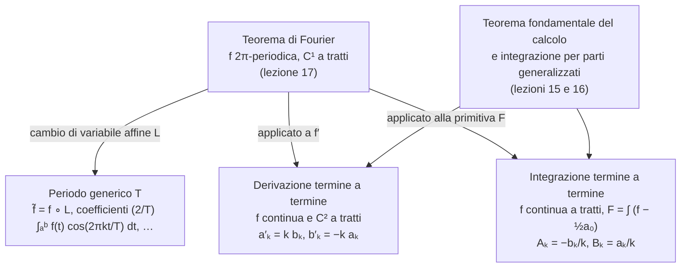

# Lezione 18 — Serie di Fourier di periodo generico, derivazione e integrazione termine a termine

Nella [[MM L17 - Dimostrazione del teorema di Fourier ed esempi|lezione 17]] è stato dimostrato il **teorema di Fourier** per le funzioni $2\pi$-periodiche di classe $C^1$ a tratti, e lo si è applicato a due esempi: la funzione $x^2$ estesa per periodicità e l'onda quadra. Questa lezione completa la teoria in due direzioni. La prima è l'estensione alle funzioni di **periodo generico** $T > 0$: invece di rifare la dimostrazione, si trasforma la funzione in una funzione $2\pi$-periodica con un **cambio di variabile affine**, si applica il teorema già noto e si torna indietro, ricavando alla fine formule dirette per i coefficienti. La seconda riguarda due operazioni sulle serie di Fourier: sotto ipotesi opportune la serie di Fourier della **derivata** si ottiene derivando termine a termine quella della funzione, e la serie di Fourier della **primitiva a media nulla** si ottiene integrando termine a termine. Entrambi i risultati si dimostrano calcolando i coefficienti con il teorema fondamentale del calcolo e con l'integrazione per parti nella forma generalizzata alle funzioni continue e di classe $C^1$ a tratti, viste nella [[MM L15 - Serie numeriche e coefficienti di Fourier|lezione 15]] e nella [[MM L16 - Integrazione per parti, lemma di Riemann e identità di Lagrange|lezione 16]].

> [!note] Fonti di questa lezione
> Fonti: la trascrizione della lezione (parte 1) e gli appunti manuali del 20 novembre 2026. Per la parte del corso tenuta dal prof. Benini non è disponibile materiale scritto del docente: enunciati e notazioni seguono la lavagna, come risulta dalla trascrizione e dagli appunti. La **data** è quella del nome del file degli appunti (venerdì 20 novembre 2026); l'intestazione della trascrizione riporta il 21 novembre, un sabato, che è con ogni probabilità la data di elaborazione della registrazione. Il tratto della trascrizione in cui il docente sviluppa le somme parziali con le formule di addizione è in gran parte incomprensibile: lì la nota segue gli appunti, che riportano il calcolo per intero. I primi secondi della registrazione (conversazioni prima dell'inizio) e la pausa non sono riportati. Gli esempi segnati come aggiunti non sono stati svolti a lezione; gli approfondimenti si appoggiano alla dispensa di Fisica matematica di A. Morro presente tra i materiali del corso [@morro2023]. Le figure sono costruite per illustrare le costruzioni descritte a lezione e gli esempi.

## Richiamo: il teorema di Fourier

Il docente apre la lezione ricordando che la volta precedente sono state introdotte le serie di Fourier e calcolate quelle di $x^2$ e dell'onda quadra. Tutta la lezione usa il teorema dimostrato nella lezione 17, che conviene avere sotto gli occhi nella forma in cui è stato enunciato.

> [!important] Teorema — Fourier (richiamo dalla lezione 17)
> Sia $f : \mathbb{R} \to \mathbb{R}$ una funzione $2\pi$-periodica e di classe $C^1$ a tratti su ogni periodo. Posto
> $$a_0 = \frac{1}{\pi}\int_{-\pi}^{\pi} f(t)\, dt, \qquad a_k = \frac{1}{\pi}\int_{-\pi}^{\pi} f(t)\cos(kt)\, dt, \qquad b_k = \frac{1}{\pi}\int_{-\pi}^{\pi} f(t)\sin(kt)\, dt \quad (k \geq 1),$$
> la serie di Fourier
> $$\frac{1}{2}a_0 + \sum_{k=1}^{+\infty}\big(a_k\cos(kx) + b_k\sin(kx)\big)$$
> converge, per ogni $x \in \mathbb{R}$, a $\tfrac12\big(f(x_+) + f(x_-)\big)$, la media dei limiti destro e sinistro $f(x_\pm) = \lim_{y \to x^\pm} f(y)$.

Con $S_n(x) = \tfrac12 a_0 + \sum_{k=1}^{n}\big(a_k\cos(kx) + b_k\sin(kx)\big)$ si indica la **successione delle somme parziali**: dire che la serie converge significa che $S_n(x)$ ha limite per $n \to +\infty$. Nei punti in cui $f$ è continua il limite è proprio $f(x)$; nei punti di salto è il punto medio del salto.

## Serie di Fourier di periodo generico

### L'idea: ricondursi al periodo 2π

Finora si è lavorato con funzioni $2\pi$-periodiche, prendendo sempre come periodo di riferimento l'intervallo $[-\pi, \pi]$. Ora si considera una funzione $f : \mathbb{R} \to \mathbb{R}$ **$T$-periodica**, cioè tale che $f(x + T) = f(x)$ per ogni $x$, con $T > 0$ arbitrario, e di classe $C^1$ a tratti su ogni periodo. Il docente osserva che essere $C^1$ a tratti "su un periodo" o "su ogni periodo" è la stessa cosa: per periodicità, ciò che accade su un intervallo di lunghezza $T$ si ripete identico su tutti gli altri. Si fissa poi un punto di inizio arbitrario $a \in \mathbb{R}$ e si considera il periodo $[a, b]$ con $b = a + T$; il caso già studiato corrisponde a $T = 2\pi$ e $a = -\pi$.

Invece di ripetere la dimostrazione del teorema di Fourier per il periodo $T$, il docente propone un procedimento in tre passi:

1. si costruisce l'unica **trasformazione affine** $L : \mathbb{R} \to \mathbb{R}$ che manda l'intervallo $[-\pi, \pi]$ nell'intervallo $[a, b]$, cioè con $L(-\pi) = a$ e $L(\pi) = b$;
2. si applica il teorema di Fourier alla funzione composta $\tilde f = f \circ L$, che risulterà $2\pi$-periodica, con periodo di riferimento $[-\pi, \pi]$;
3. si torna indietro all'intervallo $[a, b]$ con la trasformazione inversa $L^{-1}$, e si riscrive il risultato in termini della sola $f$.

Delle due trasformazioni, $L$ e $L^{-1}$, quella che serve per costruire $\tilde f$ è quella che va da $[-\pi, \pi]$ ad $[a, b]$: componendo $f$ a destra con $L$ si ottiene una funzione della variabile di $[-\pi, \pi]$. Per evitare confusione, la variabile che vive nell'intervallo $[-\pi, \pi]$ si indica con $\tilde x$ e quella che vive in $[a, b]$ con $x$: dunque $x = L(\tilde x)$ e $\tilde x = L^{-1}(x)$.

### La trasformazione affine

Le trasformazioni affini di $\mathbb{R}$ in sé sono tutte della forma "un termine lineare più una costante", quindi si cerca $L$ nella forma
$$L(\tilde x) = c + d\,\tilde x ,$$
e si determinano le due costanti $c$ e $d$ imponendo le due condizioni $L(-\pi) = a$ e $L(\pi) = b$. Si ottiene il sistema lineare
$$\begin{cases} c - \pi d = a \\ c + \pi d = b \end{cases}$$
Sommando le due equazioni si trova $2c = a + b$; sottraendo la prima dalla seconda si trova $2\pi d = b - a = T$. Quindi
$$c = \frac{a + b}{2}, \qquad d = \frac{b - a}{2\pi} = \frac{T}{2\pi} .$$
Le due costanti hanno un significato geometrico preciso: $d$ è il fattore di **dilatazione** (o riscalamento) che la trasformazione applica, e non a caso è il rapporto tra il periodo $T$ con cui si lavora e il periodo $2\pi$ di riferimento; $c$ è la **traslazione**, e vale il punto medio dell'intervallo $[a, b]$, nel quale va a finire il punto medio $0$ di $[-\pi, \pi]$. In definitiva
$$L(\tilde x) = \frac{a + b}{2} + \frac{T}{2\pi}\,\tilde x, \qquad L^{-1}(x) = \frac{2\pi}{T}\Big(x - \frac{a + b}{2}\Big).$$
Che la seconda sia l'inversa della prima si verifica sostituendo: $L\big(L^{-1}(x)\big) = \frac{a+b}{2} + \frac{T}{2\pi}\cdot\frac{2\pi}{T}\big(x - \frac{a+b}{2}\big) = x$. Del resto non è sorprendente: se $L$ riscala di $T/2\pi$, l'inversa deve riscalare del reciproco $2\pi/T$.

<svg viewBox="0 0 600 290" width="600" style="display:block;margin:1em auto;max-width:100%;height:auto;font-family:inherit" xmlns="http://www.w3.org/2000/svg"><line x1="40" y1="92" x2="566" y2="92" stroke="currentColor" stroke-width="1.0"/><polygon points="570,92 563.6,94.9 563.6,89.1" fill="currentColor"/><text x="572" y="86" font-size="13" text-anchor="end" fill="currentColor" font-style="italic">x̃</text><line x1="40" y1="222" x2="566" y2="222" stroke="currentColor" stroke-width="1.0"/><polygon points="570,222 563.6,224.9 563.6,219.1" fill="currentColor"/><text x="572" y="216" font-size="13" text-anchor="end" fill="currentColor" font-style="italic">x</text><polyline points="46,60 47,60.2 47.9,60.5 48.9,60.7 49.9,61 50.8,61.2 51.8,61.4 52.7,61.6 53.7,61.8 54.7,62 55.6,62.1 56.6,62.3 57.5,62.4 58.5,62.5 59.5,62.6 60.4,62.7 61.4,62.8 62.4,62.8 63.3,62.8 64.3,62.9 65.2,62.9 66.2,62.9 67.2,62.9 68.1,62.8 69.1,62.8 70.1,62.7 71,62.7 72,62.6 73,62.5 73.9,62.4 74.9,62.3 75.8,62.2 76.8,62.1 77.8,62 78.7,61.9 79.7,61.7 80.7,61.6 81.6,61.5 82.6,61.4 83.5,61.3 84.5,61.1 85.5,61 86.4,60.9 87.4,60.8 88.3,60.8 89.3,60.7 90.3,60.6 91.2,60.6 92.2,60.5 93.2,60.5 94.1,60.5 95.1,60.5 96,60.6 97,60.6 98,60.7 98.9,60.8 99.9,60.9 100.9,61 101.8,61.2 102.8,61.3 103.8,61.5 104.7,61.8 105.7,62 106.6,62.3 107.6,62.5 108.6,62.9 109.5,63.2 110.5,63.5 111.5,63.9 112.4,64.3 113.4,64.7 114.3,65.2 115.3,65.6 116.3,66.1 117.2,66.6 118.2,67.1 119.2,67.6 120.1,68.2 121.1,68.7 122,69.3 123,69.9 124,70.5 124.9,71.1 125.9,71.7 126.8,72.3 127.8,72.9 128.8,73.5 129.7,74.1 130.7,74.7 131.7,75.3 132.6,75.9 133.6,76.5 134.6,77.1 135.5,77.6 136.5,78.2 137.4,78.8 138.4,79.3 139.4,79.8 140.3,80.3 141.3,80.8 142.2,81.2 143.2,81.7 144.2,82.1 145.1,82.5 146.1,82.8 147.1,83.2 148,83.5 149,83.8 149.9,84 150.9,84.2 151.9,84.4 152.8,84.5 153.8,84.6 154.8,84.7 155.7,84.8 156.7,84.8 157.7,84.7 158.6,84.7 159.6,84.6 160.5,84.4 161.5,84.3 162.5,84.1 163.4,83.8 164.4,83.6 165.3,83.3 166.3,82.9 167.3,82.6 168.2,82.2 169.2,81.7 170.2,81.3 171.1,80.8 172.1,80.3 173.1,79.7 174,79.2 175,78.6 175.9,78 176.9,77.3 177.9,76.7 178.8,76 179.8,75.4 180.8,74.7 181.7,74 182.7,73.3 183.6,72.5 184.6,71.8 185.6,71.1 186.5,70.4 187.5,69.6 188.4,68.9 189.4,68.2 190.4,67.5 191.3,66.8 192.3,66 193.3,65.4 194.2,64.7 195.2,64 196.2,63.3 197.1,62.7 198.1,62.1 199,61.5 200,60.9" fill="none" stroke="#3b82f6" stroke-width="1.3" stroke-linejoin="round" stroke-dasharray="4 3" stroke-opacity="0.7"/><polyline points="200,60.9 201.2,60.2 202.5,59.5 203.8,58.8 205,58.2 206.2,57.7 207.5,57.1 208.8,56.7 210,56.3 211.2,55.9 212.5,55.6 213.8,55.3 215,55.1 216.2,54.9 217.5,54.7 218.8,54.6 220,54.6 221.2,54.6 222.5,54.6 223.8,54.7 225,54.8 226.2,55 227.5,55.2 228.8,55.4 230,55.6 231.2,55.9 232.5,56.2 233.8,56.5 235,56.9 236.2,57.2 237.5,57.5 238.8,57.9 240,58.3 241.2,58.6 242.5,59 243.8,59.4 245,59.7 246.2,60.1 247.5,60.4 248.8,60.7 250,61 251.2,61.3 252.5,61.6 253.8,61.8 255,62 256.2,62.2 257.5,62.4 258.8,62.5 260,62.7 261.2,62.7 262.5,62.8 263.8,62.9 265,62.9 266.2,62.9 267.5,62.9 268.8,62.8 270,62.7 271.2,62.6 272.5,62.5 273.8,62.4 275,62.3 276.2,62.2 277.5,62 278.8,61.9 280,61.7 281.2,61.5 282.5,61.4 283.8,61.2 285,61.1 286.2,60.9 287.5,60.8 288.8,60.7 290,60.6 291.2,60.6 292.5,60.5 293.8,60.5 295,60.5 296.2,60.6 297.5,60.6 298.8,60.8 300,60.9 301.2,61.1 302.5,61.3 303.8,61.5 305,61.8 306.2,62.2 307.5,62.5 308.8,62.9 310,63.4 311.2,63.8 312.5,64.4 313.8,64.9 315,65.5 316.2,66.1 317.5,66.8 318.8,67.4 320,68.1 321.2,68.8 322.5,69.6 323.8,70.3 325,71.1 326.2,71.9 327.5,72.7 328.8,73.5 330,74.3 331.2,75 332.5,75.8 333.8,76.6 335,77.3 336.2,78.1 337.5,78.8 338.8,79.5 340,80.1 341.2,80.8 342.5,81.4 343.8,81.9 345,82.4 346.2,82.9 347.5,83.3 348.8,83.7 350,84 351.2,84.3 352.5,84.5 353.8,84.6 355,84.7 356.2,84.8 357.5,84.7 358.8,84.7 360,84.5 361.2,84.3 362.5,84.1 363.8,83.7 365,83.4 366.2,82.9 367.5,82.5 368.8,81.9 370,81.3 371.2,80.7 372.5,80 373.8,79.3 375,78.6 376.2,77.8 377.5,76.9 378.8,76.1 380,75.2 381.2,74.3 382.5,73.4 383.8,72.5 385,71.5 386.2,70.6 387.5,69.6 388.8,68.7 390,67.7 391.2,66.8 392.5,65.9 393.8,65 395,64.1 396.2,63.3 397.5,62.5 398.8,61.7 400,60.9" fill="none" stroke="#3b82f6" stroke-width="2.2" stroke-linejoin="round"/><polyline points="400,60.9 401,60.3 401.9,59.8 402.9,59.3 403.9,58.8 404.8,58.3 405.8,57.9 406.7,57.5 407.7,57.1 408.7,56.7 409.6,56.4 410.6,56.1 411.6,55.8 412.5,55.6 413.5,55.3 414.4,55.1 415.4,55 416.4,54.9 417.3,54.7 418.3,54.7 419.2,54.6 420.2,54.6 421.2,54.6 422.1,54.6 423.1,54.7 424.1,54.7 425,54.8 426,55 426.9,55.1 427.9,55.3 428.9,55.4 429.8,55.6 430.8,55.8 431.8,56 432.7,56.3 433.7,56.5 434.6,56.8 435.6,57 436.6,57.3 437.5,57.6 438.5,57.8 439.5,58.1 440.4,58.4 441.4,58.7 442.4,59 443.3,59.2 444.3,59.5 445.2,59.8 446.2,60 447.2,60.3 448.1,60.5 449.1,60.8 450.1,61 451,61.2 452,61.4 452.9,61.6 453.9,61.8 454.9,62 455.8,62.1 456.8,62.3 457.8,62.4 458.7,62.5 459.7,62.6 460.6,62.7 461.6,62.8 462.6,62.8 463.5,62.9 464.5,62.9 465.4,62.9 466.4,62.9 467.4,62.9 468.3,62.8 469.3,62.8 470.3,62.7 471.2,62.7 472.2,62.6 473.1,62.5 474.1,62.4 475.1,62.3 476,62.2 477,62.1 478,61.9 478.9,61.8 479.9,61.7 480.9,61.6 481.8,61.5 482.8,61.3 483.7,61.2 484.7,61.1 485.7,61 486.6,60.9 487.6,60.8 488.6,60.7 489.5,60.7 490.5,60.6 491.4,60.6 492.4,60.5 493.4,60.5 494.3,60.5 495.3,60.5 496.2,60.6 497.2,60.6 498.2,60.7 499.1,60.8 500.1,60.9 501.1,61 502,61.2 503,61.4 503.9,61.6 504.9,61.8 505.9,62.1 506.8,62.3 507.8,62.6 508.8,62.9 509.7,63.3 510.7,63.6 511.6,64 512.6,64.4 513.6,64.8 514.5,65.3 515.5,65.7 516.5,66.2 517.4,66.7 518.4,67.2 519.4,67.8 520.3,68.3 521.3,68.9 522.2,69.4 523.2,70 524.2,70.6 525.1,71.2 526.1,71.8 527,72.4 528,73 529,73.6 529.9,74.2 530.9,74.8 531.9,75.4 532.8,76 533.8,76.6 534.8,77.2 535.7,77.8 536.7,78.3 537.6,78.9 538.6,79.4 539.6,79.9 540.5,80.4 541.5,80.9 542.5,81.3 543.4,81.8 544.4,82.2 545.3,82.6 546.3,82.9 547.3,83.2 548.2,83.5 549.2,83.8 550.1,84 551.1,84.2 552.1,84.4 553,84.6 554,84.7" fill="none" stroke="#3b82f6" stroke-width="1.3" stroke-linejoin="round" stroke-dasharray="4 3" stroke-opacity="0.7"/><line x1="200" y1="88" x2="200" y2="96" stroke="currentColor" stroke-width="1.0"/><text x="200" y="110" font-size="12" text-anchor="middle" fill="currentColor">−π</text><line x1="300" y1="88" x2="300" y2="96" stroke="currentColor" stroke-width="1.0"/><text x="300" y="110" font-size="12" text-anchor="middle" fill="currentColor">0</text><line x1="400" y1="88" x2="400" y2="96" stroke="currentColor" stroke-width="1.0"/><text x="400" y="110" font-size="12" text-anchor="middle" fill="currentColor">π</text><text x="452" y="36" font-size="13" text-anchor="start" fill="#3b82f6" font-style="italic">f̃ = f ∘ L</text><text x="300" y="28" font-size="11" text-anchor="middle" fill="currentColor">periodo 2π</text><polyline points="46,210.8 46.6,210.9 47.2,211.1 47.8,211.3 48.4,211.5 48.9,211.6 49.5,211.8 50.1,211.9 50.7,212.1 51.3,212.3 51.9,212.4 52.5,212.5 53,212.7 53.6,212.8 54.2,212.9 54.8,213.1 55.4,213.2 56,213.3 56.6,213.4 57.2,213.5 57.8,213.6 58.3,213.7 58.9,213.8 59.5,213.9 60.1,214 60.7,214.1 61.3,214.2 61.9,214.3 62.5,214.3 63,214.4 63.6,214.4 64.2,214.5 64.8,214.6 65.4,214.6 66,214.6 66.6,214.7 67.2,214.7 67.7,214.7 68.3,214.7 68.9,214.8 69.5,214.8 70.1,214.8 70.7,214.8 71.3,214.8 71.8,214.8 72.4,214.7 73,214.7 73.6,214.7 74.2,214.7 74.8,214.6 75.4,214.6 76,214.5 76.5,214.5 77.1,214.4 77.7,214.4 78.3,214.3 78.9,214.2 79.5,214.1 80.1,214.1 80.7,214 81.2,213.9 81.8,213.8 82.4,213.7 83,213.6 83.6,213.5 84.2,213.3 84.8,213.2 85.4,213.1 86,213 86.5,212.8 87.1,212.7 87.7,212.5 88.3,212.4 88.9,212.2 89.5,212.1 90.1,211.9 90.7,211.7 91.2,211.6 91.8,211.4 92.4,211.2 93,211 93.6,210.8 94.2,210.7 94.8,210.5 95.3,210.3 95.9,210.1 96.5,209.9 97.1,209.6 97.7,209.4 98.3,209.2 98.9,209 99.5,208.8 100,208.5 100.6,208.3 101.2,208.1 101.8,207.8 102.4,207.6 103,207.4 103.6,207.1 104.2,206.9 104.8,206.6 105.3,206.4 105.9,206.1 106.5,205.9 107.1,205.6 107.7,205.3 108.3,205.1 108.9,204.8 109.5,204.6 110,204.3 110.6,204 111.2,203.8 111.8,203.5 112.4,203.2 113,202.9 113.6,202.7 114.2,202.4 114.7,202.1 115.3,201.8 115.9,201.6 116.5,201.3 117.1,201 117.7,200.7 118.3,200.5 118.8,200.2 119.4,199.9 120,199.6 120.6,199.3 121.2,199.1 121.8,198.8 122.4,198.5 123,198.2 123.5,198 124.1,197.7 124.7,197.4 125.3,197.1 125.9,196.9 126.5,196.6 127.1,196.3 127.7,196.1 128.2,195.8 128.8,195.5 129.4,195.3 130,195 130.6,194.7 131.2,194.5 131.8,194.2 132.4,194 132.9,193.7 133.5,193.5 134.1,193.2 134.7,193 135.3,192.7 135.9,192.5 136.5,192.3 137.1,192 137.7,191.8 138.2,191.6 138.8,191.3 139.4,191.1 140,190.9" fill="none" stroke="#3b82f6" stroke-width="1.3" stroke-linejoin="round" stroke-dasharray="4 3" stroke-opacity="0.7"/><polyline points="140,190.9 142,190.2 144,189.5 146,188.8 148,188.2 150,187.7 152,187.1 154,186.7 156,186.3 158,185.9 160,185.6 162,185.3 164,185.1 166,184.9 168,184.7 170,184.6 172,184.6 174,184.6 176,184.6 178,184.7 180,184.8 182,185 184,185.2 186,185.4 188,185.6 190,185.9 192,186.2 194,186.5 196,186.9 198,187.2 200,187.5 202,187.9 204,188.3 206,188.6 208,189 210,189.4 212,189.7 214,190.1 216,190.4 218,190.7 220,191 222,191.3 224,191.6 226,191.8 228,192 230,192.2 232,192.4 234,192.5 236,192.7 238,192.7 240,192.8 242,192.9 244,192.9 246,192.9 248,192.9 250,192.8 252,192.7 254,192.6 256,192.5 258,192.4 260,192.3 262,192.2 264,192 266,191.9 268,191.7 270,191.5 272,191.4 274,191.2 276,191.1 278,190.9 280,190.8 282,190.7 284,190.6 286,190.6 288,190.5 290,190.5 292,190.5 294,190.6 296,190.6 298,190.8 300,190.9 302,191.1 304,191.3 306,191.5 308,191.8 310,192.2 312,192.5 314,192.9 316,193.4 318,193.8 320,194.4 322,194.9 324,195.5 326,196.1 328,196.8 330,197.4 332,198.1 334,198.8 336,199.6 338,200.3 340,201.1 342,201.9 344,202.7 346,203.5 348,204.3 350,205 352,205.8 354,206.6 356,207.3 358,208.1 360,208.8 362,209.5 364,210.1 366,210.8 368,211.4 370,211.9 372,212.4 374,212.9 376,213.3 378,213.7 380,214 382,214.3 384,214.5 386,214.6 388,214.7 390,214.8 392,214.7 394,214.7 396,214.5 398,214.3 400,214.1 402,213.7 404,213.4 406,212.9 408,212.5 410,211.9 412,211.3 414,210.7 416,210 418,209.3 420,208.6 422,207.8 424,206.9 426,206.1 428,205.2 430,204.3 432,203.4 434,202.5 436,201.5 438,200.6 440,199.6 442,198.7 444,197.7 446,196.8 448,195.9 450,195 452,194.1 454,193.3 456,192.5 458,191.7 460,190.9" fill="none" stroke="#3b82f6" stroke-width="2.2" stroke-linejoin="round"/><polyline points="460,190.9 460.6,190.7 461.2,190.5 461.8,190.3 462.4,190 462.9,189.8 463.5,189.6 464.1,189.4 464.7,189.2 465.3,189.1 465.9,188.9 466.5,188.7 467.1,188.5 467.6,188.3 468.2,188.2 468.8,188 469.4,187.8 470,187.7 470.6,187.5 471.2,187.4 471.8,187.2 472.3,187.1 472.9,186.9 473.5,186.8 474.1,186.7 474.7,186.5 475.3,186.4 475.9,186.3 476.4,186.2 477,186.1 477.6,185.9 478.2,185.8 478.8,185.7 479.4,185.7 480,185.6 480.6,185.5 481.1,185.4 481.7,185.3 482.3,185.2 482.9,185.2 483.5,185.1 484.1,185 484.7,185 485.3,184.9 485.9,184.9 486.4,184.8 487,184.8 487.6,184.8 488.2,184.7 488.8,184.7 489.4,184.7 490,184.6 490.6,184.6 491.1,184.6 491.7,184.6 492.3,184.6 492.9,184.6 493.5,184.6 494.1,184.6 494.7,184.6 495.2,184.6 495.8,184.6 496.4,184.7 497,184.7 497.6,184.7 498.2,184.7 498.8,184.8 499.4,184.8 499.9,184.8 500.5,184.9 501.1,184.9 501.7,185 502.3,185 502.9,185.1 503.5,185.1 504.1,185.2 504.6,185.2 505.2,185.3 505.8,185.4 506.4,185.4 507,185.5 507.6,185.6 508.2,185.7 508.8,185.7 509.4,185.8 509.9,185.9 510.5,186 511.1,186.1 511.7,186.2 512.3,186.3 512.9,186.3 513.5,186.4 514,186.5 514.6,186.6 515.2,186.7 515.8,186.8 516.4,186.9 517,187 517.6,187.1 518.2,187.2 518.8,187.3 519.3,187.4 519.9,187.5 520.5,187.6 521.1,187.7 521.7,187.8 522.3,188 522.9,188.1 523.5,188.2 524,188.3 524.6,188.4 525.2,188.5 525.8,188.6 526.4,188.7 527,188.8 527.6,188.9 528.1,189 528.7,189.1 529.3,189.2 529.9,189.3 530.5,189.4 531.1,189.6 531.7,189.7 532.3,189.8 532.9,189.9 533.4,190 534,190.1 534.6,190.2 535.2,190.3 535.8,190.4 536.4,190.4 537,190.5 537.5,190.6 538.1,190.7 538.7,190.8 539.3,190.9 539.9,191 540.5,191.1 541.1,191.2 541.7,191.2 542.2,191.3 542.8,191.4 543.4,191.5 544,191.6 544.6,191.6 545.2,191.7 545.8,191.8 546.4,191.8 547,191.9 547.5,192 548.1,192 548.7,192.1 549.3,192.1 549.9,192.2 550.5,192.3 551.1,192.3 551.6,192.4 552.2,192.4 552.8,192.4 553.4,192.5 554,192.5" fill="none" stroke="#3b82f6" stroke-width="1.3" stroke-linejoin="round" stroke-dasharray="4 3" stroke-opacity="0.7"/><line x1="140" y1="218" x2="140" y2="226" stroke="currentColor" stroke-width="1.0"/><text x="140" y="240" font-size="12" text-anchor="middle" fill="currentColor" font-style="italic">a</text><line x1="300" y1="218" x2="300" y2="226" stroke="currentColor" stroke-width="1.0"/><text x="300" y="240" font-size="12" text-anchor="middle" fill="currentColor">(a+b)/2</text><line x1="460" y1="218" x2="460" y2="226" stroke="currentColor" stroke-width="1.0"/><text x="460" y="240" font-size="12" text-anchor="middle" fill="currentColor">b = a + T</text><text x="512" y="160" font-size="13" text-anchor="start" fill="#3b82f6" font-style="italic">f</text><line x1="200" y1="118" x2="143.2" y2="161.6" stroke="#d98a1c" stroke-width="1.4" stroke-dasharray="5 3"/><polygon points="140,164 143.3,157.8 146.8,162.4" fill="#d98a1c"/><line x1="300" y1="118" x2="300" y2="160" stroke="#d98a1c" stroke-width="1.4" stroke-dasharray="5 3"/><polygon points="300,164 297.1,157.6 302.9,157.6" fill="#d98a1c"/><line x1="400" y1="118" x2="456.8" y2="161.6" stroke="#d98a1c" stroke-width="1.4" stroke-dasharray="5 3"/><polygon points="460,164 453.2,162.4 456.7,157.8" fill="#d98a1c"/><text x="446" y="140" font-size="14" text-anchor="start" fill="#d98a1c" font-style="italic">L</text><text x="126" y="130" font-size="11" text-anchor="end" fill="#d98a1c">L⁻¹ nel verso opposto</text><text x="300" y="262" font-size="10.5" text-anchor="middle" fill="currentColor">L(x̃) = (a+b)/2 + (T/2π) x̃: dilata di T/2π e trasla di (a+b)/2, mandando −π, 0, π in a, (a+b)/2, b.</text><text x="300" y="278" font-size="10.5" text-anchor="middle" fill="currentColor">Blu: lo stesso grafico nelle due variabili (tratto pieno: un periodo; tratteggio: continuazione periodica).</text></svg>

### La serie della funzione trasformata converge

Si pone $\tilde f = f \circ L$, cioè $\tilde f(\tilde x) = f\big(L(\tilde x)\big)$. Questa funzione soddisfa le ipotesi del teorema di Fourier.

- **È $2\pi$-periodica**, perché eredita la periodicità di $f$: spostare $\tilde x$ di $2\pi$ sposta $L(\tilde x)$ esattamente di un periodo $T$, infatti $L(\tilde x + 2\pi) = L(\tilde x) + \frac{T}{2\pi}\cdot 2\pi = L(\tilde x) + T$, e quindi $\tilde f(\tilde x + 2\pi) = f\big(L(\tilde x) + T\big) = f\big(L(\tilde x)\big) = \tilde f(\tilde x)$.
- **È di classe $C^1$ a tratti** su ogni periodo, perché eredita anche la regolarità di $f$: un'applicazione affine "non fa niente né alla funzione né alle sue derivate". In concreto, $L^{-1}$ trasforma la partizione di $[a, b]$ relativa a $f$ in una partizione di $[-\pi, \pi]$; all'interno di ciascun sottointervallo $\tilde f$ è $C^1$ con $\tilde f'(\tilde x) = \frac{T}{2\pi} f'\big(L(\tilde x)\big)$, e i limiti agli estremi di $\tilde f$ e di $\tilde f'$ esistono finiti perché esistono quelli di $f$ e di $f'$.

Il teorema di Fourier applicato a $\tilde f$ fornisce i coefficienti
$$\tilde a_0 = \frac{1}{\pi}\int_{-\pi}^{\pi}\tilde f(\tilde x)\, d\tilde x, \qquad \tilde a_k = \frac{1}{\pi}\int_{-\pi}^{\pi}\tilde f(\tilde x)\cos(k\tilde x)\, d\tilde x, \qquad \tilde b_k = \frac{1}{\pi}\int_{-\pi}^{\pi}\tilde f(\tilde x)\sin(k\tilde x)\, d\tilde x,$$
e assicura che le somme parziali
$$\tilde S_n(\tilde x) = \frac12\tilde a_0 + \sum_{k=1}^{n}\big(\tilde a_k\cos(k\tilde x) + \tilde b_k\sin(k\tilde x)\big)$$
convergono, per $n \to +\infty$, a $\tfrac12\big(\tilde f(\tilde x_+) + \tilde f(\tilde x_-)\big)$ per ogni $\tilde x$.

Ora si torna indietro. Così come $\tilde f$ è stata costruita componendo $f$ a destra con $L$, si costruisce la nuova successione di funzioni componendo $\tilde S_n$ a destra con l'inversa:
$$S_n = \tilde S_n \circ L^{-1}, \qquad \text{cioè} \qquad S_n(x) = \tilde S_n\big(L^{-1}(x)\big).$$
Per quanto appena visto, applicato nel punto $\tilde x = L^{-1}(x)$,
$$S_n(x) \xrightarrow[n \to +\infty]{} \frac12\Big(\tilde f\big(L^{-1}(x)_+\big) + \tilde f\big(L^{-1}(x)_-\big)\Big).$$
Resta da capire chi siano questi limiti destro e sinistro. Per definizione $\tilde f\big(L^{-1}(x)_\pm\big) = \lim_{\tilde x \to L^{-1}(x)^\pm} \tilde f(\tilde x)$. Poiché $L$ è un'applicazione affine invertibile, continua con l'inversa continua, la si può usare come **cambio di variabile nel limite**: si introduce $y = L(\tilde x)$. Quando $\tilde x$ tende a $L^{-1}(x)$, la nuova variabile $y$ tende a $L\big(L^{-1}(x)\big) = x$, e al posto di $\tilde x$ si scrive $L^{-1}(y)$. Si ottiene la catena
$$\tilde f\big(L^{-1}(x)_\pm\big) = \lim_{\tilde x \to L^{-1}(x)^\pm} \tilde f(\tilde x) = \lim_{y \to x^\pm} \tilde f\big(L^{-1}(y)\big) = \lim_{y \to x^\pm} f(y) = f(x_\pm),$$
dove nel penultimo passaggio si è usato $\tilde f\big(L^{-1}(y)\big) = f\big(L(L^{-1}(y))\big) = f(y)$. Il limite da destra resta un limite da destra perché $L$ è crescente (il coefficiente $d = T/2\pi$ è positivo): se $\tilde x$ si avvicina a $L^{-1}(x)$ da destra, $y = L(\tilde x)$ si avvicina a $x$ da destra (osservazione aggiunta). Mettendo insieme,
$$S_n(x) \xrightarrow[n \to +\infty]{} \frac12\big(f(x_+) + f(x_-)\big).$$
La serie costruita con questo procedimento converge proprio al valore medio tra il limite destro e il limite sinistro della funzione di partenza, nel punto $x$: ha dunque senso chiamarla **serie di Fourier di $f$**. Quello che ancora manca è una formula che dia i suoi coefficienti direttamente a partire da $f$, senza passare attraverso la trasformazione.

### I coefficienti espressi direttamente tramite f

Si scrive esplicitamente $S_n(x) = \tilde S_n\big(L^{-1}(x)\big)$, cioè si mette $L^{-1}(x) = \frac{2\pi}{T}\big(x - \frac{a+b}{2}\big)$ al posto di $\tilde x$:
$$S_n(x) = \frac12\tilde a_0 + \sum_{k=1}^{n}\Big(\tilde a_k\cos\Big(k\,\frac{2\pi}{T}\Big(x - \frac{a+b}{2}\Big)\Big) + \tilde b_k\sin\Big(k\,\frac{2\pi}{T}\Big(x - \frac{a+b}{2}\Big)\Big)\Big).$$
L'argomento delle funzioni trigonometriche è la differenza $\frac{2\pi}{T}kx - \theta_k$, con
$$\theta_k = \frac{\pi k(a + b)}{T},$$
e si possono usare le formule di sottrazione $\cos(\alpha - \theta) = \cos\alpha\cos\theta + \sin\alpha\sin\theta$ e $\sin(\alpha - \theta) = \sin\alpha\cos\theta - \cos\alpha\sin\theta$. A lezione il docente sbaglia per un momento la formula del seno (scrive "seno per seno") e si corregge subito: il seno di una differenza è "seno del primo per coseno del secondo meno coseno del primo per seno del secondo". Raccogliendo i termini che moltiplicano $\cos\big(\frac{2\pi}{T}kx\big)$ e quelli che moltiplicano $\sin\big(\frac{2\pi}{T}kx\big)$ si arriva a
$$S_n(x) = \frac12\tilde a_0 + \sum_{k=1}^{n}\Big[\big(\tilde a_k\cos\theta_k - \tilde b_k\sin\theta_k\big)\cos\Big(\frac{2\pi}{T}kx\Big) + \big(\tilde a_k\sin\theta_k + \tilde b_k\cos\theta_k\big)\sin\Big(\frac{2\pi}{T}kx\Big)\Big].$$
Il senso di questo "contaccio", come lo chiama il docente, è che ora $S_n$ ha proprio la forma di una somma parziale di Fourier: costante più combinazione di coseni e seni di multipli interi di una stessa frequenza. L'unica differenza rispetto al caso $2\pi$-periodico è che davanti a $kx$ non c'è più $1$, ma il rapporto $2\pi/T$ tra il periodo di riferimento e il periodo con cui ci si è trovati a lavorare. Viene allora naturale definire i nuovi coefficienti come le quantità che compaiono davanti:
$$a_0 := \tilde a_0, \qquad a_k := \tilde a_k\cos\theta_k - \tilde b_k\sin\theta_k, \qquad b_k := \tilde a_k\sin\theta_k + \tilde b_k\cos\theta_k .$$
Così come sono scritti, però, per calcolarli bisognerebbe trasformare la funzione, calcolare i coefficienti di $\tilde f$ e poi combinarli: il docente vuole invece $a_k$ e $b_k$ direttamente in termini di $f$. Lo strumento è un cambio di variabile negli integrali che definiscono $\tilde a_k$ e $\tilde b_k$, usando ancora la trasformazione affine: si pone $t = L(\tilde t)$, per cui $dt = \frac{T}{2\pi}\, d\tilde t$, cioè $d\tilde t = \frac{2\pi}{T}\, dt$, e gli estremi $-\pi$ e $\pi$ diventano $a$ e $b$. Il fattore $\frac{2\pi}{T}$ è lo jacobiano del cambio di variabile.

**Il coefficiente $a_0$.** Ricordando che $\tilde f = f\circ L$,
$$a_0 = \tilde a_0 = \frac{1}{\pi}\int_{-\pi}^{\pi} f\big(L(\tilde t)\big)\, d\tilde t = \frac{1}{\pi}\int_a^b f(t)\,\frac{2\pi}{T}\, dt = \frac{2}{T}\int_a^b f(t)\, dt .$$
I due fattori $\pi$ si semplificano e il coefficiente si calcola direttamente da $f$.

**Il coefficiente $a_k$.** Si sostituiscono le definizioni di $\tilde a_k$ e $\tilde b_k$ e si raccoglie tutto sotto un unico integrale:
$$a_k = \frac{1}{\pi}\int_{-\pi}^{\pi} f\big(L(\tilde t)\big)\big[\cos(k\tilde t)\cos\theta_k - \sin(k\tilde t)\sin\theta_k\big]\, d\tilde t = \frac{1}{\pi}\int_{-\pi}^{\pi} f\big(L(\tilde t)\big)\cos\big(k\tilde t + \theta_k\big)\, d\tilde t ,$$
dove si è riconosciuta la formula di addizione del coseno. L'argomento del coseno è esattamente $\frac{2\pi}{T}k$ volte $L(\tilde t)$:
$$k\tilde t + \theta_k = \frac{2\pi k}{T}\Big(\frac{T}{2\pi}\tilde t + \frac{a + b}{2}\Big) = \frac{2\pi k}{T}\,L(\tilde t).$$
Quindi, con lo stesso cambio di variabile $t = L(\tilde t)$,
$$a_k = \frac{1}{\pi}\int_a^b f(t)\cos\Big(\frac{2\pi}{T}kt\Big)\frac{2\pi}{T}\, dt = \frac{2}{T}\int_a^b f(t)\cos\Big(\frac{2\pi}{T}kt\Big)\, dt .$$

**Il coefficiente $b_k$.** Il conto è identico; il docente lo lascia da fare, osservando che invece della formula di addizione del coseno compare quella del seno. Esplicitamente (calcolo aggiunto), $\cos(k\tilde t)\sin\theta_k + \sin(k\tilde t)\cos\theta_k = \sin(k\tilde t + \theta_k) = \sin\big(\frac{2\pi k}{T}L(\tilde t)\big)$, e quindi
$$b_k = \frac{1}{\pi}\int_{-\pi}^{\pi} f\big(L(\tilde t)\big)\sin\big(k\tilde t + \theta_k\big)\, d\tilde t = \frac{2}{T}\int_a^b f(t)\sin\Big(\frac{2\pi}{T}kt\Big)\, dt .$$

### Il teorema di Fourier per funzioni T-periodiche

Mettendo insieme la convergenza e le formule per i coefficienti si ottiene un nuovo enunciato del teorema di Fourier.

> [!important] Teorema — Fourier per funzioni di periodo generico
> Sia $f : \mathbb{R} \to \mathbb{R}$ una funzione $T$-periodica ($T > 0$) e di classe $C^1$ a tratti su ogni periodo, e sia $[a, b]$ un periodo, con $b = a + T$. Posto
> $$a_0 = \frac{2}{T}\int_a^b f(t)\, dt, \qquad a_k = \frac{2}{T}\int_a^b f(t)\cos\Big(\frac{2\pi}{T}kt\Big)\, dt, \qquad b_k = \frac{2}{T}\int_a^b f(t)\sin\Big(\frac{2\pi}{T}kt\Big)\, dt ,$$
> la serie di Fourier
> $$\frac12 a_0 + \sum_{k=1}^{+\infty}\Big(a_k\cos\Big(\frac{2\pi}{T}kx\Big) + b_k\sin\Big(\frac{2\pi}{T}kx\Big)\Big)$$
> converge, per ogni $x \in \mathbb{R}$, a $\tfrac12\big(f(x_+) + f(x_-)\big)$.

Se $T = 2\pi$ e $a = -\pi$, e di conseguenza $b = \pi$, si ritrova esattamente il teorema di Fourier dimostrato nella lezione 17: il fattore $2/T$ diventa $1/\pi$ e il fattore $2\pi/T$ davanti a $kx$ diventa $1$.

Due osservazioni (aggiunte). Le funzioni integrande $f(t)\cos\big(\frac{2\pi}{T}kt\big)$ e $f(t)\sin\big(\frac{2\pi}{T}kt\big)$ sono $T$-periodiche, e l'integrale di una funzione periodica esteso a un intero periodo non dipende dal punto in cui il periodo comincia (è lo stesso fatto che il docente usa più avanti nella dimostrazione sull'integrazione): quindi i coefficienti **non dipendono dalla scelta di $a$**, e in un esercizio conviene scegliere il periodo su cui la funzione ha l'espressione più comoda, ad esempio $[0, T]$ oppure $[-T/2, T/2]$. Inoltre è comune scrivere $\omega = 2\pi/T$, la **pulsazione fondamentale**: la serie diventa $\frac12 a_0 + \sum_k\big(a_k\cos(k\omega x) + b_k\sin(k\omega x)\big)$, una sovrapposizione di oscillazioni con pulsazioni multiple intere di $\omega$, cioè le armoniche della funzione.

> [!example] Esempio (aggiunto) — Onda quadra di periodo $T$
> Sia $f$ la funzione $T$-periodica che vale $0$ su $[-T/2, 0)$ e $A > 0$ su $[0, T/2)$: è l'onda quadra della lezione 17, con periodo $T$ invece di $2\pi$. Si sceglie il periodo $[a, b] = [-T/2, T/2]$, su cui l'integrale si riduce alla metà destra:
> $$a_0 = \frac{2}{T}\int_0^{T/2} A\, dt = A, \qquad a_k = \frac{2A}{T}\int_0^{T/2}\cos\Big(\frac{2\pi}{T}kt\Big)\, dt = \frac{2A}{T}\cdot\frac{T}{2\pi k}\sin(\pi k) = 0,$$
> $$b_k = \frac{2A}{T}\int_0^{T/2}\sin\Big(\frac{2\pi}{T}kt\Big)\, dt = \frac{2A}{T}\cdot\frac{T}{2\pi k}\big(1 - \cos(\pi k)\big) = \frac{A}{\pi k}\big(1 - (-1)^k\big).$$
> I coefficienti sono gli stessi del caso $T = 2\pi$ ($b_k = \frac{2A}{\pi k}$ per $k$ dispari, nulli gli altri), e la serie è
> $$\frac{A}{2} + \frac{2A}{\pi}\sum_{l=0}^{+\infty}\frac{1}{2l + 1}\sin\Big(\frac{2\pi}{T}(2l + 1)x\Big),$$
> che converge ad $A$ dove $f = A$, a $0$ dove $f = 0$ e ad $A/2$ nei punti di salto $x = mT/2$, $m \in \mathbb{Z}$. Il risultato non sorprende: questa $f$ è l'onda quadra $2\pi$-periodica valutata in $\frac{2\pi}{T}x$, e cambiare il periodo cambia solo la frequenza delle armoniche, non i coefficienti.

## Derivazione termine a termine

La seconda parte della lezione mostra che, sotto condizioni opportune, le serie di Fourier si possono **derivare termine a termine** e **integrare termine a termine**. Il docente torna alle funzioni $2\pi$-periodiche, "per non scrivere $2\pi/T$ da tutte le parti": con la trasformazione affine appena vista i risultati si trasportano a un periodo qualunque.

### Funzioni di classe C² a tratti

Per parlare della serie di Fourier della derivata $f'$ serve che $f'$ soddisfi le ipotesi del teorema di Fourier, cioè che sia di classe $C^1$ a tratti. Questo porta a chiedere a $f$ un ordine di regolarità in più. La definizione non è stata data formalmente, ma è l'analoga di quella di funzione di classe $C^1$ a tratti della lezione 15.

> [!important] Definizione — Funzione di classe $C^2$ a tratti
> Una funzione $f : [a, b] \to \mathbb{R}$ è **di classe $C^2$ a tratti** se esiste una partizione $a = x_0 < x_1 < \dots < x_N = b$ tale che su ciascun intervallo aperto $(x_{i-1}, x_i)$ la funzione $f$ è di classe $C^2$ ed esistono finiti, agli estremi di ciascun intervallo, i limiti (destro nell'estremo sinistro, sinistro nell'estremo destro) di $f$, di $f'$ e di $f''$.

Se $f$ è $2\pi$-periodica, anche $f'$ lo è; se $f$ è di classe $C^2$ a tratti, $f'$ è di classe $C^1$ a tratti. C'è un solo dettaglio su cui mettersi d'accordo: nei punti di taglio della partizione la derivata di $f$ può non esistere, perché si sa solo che esistono finiti i limiti destro e sinistro di $f'$, e non è detto che coincidano. Per **convenzione** si definisce $f'$ come la derivata dove questa ha senso e, nei punti di taglio, ad esempio come il limite sinistro. Va benissimo anche il limite destro, o qualunque altro valore: i punti di taglio sono in numero finito in ogni periodo e non influiscono sugli integrali che definiscono i coefficienti. La scelta "migliore di tutte", osserva il docente, è il valore medio tra limite destro e limite sinistro, perché è proprio il valore che la serie di Fourier restituisce comunque in quei punti.

### Il teorema

> [!important] Teorema — Derivazione termine a termine della serie di Fourier
> Sia $f : \mathbb{R} \to \mathbb{R}$ una funzione $2\pi$-periodica, **continua** e di classe $C^2$ a tratti, e siano $a_0$, $a_k$, $b_k$ i suoi coefficienti di Fourier. Allora i coefficienti di Fourier di $f'$ sono
> $$a_0' = 0, \qquad a_k' = k\, b_k, \qquad b_k' = -k\, a_k .$$
> In particolare, per ogni $x \in \mathbb{R}$,
> $$\sum_{k=1}^{+\infty}\big(k\, b_k\cos(kx) - k\, a_k\sin(kx)\big) = \frac12\big(f'(x_+) + f'(x_-)\big),$$
> dove $f'(x_\pm)$ sono i limiti destro e sinistro di $f'$ nel punto $x$.

Alla lavagna l'enunciato è stato scritto all'inizio con i segni scambiati ($a_k' = -k\,b_k$, $b_k' = k\,a_k$); la dimostrazione dà i segni riportati sopra, e il docente lo fa notare alla fine, spiegando perché "dovevano venire proprio così" (si veda più sotto).

**Dimostrazione.** Poiché $f$ è $2\pi$-periodica e di classe $C^2$ a tratti, $f'$ è $2\pi$-periodica e di classe $C^1$ a tratti: la si può dare in pasto al teorema di Fourier, che garantisce che la sua serie di Fourier converge in ogni punto alla media $\tfrac12\big(f'(x_+) + f'(x_-)\big)$. Tutto quello che resta da fare è verificare che i coefficienti di Fourier di $f'$ hanno l'espressione dell'enunciato. È qui che serve la continuità di $f$.

**Coefficiente $a_0'$.** Per definizione $a_0' = \frac1\pi\int_{-\pi}^{\pi} f'(t)\, dt$. La funzione $f$ è continua e, essendo di classe $C^2$ a tratti, in particolare di classe $C^1$ a tratti, quindi si può invocare il **teorema fondamentale del calcolo generalizzato** della lezione 15:
$$a_0' = \frac{1}{\pi}\int_{-\pi}^{\pi} f'(t)\, dt = \frac{1}{\pi}\big(f(\pi) - f(-\pi)\big) = 0,$$
perché $f$ è $2\pi$-periodica e i punti $-\pi$ e $\pi$ distano proprio $2\pi$, quindi $f$ vi assume lo stesso valore.

**Coefficiente $a_k'$.** Per definizione $a_k' = \frac1\pi\int_{-\pi}^{\pi} f'(t)\cos(kt)\, dt$. Si integra per parti, scaricando la derivata da $f$ al coseno; poiché $f$ e $\cos(kt)$ sono continue e di classe $C^1$ a tratti, vale l'**integrazione per parti generalizzata** della lezione 16:
$$a_k' = \frac{1}{\pi}\Big[f(t)\cos(kt)\Big]_{-\pi}^{\pi} - \frac{1}{\pi}\int_{-\pi}^{\pi} f(t)\big(-k\sin(kt)\big)\, dt = k\,\frac{1}{\pi}\int_{-\pi}^{\pi} f(t)\sin(kt)\, dt = k\, b_k .$$
Il termine di bordo è nullo per la stessa ragione di prima: $f$ e $\cos(kt)$ sono entrambe $2\pi$-periodiche, quindi il loro prodotto assume lo stesso valore in $-\pi$ e in $\pi$. Il "meno per meno" dà il segno positivo.

**Coefficiente $b_k'$.** Allo stesso modo, integrando per parti,
$$b_k' = \frac{1}{\pi}\Big[f(t)\sin(kt)\Big]_{-\pi}^{\pi} - \frac{1}{\pi}\int_{-\pi}^{\pi} f(t)\, k\cos(kt)\, dt = -k\,\frac{1}{\pi}\int_{-\pi}^{\pi} f(t)\cos(kt)\, dt = -k\, a_k ,$$
con il termine di bordo nullo perché $f$ e $\sin(kt)$ sono $2\pi$-periodiche. $\blacksquare$

Il docente sottolinea che in entrambi i passaggi la continuità di $f$ è essenziale: il teorema fondamentale del calcolo e l'integrazione per parti in forma generalizzata valgono per funzioni continue e di classe $C^1$ a tratti, e "se $f$ non fosse stata continua non avremmo potuto applicarlo". A lezione il calcolo di $a_k'$ parte inizialmente in un altro modo, scrivendo $\cos(kt)$ come derivata di $\frac1k\sin(kt)$: così però la derivata si scaricherebbe su $f'$ e comparirebbe $f''$. Il docente si ferma e riparte integrando per parti nel verso giusto, cioè spostando la derivata da $f'$ al coseno.

### Perché proprio questi segni

Sotto le ipotesi del teorema, che sono più forti di quelle del teorema di Fourier, la serie di Fourier di $f$ converge in ogni punto; e poiché $f$ è continua, la media tra limite destro e limite sinistro è il valore stesso della funzione:
$$f(x) = \frac12 a_0 + \sum_{k=1}^{+\infty}\big(a_k\cos(kx) + b_k\sin(kx)\big) \qquad \text{per ogni } x \in \mathbb{R}.$$
Se si deriva questa serie termine a termine, il primo termine è costante e dà $0$, il termine con il coseno dà $-k\,a_k\sin(kx)$ e quello con il seno dà $+k\,b_k\cos(kx)$:
$$0 + \sum_{k=1}^{+\infty}\big(-k\,a_k\sin(kx) + k\,b_k\cos(kx)\big).$$
Scambiando l'ordine dei due addendi, per avere come al solito il coseno a sinistra e il seno a destra, si ottiene esattamente la serie dell'enunciato, che converge a $\tfrac12\big(f'(x_+) + f'(x_-)\big)$. Ecco perché $a_k'$ deve avere il segno più e $b_k'$ il segno meno: il teorema dice proprio che **la serie di Fourier di una funzione continua e di classe $C^2$ a tratti si può derivare termine a termine**, e la serie derivata è la serie di Fourier della derivata. Non è un fatto ovvio, perché in generale la derivata di una somma infinita non è la somma delle derivate; qui lo si è dimostrato passando per i coefficienti.

> [!example] Esempio (aggiunto) — Derivare la serie di $x^2$
> Sia $f$ la funzione $2\pi$-periodica che vale $x^2$ su $[-\pi, \pi)$, già studiata nella lezione 17. È continua, perché $f(-\pi) = f(\pi) = \pi^2$ e quindi l'estensione periodica non ha salti, ed è di classe $C^2$ a tratti: all'interno di ogni periodo è un polinomio, e nei punti $\pi + 2m\pi$ esistono finiti i limiti di $f' = 2x$ (cioè $\mp 2\pi$) e di $f'' = 2$. I suoi coefficienti sono $a_0 = \frac23\pi^2$, $a_k = \frac{4}{k^2}(-1)^k$, $b_k = 0$, quindi
> $$x^2 = \frac{\pi^2}{3} + \sum_{k=1}^{+\infty}\frac{4(-1)^k}{k^2}\cos(kx), \qquad x \in [-\pi, \pi].$$
> Per il teorema i coefficienti di $f'$ sono $a_k' = k\,b_k = 0$ e $b_k' = -k\,a_k = \frac{4(-1)^{k+1}}{k}$, e la derivata termine a termine
> $$\sum_{k=1}^{+\infty}\frac{4(-1)^{k+1}}{k}\sin(kx) = 2x \qquad \text{per } x \in (-\pi, \pi)$$
> rappresenta l'estensione periodica di $2x$, un'onda a **dente di sega**. Nei punti $x = \pi + 2m\pi$ la derivata salta da $2\pi$ a $-2\pi$, e la serie (tutti i $\sin(k\pi)$ sono nulli) dà $0 = \frac12(2\pi - 2\pi)$, la media dei due limiti, come previsto. Il calcolo diretto, integrando per parti $\frac1\pi\int_{-\pi}^{\pi} 2t\sin(kt)\, dt$, dà lo stesso valore di $b_k'$. Dividendo per $2$ si ottiene la serie di Fourier di $x$ su $(-\pi, \pi)$, cioè $x = 2\sum_{k\geq1}\frac{(-1)^{k+1}}{k}\sin(kx)$.

<svg viewBox="0 0 620 350" width="620" style="display:block;margin:1em auto;max-width:100%;height:auto;font-family:inherit" xmlns="http://www.w3.org/2000/svg"><line x1="30" y1="124" x2="588" y2="124" stroke="currentColor" stroke-width="1.0"/><polygon points="592,124 585.6,126.9 585.6,121.1" fill="currentColor"/><text x="594" y="118" font-size="13" text-anchor="end" fill="currentColor" font-style="italic">x</text><line x1="30" y1="256" x2="588" y2="256" stroke="currentColor" stroke-width="1.0"/><polygon points="592,256 585.6,258.9 585.6,253.1" fill="currentColor"/><text x="594" y="250" font-size="13" text-anchor="end" fill="currentColor" font-style="italic">x</text><line x1="310" y1="132" x2="310" y2="28" stroke="currentColor" stroke-width="1.0"/><polygon points="310,24 312.9,30.4 307.1,30.4" fill="currentColor"/><line x1="310" y1="320" x2="310" y2="194" stroke="currentColor" stroke-width="1.0"/><polygon points="310,190 312.9,196.4 307.1,196.4" fill="currentColor"/><polyline points="46,39.1 46.9,40.8 47.8,42.5 48.6,44.1 49.5,45.8 50.4,47.4 51.3,49 52.2,50.6 53,52.2 53.9,53.7 54.8,55.2 55.7,56.8 56.6,58.3 57.4,59.8 58.3,61.2 59.2,62.7 60.1,64.1 61,65.5 61.8,66.9 62.7,68.3 63.6,69.7 64.5,71 65.4,72.4 66.2,73.7 67.1,75 68,76.3 68.9,77.5 69.8,78.8 70.6,80 71.5,81.2 72.4,82.4 73.3,83.6 74.2,84.8 75,85.9 75.9,87 76.8,88.1 77.7,89.2 78.6,90.3 79.4,91.4 80.3,92.4 81.2,93.4 82.1,94.5 83,95.4 83.8,96.4 84.7,97.4 85.6,98.3 86.5,99.2 87.4,100.2 88.2,101 89.1,101.9 90,102.8 90.9,103.6 91.8,104.4 92.6,105.3 93.5,106 94.4,106.8 95.3,107.6 96.2,108.3 97,109 97.9,109.7 98.8,110.4 99.7,111.1 100.6,111.7 101.4,112.4 102.3,113 103.2,113.6 104.1,114.2 105,114.8 105.8,115.3 106.7,115.8 107.6,116.4 108.5,116.9 109.4,117.3 110.2,117.8 111.1,118.3 112,118.7 112.9,119.1 113.8,119.5 114.6,119.9 115.5,120.3 116.4,120.6 117.3,120.9 118.2,121.2 119,121.5 119.9,121.8 120.8,122.1 121.7,122.3 122.6,122.6 123.4,122.8 124.3,123 125.2,123.2 126.1,123.3 127,123.5 127.8,123.6 128.7,123.7 129.6,123.8 130.5,123.9 131.4,123.9 132.2,124 133.1,124 134,124 134.9,124 135.8,124 136.6,123.9 137.5,123.9 138.4,123.8 139.3,123.7 140.2,123.6 141,123.5 141.9,123.3 142.8,123.2 143.7,123 144.6,122.8 145.4,122.6 146.3,122.3 147.2,122.1 148.1,121.8 149,121.5 149.8,121.2 150.7,120.9 151.6,120.6 152.5,120.3 153.4,119.9 154.2,119.5 155.1,119.1 156,118.7 156.9,118.3 157.8,117.8 158.6,117.3 159.5,116.9 160.4,116.4 161.3,115.8 162.2,115.3 163,114.8 163.9,114.2 164.8,113.6 165.7,113 166.6,112.4 167.4,111.7 168.3,111.1 169.2,110.4 170.1,109.7 171,109 171.8,108.3 172.7,107.6 173.6,106.8 174.5,106 175.4,105.3 176.2,104.4 177.1,103.6 178,102.8 178.9,101.9 179.8,101 180.6,100.2 181.5,99.2 182.4,98.3 183.3,97.4 184.2,96.4 185,95.4 185.9,94.5 186.8,93.4 187.7,92.4 188.6,91.4 189.4,90.3 190.3,89.2 191.2,88.1 192.1,87 193,85.9 193.8,84.8 194.7,83.6 195.6,82.4 196.5,81.2 197.4,80 198.2,78.8 199.1,77.5 200,76.3 200.9,75 201.8,73.7 202.6,72.4 203.5,71 204.4,69.7 205.3,68.3 206.2,66.9 207,65.5 207.9,64.1 208.8,62.7 209.7,61.2 210.6,59.8 211.4,58.3 212.3,56.8 213.2,55.2 214.1,53.7 215,52.2 215.8,50.6 216.7,49 217.6,47.4 218.5,45.8 219.4,44.1 220.2,42.5 221.1,40.8 222,39.1 222.9,40.8 223.8,42.5 224.6,44.1 225.5,45.8 226.4,47.4 227.3,49 228.2,50.6 229,52.2 229.9,53.7 230.8,55.2 231.7,56.8 232.6,58.3 233.4,59.8 234.3,61.2 235.2,62.7 236.1,64.1 237,65.5 237.8,66.9 238.7,68.3 239.6,69.7 240.5,71 241.4,72.4 242.2,73.7 243.1,75 244,76.3 244.9,77.5 245.8,78.8 246.6,80 247.5,81.2 248.4,82.4 249.3,83.6 250.2,84.8 251,85.9 251.9,87 252.8,88.1 253.7,89.2 254.6,90.3 255.4,91.4 256.3,92.4 257.2,93.4 258.1,94.5 259,95.4 259.8,96.4 260.7,97.4 261.6,98.3 262.5,99.2 263.4,100.2 264.2,101 265.1,101.9 266,102.8 266.9,103.6 267.8,104.4 268.6,105.3 269.5,106 270.4,106.8 271.3,107.6 272.2,108.3 273,109 273.9,109.7 274.8,110.4 275.7,111.1 276.6,111.7 277.4,112.4 278.3,113 279.2,113.6 280.1,114.2 281,114.8 281.8,115.3 282.7,115.8 283.6,116.4 284.5,116.9 285.4,117.3 286.2,117.8 287.1,118.3 288,118.7 288.9,119.1 289.8,119.5 290.6,119.9 291.5,120.3 292.4,120.6 293.3,120.9 294.2,121.2 295,121.5 295.9,121.8 296.8,122.1 297.7,122.3 298.6,122.6 299.4,122.8 300.3,123 301.2,123.2 302.1,123.3 303,123.5 303.8,123.6 304.7,123.7 305.6,123.8 306.5,123.9 307.4,123.9 308.2,124 309.1,124 310,124 310.9,124 311.8,124 312.6,123.9 313.5,123.9 314.4,123.8 315.3,123.7 316.2,123.6 317,123.5 317.9,123.3 318.8,123.2 319.7,123 320.6,122.8 321.4,122.6 322.3,122.3 323.2,122.1 324.1,121.8 325,121.5 325.8,121.2 326.7,120.9 327.6,120.6 328.5,120.3 329.4,119.9 330.2,119.5 331.1,119.1 332,118.7 332.9,118.3 333.8,117.8 334.6,117.3 335.5,116.9 336.4,116.4 337.3,115.8 338.2,115.3 339,114.8 339.9,114.2 340.8,113.6 341.7,113 342.6,112.4 343.4,111.7 344.3,111.1 345.2,110.4 346.1,109.7 347,109 347.8,108.3 348.7,107.6 349.6,106.8 350.5,106 351.4,105.3 352.2,104.4 353.1,103.6 354,102.8 354.9,101.9 355.8,101 356.6,100.2 357.5,99.2 358.4,98.3 359.3,97.4 360.2,96.4 361,95.4 361.9,94.5 362.8,93.4 363.7,92.4 364.6,91.4 365.4,90.3 366.3,89.2 367.2,88.1 368.1,87 369,85.9 369.8,84.8 370.7,83.6 371.6,82.4 372.5,81.2 373.4,80 374.2,78.8 375.1,77.5 376,76.3 376.9,75 377.8,73.7 378.6,72.4 379.5,71 380.4,69.7 381.3,68.3 382.2,66.9 383,65.5 383.9,64.1 384.8,62.7 385.7,61.2 386.6,59.8 387.4,58.3 388.3,56.8 389.2,55.2 390.1,53.7 391,52.2 391.8,50.6 392.7,49 393.6,47.4 394.5,45.8 395.4,44.1 396.2,42.5 397.1,40.8 398,39.1 398.9,40.8 399.8,42.5 400.6,44.1 401.5,45.8 402.4,47.4 403.3,49 404.2,50.6 405,52.2 405.9,53.7 406.8,55.2 407.7,56.8 408.6,58.3 409.4,59.8 410.3,61.2 411.2,62.7 412.1,64.1 413,65.5 413.8,66.9 414.7,68.3 415.6,69.7 416.5,71 417.4,72.4 418.2,73.7 419.1,75 420,76.3 420.9,77.5 421.8,78.8 422.6,80 423.5,81.2 424.4,82.4 425.3,83.6 426.2,84.8 427,85.9 427.9,87 428.8,88.1 429.7,89.2 430.6,90.3 431.4,91.4 432.3,92.4 433.2,93.4 434.1,94.5 435,95.4 435.8,96.4 436.7,97.4 437.6,98.3 438.5,99.2 439.4,100.2 440.2,101 441.1,101.9 442,102.8 442.9,103.6 443.8,104.4 444.6,105.3 445.5,106 446.4,106.8 447.3,107.6 448.2,108.3 449,109 449.9,109.7 450.8,110.4 451.7,111.1 452.6,111.7 453.4,112.4 454.3,113 455.2,113.6 456.1,114.2 457,114.8 457.8,115.3 458.7,115.8 459.6,116.4 460.5,116.9 461.4,117.3 462.2,117.8 463.1,118.3 464,118.7 464.9,119.1 465.8,119.5 466.6,119.9 467.5,120.3 468.4,120.6 469.3,120.9 470.2,121.2 471,121.5 471.9,121.8 472.8,122.1 473.7,122.3 474.6,122.6 475.4,122.8 476.3,123 477.2,123.2 478.1,123.3 479,123.5 479.8,123.6 480.7,123.7 481.6,123.8 482.5,123.9 483.4,123.9 484.2,124 485.1,124 486,124 486.9,124 487.8,124 488.6,123.9 489.5,123.9 490.4,123.8 491.3,123.7 492.2,123.6 493,123.5 493.9,123.3 494.8,123.2 495.7,123 496.6,122.8 497.4,122.6 498.3,122.3 499.2,122.1 500.1,121.8 501,121.5 501.8,121.2 502.7,120.9 503.6,120.6 504.5,120.3 505.4,119.9 506.2,119.5 507.1,119.1 508,118.7 508.9,118.3 509.8,117.8 510.6,117.3 511.5,116.9 512.4,116.4 513.3,115.8 514.2,115.3 515,114.8 515.9,114.2 516.8,113.6 517.7,113 518.6,112.4 519.4,111.7 520.3,111.1 521.2,110.4 522.1,109.7 523,109 523.8,108.3 524.7,107.6 525.6,106.8 526.5,106 527.4,105.3 528.2,104.4 529.1,103.6 530,102.8 530.9,101.9 531.8,101 532.6,100.2 533.5,99.2 534.4,98.3 535.3,97.4 536.2,96.4 537,95.4 537.9,94.5 538.8,93.4 539.7,92.4 540.6,91.4 541.4,90.3 542.3,89.2 543.2,88.1 544.1,87 545,85.9 545.8,84.8 546.7,83.6 547.6,82.4 548.5,81.2 549.4,80 550.2,78.8 551.1,77.5 552,76.3 552.9,75 553.8,73.7 554.6,72.4 555.5,71 556.4,69.7 557.3,68.3 558.2,66.9 559,65.5 559.9,64.1 560.8,62.7 561.7,61.2 562.6,59.8 563.4,58.3 564.3,56.8 565.2,55.2 566.1,53.7 567,52.2 567.8,50.6 568.7,49 569.6,47.4 570.5,45.8 571.4,44.1 572.2,42.5 573.1,40.8 574,39.1" fill="none" stroke="#3b82f6" stroke-width="2.2" stroke-linejoin="round"/><text x="318" y="36" font-size="13" text-anchor="start" fill="#3b82f6" font-style="italic">f(x)</text><text x="310" y="20" font-size="11" text-anchor="middle" fill="currentColor">x² su [−π, π), estesa per periodicità: continua, con spigoli in π + 2mπ</text><polyline points="46,310 222,202" fill="none" stroke="#e05a47" stroke-width="2.2" stroke-linejoin="round"/><polyline points="222,310 398,202" fill="none" stroke="#e05a47" stroke-width="2.2" stroke-linejoin="round"/><polyline points="398,310 574,202" fill="none" stroke="#e05a47" stroke-width="2.2" stroke-linejoin="round"/><line x1="222" y1="202" x2="222" y2="310" stroke="currentColor" stroke-width="0.8" stroke-dasharray="2 3" stroke-opacity="0.6"/><circle cx="222" cy="202" r="3.2" fill="none" stroke="#e05a47" stroke-width="1.5"/><circle cx="222" cy="310" r="3.2" fill="none" stroke="#e05a47" stroke-width="1.5"/><circle cx="222" cy="256" r="4" fill="#2e9e6a"/><line x1="398" y1="202" x2="398" y2="310" stroke="currentColor" stroke-width="0.8" stroke-dasharray="2 3" stroke-opacity="0.6"/><circle cx="398" cy="202" r="3.2" fill="none" stroke="#e05a47" stroke-width="1.5"/><circle cx="398" cy="310" r="3.2" fill="none" stroke="#e05a47" stroke-width="1.5"/><circle cx="398" cy="256" r="4" fill="#2e9e6a"/><text x="499.2" y="194" font-size="13" text-anchor="start" fill="#e05a47" font-style="italic">f′(x) = 2x</text><text x="404" y="250" font-size="11" text-anchor="start" fill="#2e9e6a">0</text><line x1="46" y1="121" x2="46" y2="127" stroke="currentColor" stroke-width="1.0"/><text x="46" y="140" font-size="11" text-anchor="middle" fill="currentColor">−3π</text><line x1="46" y1="253" x2="46" y2="259" stroke="currentColor" stroke-width="1.0"/><line x1="222" y1="121" x2="222" y2="127" stroke="currentColor" stroke-width="1.0"/><text x="222" y="140" font-size="11" text-anchor="middle" fill="currentColor">−π</text><line x1="222" y1="253" x2="222" y2="259" stroke="currentColor" stroke-width="1.0"/><line x1="398" y1="121" x2="398" y2="127" stroke="currentColor" stroke-width="1.0"/><text x="398" y="140" font-size="11" text-anchor="middle" fill="currentColor">π</text><line x1="398" y1="253" x2="398" y2="259" stroke="currentColor" stroke-width="1.0"/><line x1="574" y1="121" x2="574" y2="127" stroke="currentColor" stroke-width="1.0"/><text x="574" y="140" font-size="11" text-anchor="middle" fill="currentColor">3π</text><line x1="574" y1="253" x2="574" y2="259" stroke="currentColor" stroke-width="1.0"/><text x="58" y="272" font-size="11" text-anchor="middle" fill="currentColor">−3π</text><text x="208" y="272" font-size="11" text-anchor="middle" fill="currentColor">−π</text><text x="386" y="272" font-size="11" text-anchor="middle" fill="currentColor">π</text><text x="560" y="272" font-size="11" text-anchor="middle" fill="currentColor">3π</text><text x="304" y="43.1" font-size="11" text-anchor="end" fill="currentColor">π²</text><line x1="307" y1="39.1" x2="313" y2="39.1" stroke="currentColor" stroke-width="1.0"/><text x="310" y="334" font-size="10.5" text-anchor="middle" fill="currentColor">Blu: f; rosso: f′ (dente di sega, salti in π + 2mπ); verde: ½(f′(x₊) + f′(x₋)) = 0, a cui converge nei salti la serie derivata.</text></svg>

> [!tip] Approfondimento — Perché serve la continuità
> #approfondimento La dispensa di Morro discute un esempio che mostra che cosa succede senza continuità [@morro2023, §5.4.1]. Si consideri l'estensione $2\pi$-periodica di $g(t) = t$ su $(-\pi, \pi)$: è di classe $C^\infty$ a tratti, ma ha salti in $\pi + 2m\pi$. La sua serie di Fourier è quella trovata nell'esempio precedente, $t = 2\sum_{n\geq1}\frac{(-1)^{n+1}}{n}\sin(nt)$ su $(-\pi, \pi)$. Derivando termine a termine si otterrebbe
> $$1 \overset{?}{=} 2\sum_{n=1}^{+\infty}(-1)^{n+1}\cos(nt),$$
> che è una serie **non convergente** in alcun punto, perché il termine generale $\cos(nt)$ non tende a zero; mentre la derivata $g' = 1$ (dove esiste) ha come serie di Fourier la sola costante $1$. Il punto in cui la dimostrazione si rompe è il termine di bordo nell'integrazione per parti: per una funzione con un salto in $\pm\pi$ il prodotto $g(t)\cos(nt)$ non assume più lo stesso valore agli estremi, e $\frac1\pi\big[g(t)\cos(nt)\big]_{-\pi^+}^{\pi^-} = 2(-1)^n$ si aggiunge a $n\,b_n = 2(-1)^{n+1}$, dando correttamente $a_n' = 0$. In altre parole, con dei salti i coefficienti della derivata contengono un contributo dei salti e la regola $a_k' = k\,b_k$, $b_k' = -k\,a_k$ non vale più. La dispensa enuncia il teorema di derivazione con ipotesi un po' diverse da quelle della lezione: $f$ continua su $[-\pi, \pi]$ con $f(-\pi) = f(\pi)$ e $f'$ continua a tratti; le ipotesi della lezione ($f$ di classe $C^2$ a tratti) sono quelle che permettono di applicare a $f'$ il teorema di Fourier nella forma dimostrata nel corso.

## Integrazione termine a termine

L'ultimo risultato della lezione riguarda la serie di Fourier di una primitiva. Questa volta basta **meno regolarità**: una primitiva guadagna un ordine di regolarità rispetto alla funzione integrata, e la primitiva di una funzione continua a tratti è già di classe $C^1$ a tratti, cioè soddisfa le ipotesi del teorema di Fourier.

Il docente sottolinea un punto sottile. Se $f$ è soltanto continua a tratti, i suoi coefficienti di Fourier si possono calcolare comunque, perché per farlo basta che $f$ sia integrabile su un periodo; ma non c'è scritto da nessuna parte che la serie di Fourier costruita con questi coefficienti converga, perché a priori non c'è abbastanza regolarità. Il teorema che segue non dice nulla sulla serie di $f$: dice che la serie integrata termine a termine converge.

> [!important] Teorema — Integrazione termine a termine della serie di Fourier
> Sia $f : \mathbb{R} \to \mathbb{R}$ una funzione $2\pi$-periodica e continua a tratti, e siano $a_0$, $a_k$, $b_k$ i suoi coefficienti di Fourier. Sia $F : \mathbb{R} \to \mathbb{R}$ la primitiva di $f - \tfrac12 a_0$ data da
> $$F(x) = \int_{-\pi}^{x}\Big(f(t) - \frac12 a_0\Big)\, dt, \qquad \text{e sia} \qquad A_0 = \frac{1}{\pi}\int_{-\pi}^{\pi} F(t)\, dt .$$
> Allora, per ogni $x \in \mathbb{R}$,
> $$F(x) = \frac12 A_0 + \sum_{k=1}^{+\infty}\Big(\frac{a_k}{k}\sin(kx) - \frac{b_k}{k}\cos(kx)\Big).$$
> In altre parole, i coefficienti di Fourier di $F$ sono $A_k = -\dfrac{b_k}{k}$ e $B_k = \dfrac{a_k}{k}$, e la serie converge a $F(x)$ in ogni punto.

Il docente controlla i segni derivando: la derivata di $\frac{a_k}{k}\sin(kx)$ "porta giù un $k$" e dà $a_k\cos(kx)$; la derivata di $-\frac{b_k}{k}\cos(kx)$ dà $b_k\sin(kx)$, perché il segno meno compensa quello che nasce derivando il coseno. Derivando termine a termine si ritrova quindi la serie di $f$ senza il termine costante, come deve essere per una primitiva di $f - \tfrac12 a_0$. Il teorema dice due cose: che la serie scritta è la serie di Fourier di $F$, e che converge **esattamente** a $F(x)$, non alla media tra limite destro e limite sinistro, perché $F$, essendo una primitiva, è automaticamente continua.

### Dimostrazione

Si tratta di verificare che il teorema di Fourier si può applicare a $F$, cioè che $F$ è $2\pi$-periodica e di classe $C^1$ a tratti, e poi di calcolarne i coefficienti.

**$F$ è di classe $C^1$ a tratti.** È una funzione integrale, quindi continua. Sia $-\pi = x_0 < \dots < x_N = \pi$ la partizione rispetto alla quale $f$ è continua a tratti: all'interno di ciascun intervallo $(x_{i-1}, x_i)$ la funzione integranda è continua, quindi per il teorema fondamentale del calcolo $F$ vi è derivabile con $F' = f - \tfrac12 a_0$, che è continua; agli estremi i limiti di $F$ esistono (è continua) e quelli di $F'$ esistono finiti perché esistono finiti quelli di $f$. Lo stesso vale su ogni periodo.

**$F$ è $2\pi$-periodica.** Si spezza l'integrale che definisce $F(x + 2\pi)$ nel punto $x$:
$$F(x + 2\pi) = \int_{-\pi}^{x}\Big(f(t) - \frac12 a_0\Big)\, dt + \int_{x}^{x + 2\pi}\Big(f(t) - \frac12 a_0\Big)\, dt = F(x) + \int_{x}^{x + 2\pi} f(t)\, dt - \frac12 a_0\cdot 2\pi .$$
L'ultimo integrale si estende a un intero periodo di una funzione $2\pi$-periodica, quindi non dipende dal punto in cui comincia: è uguale a $\int_{-\pi}^{\pi} f(t)\, dt$, che per definizione di $a_0$ vale $\pi a_0$. I due termini $\pi a_0$ e $-\tfrac12 a_0\cdot 2\pi$ si cancellano e resta
$$F(x + 2\pi) = F(x).$$

Il ruolo del termine $\tfrac12 a_0$ è cruciale. Poiché $\tfrac12 a_0 = \frac{1}{2\pi}\int_{-\pi}^{\pi} f(t)\, dt$, esso è il **valore medio** di $f$ su un periodo. Una primitiva di una funzione periodica con media non nulla contiene un termine che cresce linearmente, con pendenza pari proprio al valore medio, e quindi non può essere periodica. Togliendo $\tfrac12 a_0$ si rende la funzione integranda **a media nulla** su ogni periodo, e la sua primitiva diventa periodica perché il termine lineare sparisce.

<svg viewBox="0 0 620 356" width="620" style="display:block;margin:1em auto;max-width:100%;height:auto;font-family:inherit" xmlns="http://www.w3.org/2000/svg"><line x1="40" y1="236" x2="586" y2="236" stroke="currentColor" stroke-width="1.0"/><polygon points="590,236 583.6,238.9 583.6,233.1" fill="currentColor"/><text x="592" y="230" font-size="13" text-anchor="end" fill="currentColor" font-style="italic">x</text><line x1="140" y1="288" x2="140" y2="26" stroke="currentColor" stroke-width="1.0"/><polygon points="140,22 142.9,28.4 137.1,28.4" fill="currentColor"/><polyline points="56,236 140,236" fill="none" stroke="#3b82f6" stroke-width="2.2" stroke-linejoin="round"/><polyline points="140,217 224,217" fill="none" stroke="#3b82f6" stroke-width="2.2" stroke-linejoin="round"/><polyline points="224,236 308,236" fill="none" stroke="#3b82f6" stroke-width="2.2" stroke-linejoin="round"/><polyline points="308,217 392,217" fill="none" stroke="#3b82f6" stroke-width="2.2" stroke-linejoin="round"/><polyline points="392,236 476,236" fill="none" stroke="#3b82f6" stroke-width="2.2" stroke-linejoin="round"/><polyline points="476,217 560,217" fill="none" stroke="#3b82f6" stroke-width="2.2" stroke-linejoin="round"/><polyline points="56,236 560,56.9" fill="none" stroke="#e05a47" stroke-width="1.0" stroke-linejoin="round" stroke-dasharray="2 4" stroke-opacity="0.8"/><polyline points="56,236 56.8,236 57.7,236 58.5,236 59.4,236 60.2,236 61,236 61.9,236 62.7,236 63.6,236 64.4,236 65.2,236 66.1,236 66.9,236 67.8,236 68.6,236 69.4,236 70.3,236 71.1,236 72,236 72.8,236 73.6,236 74.5,236 75.3,236 76.2,236 77,236 77.8,236 78.7,236 79.5,236 80.4,236 81.2,236 82,236 82.9,236 83.7,236 84.6,236 85.4,236 86.2,236 87.1,236 87.9,236 88.8,236 89.6,236 90.4,236 91.3,236 92.1,236 93,236 93.8,236 94.6,236 95.5,236 96.3,236 97.2,236 98,236 98.8,236 99.7,236 100.5,236 101.4,236 102.2,236 103,236 103.9,236 104.7,236 105.6,236 106.4,236 107.2,236 108.1,236 108.9,236 109.8,236 110.6,236 111.4,236 112.3,236 113.1,236 114,236 114.8,236 115.6,236 116.5,236 117.3,236 118.2,236 119,236 119.8,236 120.7,236 121.5,236 122.4,236 123.2,236 124,236 124.9,236 125.7,236 126.6,236 127.4,236 128.2,236 129.1,236 129.9,236 130.8,236 131.6,236 132.4,236 133.3,236 134.1,236 135,236 135.8,236 136.6,236 137.5,236 138.3,236 139.2,236 140,236 140.8,235.4 141.7,234.8 142.5,234.2 143.4,233.6 144.2,233 145,232.4 145.9,231.8 146.7,231.2 147.6,230.6 148.4,230 149.2,229.4 150.1,228.8 150.9,228.2 151.8,227.6 152.6,227 153.4,226.4 154.3,225.9 155.1,225.3 156,224.7 156.8,224.1 157.6,223.5 158.5,222.9 159.3,222.3 160.2,221.7 161,221.1 161.8,220.5 162.7,219.9 163.5,219.3 164.4,218.7 165.2,218.1 166,217.5 166.9,216.9 167.7,216.3 168.6,215.7 169.4,215.1 170.2,214.5 171.1,213.9 171.9,213.3 172.8,212.7 173.6,212.1 174.4,211.5 175.3,210.9 176.1,210.3 177,209.7 177.8,209.1 178.6,208.5 179.5,207.9 180.3,207.3 181.2,206.8 182,206.2 182.8,205.6 183.7,205 184.5,204.4 185.4,203.8 186.2,203.2 187,202.6 187.9,202 188.7,201.4 189.6,200.8 190.4,200.2 191.2,199.6 192.1,199 192.9,198.4 193.8,197.8 194.6,197.2 195.4,196.6 196.3,196 197.1,195.4 198,194.8 198.8,194.2 199.6,193.6 200.5,193 201.3,192.4 202.2,191.8 203,191.2 203.8,190.6 204.7,190 205.5,189.4 206.4,188.8 207.2,188.2 208,187.7 208.9,187.1 209.7,186.5 210.6,185.9 211.4,185.3 212.2,184.7 213.1,184.1 213.9,183.5 214.8,182.9 215.6,182.3 216.4,181.7 217.3,181.1 218.1,180.5 219,179.9 219.8,179.3 220.6,178.7 221.5,178.1 222.3,177.5 223.2,176.9 224,176.3 224.8,176.3 225.7,176.3 226.5,176.3 227.4,176.3 228.2,176.3 229,176.3 229.9,176.3 230.7,176.3 231.6,176.3 232.4,176.3 233.2,176.3 234.1,176.3 234.9,176.3 235.8,176.3 236.6,176.3 237.4,176.3 238.3,176.3 239.1,176.3 240,176.3 240.8,176.3 241.6,176.3 242.5,176.3 243.3,176.3 244.2,176.3 245,176.3 245.8,176.3 246.7,176.3 247.5,176.3 248.4,176.3 249.2,176.3 250,176.3 250.9,176.3 251.7,176.3 252.6,176.3 253.4,176.3 254.2,176.3 255.1,176.3 255.9,176.3 256.8,176.3 257.6,176.3 258.4,176.3 259.3,176.3 260.1,176.3 261,176.3 261.8,176.3 262.6,176.3 263.5,176.3 264.3,176.3 265.2,176.3 266,176.3 266.8,176.3 267.7,176.3 268.5,176.3 269.4,176.3 270.2,176.3 271,176.3 271.9,176.3 272.7,176.3 273.6,176.3 274.4,176.3 275.2,176.3 276.1,176.3 276.9,176.3 277.8,176.3 278.6,176.3 279.4,176.3 280.3,176.3 281.1,176.3 282,176.3 282.8,176.3 283.6,176.3 284.5,176.3 285.3,176.3 286.2,176.3 287,176.3 287.8,176.3 288.7,176.3 289.5,176.3 290.4,176.3 291.2,176.3 292,176.3 292.9,176.3 293.7,176.3 294.6,176.3 295.4,176.3 296.2,176.3 297.1,176.3 297.9,176.3 298.8,176.3 299.6,176.3 300.4,176.3 301.3,176.3 302.1,176.3 303,176.3 303.8,176.3 304.6,176.3 305.5,176.3 306.3,176.3 307.2,176.3 308,176.3 308.8,175.7 309.7,175.1 310.5,174.5 311.4,173.9 312.2,173.3 313,172.7 313.9,172.1 314.7,171.5 315.6,170.9 316.4,170.3 317.2,169.7 318.1,169.1 318.9,168.6 319.8,168 320.6,167.4 321.4,166.8 322.3,166.2 323.1,165.6 324,165 324.8,164.4 325.6,163.8 326.5,163.2 327.3,162.6 328.2,162 329,161.4 329.8,160.8 330.7,160.2 331.5,159.6 332.4,159 333.2,158.4 334,157.8 334.9,157.2 335.7,156.6 336.6,156 337.4,155.4 338.2,154.8 339.1,154.2 339.9,153.6 340.8,153 341.6,152.4 342.4,151.8 343.3,151.2 344.1,150.6 345,150 345.8,149.4 346.6,148.9 347.5,148.3 348.3,147.7 349.2,147.1 350,146.5 350.8,145.9 351.7,145.3 352.5,144.7 353.4,144.1 354.2,143.5 355,142.9 355.9,142.3 356.7,141.7 357.6,141.1 358.4,140.5 359.2,139.9 360.1,139.3 360.9,138.7 361.8,138.1 362.6,137.5 363.4,136.9 364.3,136.3 365.1,135.7 366,135.1 366.8,134.5 367.6,133.9 368.5,133.3 369.3,132.7 370.2,132.1 371,131.5 371.8,130.9 372.7,130.3 373.5,129.8 374.4,129.2 375.2,128.6 376,128 376.9,127.4 377.7,126.8 378.6,126.2 379.4,125.6 380.2,125 381.1,124.4 381.9,123.8 382.8,123.2 383.6,122.6 384.4,122 385.3,121.4 386.1,120.8 387,120.2 387.8,119.6 388.6,119 389.5,118.4 390.3,117.8 391.2,117.2 392,116.6 392.8,116.6 393.7,116.6 394.5,116.6 395.4,116.6 396.2,116.6 397,116.6 397.9,116.6 398.7,116.6 399.6,116.6 400.4,116.6 401.2,116.6 402.1,116.6 402.9,116.6 403.8,116.6 404.6,116.6 405.4,116.6 406.3,116.6 407.1,116.6 408,116.6 408.8,116.6 409.6,116.6 410.5,116.6 411.3,116.6 412.2,116.6 413,116.6 413.8,116.6 414.7,116.6 415.5,116.6 416.4,116.6 417.2,116.6 418,116.6 418.9,116.6 419.7,116.6 420.6,116.6 421.4,116.6 422.2,116.6 423.1,116.6 423.9,116.6 424.8,116.6 425.6,116.6 426.4,116.6 427.3,116.6 428.1,116.6 429,116.6 429.8,116.6 430.6,116.6 431.5,116.6 432.3,116.6 433.2,116.6 434,116.6 434.8,116.6 435.7,116.6 436.5,116.6 437.4,116.6 438.2,116.6 439,116.6 439.9,116.6 440.7,116.6 441.6,116.6 442.4,116.6 443.2,116.6 444.1,116.6 444.9,116.6 445.8,116.6 446.6,116.6 447.4,116.6 448.3,116.6 449.1,116.6 450,116.6 450.8,116.6 451.6,116.6 452.5,116.6 453.3,116.6 454.2,116.6 455,116.6 455.8,116.6 456.7,116.6 457.5,116.6 458.4,116.6 459.2,116.6 460,116.6 460.9,116.6 461.7,116.6 462.6,116.6 463.4,116.6 464.2,116.6 465.1,116.6 465.9,116.6 466.8,116.6 467.6,116.6 468.4,116.6 469.3,116.6 470.1,116.6 471,116.6 471.8,116.6 472.6,116.6 473.5,116.6 474.3,116.6 475.2,116.6 476,116.6 476.8,116 477.7,115.4 478.5,114.8 479.4,114.2 480.2,113.6 481,113 481.9,112.4 482.7,111.8 483.6,111.2 484.4,110.7 485.2,110.1 486.1,109.5 486.9,108.9 487.8,108.3 488.6,107.7 489.4,107.1 490.3,106.5 491.1,105.9 492,105.3 492.8,104.7 493.6,104.1 494.5,103.5 495.3,102.9 496.2,102.3 497,101.7 497.8,101.1 498.7,100.5 499.5,99.9 500.4,99.3 501.2,98.7 502,98.1 502.9,97.5 503.7,96.9 504.6,96.3 505.4,95.7 506.2,95.1 507.1,94.5 507.9,93.9 508.8,93.3 509.6,92.7 510.4,92.1 511.3,91.5 512.1,91 513,90.4 513.8,89.8 514.6,89.2 515.5,88.6 516.3,88 517.2,87.4 518,86.8 518.8,86.2 519.7,85.6 520.5,85 521.4,84.4 522.2,83.8 523,83.2 523.9,82.6 524.7,82 525.6,81.4 526.4,80.8 527.2,80.2 528.1,79.6 528.9,79 529.8,78.4 530.6,77.8 531.4,77.2 532.3,76.6 533.1,76 534,75.4 534.8,74.8 535.6,74.2 536.5,73.6 537.3,73 538.2,72.4 539,71.9 539.8,71.3 540.7,70.7 541.5,70.1 542.4,69.5 543.2,68.9 544,68.3 544.9,67.7 545.7,67.1 546.6,66.5 547.4,65.9 548.2,65.3 549.1,64.7 549.9,64.1 550.8,63.5 551.6,62.9 552.4,62.3 553.3,61.7 554.1,61.1 555,60.5 555.8,59.9 556.6,59.3 557.5,58.7 558.3,58.1 559.2,57.5 560,56.9" fill="none" stroke="#e05a47" stroke-width="1.8" stroke-linejoin="round" stroke-dasharray="6 3"/><polyline points="56,236 56.8,236.3 57.7,236.6 58.5,236.9 59.4,237.2 60.2,237.5 61,237.8 61.9,238.1 62.7,238.4 63.6,238.7 64.4,239 65.2,239.3 66.1,239.6 66.9,239.9 67.8,240.2 68.6,240.5 69.4,240.8 70.3,241.1 71.1,241.4 72,241.7 72.8,242 73.6,242.3 74.5,242.6 75.3,242.9 76.2,243.2 77,243.5 77.8,243.8 78.7,244.1 79.5,244.4 80.4,244.7 81.2,245 82,245.3 82.9,245.6 83.7,245.8 84.6,246.1 85.4,246.4 86.2,246.7 87.1,247 87.9,247.3 88.8,247.6 89.6,247.9 90.4,248.2 91.3,248.5 92.1,248.8 93,249.1 93.8,249.4 94.6,249.7 95.5,250 96.3,250.3 97.2,250.6 98,250.9 98.8,251.2 99.7,251.5 100.5,251.8 101.4,252.1 102.2,252.4 103,252.7 103.9,253 104.7,253.3 105.6,253.6 106.4,253.9 107.2,254.2 108.1,254.5 108.9,254.8 109.8,255.1 110.6,255.4 111.4,255.7 112.3,256 113.1,256.3 114,256.6 114.8,256.9 115.6,257.2 116.5,257.5 117.3,257.8 118.2,258.1 119,258.4 119.8,258.7 120.7,259 121.5,259.3 122.4,259.6 123.2,259.9 124,260.2 124.9,260.5 125.7,260.8 126.6,261.1 127.4,261.4 128.2,261.7 129.1,262 129.9,262.3 130.8,262.6 131.6,262.9 132.4,263.2 133.3,263.5 134.1,263.8 135,264.1 135.8,264.4 136.6,264.7 137.5,264.9 138.3,265.2 139.2,265.5 140,265.8 140.8,265.5 141.7,265.2 142.5,264.9 143.4,264.7 144.2,264.4 145,264.1 145.9,263.8 146.7,263.5 147.6,263.2 148.4,262.9 149.2,262.6 150.1,262.3 150.9,262 151.8,261.7 152.6,261.4 153.4,261.1 154.3,260.8 155.1,260.5 156,260.2 156.8,259.9 157.6,259.6 158.5,259.3 159.3,259 160.2,258.7 161,258.4 161.8,258.1 162.7,257.8 163.5,257.5 164.4,257.2 165.2,256.9 166,256.6 166.9,256.3 167.7,256 168.6,255.7 169.4,255.4 170.2,255.1 171.1,254.8 171.9,254.5 172.8,254.2 173.6,253.9 174.4,253.6 175.3,253.3 176.1,253 177,252.7 177.8,252.4 178.6,252.1 179.5,251.8 180.3,251.5 181.2,251.2 182,250.9 182.8,250.6 183.7,250.3 184.5,250 185.4,249.7 186.2,249.4 187,249.1 187.9,248.8 188.7,248.5 189.6,248.2 190.4,247.9 191.2,247.6 192.1,247.3 192.9,247 193.8,246.7 194.6,246.4 195.4,246.1 196.3,245.8 197.1,245.6 198,245.3 198.8,245 199.6,244.7 200.5,244.4 201.3,244.1 202.2,243.8 203,243.5 203.8,243.2 204.7,242.9 205.5,242.6 206.4,242.3 207.2,242 208,241.7 208.9,241.4 209.7,241.1 210.6,240.8 211.4,240.5 212.2,240.2 213.1,239.9 213.9,239.6 214.8,239.3 215.6,239 216.4,238.7 217.3,238.4 218.1,238.1 219,237.8 219.8,237.5 220.6,237.2 221.5,236.9 222.3,236.6 223.2,236.3 224,236 224.8,236.3 225.7,236.6 226.5,236.9 227.4,237.2 228.2,237.5 229,237.8 229.9,238.1 230.7,238.4 231.6,238.7 232.4,239 233.2,239.3 234.1,239.6 234.9,239.9 235.8,240.2 236.6,240.5 237.4,240.8 238.3,241.1 239.1,241.4 240,241.7 240.8,242 241.6,242.3 242.5,242.6 243.3,242.9 244.2,243.2 245,243.5 245.8,243.8 246.7,244.1 247.5,244.4 248.4,244.7 249.2,245 250,245.3 250.9,245.6 251.7,245.8 252.6,246.1 253.4,246.4 254.2,246.7 255.1,247 255.9,247.3 256.8,247.6 257.6,247.9 258.4,248.2 259.3,248.5 260.1,248.8 261,249.1 261.8,249.4 262.6,249.7 263.5,250 264.3,250.3 265.2,250.6 266,250.9 266.8,251.2 267.7,251.5 268.5,251.8 269.4,252.1 270.2,252.4 271,252.7 271.9,253 272.7,253.3 273.6,253.6 274.4,253.9 275.2,254.2 276.1,254.5 276.9,254.8 277.8,255.1 278.6,255.4 279.4,255.7 280.3,256 281.1,256.3 282,256.6 282.8,256.9 283.6,257.2 284.5,257.5 285.3,257.8 286.2,258.1 287,258.4 287.8,258.7 288.7,259 289.5,259.3 290.4,259.6 291.2,259.9 292,260.2 292.9,260.5 293.7,260.8 294.6,261.1 295.4,261.4 296.2,261.7 297.1,262 297.9,262.3 298.8,262.6 299.6,262.9 300.4,263.2 301.3,263.5 302.1,263.8 303,264.1 303.8,264.4 304.6,264.7 305.5,264.9 306.3,265.2 307.2,265.5 308,265.8 308.8,265.5 309.7,265.2 310.5,264.9 311.4,264.7 312.2,264.4 313,264.1 313.9,263.8 314.7,263.5 315.6,263.2 316.4,262.9 317.2,262.6 318.1,262.3 318.9,262 319.8,261.7 320.6,261.4 321.4,261.1 322.3,260.8 323.1,260.5 324,260.2 324.8,259.9 325.6,259.6 326.5,259.3 327.3,259 328.2,258.7 329,258.4 329.8,258.1 330.7,257.8 331.5,257.5 332.4,257.2 333.2,256.9 334,256.6 334.9,256.3 335.7,256 336.6,255.7 337.4,255.4 338.2,255.1 339.1,254.8 339.9,254.5 340.8,254.2 341.6,253.9 342.4,253.6 343.3,253.3 344.1,253 345,252.7 345.8,252.4 346.6,252.1 347.5,251.8 348.3,251.5 349.2,251.2 350,250.9 350.8,250.6 351.7,250.3 352.5,250 353.4,249.7 354.2,249.4 355,249.1 355.9,248.8 356.7,248.5 357.6,248.2 358.4,247.9 359.2,247.6 360.1,247.3 360.9,247 361.8,246.7 362.6,246.4 363.4,246.1 364.3,245.8 365.1,245.6 366,245.3 366.8,245 367.6,244.7 368.5,244.4 369.3,244.1 370.2,243.8 371,243.5 371.8,243.2 372.7,242.9 373.5,242.6 374.4,242.3 375.2,242 376,241.7 376.9,241.4 377.7,241.1 378.6,240.8 379.4,240.5 380.2,240.2 381.1,239.9 381.9,239.6 382.8,239.3 383.6,239 384.4,238.7 385.3,238.4 386.1,238.1 387,237.8 387.8,237.5 388.6,237.2 389.5,236.9 390.3,236.6 391.2,236.3 392,236 392.8,236.3 393.7,236.6 394.5,236.9 395.4,237.2 396.2,237.5 397,237.8 397.9,238.1 398.7,238.4 399.6,238.7 400.4,239 401.2,239.3 402.1,239.6 402.9,239.9 403.8,240.2 404.6,240.5 405.4,240.8 406.3,241.1 407.1,241.4 408,241.7 408.8,242 409.6,242.3 410.5,242.6 411.3,242.9 412.2,243.2 413,243.5 413.8,243.8 414.7,244.1 415.5,244.4 416.4,244.7 417.2,245 418,245.3 418.9,245.6 419.7,245.8 420.6,246.1 421.4,246.4 422.2,246.7 423.1,247 423.9,247.3 424.8,247.6 425.6,247.9 426.4,248.2 427.3,248.5 428.1,248.8 429,249.1 429.8,249.4 430.6,249.7 431.5,250 432.3,250.3 433.2,250.6 434,250.9 434.8,251.2 435.7,251.5 436.5,251.8 437.4,252.1 438.2,252.4 439,252.7 439.9,253 440.7,253.3 441.6,253.6 442.4,253.9 443.2,254.2 444.1,254.5 444.9,254.8 445.8,255.1 446.6,255.4 447.4,255.7 448.3,256 449.1,256.3 450,256.6 450.8,256.9 451.6,257.2 452.5,257.5 453.3,257.8 454.2,258.1 455,258.4 455.8,258.7 456.7,259 457.5,259.3 458.4,259.6 459.2,259.9 460,260.2 460.9,260.5 461.7,260.8 462.6,261.1 463.4,261.4 464.2,261.7 465.1,262 465.9,262.3 466.8,262.6 467.6,262.9 468.4,263.2 469.3,263.5 470.1,263.8 471,264.1 471.8,264.4 472.6,264.7 473.5,264.9 474.3,265.2 475.2,265.5 476,265.8 476.8,265.5 477.7,265.2 478.5,264.9 479.4,264.7 480.2,264.4 481,264.1 481.9,263.8 482.7,263.5 483.6,263.2 484.4,262.9 485.2,262.6 486.1,262.3 486.9,262 487.8,261.7 488.6,261.4 489.4,261.1 490.3,260.8 491.1,260.5 492,260.2 492.8,259.9 493.6,259.6 494.5,259.3 495.3,259 496.2,258.7 497,258.4 497.8,258.1 498.7,257.8 499.5,257.5 500.4,257.2 501.2,256.9 502,256.6 502.9,256.3 503.7,256 504.6,255.7 505.4,255.4 506.2,255.1 507.1,254.8 507.9,254.5 508.8,254.2 509.6,253.9 510.4,253.6 511.3,253.3 512.1,253 513,252.7 513.8,252.4 514.6,252.1 515.5,251.8 516.3,251.5 517.2,251.2 518,250.9 518.8,250.6 519.7,250.3 520.5,250 521.4,249.7 522.2,249.4 523,249.1 523.9,248.8 524.7,248.5 525.6,248.2 526.4,247.9 527.2,247.6 528.1,247.3 528.9,247 529.8,246.7 530.6,246.4 531.4,246.1 532.3,245.8 533.1,245.6 534,245.3 534.8,245 535.6,244.7 536.5,244.4 537.3,244.1 538.2,243.8 539,243.5 539.8,243.2 540.7,242.9 541.5,242.6 542.4,242.3 543.2,242 544,241.7 544.9,241.4 545.7,241.1 546.6,240.8 547.4,240.5 548.2,240.2 549.1,239.9 549.9,239.6 550.8,239.3 551.6,239 552.4,238.7 553.3,238.4 554.1,238.1 555,237.8 555.8,237.5 556.6,237.2 557.5,236.9 558.3,236.6 559.2,236.3 560,236" fill="none" stroke="#d98a1c" stroke-width="2.4" stroke-linejoin="round"/><line x1="56" y1="233" x2="56" y2="239" stroke="currentColor" stroke-width="1.0"/><text x="56" y="280" font-size="11" text-anchor="middle" fill="currentColor">−π</text><line x1="224" y1="233" x2="224" y2="239" stroke="currentColor" stroke-width="1.0"/><text x="224" y="280" font-size="11" text-anchor="middle" fill="currentColor">π</text><line x1="392" y1="233" x2="392" y2="239" stroke="currentColor" stroke-width="1.0"/><text x="392" y="280" font-size="11" text-anchor="middle" fill="currentColor">3π</text><line x1="560" y1="233" x2="560" y2="239" stroke="currentColor" stroke-width="1.0"/><text x="560" y="280" font-size="11" text-anchor="middle" fill="currentColor">5π</text><line x1="137" y1="217" x2="143" y2="217" stroke="currentColor" stroke-width="1.0"/><text x="134" y="221" font-size="11" text-anchor="end" fill="currentColor" font-style="italic">A</text><text x="314" y="210" font-size="12" text-anchor="start" fill="#3b82f6">f (onda quadra)</text><text x="480.2" y="54.9" font-size="12" text-anchor="end" fill="#e05a47">primitiva di f da −π</text><text x="425.6" y="96.7" font-size="11" text-anchor="end" fill="#e05a47">pendenza ½a₀</text><text x="308" y="300" font-size="12" text-anchor="middle" fill="#d98a1c">F: primitiva di f − ½a₀ da −π, periodica</text><text x="310" y="330" font-size="10.5" text-anchor="middle" fill="currentColor">Con A = 1: la primitiva di f (rosso, tratteggio) cresce in media con pendenza ½a₀ = A/2 e non è periodica;</text><text x="310" y="346" font-size="10.5" text-anchor="middle" fill="currentColor">togliendo il valore medio ½a₀ si ottiene F (arancione), un'onda triangolare 2π-periodica.</text></svg>

**Convergenza.** Le ipotesi del teorema di Fourier sono soddisfatte da $F$, che inoltre è continua: la sua serie di Fourier, costruita con i coefficienti $A_0$, $A_k$, $B_k$ di $F$, converge in ogni punto esattamente a $F(x)$:
$$F(x) = \frac12 A_0 + \sum_{k=1}^{+\infty}\big(A_k\cos(kx) + B_k\sin(kx)\big).$$

**Coefficienti.** Il coefficiente $A_0 = \frac1\pi\int_{-\pi}^{\pi} F(t)\, dt$ è esattamente quello che compare nell'enunciato. Per $A_k$ si scrive $\cos(kt)$ come la derivata di $\frac1k\sin(kt)$ e si integra per parti in senso generalizzato, scaricando la derivata su $F$; è lecito perché $F$ è continua e di classe $C^1$ a tratti. È lo stesso procedimento della dimostrazione sulle derivate, "solo che stavamo parlando di derivate invece che di primitive":
$$\begin{aligned}
A_k &= \frac{1}{\pi}\int_{-\pi}^{\pi} F(t)\cos(kt)\, dt = \frac{1}{\pi}\Big[F(t)\,\frac{1}{k}\sin(kt)\Big]_{-\pi}^{\pi} - \frac{1}{\pi}\int_{-\pi}^{\pi} F'(t)\,\frac{1}{k}\sin(kt)\, dt \\
&= -\frac{1}{k}\cdot\frac{1}{\pi}\int_{-\pi}^{\pi}\Big(f(t) - \frac12 a_0\Big)\sin(kt)\, dt = -\frac{1}{k}\cdot\frac{1}{\pi}\int_{-\pi}^{\pi} f(t)\sin(kt)\, dt + \frac{a_0}{2k\pi}\int_{-\pi}^{\pi}\sin(kt)\, dt = -\frac{b_k}{k} .
\end{aligned}$$
Il termine di bordo è nullo perché $F$ (come appena dimostrato) e $\sin(kt)$ sono $2\pi$-periodiche; l'integrale di $\sin(kt)$ su un periodo è nullo perché le funzioni sinusoidali hanno media zero; nel resto si riconosce, grazie al fattore $\frac1\pi$, la definizione di $b_k$. Il docente insiste su quel fattore: senza $\frac1\pi$ non si ottiene $b_k$ ma $\pi b_k$.

Per $B_k$ il conto è lo stesso; a lezione è appena accennato, e lo si riporta per esteso (calcolo aggiunto). Ora $\sin(kt)$ è la derivata di $-\frac1k\cos(kt)$, e quindi
$$\begin{aligned}
B_k &= \frac{1}{\pi}\int_{-\pi}^{\pi} F(t)\sin(kt)\, dt = \frac{1}{\pi}\Big[-F(t)\,\frac{1}{k}\cos(kt)\Big]_{-\pi}^{\pi} + \frac{1}{\pi}\int_{-\pi}^{\pi} F'(t)\,\frac{1}{k}\cos(kt)\, dt \\
&= \frac{1}{k}\cdot\frac{1}{\pi}\int_{-\pi}^{\pi} f(t)\cos(kt)\, dt - \frac{a_0}{2k\pi}\int_{-\pi}^{\pi}\cos(kt)\, dt = \frac{a_k}{k} ,
\end{aligned}$$
dove "il meno e il meno si compensano", il termine di bordo è nullo per periodicità e l'integrale del coseno su un periodo è nullo. $\blacksquare$

> [!example] Esempio (aggiunto) — Primitiva dell'onda quadra
> Sia $f$ l'onda quadra della lezione 17: $2\pi$-periodica, uguale a $0$ su $[-\pi, 0)$ e ad $A > 0$ su $[0, \pi)$. È continua a tratti (anzi $C^1$ a tratti), con $a_0 = A$, $a_k = 0$ e $b_k = \frac{A}{\pi k}\big(1 - (-1)^k\big)$. Il suo valore medio è $\tfrac12 a_0 = A/2$, e la primitiva a media nulla è
> $$F(x) = \int_{-\pi}^{x}\Big(f(t) - \frac{A}{2}\Big)\, dt = \begin{cases} -\dfrac{A}{2}(x + \pi), & x \in [-\pi, 0], \\[2mm] \dfrac{A}{2}(x - \pi), & x \in [0, \pi], \end{cases} $$
> cioè $F(x) = \frac{A}{2}\big(|x| - \pi\big)$ su $[-\pi, \pi]$: un'**onda triangolare**, continua, che vale $0$ in $\pm\pi$ e $-A\pi/2$ in $0$. Per calcolare $A_0$ basta integrare: $A_0 = \frac1\pi\int_{-\pi}^{\pi}\frac{A}{2}\big(|t| - \pi\big)\, dt = \frac{A}{2\pi}\big(\pi^2 - 2\pi^2\big) = -\frac{A\pi}{2}$. Il teorema dà $B_k = a_k/k = 0$ e $A_k = -b_k/k = -\frac{A}{\pi k^2}\big(1 - (-1)^k\big)$, quindi
> $$\frac{A}{2}\big(|x| - \pi\big) = -\frac{A\pi}{4} - \frac{2A}{\pi}\sum_{l=0}^{+\infty}\frac{\cos\big((2l + 1)x\big)}{(2l + 1)^2}, \qquad x \in [-\pi, \pi],$$
> con convergenza in ogni punto, compresi i punti angolosi. Nel punto $x = 0$ si ottiene $-\frac{A\pi}{2} = -\frac{A\pi}{4} - \frac{2A}{\pi}\sum_{l\geq0}\frac{1}{(2l+1)^2}$, cioè
> $$\sum_{l=0}^{+\infty}\frac{1}{(2l + 1)^2} = \frac{\pi^2}{8},$$
> coerente con la somma $\sum_{k\geq1}\frac{1}{k^2} = \frac{\pi^2}{6}$ trovata nella lezione 17: i termini pari contribuiscono $\frac14\cdot\frac{\pi^2}{6}$, e $\frac{\pi^2}{6} - \frac{\pi^2}{24} = \frac{\pi^2}{8}$. Si noti che i coefficienti della serie integrata decrescono come $1/k^2$, più in fretta dei coefficienti $1/k$ dell'onda quadra: integrare migliora la convergenza.

> [!tip] Approfondimento — Il termine costante e l'integrale della serie
> #approfondimento Il coefficiente $A_0$ si può esprimere tramite i coefficienti di $f$. Poiché $F(-\pi) = 0$ e la serie converge a $F$ anche in $x = -\pi$, dove $\sin(-k\pi) = 0$ e $\cos(-k\pi) = (-1)^k$, si ha $0 = \tfrac12 A_0 - \sum_k \frac{b_k}{k}(-1)^k$, cioè $\tfrac12 A_0 = \sum_{k\geq1}(-1)^k\frac{b_k}{k}$ (nell'esempio dell'onda quadra si ritrova $-\frac{A\pi}{4}$). Sostituendo nel teorema e ricordando che $\int_{-\pi}^{x} f(t)\, dt = F(x) + \tfrac12 a_0(x + \pi)$, si ottiene
> $$\int_{-\pi}^{x} f(t)\, dt = \frac12 a_0(x + \pi) + \sum_{k=1}^{+\infty}\frac{1}{k}\Big[a_k\sin(kx) - b_k\big(\cos(kx) - \cos(k\pi)\big)\Big], \qquad x \in [-\pi, \pi],$$
> che è esattamente ciò che si ottiene integrando da $-\pi$ a $x$, termine per termine, la serie di Fourier di $f$. È la forma in cui la dispensa di Morro enuncia il teorema di integrazione, sottolineando che vale **indipendentemente dalla convergenza** della serie di Fourier di $f$ e che la serie integrata non è una serie di Fourier quando $a_0 \neq 0$, per la presenza del termine lineare $\tfrac12 a_0 x$; qualitativamente, l'integrazione introduce un fattore $1/k$ che favorisce la convergenza [@morro2023, §5.4.2].

## Mappa dei risultati

Alla fine della lezione il docente annuncia che la volta successiva si calcoleranno ancora uno o due esempi di serie di Fourier.

> [!warning] Note sulle fonti della lezione
> - **Data.** Ricavata dal nome del file degli appunti (20 novembre 2026, venerdì). L'intestazione della trascrizione riporta il 21 novembre, un sabato: è con ogni probabilità la data di elaborazione del file, non della lezione.
> - **Segni nel teorema di derivazione.** Alla lavagna l'enunciato è stato scritto inizialmente con $a_k' = -k\,b_k$ e $b_k' = k\,a_k$, e così compare negli appunti manuali (anche nella riga "in particolare"). La dimostrazione, sia nella trascrizione sia negli appunti, dà $a_k' = k\,b_k$ e $b_k' = -k\,a_k$, e il docente lo conferma alla fine con l'osservazione sulla derivazione termine a termine. Nella nota sono riportati i segni corretti.
> - **Ipotesi del teorema di derivazione negli appunti.** Negli appunti l'enunciato chiede solo "$2\pi$-periodica e di classe $C^2$ a tratti"; il docente chiede esplicitamente anche che $f$ sia **continua**, e la continuità è indispensabile nella dimostrazione. Seguita la trascrizione.
> - **Definizione di $b_k$ nel periodo generico, negli appunti.** Gli appunti definiscono $b_k := \tilde a_k\cos\theta_k + \tilde b_k\sin\theta_k$ (con $\theta_k = \pi k(a+b)/T$), scambiando seno e coseno rispetto alla riga immediatamente precedente degli appunti stessi, dove il coefficiente di $\sin\big(\frac{2\pi}{T}kx\big)$ è $\tilde a_k\sin\theta_k + \tilde b_k\cos\theta_k$. La forma corretta è la seconda, riportata nella nota; la formula finale $b_k = \frac2T\int_a^b f(t)\sin\big(\frac{2\pi}{T}kt\big)\, dt$ degli appunti è corretta.
> - **Primitiva negli appunti.** Gli appunti definiscono $F(x) = \int_{-\pi}^{\pi}\big(f(t) - \tfrac12 a_0\big)\, dt$, con estremo superiore $\pi$: così $F$ sarebbe una costante (nulla). Il docente dice "l'integrale da meno pi greco fino a $x$", e lo stesso negli appunti si usa più sotto nella verifica della periodicità. Nella nota l'estremo superiore è $x$.
> - **Errori di riconoscimento nella trascrizione**, ricostruiti dal contesto: "donna quadra" = onda quadra; "serie di curie", "serie di forie" = serie di Fourier; "epiperiodica", "funzione pubblica coperiodica" = $T$-periodica, $2\pi$-periodica; "classe C1-3", "classici unatratti" = classe $C^1$ a tratti; "converge a metà del valore medio" = converge al valore medio tra limite destro e limite sinistro. Nella trascrizione la formula finale di $b_k$ è letta con il coseno: alla lavagna, come negli appunti, c'è il seno.
> - **Tratti incomprensibili.** La soluzione del sistema per $d$ e lo sviluppo delle somme parziali con le formule di sottrazione sono in gran parte illeggibili nella trascrizione; seguiti gli appunti, ricontrollando il calcolo.
> - **Correzioni fatte a lezione.** Durante lo sviluppo il docente scrive per un momento la formula del seno di una differenza come "seno per seno" e si corregge; nel calcolo di $b_k'$ perde il fattore $\frac1\pi$ e lo reintegra su segnalazione di uno studente; nel calcolo di $a_k'$ parte scrivendo $\cos(kt)$ come derivata di $\frac1k\sin(kt)$ e poi riparte integrando per parti nel verso giusto. Nella nota compaiono solo le versioni corrette.
> - **Definizione di funzione di classe $C^2$ a tratti.** Non è stata data formalmente ("potete immaginare cosa vuol dire"); quella riportata è l'estensione naturale della definizione di classe $C^1$ a tratti, con i limiti di $f$, $f'$ e $f''$ agli estremi, come detto a voce dal docente.
> - **Dispensa di Morro.** La dispensa, usata solo negli approfondimenti, scrive la serie di periodo generico con la variabile $\frac{2k\pi(y - a)}{b - a}$ e un fattore $(-1)^k$ poi riassorbito nei coefficienti: è equivalente alla forma della lezione [@morro2023, §5.2.1]. Per il teorema di derivazione usa ipotesi diverse ($f$ continua, $f'$ continua a tratti), segnalate nell'approfondimento.
