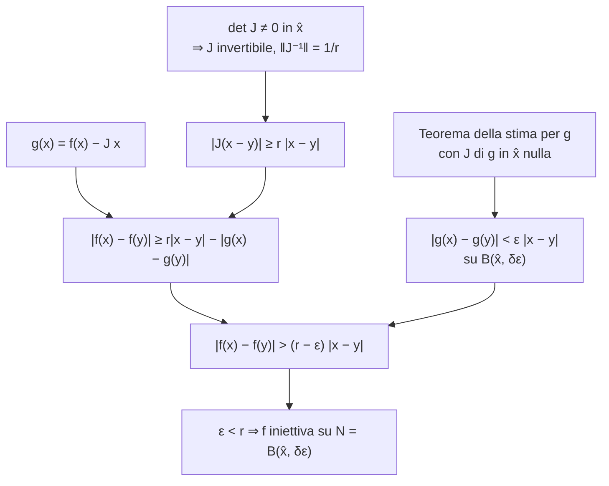
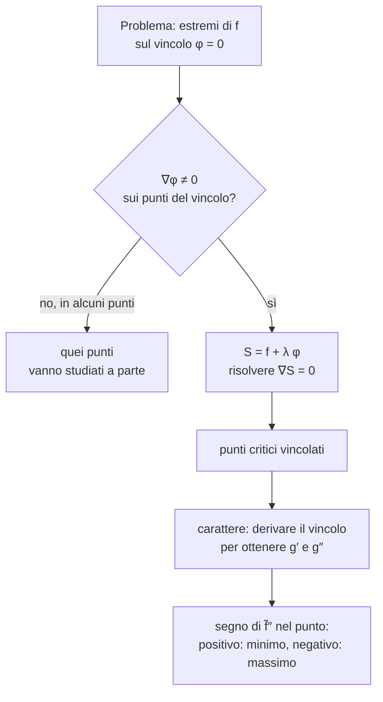

---

## corso: "Metodi Matematici per l'Ingegneria" lezione: 7 data: 2026-10-14 docente: Nicola Pinamonti argomenti: [teorema della funzione inversa, invertibilità locale e globale, jacobiano della funzione inversa, trasformazioni di coordinate, coordinate polari, massimi e minimi vincolati, moltiplicatori di Lagrange] fonti: [trascrizione, appunti manuali, note del docente] tags: [metodi-matematici, lezione]
---
# Lezione 7 — Teorema della funzione inversa e moltiplicatori di Lagrange

La lezione chiude il discorso iniziato alla fine della [[MM L06 - Funzione implicita, stima e funzione inversa|lezione 6]] sui cambi di coordinate. Il **teorema della funzione inversa** dice che una funzione da $\mathbb{R}^n$ in $\mathbb{R}^n$ di classe $C^1$ è invertibile in un intorno di ogni punto in cui il determinante della matrice jacobiana è diverso da zero. Seguono la relazione tra la jacobiana di una funzione e quella della sua inversa e tre esempi: una trasformazione invertibile solo localmente, una trasformazione lineare e le coordinate polari. La seconda parte introduce il **metodo dei moltiplicatori di Lagrange**, che trasforma la ricerca dei punti critici di una funzione sottoposta a un vincolo in un problema senza vincolo. La parte si chiude con un esercizio svolto e con l'impostazione di un secondo esercizio.

> [!note] Fonti di questa lezione La trascrizione disponibile (parte 1) si interrompe durante il secondo esercizio sui moltiplicatori di Lagrange; la parte finale di quell'esercizio è ricostruita ed è delimitata come tale. Enunciati e dimostrazioni seguono le note del docente nella versione del 12 ottobre 2026 [@pinamonti2026, §1.2.8–§1.2.10]. Le figure non provengono dalle note, che non ne contengono: sono costruite per rappresentare ciò che il docente descrive e disegna alla lavagna.

## Il teorema della funzione inversa

### Il problema

Si considera una funzione $f : D \subseteq \mathbb{R}^n \to \mathbb{R}^n$ e la si vuole interpretare come un **cambio di coordinate**: a ogni punto $\mathbf{x}$ del dominio si associano le nuove coordinate $f(\mathbf{x})$. Perché il cambio di coordinate sia utilizzabile bisogna poter tornare indietro, almeno localmente: si cerca un sottoinsieme $N \subseteq D$ su cui la funzione $$f : N \to f(N)$$ risulti al tempo stesso suriettiva e iniettiva.

Come osservato nella lezione 6, la suriettività è automatica, perché il codominio è stato ristretto all'immagine: in $f(N)$ non ci sono "buchi", cioè punti non raggiunti. Va invece controllata l'iniettività: per ogni $\mathbf{x}, \mathbf{y} \in N$ con $\mathbf{x} \neq \mathbf{y}$ deve valere $f(\mathbf{x}) \neq f(\mathbf{y})$, cioè punti distinti devono essere mandati in punti distinti. Verificarlo direttamente è difficile, perché bisognerebbe esaminare tutte le coppie di punti. Serve un teorema che dica: se la funzione ha una certa proprietà in un punto, allora esiste automaticamente una regione attorno a quel punto in cui è iniettiva.

Un indizio viene dal caso lineare. La funzione $f(\mathbf{x}) = \mathbf{y}_0 + A\mathbf{x}$, con $A$ matrice quadrata $n \times n$, è invertibile se $A$ è invertibile, e l'inversa si scrive esplicitamente: $$\mathbf{y} = \mathbf{y}_0 + A\mathbf{x} \iff \mathbf{x} = A^{-1}(\mathbf{y} - \mathbf{y}_0).$$ Una funzione differenziabile in $\hat{\mathbf{x}}$ è approssimata, vicino a $\hat{\mathbf{x}}$, dalla funzione lineare $\mathbf{x} \mapsto f(\hat{\mathbf{x}}) + J_{\hat{\mathbf{x}}}(\mathbf{x} - \hat{\mathbf{x}})$, interamente descritta dalla matrice jacobiana: se $J_{\hat{\mathbf{x}}}$ è invertibile, questa approssimazione è invertibile [@pinamonti2026, §1.2.8]. Il teorema seguente rende rigorosa l'idea che l'invertibilità della jacobiana in un punto garantisca l'invertibilità di $f$ vicino a quel punto.

### L'enunciato

> [!important] Teorema — Funzione inversa Sia $f : D \subseteq \mathbb{R}^n \to \mathbb{R}^n$ di classe $C^1$ e sia $\hat{\mathbf{x}}$ un punto interno a $D$ tale che la matrice jacobiana $J_{\hat{\mathbf{x}}} = d_{\hat{\mathbf{x}}} f$ abbia $$\det J_{\hat{\mathbf{x}}} \neq 0 .$$ Allora esiste un intorno $N \subseteq D$ di $\hat{\mathbf{x}}$ tale che la funzione $f$ ristretta a $N$ è invertibile sulla sua immagine $f(N)$.
> 
> [@pinamonti2026, Teor. 1.2.12]

Alcune osservazioni sulle ipotesi.

- **Stessa dimensione.** Dominio e codominio stanno nello stesso $\mathbb{R}^n$. La jacobiana ha per righe i gradienti delle $n$ componenti, ciascuno con $n$ entrate: è una matrice quadrata $n \times n$, e quindi ha senso calcolarne il determinante.
- **Regolarità.** Se la funzione avesse salti, o derivate poco regolari, non ci sarebbe speranza di invertirla facilmente. Si chiede quindi che $f$ sia di classe $C^1$: differenziabile in ogni punto interno, con derivate parziali continue.
- **Un solo punto.** La condizione sul determinante riguarda soltanto il punto $\hat{\mathbf{x}}$: basta conoscere la jacobiana in quel punto per sapere che esiste un intorno su cui la funzione è iniettiva.

### Dimostrazione

Come detto, basta trovare un intorno $N$ su cui $f$ è iniettiva; la suriettività su $f(N)$ si ottiene restringendo il codominio. La strategia è simile a quella del teorema della stima della lezione 6: si confronta $f$ con la sua parte lineare e si controlla la differenza.

**Passo 1: la jacobiana inversa.** In $\hat{\mathbf{x}}$ la jacobiana è una tabella di numeri, una matrice $n \times n$ con determinante diverso da zero, quindi invertibile. Si indica con $J_{\hat{\mathbf{x}}}^{-1}$ la sua inversa. Anche $J_{\hat{\mathbf{x}}}^{-1}$ è una matrice di numeri finiti, quindi la sua norma (definita nella lezione 6) è un numero finito e strettamente positivo; si definisce $r > 0$ ponendo $$\big| J_{\hat{\mathbf{x}}}^{-1} \big| = \sup_{\mathbf{z} \neq \mathbf{0}} \frac{\big| J_{\hat{\mathbf{x}}}^{-1} \mathbf{z} \big|}{|\mathbf{z}|} = \frac{1}{r}.$$ La norma è positiva perché $J_{\hat{\mathbf{x}}}^{-1}$ non è la matrice nulla (il suo determinante vale $1/\det J_{\hat{\mathbf{x}}} \neq 0$, come si vedrà più avanti).

**Passo 2: la funzione ausiliaria.** Si considera $$g(\mathbf{x}) = f(\mathbf{x}) - J_{\hat{\mathbf{x}}},\mathbf{x},$$ dove $J_{\hat{\mathbf{x}}}$ è la matrice costante calcolata in $\hat{\mathbf{x}}$. Per due punti $\mathbf{x}, \mathbf{y}$, per linearità della matrice, $$g(\mathbf{x}) - g(\mathbf{y}) = f(\mathbf{x}) - f(\mathbf{y}) - J_{\hat{\mathbf{x}}}(\mathbf{x} - \mathbf{y}), \qquad\text{cioè}\qquad f(\mathbf{x}) - f(\mathbf{y}) - \big(g(\mathbf{x}) - g(\mathbf{y})\big) = J_{\hat{\mathbf{x}}}(\mathbf{x} - \mathbf{y}).$$ Prendendo i moduli e usando la disuguaglianza triangolare (il modulo di una differenza di vettori è al più la somma dei moduli): $$\big|f(\mathbf{x}) - f(\mathbf{y})\big| + \big|g(\mathbf{x}) - g(\mathbf{y})\big| \ \geq\ \big|J_{\hat{\mathbf{x}}}(\mathbf{x} - \mathbf{y})\big|. \tag{1}$$

**Passo 3: una stima dal basso per la parte lineare.** Applicando a un vettore una matrice e poi la sua inversa si ritrova il vettore di partenza: $J_{\hat{\mathbf{x}}}^{-1} J_{\hat{\mathbf{x}}} (\mathbf{x} - \mathbf{y}) = \mathbf{x} - \mathbf{y}$. Prendendo i moduli e usando la definizione di norma della matrice inversa: $$|\mathbf{x} - \mathbf{y}| = \big|J_{\hat{\mathbf{x}}}^{-1} \big(J_{\hat{\mathbf{x}}}(\mathbf{x} - \mathbf{y})\big)\big| \ \leq\ \big|J_{\hat{\mathbf{x}}}^{-1}\big|, \big|J_{\hat{\mathbf{x}}}(\mathbf{x} - \mathbf{y})\big| .$$ Si è stimata l'azione della matrice sulla direzione del vettore con l'estremo superiore su tutte le direzioni. Dividendo per la norma, che è positiva: $$\big|J_{\hat{\mathbf{x}}}(\mathbf{x} - \mathbf{y})\big| \ \geq\ \frac{1}{|J_{\hat{\mathbf{x}}}^{-1}|},|\mathbf{x} - \mathbf{y}| = r,|\mathbf{x} - \mathbf{y}| .$$ Inserendo in (1) e portando il termine con $g$ dall'altra parte: $$\big|f(\mathbf{x}) - f(\mathbf{y})\big| \ \geq\ r,|\mathbf{x} - \mathbf{y}| - \big|g(\mathbf{x}) - g(\mathbf{y})\big| . \tag{2}$$ Ci si è quasi: se $\mathbf{x} \neq \mathbf{y}$ il primo termine a destra è positivo. Resta un "errore", $|g(\mathbf{x}) - g(\mathbf{y})|$, che bisogna dominare: se è più piccolo di $r|\mathbf{x} - \mathbf{y}|$ non riesce a cancellarlo del tutto.

**Passo 4: il teorema della stima applicato a $g$.** La funzione $g$ è di classe $C^1$, perché lo sono $f$ e la funzione lineare $\mathbf{x} \mapsto J_{\hat{\mathbf{x}}}\mathbf{x}$. Il teorema della stima della lezione 6, applicato a $g$, dice che per ogni $\varepsilon > 0$ esiste $\delta_\varepsilon > 0$ tale che, per ogni $\mathbf{x}, \mathbf{y} \in B(\hat{\mathbf{x}}, \delta_\varepsilon)$ con $\mathbf{x} \neq \mathbf{y}$, $$\big|g(\mathbf{x}) - g(\mathbf{y})\big| < \big(|J_{\hat{\mathbf{x}}} g| + \varepsilon\big),|\mathbf{x} - \mathbf{y}| ,$$ dove $J_{\hat{\mathbf{x}}} g$ è la jacobiana di $g$ in $\hat{\mathbf{x}}$. Si calcola componente per componente: la derivata della componente $i$-esima di $\mathbf{x} \mapsto J_{\hat{\mathbf{x}}}\mathbf{x}$ rispetto a $x_j$ è l'elemento $(J_{\hat{\mathbf{x}}})_{ij} = \partial_{x_j} f_i(\hat{\mathbf{x}})$, quindi $$\partial_{x_j} g_i(\mathbf{x}) = \partial_{x_j} f_i(\mathbf{x}) - \partial_{x_j} f_i(\hat{\mathbf{x}}), \qquad \partial_{x_j} g_i(\hat{\mathbf{x}}) = 0 .$$ Ora si capisce perché la funzione ausiliaria era stata costruita così: in $\hat{\mathbf{x}}$ la jacobiana di $g$ è la jacobiana di $f$ meno sé stessa, cioè la matrice nulla, e la sua norma vale zero. La stima diventa $$\big|g(\mathbf{x}) - g(\mathbf{y})\big| < \varepsilon,|\mathbf{x} - \mathbf{y}|, \qquad\text{cioè}\qquad -\big|g(\mathbf{x}) - g(\mathbf{y})\big| > -\varepsilon,|\mathbf{x} - \mathbf{y}|$$ (moltiplicando per $-1$ la disuguaglianza cambia verso).

**Passo 5: conclusione.** Sostituendo in (2), per ogni $\mathbf{x}, \mathbf{y} \in B(\hat{\mathbf{x}}, \delta_\varepsilon)$ con $\mathbf{x} \neq \mathbf{y}$: $$\big|f(\mathbf{x}) - f(\mathbf{y})\big| \ >\ (r - \varepsilon),|\mathbf{x} - \mathbf{y}| .$$ La disuguaglianza vale per ogni $\varepsilon$, ma rimpicciolendo $\varepsilon$ si rimpicciolisce anche la palla. Interessa che il membro di destra resti positivo, quindi si sceglie $\varepsilon < r$ (ad esempio $\varepsilon = r/2$) e si pone $N = B(\hat{\mathbf{x}}, \delta_\varepsilon)$. Per ogni coppia di punti distinti di $N$ si ha allora $|f(\mathbf{x}) - f(\mathbf{y})| > 0$, cioè $f(\mathbf{x}) \neq f(\mathbf{y})$: la funzione è iniettiva su $N$, e quindi invertibile su $f(N)$. $\blacksquare$

Il teorema dice che attorno a ogni punto in cui il determinante della jacobiana è diverso da zero esiste almeno una "palletta" su cui la funzione è invertibile. Non dice nulla, invece, sull'invertibilità **globale** della trasformazione: il primo esempio mostrerà che può mancare anche quando il determinante non si annulla mai.

> [!tip] Approfondimento — Regolarità dell'inversa #approfondimento Nella formulazione usuale il teorema contiene anche un'informazione sulla funzione inversa: $f^{-1} : f(N) \to N$ è a sua volta di classe $C^1$, e l'intorno $N$ può essere scelto in modo che $f(N)$ sia aperto [@rudin1976, cap. 9]. A lezione, e nelle note del docente, questa proprietà non viene dimostrata; viene però usata implicitamente nella sezione seguente, quando si calcola la jacobiana di $f^{-1}$ con la regola della catena.

> [!tip] Approfondimento — Perché in una variabile basta di meno #approfondimento Per $n = 1$ la condizione $\det J \neq 0$ diventa $f'(x) \neq 0$. Se $f$ è di classe $C^1$ su un intervallo e $f'$ non si annulla mai, la derivata, essendo continua, non può cambiare segno senza passare per lo zero (teorema dei valori intermedi): $f$ è quindi strettamente monotona e **globalmente** iniettiva. In dimensione $n \geq 2$ un argomento del genere non esiste: il determinante della jacobiana può essere sempre diverso da zero senza che la funzione sia iniettiva su tutto il dominio, come mostra il primo esempio qui sotto.

## Jacobiano della funzione inversa

### Il determinante della matrice inversa

Nella dimostrazione è comparsa la matrice inversa $J_{\hat{\mathbf{x}}}^{-1}$. Molte sue proprietà si ricavano dalla matrice diretta. Il prodotto di una matrice per la sua inversa è l'identità $\mathbb{I}$, matrice $n \times n$ con 1 sulla diagonale e 0 altrove, il cui determinante vale 1: $$J_{\hat{\mathbf{x}}}, J_{\hat{\mathbf{x}}}^{-1} = \mathbb{I} \quad\Longrightarrow\quad \det\big(J_{\hat{\mathbf{x}}}, J_{\hat{\mathbf{x}}}^{-1}\big) = \det \mathbb{I} = 1 .$$ Dal corso di geometria è noto il teorema di Binet: il determinante di un prodotto di matrici quadrate è il prodotto dei determinanti. Il docente sottolinea che per la somma questo è "vietatissimo": il determinante di una somma **non** è la somma dei determinanti. Quindi $$\det J_{\hat{\mathbf{x}}} \cdot \det J_{\hat{\mathbf{x}}}^{-1} = 1, \qquad \det J_{\hat{\mathbf{x}}}^{-1} = \frac{1}{\det J_{\hat{\mathbf{x}}}} .$$ Per conoscere il determinante dell'inversa basta dunque conoscere il determinante della matrice diretta. Il docente anticipa che questi determinanti serviranno nel calcolo degli integrali quando si cambiano le variabili.

### La jacobiana della funzione inversa

Più delicata è la domanda: che legame c'è tra la jacobiana della **funzione inversa** e l'inversa della jacobiana? Sono, in principio, oggetti diversi: la prima è la jacobiana di un'altra funzione, calcolata in un altro punto. Sia $f$ invertibile su $N$, sia $h = f^{-1} : f(N) \to N$ e sia $\mathbf{x} \in N$. Partendo da $\mathbf{x}$, applicando $f$ e poi tornando indietro con $f^{-1}$ si ritrova $\mathbf{x}$: $$f^{-1}\big(f(\mathbf{x})\big) = \mathbf{x} \qquad \forall, \mathbf{x} \in N .$$ La funzione identità $\mathbf{x} \mapsto \mathbf{x}$ ha come jacobiana la matrice identica. D'altra parte, per la regola di derivazione delle funzioni composte della [[MM L03 - Differenziabilità, Jacobiana e regola della catena|lezione 3]], il differenziale della composizione è il prodotto, riga per colonna, dei differenziali. Quindi $$J_{f(\mathbf{x})}\big(f^{-1}\big); J_{\mathbf{x}} f = \mathbb{I} .$$ Moltiplicando a destra per l'inversa della matrice $J_{\mathbf{x}} f$ si ottiene il risultato.

> [!important] Proposizione — Jacobiana e determinante della funzione inversa Sia $f : D \subseteq \mathbb{R}^n \to \mathbb{R}^n$ di classe $C^1$ con $\det J_{\hat{\mathbf{x}}} f \neq 0$, e sia $f^{-1} : f(N) \to N$ l'inversa della restrizione di $f$ all'intorno $N$ fornito dal teorema della funzione inversa. Allora $$J_{f(\hat{\mathbf{x}})}\big(f^{-1}\big) = \big(J_{\hat{\mathbf{x}}} f\big)^{-1}, \qquad \det J_{f(\hat{\mathbf{x}})}\big(f^{-1}\big) = \frac{1}{\det J_{\hat{\mathbf{x}}} f} .$$
> 
> [@pinamonti2026, Prop. 1.2.5]

In parole: la jacobiana della funzione inversa è l'inversa della jacobiana della funzione diretta. Bisogna però fare attenzione ai punti: a sinistra la funzione inversa è derivata nel punto immagine $f(\hat{\mathbf{x}})$, a destra la matrice diretta è calcolata in $\hat{\mathbf{x}}$.

Nelle note del docente questi risultati sono inseriti nel discorso sulle **trasformazioni regolari**: una funzione $f : D \subseteq \mathbb{R}^n \to \mathbb{R}^n$ di classe $C^1$ e iniettiva si dice trasformazione regolare [@pinamonti2026, Def. 1.2.12]. Per la composizione di due trasformazioni $h = g \circ f$ vale $J_{\hat{\mathbf{x}}} h = J_{f(\hat{\mathbf{x}})} g \cdot J_{\hat{\mathbf{x}}} f$ e quindi, per Binet, $\det J_{\hat{\mathbf{x}}} h = \det J_{f(\hat{\mathbf{x}})} g , \det J_{\hat{\mathbf{x}}} f$ [@pinamonti2026, Prop. 1.2.4]. La proposizione precedente è il caso particolare $g = f^{-1}$, in cui la composizione è l'identità.

## Esempi di cambi di coordinate

### Una trasformazione invertibile solo localmente

Si considera $f : \mathbb{R}^2 \to \mathbb{R}^2$, $$f(x, y) = \big(u(x, y),, v(x, y)\big) = \big(e^x \cos y,; e^x \sin y\big).$$ Le nuove coordinate si chiamano $u$ e $v$, così è chiaro che si tratta di un cambio di coordinate da $(x, y)$ a $(u, v)$. Per capire se è invertibile si studia la jacobiana, che ha per righe i gradienti di $u$ e di $v$. La dipendenza da $x$ passa per $e^x$, la cui derivata è sé stessa; la dipendenza da $y$ passa per seno e coseno: $$J_{(x, y)} f = \begin{pmatrix} \dfrac{\partial u}{\partial x} & \dfrac{\partial u}{\partial y} \\ \dfrac{\partial v}{\partial x} & \dfrac{\partial v}{\partial y} \end{pmatrix} = \begin{pmatrix} e^x \cos y & -e^x \sin y \ e^x \sin y & e^x \cos y \end{pmatrix}.$$ Il determinante di una matrice $2 \times 2$ è il prodotto sulla diagonale meno il prodotto sull'antidiagonale: $$\det J_{(x, y)} f = e^{2x}\cos^2 y + e^{2x}\sin^2 y = e^{2x}\big(\cos^2 y + \sin^2 y\big) = e^{2x} .$$ L'esponenziale è strettamente positivo per ogni $(x, y)$: il determinante non si annulla mai, e per il teorema la funzione è **localmente invertibile** attorno a ogni punto.

È anche globalmente invertibile? No. Per ogni $k \in \mathbb{Z}$, $$f(x, y + 2k\pi) = f(x, y),$$ perché seno e coseno sono periodici di periodo $2\pi$. I punti $(x, y)$ e $(x, y + 2\pi)$ sono diversi (ad esempio $(0, 0)$ e $(0, 2\pi)$), ma vengono mandati nello stesso punto: la funzione non è globalmente iniettiva, e quindi non è globalmente invertibile. Fissato però un punto qualunque del dominio, esiste sempre un intorno in cui la funzione è invertibile. Se si vogliono usare $u$ e $v$ come nuove coordinate, lo si può fare a patto di restringersi a una regione in cui la funzione è invertibile.

Le note del docente mostrano una regione di questo tipo: la striscia $\mathbb{R} \times (-\pi/2, \pi/2)$ [@pinamonti2026, §1.2.9]. Lì $u = e^x \cos y > 0$, e da $$u^2 + v^2 = e^{2x}, \qquad \frac{v}{u} = \tan y$$ si ricava l'inversa esplicita $$f^{-1}(u, v) = \Big(\tfrac{1}{2}\log\big(u^2 + v^2\big),; \arctan\frac{v}{u}\Big), \qquad u > 0 .$$ Senza usare questa formula, la proposizione sulla jacobiana dell'inversa dà subito $$J_{(u, v)}\big(f^{-1}\big) = \big(J_{(x, y)} f\big)^{-1} = \begin{pmatrix} e^{-x}\cos y & e^{-x}\sin y \ -e^{-x}\sin y & e^{-x}\cos y \end{pmatrix}, \qquad \det J_{(u, v)}\big(f^{-1}\big) = e^{-2x} = \frac{1}{u^2 + v^2},$$ dove $(x, y) = f^{-1}(u, v)$.

> [!example] Verifica (aggiunta) — Derivando direttamente l'inversa Con $u = e^x\cos y$, $v = e^x \sin y$ e $u^2 + v^2 = e^{2x}$: $$\frac{\partial}{\partial u},\tfrac12\log(u^2 + v^2) = \frac{u}{u^2 + v^2} = e^{-x}\cos y, \qquad \frac{\partial}{\partial v},\tfrac12\log(u^2 + v^2) = \frac{v}{u^2 + v^2} = e^{-x}\sin y,$$ $$\frac{\partial}{\partial u}\arctan\frac{v}{u} = -\frac{v}{u^2 + v^2} = -e^{-x}\sin y, \qquad \frac{\partial}{\partial v}\arctan\frac{v}{u} = \frac{u}{u^2 + v^2} = e^{-x}\cos y .$$ Sono esattamente gli elementi della matrice $\big(J_{(x, y)} f\big)^{-1}$ scritta sopra, come previsto dalla proposizione.

> [!warning] Discrepanza tra fonti: refusi nell'esempio delle note del docente Nella sezione 1.2.9 delle note la jacobiana di $f(x, y) = (e^x\cos y, e^x\sin y)$ compare trasposta (con $e^x \sin y$ in alto a destra e $-e^x\sin y$ in basso a sinistra), e di conseguenza anche la jacobiana dell'inversa; nella sezione 1.2.8 la stessa jacobiana è invece scritta correttamente, come sopra. Nella formula dell'inversa compaiono inoltre i refusi "frac12" (per $\tfrac12$) e $\arctan(u, v)$ (per $\arctan(v/u)$).

> [!tip] Approfondimento — L'esponenziale complesso #approfondimento Identificando il punto $(x, y)$ con il numero complesso $z = x + iy$ e il punto $(u, v)$ con $w = u + iv$, la trasformazione dell'esempio è $w = e^x(\cos y + i \sin y) = e^{x}e^{iy} = e^{z}$ per la formula di Eulero. La periodicità $f(x, y + 2\pi) = f(x, y)$ è la periodicità dell'esponenziale complesso, $e^{z + 2\pi i} = e^z$, e l'inversa locale trovata sopra è un "ramo" del logaritmo complesso. Le funzioni di variabile complessa fanno parte del programma del corso.

### Una trasformazione lineare

Si considera ora $$f(x, y) = \big(u, v\big) = \big(x - y,; x + y\big).$$ Si potrebbe calcolare la jacobiana, ma c'è una via più furba: la trasformazione è lineare in $x$ e $y$, e l'inversa si trova a mano. Sommando le due relazioni si ottiene $u + v = 2x$, sottraendole $v - u = 2y$; quindi $$f^{-1}(u, v) = \Big(\frac{u + v}{2},; \frac{v - u}{2}\Big).$$ In questo caso la funzione è **globalmente** invertibile. Coerentemente, la jacobiana è costante con determinante diverso da zero: $$J = \begin{pmatrix} 1 & -1 \ 1 & 1 \end{pmatrix}, \qquad \det J = 2, \qquad J^{-1} = \frac12\begin{pmatrix} 1 & 1 \ -1 & 1 \end{pmatrix},$$ e $J^{-1}$ è proprio la jacobiana della funzione inversa trovata a mano, con determinante $1/2$ [@pinamonti2026, §1.2.9].

### Le coordinate polari

L'ultimo esempio contiene "una piccola sorpresa". Si vogliono descrivere i punti del piano non con le coordinate cartesiane $(x, y)$ ma con le **coordinate polari**: la distanza $r$ dall'origine e l'angolo $\theta$ formato con l'asse $x$. La trasformazione è $$f(r, \theta) = \big(x(r, \theta),, y(r, \theta)\big) = \big(r\cos\theta,; r\sin\theta\big).$$ La jacobiana ha per righe i gradienti di $x$ e $y$ rispetto a $(r, \theta)$. La coordinata $x$ dipende da $r$ linearmente e da $\theta$ attraverso il coseno, la cui derivata è $-\sin\theta$; analogamente per $y$: $$J_{(r, \theta)} f = \begin{pmatrix} \cos\theta & -r\sin\theta \ \sin\theta & r\cos\theta \end{pmatrix}, \qquad \det J_{(r, \theta)} f = r\cos^2\theta + r\sin^2\theta = r .$$ Il determinante è diverso da zero se e solo se $r \neq 0$. Le coordinate polari sono quindi localmente invertibili ovunque **tranne che nell'origine**. In $r = 0$ la funzione è ben definita, ma qualunque sia $\theta$ il risultato è sempre $(0, 0)$: tutti i punti del segmento ${0} \times [0, 2\pi]$ vengono mandati nello stesso punto, e la funzione non è iniettiva. Le coordinate polari sono buone coordinate fintanto che si sta lontani dall'origine; nell'origine sono degeneri [@pinamonti2026, §1.2.9].

<svg viewBox="0 0 600 290" width="600" style="display:block;margin:1em auto;max-width:100%;height:auto;font-family:inherit" xmlns="http://www.w3.org/2000/svg"><line x1="46" y1="250" x2="214" y2="250" stroke="currentColor" stroke-width="1.1"/><polygon points="214,250 207.8,253.3 207.8,246.7" fill="currentColor"/><line x1="60" y1="260.4" x2="60" y2="52.4" stroke="currentColor" stroke-width="1.1"/><polygon points="60,52.4 63.3,58.6 56.7,58.6" fill="currentColor"/><text x="214" y="266" font-size="13" text-anchor="end" fill="currentColor" font-style="italic">r</text><text x="67" y="58.4" font-size="13" text-anchor="start" fill="currentColor" font-style="italic">θ</text><line x1="60" y1="86.6" x2="200" y2="86.6" stroke="currentColor" stroke-opacity="0.35" stroke-dasharray="4 3"/><text x="54" y="90.6" font-size="11" text-anchor="end" fill="currentColor">2π</text><line x1="60" y1="250" x2="60" y2="86.6" stroke="#e05a47" stroke-width="3"/><text x="68" y="112.2" font-size="12" text-anchor="start" fill="#e05a47">r = 0</text><rect x="123" y="208.4" width="49" height="26" fill="#3b82f6" fill-opacity="0.18" stroke="#3b82f6" stroke-width="1.3"/><text x="178" y="210.4" font-size="13" text-anchor="start" fill="#3b82f6" font-style="italic">R</text><text x="140" y="22" font-size="12" text-anchor="middle" fill="currentColor">piano (r, θ)</text><line x1="322.2" y1="170" x2="557.8" y2="170" stroke="currentColor" stroke-width="1.1"/><polygon points="557.8,170 551.6,173.3 551.6,166.7" fill="currentColor"/><line x1="440" y1="263" x2="440" y2="70.8" stroke="currentColor" stroke-width="1.1"/><polygon points="440,70.8 443.3,77 436.7,77" fill="currentColor"/><text x="557.8" y="186" font-size="13" text-anchor="end" fill="currentColor" font-style="italic">x</text><text x="432" y="78.8" font-size="13" text-anchor="end" fill="currentColor" font-style="italic">y</text><path d="M 521.9,114 L 520.4,111.9 L 518.9,109.9 L 517.3,107.9 L 515.7,105.9 L 514,104 L 512.3,102.1 L 510.6,100.3 L 508.7,98.5 L 506.9,96.7 L 505,95.1 L 503,93.4 L 501.1,91.8 L 499,90.3 L 497,88.8 L 494.9,87.4 L 492.7,86 L 490.6,84.7 L 488.4,83.4 L 486.1,82.2 L 483.9,81 L 481.6,79.9 L 479.2,78.9 L 476.9,77.9 L 474.5,77 L 472.1,76.1 L 469.7,75.4 L 467.3,74.6 L 464.8,74 L 462.3,73.3 L 459.9,72.8 L 457.4,72.3 L 454.9,71.9 L 452.3,71.6 L 449.8,71.3 L 447.3,71.1 L 444.7,70.9 L 442.2,70.8 L 439.6,70.8 L 437.1,70.8 L 438.4,114.2 L 439.8,114.2 L 441.2,114.2 L 442.7,114.3 L 444.1,114.4 L 445.5,114.5 L 446.9,114.6 L 448.4,114.8 L 449.8,115.1 L 451.2,115.3 L 452.6,115.6 L 454,116 L 455.3,116.3 L 456.7,116.8 L 458.1,117.2 L 459.4,117.7 L 460.8,118.2 L 462.1,118.8 L 463.4,119.3 L 464.7,120 L 465.9,120.6 L 467.2,121.3 L 468.4,122 L 469.7,122.7 L 470.9,123.5 L 472,124.3 L 473.2,125.2 L 474.3,126 L 475.5,126.9 L 476.6,127.8 L 477.6,128.8 L 478.7,129.8 L 479.7,130.8 L 480.7,131.8 L 481.6,132.9 L 482.6,133.9 L 483.5,135 L 484.4,136.2 L 485.2,137.3 L 486.1,138.5 Z" fill="#3b82f6" fill-opacity="0.18" stroke="#3b82f6" stroke-width="1.3"/><text x="505.2" y="82.9" font-size="13" text-anchor="start" fill="#3b82f6" font-style="italic">f(R)</text><circle cx="440" cy="170" r="4.5" fill="#e05a47"/><text x="448" y="188" font-size="12" text-anchor="start" fill="#e05a47">origine</text><text x="440" y="22" font-size="12" text-anchor="middle" fill="currentColor">piano (x, y)</text><path d="M 66,192.8 Q 240,146 432,166" fill="none" stroke="#e05a47" stroke-width="1.4" stroke-dasharray="5 3"/><polygon points="432,166 424.6,169 425.4,161.5" fill="#e05a47"/><text x="300" y="280" font-size="11" text-anchor="middle" fill="#e05a47">tutto il segmento r = 0 viene mandato nell'origine: lì f non è iniettiva</text></svg>

> [!tip] Approfondimento — Dove le coordinate polari sono globalmente invertibili #approfondimento Il determinante $r$ non si annulla sull'insieme aperto $(0, +\infty) \times (-\pi, \pi)$, e lì la trasformazione è anche globalmente iniettiva: un punto del piano diverso dall'origine individua univocamente la sua distanza $r > 0$ dall'origine e il suo angolo in $(-\pi, \pi]$. L'immagine di quell'aperto è il piano privato della semiretta ${(x, 0) : x \leq 0}$, origine compresa: l'angolo $\theta = \pi$ è escluso perché altrimenti l'intervallo non sarebbe aperto, e l'origine è esclusa perché lì le coordinate degenerano. La semiretta tolta è un insieme di "area nulla", e per questo nel calcolo degli integrali non crea problemi: è il motivo per cui le coordinate polari si usano sistematicamente nonostante la degenerazione nell'origine.

## Massimi e minimi vincolati: i moltiplicatori di Lagrange

### Il problema

Si considera una funzione a valori reali $f : D \subseteq \mathbb{R}^2 \to \mathbb{R}$. Nelle lezioni precedenti si è visto come trovarne i punti critici e come stabilire se sono di massimo o di minimo. Spesso, però, interessano i punti critici non su tutto il dominio, ma solo sui punti che soddisfano un **vincolo**, descritto anch'esso da una funzione $\varphi : D \subseteq \mathbb{R}^2 \to \mathbb{R}$: $$\text{massimi e minimi di } f \text{ sull'insieme } {(x, y) \in D : \varphi(x, y) = 0}.$$

Il docente ragiona su un disegno, come se si guardasse una cartina geografica. Le curve di livello di $f$ (in arancione nella figura) sono le linee lungo cui $f$ è costante; supponiamo che $f$ cresca andando verso l'interno, dove sta la cima della montagna. Senza vincoli, il massimo sarebbe sulla cima. Ma bisogna stare sulla curva del vincolo $\varphi = 0$ (in rosso): se si è fortunati, per il teorema della funzione implicita della lezione 6, l'insieme ${\varphi = 0}$ è davvero una curva. Seguendo la curva rossa, $f$ cresce, raggiunge un massimo e poi torna a decrescere. Nel punto di massimo la curva rossa tocca una curva di livello senza attraversarla: le due curve sono **tangenti**, e i loro vettori tangenti sono paralleli (non necessariamente della stessa lunghezza).

<svg viewBox="0 0 560 400" width="560" style="display:block;margin:1em auto;max-width:100%;height:auto;font-family:inherit" xmlns="http://www.w3.org/2000/svg"><rect x="77" y="14.4" width="404.8" height="347.6" fill="currentColor" fill-opacity="0.03" stroke="currentColor" stroke-opacity="0.3"/><polyline points="481.8,114 481.4,112.8 480.9,111.1 480.6,110.2 480,108.5 479.7,107.6 479,105.9 478.6,105 477.9,103.3 477.5,102.4 476.8,100.6 476.4,99.8 475.7,98.4 475.1,97.2 474.7,96.3 473.7,94.5 473.3,93.7 472.7,92.6 471.8,91.1 471.3,90.2 470.6,89.1 469.7,87.6 469.1,86.7 468.5,85.8 467.6,84.4 466.8,83.2 466.1,82.4 465.5,81.5 464.6,80.2 463.6,78.9 462.9,78 462.2,77.1 461.5,76.3 460.5,75 459.5,73.8 458.6,72.8 457.8,71.9 457,71 456.2,70.2 455.4,69.3 454.4,68.3 453.4,67.2 452.4,66.2 451.4,65.2 450.3,64.2 449.3,63.3 448.3,62.3 447.3,61.4 446.3,60.6 445.3,59.7 444.3,58.8 443.3,58 442.2,57.1 441.2,56.3 440.2,55.5 439.2,54.7 438.2,54 437.2,53.2 436.1,52.5 435.1,51.7 434.1,51 432.8,50.1 431.5,49.2 430.2,48.4 429,47.6 428,47 427,46.3 426,45.7 424.6,44.9 423.2,44 421.9,43.3 420.9,42.7 419.9,42.2 418.5,41.4 416.9,40.6 415.9,40 414.8,39.5 413.4,38.8 411.8,38 410.8,37.5 409.7,37.1 407.8,36.2 406.7,35.7 405.7,35.3 403.8,34.4 402.7,34 401.6,33.6 399.6,32.8 398.6,32.4 397.1,31.8 395.6,31.3 394.5,30.9 392.5,30.2 391.5,29.9 389.5,29.2 388.5,28.9 386.7,28.3 385.4,28 383.6,27.5 382.4,27.1 380.4,26.6 379.3,26.3 377.3,25.8 376.3,25.6 374.3,25.1 373.2,24.9 371.2,24.4 369.2,24 368.2,23.8 366.1,23.5 364.1,23.1 363.1,22.9 361.1,22.6 359,22.3 358,22.2 356,21.9 354,21.7 351.9,21.5 350.9,21.4 348.9,21.2 346.9,21 344.8,20.9 342.8,20.8 340.8,20.6 338.8,20.6 336.7,20.5 335.7,20.5 333.7,20.5 331.6,20.5 329.6,20.5 328.4,20.5 326.6,20.5 324.5,20.6 322.5,20.7 320.5,20.8 318.5,20.9 316.4,21.1 314.4,21.3 313.4,21.4 311.4,21.6 309.3,21.8 307.3,22.1 306,22.2 304.3,22.5 302.2,22.8 300.3,23.1 299.2,23.3 297.2,23.7 295.5,24 294.1,24.2 292.1,24.7 291.1,24.9 289,25.3 287.4,25.7 286,26.1 284,26.6 283,26.9 280.9,27.4 279.9,27.7 277.9,28.3 276.9,28.6 274.9,29.2 273.8,29.6 272.3,30.1 270.8,30.6 269.7,31 267.7,31.7 266.7,32 265,32.7 263.7,33.2 262.7,33.6 260.6,34.4 259.6,34.9 258.6,35.3 256.6,36.2 255.6,36.6 254.5,37.1 252.8,37.9 251.5,38.6 250.5,39.1 249.3,39.7 247.6,40.5 246.4,41.1 245.4,41.7 244.3,42.3 242.8,43.1 241.4,43.9 240.3,44.5 239.3,45.1 238.3,45.8 236.9,46.6 235.5,47.5 234.3,48.3 233.2,49 232.2,49.7 231.2,50.4 230.2,51.1 229.1,51.9 227.9,52.7 226.7,53.6 225.5,54.5 224.4,55.3 223.3,56.2 222.2,57.1 221.1,58 220.1,58.8 219.1,59.7 218.1,60.6 217.1,61.4 216.1,62.3 215.2,63.2 214.2,64.1 213.3,64.9 212.4,65.8 211.6,66.7 210.7,67.5 209.8,68.4 208.9,69.4 207.9,70.5 206.9,71.6 205.8,72.8 205.1,73.6 204.3,74.5 203.6,75.4 202.8,76.4 201.8,77.6 200.8,78.9 200.2,79.7 199.5,80.6 198.7,81.7 197.7,83.1 197,84.1 196.4,85 195.7,86.1 194.7,87.6 194.2,88.5 193.7,89.3 192.7,91 192.1,91.9 191.6,92.8 190.7,94.5 190.2,95.4 189.6,96.6 188.9,98 188.5,98.9 187.6,100.6 187.2,101.5 186.6,103.1 186.1,104.1 185.6,105.5 185.1,106.7 184.5,108.2 184.1,109.4 183.5,111.1 183.2,112 182.7,113.7 182.4,114.6 181.9,116.3 181.5,118 181.3,118.9 180.8,120.7 180.5,122.4 180.3,123.3 180,125 179.7,126.8 179.5,128.1 179.3,129.4 179.1,131.1 178.9,132.9 178.7,134.6 178.6,136.4 178.5,138.1 178.5,139.8 178.5,141.6 178.5,143.3 178.5,145.1 178.6,146.8 178.7,148.6 178.8,150.3 179,152 179.2,153.8 179.4,155.5 179.5,156.4 179.8,158.1 180.1,159.9 180.5,161.6 180.7,162.5 181.1,164.2 181.5,166 181.7,166.9 182.2,168.6 182.5,169.7 183,171.2 183.5,172.9 183.8,173.8 184.4,175.6 184.8,176.4 185.4,178.2 185.8,179.1 186.5,180.8 186.9,181.7 187.6,183.2 188.1,184.3 188.6,185.4 189.3,186.9 189.8,187.8 190.6,189.4 191.2,190.4 191.6,191.2 192.6,193 193.2,193.9 193.7,194.7 194.7,196.3 195.3,197.3 195.9,198.2 196.7,199.4 197.7,200.8 198.3,201.7 198.9,202.6 199.8,203.7 200.8,205.1 201.6,206.1 202.2,206.9 202.9,207.8 203.8,208.9 204.8,210.1 205.8,211.2 206.7,212.2 207.4,213 208.2,213.9 209.1,214.8 209.9,215.7 210.9,216.7 211.9,217.7 212.9,218.7 214,219.7 215,220.6 216,221.6 217,222.5 218,223.4 219,224.3 220,225.1 221.1,226 222.1,226.8 223.1,227.6 224.1,228.4 225.1,229.2 226.1,230 227.2,230.7 228.2,231.5 229.2,232.2 230.4,233.1 231.6,233.9 232.9,234.8 234.3,235.7 235.3,236.3 236.3,237 237.3,237.6 238.4,238.3 239.8,239.2 241.3,240 242.4,240.6 243.4,241.2 244.4,241.8 246,242.6 247.4,243.4 248.5,243.9 249.5,244.4 251.1,245.3 252.5,245.9 253.5,246.4 254.8,247 256.6,247.8 257.6,248.3 258.7,248.7 260.6,249.6 261.6,250 262.9,250.5 264.7,251.2 265.7,251.6 267.4,252.2 268.7,252.7 269.9,253.1 271.8,253.8 272.8,254.1 274.8,254.8 275.8,255.1 277.9,255.7 278.9,256 280.9,256.6 281.9,256.9 284,257.4 285,257.7 287,258.2 288,258.4 290.1,258.9 291.5,259.2 293.1,259.5 295.1,260 296.1,260.1 298.2,260.5 300.2,260.9 301.2,261 303.2,261.4 305.3,261.7 306.4,261.8 308.3,262.1 310.3,262.3 312.4,262.5 314,262.7 315.4,262.8 317.4,263 319.5,263.1 321.5,263.2 323.5,263.3 325.6,263.4 327.6,263.5 329.6,263.5 331.6,263.5 333.7,263.5 335.7,263.5 337.7,263.5 339.8,263.4 341.8,263.3 343.8,263.2 345.9,263.1 347.9,262.9 349.9,262.7 350.9,262.6 353,262.4 355,262.2 357,261.9 358,261.8 360.1,261.5 362.1,261.2 363.8,260.9 365.1,260.7 367.2,260.4 368.7,260.1 370.2,259.8 372.2,259.3 373.2,259.1 375.3,258.7 376.7,258.3 378.3,257.9 380.2,257.5 381.4,257.2 383.4,256.6 384.4,256.3 386.4,255.7 387.4,255.4 389.3,254.8 390.5,254.5 392,254 393.5,253.4 394.5,253.1 396.6,252.4 397.6,252 399.3,251.4 400.6,250.8 401.7,250.4 403.6,249.6 404.7,249.2 405.7,248.7 407.7,247.9 408.8,247.4 409.8,246.9 411.5,246.1 412.8,245.5 413.8,245 415,244.4 416.7,243.5 417.9,242.9 418.9,242.4 420,241.8 421.5,240.9 423,240.1 424,239.5 425,238.9 426,238.3 427.4,237.4 428.8,236.6 430.1,235.7 431.1,235.1 432.1,234.4 433.1,233.7 434.1,233 435.2,232.2 436.5,231.3 437.6,230.5 438.8,229.6 439.9,228.7 441,227.8 442.1,227 443.2,226.1 444.2,225.2 445.3,224.4 446.3,223.5 447.3,222.6 448.2,221.7 449.2,220.9 450.1,220 451,219.1 451.9,218.3 452.8,217.4 453.7,216.5 454.5,215.6 455.4,214.7 456.4,213.6 457.5,212.5 458.5,211.3 459.3,210.4 460,209.5 460.7,208.7 461.5,207.7 462.5,206.5 463.5,205.2 464.2,204.3 464.8,203.4 465.6,202.5 466.6,201 467.3,200 467.9,199.1 468.6,198.1 469.6,196.5 470.2,195.6 470.7,194.7 471.7,193.2 472.3,192.1 472.8,191.2 473.7,189.5 474.2,188.6 474.7,187.6 475.5,186 475.9,185.2 476.7,183.4 477.1,182.5 477.7,181.2 478.3,179.9 478.8,178.7 479.3,177.3 479.8,176.1 480.3,174.7 480.8,173.2 481.2,172.1 481.7,170.3 481.8,170" fill="none" stroke="#d98a1c" stroke-width="1.2" stroke-opacity="0.75"/><text x="332.7" y="15.5" font-size="11" text-anchor="middle" fill="#d98a1c">f = a₀</text><polyline points="325.6,244.4 327.6,244.5 329.6,244.5 331.6,244.5 333.7,244.5 335.7,244.5 337.7,244.4 339,244.4 340.8,244.3 342.8,244.2 344.8,244 346.9,243.9 348.9,243.7 350.4,243.5 351.9,243.3 354,243.1 356,242.8 357,242.6 359,242.3 361.1,242 362.1,241.8 364.1,241.4 366.1,241 367.2,240.7 369.2,240.3 370.2,240 372.2,239.5 373.6,239.2 375.3,238.7 376.7,238.3 378.3,237.8 379.7,237.4 381.4,236.9 382.4,236.5 384.4,235.9 385.4,235.5 387.3,234.8 388.5,234.4 389.6,233.9 391.5,233.2 392.5,232.8 393.9,232.2 395.6,231.5 396.6,231 397.8,230.5 399.6,229.6 400.6,229.1 401.7,228.6 403.1,227.8 404.7,227 405.7,226.5 406.7,225.9 408,225.2 409.5,224.4 410.8,223.6 411.8,222.9 412.8,222.3 413.8,221.7 415.1,220.9 416.4,220 417.7,219.1 418.9,218.3 419.9,217.5 420.9,216.8 421.9,216 423,215.2 424,214.4 425,213.6 426,212.8 427,212 428,211.1 429,210.2 430.1,209.3 431.1,208.4 432.1,207.4 433.1,206.4 434.1,205.4 435.1,204.4 436,203.4 436.8,202.6 437.6,201.7 438.4,200.8 439.2,200 440.2,198.8 441.2,197.5 442.1,196.5 442.8,195.6 443.4,194.7 444.3,193.6 445.3,192.2 446,191.2 446.5,190.4 447.3,189.2 448.3,187.8 448.8,186.9 449.3,186 450.3,184.3 450.8,183.4 451.4,182.5 452.3,180.8 452.7,179.9 453.4,178.5 454,177.3 454.4,176.3 455.1,174.7 455.5,173.8 456.2,172.1 456.5,171.2 457.2,169.5 457.5,168.6 458,166.9 458.5,165.4 458.8,164.2 459.3,162.5 459.5,161.6 459.9,159.9 460.3,158.1 460.5,157 460.8,155.5 461,153.8 461.3,152 461.5,150.3 461.6,149.4 461.7,147.7 461.8,145.9 461.9,144.2 461.9,142.5 461.9,140.7 461.8,139 461.8,137.2 461.6,135.5 461.5,134.1 461.4,132.9 461.2,131.1 460.9,129.4 460.6,127.7 460.5,126.8 460.1,125 459.7,123.3 459.5,122.3 459.1,120.7 458.6,118.9 458.3,118.1 457.8,116.3 457.5,115.4 456.9,113.7 456.4,112.6 455.9,111.1 455.4,110 454.8,108.5 454.4,107.6 453.6,105.9 453.2,105 452.4,103.5 451.8,102.4 451.4,101.5 450.4,99.8 449.9,98.9 449.3,98 448.3,96.3 447.7,95.4 447.2,94.5 446.3,93.2 445.4,91.9 444.8,91.1 444.1,90.2 443.2,89 442.2,87.7 441.4,86.7 440.7,85.8 440,85 439.2,84 438.2,82.9 437.2,81.8 436.1,80.7 435.2,79.7 434.4,78.9 433.5,78 432.6,77.1 431.7,76.3 430.8,75.4 429.8,74.5 428.9,73.6 427.9,72.8 426.8,71.9 425.8,71 424.7,70.2 423.6,69.3 422.5,68.4 421.4,67.5 420.2,66.7 419,65.8 417.9,65 416.9,64.3 415.9,63.6 414.8,63 413.8,62.3 412.4,61.4 411,60.6 409.8,59.8 408.8,59.2 407.7,58.7 406.5,58 404.9,57.1 403.7,56.4 402.7,55.9 401.5,55.3 399.8,54.5 398.6,53.9 397.6,53.5 396,52.7 394.5,52.1 393.5,51.7 391.9,51 390.5,50.4 389.5,50 387.5,49.2 386.4,48.9 385.1,48.4 383.4,47.8 382.4,47.5 380.3,46.8 379.3,46.5 377.3,45.9 376.3,45.6 374.3,45 373.2,44.7 371.2,44.2 370.2,44 368.2,43.5 366.6,43.1 365.1,42.8 363.1,42.4 362.1,42.2 360.1,41.9 358,41.5 357,41.4 355,41.1 353,40.8 350.9,40.5 349.9,40.4 347.9,40.2 345.9,40 343.8,39.9 341.8,39.7 340.2,39.7 338.8,39.6 336.7,39.5 334.7,39.5 332.7,39.5 330.6,39.5 328.6,39.5 326.6,39.6 324.5,39.6 323.5,39.7 321.5,39.8 319.5,40 317.4,40.1 315.4,40.3 313.5,40.5 312.4,40.7 310.3,40.9 308.3,41.2 307.1,41.4 305.3,41.7 303.2,42.1 302,42.3 300.2,42.6 298.2,43.1 297.2,43.3 295.1,43.7 294,44 292.1,44.5 290.6,44.9 289,45.3 287.5,45.8 286,46.2 284.6,46.6 283,47.1 281.9,47.5 279.9,48.2 278.9,48.5 276.9,49.2 275.8,49.7 274.6,50.1 272.8,50.9 271.8,51.3 270.4,51.9 268.7,52.6 267.7,53 266.5,53.6 264.7,54.5 263.7,54.9 262.7,55.5 261.2,56.2 259.6,57 258.6,57.6 257.6,58.1 256.4,58.8 254.8,59.7 253.5,60.5 252.5,61.1 251.5,61.7 250.5,62.4 249.2,63.2 247.9,64.1 246.7,64.9 245.4,65.8 244.4,66.5 243.4,67.3 242.4,68 241.4,68.8 240.3,69.6 239.3,70.4 238.3,71.3 237.3,72.1 236.3,73 235.3,73.9 234.3,74.8 233.2,75.7 232.2,76.7 231.2,77.7 230.2,78.7 229.2,79.7 228.3,80.6 227.5,81.5 226.7,82.4 225.9,83.2 225.1,84.1 224.1,85.3 223.1,86.6 222.3,87.6 221.6,88.5 220.9,89.3 220,90.5 219,91.9 218.4,92.8 217.8,93.7 217,94.9 216.1,96.3 215.6,97.2 215,98.1 214,99.8 213.5,100.6 212.9,101.7 212.1,103.3 211.7,104.1 210.9,105.7 210.4,106.7 209.9,107.9 209.3,109.4 208.9,110.2 208.2,112 207.9,112.8 207.2,114.6 206.9,115.7 206.4,117.2 205.8,118.9 205.6,119.8 205.1,121.6 204.8,122.7 204.5,124.2 204.1,125.9 203.8,127.5 203.6,128.5 203.4,130.3 203.1,132 202.9,133.8 202.8,135.1 202.7,136.4 202.6,138.1 202.5,139.8 202.5,141.6 202.5,143.3 202.6,145.1 202.6,146.8 202.8,148.6 202.8,149.4 203,151.2 203.2,152.9 203.5,154.7 203.8,156.4 204,157.3 204.3,159 204.7,160.8 204.9,161.6 205.4,163.4 205.8,165.1 206.1,166 206.7,167.7 206.9,168.6 207.6,170.3 207.9,171.2 208.6,173 208.9,173.8 209.7,175.6 210,176.4 210.8,178.2 211.3,179.1 211.9,180.4 212.6,181.7 213.1,182.5 214,184.1 214.6,185.2 215.1,186 216,187.5 216.7,188.6 217.3,189.5 218,190.6 219,192.1 219.7,193 220.3,193.9 221.1,194.9 222.1,196.2 223,197.3 223.7,198.2 224.5,199.1 225.2,200 226.1,201 227.2,202.1 228.2,203.2 229.2,204.3 230.1,205.2 230.9,206.1 231.8,206.9 232.7,207.8 233.7,208.7 234.6,209.5 235.6,210.4 236.6,211.3 237.6,212.2 238.7,213 239.7,213.9 240.8,214.8 242,215.6 243.1,216.5 244.3,217.4 245.4,218.2 246.4,218.9 247.4,219.6 248.5,220.3 249.5,221 250.7,221.7 252.1,222.6 253.5,223.5 254.5,224.1 255.6,224.7 256.6,225.3 258,226.1 259.6,227 260.6,227.5 261.6,228 263,228.7 264.7,229.5 265.7,230 266.7,230.5 268.5,231.3 269.8,231.9 270.8,232.3 272.6,233.1 273.8,233.6 274.8,234 276.9,234.7 277.9,235.1 279.5,235.7 280.9,236.2 282,236.6 284,237.2 285,237.5 287,238.1 288,238.4 290.1,239 291.1,239.2 293.1,239.8 294.2,240 296.1,240.5 298,240.9 299.2,241.2 301.2,241.6 302.3,241.8 304.3,242.1 306.3,242.5 307.5,242.6 309.3,242.9 311.4,243.2 313.4,243.4 314.4,243.6 316.4,243.8 318.5,244 320.5,244.1 322.5,244.2 324.5,244.4 325.6,244.4 325.6,244.4" fill="none" stroke="#d98a1c" stroke-width="1.2" stroke-opacity="0.75"/><text x="332.7" y="34.5" font-size="11" text-anchor="middle" fill="#d98a1c">f = a₁</text><polyline points="325.6,220.9 327.6,221 329.6,221.1 331.6,221.1 333.7,221.1 335.7,221 337.7,221 339.5,220.9 340.8,220.8 342.8,220.6 344.8,220.4 346.9,220.2 348.7,220 349.9,219.8 351.9,219.5 354,219.2 355,219 357,218.6 358.7,218.3 360.1,218 362.1,217.5 363.1,217.2 365.1,216.7 366.1,216.4 368.2,215.8 369.2,215.5 371.2,214.8 372.2,214.5 373.8,213.9 375.3,213.4 376.3,213 378.3,212.2 379.3,211.7 380.4,211.3 382.4,210.4 383.4,209.9 384.4,209.5 386,208.7 387.4,207.9 388.5,207.4 389.5,206.8 390.9,206.1 392.3,205.2 393.5,204.5 394.5,203.8 395.6,203.2 396.6,202.5 397.8,201.7 399,200.8 400.2,200 401.4,199.1 402.5,198.2 403.6,197.3 404.7,196.5 405.7,195.6 406.7,194.7 407.7,193.9 408.7,193 409.6,192.1 410.5,191.2 411.3,190.4 412.2,189.5 413,188.6 413.8,187.7 414.8,186.6 415.9,185.4 416.7,184.3 417.4,183.4 418.1,182.5 418.9,181.4 419.9,180 420.6,179.1 421.1,178.2 421.9,176.9 422.8,175.6 423.3,174.7 424,173.5 424.7,172.1 425.2,171.2 426,169.5 426.4,168.6 427,167.2 427.5,166 428,164.7 428.5,163.4 429,161.8 429.4,160.8 429.9,159 430.1,158.1 430.6,156.4 430.9,154.7 431.1,153.8 431.4,152 431.7,150.3 431.9,148.6 432,146.8 432.1,145.9 432.2,144.2 432.2,142.5 432.2,140.7 432.2,139 432.1,137.8 432,136.4 431.8,134.6 431.6,132.9 431.3,131.1 431.1,130 430.8,128.5 430.4,126.8 430.1,125.6 429.7,124.2 429.1,122.4 428.8,121.6 428.2,119.8 427.9,118.9 427.2,117.2 426.8,116.3 426,114.6 425.6,113.7 425,112.5 424.3,111.1 423.8,110.2 423,108.8 422.3,107.6 421.7,106.7 420.9,105.5 420,104.1 419.4,103.3 418.8,102.4 417.9,101.2 416.9,99.9 416.1,98.9 415.3,98 414.6,97.2 413.8,96.3 412.8,95.2 411.8,94.1 410.8,93.1 409.8,92.1 408.8,91.1 407.8,90.2 406.8,89.3 405.8,88.5 404.8,87.6 403.7,86.7 402.7,85.9 401.7,85.1 400.6,84.3 399.6,83.6 398.6,82.9 397.6,82.2 396.6,81.5 395.3,80.6 393.9,79.7 392.5,78.9 391.5,78.3 390.5,77.7 389.4,77.1 387.8,76.3 386.4,75.6 385.4,75 384.3,74.5 382.5,73.6 381.4,73.1 380.3,72.7 378.5,71.9 377.3,71.4 376.3,71 374.3,70.3 373.2,69.9 371.5,69.3 370.2,68.9 368.8,68.4 367.2,67.9 365.9,67.5 364.1,67.1 362.6,66.7 361.1,66.3 359,65.8 358,65.6 356,65.2 354.6,64.9 353,64.6 350.9,64.3 349.1,64.1 347.9,63.9 345.9,63.7 343.8,63.5 341.8,63.3 340.4,63.2 338.8,63.1 336.7,63 334.7,62.9 332.7,62.9 330.6,62.9 328.6,63 326.6,63 324.5,63.2 323.5,63.2 321.5,63.4 319.5,63.6 317.4,63.8 315.4,64 314.4,64.2 312.4,64.5 310.3,64.8 309.3,65 307.3,65.4 305.5,65.8 304.3,66.1 302.2,66.6 301.2,66.8 299.2,67.4 298.2,67.6 296.1,68.2 295.1,68.6 293.1,69.2 292.1,69.6 290.4,70.2 289,70.7 288,71.1 286,71.9 285,72.3 283.9,72.8 281.9,73.6 280.9,74.1 279.9,74.6 278.3,75.4 276.9,76.1 275.8,76.7 274.8,77.2 273.5,78 272,78.9 270.8,79.6 269.8,80.2 268.7,80.9 267.7,81.5 266.5,82.4 265.3,83.2 264.1,84.1 262.9,85 261.8,85.8 260.7,86.7 259.6,87.6 258.6,88.4 257.6,89.3 256.6,90.2 255.7,91.1 254.8,91.9 253.9,92.8 253,93.7 252.2,94.5 251.4,95.4 250.5,96.4 249.5,97.5 248.5,98.8 247.6,99.8 246.9,100.6 246.3,101.5 245.4,102.7 244.4,104.1 243.8,105 243.2,105.9 242.4,107.2 241.6,108.5 241.1,109.4 240.3,110.7 239.7,112 239.2,112.8 238.4,114.6 238,115.5 237.3,117 236.9,118.1 236.3,119.6 235.9,120.7 235.3,122.4 235,123.3 234.5,125 234.3,126 233.8,127.7 233.5,129.4 233.2,130.5 233,132 232.7,133.8 232.5,135.5 232.4,137.2 232.2,139 232.2,139.8 232.2,141.6 232.2,143.3 232.2,144.5 232.3,145.9 232.4,147.7 232.6,149.4 232.8,151.2 233.1,152.9 233.3,153.8 233.6,155.5 234.1,157.3 234.3,158.1 234.8,159.9 235.3,161.5 235.6,162.5 236.2,164.2 236.5,165.1 237.2,166.9 237.6,167.7 238.3,169.3 238.8,170.3 239.3,171.4 240.2,173 240.6,173.8 241.4,175.1 242.2,176.4 242.7,177.3 243.4,178.4 244.4,179.9 245,180.8 245.7,181.7 246.4,182.7 247.4,184 248.4,185.2 249.1,186 249.9,186.9 250.6,187.8 251.5,188.7 252.5,189.8 253.5,190.8 254.5,191.8 255.6,192.8 256.6,193.8 257.6,194.7 258.6,195.6 259.6,196.4 260.6,197.2 261.6,198.1 262.7,198.8 263.7,199.6 264.7,200.4 265.7,201.1 266.7,201.8 267.9,202.6 269.2,203.4 270.6,204.3 271.8,205 272.8,205.6 273.8,206.2 275.1,206.9 276.7,207.8 277.9,208.4 278.9,208.9 280.2,209.5 281.9,210.4 283,210.8 284,211.3 286,212.1 287,212.5 288.2,213 290.1,213.7 291.1,214.1 293,214.8 294.1,215.1 295.8,215.6 297.2,216.1 298.7,216.5 300.2,216.9 302,217.4 303.2,217.7 305.3,218.2 306.3,218.4 308.3,218.8 310.1,219.1 311.4,219.3 313.4,219.7 315.4,220 316.4,220.1 318.5,220.3 320.5,220.5 322.5,220.7 324.5,220.8 325.6,220.9 325.6,220.9" fill="none" stroke="#d98a1c" stroke-width="2.0" stroke-opacity="1"/><text x="332.7" y="57.9" font-size="11" text-anchor="middle" fill="#d98a1c">f = a₂</text><polyline points="321.5,200 323.5,200.2 325.6,200.4 327.6,200.5 329.6,200.6 331.6,200.6 333.7,200.6 335.7,200.6 337.7,200.5 339.8,200.3 341.8,200.2 343.5,200 344.8,199.8 346.9,199.5 348.9,199.1 349.9,199 351.9,198.5 353.3,198.2 355,197.8 356.7,197.3 358,197 359.7,196.5 361.1,196 362.3,195.6 364.1,194.9 365.1,194.6 366.8,193.9 368.2,193.3 369.2,192.8 370.7,192.1 372.2,191.4 373.2,190.9 374.3,190.3 375.7,189.5 377.2,188.6 378.3,187.9 379.3,187.3 380.3,186.6 381.4,185.9 382.4,185.2 383.6,184.3 384.7,183.4 385.8,182.5 386.8,181.7 387.8,180.8 388.8,179.9 389.7,179.1 390.6,178.2 391.5,177.2 392.5,176.1 393.5,175 394.5,173.8 395.2,173 395.9,172.1 396.6,171.1 397.6,169.7 398.3,168.6 398.9,167.7 399.6,166.5 400.4,165.1 400.8,164.2 401.7,162.6 402.1,161.6 402.7,160.3 403.2,159 403.7,157.7 404.1,156.4 404.6,154.7 404.9,153.8 405.3,152 405.6,150.3 405.8,149.4 406,147.7 406.2,145.9 406.3,144.2 406.4,142.5 406.4,140.7 406.3,139 406.1,137.2 405.9,135.5 405.7,134.1 405.5,132.9 405.1,131.1 404.7,129.6 404.4,128.5 403.8,126.8 403.5,125.9 402.9,124.2 402.5,123.3 401.7,121.6 401.3,120.7 400.6,119.4 399.9,118.1 399.4,117.2 398.6,115.9 397.8,114.6 397.2,113.7 396.6,112.8 395.6,111.5 394.6,110.2 393.8,109.4 393.1,108.5 392.3,107.6 391.5,106.7 390.5,105.7 389.5,104.7 388.5,103.8 387.4,102.9 386.4,102 385.4,101.1 384.4,100.3 383.4,99.6 382.4,98.8 381.3,98 380,97.2 378.7,96.3 377.3,95.4 376.3,94.8 375.3,94.3 374.2,93.7 372.6,92.8 371.2,92.1 370.2,91.6 369,91.1 367.2,90.3 366.1,89.9 364.8,89.3 363.1,88.7 362.1,88.3 360.1,87.6 359,87.3 357,86.7 356,86.5 354,85.9 353,85.7 350.9,85.3 349.5,85 347.9,84.7 345.9,84.4 344,84.1 342.8,84 340.8,83.7 338.8,83.6 336.7,83.5 334.7,83.4 332.7,83.4 330.6,83.4 328.6,83.4 326.6,83.5 324.5,83.7 322.5,83.9 320.5,84.1 319.5,84.2 317.4,84.5 315.4,84.9 314.4,85.1 312.4,85.5 310.8,85.8 309.3,86.2 307.5,86.7 306.3,87 304.6,87.6 303.2,88 302,88.5 300.2,89.1 299.2,89.5 297.4,90.2 296.1,90.7 295.1,91.2 293.6,91.9 292.1,92.7 291.1,93.2 290.1,93.7 288.6,94.5 287.1,95.4 286,96.1 285,96.8 284,97.4 283,98.1 281.9,98.9 280.7,99.8 279.6,100.6 278.5,101.5 277.5,102.4 276.5,103.3 275.6,104.1 274.6,105 273.8,105.9 272.8,106.9 271.8,108 270.8,109.1 269.8,110.2 269.1,111.1 268.5,112 267.7,113 266.7,114.4 266.1,115.5 265.5,116.3 264.7,117.7 264,118.9 263.5,119.8 262.7,121.6 262.3,122.4 261.6,123.9 261.2,125 260.6,126.6 260.3,127.7 259.8,129.4 259.5,130.3 259.1,132 258.8,133.8 258.6,134.6 258.4,136.4 258.2,138.1 258.1,139.8 258,141.6 258,143.3 258.1,145.1 258.3,146.8 258.5,148.6 258.6,149.4 258.9,151.2 259.3,152.9 259.6,154.1 260,155.5 260.6,157.3 260.9,158.1 261.6,159.9 261.9,160.8 262.7,162.4 263.1,163.4 263.7,164.5 264.5,166 265,166.9 265.7,168 266.7,169.5 267.3,170.3 267.9,171.2 268.7,172.4 269.8,173.7 270.6,174.7 271.4,175.6 272.2,176.4 273,177.3 273.8,178.2 274.8,179.2 275.8,180.1 276.9,181.1 277.9,181.9 278.9,182.8 279.9,183.6 280.9,184.4 282,185.2 283.2,186 284.5,186.9 285.8,187.8 287,188.5 288,189.1 289,189.7 290.3,190.4 291.9,191.2 293.1,191.8 294.1,192.3 295.6,193 297.2,193.7 298.2,194.1 299.7,194.7 301.2,195.3 302.2,195.6 304.3,196.3 305.3,196.6 307.3,197.2 308.3,197.5 310.3,198 311.4,198.3 313.4,198.7 315.2,199.1 316.4,199.3 318.5,199.6 320.5,199.9 321.5,200 321.5,200" fill="none" stroke="#d98a1c" stroke-width="1.2" stroke-opacity="0.75"/><text x="332.7" y="78.4" font-size="11" text-anchor="middle" fill="#d98a1c">f = a₃</text><polyline points="330.6,177.3 332.7,177.4 334.7,177.3 335.7,177.3 337.7,177.1 339.8,176.9 341.8,176.5 342.8,176.4 344.8,175.9 346.3,175.6 347.9,175.1 349.2,174.7 350.9,174.1 351.9,173.7 353.8,173 355,172.4 356,171.9 357.4,171.2 359,170.3 360.1,169.7 361.1,169 362.1,168.3 363.1,167.6 364.1,166.8 365.1,165.9 366.1,165 367.2,164.1 368.2,163 369.2,161.9 370.1,160.8 370.8,159.9 371.4,159 372.2,157.8 373.1,156.4 373.5,155.5 374.3,154 374.7,152.9 375.3,151.5 375.7,150.3 376.2,148.6 376.4,147.7 376.7,145.9 376.8,144.2 376.9,142.5 376.9,140.7 376.8,139 376.5,137.2 376.3,136 375.9,134.6 375.4,132.9 375.1,132 374.4,130.3 374,129.4 373.2,127.9 372.6,126.8 372,125.9 371.2,124.7 370.2,123.3 369.5,122.4 368.7,121.6 367.9,120.7 367,119.8 366.1,118.9 365.1,118.1 364.1,117.2 363,116.3 361.8,115.5 360.5,114.6 359.1,113.7 358,113.1 357,112.6 355.8,112 354,111.1 353,110.7 351.8,110.2 349.9,109.5 348.9,109.2 346.9,108.6 345.9,108.3 343.8,107.9 342.7,107.6 340.8,107.3 338.8,107 336.7,106.8 335.7,106.7 333.7,106.7 331.6,106.6 329.6,106.7 328.6,106.7 326.6,106.9 324.5,107.2 322.5,107.5 321.5,107.7 319.5,108.1 317.9,108.5 316.4,108.9 315,109.4 313.4,109.9 312.4,110.3 310.4,111.1 309.3,111.6 308.3,112.1 306.9,112.8 305.3,113.7 304.3,114.4 303.2,115 302.2,115.7 301.2,116.5 300.2,117.3 299.2,118.1 298.2,119 297.2,120 296.1,121.1 295.1,122.2 294.2,123.3 293.6,124.2 292.9,125 292.1,126.4 291.3,127.7 290.8,128.5 290.1,130.2 289.6,131.1 289,132.7 288.7,133.8 288.2,135.5 288,136.4 287.7,138.1 287.6,139.8 287.5,141.6 287.5,143.3 287.6,145.1 287.9,146.8 288,147.7 288.5,149.4 289,151.2 289.3,152 290,153.8 290.4,154.7 291.1,155.9 291.9,157.3 292.4,158.1 293.1,159.2 294.1,160.5 295,161.6 295.8,162.5 296.6,163.4 297.4,164.2 298.3,165.1 299.3,166 300.4,166.9 301.5,167.7 302.7,168.6 304,169.5 305.3,170.2 306.3,170.8 307.3,171.4 308.7,172.1 310.3,172.9 311.4,173.3 312.7,173.8 314.4,174.4 315.4,174.8 317.4,175.4 318.5,175.7 320.5,176.1 322,176.4 323.5,176.7 325.6,177 327.6,177.2 329.6,177.3 330.6,177.3 330.6,177.3" fill="none" stroke="#d98a1c" stroke-width="1.2" stroke-opacity="0.75"/><text x="332.7" y="101.6" font-size="11" text-anchor="middle" fill="#d98a1c">f = a₄</text><polyline points="77,280.4 77.5,280.5 78,280.6 78.5,280.7 79,280.8 79.5,280.9 80,281 80.5,281.1 81.1,281.2 81.6,281.3 82.1,281.4 82.6,281.5 83.1,281.6 83.6,281.6 84.1,281.7 84.6,281.8 85.1,281.9 85.6,282 86.1,282.1 86.6,282.2 87.1,282.2 87.6,282.3 88.1,282.4 88.7,282.5 89.2,282.6 89.7,282.7 90.2,282.7 90.7,282.8 91.2,282.9 91.7,283 92.2,283 92.7,283.1 93.2,283.2 93.7,283.3 94.2,283.3 94.7,283.4 95.2,283.5 95.7,283.6 96.3,283.6 96.8,283.7 97.3,283.8 97.8,283.8 98.3,283.9 98.8,284 99.3,284 99.8,284.1 100.3,284.2 100.8,284.2 101.3,284.3 101.8,284.4 102.3,284.4 102.8,284.5 103.3,284.6 103.9,284.6 104.4,284.7 104.9,284.7 105.4,284.8 105.9,284.8 106.4,284.9 106.9,285 107.4,285 107.9,285.1 108.4,285.1 108.9,285.2 109.4,285.2 109.9,285.3 110.4,285.3 110.9,285.4 111.5,285.4 112,285.5 112.5,285.5 113,285.6 113.5,285.6 114,285.7 114.5,285.7 115,285.8 115.5,285.8 116,285.9 116.5,285.9 117,285.9 117.5,286 118,286 118.5,286.1 119.1,286.1 119.6,286.1 120.1,286.2 120.6,286.2 121.1,286.3 121.6,286.3 122.1,286.3 122.6,286.4 123.1,286.4 123.6,286.4 124.1,286.5 124.6,286.5 125.1,286.5 125.6,286.6 126.1,286.6 126.7,286.6 127.2,286.6 127.7,286.7 128.2,286.7 128.7,286.7 129.2,286.7 129.7,286.8 130.2,286.8 130.7,286.8 131.2,286.8 131.7,286.9 132.2,286.9 132.7,286.9 133.2,286.9 133.7,286.9 134.2,287 134.8,287 135.3,287 135.8,287 136.3,287 136.8,287 137.3,287.1 137.8,287.1 138.3,287.1 138.8,287.1 139.3,287.1 139.8,287.1 140.3,287.1 140.8,287.1 141.3,287.1 141.8,287.2 142.4,287.2 142.9,287.2 143.4,287.2 143.9,287.2 144.4,287.2 144.9,287.2 145.4,287.2 145.9,287.2 146.4,287.2 146.9,287.2 147.4,287.2 147.9,287.2 148.4,287.2 148.9,287.2 149.4,287.2 150,287.2 150.5,287.2 151,287.2 151.5,287.2 152,287.2 152.5,287.2 153,287.2 153.5,287.1 154,287.1 154.5,287.1 155,287.1 155.5,287.1 156,287.1 156.5,287.1 157,287.1 157.6,287.1 158.1,287 158.6,287 159.1,287 159.6,287 160.1,287 160.6,287 161.1,286.9 161.6,286.9 162.1,286.9 162.6,286.9 163.1,286.9 163.6,286.8 164.1,286.8 164.6,286.8 165.2,286.8 165.7,286.7 166.2,286.7 166.7,286.7 167.2,286.7 167.7,286.6 168.2,286.6 168.7,286.6 169.2,286.6 169.7,286.5 170.2,286.5 170.7,286.5 171.2,286.4 171.7,286.4 172.2,286.4 172.8,286.3 173.3,286.3 173.8,286.3 174.3,286.2 174.8,286.2 175.3,286.1 175.8,286.1 176.3,286.1 176.8,286 177.3,286 177.8,285.9 178.3,285.9 178.8,285.9 179.3,285.8 179.8,285.8 180.4,285.7 180.9,285.7 181.4,285.6 181.9,285.6 182.4,285.5 182.9,285.5 183.4,285.4 183.9,285.4 184.4,285.3 184.9,285.3 185.4,285.2 185.9,285.2 186.4,285.1 186.9,285.1 187.4,285 188,285 188.5,284.9 189,284.8 189.5,284.8 190,284.7 190.5,284.7 191,284.6 191.5,284.5 192,284.5 192.5,284.4 193,284.4 193.5,284.3 194,284.2 194.5,284.2 195,284.1 195.6,284 196.1,284 196.6,283.9 197.1,283.8 197.6,283.8 198.1,283.7 198.6,283.6 199.1,283.6 199.6,283.5 200.1,283.4 200.6,283.3 201.1,283.3 201.6,283.2 202.1,283.1 202.6,283 203.2,283 203.7,282.9 204.2,282.8 204.7,282.7 205.2,282.6 205.7,282.6 206.2,282.5 206.7,282.4 207.2,282.3 207.7,282.2 208.2,282.2 208.7,282.1 209.2,282 209.7,281.9 210.2,281.8 210.8,281.7 211.3,281.6 211.8,281.6 212.3,281.5 212.8,281.4 213.3,281.3 213.8,281.2 214.3,281.1 214.8,281 215.3,280.9 215.8,280.8 216.3,280.7 216.8,280.6 217.3,280.5 217.8,280.4 218.4,280.3 218.9,280.2 219.4,280.1 219.9,280 220.4,279.9 220.9,279.8 221.4,279.7 221.9,279.6 222.4,279.5 222.9,279.4 223.4,279.3 223.9,279.2 224.4,279.1 224.9,279 225.4,278.9 226,278.8 226.5,278.7 227,278.6 227.5,278.5 228,278.3 228.5,278.2 229,278.1 229.5,278 230,277.9 230.5,277.8 231,277.7 231.5,277.5 232,277.4 232.5,277.3 233,277.2 233.5,277.1 234.1,277 234.6,276.8 235.1,276.7 235.6,276.6 236.1,276.5 236.6,276.4 237.1,276.2 237.6,276.1 238.1,276 238.6,275.9 239.1,275.7 239.6,275.6 240.1,275.5 240.6,275.3 241.1,275.2 241.7,275.1 242.2,275 242.7,274.8 243.2,274.7 243.7,274.6 244.2,274.4 244.7,274.3 245.2,274.2 245.7,274 246.2,273.9 246.7,273.7 247.2,273.6 247.7,273.5 248.2,273.3 248.7,273.2 249.3,273.1 249.8,272.9 250.3,272.8 250.8,272.6 251.3,272.5 251.8,272.3 252.3,272.2 252.8,272.1 253.3,271.9 253.8,271.8 254.3,271.6 254.8,271.5 255.3,271.3 255.8,271.2 256.3,271 256.9,270.9 257.4,270.7 257.9,270.6 258.4,270.4 258.9,270.3 259.4,270.1 259.9,269.9 260.4,269.8 260.9,269.6 261.4,269.5 261.9,269.3 262.4,269.2 262.9,269 263.4,268.8 263.9,268.7 264.5,268.5 265,268.4 265.5,268.2 266,268 266.5,267.9 267,267.7 267.5,267.5 268,267.4 268.5,267.2 269,267 269.5,266.9 270,266.7 270.5,266.5 271,266.4 271.5,266.2 272.1,266 272.6,265.8 273.1,265.7 273.6,265.5 274.1,265.3 274.6,265.1 275.1,265 275.6,264.8 276.1,264.6 276.6,264.4 277.1,264.3 277.6,264.1 278.1,263.9 278.6,263.7 279.1,263.5 279.7,263.3 280.2,263.2 280.7,263 281.2,262.8 281.7,262.6 282.2,262.4 282.7,262.2 283.2,262.1 283.7,261.9 284.2,261.7 284.7,261.5 285.2,261.3 285.7,261.1 286.2,260.9 286.7,260.7 287.3,260.5 287.8,260.3 288.3,260.1 288.8,259.9 289.3,259.8 289.8,259.6 290.3,259.4 290.8,259.2 291.3,259 291.8,258.8 292.3,258.6 292.8,258.4 293.3,258.2 293.8,258 294.3,257.8 294.9,257.6 295.4,257.3 295.9,257.1 296.4,256.9 296.9,256.7 297.4,256.5 297.9,256.3 298.4,256.1 298.9,255.9 299.4,255.7 299.9,255.5 300.4,255.3 300.9,255.1 301.4,254.8 301.9,254.6 302.5,254.4 303,254.2 303.5,254 304,253.8 304.5,253.6 305,253.3 305.5,253.1 306,252.9 306.5,252.7 307,252.5 307.5,252.2 308,252 308.5,251.8 309,251.6 309.5,251.3 310.1,251.1 310.6,250.9 311.1,250.7 311.6,250.4 312.1,250.2 312.6,250 313.1,249.8 313.6,249.5 314.1,249.3 314.6,249.1 315.1,248.8 315.6,248.6 316.1,248.4 316.6,248.1 317.1,247.9 317.7,247.7 318.2,247.4 318.7,247.2 319.2,247 319.7,246.7 320.2,246.5 320.7,246.3 321.2,246 321.7,245.8 322.2,245.5 322.7,245.3 323.2,245 323.7,244.8 324.2,244.6 324.7,244.3 325.3,244.1 325.8,243.8 326.3,243.6 326.8,243.3 327.3,243.1 327.8,242.8 328.3,242.6 328.8,242.3 329.3,242.1 329.8,241.8 330.3,241.6 330.8,241.3 331.3,241.1 331.8,240.8 332.3,240.6 332.8,240.3 333.4,240 333.9,239.8 334.4,239.5 334.9,239.3 335.4,239 335.9,238.8 336.4,238.5 336.9,238.2 337.4,238 337.9,237.7 338.4,237.4 338.9,237.2 339.4,236.9 339.9,236.6 340.4,236.4 341,236.1 341.5,235.8 342,235.6 342.5,235.3 343,235 343.5,234.8 344,234.5 344.5,234.2 345,234 345.5,233.7 346,233.4 346.5,233.1 347,232.9 347.5,232.6 348,232.3 348.6,232 349.1,231.7 349.6,231.5 350.1,231.2 350.6,230.9 351.1,230.6 351.6,230.3 352.1,230.1 352.6,229.8 353.1,229.5 353.6,229.2 354.1,228.9 354.6,228.6 355.1,228.4 355.6,228.1 356.2,227.8 356.7,227.5 357.2,227.2 357.7,226.9 358.2,226.6 358.7,226.3 359.2,226 359.7,225.7 360.2,225.4 360.7,225.2 361.2,224.9 361.7,224.6 362.2,224.3 362.7,224 363.2,223.7 363.8,223.4 364.3,223.1 364.8,222.8 365.3,222.5 365.8,222.2 366.3,221.9 366.8,221.6 367.3,221.3 367.8,221 368.3,220.7 368.8,220.3 369.3,220 369.8,219.7 370.3,219.4 370.8,219.1 371.4,218.8 371.9,218.5 372.4,218.2 372.9,217.9 373.4,217.6 373.9,217.3 374.4,216.9 374.9,216.6 375.4,216.3 375.9,216 376.4,215.7 376.9,215.4 377.4,215 377.9,214.7 378.4,214.4 379,214.1 379.5,213.8 380,213.4 380.5,213.1 381,212.8 381.5,212.5 382,212.2 382.5,211.8 383,211.5 383.5,211.2 384,210.9 384.5,210.5 385,210.2 385.5,209.9 386,209.5 386.6,209.2 387.1,208.9 387.6,208.5 388.1,208.2 388.6,207.9 389.1,207.5 389.6,207.2 390.1,206.9 390.6,206.5 391.1,206.2 391.6,205.9 392.1,205.5 392.6,205.2 393.1,204.9 393.6,204.5 394.2,204.2 394.7,203.8 395.2,203.5 395.7,203.1 396.2,202.8 396.7,202.5 397.2,202.1 397.7,201.8 398.2,201.4 398.7,201.1 399.2,200.7 399.7,200.4 400.2,200 400.7,199.7 401.2,199.3 401.8,199 402.3,198.6 402.8,198.3 403.3,197.9 403.8,197.6 404.3,197.2 404.8,196.9 405.3,196.5 405.8,196.1 406.3,195.8 406.8,195.4 407.3,195.1 407.8,194.7 408.3,194.4 408.8,194 409.4,193.6 409.9,193.3 410.4,192.9 410.9,192.5 411.4,192.2 411.9,191.8 412.4,191.4 412.9,191.1 413.4,190.7 413.9,190.3 414.4,190 414.9,189.6 415.4,189.2 415.9,188.9 416.4,188.5 417,188.1 417.5,187.7 418,187.4 418.5,187 419,186.6 419.5,186.3 420,185.9 420.5,185.5 421,185.1 421.5,184.7 422,184.4 422.5,184 423,183.6 423.5,183.2 424,182.8 424.6,182.5 425.1,182.1 425.6,181.7 426.1,181.3 426.6,180.9 427.1,180.5 427.6,180.1 428.1,179.8 428.6,179.4 429.1,179 429.6,178.6 430.1,178.2 430.6,177.8 431.1,177.4 431.6,177 432.1,176.6 432.7,176.2 433.2,175.8 433.7,175.4 434.2,175.1 434.7,174.7 435.2,174.3 435.7,173.9 436.2,173.5 436.7,173.1 437.2,172.7 437.7,172.3 438.2,171.9 438.7,171.5 439.2,171.1 439.7,170.7 440.3,170.2 440.8,169.8 441.3,169.4 441.8,169 442.3,168.6 442.8,168.2 443.3,167.8 443.8,167.4 444.3,167 444.8,166.6 445.3,166.2 445.8,165.8 446.3,165.3 446.8,164.9 447.3,164.5 447.9,164.1 448.4,163.7 448.9,163.3 449.4,162.9 449.9,162.4 450.4,162 450.9,161.6 451.4,161.2 451.9,160.8 452.4,160.3 452.9,159.9 453.4,159.5 453.9,159.1 454.4,158.6 454.9,158.2 455.5,157.8 456,157.4 456.5,156.9 457,156.5 457.5,156.1 458,155.7 458.5,155.2 459,154.8 459.5,154.4 460,153.9 460.5,153.5 461,153.1 461.5,152.6 462,152.2 462.5,151.8 463.1,151.3 463.6,150.9 464.1,150.5 464.6,150 465.1,149.6 465.6,149.1 466.1,148.7 466.6,148.3 467.1,147.8 467.6,147.4 468.1,146.9 468.6,146.5 469.1,146 469.6,145.6 470.1,145.2 470.7,144.7 471.2,144.3 471.7,143.8 472.2,143.4 472.7,142.9 473.2,142.5 473.7,142 474.2,141.6 474.7,141.1 475.2,140.7 475.7,140.2 476.2,139.8 476.7,139.3 477.2,138.8 477.7,138.4 478.3,137.9 478.8,137.5 479.3,137 479.8,136.6 480.3,136.1 480.8,135.6 481.3,135.2 481.8,134.7" fill="none" stroke="#e05a47" stroke-width="2.4" stroke-opacity="1.0"/><text x="116.6" y="275.9" font-size="12" text-anchor="start" fill="#e05a47">φ = 0</text><line x1="397.7" y1="201.8" x2="370.3" y2="161.8" stroke="#d98a1c" stroke-width="2.2"/><polygon points="370.3,161.8 377.4,165.5 371.2,169.8" fill="#d98a1c"/><text x="376.3" y="159.8" font-size="13" text-anchor="start" fill="#d98a1c">∇f</text><line x1="397.7" y1="201.8" x2="413.6" y2="225" stroke="#e05a47" stroke-width="2.2"/><polygon points="413.6,225 406.5,221.3 412.7,217.1" fill="#e05a47"/><text x="419.6" y="237" font-size="13" text-anchor="start" fill="#e05a47">∇φ</text><circle cx="397.7" cy="201.8" r="4.5" fill="currentColor"/><text x="387.7" y="221.8" font-size="14" text-anchor="end" fill="currentColor" font-style="italic">p̂</text><circle cx="332.2" cy="142" r="3" fill="#d98a1c"/><text x="338.2" y="136" font-size="11" text-anchor="start" fill="#d98a1c">cima</text><text x="280" y="392" font-size="10.5" text-anchor="middle" fill="currentColor">livelli crescenti verso la cima: a₀ < a₁ < a₂ < a₃ < a₄; in p̂ la curva del vincolo è tangente alla curva f = a₂</text></svg>

Sembrerebbe quindi di dover cercare i punti in cui i vettori tangenti alle due curve sono paralleli. Calcolarli, però, non è facile: per il vettore tangente $(1, g'(x))$ alla curva $y = g(x)$ bisogna conoscere $g$, e per conoscere $g$ bisogna risolvere l'equazione differenziale vista nella dimostrazione del teorema della funzione implicita. Si vuole evitarlo. In due dimensioni i vettori normali si ottengono da quelli tangenti con una rotazione di 90 gradi, quindi se i vettori tangenti sono paralleli lo sono anche i vettori normali. E i vettori normali alle curve di livello sono facili da calcolare: per la proprietà vista nella lezione 6, sono i **gradienti**. Il vettore normale alle curve arancioni è $\nabla f$, quello alla curva rossa è $\nabla\varphi$. La condizione da imporre nei punti che soddisfano il vincolo è allora che i due gradienti siano proporzionali: $$\nabla f(x, y) = \lambda, \nabla\varphi(x, y) \quad\text{per qualche } \lambda \in \mathbb{R}, \qquad \varphi(x, y) = 0 .$$ Il vantaggio è che non serve calcolare la curva rossa: basta risolvere questo sistema [@pinamonti2026, §1.2.10]. Resta da dimostrare che il ragionamento è corretto.

### Punti critici vincolati

Sia $\hat{\mathbf{p}} = (\hat{x}, \hat{y})$ un punto con $\varphi(\hat{\mathbf{p}}) = 0$ e $\partial_y \varphi(\hat{\mathbf{p}}) \neq 0$. Per il teorema della funzione implicita, vicino a $\hat{\mathbf{p}}$ i punti del vincolo sono il grafico di una funzione $g : I \to \mathbb{R}$, con $\hat{x} \in I$, $g(\hat{x}) = \hat{y}$ e $\varphi(x, g(x)) = 0$ per ogni $x \in I$. Studiare $f$ lungo il vincolo significa allora studiare la funzione di **una** variabile $$\tilde{f}(x) = f\big(x, g(x)\big), \qquad x \in I,$$ ottenuta componendo $f$ con il grafico di $g$: essa dice quanto vale $f$ sopra la curva rossa al variare di $x$. Si dice che $\hat{\mathbf{p}}$ è un **punto critico per $f$ vincolato** a $\varphi = 0$ se $\hat{x}$ è un punto critico di $\tilde{f}$, cioè se $\tilde{f}'(\hat{x}) = 0$; nel caso in cui sia $\partial_x \varphi(\hat{\mathbf{p}}) \neq 0$ si usa in modo analogo la descrizione $x = \tilde{g}(y)$. I massimi e i minimi locali di $f$ sul vincolo sono punti critici vincolati, per il teorema di Fermat in una variabile applicato a $\tilde{f}$.

### Il teorema

> [!important] Teorema — Moltiplicatori di Lagrange Siano $f, \varphi : D \subseteq \mathbb{R}^2 \to \mathbb{R}$ di classe $C^1$ sull'aperto $D$, e si supponga che $\nabla\varphi(x, y) \neq \mathbf{0}$ in ogni punto $(x, y) \in D$ con $\varphi(x, y) = 0$. Allora $\hat{\mathbf{p}} = (\hat{x}, \hat{y})$ è un punto critico per $f$ vincolato a $\varphi = 0$ se e solo se, per qualche $\lambda \in \mathbb{R}$, il punto $(\hat{x}, \hat{y}, \lambda)$ è un punto critico della funzione $$S(x, y, \lambda) = f(x, y) + \lambda, \varphi(x, y), \qquad S : D \times \mathbb{R} \to \mathbb{R}.$$
> 
> [@pinamonti2026, Teor. 1.2.13]

Il parametro $\lambda$ si chiama **moltiplicatore di Lagrange**. Il punto fondamentale è che un problema di punti critici **vincolato** viene trasformato in un problema **non vincolato**: a destra non c'è più il vincolo, c'è un'unica funzione $S$ di cui cercare i punti critici. Il prezzo da pagare è una variabile in più: $f$ era una funzione di due variabili, $S$ è una funzione di tre. Inoltre in tutto il discorso la funzione $g$ che descrive il vincolo non compare mai: non serve conoscere la curva dei punti che soddisfano il vincolo. Il metodo funziona bene per trovare i punti critici; per stabilire se sono di massimo o di minimo, avverte il docente, "tocca sporcarsi le mani".

L'ipotesi $\nabla\varphi \neq \mathbf{0}$ sul vincolo serve per poter usare il teorema della funzione implicita "in tutta la sua potenza".

### Dimostrazione

**Da punto critico vincolato a punto critico di $S$.** Per ipotesi $\nabla\varphi(\hat{\mathbf{p}}) \neq \mathbf{0}$; si tratta il caso $\partial_y\varphi(\hat{\mathbf{p}}) \neq 0$ (il caso in cui solo $\partial_x\varphi(\hat{\mathbf{p}}) \neq 0$ è analogo, scambiando i ruoli di $x$ e $y$). Sia $g$ la funzione data dal teorema della funzione implicita, come sopra. Poiché $\hat{\mathbf{p}}$ è critico vincolato, $\tilde{f}'(\hat{x}) = 0$. La funzione $\tilde{f}$ dipende da $x$ in modo esplicito e attraverso $g(x)$; per la regola della catena $$\tilde{f}'(\hat{x}) = \frac{\partial f}{\partial x}\big(\hat{x}, g(\hat{x})\big) + \frac{\partial f}{\partial y}\big(\hat{x}, g(\hat{x})\big), g'(\hat{x}) = 0 . \tag{3}$$ Il problema è che compare $g'$, e $g$ non è nota. Ma si sa anche che $\varphi(x, g(x)) = 0$ **per ogni** $x \in I$, quindi la sua derivata rispetto a $x$ è nulla: $$\frac{\partial \varphi}{\partial x}\big(x, g(x)\big) + \frac{\partial \varphi}{\partial y}\big(x, g(x)\big), g'(x) = 0 .$$ Questa relazione permette di dire quanto vale $g'$ senza conoscere $g$: poiché $\partial_y\varphi \neq 0$ in tutto un intorno (per la permanenza del segno, come nella dimostrazione del teorema della funzione implicita), $$g'(\hat{x}) = -,\frac{\partial_x \varphi\big(\hat{x}, g(\hat{x})\big)}{\partial_y \varphi\big(\hat{x}, g(\hat{x})\big)} . \tag{4}$$ Sostituendo (4) in (3), e scrivendo $\hat{\mathbf{p}} = (\hat{x}, g(\hat{x}))$: $$\frac{\partial f}{\partial x}(\hat{\mathbf{p}}) - \frac{\partial f}{\partial y}(\hat{\mathbf{p}}), \frac{\partial_x\varphi(\hat{\mathbf{p}})}{\partial_y\varphi(\hat{\mathbf{p}})} = 0 .$$ Si dà ora un nome al rapporto che compare: $$\lambda = -,\frac{\partial_y f(\hat{\mathbf{p}})}{\partial_y \varphi(\hat{\mathbf{p}})} .$$ Per definizione di $\lambda$ vale $\partial_y f(\hat{\mathbf{p}}) + \lambda,\partial_y\varphi(\hat{\mathbf{p}}) = 0$, e l'equazione precedente diventa $\partial_x f(\hat{\mathbf{p}}) + \lambda,\partial_x\varphi(\hat{\mathbf{p}}) = 0$. Insieme al vincolo si ottiene il sistema $$\begin{cases} \partial_x f(\hat{\mathbf{p}}) + \lambda, \partial_x \varphi(\hat{\mathbf{p}}) = 0 \ \partial_y f(\hat{\mathbf{p}}) + \lambda, \partial_y \varphi(\hat{\mathbf{p}}) = 0 \ \varphi(\hat{\mathbf{p}}) = 0 . \end{cases} \tag{5}$$ Ora si calcola il gradiente di $S(x, y, \lambda) = f(x, y) + \lambda\varphi(x, y)$, cioè le derivate rispetto a tutte e tre le variabili: $$\nabla S = \Big(\partial_x f + \lambda, \partial_x\varphi,;; \partial_y f + \lambda, \partial_y\varphi,;; \varphi\Big).$$ La derivata rispetto a $\lambda$ restituisce proprio il vincolo. Le tre equazioni (5) dicono esattamente che le tre componenti di $\nabla S$ sono nulle in $(\hat{x}, \hat{y}, \lambda)$: il punto è critico per $S$.

**Da punto critico di $S$ a punto critico vincolato.** A lezione il docente osserva che $\nabla S = \mathbf{0}$ se e solo se valgono le tre relazioni (5); il ragionamento all'indietro è svolto nelle note [@pinamonti2026, Teor. 1.2.13]. Se $(\hat{\mathbf{p}}, \lambda)$ è critico per $S$, la terza equazione dice che $\varphi(\hat{\mathbf{p}}) = 0$, e per ipotesi $\nabla\varphi(\hat{\mathbf{p}}) \neq \mathbf{0}$: supponendo ancora $\partial_y\varphi(\hat{\mathbf{p}}) \neq 0$, il teorema della funzione implicita fornisce $g$ con $g(\hat{x}) = \hat{y}$, e vale (4). La seconda equazione dà $\lambda = -\partial_y f/\partial_y\varphi$; sostituendo nella prima, $$0 = \frac{\partial f}{\partial x}(\hat{\mathbf{p}}) - \frac{\partial f}{\partial y}(\hat{\mathbf{p}}),\frac{\partial_x\varphi(\hat{\mathbf{p}})}{\partial_y\varphi(\hat{\mathbf{p}})} = \frac{\partial f}{\partial x}(\hat{\mathbf{p}}) + \frac{\partial f}{\partial y}(\hat{\mathbf{p}}), g'(\hat{x}) = \tilde{f}'(\hat{x}),$$ cioè $\hat{\mathbf{p}}$ è critico vincolato. $\blacksquare$

Il metodo, visto qui in due dimensioni con un unico vincolo scalare, vale in dimensione qualunque e con più vincoli: con tre vincoli, ad esempio, servono tre moltiplicatori $\lambda_1, \lambda_2, \lambda_3$, e la funzione $S$ costruita con tutti i vincoli continua a fornire i punti critici del problema [@pinamonti2026, §1.2.10].

> [!tip] Approfondimento — Più variabili e più vincoli #approfondimento Nella formulazione generale si cercano i punti critici di $f : D \subseteq \mathbb{R}^n \to \mathbb{R}$ sull'insieme ${\varphi_1 = 0, \dots, \varphi_m = 0}$, con $m < n$, e si studia $$S(\mathbf{x}, \lambda_1, \dots, \lambda_m) = f(\mathbf{x}) + \sum_{i=1}^{m} \lambda_i, \varphi_i(\mathbf{x}),$$ funzione di $n + m$ variabili. L'ipotesi che sostituisce $\nabla\varphi \neq \mathbf{0}$ è che, nei punti del vincolo, i gradienti $\nabla\varphi_1, \dots, \nabla\varphi_m$ siano **linearmente indipendenti**: è la condizione che permette di applicare la versione in più dimensioni del teorema della funzione implicita e di descrivere localmente il vincolo come una superficie regolare di dimensione $n - m$ [@bacciottiricci].

> [!tip] Approfondimento — Perché serve l'ipotesi $\nabla\varphi \neq \mathbf{0}$ #approfondimento Si cerchi il minimo di $f(x, y) = x$ sulla curva $\varphi(x, y) = y^2 - x^3 = 0$. Sul vincolo $x^3 = y^2 \geq 0$, quindi $x \geq 0$, e il minimo di $f$ vale $0$, raggiunto nell'origine (dove la curva ha una cuspide). Le equazioni di Lagrange però non hanno soluzioni: con $S = x + \lambda(y^2 - x^3)$, $$\partial_x S = 1 - 3\lambda x^2 = 0, \qquad \partial_y S = 2\lambda y = 0, \qquad y^2 = x^3 .$$ Dalla seconda, $\lambda = 0$ (e allora la prima dà $1 = 0$) oppure $y = 0$, quindi $x = 0$ (e di nuovo la prima dà $1 = 0$). Il metodo "perde" il minimo perché nell'origine $\nabla\varphi = (-3x^2, 2y) = \mathbf{0}$: lì il vincolo non è descritto da una curva regolare e il teorema non si applica. Per questo, in un esercizio, i punti del vincolo in cui $\nabla\varphi$ si annulla vanno sempre esaminati a parte.

## Esercizio svolto: $f(x, y) = xy$ sull'ellisse

> [!example] Esercizio — Punti critici di $f(x, y) = xy$ vincolati a $2x^2 + y^2 = 1$ Si cercano i punti critici di $f(x, y) = xy$, definita su $\mathbb{R}^2$, non ovunque ma sui punti dell'ellisse $2x^2 + y^2 = 1$: non è proprio un cerchio, perché il fattore 2 la schiaccia nella direzione $x$.
> 
> **Il vincolo.** Si scrive il vincolo nella forma $\varphi = 0$: $$\varphi(x, y) = 2x^2 + y^2 - 1 .$$ Il gradiente $\nabla\varphi = (4x, 2y)$ si annulla solo nell'origine, che non sta sull'ellisse: il teorema si applica.
> 
> **La funzione ausiliaria e le equazioni.** Si costruisce $$S(x, y, \lambda) = xy + \lambda\big(2x^2 + y^2 - 1\big)$$ e, dimenticandosi del vincolo, se ne cercano i punti critici: $$\begin{cases} \partial_x S = y + 4\lambda x = 0 \ \partial_y S = x + 2\lambda y = 0 \ \partial_\lambda S = 2x^2 + y^2 - 1 = 0 . \end{cases}$$ Tre equazioni in tre incognite; le incognite interessanti sono $x$ e $y$, ma il metodo fornisce anche il moltiplicatore.
> 
> **Soluzione.** La seconda equazione dà $x = -2\lambda y$. Sostituendo nella prima: $$y - 8\lambda^2 y = y,(1 - 8\lambda^2) = 0 .$$ Un prodotto è nullo se è nullo uno dei fattori. Se $y = 0$, anche $x = -2\lambda y = 0$, ma $(0, 0)$ non soddisfa il vincolo ($0 \neq 1$): soluzione non accettabile. Resta $$1 - 8\lambda^2 = 0 \quad\Longrightarrow\quad \lambda = \pm\frac{1}{2\sqrt{2}} .$$ Allora $x = -2\lambda y = \mp, \dfrac{y}{\sqrt{2}}$, e sostituendo nel vincolo $$2\cdot\frac{y^2}{2} + y^2 = 2y^2 = 1 \quad\Longrightarrow\quad y = \pm\frac{1}{\sqrt{2}} .$$ Questo secondo $\pm$ è indipendente dal primo: il quadrato ha cancellato l'informazione sul segno di $\lambda$. Si trovano quindi **quattro** punti critici:
> 
> |Punto|$x$|$y$|$\lambda$|$f = xy$|
> |---|---|---|---|---|
> |$C_1$|$-\tfrac12$|$\tfrac{1}{\sqrt2}$|$\tfrac{1}{2\sqrt2}$|$-\tfrac{1}{2\sqrt2}$|
> |$C_2$|$\tfrac12$|$-\tfrac{1}{\sqrt2}$|$\tfrac{1}{2\sqrt2}$|$-\tfrac{1}{2\sqrt2}$|
> |$C_3$|$\tfrac12$|$\tfrac{1}{\sqrt2}$|$-\tfrac{1}{2\sqrt2}$|$\tfrac{1}{2\sqrt2}$|
> |$C_4$|$-\tfrac12$|$-\tfrac{1}{\sqrt2}$|$-\tfrac{1}{2\sqrt2}$|$\tfrac{1}{2\sqrt2}$|

<svg viewBox="0 0 470 500" width="470" style="display:block;margin:1em auto;max-width:100%;height:auto;font-family:inherit" xmlns="http://www.w3.org/2000/svg"><line x1="19" y1="225" x2="451" y2="225" stroke="currentColor" stroke-width="1.0"/><polygon points="451,225 444.8,228.3 444.8,221.7" fill="currentColor"/><line x1="235" y1="441" x2="235" y2="9" stroke="currentColor" stroke-width="1.0"/><polygon points="235,9 238.3,15.2 231.7,15.2" fill="currentColor"/><text x="451" y="241" font-size="13" text-anchor="end" fill="currentColor" font-style="italic">x</text><text x="242" y="17" font-size="13" text-anchor="start" fill="currentColor" font-style="italic">y</text><polyline points="323.9,441 324.3,439.9 325.2,437.8 325.7,436.7 326.5,434.9 327.1,433.4 327.6,432.3 328.6,430.2 329.1,429.1 329.7,427.7 330.6,425.8 331.1,424.8 331.9,423.1 332.7,421.5 333.2,420.4 334.1,418.8 334.9,417.2 335.5,416.1 336.2,414.7 337.2,412.8 337.8,411.8 338.4,410.7 339.5,408.8 340.2,407.4 340.9,406.4 341.6,405 342.7,403.2 343.5,402 344.1,400.9 344.9,399.7 346,398 346.9,396.6 347.6,395.5 348.3,394.4 349.2,393.1 350.3,391.5 351.3,390.1 352.1,389 352.8,387.9 353.6,386.9 354.6,385.5 355.7,384 356.8,382.6 357.7,381.5 358.6,380.4 359.4,379.3 360.3,378.2 361.2,377.1 362.2,375.9 363.3,374.6 364.4,373.4 365.5,372.2 366.5,371 367.6,369.8 368.7,368.6 369.8,367.4 370.9,366.3 371.9,365.2 373,364.1 374.1,363 375.2,362 376.3,360.9 377.4,359.9 378.5,358.8 379.5,357.8 380.6,356.8 381.7,355.9 382.8,354.9 383.9,354 385,353 386,352.1 387.2,351.1 388.5,350.1 389.9,349 391.2,347.9 392.5,346.9 393.6,346 394.7,345.2 395.8,344.4 396.9,343.6 398.4,342.5 400,341.4 401.2,340.5 402.3,339.8 403.4,339 404.7,338.1 406.3,337.1 407.7,336.2 408.8,335.5 409.9,334.8 411.5,333.8 413.1,332.8 414.2,332.2 415.3,331.5 416.9,330.6 418.5,329.6 419.6,329 420.7,328.4 422.7,327.3 423.9,326.6 425,326 426.7,325.2 428.3,324.3 429.3,323.8 430.9,323 432.6,322.2 433.7,321.6 435.4,320.8 436.9,320.1 438,319.6 440,318.7 441.3,318.1 442.4,317.6 444.5,316.6 445.6,316.2 447.4,315.4 448.8,314.8 449.9,314.3 451,313.9" fill="none" stroke="#d98a1c" stroke-width="1.0" stroke-opacity="0.55" stroke-dasharray="4 3"/><polyline points="146.1,9 145.7,10.1 144.8,12.2 144.3,13.3 143.5,15.1 142.9,16.6 142.4,17.7 141.4,19.8 140.9,20.9 140.3,22.3 139.4,24.2 138.9,25.2 138.1,26.9 137.3,28.5 136.8,29.6 135.9,31.2 135.1,32.8 134.5,33.9 133.8,35.3 132.8,37.2 132.2,38.2 131.6,39.3 130.5,41.2 129.8,42.6 129.1,43.6 128.4,45 127.3,46.8 126.5,48 125.9,49.1 125.1,50.3 124,52 123.1,53.4 122.4,54.5 121.7,55.6 120.8,56.9 119.7,58.5 118.7,59.9 117.9,61 117.2,62.1 116.4,63.1 115.4,64.5 114.3,66 113.2,67.4 112.3,68.5 111.4,69.6 110.6,70.7 109.7,71.8 108.8,72.9 107.8,74.1 106.7,75.4 105.6,76.6 104.5,77.8 103.5,79 102.4,80.2 101.3,81.4 100.2,82.6 99.1,83.7 98.1,84.8 97,85.9 95.9,87 94.8,88 93.7,89.1 92.6,90.1 91.5,91.2 90.5,92.2 89.4,93.2 88.3,94.1 87.2,95.1 86.1,96 85,97 84,97.9 82.8,98.9 81.5,99.9 80.1,101 78.8,102.1 77.5,103.1 76.4,104 75.3,104.8 74.2,105.6 73.1,106.4 71.6,107.5 70,108.6 68.8,109.5 67.7,110.2 66.6,111 65.3,111.9 63.7,112.9 62.3,113.8 61.2,114.5 60.1,115.2 58.5,116.2 56.9,117.2 55.8,117.8 54.7,118.5 53.1,119.4 51.5,120.4 50.4,121 49.3,121.6 47.3,122.7 46.1,123.4 45,124 43.3,124.8 41.7,125.7 40.7,126.2 39.1,127 37.4,127.8 36.3,128.4 34.6,129.2 33.1,129.9 32,130.4 30,131.3 28.7,131.9 27.6,132.4 25.5,133.4 24.4,133.8 22.6,134.6 21.2,135.2 20.1,135.7 19,136.1" fill="none" stroke="#d98a1c" stroke-width="1.0" stroke-opacity="0.55" stroke-dasharray="4 3"/><polyline points="282.4,441 282.9,438.8 283.2,437.5 283.6,435.6 284.1,433.4 284.4,432.3 284.9,430.2 285.3,428.4 285.7,426.9 286.3,424.8 286.5,423.7 287.1,421.5 287.5,420 288,418.3 288.6,416.1 288.9,415 289.5,412.8 289.8,411.8 290.5,409.6 290.8,408.5 291.5,406.4 291.8,405.1 292.5,403.1 292.9,401.8 293.6,399.9 294,398.5 294.7,396.6 295.1,395.4 295.8,393.4 296.2,392.3 297,390.1 297.4,389 298.3,386.9 298.7,385.8 299.4,384 300,382.5 300.5,381.3 301.4,379.3 301.8,378.2 302.7,376.3 303.3,375 303.8,373.9 304.8,371.7 305.3,370.6 305.9,369.4 306.9,367.4 307.5,366.3 308.1,365.1 309.2,363.1 309.8,362 310.4,360.9 311.3,359.2 312.2,357.6 312.8,356.5 313.5,355.5 314.6,353.7 315.5,352.2 316.2,351.1 316.9,350.1 317.8,348.6 318.9,347 319.8,345.7 320.6,344.6 321.4,343.6 322.2,342.5 323.2,341 324.3,339.6 325.4,338.3 326.4,337.1 327.3,336 328.2,334.9 329.1,333.8 330.1,332.7 331,331.6 332,330.6 333,329.5 334.1,328.4 335.2,327.2 336.2,326.2 337.3,325.1 338.4,324 339.5,323 340.7,321.9 341.9,320.8 343.1,319.7 344.3,318.7 345.6,317.6 346.9,316.5 348.1,315.5 349.2,314.6 350.3,313.8 351.4,313 352.5,312.2 354,311.1 355.5,310 356.8,309.1 357.9,308.3 359,307.6 360.3,306.7 362,305.7 363.3,304.8 364.4,304.1 365.5,303.5 367.3,302.4 368.7,301.6 369.8,301 371.1,300.2 373,299.2 374.1,298.6 375.2,298 377.2,297 378.5,296.4 379.5,295.8 381.6,294.8 382.8,294.3 383.9,293.8 386,292.8 387.1,292.3 388.8,291.6 390.4,290.9 391.5,290.5 393.6,289.6 394.7,289.1 396.7,288.3 397.9,287.8 399.5,287.3 401.2,286.6 402.4,286.2 404.4,285.4 405.5,285 407.7,284.3 408.8,283.9 410.9,283.2 412,282.8 414.2,282.1 415.3,281.8 417.4,281.1 418.6,280.8 420.7,280.1 422.3,279.7 423.9,279.2 426.1,278.6 427.2,278.3 429.3,277.7 430.4,277.4 432.6,276.8 434.1,276.4 435.8,276 438,275.4 439.1,275.2 441.3,274.6 442.9,274.3 444.5,273.9 446.7,273.4 447.8,273.1 449.9,272.6 451,272.4" fill="none" stroke="#d98a1c" stroke-width="1.0" stroke-opacity="0.55" stroke-dasharray="4 3"/><polyline points="187.6,9 187.1,11.2 186.8,12.5 186.4,14.4 185.9,16.6 185.6,17.7 185.1,19.8 184.7,21.6 184.3,23.1 183.7,25.2 183.5,26.3 182.9,28.5 182.5,30 182,31.7 181.4,33.9 181.1,35 180.5,37.2 180.2,38.2 179.5,40.4 179.2,41.5 178.5,43.6 178.2,44.9 177.5,46.9 177.1,48.2 176.4,50.1 176,51.5 175.3,53.4 174.9,54.6 174.2,56.6 173.8,57.7 173,59.9 172.6,61 171.7,63.1 171.3,64.2 170.6,66 170,67.5 169.5,68.7 168.6,70.7 168.2,71.8 167.3,73.7 166.7,75 166.2,76.1 165.2,78.3 164.7,79.4 164.1,80.6 163.1,82.6 162.5,83.7 161.9,84.9 160.8,86.9 160.2,88 159.6,89.1 158.7,90.8 157.8,92.4 157.2,93.5 156.5,94.5 155.4,96.3 154.5,97.8 153.8,98.9 153.1,99.9 152.2,101.4 151.1,103 150.2,104.3 149.4,105.4 148.6,106.4 147.8,107.5 146.8,109 145.7,110.4 144.6,111.7 143.6,112.9 142.7,114 141.8,115.1 140.9,116.2 139.9,117.3 139,118.4 138,119.4 137,120.5 135.9,121.6 134.8,122.8 133.8,123.8 132.7,124.9 131.6,126 130.5,127 129.3,128.1 128.1,129.2 126.9,130.3 125.7,131.3 124.4,132.4 123.1,133.5 121.9,134.5 120.8,135.4 119.7,136.2 118.6,137 117.5,137.8 116,138.9 114.5,140 113.2,140.9 112.1,141.7 111,142.4 109.7,143.3 108,144.3 106.7,145.2 105.6,145.9 104.5,146.5 102.7,147.6 101.3,148.4 100.2,149 98.9,149.8 97,150.8 95.9,151.4 94.8,152 92.8,153 91.5,153.6 90.5,154.2 88.4,155.2 87.2,155.7 86.1,156.2 84,157.2 82.9,157.7 81.2,158.4 79.6,159.1 78.5,159.5 76.4,160.4 75.3,160.9 73.3,161.7 72.1,162.2 70.5,162.7 68.8,163.4 67.6,163.8 65.6,164.6 64.5,165 62.3,165.7 61.2,166.1 59.1,166.8 58,167.2 55.8,167.9 54.7,168.2 52.6,168.9 51.4,169.2 49.3,169.9 47.7,170.3 46.1,170.8 43.9,171.4 42.8,171.7 40.7,172.3 39.6,172.6 37.4,173.2 35.9,173.6 34.2,174 32,174.6 30.9,174.8 28.7,175.4 27.1,175.7 25.5,176.1 23.3,176.6 22.2,176.9 20.1,177.4 19,177.6" fill="none" stroke="#d98a1c" stroke-width="1.0" stroke-opacity="0.55" stroke-dasharray="4 3"/><polyline points="276.9,441 277.3,438.8 277.8,436.7 278,435.6 278.4,433.4 278.8,431.4 279.1,430.2 279.6,428 279.9,426.4 280.3,424.8 280.8,422.6 281.1,421.5 281.6,419.3 282.1,417.2 282.4,416.1 282.9,413.9 283.2,412.8 283.7,410.7 284.3,408.7 284.6,407.4 285.2,405.3 285.5,404.2 286.1,402 286.4,400.9 287.1,398.8 287.5,397.4 288.1,395.5 288.6,393.9 289.1,392.3 289.7,390.5 290.2,389 290.8,387.3 291.3,385.8 291.8,384.2 292.5,382.5 292.9,381.3 293.7,379.3 294.1,378.2 294.9,376 295.4,375 296.2,373 296.7,371.7 297.3,370.4 298.1,368.5 298.6,367.4 299.4,365.5 300.1,364.1 300.6,363 301.6,360.9 302.1,359.8 302.7,358.7 303.8,356.6 304.4,355.5 305,354.4 305.9,352.6 306.8,351.1 307.4,350.1 308.1,348.8 309.2,347 310,345.7 310.7,344.6 311.3,343.6 312.4,341.9 313.5,340.3 314.2,339.2 315,338.1 315.8,337.1 316.7,335.7 317.8,334.3 318.9,332.9 319.9,331.6 320.7,330.6 321.6,329.5 322.5,328.4 323.5,327.3 324.4,326.2 325.4,325.1 326.5,323.9 327.6,322.8 328.7,321.6 329.7,320.5 330.8,319.5 331.9,318.4 333,317.4 334.1,316.4 335.2,315.4 336.3,314.3 337.6,313.2 338.8,312.2 340.2,311.1 341.5,310 342.7,309 343.8,308.2 344.9,307.4 346,306.6 347.2,305.7 348.7,304.6 350.3,303.5 351.4,302.8 352.5,302 353.6,301.3 355.3,300.2 356.8,299.3 357.9,298.7 359,298 360.7,297 362.2,296.1 363.3,295.5 364.6,294.8 366.5,293.8 367.6,293.2 368.8,292.7 370.9,291.6 372,291.1 373.2,290.5 375.2,289.6 376.3,289.1 377.9,288.3 379.5,287.6 380.6,287.2 382.8,286.2 383.9,285.8 385.6,285.1 387.1,284.5 388.4,284 390.4,283.3 391.5,282.9 393.6,282.1 394.7,281.7 396.9,280.9 397.9,280.5 400.1,279.8 401.2,279.5 403.4,278.8 404.4,278.4 406.6,277.7 407.7,277.4 409.9,276.8 411,276.4 413.1,275.8 414.8,275.3 416.4,274.9 418.5,274.3 419.6,274 421.8,273.5 422.9,273.2 425,272.6 427.2,272.1 428.3,271.8 430.4,271.3 431.7,271 433.7,270.6 435.8,270.1 436.9,269.8 439.1,269.3 441.3,268.9 442.3,268.7 444.5,268.2 446.6,267.8 447.8,267.5 449.9,267.1 451,266.9" fill="none" stroke="#d98a1c" stroke-width="1.8" stroke-opacity="1"/><polyline points="193.1,9 192.7,11.2 192.2,13.3 192,14.4 191.6,16.6 191.2,18.6 190.9,19.8 190.4,22 190.1,23.6 189.7,25.2 189.2,27.4 188.9,28.5 188.4,30.7 187.9,32.8 187.6,33.9 187.1,36.1 186.8,37.2 186.3,39.3 185.7,41.3 185.4,42.6 184.8,44.7 184.5,45.8 183.9,48 183.6,49.1 182.9,51.2 182.5,52.6 181.9,54.5 181.4,56.1 180.9,57.7 180.3,59.5 179.8,61 179.2,62.7 178.7,64.2 178.2,65.8 177.5,67.5 177.1,68.7 176.3,70.7 175.9,71.8 175.1,74 174.6,75 173.8,77 173.3,78.3 172.7,79.6 171.9,81.5 171.4,82.6 170.6,84.5 169.9,85.9 169.4,87 168.4,89.1 167.9,90.2 167.3,91.3 166.2,93.4 165.6,94.5 165,95.6 164.1,97.4 163.2,98.9 162.6,99.9 161.9,101.2 160.8,103 160,104.3 159.3,105.4 158.7,106.4 157.6,108.1 156.5,109.7 155.8,110.8 155,111.9 154.2,112.9 153.3,114.3 152.2,115.7 151.1,117.1 150.1,118.4 149.3,119.4 148.4,120.5 147.5,121.6 146.5,122.7 145.6,123.8 144.6,124.9 143.5,126.1 142.4,127.2 141.3,128.4 140.3,129.5 139.2,130.5 138.1,131.6 137,132.6 135.9,133.6 134.8,134.6 133.7,135.7 132.4,136.8 131.2,137.8 129.8,138.9 128.5,140 127.3,141 126.2,141.8 125.1,142.6 124,143.4 122.8,144.3 121.3,145.4 119.7,146.5 118.6,147.2 117.5,148 116.4,148.7 114.7,149.8 113.2,150.7 112.1,151.3 111,152 109.3,153 107.8,153.9 106.7,154.5 105.4,155.2 103.5,156.2 102.4,156.8 101.2,157.3 99.1,158.4 98,158.9 96.8,159.5 94.8,160.4 93.7,160.9 92.1,161.7 90.5,162.4 89.4,162.8 87.2,163.8 86.1,164.2 84.4,164.9 82.9,165.5 81.6,166 79.6,166.7 78.5,167.1 76.4,167.9 75.3,168.3 73.1,169.1 72.1,169.5 69.9,170.2 68.8,170.5 66.6,171.2 65.6,171.6 63.4,172.3 62.3,172.6 60.1,173.2 59,173.6 56.9,174.2 55.2,174.7 53.6,175.1 51.5,175.7 50.4,176 48.2,176.5 47.1,176.8 45,177.4 42.8,177.9 41.7,178.2 39.6,178.7 38.3,179 36.3,179.4 34.2,179.9 33.1,180.2 30.9,180.7 28.7,181.1 27.7,181.3 25.5,181.8 23.4,182.2 22.2,182.5 20.1,182.9 19,183.1" fill="none" stroke="#d98a1c" stroke-width="1.8" stroke-opacity="1"/><polyline points="249.2,441 249.4,438.8 249.5,436.7 249.6,435.2 249.7,433.4 249.9,431.3 250.1,429.1 250.2,426.9 250.4,424.8 250.5,422.6 250.7,420.7 250.8,419.3 251,417.2 251.2,415 251.4,412.8 251.5,410.7 251.7,408.5 251.8,407.4 252,405.3 252.2,403.1 252.5,400.9 252.7,398.8 252.9,397 253,395.5 253.2,393.4 253.5,391.2 253.7,389 253.9,387.1 254.1,385.8 254.4,383.6 254.6,381.5 254.9,379.3 255.1,378.2 255.3,376 255.6,373.9 255.9,371.7 256.1,370.5 256.4,368.5 256.7,366.3 257.1,364.1 257.3,363 257.6,360.9 258,358.7 258.3,357 258.5,355.5 258.9,353.3 259.4,351.1 259.6,350.1 260,347.9 260.4,345.7 260.7,344.6 261.2,342.5 261.5,340.8 261.9,339.2 262.4,337.1 262.7,336 263.2,333.8 263.7,332.1 264.1,330.6 264.7,328.4 265,327.3 265.7,325.2 266,324.1 266.7,321.9 267.1,320.8 267.8,318.7 268.2,317.6 269,315.4 269.4,314.3 270.2,312.3 270.7,311.1 271.3,309.7 272.1,307.8 272.6,306.7 273.4,304.9 274.1,303.5 274.7,302.4 275.6,300.7 276.4,299.2 277,298.1 277.8,296.8 278.8,295.1 279.7,293.8 280.4,292.7 281.1,291.6 282.1,290.2 283.2,288.8 284.3,287.4 285.2,286.2 286.1,285.1 287.1,284 288,282.9 289,281.8 290.1,280.8 291.2,279.7 292.3,278.6 293.5,277.5 294.7,276.4 296,275.3 297.3,274.3 298.3,273.5 299.4,272.7 300.5,271.9 301.8,271 303.4,269.9 304.8,269 305.9,268.3 307,267.7 308.7,266.7 310.2,265.8 311.3,265.2 312.7,264.5 314.6,263.6 315.7,263.1 317.2,262.4 318.9,261.6 320,261.1 322.2,260.2 323.2,259.8 325.1,259.1 326.5,258.6 328,258 329.7,257.4 331.2,256.9 333,256.4 334.6,255.9 336.2,255.3 338.2,254.8 339.5,254.4 341.6,253.8 342.7,253.5 344.9,253 346.3,252.6 348.1,252.2 350.3,251.6 351.4,251.4 353.6,250.9 355.7,250.4 356.8,250.2 359,249.8 361.1,249.4 362.2,249.1 364.4,248.7 366.5,248.4 367.6,248.2 369.8,247.8 372,247.4 373.4,247.2 375.2,246.9 377.4,246.6 379.5,246.3 380.6,246.1 382.8,245.8 385,245.5 387.1,245.2 388.4,245 390.4,244.8 392.5,244.5 394.7,244.2 396.9,244 397.9,243.9 400.1,243.6 402.3,243.4 404.4,243.1 406.6,242.9 407.7,242.8 409.9,242.6 412,242.4 414.2,242.1 416.4,241.9 418.1,241.8 419.6,241.6 421.8,241.4 423.9,241.3 426.1,241.1 428.3,240.9 430.4,240.7 431.5,240.6 433.7,240.5 435.8,240.3 438,240.1 440.2,240 442.3,239.8 444.5,239.7 445.6,239.6 447.8,239.4 449.9,239.3 451,239.2" fill="none" stroke="#d98a1c" stroke-width="1.0" stroke-opacity="0.55" stroke-dasharray="4 3"/><polyline points="220.8,9 220.6,11.2 220.5,13.3 220.4,14.8 220.3,16.6 220.1,18.7 219.9,20.9 219.8,23.1 219.6,25.2 219.5,27.4 219.3,29.3 219.2,30.7 219,32.8 218.8,35 218.6,37.2 218.5,39.3 218.3,41.5 218.2,42.6 218,44.7 217.8,46.9 217.5,49.1 217.3,51.2 217.1,53 217,54.5 216.8,56.6 216.5,58.8 216.3,61 216.1,62.9 215.9,64.2 215.6,66.4 215.4,68.5 215.1,70.7 214.9,71.8 214.7,74 214.4,76.1 214.1,78.3 213.9,79.5 213.6,81.5 213.3,83.7 212.9,85.9 212.7,87 212.4,89.1 212,91.3 211.7,93 211.5,94.5 211.1,96.7 210.6,98.9 210.4,99.9 210,102.1 209.6,104.3 209.3,105.4 208.8,107.5 208.5,109.2 208.1,110.8 207.6,112.9 207.3,114 206.8,116.2 206.3,117.9 205.9,119.4 205.3,121.6 205,122.7 204.3,124.8 204,125.9 203.3,128.1 202.9,129.2 202.2,131.3 201.8,132.4 201,134.6 200.6,135.7 199.8,137.7 199.3,138.9 198.7,140.3 197.9,142.2 197.4,143.3 196.6,145.1 195.9,146.5 195.3,147.6 194.4,149.3 193.6,150.8 193,151.9 192.2,153.2 191.2,154.9 190.3,156.2 189.6,157.3 188.9,158.4 187.9,159.8 186.8,161.2 185.7,162.6 184.8,163.8 183.9,164.9 182.9,166 182,167.1 181,168.2 179.9,169.2 178.8,170.3 177.7,171.4 176.5,172.5 175.3,173.6 174,174.7 172.7,175.7 171.7,176.5 170.6,177.3 169.5,178.1 168.2,179 166.6,180.1 165.2,181 164.1,181.7 163,182.3 161.3,183.3 159.8,184.2 158.7,184.8 157.3,185.5 155.4,186.4 154.3,186.9 152.8,187.6 151.1,188.4 150,188.9 147.8,189.8 146.8,190.2 144.9,190.9 143.5,191.4 142,192 140.3,192.6 138.8,193.1 137,193.6 135.4,194.1 133.8,194.7 131.8,195.2 130.5,195.6 128.4,196.2 127.3,196.5 125.1,197 123.7,197.4 121.9,197.8 119.7,198.4 118.6,198.6 116.4,199.1 114.3,199.6 113.2,199.8 111,200.2 108.9,200.6 107.8,200.9 105.6,201.3 103.5,201.6 102.4,201.8 100.2,202.2 98,202.6 96.6,202.8 94.8,203.1 92.6,203.4 90.5,203.7 89.4,203.9 87.2,204.2 85,204.5 82.9,204.8 81.6,205 79.6,205.2 77.5,205.5 75.3,205.8 73.1,206 72.1,206.1 69.9,206.4 67.7,206.6 65.6,206.9 63.4,207.1 62.3,207.2 60.1,207.4 58,207.6 55.8,207.9 53.6,208.1 51.9,208.2 50.4,208.4 48.2,208.6 46.1,208.7 43.9,208.9 41.7,209.1 39.6,209.3 38.5,209.4 36.3,209.5 34.2,209.7 32,209.9 29.8,210 27.7,210.2 25.5,210.3 24.4,210.4 22.2,210.6 20.1,210.7 19,210.8" fill="none" stroke="#d98a1c" stroke-width="1.0" stroke-opacity="0.55" stroke-dasharray="4 3"/><polyline points="220.8,441 220.6,438.8 220.5,436.7 220.4,435.2 220.3,433.4 220.1,431.3 219.9,429.1 219.8,426.9 219.6,424.8 219.5,422.6 219.3,420.7 219.2,419.3 219,417.2 218.8,415 218.6,412.8 218.5,410.7 218.3,408.5 218.2,407.4 218,405.3 217.8,403.1 217.5,400.9 217.3,398.8 217.1,397 217,395.5 216.8,393.4 216.5,391.2 216.3,389 216.1,387.1 215.9,385.8 215.6,383.6 215.4,381.5 215.1,379.3 214.9,378.2 214.7,376 214.4,373.9 214.1,371.7 213.9,370.5 213.6,368.5 213.3,366.3 212.9,364.1 212.7,363 212.4,360.9 212,358.7 211.7,357 211.5,355.5 211.1,353.3 210.6,351.1 210.4,350.1 210,347.9 209.6,345.7 209.3,344.6 208.8,342.5 208.5,340.8 208.1,339.2 207.6,337.1 207.3,336 206.8,333.8 206.3,332.1 205.9,330.6 205.3,328.4 205,327.3 204.3,325.2 204,324.1 203.3,321.9 202.9,320.8 202.2,318.7 201.8,317.6 201,315.4 200.6,314.3 199.8,312.3 199.3,311.1 198.7,309.7 197.9,307.8 197.4,306.7 196.6,304.9 195.9,303.5 195.3,302.4 194.4,300.7 193.6,299.2 193,298.1 192.2,296.8 191.2,295.1 190.3,293.8 189.6,292.7 188.9,291.6 187.9,290.2 186.8,288.8 185.7,287.4 184.8,286.2 183.9,285.1 182.9,284 182,282.9 181,281.8 179.9,280.8 178.8,279.7 177.7,278.6 176.5,277.5 175.3,276.4 174,275.3 172.7,274.3 171.7,273.5 170.6,272.7 169.5,271.9 168.2,271 166.6,269.9 165.2,269 164.1,268.3 163,267.7 161.3,266.7 159.8,265.8 158.7,265.2 157.3,264.5 155.4,263.6 154.3,263.1 152.8,262.4 151.1,261.6 150,261.1 147.8,260.2 146.8,259.8 144.9,259.1 143.5,258.6 142,258 140.3,257.4 138.8,256.9 137,256.4 135.4,255.9 133.8,255.3 131.8,254.8 130.5,254.4 128.4,253.8 127.3,253.5 125.1,253 123.7,252.6 121.9,252.2 119.7,251.6 118.6,251.4 116.4,250.9 114.3,250.4 113.2,250.2 111,249.8 108.9,249.4 107.8,249.1 105.6,248.7 103.5,248.4 102.4,248.2 100.2,247.8 98,247.4 96.6,247.2 94.8,246.9 92.6,246.6 90.5,246.3 89.4,246.1 87.2,245.8 85,245.5 82.9,245.2 81.6,245 79.6,244.8 77.5,244.5 75.3,244.2 73.1,244 72.1,243.9 69.9,243.6 67.7,243.4 65.6,243.1 63.4,242.9 62.3,242.8 60.1,242.6 58,242.4 55.8,242.1 53.6,241.9 51.9,241.8 50.4,241.6 48.2,241.4 46.1,241.3 43.9,241.1 41.7,240.9 39.6,240.7 38.5,240.6 36.3,240.5 34.2,240.3 32,240.1 29.8,240 27.7,239.8 25.5,239.7 24.4,239.6 22.2,239.4 20.1,239.3 19,239.2" fill="none" stroke="#d98a1c" stroke-width="1.0" stroke-opacity="0.55" stroke-dasharray="4 3"/><polyline points="249.2,9 249.4,11.2 249.5,13.3 249.6,14.8 249.7,16.6 249.9,18.7 250.1,20.9 250.2,23.1 250.4,25.2 250.5,27.4 250.7,29.3 250.8,30.7 251,32.8 251.2,35 251.4,37.2 251.5,39.3 251.7,41.5 251.8,42.6 252,44.7 252.2,46.9 252.5,49.1 252.7,51.2 252.9,53 253,54.5 253.2,56.6 253.5,58.8 253.7,61 253.9,62.9 254.1,64.2 254.4,66.4 254.6,68.5 254.9,70.7 255.1,71.8 255.3,74 255.6,76.1 255.9,78.3 256.1,79.5 256.4,81.5 256.7,83.7 257.1,85.9 257.3,87 257.6,89.1 258,91.3 258.3,93 258.5,94.5 258.9,96.7 259.4,98.9 259.6,99.9 260,102.1 260.4,104.3 260.7,105.4 261.2,107.5 261.5,109.2 261.9,110.8 262.4,112.9 262.7,114 263.2,116.2 263.7,117.9 264.1,119.4 264.7,121.6 265,122.7 265.7,124.8 266,125.9 266.7,128.1 267.1,129.2 267.8,131.3 268.2,132.4 269,134.6 269.4,135.7 270.2,137.7 270.7,138.9 271.3,140.3 272.1,142.2 272.6,143.3 273.4,145.1 274.1,146.5 274.7,147.6 275.6,149.3 276.4,150.8 277,151.9 277.8,153.2 278.8,154.9 279.7,156.2 280.4,157.3 281.1,158.4 282.1,159.8 283.2,161.2 284.3,162.6 285.2,163.8 286.1,164.9 287.1,166 288,167.1 289,168.2 290.1,169.2 291.2,170.3 292.3,171.4 293.5,172.5 294.7,173.6 296,174.7 297.3,175.7 298.3,176.5 299.4,177.3 300.5,178.1 301.8,179 303.4,180.1 304.8,181 305.9,181.7 307,182.3 308.7,183.3 310.2,184.2 311.3,184.8 312.7,185.5 314.6,186.4 315.7,186.9 317.2,187.6 318.9,188.4 320,188.9 322.2,189.8 323.2,190.2 325.1,190.9 326.5,191.4 328,192 329.7,192.6 331.2,193.1 333,193.6 334.6,194.1 336.2,194.7 338.2,195.2 339.5,195.6 341.6,196.2 342.7,196.5 344.9,197 346.3,197.4 348.1,197.8 350.3,198.4 351.4,198.6 353.6,199.1 355.7,199.6 356.8,199.8 359,200.2 361.1,200.6 362.2,200.9 364.4,201.3 366.5,201.6 367.6,201.8 369.8,202.2 372,202.6 373.4,202.8 375.2,203.1 377.4,203.4 379.5,203.7 380.6,203.9 382.8,204.2 385,204.5 387.1,204.8 388.4,205 390.4,205.2 392.5,205.5 394.7,205.8 396.9,206 397.9,206.1 400.1,206.4 402.3,206.6 404.4,206.9 406.6,207.1 407.7,207.2 409.9,207.4 412,207.6 414.2,207.9 416.4,208.1 418.1,208.2 419.6,208.4 421.8,208.6 423.9,208.7 426.1,208.9 428.3,209.1 430.4,209.3 431.5,209.4 433.7,209.5 435.8,209.7 438,209.9 440.2,210 442.3,210.2 444.5,210.3 445.6,210.4 447.8,210.6 449.9,210.7 451,210.8" fill="none" stroke="#d98a1c" stroke-width="1.0" stroke-opacity="0.55" stroke-dasharray="4 3"/><polyline points="193.1,441 192.7,438.8 192.2,436.7 192,435.6 191.6,433.4 191.2,431.4 190.9,430.2 190.4,428 190.1,426.4 189.7,424.8 189.2,422.6 188.9,421.5 188.4,419.3 187.9,417.2 187.6,416.1 187.1,413.9 186.8,412.8 186.3,410.7 185.7,408.7 185.4,407.4 184.8,405.3 184.5,404.2 183.9,402 183.6,400.9 182.9,398.8 182.5,397.4 181.9,395.5 181.4,393.9 180.9,392.3 180.3,390.5 179.8,389 179.2,387.3 178.7,385.8 178.2,384.2 177.5,382.5 177.1,381.3 176.3,379.3 175.9,378.2 175.1,376 174.6,375 173.8,373 173.3,371.7 172.7,370.4 171.9,368.5 171.4,367.4 170.6,365.5 169.9,364.1 169.4,363 168.4,360.9 167.9,359.8 167.3,358.7 166.2,356.6 165.6,355.5 165,354.4 164.1,352.6 163.2,351.1 162.6,350.1 161.9,348.8 160.8,347 160,345.7 159.3,344.6 158.7,343.6 157.6,341.9 156.5,340.3 155.8,339.2 155,338.1 154.2,337.1 153.3,335.7 152.2,334.3 151.1,332.9 150.1,331.6 149.3,330.6 148.4,329.5 147.5,328.4 146.5,327.3 145.6,326.2 144.6,325.1 143.5,323.9 142.4,322.8 141.3,321.6 140.3,320.5 139.2,319.5 138.1,318.4 137,317.4 135.9,316.4 134.8,315.4 133.7,314.3 132.4,313.2 131.2,312.2 129.8,311.1 128.5,310 127.3,309 126.2,308.2 125.1,307.4 124,306.6 122.8,305.7 121.3,304.6 119.7,303.5 118.6,302.8 117.5,302 116.4,301.3 114.7,300.2 113.2,299.3 112.1,298.7 111,298 109.3,297 107.8,296.1 106.7,295.5 105.4,294.8 103.5,293.8 102.4,293.2 101.2,292.7 99.1,291.6 98,291.1 96.8,290.5 94.8,289.6 93.7,289.1 92.1,288.3 90.5,287.6 89.4,287.2 87.2,286.2 86.1,285.8 84.4,285.1 82.9,284.5 81.6,284 79.6,283.3 78.5,282.9 76.4,282.1 75.3,281.7 73.1,280.9 72.1,280.5 69.9,279.8 68.8,279.5 66.6,278.8 65.6,278.4 63.4,277.7 62.3,277.4 60.1,276.8 59,276.4 56.9,275.8 55.2,275.3 53.6,274.9 51.5,274.3 50.4,274 48.2,273.5 47.1,273.2 45,272.6 42.8,272.1 41.7,271.8 39.6,271.3 38.3,271 36.3,270.6 34.2,270.1 33.1,269.8 30.9,269.3 28.7,268.9 27.7,268.7 25.5,268.2 23.4,267.8 22.2,267.5 20.1,267.1 19,266.9" fill="none" stroke="#d98a1c" stroke-width="1.8" stroke-opacity="1"/><polyline points="276.9,9 277.3,11.2 277.8,13.3 278,14.4 278.4,16.6 278.8,18.6 279.1,19.8 279.6,22 279.9,23.6 280.3,25.2 280.8,27.4 281.1,28.5 281.6,30.7 282.1,32.8 282.4,33.9 282.9,36.1 283.2,37.2 283.7,39.3 284.3,41.3 284.6,42.6 285.2,44.7 285.5,45.8 286.1,48 286.4,49.1 287.1,51.2 287.5,52.6 288.1,54.5 288.6,56.1 289.1,57.7 289.7,59.5 290.2,61 290.8,62.7 291.3,64.2 291.8,65.8 292.5,67.5 292.9,68.7 293.7,70.7 294.1,71.8 294.9,74 295.4,75 296.2,77 296.7,78.3 297.3,79.6 298.1,81.5 298.6,82.6 299.4,84.5 300.1,85.9 300.6,87 301.6,89.1 302.1,90.2 302.7,91.3 303.8,93.4 304.4,94.5 305,95.6 305.9,97.4 306.8,98.9 307.4,99.9 308.1,101.2 309.2,103 310,104.3 310.7,105.4 311.3,106.4 312.4,108.1 313.5,109.7 314.2,110.8 315,111.9 315.8,112.9 316.7,114.3 317.8,115.7 318.9,117.1 319.9,118.4 320.7,119.4 321.6,120.5 322.5,121.6 323.5,122.7 324.4,123.8 325.4,124.9 326.5,126.1 327.6,127.2 328.7,128.4 329.7,129.5 330.8,130.5 331.9,131.6 333,132.6 334.1,133.6 335.2,134.6 336.3,135.7 337.6,136.8 338.8,137.8 340.2,138.9 341.5,140 342.7,141 343.8,141.8 344.9,142.6 346,143.4 347.2,144.3 348.7,145.4 350.3,146.5 351.4,147.2 352.5,148 353.6,148.7 355.3,149.8 356.8,150.7 357.9,151.3 359,152 360.7,153 362.2,153.9 363.3,154.5 364.6,155.2 366.5,156.2 367.6,156.8 368.8,157.3 370.9,158.4 372,158.9 373.2,159.5 375.2,160.4 376.3,160.9 377.9,161.7 379.5,162.4 380.6,162.8 382.8,163.8 383.9,164.2 385.6,164.9 387.1,165.5 388.4,166 390.4,166.7 391.5,167.1 393.6,167.9 394.7,168.3 396.9,169.1 397.9,169.5 400.1,170.2 401.2,170.5 403.4,171.2 404.4,171.6 406.6,172.3 407.7,172.6 409.9,173.2 411,173.6 413.1,174.2 414.8,174.7 416.4,175.1 418.5,175.7 419.6,176 421.8,176.5 422.9,176.8 425,177.4 427.2,177.9 428.3,178.2 430.4,178.7 431.7,179 433.7,179.4 435.8,179.9 436.9,180.2 439.1,180.7 441.3,181.1 442.3,181.3 444.5,181.8 446.6,182.2 447.8,182.5 449.9,182.9 451,183.1" fill="none" stroke="#d98a1c" stroke-width="1.8" stroke-opacity="1"/><polyline points="187.6,441 187.1,438.8 186.8,437.5 186.4,435.6 185.9,433.4 185.6,432.3 185.1,430.2 184.7,428.4 184.3,426.9 183.7,424.8 183.5,423.7 182.9,421.5 182.5,420 182,418.3 181.4,416.1 181.1,415 180.5,412.8 180.2,411.8 179.5,409.6 179.2,408.5 178.5,406.4 178.2,405.1 177.5,403.1 177.1,401.8 176.4,399.9 176,398.5 175.3,396.6 174.9,395.4 174.2,393.4 173.8,392.3 173,390.1 172.6,389 171.7,386.9 171.3,385.8 170.6,384 170,382.5 169.5,381.3 168.6,379.3 168.2,378.2 167.3,376.3 166.7,375 166.2,373.9 165.2,371.7 164.7,370.6 164.1,369.4 163.1,367.4 162.5,366.3 161.9,365.1 160.8,363.1 160.2,362 159.6,360.9 158.7,359.2 157.8,357.6 157.2,356.5 156.5,355.5 155.4,353.7 154.5,352.2 153.8,351.1 153.1,350.1 152.2,348.6 151.1,347 150.2,345.7 149.4,344.6 148.6,343.6 147.8,342.5 146.8,341 145.7,339.6 144.6,338.3 143.6,337.1 142.7,336 141.8,334.9 140.9,333.8 139.9,332.7 139,331.6 138,330.6 137,329.5 135.9,328.4 134.8,327.2 133.8,326.2 132.7,325.1 131.6,324 130.5,323 129.3,321.9 128.1,320.8 126.9,319.7 125.7,318.7 124.4,317.6 123.1,316.5 121.9,315.5 120.8,314.6 119.7,313.8 118.6,313 117.5,312.2 116,311.1 114.5,310 113.2,309.1 112.1,308.3 111,307.6 109.7,306.7 108,305.7 106.7,304.8 105.6,304.1 104.5,303.5 102.7,302.4 101.3,301.6 100.2,301 98.9,300.2 97,299.2 95.9,298.6 94.8,298 92.8,297 91.5,296.4 90.5,295.8 88.4,294.8 87.2,294.3 86.1,293.8 84,292.8 82.9,292.3 81.2,291.6 79.6,290.9 78.5,290.5 76.4,289.6 75.3,289.1 73.3,288.3 72.1,287.8 70.5,287.3 68.8,286.6 67.6,286.2 65.6,285.4 64.5,285 62.3,284.3 61.2,283.9 59.1,283.2 58,282.8 55.8,282.1 54.7,281.8 52.6,281.1 51.4,280.8 49.3,280.1 47.7,279.7 46.1,279.2 43.9,278.6 42.8,278.3 40.7,277.7 39.6,277.4 37.4,276.8 35.9,276.4 34.2,276 32,275.4 30.9,275.2 28.7,274.6 27.1,274.3 25.5,273.9 23.3,273.4 22.2,273.1 20.1,272.6 19,272.4" fill="none" stroke="#d98a1c" stroke-width="1.0" stroke-opacity="0.55" stroke-dasharray="4 3"/><polyline points="282.4,9 282.9,11.2 283.2,12.5 283.6,14.4 284.1,16.6 284.4,17.7 284.9,19.8 285.3,21.6 285.7,23.1 286.3,25.2 286.5,26.3 287.1,28.5 287.5,30 288,31.7 288.6,33.9 288.9,35 289.5,37.2 289.8,38.2 290.5,40.4 290.8,41.5 291.5,43.6 291.8,44.9 292.5,46.9 292.9,48.2 293.6,50.1 294,51.5 294.7,53.4 295.1,54.6 295.8,56.6 296.2,57.7 297,59.9 297.4,61 298.3,63.1 298.7,64.2 299.4,66 300,67.5 300.5,68.7 301.4,70.7 301.8,71.8 302.7,73.7 303.3,75 303.8,76.1 304.8,78.3 305.3,79.4 305.9,80.6 306.9,82.6 307.5,83.7 308.1,84.9 309.2,86.9 309.8,88 310.4,89.1 311.3,90.8 312.2,92.4 312.8,93.5 313.5,94.5 314.6,96.3 315.5,97.8 316.2,98.9 316.9,99.9 317.8,101.4 318.9,103 319.8,104.3 320.6,105.4 321.4,106.4 322.2,107.5 323.2,109 324.3,110.4 325.4,111.7 326.4,112.9 327.3,114 328.2,115.1 329.1,116.2 330.1,117.3 331,118.4 332,119.4 333,120.5 334.1,121.6 335.2,122.8 336.2,123.8 337.3,124.9 338.4,126 339.5,127 340.7,128.1 341.9,129.2 343.1,130.3 344.3,131.3 345.6,132.4 346.9,133.5 348.1,134.5 349.2,135.4 350.3,136.2 351.4,137 352.5,137.8 354,138.9 355.5,140 356.8,140.9 357.9,141.7 359,142.4 360.3,143.3 362,144.3 363.3,145.2 364.4,145.9 365.5,146.5 367.3,147.6 368.7,148.4 369.8,149 371.1,149.8 373,150.8 374.1,151.4 375.2,152 377.2,153 378.5,153.6 379.5,154.2 381.6,155.2 382.8,155.7 383.9,156.2 386,157.2 387.1,157.7 388.8,158.4 390.4,159.1 391.5,159.5 393.6,160.4 394.7,160.9 396.7,161.7 397.9,162.2 399.5,162.7 401.2,163.4 402.4,163.8 404.4,164.6 405.5,165 407.7,165.7 408.8,166.1 410.9,166.8 412,167.2 414.2,167.9 415.3,168.2 417.4,168.9 418.6,169.2 420.7,169.9 422.3,170.3 423.9,170.8 426.1,171.4 427.2,171.7 429.3,172.3 430.4,172.6 432.6,173.2 434.1,173.6 435.8,174 438,174.6 439.1,174.8 441.3,175.4 442.9,175.7 444.5,176.1 446.7,176.6 447.8,176.9 449.9,177.4 451,177.6" fill="none" stroke="#d98a1c" stroke-width="1.0" stroke-opacity="0.55" stroke-dasharray="4 3"/><polyline points="146.1,441 145.7,439.9 144.8,437.8 144.3,436.7 143.5,434.9 142.9,433.4 142.4,432.3 141.4,430.2 140.9,429.1 140.3,427.7 139.4,425.8 138.9,424.8 138.1,423.1 137.3,421.5 136.8,420.4 135.9,418.8 135.1,417.2 134.5,416.1 133.8,414.7 132.8,412.8 132.2,411.8 131.6,410.7 130.5,408.8 129.8,407.4 129.1,406.4 128.4,405 127.3,403.2 126.5,402 125.9,400.9 125.1,399.7 124,398 123.1,396.6 122.4,395.5 121.7,394.4 120.8,393.1 119.7,391.5 118.7,390.1 117.9,389 117.2,387.9 116.4,386.9 115.4,385.5 114.3,384 113.2,382.6 112.3,381.5 111.4,380.4 110.6,379.3 109.7,378.2 108.8,377.1 107.8,375.9 106.7,374.6 105.6,373.4 104.5,372.2 103.5,371 102.4,369.8 101.3,368.6 100.2,367.4 99.1,366.3 98.1,365.2 97,364.1 95.9,363 94.8,362 93.7,360.9 92.6,359.9 91.5,358.8 90.5,357.8 89.4,356.8 88.3,355.9 87.2,354.9 86.1,354 85,353 84,352.1 82.8,351.1 81.5,350.1 80.1,349 78.8,347.9 77.5,346.9 76.4,346 75.3,345.2 74.2,344.4 73.1,343.6 71.6,342.5 70,341.4 68.8,340.5 67.7,339.8 66.6,339 65.3,338.1 63.7,337.1 62.3,336.2 61.2,335.5 60.1,334.8 58.5,333.8 56.9,332.8 55.8,332.2 54.7,331.5 53.1,330.6 51.5,329.6 50.4,329 49.3,328.4 47.3,327.3 46.1,326.6 45,326 43.3,325.2 41.7,324.3 40.7,323.8 39.1,323 37.4,322.2 36.3,321.6 34.6,320.8 33.1,320.1 32,319.6 30,318.7 28.7,318.1 27.6,317.6 25.5,316.6 24.4,316.2 22.6,315.4 21.2,314.8 20.1,314.3 19,313.9" fill="none" stroke="#d98a1c" stroke-width="1.0" stroke-opacity="0.55" stroke-dasharray="4 3"/><polyline points="323.9,9 324.3,10.1 325.2,12.2 325.7,13.3 326.5,15.1 327.1,16.6 327.6,17.7 328.6,19.8 329.1,20.9 329.7,22.3 330.6,24.2 331.1,25.2 331.9,26.9 332.7,28.5 333.2,29.6 334.1,31.2 334.9,32.8 335.5,33.9 336.2,35.3 337.2,37.2 337.8,38.2 338.4,39.3 339.5,41.2 340.2,42.6 340.9,43.6 341.6,45 342.7,46.8 343.5,48 344.1,49.1 344.9,50.3 346,52 346.9,53.4 347.6,54.5 348.3,55.6 349.2,56.9 350.3,58.5 351.3,59.9 352.1,61 352.8,62.1 353.6,63.1 354.6,64.5 355.7,66 356.8,67.4 357.7,68.5 358.6,69.6 359.4,70.7 360.3,71.8 361.2,72.9 362.2,74.1 363.3,75.4 364.4,76.6 365.5,77.8 366.5,79 367.6,80.2 368.7,81.4 369.8,82.6 370.9,83.7 371.9,84.8 373,85.9 374.1,87 375.2,88 376.3,89.1 377.4,90.1 378.5,91.2 379.5,92.2 380.6,93.2 381.7,94.1 382.8,95.1 383.9,96 385,97 386,97.9 387.2,98.9 388.5,99.9 389.9,101 391.2,102.1 392.5,103.1 393.6,104 394.7,104.8 395.8,105.6 396.9,106.4 398.4,107.5 400,108.6 401.2,109.5 402.3,110.2 403.4,111 404.7,111.9 406.3,112.9 407.7,113.8 408.8,114.5 409.9,115.2 411.5,116.2 413.1,117.2 414.2,117.8 415.3,118.5 416.9,119.4 418.5,120.4 419.6,121 420.7,121.6 422.7,122.7 423.9,123.4 425,124 426.7,124.8 428.3,125.7 429.3,126.2 430.9,127 432.6,127.8 433.7,128.4 435.4,129.2 436.9,129.9 438,130.4 440,131.3 441.3,131.9 442.4,132.4 444.5,133.4 445.6,133.8 447.4,134.6 448.8,135.2 449.9,135.7 451,136.1" fill="none" stroke="#d98a1c" stroke-width="1.0" stroke-opacity="0.55" stroke-dasharray="4 3"/><polyline points="348.1,225 348.1,219.9 347.9,214.9 347.6,209.9 347.2,204.8 346.7,199.8 346.1,194.9 345.4,189.9 344.5,185 343.6,180.1 342.5,175.3 341.4,170.5 340.1,165.8 338.7,161.2 337.3,156.6 335.7,152 334,147.6 332.2,143.2 330.4,138.9 328.4,134.7 326.3,130.5 324.2,126.5 321.9,122.6 319.6,118.8 317.2,115 314.7,111.4 312.1,107.9 309.5,104.5 306.7,101.3 303.9,98.1 301.1,95.1 298.1,92.2 295.1,89.5 292.1,86.9 289,84.4 285.8,82 282.6,79.8 279.3,77.8 276,75.9 272.7,74.1 269.3,72.5 265.9,71.1 262.4,69.8 258.9,68.6 255.4,67.6 251.9,66.8 248.4,66.1 244.8,65.6 241.2,65.2 237.7,65 234.1,65 230.5,65.1 227,65.4 223.4,65.8 219.9,66.4 216.3,67.2 212.8,68.1 209.3,69.2 205.9,70.4 202.4,71.8 199,73.3 195.7,75 192.3,76.8 189,78.8 185.8,80.9 182.6,83.2 179.5,85.6 176.4,88.2 173.4,90.8 170.4,93.7 167.5,96.6 164.7,99.7 161.9,102.9 159.2,106.2 156.6,109.7 154.1,113.2 151.6,116.9 149.2,120.7 146.9,124.5 144.7,128.5 142.6,132.6 140.6,136.8 138.7,141 136.9,145.4 135.1,149.8 133.5,154.3 132,158.8 130.6,163.5 129.2,168.2 128,172.9 126.9,177.7 125.9,182.6 125,187.5 124.2,192.4 123.6,197.4 123,202.3 122.6,207.4 122.2,212.4 122,217.4 121.9,222.5 121.9,227.5 122,232.6 122.2,237.6 122.6,242.6 123,247.7 123.6,252.6 124.2,257.6 125,262.5 125.9,267.4 126.9,272.3 128,277.1 129.2,281.8 130.6,286.5 132,291.2 133.5,295.7 135.1,300.2 136.9,304.6 138.7,309 140.6,313.2 142.6,317.4 144.7,321.5 146.9,325.5 149.2,329.3 151.6,333.1 154.1,336.8 156.6,340.3 159.2,343.8 161.9,347.1 164.7,350.3 167.5,353.4 170.4,356.3 173.4,359.2 176.4,361.8 179.5,364.4 182.6,366.8 185.8,369.1 189,371.2 192.3,373.2 195.7,375 199,376.7 202.4,378.2 205.9,379.6 209.3,380.8 212.8,381.9 216.3,382.8 219.9,383.6 223.4,384.2 227,384.6 230.5,384.9 234.1,385 237.7,385 241.2,384.8 244.8,384.4 248.4,383.9 251.9,383.2 255.4,382.4 258.9,381.4 262.4,380.2 265.9,378.9 269.3,377.5 272.7,375.9 276,374.1 279.3,372.2 282.6,370.2 285.8,368 289,365.6 292.1,363.1 295.1,360.5 298.1,357.8 301.1,354.9 303.9,351.9 306.7,348.7 309.5,345.5 312.1,342.1 314.7,338.6 317.2,335 319.6,331.2 321.9,327.4 324.2,323.5 326.3,319.5 328.4,315.3 330.4,311.1 332.2,306.8 334,302.4 335.7,298 337.3,293.4 338.7,288.8 340.1,284.2 341.4,279.5 342.5,274.7 343.6,269.9 344.5,265 345.4,260.1 346.1,255.1 346.7,250.2 347.2,245.2 347.6,240.1 347.9,235.1 348.1,230.1 348.1,225" fill="none" stroke="#e05a47" stroke-width="2.4" stroke-opacity="1.0"/><text x="244.6" y="57" font-size="12" text-anchor="start" fill="#e05a47">2x² + y² = 1</text><line x1="155" y1="111.9" x2="196.8" y2="141.4" stroke="#d98a1c" stroke-width="1.8"/><polygon points="196.8,141.4 189.9,140.5 193.7,135.2" fill="#d98a1c"/><line x1="155" y1="111.9" x2="126.3" y2="91.5" stroke="#e05a47" stroke-width="1.8"/><polygon points="126.3,91.5 133.2,92.4 129.4,97.8" fill="#e05a47"/><circle cx="155" cy="111.9" r="5" fill="#3b82f6"/><text x="165" y="159.9" font-size="12" text-anchor="start" fill="#3b82f6">C₁ (min)</text><line x1="315" y1="338.1" x2="273.2" y2="308.6" stroke="#d98a1c" stroke-width="1.8"/><polygon points="273.2,308.6 280.1,309.5 276.3,314.8" fill="#d98a1c"/><line x1="315" y1="338.1" x2="343.7" y2="358.5" stroke="#e05a47" stroke-width="1.8"/><polygon points="343.7,358.5 336.8,357.6 340.6,352.2" fill="#e05a47"/><circle cx="315" cy="338.1" r="5" fill="#3b82f6"/><text x="305" y="302.1" font-size="12" text-anchor="end" fill="#3b82f6">C₂ (min)</text><line x1="315" y1="111.9" x2="356.8" y2="82.3" stroke="#d98a1c" stroke-width="1.8"/><polygon points="356.8,82.3 353.7,88.6 349.9,83.2" fill="#d98a1c"/><line x1="315" y1="111.9" x2="343.7" y2="91.5" stroke="#e05a47" stroke-width="1.8"/><polygon points="343.7,91.5 340.6,97.8 336.8,92.4" fill="#e05a47"/><circle cx="315" cy="111.9" r="5" fill="#2e9e6a"/><text x="305" y="159.9" font-size="12" text-anchor="end" fill="#2e9e6a">C₃ (max)</text><line x1="155" y1="338.1" x2="113.2" y2="367.7" stroke="#d98a1c" stroke-width="1.8"/><polygon points="113.2,367.7 116.3,361.4 120.1,366.8" fill="#d98a1c"/><line x1="155" y1="338.1" x2="126.3" y2="358.5" stroke="#e05a47" stroke-width="1.8"/><polygon points="126.3,358.5 129.4,352.2 133.2,357.6" fill="#e05a47"/><circle cx="155" cy="338.1" r="5" fill="#2e9e6a"/><text x="165" y="302.1" font-size="12" text-anchor="start" fill="#2e9e6a">C₄ (max)</text><text x="235" y="476" font-size="10.5" text-anchor="middle" fill="currentColor">arancione: curve di livello xy = c (piene: c = ±1/(2√2)); frecce: ∇f e ∇φ</text><text x="235" y="493" font-size="10.5" text-anchor="middle" fill="currentColor">nei quattro punti critici ∇f e ∇φ sono paralleli</text></svg>

### Il carattere dei punti critici

Per sapere se i punti trovati sono di massimo o di minimo, il metodo dei moltiplicatori non aiuta: non c'è una teoria generale, e "bisogna industriarsi un pochino". L'idea è studiare la derivata seconda della funzione di una variabile $\tilde{f}(x) = f(x, g(x))$, dove $g$ descrive il vincolo vicino al punto critico, **senza calcolare $g$**, ma supponendo che esista: se $\tilde{f}''$ è positiva nel punto critico si ha un minimo, se è negativa un massimo, come sempre in una variabile.

**Le derivate di $g$ dal vincolo.** Per ogni $x$ vale $\varphi(x, g(x)) = 2x^2 + g(x)^2 - 1 = 0$. Derivando rispetto a $x$ (il quadrato di $g$ si deriva con la regola della catena): $$4x + 2g(x),g'(x) = 0 \quad\Longrightarrow\quad g'(x) = -\frac{2x}{g(x)} .$$ Non si sa chi è $g$, ma si sa che $g'$ è legata a $g$. Il gioco si può ripetere per la derivata seconda, che servirà per la concavità. Derivando ancora (il termine $g,g'$ è un prodotto): $$4 + 2\big(g'(x)\big)^2 + 2g(x),g''(x) = 0 \quad\Longrightarrow\quad g''(x) = -\frac{4 + 2\big(g'(x)\big)^2}{2g(x)} = -\frac{2 + \big(g'(x)\big)^2}{g(x)} .$$ Anche $g''$ si sa calcolare senza calcolare $g$.

**Le derivate di $\tilde{f}$.** In questo esercizio $\tilde{f}(x) = x,g(x)$. Quindi $$\tilde{f}'(x) = g(x) + x,g'(x), \qquad \tilde{f}''(x) = 2g'(x) + x,g''(x) .$$ Sostituendo le espressioni di $g'$ e $g''$: $$\tilde{f}''(x) = -\frac{4x}{g(x)} - \frac{x,\big(2 + g'(x)^2\big)}{g(x)} = -,\frac{x}{g(x)},\Big(6 + g'(x)^2\Big).$$ Nel punto critico $g(\hat{x}) = \hat{y}$, e il fattore $6 + g'^2$ è sicuramente positivo. Il segno di $\tilde{f}''$ è quindi l'opposto del segno del rapporto $\hat{x}/\hat{y}$:

- in $C_1$ e $C_2$ le coordinate hanno segni opposti, $\hat{x}/\hat{y} < 0$, quindi $\tilde{f}'' > 0$: sono punti di **minimo** vincolato;
- in $C_3$ e $C_4$ le coordinate hanno lo stesso segno, $\hat{x}/\hat{y} > 0$, quindi $\tilde{f}'' < 0$: sono punti di **massimo** vincolato.

Ad esempio in $C_1$: $g' = -2\hat{x}/\hat{y} = \sqrt{2}$, e $\tilde{f}''(-\tfrac12) = \tfrac{1}{\sqrt2},(6 + 2) = 4\sqrt{2} > 0$.

> [!example] Verifica con le note del docente — La funzione $g$ esplicita Le note del docente svolgono lo stesso esercizio scrivendo esplicitamente il vincolo vicino a $C_1 = \big(-\tfrac12, \tfrac{1}{\sqrt2}\big)$: lì $y > 0$, quindi $g(x) = \sqrt{1 - 2x^2}$ e $$\tilde{f}(x) = x\sqrt{1 - 2x^2}, \qquad \tilde{f}'(x) = \sqrt{1 - 2x^2} - \frac{2x^2}{\sqrt{1 - 2x^2}}, \qquad \tilde{f}''(x) = -\frac{6x}{\sqrt{1 - 2x^2}} - \frac{4x^3}{\big(\sqrt{1 - 2x^2}\big)^{3}} .$$ Si trova $\tilde{f}'(-\tfrac12) = 0$ e $\tilde{f}''(-\tfrac12) = 4\sqrt{2} > 0$: $C_1$ è un punto di minimo, in accordo con il calcolo fatto a lezione [@pinamonti2026, §1.2.10].

> [!tip] Approfondimento — Controllo globale con una parametrizzazione dell'ellisse #approfondimento L'ellisse si può percorrere con $x = \tfrac{1}{\sqrt2}\cos t$, $y = \sin t$, $t \in [0, 2\pi]$: infatti $2x^2 + y^2 = \cos^2 t + \sin^2 t = 1$. Lungo l'ellisse $$f = xy = \frac{\cos t \sin t}{\sqrt2} = \frac{\sin 2t}{2\sqrt2},$$ che ha massimo $\tfrac{1}{2\sqrt2}$ per $t = \tfrac{\pi}{4}$ e $t = \tfrac{5\pi}{4}$ (i punti $C_3$ e $C_4$) e minimo $-\tfrac{1}{2\sqrt2}$ per $t = \tfrac{3\pi}{4}$ e $t = \tfrac{7\pi}{4}$ (i punti $C_1$ e $C_2$). I quattro punti critici sono quindi anche il massimo e il minimo **assoluti** di $f$ sull'ellisse, come doveva essere: l'ellisse è chiusa e limitata, quindi per il teorema di Weierstrass $f$ vi assume massimo e minimo assoluti, che devono trovarsi tra i punti critici vincolati.

## Secondo esercizio

A lezione il docente imposta un secondo esercizio, con la funzione $f(x, y) = x^2 y$. Dalle derivate dettate a lezione ($\partial_x S = 2xy + \lambda(-2x + 2)$, $\partial_y S = x^2 + \lambda$) il vincolo risulta essere la parabola $$y = x^2 - 2x + 3, \qquad \varphi(x, y) = y - x^2 + 2x - 3 = 0,$$ con $\nabla\varphi = (-2x + 2,; 1) \neq \mathbf{0}$ ovunque. La funzione ausiliaria è $$S(x, y, \lambda) = x^2 y + \lambda\big(y - x^2 + 2x - 3\big),$$ e il sistema dei punti critici è $$\begin{cases} \partial_x S = 2xy + \lambda(2 - 2x) = 0 \ \partial_y S = x^2 + \lambda = 0 \ \partial_\lambda S = y - x^2 + 2x - 3 = 0 . \end{cases}$$ Il docente osserva che la seconda equazione dà subito $\lambda = -x^2$, da sostituire nella prima.

> [!warning] Sezione ricostruita — inizio La trascrizione si interrompe a questo punto. Anche il testo dell'esercizio è ricostruito dalle derivate dettate dal docente: la frase con cui viene enunciato il vincolo non è comprensibile nella trascrizione.

Sostituendo $\lambda = -x^2$ nella prima equazione: $$2xy - 2x^2(1 - x) = 2x,\big(y - x + x^2\big) = 0 .$$

- Se $x = 0$, il vincolo dà $y = 3$ e la seconda equazione $\lambda = 0$: si trova il punto $(0, 3)$.
- Altrimenti $y = x - x^2$; confrontando con il vincolo $y = x^2 - 2x + 3$ si ottiene $2x^2 - 3x + 3 = 0$, che ha discriminante $9 - 24 < 0$ e quindi nessuna soluzione reale.

L'unico punto critico vincolato è $(0, 3)$, con $\lambda = 0$. Il moltiplicatore nullo ha un significato preciso: in $(0, 3)$ si annulla già il gradiente di $f$, $\nabla f = (2xy, x^2) = (0, 0)$, quindi il punto è critico anche per il problema senza vincolo.

Qui il vincolo è già scritto come grafico, $g(x) = x^2 - 2x + 3$, e il carattere si studia direttamente: $$\tilde{f}(x) = x^2\big(x^2 - 2x + 3\big) = x^4 - 2x^3 + 3x^2, \qquad \tilde{f}'(x) = 2x\big(2x^2 - 3x + 3\big), \qquad \tilde{f}''(0) = 6 > 0 .$$ Il punto $(0, 3)$ è un minimo vincolato. Anzi, poiché $x^2 - 2x + 3 = (x - 1)^2 + 2 > 0$, si ha $\tilde{f}(x) \geq 0 = \tilde{f}(0)$ per ogni $x$: è il minimo assoluto di $f$ sul vincolo, mentre un massimo non esiste, perché $\tilde{f}(x) \to +\infty$ per $x \to \pm\infty$.

> [!warning] Sezione ricostruita — fine

## In sintesi

Il docente riassume così la seconda parte della lezione: per trovare i punti critici di un problema di massimo o minimo vincolato si usa il metodo dei moltiplicatori di Lagrange; per studiarne il carattere si usa il vincolo "due volte", derivandolo per ricavare $g'$ e $g''$ come se si conoscesse la funzione $g$ che lo descrive, e si studia il segno della derivata seconda della funzione ristretta al vincolo.

> [!warning] Note sulle fonti della lezione
> 
> - Nelle note del docente i moltiplicatori dei quattro punti critici dell'esercizio sull'ellisse compaiono come $\pm\frac{1}{2\sqrt{x}}$: è un refuso per $\pm\frac{1}{2\sqrt{2}}$. I punti e il loro carattere ($C_1, C_2$ minimi, $C_3, C_4$ massimi) coincidono con quelli trovati sopra.
> - Nelle note, all'inizio della sezione 1.2.8, "intiettiva" sta per "iniettiva" e $R = f(F) = B$ per $R = f(A) = B$; nel calcolo del determinante delle coordinate polari $r(\cos\theta^2 + \sin\theta^2)$ sta per $r(\cos^2\theta + \sin^2\theta)$.
> - Negli appunti in Markdown sulla funzione inversa l'ultima stima riporta $|f_{\hat{x}}, g|$ al posto di $|d_{\hat{x}}, g|$, la norma del differenziale di $g$ in $\hat{\mathbf{x}}$, che nella dimostrazione risulta nulla.
> - Nella trascrizione, nelle parti sui moltiplicatori, il simbolo del vincolo è spesso reso con parole diverse ("piccolo", "fi", "P"); la ricostruzione segue le note del docente e la struttura delle formule dettate.