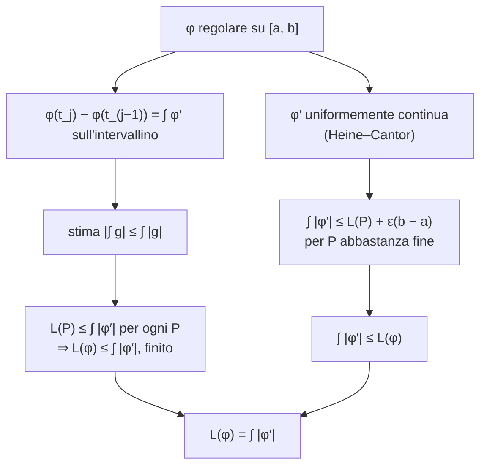

---

## corso: "Metodi Matematici per l'Ingegneria" lezione: 8 data: 2026-10-16 docente: Nicola Pinamonti argomenti: [curve in Rn, parametrizzazione e sostegno, curve chiuse, curve semplici, curve regolari, vettore e versore tangente, riparametrizzazione, integrale di funzioni a valori vettoriali, lunghezza di una curva, curve rettificabili] fonti: [trascrizione, appunti manuali, note del docente] tags: [metodi-matematici, lezione]
---
# Lezione 8 — Curve in $\mathbb{R}^n$ e lunghezza di una curva

Con questa lezione inizia la seconda grande parte del calcolo per funzioni di più variabili: l'**integrazione**. Il primo passo sono le curve, che descrivono oggetti unidimensionali che si sviluppano nello spazio $\mathbb{R}^n$. Una curva viene descritta da una funzione di una variabile reale a valori in $\mathbb{R}^n$, che dice come la si percorre al variare di un parametro. Si definiscono le curve chiuse, semplici e regolari, il vettore tangente e la riparametrizzazione. Per misurare la lunghezza di una curva serve poi l'integrale di funzioni a valori vettoriali, per il quale si dimostra la stima $\big|\int g\big| \leq \int |g|$. La lezione si chiude con la definizione di lunghezza tramite le poligonali inscritte e con il teorema che, per le curve regolari, la riduce a un integrale.

> [!note] Fonti di questa lezione La trascrizione disponibile (parte 1) si interrompe durante la dimostrazione del teorema sulla lunghezza delle curve regolari: il docente enuncia a parole l'idea della seconda metà e rimanda i dettagli alla lezione successiva. Quella parte è ricostruita dalle note del docente ed è delimitata come tale. Enunciati e dimostrazioni seguono le note del docente nella versione del 12 ottobre 2026 [@pinamonti2026, §2.1.1–§2.1.2] e gli appunti manuali della lezione. Le figure sono costruite per rappresentare ciò che il docente disegna alla lavagna.

## Curve in $\mathbb{R}^n$

### Una curva come funzione

Una curva disegnata nello spazio $\mathbb{R}^n$ può essere un oggetto molto complicato, un "arzigogolo" con avvolgimenti e incroci. Il punto di vista adottato per descriverla in modo semplice è il seguente: invece della curva come insieme di punti, si considera una **funzione che dice come la si percorre** al variare di un parametro. Si pensi al parametro come al tempo: a ogni istante $t$ corrisponde un punto $\varphi(t)$ della curva, e facendo scorrere il tempo il punto percorre la curva.

Più precisamente, si considera una funzione $$\varphi : [a, b] \subseteq \mathbb{R} \to \mathbb{R}^n, \qquad t \mapsto \varphi(t) \in \mathbb{R}^n .$$ Fissato un sistema di assi $\mathbf{e}_1, \dots, \mathbf{e}_n$, il vettore $\varphi(t)$ è descritto dalle sue componenti, cioè dalle sue proiezioni sui vari assi: $$\varphi(t) = \big(\varphi_1(t), \dots, \varphi_n(t)\big) = \sum_{i=1}^{n} \varphi_i(t), \mathbf{e}_i .$$ Ogni componente $\varphi_i : [a, b] \to \mathbb{R}$ è una funzione reale di una variabile reale: quello che conta sono solo le componenti. La curva "vera", l'arzigogolo disegnato nello spazio, è l'**immagine** (o **rango**) della funzione, che si chiama **sostegno** della curva.

<svg viewBox="0 0 560 300" width="560" style="display:block;margin:1em auto;max-width:100%;height:auto;font-family:inherit" xmlns="http://www.w3.org/2000/svg"><polyline points="60,250 61.9,249.2 63.7,248.3 65.6,247.5 67.4,246.6 69.2,245.7 71,244.8 72.8,243.9 74.6,243 76.4,242 78.2,241.1 80,240.1 81.7,239.1 83.5,238.1 85.2,237.1 86.9,236 88.6,235 90.3,233.9 92,232.8 93.7,231.7 95.3,230.6 97,229.5 98.6,228.3 100.2,227.2 101.8,226 103.4,224.8 105,223.6 106.6,222.4 108.1,221.2 109.7,219.9 111.2,218.7 112.7,217.4 114.2,216.2 115.7,214.9 117.1,213.6 118.6,212.3 120,211 121.4,209.7 122.8,208.3 124.2,207 125.6,205.6 126.9,204.3 128.3,202.9 129.6,201.5 130.9,200.1 132.2,198.7 133.5,197.3 134.7,195.9 135.9,194.5 137.2,193 138.3,191.6 139.5,190.2 140.7,188.7 141.8,187.3 143,185.8 144.1,184.3 145.2,182.8 146.2,181.4 147.3,179.9 148.3,178.4 149.4,176.9 150.4,175.4 151.3,173.9 152.3,172.4 153.2,170.9 154.2,169.4 155.1,167.8 156,166.3 156.8,164.8 157.7,163.3 158.5,161.8 159.3,160.2 160.1,158.7 160.9,157.2 161.7,155.6 162.4,154.1 163.1,152.6 163.8,151.1 164.5,149.5 165.2,148 165.8,146.5 166.4,144.9 167,143.4 167.6,141.9 168.2,140.4 168.7,138.9 169.3,137.3 169.8,135.8 170.3,134.3 170.7,132.8 171.2,131.3 171.6,129.8 172,128.3 172.4,126.8 172.8,125.4 173.2,123.9 173.5,122.4 173.9,121 174.2,119.5 174.5,118 174.7,116.6 175,115.2 175.2,113.7 175.5,112.3 175.7,110.9 175.9,109.5 176,108.1 176.2,106.7 176.3,105.3 176.4,103.9 176.5,102.6 176.6,101.2 176.7,99.9 176.8,98.5 176.8,97.2 176.8,95.9 176.8,94.6 176.8,93.3 176.8,92 176.8,90.7 176.7,89.5 176.6,88.2 176.5,87 176.4,85.8 176.3,84.6 176.2,83.4 176.1,82.2 175.9,81 175.8,79.8 175.6,78.7 175.4,77.6 175.2,76.4 175,75.3 174.7,74.3 174.5,73.2 174.2,72.1 174,71.1 173.7,70 173.4,69 173.1,68 172.8,67 172.5,66.1 172.1,65.1 171.8,64.2 171.4,63.3 171.1,62.4 170.7,61.5 170.3,60.6 169.9,59.7 169.5,58.9 169.1,58.1 168.7,57.3 168.3,56.5 167.9,55.7 167.4,55 167,54.2 166.5,53.5 166.1,52.8 165.6,52.1 165.1,51.5 164.7,50.8 164.2,50.2 163.7,49.6 163.2,49 162.7,48.4 162.2,47.9 161.7,47.4 161.2,46.8 160.7,46.3 160.2,45.9 159.7,45.4 159.1,45 158.6,44.5 158.1,44.1 157.6,43.7 157,43.4 156.5,43 156,42.7 155.4,42.4 154.9,42.1 154.4,41.8 153.8,41.6 153.3,41.3 152.8,41.1 152.2,40.9 151.7,40.8 151.2,40.6 150.7,40.5 150.1,40.3 149.6,40.2 149.1,40.1 148.6,40.1 148.1,40 147.6,40 147.1,40 146.6,40 146.1,40 145.6,40.1 145.1,40.1 144.6,40.2 144.1,40.3 143.7,40.5 143.2,40.6 142.7,40.7 142.3,40.9 141.8,41.1 141.4,41.3 141,41.5 140.5,41.8 140.1,42 139.7,42.3 139.3,42.6 138.9,42.9 138.5,43.2 138.2,43.6 137.8,44 137.5,44.3 137.1,44.7 136.8,45.1 136.5,45.6 136.2,46 135.8,46.5 135.6,46.9 135.3,47.4 135,47.9 134.8,48.4 134.5,49 134.3,49.5 134.1,50.1 133.9,50.6 133.7,51.2 133.5,51.8 133.3,52.4 133.2,53.1 133,53.7 132.9,54.4 132.8,55 132.7,55.7 132.6,56.4 132.5,57.1 132.5,57.8 132.4,58.6 132.4,59.3 132.4,60 132.4,60.8 132.4,61.6 132.5,62.4 132.5,63.2 132.6,64 132.7,64.8 132.8,65.6 132.9,66.4 133,67.3 133.2,68.1 133.3,69 133.5,69.8 133.7,70.7 134,71.6 134.2,72.5 134.5,73.4 134.7,74.3 135,75.2 135.3,76.1 135.6,77 136,78 136.4,78.9 136.7,79.8 137.1,80.8 137.5,81.7 138,82.7 138.4,83.6 138.9,84.6 139.4,85.6 139.9,86.5 140.4,87.5 141,88.5 141.6,89.4 142.1,90.4 142.7,91.4 143.4,92.4 144,93.4 144.7,94.4 145.3,95.4 146,96.3 146.8,97.3 147.5,98.3 148.2,99.3 149,100.3 149.8,101.3 150.6,102.3 151.5,103.2 152.3,104.2 153.2,105.2 154.1,106.2 155,107.2 155.9,108.1 156.8,109.1 157.8,110.1 158.8,111 159.8,112 160.8,112.9 161.8,113.9 162.9,114.8 163.9,115.8 165,116.7 166.1,117.6 167.3,118.5 168.4,119.5 169.6,120.4 170.8,121.3 171.9,122.2 173.2,123.1 174.4,123.9 175.6,124.8 176.9,125.7 178.2,126.5 179.5,127.4 180.8,128.2 182.1,129.1 183.5,129.9 184.9,130.7 186.2,131.5 187.6,132.3 189.1,133.1 190.5,133.8 191.9,134.6 193.4,135.4 194.9,136.1 196.4,136.8 197.9,137.5 199.4,138.2 200.9,138.9 202.5,139.6 204,140.3 205.6,140.9 207.2,141.6 208.8,142.2 210.4,142.8 212.1,143.4 213.7,144 215.4,144.6 217,145.2 218.7,145.7 220.4,146.2 222.1,146.7 223.9,147.2 225.6,147.7 227.3,148.2 229.1,148.7 230.8,149.1 232.6,149.5 234.4,149.9 236.2,150.3 238,150.7 239.8,151.1 241.6,151.4 243.5,151.7 245.3,152.1 247.2,152.3 249,152.6 250.9,152.9 252.8,153.1 254.7,153.3 256.5,153.6 258.4,153.7 260.3,153.9 262.3,154.1 264.2,154.2 266.1,154.3 268,154.4 270,154.5 271.9,154.6 273.8,154.6 275.8,154.7 277.7,154.7 279.7,154.7 281.7,154.6 283.6,154.6 285.6,154.5 287.6,154.4 289.5,154.3 291.5,154.2 293.5,154.1 295.5,153.9 297.5,153.7 299.4,153.5 301.4,153.3 303.4,153.1 305.4,152.8 307.4,152.6 309.4,152.3 311.3,152 313.3,151.6 315.3,151.3 317.3,150.9 319.3,150.5 321.2,150.1 323.2,149.7 325.2,149.3 327.2,148.8" fill="none" stroke="currentColor" stroke-width="2.2" stroke-opacity="1.0"/><circle cx="172.7" cy="122.3" r="9" fill="none" stroke="#e05a47" stroke-width="1.6"/><text x="194.7" y="186.3" font-size="12" text-anchor="start" fill="#e05a47">nodo: φ(t₁) = φ(t₂), t₁ ≠ t₂</text><circle cx="60" cy="250" r="4.5" fill="currentColor"/><text x="52" y="254" font-size="13" text-anchor="end" fill="currentColor" font-style="italic">φ(a)</text><circle cx="327.2" cy="148.8" r="4.5" fill="currentColor"/><text x="335.2" y="152.8" font-size="13" text-anchor="start" fill="currentColor" font-style="italic">φ(b)</text><circle cx="199.4" cy="138.2" r="4.5" fill="#3b82f6"/><text x="209.4" y="132.2" font-size="13" text-anchor="start" fill="#3b82f6" font-style="italic">φ(t)</text><polygon points="129.6,201.5 127.1,210.2 121,204.3" fill="currentColor"/><polygon points="142.7,40.7 149.2,34.4 151.5,42.5" fill="currentColor"/><polygon points="154.1,106.2 145.6,103 151.9,97.4" fill="currentColor"/><text x="280" y="290" font-size="11" text-anchor="middle" fill="currentColor">sostegno della curva: l'immagine φ([a, b]) ⊂ ℝⁿ, percorsa nel verso indicato dalle frecce</text></svg>

> [!important] Definizione — Curva, parametrizzazione, sostegno Una **curva** in $\mathbb{R}^n$ è descritta da una funzione continua $$\varphi : I = [a, b] \subseteq \mathbb{R} \to \mathbb{R}^n .$$ La funzione $\varphi$ si chiama **parametrizzazione** della curva, le funzioni $\varphi_i$ ne sono le **componenti**, e l'immagine $$\gamma = \varphi(I) = { \varphi(t) : t \in [a, b] } \subseteq \mathbb{R}^n$$ si chiama **sostegno** della curva.
> 
> [@pinamonti2026, Def. 2.1.1]

> [!note] Curva come funzione o curva come insieme A lezione il docente chiama "curva" la funzione $\varphi$ stessa; nelle note del docente la curva è invece l'insieme $\gamma = \varphi(I)$, e $\varphi$ è "una" parametrizzazione che la descrive. Le due cose vanno tenute distinte: lo stesso sostegno può essere percorso da parametrizzazioni diverse, ad esempio più velocemente o nel verso opposto, come si vedrà parlando di riparametrizzazione. Le note richiedono inoltre esplicitamente che $\varphi$ sia continua.

### Tre esempi

**Il cerchio.** Nel piano $\mathbb{R}^2$ si considera il cerchio di raggio $R$ centrato nell'origine. Il modo più semplice di descriverlo è usare come parametro l'angolo $\theta$ che il raggio forma con l'asse $\mathbf{e}_1$: proiettando sui due assi il vettore di lunghezza $R$ si ottiene $$\varphi : [0, 2\pi] \to \mathbb{R}^2, \qquad \varphi(\theta) = (R\cos\theta,, R\sin\theta) = R\cos\theta, \mathbf{e}_1 + R\sin\theta, \mathbf{e}_2 .$$ La variabile è $\theta$, mentre $R$ è un parametro fissato. Per $\theta = 0$ ci si trova nel punto $(R, 0)$, per $\theta = \pi/2$ nel punto $(0, R)$, e così via.

**Il grafico di una funzione.** Data $g : [a, b] \to \mathbb{R}$, si considera $$\varphi(t) = \big(t,, g(t)\big), \qquad t \in [a, b],$$ il cui sostegno è il grafico di $g$. Ad esempio, con $[a, b] = [-1, 1]$ e $g(t) = t^2$ si ottiene l'arco di parabola $y = x^2$ tra $-1$ e $1$. Qui la prima componente coincide con il parametro: una curva parametrizzata in questo modo si chiama **cartesiana**, e la relazione $x_2 = g(x_1)$ tra le componenti si chiama **equazione cartesiana** della curva [@pinamonti2026, §2.1.1].

**L'elica.** In $\mathbb{R}^3$ si costruisce un'elica di raggio $R$ e passo $a$ che si sviluppa lungo l'asse $\mathbf{e}_3$: $$\varphi(t) = \Big(R\cos t,; R\sin t,; \frac{a,t}{2\pi}\Big).$$ Le prime due componenti percorrono un cerchio di raggio $R$; la terza non è fissata a zero, ma cresce nel tempo, in modo che quando il parametro aumenta di $2\pi$ si torna allo stesso punto nelle prime due componenti ma ci si è alzati di un passo $a$ lungo l'asse $\mathbf{e}_3$. Per $t = 0$ si parte da $(R, 0, 0)$; per $t = 2\pi$ ci si trova in $(R, 0, a)$.

<svg viewBox="0 0 660 270" width="660" style="display:block;margin:1em auto;max-width:100%;height:auto;font-family:inherit" xmlns="http://www.w3.org/2000/svg"><line x1="15" y1="130" x2="210" y2="130" stroke="currentColor" stroke-width="1.0"/><polygon points="210,130 203.8,133.3 203.8,126.7" fill="currentColor"/><line x1="110" y1="225" x2="110" y2="30" stroke="currentColor" stroke-width="1.0"/><polygon points="110,30 113.3,36.2 106.7,36.2" fill="currentColor"/><text x="210" y="146" font-size="12" text-anchor="end" fill="currentColor">e₁</text><text x="117" y="38" font-size="12" text-anchor="start" fill="currentColor">e₂</text><polyline points="180,130 179.9,126.3 179.6,122.6 179.1,119 178.4,115.3 177.6,111.7 176.5,108.2 175.3,104.7 173.8,101.3 172.2,98 170.5,94.7 168.5,91.6 166.4,88.6 164.1,85.6 161.7,82.8 159.2,80.2 156.5,77.7 153.6,75.3 150.7,73 147.6,71 144.5,69.1 141.2,67.3 137.9,65.8 134.4,64.4 130.9,63.2 127.4,62.2 123.8,61.4 120.1,60.7 116.5,60.3 112.8,60.1 109.1,60 105.4,60.2 101.7,60.5 98,61 94.4,61.8 90.8,62.7 87.3,63.8 83.9,65.1 80.5,66.5 77.2,68.2 73.9,70 70.8,72 67.8,74.1 64.9,76.4 62.2,78.9 59.5,81.5 57,84.2 54.7,87.1 52.5,90.1 50.5,93.1 48.6,96.3 46.9,99.6 45.4,103 44.1,106.4 42.9,110 42,113.5 41.2,117.1 40.6,120.8 40.2,124.5 40,128.2 40,131.8 40.2,135.5 40.6,139.2 41.2,142.9 42,146.5 42.9,150 44.1,153.6 45.4,157 46.9,160.4 48.6,163.7 50.5,166.9 52.5,169.9 54.7,172.9 57,175.8 59.5,178.5 62.2,181.1 64.9,183.6 67.8,185.9 70.8,188 73.9,190 77.2,191.8 80.5,193.5 83.9,194.9 87.3,196.2 90.8,197.3 94.4,198.2 98,199 101.7,199.5 105.4,199.8 109.1,200 112.8,199.9 116.5,199.7 120.1,199.3 123.8,198.6 127.4,197.8 130.9,196.8 134.4,195.6 137.9,194.2 141.2,192.7 144.5,190.9 147.6,189 150.7,187 153.6,184.7 156.5,182.3 159.2,179.8 161.7,177.2 164.1,174.4 166.4,171.4 168.5,168.4 170.5,165.3 172.2,162 173.8,158.7 175.3,155.3 176.5,151.8 177.6,148.3 178.4,144.7 179.1,141 179.6,137.4 179.9,133.7 180,130" fill="none" stroke="#3b82f6" stroke-width="2.2" stroke-opacity="1.0"/><line x1="110" y1="130" x2="163.5" y2="84.9" stroke="currentColor" stroke-width="1.2"/><polyline points="132,130 132,129.2 131.9,128.4 131.9,127.6 131.8,126.8 131.6,126 131.5,125.2 131.3,124.4 131.1,123.6 130.8,122.8 130.5,122.1 130.2,121.3 129.9,120.6 129.5,119.9 129.1,119.1 128.7,118.5 128.3,117.8 127.8,117.1 127.3,116.5 126.8,115.8" fill="none" stroke="currentColor" stroke-width="1.0" stroke-opacity="1.0"/><text x="138" y="124" font-size="12" text-anchor="start" fill="currentColor" font-style="italic">θ</text><circle cx="163.5" cy="84.9" r="4" fill="currentColor"/><text x="171.5" y="78.9" font-size="12" text-anchor="start" fill="currentColor" font-style="italic">φ(θ)</text><text x="110" y="258" font-size="11.5" text-anchor="middle" fill="currentColor">cerchio: (R cos θ, R sin θ)</text><line x1="235" y1="175" x2="430" y2="175" stroke="currentColor" stroke-width="1.0"/><polygon points="430,175 423.8,178.3 423.8,171.7" fill="currentColor"/><line x1="330" y1="200" x2="330" y2="35" stroke="currentColor" stroke-width="1.0"/><polygon points="330,35 333.3,41.2 326.7,41.2" fill="currentColor"/><text x="430" y="191" font-size="12" text-anchor="end" fill="currentColor">e₁</text><text x="337" y="43" font-size="12" text-anchor="start" fill="currentColor">e₂</text><polyline points="260,105 261.8,108.5 263.5,111.9 265.3,115.2 267.1,118.5 268.9,121.6 270.6,124.7 272.4,127.6 274.2,130.5 275.9,133.3 277.7,136 279.5,138.6 281.3,141.1 283,143.5 284.8,145.8 286.6,148.1 288.4,150.2 290.1,152.3 291.9,154.3 293.7,156.1 295.4,157.9 297.2,159.6 299,161.3 300.8,162.8 302.5,164.2 304.3,165.6 306.1,166.8 307.8,168 309.6,169.1 311.4,170.1 313.2,171 314.9,171.8 316.7,172.5 318.5,173.1 320.3,173.6 322,174.1 323.8,174.5 325.6,174.7 327.3,174.9 329.1,175 330.9,175 332.7,174.9 334.4,174.7 336.2,174.5 338,174.1 339.7,173.6 341.5,173.1 343.3,172.5 345.1,171.8 346.8,171 348.6,170.1 350.4,169.1 352.2,168 353.9,166.8 355.7,165.6 357.5,164.2 359.2,162.8 361,161.3 362.8,159.6 364.6,157.9 366.3,156.1 368.1,154.3 369.9,152.3 371.6,150.2 373.4,148.1 375.2,145.8 377,143.5 378.7,141.1 380.5,138.6 382.3,136 384.1,133.3 385.8,130.5 387.6,127.6 389.4,124.7 391.1,121.6 392.9,118.5 394.7,115.2 396.5,111.9 398.2,108.5 400,105" fill="none" stroke="#3b82f6" stroke-width="2.2" stroke-opacity="1.0"/><line x1="260" y1="171" x2="260" y2="179" stroke="currentColor"/><text x="260" y="193" font-size="11" text-anchor="middle" fill="currentColor">−1</text><line x1="400" y1="171" x2="400" y2="179" stroke="currentColor"/><text x="400" y="193" font-size="11" text-anchor="middle" fill="currentColor">1</text><circle cx="372" cy="149.8" r="4" fill="currentColor"/><text x="380" y="163.8" font-size="12" text-anchor="start" fill="currentColor">(t, t²)</text><text x="330" y="258" font-size="11.5" text-anchor="middle" fill="currentColor">grafico: (t, t²), t ∈ [−1, 1]</text><line x1="560" y1="200" x2="625.5" y2="217" stroke="currentColor" stroke-width="1.0"/><polygon points="625.5,217 618.7,218.6 620.3,212.3" fill="currentColor"/><text x="629.5" y="221" font-size="12" text-anchor="start" fill="currentColor">e₁</text><line x1="560" y1="200" x2="629.4" y2="174.4" stroke="currentColor" stroke-width="1.0"/><polygon points="629.4,174.4 624.8,179.7 622.5,173.5" fill="currentColor"/><text x="633.4" y="178.4" font-size="12" text-anchor="start" fill="currentColor">e₂</text><line x1="560" y1="200" x2="560" y2="45.9" stroke="currentColor" stroke-width="1.0"/><polygon points="560,45.9 563.3,52.1 556.7,52.1" fill="currentColor"/><text x="564" y="49.9" font-size="12" text-anchor="start" fill="currentColor">e₃</text><polyline points="594.5,208.9 595.8,208.1 597,207.3 598.2,206.4 599.3,205.5 600.3,204.6 601.2,203.7 602,202.7 602.7,201.8 603.3,200.9 603.9,199.9 604.3,198.9 604.6,198 604.8,197 605,196 605,195 604.9,194 604.8,193.1 604.5,192.1 604.1,191.1 603.6,190.2 603.1,189.2 602.4,188.3 601.6,187.3 600.8,186.4 599.9,185.5 598.8,184.6 597.7,183.7 596.5,182.9 595.2,182 593.9,181.2 592.4,180.4 590.9,179.6 589.3,178.8 587.7,178.1 586,177.4 584.2,176.7 582.4,176 580.5,175.4 578.6,174.8 576.7,174.2 574.7,173.7 572.6,173.1 570.6,172.6 568.5,172.2 566.4,171.8 564.3,171.4 562.2,171 560.1,170.6 557.9,170.3 555.8,170.1 553.7,169.8 551.6,169.6 549.5,169.4 547.5,169.3 545.4,169.1 543.4,169 541.5,169 539.6,168.9 537.7,168.9 535.9,169 534.1,169 532.4,169.1 530.8,169.2 529.2,169.3 527.7,169.4 526.2,169.6 524.9,169.8 523.6,170 522.4,170.2 521.2,170.4 520.2,170.7 519.3,170.9 518.4,171.2 517.6,171.5 517,171.8 516.4,172.1 515.9,172.4 515.5,172.8 515.3,173.1 515.1,173.4 515,173.8 515,174.1 515.1,174.4 515.4,174.8 515.7,175.1 516.1,175.4 516.6,175.7 517.3,176 518,176.3 518.8,176.6 519.7,176.9 520.7,177.1 521.7,177.4 522.9,177.6 524.1,177.8 525.5,178 526.9,178.2 528.3,178.3 529.9,178.5 531.5,178.6 533.2,178.7 534.9,178.7 536.7,178.8 538.5,178.8 540.4,178.7 542.4,178.7 544.3,178.6 546.3,178.5 548.4,178.4 550.4,178.2 552.5,178 554.6,177.8 556.8,177.5 558.9,177.2 561,176.9 563.1,176.5 565.2,176.2 567.3,175.7 569.4,175.3 571.5,174.8 573.5,174.3 575.6,173.8 577.5,173.2 579.5,172.6 581.4,172 583.2,171.4 585,170.7 586.7,170 588.4,169.3 590,168.5 591.6,167.7 593.1,167 594.5,166.1 595.8,165.3 597,164.5 598.2,163.6 599.3,162.7 600.3,161.8 601.2,160.9 602,159.9 602.7,159 603.3,158.1 603.9,157.1 604.3,156.1 604.6,155.2 604.8,154.2 605,153.2 605,152.2 604.9,151.3 604.8,150.3 604.5,149.3 604.1,148.3 603.6,147.4 603.1,146.4 602.4,145.5 601.6,144.5 600.8,143.6 599.9,142.7 598.8,141.8 597.7,140.9 596.5,140.1 595.2,139.2 593.9,138.4 592.4,137.6 590.9,136.8 589.3,136 587.7,135.3 586,134.6 584.2,133.9 582.4,133.2 580.5,132.6 578.6,132 576.7,131.4 574.7,130.9 572.6,130.3 570.6,129.9 568.5,129.4 566.4,129 564.3,128.6 562.2,128.2 560.1,127.9 557.9,127.5 555.8,127.3 553.7,127 551.6,126.8 549.5,126.6 547.5,126.5 545.4,126.3 543.4,126.3 541.5,126.2 539.6,126.1 537.7,126.1 535.9,126.2 534.1,126.2 532.4,126.3 530.8,126.4 529.2,126.5 527.7,126.6 526.2,126.8 524.9,127 523.6,127.2 522.4,127.4 521.2,127.6 520.2,127.9 519.3,128.1 518.4,128.4 517.6,128.7 517,129 516.4,129.3 515.9,129.6 515.5,130 515.3,130.3 515.1,130.6 515,131 515,131.3 515.1,131.6 515.4,132 515.7,132.3 516.1,132.6 516.6,132.9 517.3,133.2 518,133.5 518.8,133.8 519.7,134.1 520.7,134.3 521.7,134.6 522.9,134.8 524.1,135 525.5,135.2 526.9,135.4 528.3,135.5 529.9,135.7 531.5,135.8 533.2,135.9 534.9,135.9 536.7,136 538.5,136 540.4,135.9 542.4,135.9 544.3,135.8 546.3,135.7 548.4,135.6 550.4,135.4 552.5,135.2 554.6,135 556.8,134.7 558.9,134.4 561,134.1 563.1,133.7 565.2,133.4 567.3,133 569.4,132.5 571.5,132 573.5,131.5 575.6,131 577.5,130.4 579.5,129.8 581.4,129.2 583.2,128.6 585,127.9 586.7,127.2 588.4,126.5 590,125.7 591.6,125 593.1,124.2 594.5,123.3 595.8,122.5 597,121.7 598.2,120.8 599.3,119.9 600.3,119 601.2,118.1 602,117.1 602.7,116.2 603.3,115.3 603.9,114.3 604.3,113.3 604.6,112.4 604.8,111.4 605,110.4 605,109.4 604.9,108.5 604.8,107.5 604.5,106.5 604.1,105.5 603.6,104.6 603.1,103.6 602.4,102.7 601.6,101.7 600.8,100.8 599.9,99.9 598.8,99 597.7,98.1 596.5,97.3 595.2,96.4 593.9,95.6 592.4,94.8 590.9,94 589.3,93.2 587.7,92.5 586,91.8 584.2,91.1 582.4,90.4 580.5,89.8 578.6,89.2 576.7,88.6 574.7,88.1 572.6,87.5 570.6,87.1 568.5,86.6 566.4,86.2 564.3,85.8 562.2,85.4 560.1,85.1 557.9,84.7 555.8,84.5 553.7,84.2 551.6,84 549.5,83.8 547.5,83.7 545.4,83.5 543.4,83.5 541.5,83.4 539.6,83.4 537.7,83.3 535.9,83.4 534.1,83.4 532.4,83.5 530.8,83.6 529.2,83.7 527.7,83.8 526.2,84 524.9,84.2 523.6,84.4 522.4,84.6 521.2,84.8 520.2,85.1 519.3,85.3 518.4,85.6 517.6,85.9 517,86.2 516.4,86.5 515.9,86.8 515.5,87.2 515.3,87.5 515.1,87.8 515,88.2 515,88.5 515.1,88.8 515.4,89.2 515.7,89.5 516.1,89.8 516.6,90.1 517.3,90.4 518,90.7 518.8,91 519.7,91.3 520.7,91.5 521.7,91.8 522.9,92 524.1,92.2 525.5,92.4 526.9,92.6 528.3,92.7 529.9,92.9 531.5,93 533.2,93.1 534.9,93.1 536.7,93.2 538.5,93.2 540.4,93.1 542.4,93.1 544.3,93 546.3,92.9 548.4,92.8 550.4,92.6 552.5,92.4 554.6,92.2 556.8,91.9 558.9,91.6 561,91.3 563.1,90.9 565.2,90.6 567.3,90.2 569.4,89.7 571.5,89.2 573.5,88.7 575.6,88.2 577.5,87.6 579.5,87 581.4,86.4 583.2,85.8 585,85.1 586.7,84.4 588.4,83.7 590,82.9 591.6,82.2 593.1,81.4 594.5,80.5" fill="none" stroke="#3b82f6" stroke-width="2.0" stroke-opacity="1.0"/><line x1="525.5" y1="169.7" x2="525.5" y2="126.9" stroke="#e05a47" stroke-width="1.8"/><text x="517.5" y="152.3" font-size="11" text-anchor="end" fill="#e05a47">passo a</text><text x="560" y="258" font-size="11.5" text-anchor="middle" fill="currentColor">elica: (R cos t, R sin t, at/2π)</text></svg>

### Curve chiuse, semplici e regolari

> [!important] Definizione — Curve chiuse, semplici, regolari Sia $\varphi : I = [a, b] \to \mathbb{R}^n$ una curva.
> 
> - $\varphi$ è **chiusa** se $\varphi(a) = \varphi(b)$: il punto di arrivo coincide con il punto di partenza.
> - $\varphi$ è **semplice** se non ha **nodi**, cioè se non esistono due valori distinti del parametro in cui la curva passa per lo stesso punto: per ogni $t_1, t_2 \in I$ con $t_1 \neq t_2$ vale $\varphi(t_1) \neq \varphi(t_2)$. In altre parole, la curva è semplice se $\varphi$ è **iniettiva**.
> - $\varphi$ è **regolare** se
>     1. $\varphi$ è di classe $C^1$ su $I$;
>     2. $\varphi'(t) \neq \mathbf{0}$ per ogni $t \in I$.In questo caso si dice anche che la curva ammette una parametrizzazione regolare.
> 
> [@pinamonti2026, Def. 2.1.1]

Il cerchio dell'esempio è chiuso: in $\theta = 0$ e in $\theta = 2\pi$ il punto è lo stesso. L'arco di parabola non è chiuso, perché i punti $(-1, 1)$ e $(1, 1)$ sono diversi; nemmeno l'elica lo è, perché la terza componente continua a crescere.

La condizione che interessa di più, e che verrà usata quasi sempre, è la regolarità. Il docente la descrive come la richiesta di curve "armoniose", senza angoli spigolosi e percorse "senza scossoni":

- la prima condizione permette di calcolare la derivata rispetto al parametro, che sarà il vettore tangente, e chiede che anche questa vari con continuità;
- la seconda dice che, mentre il parametro cresce, il punto che percorre la curva **non si ferma mai**; e quindi non può nemmeno tornare indietro.

> [!note] Curve chiuse e semplici Prese alla lettera, le due definizioni sono incompatibili: se $\varphi(a) = \varphi(b)$ con $a \neq b$, la funzione non è iniettiva su $[a, b]$. Per una curva chiusa si chiede quindi che l'unico "nodo" ammesso sia quello tra i due estremi, cioè che $\varphi$ sia iniettiva su $[a, b)$. In questo senso il cerchio $\varphi(\theta) = (R\cos\theta, R\sin\theta)$, $\theta \in [0, 2\pi]$, è una curva chiusa e semplice.

> [!tip] Approfondimento — Una curva $C^1$ non regolare #approfondimento La condizione $\varphi' \neq \mathbf{0}$ non è un dettaglio tecnico. La curva $\varphi(t) = (t^3, t^2)$, $t \in [-1, 1]$, ha componenti polinomiali, quindi di classe $C^1$ (anzi $C^\infty$), ma $\varphi'(t) = (3t^2, 2t)$ si annulla per $t = 0$. Il suo sostegno è l'insieme $y = |x|^{2/3}$, che nell'origine ha una **cuspide**, cioè una punta: il punto che percorre la curva rallenta fino a fermarsi in $t = 0$, e lì la direzione di moto cambia bruscamente da "verso il basso a destra" a "verso l'alto a destra". È proprio uno degli angoli spigolosi che la regolarità esclude.

### Il vettore tangente

Sia $\varphi$ una curva regolare e sia $t_0$ un istante fissato. Si confronta il punto $\varphi(t)$ con il punto $\varphi(t_0)$: la differenza $\varphi(t) - \varphi(t_0)$ è il vettore che va da $\varphi(t_0)$ a $\varphi(t)$, cioè una corda della curva. Man mano che $t$ si avvicina a $t_0$ il vettore cambia direzione e tende a disporsi lungo la curva. Per evitare che la sua lunghezza vada a zero lo si divide per $t - t_0$. Poiché $\varphi$ è differenziabile (in una variabile il differenziale è descritto dalla sola derivata), $$\varphi(t) - \varphi(t_0) = \varphi'(t_0),(t - t_0) + o(t - t_0),$$ e quindi $$\frac{\varphi(t) - \varphi(t_0)}{t - t_0} = \varphi'(t_0) + \frac{o(t - t_0)}{t - t_0} \ \xrightarrow[t \to t_0]{}\ \varphi'(t_0) .$$ Il limite $\varphi'(t_0)$, che per la regolarità non è mai nullo, è un **vettore tangente** alla curva nel punto $\varphi(t_0)$. La retta ${\varphi(t_0) + \alpha, \varphi'(t_0) : \alpha \in \mathbb{R}}$ è la **retta tangente** [@pinamonti2026, §2.1.1].

<svg viewBox="0 0 520 190" width="520" style="display:block;margin:1em auto;max-width:100%;height:auto;font-family:inherit" xmlns="http://www.w3.org/2000/svg"><polyline points="22,105.9 24.2,107.8 26.4,109.6 28.6,111.4 30.9,113.2 33.1,114.9 35.3,116.6 37.5,118.2 39.7,119.8 41.9,121.4 44.2,122.9 46.4,124.4 48.6,125.8 50.8,127.2 53,128.5 55.2,129.8 57.5,131 59.7,132.2 61.9,133.4 64.1,134.4 66.3,135.5 68.5,136.5 70.8,137.4 73,138.3 75.2,139.1 77.4,139.9 79.6,140.6 81.8,141.3 84.1,141.9 86.3,142.5 88.5,143 90.7,143.4 92.9,143.8 95.1,144.2 97.3,144.5 99.6,144.7 101.8,144.9 104,145.1 106.2,145.1 108.4,145.2 110.6,145.2 112.9,145.1 115.1,145 117.3,144.8 119.5,144.6 121.7,144.4 123.9,144.1 126.2,143.7 128.4,143.3 130.6,142.9 132.8,142.4 135,141.9 137.2,141.3 139.5,140.7 141.7,140 143.9,139.3 146.1,138.6 148.3,137.8 150.5,137 152.7,136.2 155,135.3 157.2,134.4 159.4,133.5 161.6,132.5 163.8,131.5 166,130.5 168.3,129.4 170.5,128.3 172.7,127.2 174.9,126.1 177.1,125 179.3,123.8 181.6,122.6 183.8,121.4 186,120.2 188.2,119 190.4,117.8 192.6,116.5 194.9,115.3 197.1,114 199.3,112.7 201.5,111.4 203.7,110.2 205.9,108.9 208.2,107.6 210.4,106.3 212.6,105 214.8,103.7 217,102.5 219.2,101.2 221.4,99.9 223.7,98.7 225.9,97.4 228.1,96.2 230.3,95 232.5,93.7 234.7,92.6 237,91.4 239.2,90.2 241.4,89.1 243.6,87.9 245.8,86.8 248,85.7 250.3,84.7 252.5,83.6 254.7,82.6 256.9,81.6 259.1,80.6 261.3,79.7 263.6,78.7 265.8,77.8 268,77 270.2,76.1 272.4,75.3 274.6,74.5 276.8,73.7 279.1,73 281.3,72.3 283.5,71.7 285.7,71 287.9,70.4 290.1,69.8 292.4,69.3 294.6,68.8 296.8,68.3 299,67.8 301.2,67.4 303.4,67 305.7,66.6 307.9,66.3 310.1,66 312.3,65.7 314.5,65.5 316.7,65.3 319,65.1 321.2,64.9 323.4,64.8 325.6,64.7 327.8,64.6 330,64.5 332.3,64.5 334.5,64.5 336.7,64.5 338.9,64.5 341.1,64.6 343.3,64.6 345.5,64.7 347.8,64.8 350,65 352.2,65.1 354.4,65.3 356.6,65.4 358.8,65.6 361.1,65.8 363.3,66 365.5,66.2 367.7,66.5 369.9,66.7 372.1,66.9 374.4,67.2 376.6,67.4 378.8,67.6 381,67.9 383.2,68.1 385.4,68.4 387.7,68.6 389.9,68.8 392.1,69 394.3,69.3 396.5,69.5 398.7,69.6 400.9,69.8 403.2,70 405.4,70.1 407.6,70.3 409.8,70.4 412,70.5 414.2,70.5 416.5,70.6 418.7,70.6 420.9,70.6 423.1,70.6 425.3,70.5 427.5,70.4 429.8,70.3 432,70.2 434.2,70 436.4,69.8 438.6,69.5 440.8,69.2 443.1,68.9 445.3,68.5 447.5,68.1 449.7,67.7 451.9,67.2 454.1,66.7 456.4,66.1 458.6,65.5 460.8,64.8 463,64.1" fill="none" stroke="currentColor" stroke-width="2.2" stroke-opacity="1.0"/><line x1="190" y1="118" x2="421" y2="70.6" stroke="#3b82f6" stroke-width="1.5" stroke-opacity="0.45"/><circle cx="421" cy="70.6" r="3.5" fill="#3b82f6"/><line x1="190" y1="118" x2="337" y2="64.5" stroke="#3b82f6" stroke-width="1.5" stroke-opacity="0.65"/><circle cx="337" cy="64.5" r="3.5" fill="#3b82f6"/><line x1="190" y1="118" x2="263.5" y2="78.7" stroke="#3b82f6" stroke-width="1.5" stroke-opacity="0.9"/><circle cx="263.5" cy="78.7" r="3.5" fill="#3b82f6"/><text x="429" y="74.6" font-size="12" text-anchor="start" fill="#3b82f6" font-style="italic">φ(t)</text><line x1="190" y1="118" x2="267.9" y2="74.4" stroke="#e05a47" stroke-width="2.4"/><polygon points="267.9,74.4 263,82 258.9,74.6" fill="#e05a47"/><text x="263.9" y="64.4" font-size="13" text-anchor="middle" fill="#e05a47" font-style="italic">φ′(t₀)</text><circle cx="190" cy="118" r="4.5" fill="currentColor"/><text x="180" y="108" font-size="13" text-anchor="end" fill="currentColor" font-style="italic">φ(t₀)</text><text x="260" y="182" font-size="11" text-anchor="middle" fill="currentColor">blu: direzioni delle secanti (φ(t) − φ(t₀))/(t − t₀) per t → t₀; rosso: il limite φ′(t₀)</text></svg>

Poiché $\varphi'(t_0) \neq \mathbf{0}$, si può sempre dividere per il suo modulo e costruire il **versore tangente**: $$\hat{\mathbf{t}} = \frac{\varphi'(t_0)}{|\varphi'(t_0)|} .$$ La regolarità assicura che non si divide mai per zero.

> [!example] Esempio (aggiunto) — Vettori tangenti negli esempi
> 
> - Cerchio: $\varphi'(\theta) = (-R\sin\theta,, R\cos\theta)$, con $|\varphi'(\theta)| = R \neq 0$; il versore tangente $\hat{\mathbf{t}} = (-\sin\theta, \cos\theta)$ è perpendicolare al raggio $(\cos\theta, \sin\theta)$, come ci si aspetta dalla geometria.
> - Grafico: $\varphi'(t) = (1,, g'(t))$ non si annulla mai, perché la prima componente vale 1. Il grafico di una funzione di classe $C^1$ è quindi sempre una curva regolare, e $(1, g'(t))$ è il vettore tangente già incontrato nelle lezioni precedenti.
> - Elica: $\varphi'(t) = \big(-R\sin t,, R\cos t,, \tfrac{a}{2\pi}\big)$, con $|\varphi'(t)| = \sqrt{R^2 + \tfrac{a^2}{4\pi^2}}$ costante e non nulla.

### Riparametrizzazione

Quanto conta davvero il parametro $t$ nella descrizione di una curva? Secondo il docente "non conta niente": bisogna però saper dire cosa succede quando, invece di $t$, si vuole usare un altro parametro. Sia $\varphi : I \to \mathbb{R}^n$ una curva e sia $$t : J \to I, \qquad x \mapsto t(x),$$ una funzione da un altro intervallo $J$ sull'intervallo $I$. Componendo si ottiene $$\tilde{\varphi}(x) = \varphi\big(t(x)\big), \qquad x \in J,$$ una nuova funzione, in principio un'altra curva, che ha però **lo stesso sostegno** della curva di partenza: cambia solo il modo in cui la si percorre.

Se $\varphi$ è regolare e si vuole che la regolarità si conservi, anche il cambio di parametro deve essere regolare: $t$ deve essere di classe $C^1$, con $t'(x) \neq 0$ per ogni $x$, e deve ricoprire tutto l'intervallo $I$. Con $I = [a, b]$ e $J = [c, d]$, una derivata continua che non si annulla mai ha segno costante, e restano due possibilità:

- $t' > 0$: $t$ è crescente, $t(c) = a$ e $t(d) = b$, e il **verso di percorrenza non cambia**;
- $t' < 0$: $t$ è decrescente, $t(c) = b$ e $t(d) = a$, e la nuova parametrizzazione percorre la curva **al contrario**.


<svg viewBox="0 0 420 280" width="420" style="display:block;margin:1em auto;max-width:100%;height:auto;font-family:inherit" xmlns="http://www.w3.org/2000/svg"><line x1="60" y1="240" x2="390" y2="240" stroke="currentColor" stroke-width="1.0"/><polygon points="390,240 383.8,243.3 383.8,236.7" fill="currentColor"/><line x1="70" y1="250" x2="70" y2="25" stroke="currentColor" stroke-width="1.0"/><polygon points="70,25 73.3,31.2 66.7,31.2" fill="currentColor"/><text x="388" y="258" font-size="13" text-anchor="end" fill="currentColor" font-style="italic">x</text><text x="78" y="32" font-size="13" text-anchor="start" fill="currentColor" font-style="italic">t</text><line x1="120" y1="240" x2="120" y2="48" stroke="currentColor" stroke-opacity="0.35" stroke-dasharray="3 3"/><text x="120" y="258" font-size="13" text-anchor="middle" fill="currentColor" font-style="italic">c</text><line x1="330" y1="240" x2="330" y2="48" stroke="currentColor" stroke-opacity="0.35" stroke-dasharray="3 3"/><text x="330" y="258" font-size="13" text-anchor="middle" fill="currentColor" font-style="italic">d</text><line x1="70" y1="190" x2="342" y2="190" stroke="currentColor" stroke-opacity="0.35" stroke-dasharray="3 3"/><text x="62" y="194" font-size="13" text-anchor="end" fill="currentColor" font-style="italic">a</text><line x1="70" y1="60" x2="342" y2="60" stroke="currentColor" stroke-opacity="0.35" stroke-dasharray="3 3"/><text x="62" y="64" font-size="13" text-anchor="end" fill="currentColor" font-style="italic">b</text><text x="225" y="258" font-size="13" text-anchor="middle" fill="currentColor" font-style="italic">J</text><text x="62" y="129" font-size="13" text-anchor="end" fill="currentColor" font-style="italic">I</text><polyline points="120,190 123.6,186.8 127.1,183.6 130.7,180.5 134.2,177.3 137.8,174.3 141.4,171.2 144.9,168.3 148.5,165.4 152,162.6 155.6,159.8 159.2,157.2 162.7,154.6 166.3,152.2 169.8,149.9 173.4,147.6 176.9,145.5 180.5,143.5 184.1,141.6 187.6,139.8 191.2,138 194.7,136.4 198.3,134.9 201.9,133.4 205.4,132 209,130.6 212.5,129.3 216.1,128.1 219.7,126.8 223.2,125.6 226.8,124.4 230.3,123.2 233.9,121.9 237.5,120.7 241,119.4 244.6,118 248.1,116.6 251.7,115.1 255.3,113.6 258.8,112 262.4,110.2 265.9,108.4 269.5,106.5 273.1,104.5 276.6,102.4 280.2,100.1 283.7,97.8 287.3,95.4 290.8,92.8 294.4,90.2 298,87.4 301.5,84.6 305.1,81.7 308.6,78.8 312.2,75.7 315.8,72.7 319.3,69.5 322.9,66.4 326.4,63.2 330,60" fill="none" stroke="#3b82f6" stroke-width="2.4" stroke-opacity="1.0"/><polyline points="120,60 123.6,60.6 127.1,61.1 130.7,61.7 134.2,62.4 137.8,63.1 141.4,64 144.9,64.9 148.5,65.9 152,67.1 155.6,68.5 159.2,69.9 162.7,71.6 166.3,73.4 169.8,75.4 173.4,77.5 176.9,79.9 180.5,82.4 184.1,85.1 187.6,87.9 191.2,90.9 194.7,94.1 198.3,97.4 201.9,100.8 205.4,104.3 209,107.9 212.5,111.6 216.1,115.4 219.7,119.2 223.2,123.1 226.8,126.9 230.3,130.8 233.9,134.6 237.5,138.4 241,142.1 244.6,145.7 248.1,149.2 251.7,152.6 255.3,155.9 258.8,159.1 262.4,162.1 265.9,164.9 269.5,167.6 273.1,170.1 276.6,172.5 280.2,174.6 283.7,176.6 287.3,178.4 290.8,180.1 294.4,181.5 298,182.9 301.5,184.1 305.1,185.1 308.6,186 312.2,186.9 315.8,187.6 319.3,188.3 322.9,188.9 326.4,189.4 330,190" fill="none" stroke="#2e9e6a" stroke-width="2.4" stroke-opacity="1.0"/><text x="326" y="50" font-size="11.5" text-anchor="end" fill="#3b82f6">t′ > 0: stesso verso</text><text x="326" y="210" font-size="11.5" text-anchor="end" fill="#2e9e6a">t′ < 0: verso opposto</text></svg>


Per la regola della catena il vettore tangente della nuova parametrizzazione è $$\tilde{\varphi}'(x) = \varphi'\big(t(x)\big); t'(x),$$ che non si annulla perché nessuno dei due fattori si annulla: la riparametrizzazione è ancora regolare. I vettori tangenti nelle due parametrizzazioni hanno la stessa direzione e individuano la stessa retta tangente; il verso è opposto se $t' < 0$, e la lunghezza è riscalata del fattore $|t'|$ [@pinamonti2026, §2.1.1].

> [!example] Esempio (aggiunto) — Percorrere il cerchio al contrario Con $t(x) = 2\pi - x$, $x \in [0, 2\pi]$, si ha $t' = -1 < 0$ e $$\tilde{\varphi}(x) = \big(R\cos(2\pi - x),, R\sin(2\pi - x)\big) = (R\cos x,, -R\sin x):$$ lo stesso cerchio, percorso in senso orario anziché antiorario.

## Integrale di funzioni a valori vettoriali

### La definizione

Per misurare la lunghezza delle curve bisogna saper integrare funzioni di una variabile a valori vettoriali. Sia $g : [a, b] \to \mathbb{R}^n$, con $g(t) = \sum_k g_k(t), \mathbf{e}_k$. Come la funzione è una collezione di componenti, anche il suo integrale è una collezione di integrali.

> [!important] Definizione — Integrale di una funzione a valori vettoriali Data $g : [a, b] \to \mathbb{R}^n$ continua, si pone $$\int_a^b g(t), dt = \Big(\int_a^b g_1(t), dt,; \dots,; \int_a^b g_n(t), dt\Big) = \sum_{k=1}^{n} \Big(\int_a^b g_k(t), dt\Big), \mathbf{e}_k .$$
> 
> [@pinamonti2026, Def. 2.1.2]

È una definizione sensata: integrando un vettore che varia nel tempo si ottiene il vettore degli integrali delle componenti. Ogni componente è un integrale ordinario di una funzione di una variabile, di quelli studiati in Analisi 1, quindi tutte le proprietà degli integrali in una variabile (linearità, additività rispetto all'intervallo, teorema fondamentale del calcolo) valgono componente per componente.

### La stima del modulo

Tra le proprietà degli integrali in una variabile ce n'è una che interessa in modo particolare: per una funzione reale $$\Big| \int_a^b g_k(t), dt \Big| \leq \int_a^b |g_k(t)|, dt .$$ Il motivo è che $g_k$ può assumere valori positivi o negativi: l'area tra l'asse e il grafico conta positivamente dove la funzione sta sopra l'asse e negativamente dove sta sotto, e le due parti possono compensarsi; prendendo il modulo della funzione non ci sono più compensazioni. Ci si chiede se la stessa proprietà valga per funzioni a valori vettoriali, dove il modulo è quello di un vettore: $$\Big| \int_a^b g(t), dt \Big| = \Big( \sum_{k=1}^{n} \Big( \int_a^b g_k(t), dt \Big)^2 \Big)^{1/2}.$$ La risposta è sì, e il risultato sarà decisivo per la lunghezza delle curve; ma, osserva il docente, "richiede un attimo di ragionamento", perché non è immediatamente ovvio.

> [!important] Teorema — Stima del modulo dell'integrale Sia $g : [a, b] \to \mathbb{R}^n$ continua. Allora $$\Big| \int_a^b g(t), dt \Big| \leq \int_a^b |g(t)|, dt .$$
> 
> [@pinamonti2026, Teor. 2.1.1]

**Dimostrazione.** Le componenti $g_k$ sono continue, e lo è anche il modulo $|g(t)|$; funzioni continue su un intervallo chiuso e limitato sono integrabili nel modo solito, quindi hanno senso sia gli integrali $\int_a^b g_k, dt$ sia l'integrale $\int_a^b |g|, dt$.

**Somme di Riemann.** Si sa di meglio: ognuno di questi integrali si può approssimare con le somme di Riemann, cioè con l'area di una funzione costante a tratti (un istogramma). Per ogni $\varepsilon > 0$, che rappresenta l'errore che si commette scrivendo la somma al posto dell'integrale, esiste $\delta_\varepsilon > 0$ tale che per ogni partizione $$a = t_0 < t_1 < \dots < t_N = b, \qquad |t_j - t_{j-1}| < \delta_\varepsilon ,$$ valgono $$\Big| \int_a^b g_k(t), dt - \sum_{j=1}^{N} g_k(t_j),(t_j - t_{j-1}) \Big| < \varepsilon \quad \text{per ogni } k, \tag{1}$$ $$\Big| \int_a^b |g(t)|, dt - \sum_{j=1}^{N} |g(t_j)|,(t_j - t_{j-1}) \Big| < \varepsilon . \tag{2}$$ In principio ognuna delle $n + 1$ funzioni ($g_1, \dots, g_n$ e $|g|$) ha il suo $\delta$; ma sono in numero finito, e basta prendere il più piccolo per avere tutte le disuguaglianze insieme. La (1) discende dall'integrabilità di ciascuna componente, la (2) da quella del modulo.

<svg viewBox="0 0 540 290" width="540" style="display:block;margin:1em auto;max-width:100%;height:auto;font-family:inherit" xmlns="http://www.w3.org/2000/svg"><rect x="50" y="85.3" width="75" height="104.7" fill="#3b82f6" fill-opacity="0.16" stroke="#3b82f6" stroke-width="1.1"/><circle cx="125" cy="85.3" r="3" fill="#3b82f6"/><rect x="125" y="92.3" width="75" height="97.7" fill="#3b82f6" fill-opacity="0.16" stroke="#3b82f6" stroke-width="1.1"/><circle cx="200" cy="92.3" r="3" fill="#3b82f6"/><rect x="200" y="149.9" width="75" height="40.1" fill="#3b82f6" fill-opacity="0.16" stroke="#3b82f6" stroke-width="1.1"/><circle cx="275" cy="149.9" r="3" fill="#3b82f6"/><rect x="275" y="190" width="75" height="27.7" fill="#3b82f6" fill-opacity="0.16" stroke="#3b82f6" stroke-width="1.1"/><circle cx="350" cy="217.7" r="3" fill="#3b82f6"/><rect x="350" y="190" width="75" height="61.2" fill="#3b82f6" fill-opacity="0.16" stroke="#3b82f6" stroke-width="1.1"/><circle cx="425" cy="251.2" r="3" fill="#3b82f6"/><rect x="425" y="190" width="75" height="54.4" fill="#3b82f6" fill-opacity="0.16" stroke="#3b82f6" stroke-width="1.1"/><circle cx="500" cy="244.4" r="3" fill="#3b82f6"/><polyline points="50,127 52.3,125.4 54.5,123.8 56.8,122.2 59,120.6 61.3,119 63.6,117.5 65.8,115.9 68.1,114.4 70.4,112.9 72.6,111.4 74.9,109.9 77.1,108.5 79.4,107 81.7,105.6 83.9,104.2 86.2,102.9 88.4,101.6 90.7,100.3 93,99 95.2,97.8 97.5,96.6 99.7,95.5 102,94.3 104.3,93.3 106.5,92.2 108.8,91.2 111.1,90.3 113.3,89.3 115.6,88.5 117.8,87.6 120.1,86.8 122.4,86.1 124.6,85.4 126.9,84.8 129.1,84.2 131.4,83.6 133.7,83.1 135.9,82.7 138.2,82.3 140.5,81.9 142.7,81.6 145,81.4 147.2,81.2 149.5,81.1 151.8,81 154,81 156.3,81 158.5,81.1 160.8,81.2 163.1,81.4 165.3,81.7 167.6,82 169.8,82.3 172.1,82.7 174.4,83.2 176.6,83.7 178.9,84.3 181.2,84.9 183.4,85.6 185.7,86.4 187.9,87.2 190.2,88 192.5,88.9 194.7,89.9 197,90.9 199.2,91.9 201.5,93 203.8,94.2 206,95.4 208.3,96.6 210.6,97.9 212.8,99.3 215.1,100.6 217.3,102.1 219.6,103.5 221.9,105.1 224.1,106.6 226.4,108.2 228.6,109.9 230.9,111.5 233.2,113.2 235.4,115 237.7,116.8 239.9,118.6 242.2,120.4 244.5,122.3 246.7,124.2 249,126.2 251.3,128.1 253.5,130.1 255.8,132.1 258,134.1 260.3,136.2 262.6,138.3 264.8,140.4 267.1,142.5 269.3,144.6 271.6,146.7 273.9,148.9 276.1,151 278.4,153.2 280.7,155.4 282.9,157.5 285.2,159.7 287.4,161.9 289.7,164.1 292,166.3 294.2,168.5 296.5,170.6 298.7,172.8 301,175 303.3,177.1 305.5,179.3 307.8,181.4 310.1,183.6 312.3,185.7 314.6,187.8 316.8,189.9 319.1,191.9 321.4,194 323.6,196 325.9,198 328.1,200 330.4,201.9 332.7,203.9 334.9,205.8 337.2,207.7 339.4,209.5 341.7,211.3 344,213.1 346.2,214.9 348.5,216.6 350.8,218.3 353,219.9 355.3,221.6 357.5,223.1 359.8,224.7 362.1,226.2 364.3,227.7 366.6,229.1 368.8,230.5 371.1,231.8 373.4,233.1 375.6,234.4 377.9,235.6 380.2,236.8 382.4,237.9 384.7,239 386.9,240.1 389.2,241.1 391.5,242.1 393.7,243 396,243.9 398.2,244.7 400.5,245.5 402.8,246.2 405,246.9 407.3,247.6 409.5,248.2 411.8,248.7 414.1,249.3 416.3,249.7 418.6,250.2 420.9,250.6 423.1,250.9 425.4,251.3 427.6,251.5 429.9,251.8 432.2,252 434.4,252.1 436.7,252.2 438.9,252.3 441.2,252.4 443.5,252.4 445.7,252.4 448,252.3 450.3,252.2 452.5,252.1 454.8,251.9 457,251.8 459.3,251.6 461.6,251.3 463.8,251.1 466.1,250.8 468.3,250.5 470.6,250.1 472.9,249.8 475.1,249.4 477.4,249 479.6,248.6 481.9,248.2 484.2,247.7 486.4,247.3 488.7,246.8 491,246.4 493.2,245.9 495.5,245.4 497.7,244.9 500,244.4" fill="none" stroke="currentColor" stroke-width="2.2" stroke-opacity="1.0"/><line x1="25" y1="190" x2="543.8" y2="190" stroke="currentColor" stroke-width="1.0"/><polygon points="543.8,190 537.6,193.3 537.6,186.7" fill="currentColor"/><line x1="50" y1="270.5" x2="50" y2="36" stroke="currentColor" stroke-width="1.0"/><polygon points="50,36 53.3,42.2 46.7,42.2" fill="currentColor"/><text x="543.8" y="206" font-size="13" text-anchor="end" fill="currentColor" font-style="italic">t</text><text x="58" y="42" font-size="12" text-anchor="start" fill="currentColor" font-style="italic">g<tspan baseline-shift='sub' font-size='9'>k</tspan>(t)</text><line x1="50" y1="186" x2="50" y2="194" stroke="currentColor"/><text x="54" y="208" font-size="11.5" text-anchor="start" fill="currentColor">t₀ = a</text><line x1="125" y1="186" x2="125" y2="194" stroke="currentColor"/><text x="125" y="208" font-size="11.5" text-anchor="middle" fill="currentColor">t₁</text><line x1="200" y1="186" x2="200" y2="194" stroke="currentColor"/><text x="200" y="208" font-size="11.5" text-anchor="middle" fill="currentColor">t₂</text><line x1="275" y1="186" x2="275" y2="194" stroke="currentColor"/><line x1="350" y1="186" x2="350" y2="194" stroke="currentColor"/><line x1="425" y1="186" x2="425" y2="194" stroke="currentColor"/><line x1="500" y1="186" x2="500" y2="194" stroke="currentColor"/><text x="500" y="182" font-size="11.5" text-anchor="middle" fill="currentColor">t<tspan baseline-shift='sub' font-size='9'>N</tspan> = b</text><text x="270" y="282" font-size="11" text-anchor="middle" fill="currentColor">rettangoli di base t<tspan baseline-shift='sub' font-size='9'>j</tspan> − t<tspan baseline-shift='sub' font-size='9'>j−1</tspan> e altezza g<tspan baseline-shift='sub' font-size='9'>k</tspan>(t<tspan baseline-shift='sub' font-size='9'>j</tspan>): sopra l'asse contano +, sotto −</text></svg>

**Il vettore delle somme.** Si dà un nome alle somme che compaiono in (1): $$\xi_k = \sum_{j=1}^{N} g_k(t_j),(t_j - t_{j-1}), \qquad \xi = (\xi_1, \dots, \xi_n) = \sum_{j=1}^{N} g(t_j),(t_j - t_{j-1}) .$$ Si somma e si sottrae $\xi$, "una delle tecniche più potenti della matematica", e si usa la disuguaglianza triangolare: $$\Big| \int_a^b g, dt \Big| = \Big| \int_a^b g, dt - \xi + \xi \Big| \leq \Big| \int_a^b g, dt - \xi \Big| + |\xi| .$$

**Il primo termine.** È il modulo di un vettore, la radice della somma dei quadrati delle componenti; ciascuna componente è controllata da (1): $$\Big| \int_a^b g, dt - \xi \Big| = \Big( \sum_{k=1}^{n} \Big| \int_a^b g_k, dt - \xi_k \Big|^2 \Big)^{1/2} < \Big( \sum_{k=1}^{n} \varepsilon^2 \Big)^{1/2} = \sqrt{n}, \varepsilon .$$

**Il secondo termine.** Per la disuguaglianza triangolare (il modulo di una somma è al più la somma dei moduli, e $t_j - t_{j-1} > 0$) e poi per (2): $$|\xi| = \Big| \sum_{j=1}^{N} g(t_j),(t_j - t_{j-1}) \Big| \leq \sum_{j=1}^{N} |g(t_j)|,(t_j - t_{j-1}) < \int_a^b |g(t)|, dt + \varepsilon .$$

**Conclusione.** Mettendo insieme: $$\Big| \int_a^b g(t), dt \Big| < \int_a^b |g(t)|, dt + \varepsilon,\big(1 + \sqrt{n}\big).$$ Poiché $\varepsilon$ è arbitrario, il termine d'errore si può far tendere a zero. Al limite la disuguaglianza stretta diventa larga, e si ottiene la tesi. $\blacksquare$

> [!tip] Approfondimento — Una dimostrazione alternativa con Cauchy–Schwarz #approfondimento Sia $\mathbf{v} = \int_a^b g(t), dt \in \mathbb{R}^n$. Se $\mathbf{v} = \mathbf{0}$ non c'è nulla da dimostrare. Altrimenti, per linearità dell'integrale e per la disuguaglianza di Cauchy–Schwarz della [[MM L01 - Spazio Rn, limiti e continuità|lezione 1]], $$|\mathbf{v}|^2 = \sum_{k=1}^{n} v_k \int_a^b g_k(t), dt = \int_a^b \mathbf{v} \cdot g(t), dt \leq \int_a^b |\mathbf{v}|, |g(t)|, dt = |\mathbf{v}| \int_a^b |g(t)|, dt,$$ e dividendo per $|\mathbf{v}| > 0$ si ottiene la stima. È l'argomento usato, ad esempio, nel testo di Rudin per le funzioni a valori in $\mathbb{R}^k$ [@rudin1976, cap. 6]. Rispetto alla dimostrazione vista a lezione evita le somme di Riemann, ma usa l'integrale di $\mathbf{v} \cdot g$ e la monotonia dell'integrale.

## Lunghezza di una curva

### L'idea: le poligonali

Data una curva $\varphi : [a, b] \to \mathbb{R}^n$, si sa dire per ogni valore del parametro in quale punto del sostegno ci si trova. Ma come si misura la lunghezza dell'arzigogolo, avendo a disposizione solo un righello? Si fissano alcuni punti sulla curva, si misura con il righello la distanza tra punti consecutivi e si sommano le misure: si ottiene una stima della lunghezza. All'inizio, con pochi punti, la stima è grossolana. Per migliorarla si infittiscono i punti: la spezzata che li unisce, detta **poligonale**, si allunga e si avvicina sempre di più alla curva. L'idea è prendere la poligonale più lunga che si riesce a costruire sulla curva, e dire che quella rappresenta la lunghezza della curva.

<svg viewBox="0 0 560 270" width="560" style="display:block;margin:1em auto;max-width:100%;height:auto;font-family:inherit" xmlns="http://www.w3.org/2000/svg"><polyline points="40,135 41.6,132 43.2,129.1 44.8,126.1 46.4,123.2 48,120.3 49.5,117.4 51.1,114.6 52.7,111.8 54.3,109 55.9,106.3 57.5,103.6 59.1,100.9 60.7,98.4 62.3,95.9 63.9,93.4 65.5,91.1 67,88.8 68.6,86.6 70.2,84.4 71.8,82.4 73.4,80.4 75,78.6 76.6,76.8 78.2,75.1 79.8,73.6 81.4,72.1 82.9,70.8 84.5,69.5 86.1,68.4 87.7,67.4 89.3,66.5 90.9,65.7 92.5,65 94.1,64.5 95.7,64 97.3,63.7 98.9,63.5 100.4,63.4 102,63.5 103.6,63.6 105.2,63.9 106.8,64.3 108.4,64.8 110,65.5 111.6,66.2 113.2,67.1 114.8,68 116.4,69.1 117.9,70.3 119.5,71.6 121.1,73 122.7,74.4 124.3,76 125.9,77.7 127.5,79.4 129.1,81.3 130.7,83.2 132.3,85.2 133.8,87.3 135.4,89.4 137,91.7 138.6,93.9 140.2,96.3 141.8,98.6 143.4,101.1 145,103.6 146.6,106.1 148.2,108.6 149.8,111.2 151.3,113.8 152.9,116.4 154.5,119 156.1,121.7 157.7,124.3 159.3,126.9 160.9,129.6 162.5,132.2 164.1,134.8 165.7,137.4 167.3,139.9 168.8,142.4 170.4,144.9 172,147.4 173.6,149.8 175.2,152.1 176.8,154.4 178.4,156.6 180,158.8 181.6,160.9 183.2,162.9 184.7,164.8 186.3,166.7 187.9,168.5 189.5,170.2 191.1,171.8 192.7,173.3 194.3,174.7 195.9,176 197.5,177.2 199.1,178.3 200.7,179.3 202.2,180.2 203.8,181 205.4,181.6 207,182.1 208.6,182.6 210.2,182.9 211.8,183.1 213.4,183.1 215,183.1 216.6,182.9 218.2,182.6 219.7,182.2 221.3,181.7 222.9,181.1 224.5,180.3 226.1,179.4 227.7,178.4 229.3,177.3 230.9,176.1 232.5,174.8 234.1,173.4 235.6,171.8 237.2,170.2 238.8,168.4 240.4,166.6 242,164.7 243.6,162.6 245.2,160.5 246.8,158.3 248.4,156.1 250,153.7 251.6,151.3 253.1,148.8 254.7,146.2 256.3,143.6 257.9,140.9 259.5,138.2 261.1,135.5 262.7,132.7 264.3,129.8 265.9,126.9 267.5,124 269.1,121.1 270.6,118.2 272.2,115.2 273.8,112.3 275.4,109.3 277,106.4 278.6,103.4 280.2,100.5 281.8,97.6 283.4,94.7 285,91.8 286.5,89 288.1,86.2 289.7,83.5 291.3,80.8 292.9,78.1 294.5,75.5 296.1,73 297.7,70.6 299.3,68.2 300.9,65.9 302.5,63.6 304,61.5 305.6,59.4 307.2,57.5 308.8,55.6 310.4,53.8 312,52.1 313.6,50.5 315.2,49 316.8,47.7 318.4,46.4 320,45.2 321.5,44.2 323.1,43.3 324.7,42.4 326.3,41.7 327.9,41.2 329.5,40.7 331.1,40.4 332.7,40.1 334.3,40 335.9,40 337.4,40.2 339,40.4 340.6,40.8 342.2,41.3 343.8,41.9 345.4,42.6 347,43.4 348.6,44.4 350.2,45.4 351.8,46.6 353.4,47.8 354.9,49.2 356.5,50.7 358.1,52.2 359.7,53.9 361.3,55.6 362.9,57.4 364.5,59.3 366.1,61.3 367.7,63.4 369.3,65.5 370.9,67.7 372.4,70 374,72.3 375.6,74.7 377.2,77.1 378.8,79.6 380.4,82.1 382,84.6 383.6,87.2 385.2,89.8 386.8,92.4 388.3,95 389.9,97.6 391.5,100.3 393.1,102.9 394.7,105.5 396.3,108.2 397.9,110.8 399.5,113.4 401.1,115.9 402.7,118.4 404.3,120.9 405.8,123.4 407.4,125.8 409,128.2 410.6,130.5 412.2,132.7 413.8,134.9 415.4,137 417,139 418.6,141 420.2,142.9 421.8,144.7 423.3,146.4 424.9,148 426.5,149.5 428.1,151 429.7,152.3 431.3,153.5 432.9,154.6 434.5,155.7 436.1,156.6 437.7,157.4 439.2,158 440.8,158.6 442.4,159.1 444,159.4 445.6,159.6 447.2,159.7 448.8,159.7 450.4,159.6 452,159.3 453.6,158.9 455.2,158.4 456.7,157.8 458.3,157.1 459.9,156.2 461.5,155.3 463.1,154.2 464.7,153 466.3,151.7 467.9,150.3 469.5,148.8 471.1,147.1 472.7,145.4 474.2,143.6 475.8,141.7 477.4,139.7 479,137.6 480.6,135.4 482.2,133.2 483.8,130.8 485.4,128.4 487,126 488.6,123.4 490.1,120.8 491.7,118.2 493.3,115.4 494.9,112.7 496.5,109.9 498.1,107.1 499.7,104.2 501.3,101.3 502.9,98.4 504.5,95.4 506.1,92.5 507.6,89.5 509.2,86.6 510.8,83.6 512.4,80.7 514,77.7 515.6,74.8" fill="none" stroke="currentColor" stroke-width="2.4" stroke-opacity="1.0"/><polyline points="40,135 79.6,73.7 119.3,71.3 158.9,126.3 198.5,178 238.2,169.2 277.8,104.9 317.4,47.1 357.1,51.2 396.7,108.8 436.3,156.7 476,141.5 515.6,74.8" fill="none" stroke="#d98a1c" stroke-width="1.8" stroke-opacity="1.0"/><polyline points="40,135 198.5,178 357.1,51.2 515.6,74.8" fill="none" stroke="#3b82f6" stroke-width="1.8" stroke-opacity="1.0" stroke-dasharray="6 3"/><circle cx="40" cy="135" r="2.6" fill="#d98a1c"/><circle cx="79.6" cy="73.7" r="2.6" fill="#d98a1c"/><circle cx="119.3" cy="71.3" r="2.6" fill="#d98a1c"/><circle cx="158.9" cy="126.3" r="2.6" fill="#d98a1c"/><circle cx="198.5" cy="178" r="2.6" fill="#d98a1c"/><circle cx="238.2" cy="169.2" r="2.6" fill="#d98a1c"/><circle cx="277.8" cy="104.9" r="2.6" fill="#d98a1c"/><circle cx="317.4" cy="47.1" r="2.6" fill="#d98a1c"/><circle cx="357.1" cy="51.2" r="2.6" fill="#d98a1c"/><circle cx="396.7" cy="108.8" r="2.6" fill="#d98a1c"/><circle cx="436.3" cy="156.7" r="2.6" fill="#d98a1c"/><circle cx="476" cy="141.5" r="2.6" fill="#d98a1c"/><circle cx="515.6" cy="74.8" r="2.6" fill="#d98a1c"/><circle cx="40" cy="135" r="3.6" fill="#3b82f6"/><circle cx="198.5" cy="178" r="3.6" fill="#3b82f6"/><circle cx="357.1" cy="51.2" r="3.6" fill="#3b82f6"/><circle cx="515.6" cy="74.8" r="3.6" fill="#3b82f6"/><text x="38" y="155" font-size="12" text-anchor="middle" fill="currentColor" font-style="italic">φ(t₀)</text><text x="519.6" y="64.8" font-size="12" text-anchor="middle" fill="currentColor" font-style="italic">φ(t<tspan baseline-shift='sub' font-size='9'>N</tspan>)</text><text x="280" y="245" font-size="11" text-anchor="middle" fill="currentColor">blu tratteggiata: poligonale con 3 segmenti; arancione: partizione più fine, 12 segmenti</text><text x="280" y="262" font-size="11" text-anchor="middle" fill="currentColor">raffinando la partizione la poligonale si allunga e si avvicina alla curva</text></svg>

In termini matematici: una **partizione** $P$ dell'intervallo $[a, b]$ è una scelta di tempi $$a = t_0 < t_1 < \dots < t_N = b,$$ che divide l'intervallo in $N$ pezzi ($N + 1$ punti, $N$ segmenti). A ogni partizione si associa la poligonale di vertici $\varphi(t_0), \varphi(t_1), \dots, \varphi(t_N)$. La lunghezza di un segmento è il modulo del vettore che congiunge i suoi estremi, quindi la lunghezza della poligonale è $$L(P) = \sum_{j=1}^{N} \big| \varphi(t_j) - \varphi(t_{j-1}) \big| .$$

> [!important] Definizione — Lunghezza di una curva, curva rettificabile Data una curva $\varphi : [a, b] \to \mathbb{R}^n$, la sua **lunghezza** è $$L(\varphi) = \sup_{P} L(P),$$ dove l'estremo superiore è preso su tutte le poligonali costruite a partire da partizioni di $[a, b]$. Se $L(\varphi)$ è un numero finito, la curva si dice **rettificabile**.
> 
> [@pinamonti2026, Def. 2.1.3]

L'estremo superiore può anche essere infinito: non è detto che una curva abbia lunghezza finita.

> [!tip] Approfondimento — Perché raffinare allunga la poligonale #approfondimento Se si aggiunge alla partizione un punto $s$ tra $t_{j-1}$ e $t_j$, il segmento da $\varphi(t_{j-1})$ a $\varphi(t_j)$ viene sostituito da due segmenti che passano per $\varphi(s)$. Per la disuguaglianza triangolare $$\big|\varphi(t_j) - \varphi(t_{j-1})\big| \leq \big|\varphi(t_j) - \varphi(s)\big| + \big|\varphi(s) - \varphi(t_{j-1})\big|,$$ quindi la nuova poligonale è lunga almeno quanto la vecchia. È il motivo per cui, nel disegno del docente, la poligonale più fitta è "sicuramente più lunga", e per cui la lunghezza della curva si definisce come estremo superiore.

> [!tip] Approfondimento — Una curva continua non rettificabile #approfondimento Si consideri $\varphi(t) = \big(t,; t\sin(1/t)\big)$ per $t \in (0, 1]$, con $\varphi(0) = (0, 0)$. La curva è continua, anche in $t = 0$ perché $|t\sin(1/t)| \leq t$. Nei punti $t_k = \dfrac{1}{\pi/2 + k\pi}$, $k = 0, 1, 2, \dots$, vale $\sin(1/t_k) = (-1)^k$, quindi la seconda componente di $\varphi(t_k)$ vale $(-1)^k, t_k$: punti consecutivi stanno da parti opposte dell'asse orizzontale, e $$\big|\varphi(t_k) - \varphi(t_{k+1})\big| \geq t_k + t_{k+1} > t_k .$$ La poligonale costruita sulla partizione $0 < t_K < t_{K-1} < \dots < t_0 < 1$ è quindi lunga più di $\sum_{k=0}^{K-1} t_k = \frac{1}{\pi}\sum_{k=0}^{K-1} \frac{1}{k + 1/2}$, che diverge per $K \to \infty$ come la serie armonica. L'estremo superiore è infinito: la curva **non** è rettificabile. Non c'è contraddizione con il teorema seguente, perché $\varphi$ non è di classe $C^1$ in $t = 0$.

### Il teorema per le curve regolari

La definizione è corretta, è in ordine logico, ma non è operativa: data una curva, non si sa a priori se la sua lunghezza è finita, e calcolarla con la definizione richiederebbe le lunghezze di infinite poligonali e il loro estremo superiore. Il teorema seguente risolve entrambi i problemi per le curve regolari. Secondo il docente "la parola magica è regolare": se la curva è $C^1$ e la parametrizzazione non si ferma mai, la curva è rettificabile e la lunghezza si calcola con un integrale.

> [!important] Teorema — Lunghezza di una curva regolare Sia $\varphi : [a, b] \to \mathbb{R}^n$ una curva regolare. Allora $\varphi$ è rettificabile e $$L(\varphi) = \int_a^b |\varphi'(t)|, dt .$$
> 
> [@pinamonti2026, Teor. 2.1.2]

Tutta la costruzione con l'estremo superiore sulle poligonali si riduce, per le curve regolari, all'integrale del modulo del vettore tangente. Per dimostrarlo bisogna confrontare le lunghezze delle poligonali con l'integrale, e servono due disuguaglianze: se $L(\varphi) \leq \int|\varphi'|$ e $\int|\varphi'| \leq L(\varphi)$, l'unica possibilità è l'uguaglianza.



**Dimostrazione: la stima dall'alto.** Sia $P$ una partizione generica, $a = t_0 < t_1 < \dots < t_N = b$, con la poligonale associata $$L(P) = \sum_{j=1}^{N} \big|\varphi(t_j) - \varphi(t_{j-1})\big| .$$ Si isola un singolo segmento. Per il teorema fondamentale del calcolo, applicato componente per componente, l'integrale di una derivata è la funzione valutata agli estremi: $$\varphi(t_j) - \varphi(t_{j-1}) = \int_{t_{j-1}}^{t_j} \varphi'(t), dt .$$ Qui compare il modulo di un integrale di una funzione a valori vettoriali, ed è il momento di usare il teorema dimostrato prima: $$\big|\varphi(t_j) - \varphi(t_{j-1})\big| = \Big| \int_{t_{j-1}}^{t_j} \varphi'(t), dt \Big| \leq \int_{t_{j-1}}^{t_j} |\varphi'(t)|, dt .$$ Sommando su $j$ si sommano integrali su intervalli adiacenti, da $t_0$ a $t_1$, poi da $t_1$ a $t_2$, e così via fino a $t_N = b$; il risultato è l'integrale su tutto $[a, b]$: $$L(P) \leq \sum_{j=1}^{N} \int_{t_{j-1}}^{t_j} |\varphi'(t)|, dt = \int_a^b |\varphi'(t)|, dt .$$ Il membro di destra non dipende dalla partizione: ogni poligonale è controllata dallo stesso numero, e quindi lo è anche il loro estremo superiore: $$L(\varphi) = \sup_P L(P) \leq \int_a^b |\varphi'(t)|, dt . \tag{3}$$ Il numero a destra è finito, perché $|\varphi'|$ è una funzione continua su un intervallo chiuso e limitato, quindi integrabile: già da qui segue che la curva è **rettificabile**.

**Dimostrazione: la stima dal basso.** Per l'uguaglianza serve la disuguaglianza opposta. Il docente parte da un'osservazione: $\varphi' : [a, b] \to \mathbb{R}^n$ è continua su un intervallo chiuso e limitato, quindi, per il teorema di Heine–Cantor visto nella [[MM L05 - Massimi e minimi, derivazione sotto integrale|lezione 5]], è **uniformemente continua**: per ogni $\varepsilon > 0$ esiste $\delta_\varepsilon > 0$ tale che, per ogni $t, s \in [a, b]$, $$|t - s| < \delta_\varepsilon \quad\Longrightarrow\quad |\varphi'(t) - \varphi'(s)| < \varepsilon,$$ con un $\delta_\varepsilon$ uniforme rispetto alla scelta dei due punti. "Quando si deve provare qualcosa sugli integrali", osserva il docente, "bisogna passare per l'uniforme continuità". Si considera poi una partizione adattata a questo $\delta_\varepsilon$, cioè con $t_j - t_{j-1} < \delta_\varepsilon$ per ogni $j$, e si fissa un intervallino $[t_{j-1}, t_j]$. A questo punto la lezione si interrompe: il docente anticipa a parole che si "mette a mano" il valore $\varphi'(s)$ in un punto $s$ qualunque dell'intervallino, sommandolo e sottraendolo, e rimanda i dettagli alla lezione successiva.

> [!warning] Sezione ricostruita — inizio Il seguito della dimostrazione non è stato svolto in questa lezione; è ricostruito dalle note del docente [@pinamonti2026, Teor. 2.1.2], seguendo l'idea che il docente enuncia a parole.

Sia $s \in [t_{j-1}, t_j]$ qualunque. Sommando e sottraendo $\varphi'(s)$ dentro l'integrale: $$\varphi(t_j) - \varphi(t_{j-1}) = \int_{t_{j-1}}^{t_j} \big(\varphi'(t) - \varphi'(s) + \varphi'(s)\big), dt = \int_{t_{j-1}}^{t_j} \big(\varphi'(t) - \varphi'(s)\big), dt + \varphi'(s),(t_j - t_{j-1}),$$ perché $\varphi'(s)$ è costante rispetto a $t$. Isolando l'ultimo termine e usando la disuguaglianza triangolare e poi la stima del modulo dell'integrale: $$|\varphi'(s)|,(t_j - t_{j-1}) \leq \big|\varphi(t_j) - \varphi(t_{j-1})\big| + \int_{t_{j-1}}^{t_j} \big|\varphi'(t) - \varphi'(s)\big|, dt .$$ Nell'integrale $t$ e $s$ stanno nello stesso intervallino, quindi $|t - s| < \delta_\varepsilon$ e, per l'uniforme continuità, $|\varphi'(t) - \varphi'(s)| < \varepsilon$: $$|\varphi'(s)|,(t_j - t_{j-1}) \leq \big|\varphi(t_j) - \varphi(t_{j-1})\big| + \varepsilon,(t_j - t_{j-1}) .$$ Dividendo per $t_j - t_{j-1}$ e integrando in $s$ sull'intervallino (il membro di destra non dipende da $s$): $$\int_{t_{j-1}}^{t_j} |\varphi'(s)|, ds \leq \big|\varphi(t_j) - \varphi(t_{j-1})\big| + \varepsilon,(t_j - t_{j-1}) .$$ Sommando su $j = 1, \dots, N$, a sinistra gli integrali su intervalli adiacenti danno l'integrale su $[a, b]$, a destra compare la lunghezza della poligonale: $$\int_a^b |\varphi'(s)|, ds \leq L(P) + \varepsilon,(b - a) \leq L(\varphi) + \varepsilon,(b - a).$$ Poiché $\varepsilon$ è arbitrario, $\int_a^b |\varphi'| \leq L(\varphi)$. Insieme alla (3): $$\int_a^b |\varphi'(t)|, dt \leq L(\varphi) \leq \int_a^b |\varphi'(t)|, dt \quad\Longrightarrow\quad L(\varphi) = \int_a^b |\varphi'(t)|, dt . \qquad \blacksquare$$

> [!warning] Sezione ricostruita — fine

> [!example] Esempi (aggiunti) — Lunghezze delle tre curve della lezione **Cerchio.** $|\varphi'(\theta)| = R$, quindi $L = \int_0^{2\pi} R, d\theta = 2\pi R$: la formula della circonferenza.
> 
> **Un giro d'elica.** $|\varphi'(t)| = \sqrt{R^2 + a^2/(4\pi^2)}$ è costante, quindi $$L = \int_0^{2\pi} \sqrt{R^2 + \frac{a^2}{4\pi^2}}; dt = \sqrt{4\pi^2 R^2 + a^2} .$$ Il risultato ha un'interpretazione geometrica: tagliando il cilindro lungo una generatrice e srotolandolo, un giro d'elica diventa l'ipotenusa di un triangolo rettangolo con cateti $2\pi R$ (la circonferenza di base) e $a$ (il passo).
> 
> **Arco di parabola.** Per $\varphi(t) = (t, t^2)$, $t \in [-1, 1]$, si ha $|\varphi'(t)| = \sqrt{1 + 4t^2}$ e, con la primitiva $\tfrac{t}{2}\sqrt{1 + 4t^2} + \tfrac14 \operatorname{arsinh}(2t)$ (si verifica derivando), $$L = \int_{-1}^{1} \sqrt{1 + 4t^2}, dt = \sqrt{5} + \tfrac12 \operatorname{arsinh} 2 \approx 2{,}958 .$$

Il grafico seguente mostra, per l'arco di parabola, la lunghezza $L(P_N)$ della poligonale costruita sulla partizione di $[-1, 1]$ in $N$ intervalli uguali: cresce al raffinarsi della partizione e si avvicina al valore dato dall'integrale, come previsto dalla definizione e dal teorema (valori calcolati numericamente).

```chart
type: line
labels: ["N = 1", "N = 2", "N = 4", "N = 8", "N = 16", "N = 32", "N = 64"]
series:
  - title: "L(P_N), poligonale con N segmenti"
    data: [2.0000, 2.8284, 2.9208, 2.9486, 2.9556, 2.9573, 2.9577]
  - title: "integrale di |φ'| = 2.9579"
    data: [2.9579, 2.9579, 2.9579, 2.9579, 2.9579, 2.9579, 2.9579]
width: 80%
fill: false
beginAtZero: false
```

> [!tip] Approfondimento — La lunghezza non dipende dalla parametrizzazione #approfondimento Il docente aveva anticipato che il parametro "non conta niente". Con il teorema lo si verifica subito. Sia $\tilde{\varphi} = \varphi \circ t$ una riparametrizzazione regolare, con $t : [c, d] \to [a, b]$. Allora $|\tilde{\varphi}'(x)| = |\varphi'(t(x))|,|t'(x)|$ e, con il cambio di variabile $\tau = t(x)$ negli integrali in una variabile, $$\int_c^d |\tilde{\varphi}'(x)|, dx = \int_c^d |\varphi'(t(x))|, |t'(x)|, dx = \int_a^b |\varphi'(\tau)|, d\tau .$$ Se $t' > 0$ il cambio di variabile manda $c$ in $a$ e $d$ in $b$; se $t' < 0$ gli estremi si scambiano, ma il segno meno di $|t'| = -t'$ li rimette in ordine. In entrambi i casi la lunghezza è la stessa: è una proprietà del sostegno percorso, non del modo di percorrerlo.

> [!warning] Note sulle fonti della lezione
> 
> - Nelle note del docente l'elica è scritta come $(r\cos t, r\sin t, at)$, con passo $2\pi a$; a lezione e negli appunti manuali è $(R\cos t, R\sin t, at/2\pi)$, con passo $a$. Le due forme descrivono la stessa curva con una diversa convenzione sul parametro $a$.
> - Le note affermano che l'elica è "regolare, chiusa e semplice": è regolare e semplice, ma non chiusa, perché la terza componente è strettamente crescente e quindi $\varphi(a) \neq \varphi(b)$ su qualunque intervallo. Nello stesso punto il primo esempio delle note usa l'intervallo $[0, \pi]$, che dà una semicirconferenza (non chiusa) anziché il cerchio: l'intervallo corretto per il cerchio è $[0, 2\pi]$, come a lezione.
> - Nelle note la definizione di riparametrizzazione riporta $\tilde{\varphi} = \varphi \circ J$ (con $J$ l'intervallo) al posto di $\tilde{\varphi} = \varphi \circ \rho$ (con $\rho$ il cambio di parametro); nella dimostrazione della stima del modulo, la (2.2) riporta $|g_k(t)|$ al posto di $|g(t)|$ e la (2.4) l'estremo $n$ al posto di $b$; nella stima dal basso della lunghezza compare $\int_a^b$ al posto di $\int_{t_{i-1}}^{t_i}$.
> - Negli appunti manuali la somma $\xi_k$ è scritta con $|t_j - t_{j-1}|$: è equivalente, perché i tempi della partizione sono crescenti.