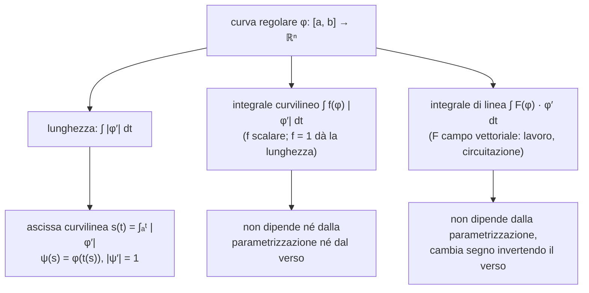

# Lezione 9 — Lunghezza delle curve, ascissa curvilinea, integrali curvilinei e di linea

La lezione completa il discorso sulle curve iniziato nella [[MM L08 - Curve in Rn e lunghezza di una curva|lezione 8]]. Prima si conclude la dimostrazione del teorema secondo cui la lunghezza di una curva regolare è l'integrale del modulo del vettore tangente. Seguono diversi esempi di calcolo: un arco di circonferenza, una curva data in forma cartesiana, un arco d'elica, la catenaria (con un richiamo sulle funzioni iperboliche) e un arco di parabola. Si introduce poi l'**ascissa curvilinea**, la parametrizzazione che usa come parametro la lunghezza stessa dell'arco. Infine si definiscono due nuovi tipi di integrale lungo una curva: l'**integrale curvilineo** di una funzione scalare, che non dipende né dalla parametrizzazione né dal verso di percorrenza, e l'**integrale di linea** di un campo vettoriale, che dipende dal verso e rappresenta, ad esempio, il lavoro di una forza.

> [!note] Fonti di questa lezione
> La trascrizione disponibile (parte 1) si interrompe mentre il docente imposta un secondo calcolo del lavoro lungo un percorso diverso; il confronto riportato alla fine è un esempio aggiunto, segnalato come tale. Enunciati e definizioni seguono le note del docente nella versione del 12 ottobre 2026 [@pinamonti2026, §2.1.1–§2.1.3]. Le figure sono costruite per rappresentare ciò che il docente descrive e disegna alla lavagna.

## La lunghezza di una curva regolare: conclusione della dimostrazione

### L'enunciato e la stima già ottenuta

Il docente riprende il teorema enunciato alla fine della lezione precedente.

> [!important] Teorema — Lunghezza di una curva regolare
> Sia $\varphi : [a, b] \to \mathbb{R}^n$ una curva regolare, cioè di classe $C^1$ con $\varphi'(t) \neq \mathbf{0}$ per ogni $t$. Allora la curva è rettificabile (ha lunghezza finita) e
> $$L(\varphi) = \int_a^b |\varphi'(t)|\, dt .$$
>
> [@pinamonti2026, Teor. 2.1.2]

Quando si ha una curva fra le mani, la prima cosa da controllare è quindi se la parametrizzazione è regolare: la curva deve essere percorsa, al variare del parametro, in un verso ben preciso e **senza mai fermarsi**. Se lo è, si può usare la formula.

Si ricorda la definizione: si partiziona l'intervallo dei tempi, $a = t_0 < t_1 < \dots < t_N = b$, si costruisce la poligonale con vertici $\varphi(t_0), \dots, \varphi(t_N)$, la cui lunghezza è
$$L(P) = \sum_{i=1}^{N} \big|\varphi(t_i) - \varphi(t_{i-1})\big|,$$
e la lunghezza della curva è l'estremo superiore di queste lunghezze su tutte le poligonali. Raffinando la partizione la poligonale si allunga, perché un segmento è più corto della somma dei due segmenti che lo sostituiscono.

Nella prima parte della dimostrazione, ripresa all'inizio della lezione, si scrive ogni differenza come integrale della derivata e si usa la stima del modulo dell'integrale vista nella lezione 8:
$$L(P) = \sum_{i=1}^{N} \Big| \int_{t_{i-1}}^{t_i} \varphi'(t)\, dt \Big| \leq \sum_{i=1}^{N} \int_{t_{i-1}}^{t_i} |\varphi'(t)|\, dt = \int_a^b |\varphi'(t)|\, dt .$$
A sinistra compare la poligonale, a destra non più: passando all'estremo superiore su tutte le poligonali,
$$L(\varphi) \leq \int_a^b |\varphi'(t)|\, dt .$$
Il membro di destra è finito, perché è l'integrale su un intervallo limitato di una funzione continua ($\varphi'$ è continua, e il modulo di una funzione continua è continuo): la curva è **rettificabile**. Per l'uguaglianza serve la disuguaglianza opposta, "leggermente più complicata".

### La stima dal basso

**Continuità uniforme della derivata.** La funzione $\varphi'$ è continua, perché derivata di una funzione di classe $C^1$, ed è definita sull'intervallo $[a, b]$, chiuso e limitato e quindi compatto. Per il teorema di Heine–Cantor, che "salta sempre fuori", $\varphi'$ è **uniformemente continua**: per ogni $\varepsilon > 0$ esiste $\delta_\varepsilon > 0$ tale che, per ogni coppia di punti $t, s \in [a, b]$,
$$|t - s| < \delta_\varepsilon \quad\Longrightarrow\quad |\varphi'(t) - \varphi'(s)| < \varepsilon .$$
L'aggettivo "uniforme" sottolinea che $\delta_\varepsilon$ non dipende da dove si prendono $t$ e $s$ nell'intervallo, ma solo dal fatto che siano abbastanza vicini.

**Una partizione adattata.** Fissato $\varepsilon$, si sceglie una partizione $a = t_0 < t_1 < \dots < t_N = b$ adattata a $\delta_\varepsilon$, cioè con
$$\Delta t_i = t_i - t_{i-1} < \delta_\varepsilon \qquad \text{per ogni } i .$$
In questo modo, per due punti qualunque dello stesso intervallino, le derivate differiscono in modulo per meno di $\varepsilon$. "Sembra poco, ma non lo è."

**Sommare zero.** Si fissa un intervallino $[t_{i-1}, t_i]$ e un suo punto $s$ qualunque. Si usa "una delle tecniche più forti della matematica", sommare zero: si somma e si sottrae $\varphi'(s)$ nell'integrale,
$$\varphi(t_i) - \varphi(t_{i-1}) = \int_{t_{i-1}}^{t_i} \varphi'(t)\, dt = \int_{t_{i-1}}^{t_i} \big(\varphi'(t) - \varphi'(s)\big)\, dt + \varphi'(s)\, \Delta t_i ,$$
perché $\varphi'(s)$ non dipende da $t$ e l'integrale di una costante è la costante per la lunghezza dell'intervallo. Il primo pezzo è piccolo, perché $t$ e $s$ stanno nello stesso intervallino. Isolando l'ultimo termine:
$$\varphi'(s)\, \Delta t_i = \varphi(t_i) - \varphi(t_{i-1}) - \int_{t_{i-1}}^{t_i} \big(\varphi'(t) - \varphi'(s)\big)\, dt .$$
Si prendono le norme, si usa la disuguaglianza triangolare e poi la stima del modulo dell'integrale:
$$|\varphi'(s)|\, \Delta t_i \leq \big|\varphi(t_i) - \varphi(t_{i-1})\big| + \int_{t_{i-1}}^{t_i} \big|\varphi'(t) - \varphi'(s)\big|\, dt \leq \big|\varphi(t_i) - \varphi(t_{i-1})\big| + \varepsilon\, \Delta t_i ,$$
dove nell'ultimo passaggio si è usata la continuità uniforme, perché $|t - s| \leq \Delta t_i < \delta_\varepsilon$.

**Media su $s$.** Nella disuguaglianza ottenuta solo il membro di sinistra dipende da $s$. Il docente ne calcola la media sull'intervallino: integra in $s$ tra $t_{i-1}$ e $t_i$ e divide per $\Delta t_i$. A destra non cambia nulla, perché la media di una costante è la costante; a sinistra il fattore $\Delta t_i$ si semplifica:
$$\int_{t_{i-1}}^{t_i} |\varphi'(s)|\, ds \leq \big|\varphi(t_i) - \varphi(t_{i-1})\big| + \varepsilon\, \Delta t_i .$$

**Somma sugli intervallini.** Sommando su $i = 1, \dots, N$: a sinistra si attaccano integrali su intervalli adiacenti e si ottiene l'integrale su $[a, b]$; a destra compaiono la lunghezza della poligonale e la somma delle lunghezze degli intervallini, che è $b - a$:
$$\int_a^b |\varphi'(s)|\, ds \leq L(P) + \varepsilon\,(b - a) .$$

**Estremo superiore ed $\varepsilon \to 0$.** Il membro di sinistra non dipende dalla poligonale. Si prende l'estremo superiore su tutte le poligonali adattate a $\delta_\varepsilon$; il docente osserva che questo coincide con la lunghezza della curva, perché raffinando una partizione la lunghezza della poligonale cresce sempre, e ogni partizione si può raffinare fino a renderla adattata. Quindi
$$\int_a^b |\varphi'(s)|\, ds \leq L(\varphi) + \varepsilon\,(b - a) .$$
In questa disuguaglianza $\delta_\varepsilon$ non compare più, c'è solo $\varepsilon$, che è arbitrario: "posso prenderlo piccolo a piacere, talmente piccolo da essere zero". Nel limite $\varepsilon \to 0$ si ottiene $\int_a^b |\varphi'| \leq L(\varphi)$, e insieme alla stima dall'alto
$$L(\varphi) = \int_a^b |\varphi'(t)|\, dt . \qquad \blacksquare$$

> [!note] Rispetto alla lezione 8
> Nella nota della lezione 8 questa seconda metà della dimostrazione era stata ricostruita dalle note del docente, perché la lezione si era interrotta. Lo svolgimento fatto in aula coincide con quella ricostruzione; l'unica differenza è il passaggio "media su $s$", che a lezione il docente presenta come calcolo della media di entrambi i membri sull'intervallino [@pinamonti2026, Teor. 2.1.2].

> [!tip] Approfondimento — Perché basta l'estremo superiore sulle partizioni adattate
> #approfondimento Sia $P$ una partizione qualunque e $P_\delta$ una partizione con passo minore di $\delta_\varepsilon$. La partizione $P \cup P_\delta$, che contiene i punti di entrambe, ha ancora passo minore di $\delta_\varepsilon$, ed è un raffinamento di $P$; per la disuguaglianza triangolare $L(P) \leq L(P \cup P_\delta)$. Quindi per ogni poligonale ne esiste una adattata almeno altrettanto lunga, e i due estremi superiori coincidono. È questo il senso dell'osservazione del docente "man mano che raffino una partizione, la lunghezza della poligonale associata cresce sempre".

## Esempi di calcolo della lunghezza

Il procedimento è sempre lo stesso: si scrive una parametrizzazione, si verifica che sia regolare, si calcola il modulo della derivata e lo si integra.

### Un arco di circonferenza

Si considera l'arco della circonferenza di raggio $R$ centrata nell'origine compreso tra gli angoli $\theta_1$ e $\theta_2$:
$$\varphi : [\theta_1, \theta_2] \to \mathbb{R}^2, \qquad \varphi(\theta) = (R\cos\theta,\; R\sin\theta).$$
Fissato $\theta$, la coordinata $x$ del punto è $R\cos\theta$ e la coordinata $y$ è $R\sin\theta$; al variare di $\theta$ in $[\theta_1, \theta_2]$ si trovano tutti i punti dell'arco.

<svg viewBox="0 0 380 345" width="380" style="display:block;margin:1em auto;max-width:100%;height:auto;font-family:inherit" xmlns="http://www.w3.org/2000/svg"><line x1="12.5" y1="200" x2="326" y2="200" stroke="currentColor" stroke-width="1.0"/><polygon points="326,200 319.8,203.3 319.8,196.7" fill="currentColor"/><line x1="150" y1="288" x2="150" y2="40.5" stroke="currentColor" stroke-width="1.0"/><polygon points="150,40.5 153.3,46.7 146.7,46.7" fill="currentColor"/><text x="326" y="216" font-size="13" text-anchor="end" fill="currentColor" font-style="italic">x</text><text x="158" y="48.5" font-size="13" text-anchor="start" fill="currentColor" font-style="italic">y</text><polyline points="260,200 259.9,195.7 259.7,191.3 259.2,187 258.6,182.7 257.9,178.4 256.9,174.2 255.8,170 254.5,165.8 253.1,161.7 251.5,157.7 249.8,153.7 247.9,149.8 245.8,145.9 243.6,142.2 241.2,138.5 238.7,135 236.1,131.5 233.3,128.2 230.4,125 227.4,121.8 224.2,118.8 221,116 217.6,113.2 214.1,110.6 210.5,108.2 206.9,105.8 203.1,103.7 199.3,101.6 195.3,99.8 191.3,98.1 187.3,96.5 183.2,95.1 179,93.9 174.8,92.8 170.5,91.9 166.2,91.2 161.9,90.6 157.6,90.3 153.3,90 148.9,90 144.6,90.1 140.2,90.4 135.9,90.9 131.6,91.5 127.3,92.4 123.1,93.3 118.9,94.5 114.8,95.8 110.7,97.3 106.7,98.9 102.7,100.7 98.8,102.6 95,104.7 91.3,107 87.7,109.4 84.1,111.9 80.7,114.6 77.4,117.4 74.2,120.3 71.1,123.4 68.1,126.6 65.3,129.8 62.6,133.3 60,136.8 57.6,140.4 55.3,144.1 53.1,147.8 51.2,151.7 49.3,155.7 47.7,159.7 46.1,163.7 44.8,167.9 43.6,172.1 42.6,176.3 41.7,180.5 41.1,184.8 40.5,189.2 40.2,193.5 40,197.8 40,202.2 40.2,206.5 40.5,210.8 41.1,215.2 41.7,219.5 42.6,223.7 43.6,227.9 44.8,232.1 46.1,236.3 47.7,240.3 49.3,244.3 51.2,248.3 53.1,252.2 55.3,255.9 57.6,259.6 60,263.2 62.6,266.7 65.3,270.2 68.1,273.4 71.1,276.6 74.2,279.7 77.4,282.6 80.7,285.4 84.1,288.1 87.7,290.6 91.3,293 95,295.3 98.8,297.4 102.7,299.3 106.7,301.1 110.7,302.7 114.8,304.2 118.9,305.5 123.1,306.7 127.3,307.6 131.6,308.5 135.9,309.1 140.2,309.6 144.6,309.9 148.9,310 153.3,310 157.6,309.7 161.9,309.4 166.2,308.8 170.5,308.1 174.8,307.2 179,306.1 183.2,304.9 187.3,303.5 191.3,301.9 195.3,300.2 199.3,298.4 203.1,296.3 206.9,294.2 210.5,291.8 214.1,289.4 217.6,286.8 221,284 224.2,281.2 227.4,278.2 230.4,275 233.3,271.8 236.1,268.5 238.7,265 241.2,261.5 243.6,257.8 245.8,254.1 247.9,250.2 249.8,246.3 251.5,242.3 253.1,238.3 254.5,234.2 255.8,230 256.9,225.8 257.9,221.6 258.6,217.3 259.2,213 259.7,208.7 259.9,204.3 260,200" fill="none" stroke="currentColor" stroke-width="1.0" stroke-opacity="0.35" stroke-dasharray="4 3"/><polyline points="253.3,162.3 252.6,160.3 251.8,158.3 250.9,156.3 250.1,154.3 249.1,152.3 248.2,150.4 247.2,148.5 246.2,146.6 245.1,144.7 244,142.9 242.9,141 241.7,139.2 240.5,137.4 239.2,135.7 237.9,133.9 236.6,132.2 235.3,130.5 233.9,128.9 232.5,127.2 231.1,125.6 229.6,124.1 228.1,122.5 226.5,121 225,119.5 223.4,118.1 221.8,116.6 220.1,115.2 218.4,113.9 216.7,112.6 215,111.3 213.2,110 211.5,108.8 209.7,107.6 207.8,106.4 206,105.3 204.1,104.2 202.2,103.2 200.3,102.2 198.4,101.2 196.5,100.3 194.5,99.4 192.5,98.5 190.5,97.7 188.5,97 186.5,96.2 184.4,95.5 182.4,94.9 180.3,94.3 178.2,93.7 176.1,93.1 174,92.7 171.9,92.2 169.8,91.8 167.7,91.4 165.5,91.1 163.4,90.8 161.2,90.6 159.1,90.4 156.9,90.2 154.8,90.1 152.6,90 150.5,90 148.3,90 146.2,90.1 144,90.2 141.9,90.3 139.7,90.5 137.6,90.7 135.4,91 133.3,91.3 131.1,91.6 129,92 126.9,92.5 124.8,92.9 122.7,93.4 120.6,94 118.5,94.6 116.5,95.2 114.4,95.9" fill="none" stroke="#d98a1c" stroke-width="3.0" stroke-opacity="1.0"/><line x1="150" y1="200" x2="253.3" y2="162.3" stroke="currentColor" stroke-width="1"/><polyline points="180.8,200 180.8,199.6 180.8,199.3 180.8,198.9 180.8,198.5 180.7,198.1 180.7,197.8 180.7,197.4 180.7,197 180.6,196.7 180.6,196.3 180.5,195.9 180.5,195.6 180.4,195.2 180.4,194.8 180.3,194.5 180.2,194.1 180.2,193.7 180.1,193.4 180,193 179.9,192.6 179.8,192.3 179.7,191.9 179.6,191.6 179.5,191.2 179.4,190.8 179.3,190.5 179.2,190.1 179.1,189.8 178.9,189.4" fill="none" stroke="currentColor" stroke-width="0.9" stroke-opacity="1.0"/><text x="193.2" y="196.7" font-size="12" text-anchor="start" fill="currentColor" font-style="italic">θ<tspan baseline-shift='sub' font-size='9'>1</tspan></text><line x1="150" y1="200" x2="114.4" y2="95.9" stroke="currentColor" stroke-width="1"/><polyline points="172,200 172,198.6 171.8,197.1 171.6,195.7 171.2,194.3 170.8,192.9 170.3,191.6 169.7,190.3 169,189 168.3,187.8 167.4,186.6 166.5,185.5 165.5,184.4 164.5,183.4 163.4,182.5 162.2,181.7 161,180.9 159.7,180.3 158.4,179.7 157,179.2 155.7,178.7 154.3,178.4 152.8,178.2 151.4,178 150,178 148.5,178 147.1,178.2 145.7,178.4 144.3,178.8 142.9,179.2" fill="none" stroke="currentColor" stroke-width="0.9" stroke-opacity="1.0"/><text x="171.2" y="177.2" font-size="12" text-anchor="start" fill="currentColor" font-style="italic">θ<tspan baseline-shift='sub' font-size='9'>2</tspan></text><text x="120.7" y="137.5" font-size="13" text-anchor="end" fill="currentColor" font-style="italic">R</text><circle cx="199.9" cy="102" r="4" fill="currentColor"/><text x="207.9" y="94" font-size="12" text-anchor="start" fill="currentColor" font-style="italic">φ(θ) = (R cos θ, R sin θ)</text><text x="190" y="338" font-size="11" text-anchor="middle" fill="#d98a1c">arancione: l'arco percorso per θ ∈ [θ₁, θ₂], lungo R(θ₂ − θ₁)</text></svg>

Seno e coseno si possono derivare infinite volte con derivate continue, quindi $\varphi$ è di classe $C^1$ (anzi $C^\infty$). Derivando componente per componente ($R$ è una costante):
$$\varphi'(\theta) = (-R\sin\theta,\; R\cos\theta), \qquad |\varphi'(\theta)| = \sqrt{R^2\sin^2\theta + R^2\cos^2\theta} = R .$$
Il vettore tangente non si annulla mai: la curva è regolare. Il docente fa notare che il **modulo** del vettore tangente è costante, ma il **vettore** no: in punti diversi dell'arco punta in direzioni diverse. La lunghezza è
$$L = \int_{\theta_1}^{\theta_2} R\, d\theta = R\,(\theta_2 - \theta_1),$$
risultato già noto dalla geometria elementare.

### Una curva in forma cartesiana

Si considera la curva del piano di equazione cartesiana
$$y = \tfrac{2}{3}\, x^{3/2}, \qquad x \in [1, 3].$$
Per usare la formula serve una forma parametrica; come visto nella lezione 8, per un grafico si usa la coordinata $x$ come parametro:
$$\varphi(t) = \Big(t,\; \tfrac{2}{3}\, t^{3/2}\Big), \qquad t \in [1, 3].$$
Ad esempio per $t = 2$ si trova il punto di ascissa $2$ e ordinata $\tfrac23\, 2^{3/2}$, che sta proprio sulla curva. Derivando, $\tfrac23 \cdot \tfrac32\, t^{3/2 - 1} = t^{1/2}$, quindi
$$\varphi'(t) = \big(1,\; t^{1/2}\big), \qquad |\varphi'(t)| = \sqrt{1 + t} .$$
Nell'intervallo $[1, 3]$ il modulo è sempre almeno $\sqrt{2}$, quindi diverso da zero, e la funzione si deriva quante volte si vuole: la curva è regolare. La lunghezza è
$$L = \int_1^3 \sqrt{1 + t}\; dt = \Big[\tfrac{2}{3}\,(1 + t)^{3/2}\Big]_1^3 = \tfrac{2}{3}\big(4^{3/2} - 2^{3/2}\big) = \tfrac{2}{3}\big(8 - 2\sqrt{2}\big) = \frac{16 - 4\sqrt{2}}{3} \approx 3{,}45 .$$

### Un arco d'elica

L'elica di raggio $R$ e passo $a$ della lezione 8, ristretta a $\theta \in [\theta_1, \theta_2]$:
$$\varphi(\theta) = \Big(R\cos\theta,\; R\sin\theta,\; \frac{a\,\theta}{2\pi}\Big), \qquad \varphi'(\theta) = \Big(-R\sin\theta,\; R\cos\theta,\; \frac{a}{2\pi}\Big).$$
Anche se la curva sta in tre dimensioni, il calcolo è facile: usando di nuovo $\sin^2\theta + \cos^2\theta = 1$,
$$|\varphi'(\theta)| = \sqrt{R^2 + \frac{a^2}{4\pi^2}}$$
è costante e non nullo, e
$$L = \sqrt{R^2 + \frac{a^2}{4\pi^2}}\;\,(\theta_2 - \theta_1).$$
Ad esempio, per $\theta_1 = 0$ e $\theta_2 = 3\pi$ (un giro e mezzo) la lunghezza è $3\pi\sqrt{R^2 + a^2/(4\pi^2)}$: una curva complicata dello spazio, ma la sua lunghezza è "semplicemente una costante per la variazione dell'angolo". Il docente avverte che non sempre è così facile: molto spesso si riesce a scrivere la formula, ma non a calcolarne il valore, perché trovare primitive non è facile.

### Funzioni iperboliche e catenaria

Prima del prossimo esempio il docente richiama le **funzioni iperboliche**, opportune combinazioni di esponenziali:
$$\cosh x = \frac{e^{x} + e^{-x}}{2}, \qquad \sinh x = \frac{e^{x} - e^{-x}}{2}.$$
Il coseno iperbolico è la media tra l'esponenziale con esponente positivo e quello con esponente negativo; è una funzione **pari**, mentre il seno iperbolico è **dispari** (cambiando segno a $x$ cambia segno). Le loro proprietà ricordano quelle di seno e coseno ordinari, "a meno di qualche segno che si sposta":

- **derivate:** derivando, $e^{x}$ resta $e^{x}$ e $e^{-x}$ diventa $-e^{-x}$, quindi
$$\frac{d}{dx}\cosh x = \sinh x, \qquad \frac{d}{dx}\sinh x = \cosh x$$
(senza il segno meno che compare per il coseno ordinario);
- **identità fondamentale:** sviluppando i quadrati dei binomi, i quadrati dei singoli termini si cancellano nella differenza e restano i doppi prodotti, $2 \cdot \tfrac14\, e^{x} e^{-x} = \tfrac12$ per ciascuno:
$$\cosh^2 x - \sinh^2 x = 1 ,$$
analoga di $\cos^2\theta + \sin^2\theta = 1$ con un segno cambiato.

In $x = 0$ il coseno iperbolico vale $\tfrac{1 + 1}{2} = 1$, e per $|x|$ grande cresce come un esponenziale; il seno iperbolico passa per l'origine ed è crescente.

```chart
type: line
labels: ["-2", "-1.5", "-1", "-0.5", "0", "0.5", "1", "1.5", "2"]
series:
  - title: "cosh x"
    data: [3.762, 2.352, 1.543, 1.128, 1.000, 1.128, 1.543, 2.352, 3.762]
  - title: "sinh x"
    data: [-3.627, -2.129, -1.175, -0.521, 0.000, 0.521, 1.175, 2.129, 3.627]
width: 75%
fill: false
beginAtZero: false
```

Il grafico del coseno iperbolico si chiama **catenaria**: è la forma che assume una fune (o una catena) appesa per i due estremi e lasciata cadere sotto il proprio peso. Il docente cita come esempio i cavi sopra i binari del treno, che a guardarli bene non sono dritti ma hanno proprio una forma di questo tipo.

Si calcola la lunghezza della curva
$$\varphi(t) = \big(3t,\; \cosh(3t)\big), \qquad t \in [-1, 1],$$
che è il grafico di $y = \cosh x$ per $x \in [-3, 3]$. Derivando (per la seconda componente, la derivata del coseno iperbolico è il seno iperbolico, per la derivata della funzione interna, che vale 3):
$$\varphi'(t) = \big(3,\; 3\sinh(3t)\big), \qquad |\varphi'(t)| = \sqrt{9 + 9\sinh^2(3t)} = 3\sqrt{1 + \sinh^2(3t)} = 3\sqrt{\cosh^2(3t)} = 3\cosh(3t),$$
dove si è usata l'identità fondamentale e il fatto che il coseno iperbolico è sempre positivo. Il modulo non si annulla mai. Cambiando variabile con $s = 3t$:
$$L = \int_{-1}^{1} 3\cosh(3t)\, dt = \int_{-3}^{3} \cosh s\; ds = \sinh 3 - \sinh(-3) = 2\sinh 3 \approx 20{,}04,$$
perché la primitiva del coseno iperbolico è il seno iperbolico, che è dispari.

### Un arco di parabola

"Se hai una funzione leggermente più complicata, siamo nei guai." Si considera la parabola
$$y = \frac{k}{2}\, x^2, \qquad k > 0, \qquad x \in [0, a],$$
parametrizzata da $\varphi(t) = \big(t,\, \tfrac{k}{2}\, t^2\big)$. Per $t = 0$ ci si trova nell'origine, e il vettore tangente
$$\varphi'(t) = (1,\; k\,t)$$
è orizzontale; al crescere di $t$ la componente orizzontale resta 1 e quella verticale cresce. Non c'è bisogno di verificare che il vettore tangente non si annulli: la prima componente vale sempre 1, quindi il modulo è sempre almeno 1. La lunghezza è
$$L = \int_0^a \sqrt{1 + k^2 t^2}\; dt = \frac{1}{k}\int_0^{ka} \sqrt{1 + r^2}\; dr,$$
con il cambio di variabile $r = k\,t$. Serve una primitiva di $\sqrt{1 + r^2}$. Il docente osserva che un tempo si consultavano le tavole degli integrali e oggi la si fa calcolare a un software, ma che va comunque verificata: la primitiva proposta è
$$G(r) = \frac{r\sqrt{1 + r^2}}{2} - \frac12 \log\big(\sqrt{1 + r^2} - r\big).$$
**Verifica derivando.** La derivata del primo termine, per la regola del prodotto, è $\dfrac{\sqrt{1 + r^2}}{2} + \dfrac{r^2}{2\sqrt{1 + r^2}}$. Per il secondo termine si deriva prima il logaritmo e poi la funzione interna:
$$-\frac12 \cdot \frac{1}{\sqrt{1 + r^2} - r}\cdot\Big(\frac{r}{\sqrt{1 + r^2}} - 1\Big) = -\frac12 \cdot \frac{1}{\sqrt{1 + r^2} - r}\cdot\frac{r - \sqrt{1 + r^2}}{\sqrt{1 + r^2}} = \frac{1}{2\sqrt{1 + r^2}} .$$
Sommando, e scrivendo tutto con denominatore comune,
$$G'(r) = \frac{\sqrt{1 + r^2}}{2} + \frac{r^2 + 1}{2\sqrt{1 + r^2}} = \frac{\sqrt{1 + r^2}}{2} + \frac{\sqrt{1 + r^2}}{2} = \sqrt{1 + r^2}. \quad\checkmark$$
In $r = 0$ si ha $G(0) = 0 - \tfrac12\log 1 = 0$, quindi
$$L = \frac{1}{k}\, G(ka) = \frac{1}{2k}\Big[ka\sqrt{1 + k^2a^2} - \log\Big(\sqrt{1 + k^2a^2} - ka\Big)\Big].$$
"E questa è solo una parabola": per curve più complicate spesso non è possibile scrivere la lunghezza in forma chiusa, ma la formula integrale continua a fornire il risultato, ad esempio per via numerica.

> [!tip] Approfondimento — La primitiva con il seno iperbolico inverso
> #approfondimento Poiché $(\sqrt{1 + r^2} - r)(\sqrt{1 + r^2} + r) = 1$, si ha $-\log(\sqrt{1 + r^2} - r) = \log(\sqrt{1 + r^2} + r)$, che è l'inversa del seno iperbolico: $\operatorname{arsinh} r = \log\big(r + \sqrt{1 + r^2}\big)$. Infatti, posto $r = \sinh u$, si ha $\sqrt{1 + r^2} = \cosh u$ e $r + \sqrt{1 + r^2} = \sinh u + \cosh u = e^{u}$. La primitiva si scrive quindi anche
> $$G(r) = \tfrac12\Big(r\sqrt{1 + r^2} + \operatorname{arsinh} r\Big),$$
> che si ottiene direttamente con la sostituzione $r = \sinh u$, $dr = \cosh u\, du$: $\int \sqrt{1 + \sinh^2 u}\,\cosh u\, du = \int \cosh^2 u\, du = \tfrac12(u + \sinh u\cosh u)$. È la stessa forma usata nella lezione 8 per l'arco di parabola $y = x^2$ (caso $k = 2$, con $t \in [-1, 1]$).

## Riparametrizzazione e ascissa curvilinea

### Il parametro non conta

Al variare di $t$ il punto $\varphi(t)$ si sposta lungo il sostegno della curva. Ma è davvero importante la velocità con cui la si percorre? Ad esempio, la lunghezza dipende dal modo in cui la curva è parametrizzata? La risposta deve essere no: la lunghezza è una proprietà geometrica, che guarda solo l'"arzigogolo" disegnato, non il modo in cui lo si percorre.

Si ricorda la riparametrizzazione della lezione 8: si sceglie una funzione $t : [c, d] \to [a, b]$ e si considera la nuova curva $\gamma(x) = \varphi(t(x))$. Perché la nuova curva sia ancora regolare e descriva tutto il sostegno, $t$ deve essere di classe $C^1$, con $t'(x) \neq 0$, e deve avere come immagine tutto $[a, b]$ (per non perdere pezzi di curva). Una derivata continua che non si annulla non può cambiare segno, quindi $t$ è **monotona**, crescente o decrescente, e di conseguenza iniettiva e invertibile. La riparametrizzazione non cambia il sostegno, ma solo il modo in cui lo si percorre.

### L'ascissa curvilinea

Tra tutte le possibili parametrizzazioni ce n'è una "più bella delle altre", quella con l'**ascissa curvilinea**. Sia $\varphi : [a, b] \to \mathbb{R}^n$ regolare. Si integra il modulo della derivata non fino a $b$, ma fino a un estremo variabile $t$:
$$s(t) = \int_a^t |\varphi'(\tau)|\, d\tau, \qquad t \in [a, b].$$
Per $t = a$ l'integrale vale 0; per $t = b$ è la lunghezza della curva. Quindi $s : [a, b] \to [0, L(\varphi)]$ dice quanta strada si è percorsa lungo la curva fino all'istante $t$.

Può succedere che $s$ superi $L$ e poi torni indietro? No. Per il teorema fondamentale del calcolo, derivando rispetto all'estremo superiore si ottiene la funzione integranda:
$$s'(t) = |\varphi'(t)| > 0,$$
strettamente positiva perché la curva è regolare. Quindi $s$ è di classe $C^1$ e strettamente crescente, cioè iniettiva; è suriettiva su $[0, L(\varphi)]$ per costruzione. È dunque **invertibile**: dato un valore di $s$ si sa dire da quale istante $t$ proviene. Si indica l'inversa con
$$t : [0, L(\varphi)] \to [a, b], \qquad s \mapsto t(s).$$

<svg viewBox="0 0 420 290" width="420" style="display:block;margin:1em auto;max-width:100%;height:auto;font-family:inherit" xmlns="http://www.w3.org/2000/svg"><line x1="46" y1="245" x2="373.6" y2="245" stroke="currentColor" stroke-width="1.0"/><polygon points="373.6,245 367.4,248.3 367.4,241.7" fill="currentColor"/><line x1="60" y1="254.5" x2="60" y2="26.5" stroke="currentColor" stroke-width="1.0"/><polygon points="60,26.5 63.3,32.7 56.7,32.7" fill="currentColor"/><text x="373.6" y="261" font-size="13" text-anchor="end" fill="currentColor" font-style="italic">t</text><text x="68" y="34.5" font-size="13" text-anchor="start" fill="currentColor" font-style="italic">s</text><polyline points="60,245 62.4,242.5 64.7,240.1 67.1,237.6 69.4,235.2 71.8,232.8 74.1,230.3 76.5,227.9 78.8,225.5 81.2,223.2 83.5,220.8 85.9,218.5 88.2,216.2 90.6,213.9 92.9,211.6 95.3,209.4 97.6,207.2 100,205.1 102.4,203 104.7,200.9 107.1,198.9 109.4,196.9 111.8,194.9 114.1,193 116.5,191.1 118.8,189.3 121.2,187.5 123.5,185.7 125.9,184 128.2,182.4 130.6,180.8 132.9,179.2 135.3,177.7 137.6,176.2 140,174.8 142.4,173.4 144.7,172.1 147.1,170.8 149.4,169.5 151.8,168.3 154.1,167.1 156.5,166 158.8,164.9 161.2,163.9 163.5,162.8 165.9,161.8 168.2,160.9 170.6,159.9 172.9,159 175.3,158.2 177.6,157.3 180,156.5 182.4,155.7 184.7,154.9 187.1,154.1 189.4,153.3 191.8,152.6 194.1,151.8 196.5,151.1 198.8,150.4 201.2,149.6 203.5,148.9 205.9,148.2 208.2,147.4 210.6,146.7 212.9,145.9 215.3,145.1 217.6,144.3 220,143.5 222.4,142.7 224.7,141.8 227.1,141 229.4,140.1 231.8,139.1 234.1,138.2 236.5,137.2 238.8,136.1 241.2,135.1 243.5,134 245.9,132.9 248.2,131.7 250.6,130.5 252.9,129.2 255.3,127.9 257.6,126.6 260,125.2 262.4,123.8 264.7,122.3 267.1,120.8 269.4,119.2 271.8,117.6 274.1,116 276.5,114.3 278.8,112.5 281.2,110.7 283.5,108.9 285.9,107 288.2,105.1 290.6,103.1 292.9,101.1 295.3,99.1 297.6,97 300,94.9 302.4,92.8 304.7,90.6 307.1,88.4 309.4,86.1 311.8,83.8 314.1,81.5 316.5,79.2 318.8,76.8 321.2,74.5 323.5,72.1 325.9,69.7 328.2,67.2 330.6,64.8 332.9,62.4 335.3,59.9 337.6,57.5 340,55" fill="none" stroke="#3b82f6" stroke-width="2.4" stroke-opacity="1.0"/><line x1="60" y1="241" x2="60" y2="249" stroke="currentColor"/><text x="60" y="263" font-size="13" text-anchor="middle" fill="currentColor" font-style="italic">a</text><line x1="340" y1="241" x2="340" y2="249" stroke="currentColor"/><text x="340" y="263" font-size="13" text-anchor="middle" fill="currentColor" font-style="italic">b</text><line x1="60" y1="55" x2="340" y2="55" stroke="currentColor" stroke-opacity="0.4" stroke-dasharray="4 3"/><line x1="340" y1="245" x2="340" y2="55" stroke="currentColor" stroke-opacity="0.4" stroke-dasharray="4 3"/><text x="52" y="59" font-size="12" text-anchor="end" fill="currentColor" font-style="italic">L(φ)</text><text x="52" y="241" font-size="12" text-anchor="end" fill="currentColor">0</text><line x1="177.6" y1="245" x2="177.6" y2="157.3" stroke="#e05a47" stroke-width="1.4" stroke-dasharray="5 3"/><line x1="177.6" y1="157.3" x2="64" y2="157.3" stroke="#e05a47" stroke-width="1.4"/><polygon points="64,157.3 70.2,154 70.2,160.6" fill="#e05a47"/><text x="177.6" y="263" font-size="12" text-anchor="middle" fill="#e05a47" font-style="italic">t</text><text x="52" y="161.3" font-size="12" text-anchor="end" fill="#e05a47" font-style="italic">s(t)</text><text x="270" y="104.8" font-size="12" text-anchor="end" fill="#3b82f6">s(t) = ∫ |φ′|, crescente</text><text x="210" y="285" font-size="11" text-anchor="middle" fill="currentColor">s′(t) = |φ′(t)| > 0: s è invertibile, e da s si risale a t(s)</text></svg>

**La derivata dell'inversa.** Andando avanti e tornando indietro si resta fermi: $s\big(t(\hat{s})\big) = \hat{s}$. Derivando rispetto a $\hat{s}$ con la regola della catena ("regola della cipolla": si toglie una buccia alla volta), a sinistra si ottiene $s'\big(t(\hat{s})\big)\, t'(\hat{s})$ e a destra la derivata di $\hat{s}$ rispetto a sé stesso, cioè 1:
$$t'(\hat{s}) = \frac{1}{s'\big(t(\hat{s})\big)} = \frac{1}{\big|\varphi'\big(t(\hat{s})\big)\big|}.$$
È la regola già nota dall'analisi in una variabile: la derivata della funzione inversa è il reciproco della derivata della funzione diretta, calcolata nel punto giusto. È anche il caso $n = 1$ della proposizione sulla jacobiana della funzione inversa vista nella [[MM L07 - Funzione inversa e moltiplicatori di Lagrange|lezione 7]].

**La nuova parametrizzazione.** Si riparametrizza la curva con $s$:
$$\psi(s) = \varphi\big(t(s)\big), \qquad s \in [0, L(\varphi)].$$
Per la regola della catena il vettore tangente è
$$\psi'(s) = \varphi'\big(t(s)\big)\, t'(s) = \frac{\varphi'\big(t(s)\big)}{\big|\varphi'\big(t(s)\big)\big|},$$
che ha modulo 1: è il **versore tangente** $\hat{\mathbf{t}}$ introdotto nella lezione 8. Con l'ascissa curvilinea la curva è percorsa a velocità costante unitaria.

> [!important] Definizione e proprietà — Ascissa curvilinea
> Data una curva regolare $\varphi : [a, b] \to \mathbb{R}^n$, la funzione
> $$s(t) = \int_a^t |\varphi'(\tau)|\, d\tau$$
> è di classe $C^1$, con $s'(t) = |\varphi'(t)| > 0$, ed è invertibile da $[a, b]$ su $[0, L(\varphi)]$. La riparametrizzazione $\psi(s) = \varphi(t(s))$, detta **parametrizzazione con l'ascissa curvilinea** o **con la lunghezza d'arco**, ha vettore tangente di modulo 1:
> $$|\psi'(s)| = 1 \qquad \text{per ogni } s .$$
>
> [@pinamonti2026, §2.1.2]

Calcolando la lunghezza della curva $\psi$ ristretta a un intervallo $[c, d] \subseteq [0, L(\varphi)]$ si ottiene
$$L\big(\psi|_{[c, d]}\big) = \int_c^d |\psi'(s)|\, ds = \int_c^d 1\, ds = d - c .$$
Per questo la parametrizzazione si chiama anche "con la lunghezza d'arco": è come usare la lunghezza della curva per parametrizzarla. Il punto $\psi(0)$ è l'inizio della curva, il punto $\psi(7)$ è quello che dista 7, misurati lungo la curva, dall'inizio, e così via.

Il docente avverte che, in pratica, non è facile calcolare esplicitamente $s(t)$, perché compare l'integrale di un modulo, e nemmeno invertirla: trovare una formula analitica per questa parametrizzazione può essere molto complicato, o impossibile. In linea di principio, però, la parametrizzazione esiste sempre.

> [!example] Esercizi proposti nelle note del docente (svolti)
> **Circonferenza.** Per $\varphi(t) = (r\cos t,\, r\sin t,\, 0)$, $t \in [0, 2\pi]$, si ha $|\varphi'(t)| = r$ e quindi $s(t) = \int_0^t r\, d\tau = r\,t$. L'inversa è $t(s) = s/r$ e $\psi(s) = \big(r\cos(s/r),\, r\sin(s/r),\, 0\big)$, che ha in effetti derivata di modulo 1.
>
> **Catenaria.** Per $\varphi(x) = \big(x,\, \tfrac{1}{b}\cosh(bx)\big)$, $x \in [-c, c]$ con $b, c > 0$, si ha $\varphi'(x) = (1, \sinh(bx))$ e $|\varphi'(x)| = \cosh(bx)$, quindi
> $$s(t) = \int_{-c}^{t} \cosh(bx)\, dx = \frac{\sinh(bt) + \sinh(bc)}{b}.$$
>
> **Parabola.** Per la curva $y = \tfrac{k}{2}x^2$ sull'intervallo $[0, x]$ il calcolo è quello fatto sopra con $a = x$:
> $$s(x) = \frac{1}{2k}\Big[kx\sqrt{1 + (kx)^2} - \log\Big(\sqrt{1 + (kx)^2} - kx\Big)\Big].$$
>
> [@pinamonti2026, §2.1.3]

## Integrale curvilineo di una funzione scalare

### Motivazione e definizione

Il docente propone un "esperimento ideale". Si ha una funzione $f : D \subseteq \mathbb{R}^n \to \mathbb{R}$, ad esempio la temperatura o l'altitudine in ogni punto di una regione: in cima alla montagna fa freddo, vicino al mare fa più caldo. Si percorre un cammino dentro $D$, descritto da una curva regolare $\varphi : [a, b] \to \mathbb{R}^n$ con sostegno contenuto in $D$. Interessa capire, ad esempio, qual è la **temperatura media** lungo il cammino; oppure, se in ogni punto c'è una certa quantità di denaro che si raccoglie passandoci, quanto denaro si è raccolto alla fine.

<svg viewBox="0 0 520 330" width="520" style="display:block;margin:1em auto;max-width:100%;height:auto;font-family:inherit" xmlns="http://www.w3.org/2000/svg"><rect x="20" y="16.5" width="484" height="297" fill="currentColor" fill-opacity="0.03" stroke="currentColor" stroke-opacity="0.3"/><polyline points="126.9,16.5 125.5,17.2 124.3,17.8 123.1,18.5 121.9,19.2 120.7,19.8 119.5,20.5 118.3,21.3 117,22 115.8,22.8 114.6,23.5 113.4,24.3 112.2,25.2 111,26 109.8,26.9 108.6,27.7 107.6,28.4 106.6,29.2 105.7,29.9 104.7,30.6 103.7,31.5 102.5,32.5 101.3,33.5 100.2,34.4 99.4,35.1 98.6,35.9 97.6,36.7 96.4,37.8 95.4,38.8 94.6,39.6 93.8,40.3 92.8,41.4 91.6,42.6 90.9,43.3 90.2,44 89.1,45.2 88.2,46.3 87.6,47 86.7,48 85.7,49.3 85,50 84.3,50.9 83.2,52.2 82.7,53 81.9,54 81,55.2 80.4,56 79.4,57.3 78.8,58.2 78.2,59.1 77.3,60.4 76.8,61.2 75.9,62.7 75.4,63.4 74.6,64.7 74,65.6 73.4,66.8 72.7,67.9 72.2,68.9 71.5,70.1 70.9,71.1 70.3,72.3 69.7,73.4 69.2,74.6 68.5,75.9 68.1,76.8 67.4,78.3 67.1,79 66.4,80.5 66.1,81.3 65.5,82.7 64.9,84.2 64.6,85 64,86.5 63.7,87.3 63.2,88.7 62.7,90.2 62.4,90.9 61.9,92.4 61.4,93.9 61.2,94.7 60.8,96.1 60.4,97.6 60,98.8 59.8,99.9 59.4,101.4 59,102.8 58.8,103.8 58.5,105.1 58.2,106.6 57.9,108.1 57.7,109.5 57.5,110.3 57.3,111.8 57.1,113.3 56.9,114.8 56.7,116.2 56.5,117.7 56.4,118.7 56.3,120 56.1,121.5 56,122.9 55.9,124.4 55.8,125.9 55.8,127.4 55.7,128.9 55.7,130.4 55.7,131.9 55.7,133.4 55.7,134.9 55.8,136.3 55.8,137.8 55.9,139.3 56,140.8 56.1,142.3 56.2,143.8 56.4,145.3 56.5,146 56.6,147.5 56.8,149 57,150.5 57.3,152 57.5,153.5 57.6,154.2 57.9,155.7 58.2,157.2 58.5,158.7 58.8,160.2 59,160.9 59.3,162.4 59.7,163.9 60,165.2 60.3,166.1 60.7,167.6 61.1,169.1 61.4,169.8 61.8,171.3 62.3,172.8 62.6,173.6 63.1,175 63.6,176.5 63.9,177.3 64.5,178.8 64.9,179.8 65.3,181 66,182.5 66.3,183.2 66.9,184.7 67.3,185.5 68,187 68.5,188.1 69,189.2 69.7,190.6 70.2,191.4 70.9,192.9 71.4,193.7 72.2,195.1 72.6,195.9 73.4,197.2 73.9,198.1 74.6,199.3 75.3,200.4 75.8,201.2 76.7,202.6 77.2,203.3 78.2,204.8 78.7,205.6 79.4,206.7 80.3,207.8 80.8,208.5 81.9,210 82.5,210.8 83.1,211.6 84.2,213 84.8,213.8 85.5,214.6 86.7,216 87.3,216.7 88,217.5 89.1,218.8 90,219.7 90.7,220.5 91.6,221.4 92.8,222.6 93.6,223.4 94.3,224.2 95.2,225 96.4,226.2 97.5,227.2 98.3,227.9 99.1,228.6 100.1,229.5 101.3,230.5 102.5,231.5 103.5,232.4 104.4,233.1 105.4,233.9 106.3,234.6 107.3,235.4 108.6,236.3 109.8,237.2 111,238 112.2,238.8 113.4,239.7 114.6,240.5 115.8,241.2 117,242 118.3,242.7 119.5,243.5 120.7,244.2 121.9,244.8 123.1,245.5 124.3,246.2 125.5,246.8 126.7,247.4 128,248 129.4,248.7 131,249.5 132.7,250.2 134,250.8 135.2,251.3 136.5,251.8 138,252.5 140,253.2 141.3,253.7 142.5,254.1 144.2,254.7 146.2,255.3 147.4,255.7 149,256.2 151,256.8 152.2,257.1 154.6,257.7 155.9,258 157.8,258.4 159.5,258.8 161.6,259.2 163.1,259.4 165.6,259.8 166.8,260 169.2,260.3 171.6,260.6 172.8,260.7 175.3,261 177.7,261.1 180.1,261.2 182.5,261.3 185,261.4 187.4,261.3 189.8,261.3 192.3,261.2 194.7,261.1 197.1,260.9 199.5,260.7 200.7,260.5 203.2,260.2 205.6,259.9 206.8,259.7 209.2,259.3 210.4,259.1 212.9,258.7 214.2,258.4 216.5,257.9 217.7,257.7 220.2,257.1 221.4,256.8 223.8,256.2 225,255.9 226.6,255.4 228.6,254.9 229.9,254.5 231.8,254 233.5,253.4 234.7,253.1 236.6,252.5 238.3,251.9 239.6,251.5 241.2,251 243.2,250.3 244.4,249.9 245.7,249.5 247.9,248.7 249.3,248.3 250.5,247.9 252.5,247.3 254.1,246.8 255.3,246.4 257.4,245.8 259,245.3 260.2,245 262.6,244.4 263.8,244.1 266.2,243.6 267.5,243.4 269.9,243.1 272.3,242.9 274.7,242.9 277.2,243.1 279.6,243.4 280.8,243.7 282.9,244.3 284.4,244.8 285.7,245.3 286.9,245.9 288.1,246.5 289.3,247.3 290.5,248 291.7,248.9 292.9,249.7 294.1,250.7 295.4,251.7 296.2,252.5 297,253.2 297.9,254 299,255 300.2,256.2 300.9,256.9 301.7,257.7 302.6,258.7 303.8,259.9 304.5,260.7 305.3,261.4 306.3,262.5 307.4,263.6 308.1,264.4 308.8,265.1 309.9,266.3 310.9,267.3 311.6,268.1 312.3,268.8 313.6,270.1 314.5,271.1 315.3,271.8 316,272.6 317.2,273.7 318.3,274.8 319.1,275.5 319.9,276.3 320.8,277.2 322,278.3 323.1,279.3 324,280 324.8,280.7 325.7,281.5 326.9,282.5 328.1,283.5 329.3,284.5 330.3,285.2 331.3,286 332.2,286.7 333.3,287.4 334.3,288.2 335.4,289 336.6,289.8 337.8,290.6 339,291.4 340.2,292.1 341.5,292.9 342.7,293.6 343.9,294.3 345.1,295 346.3,295.6 347.7,296.4 349.2,297.1 350.8,297.9 352.4,298.6 353.6,299.2 354.8,299.7 356,300.2 357.7,300.8 359.6,301.6 360.9,302 362.1,302.4 364,303.1 365.7,303.6 366.9,303.9 369.2,304.6 370.6,304.9 372.4,305.3 374.2,305.7 376,306.1 377.8,306.4 380.3,306.7 381.5,306.9 383.9,307.2 386.3,307.4 388.6,307.5 390,307.6 392.4,307.7 394.8,307.7 397.3,307.6 399.2,307.5 400.9,307.4 403.3,307.2 405.7,307 407.2,306.8 409.4,306.5 411.8,306.1 413,305.8 415.4,305.3 416.7,305 418.6,304.6 420.3,304.1 421.5,303.8 423.8,303.1 425.2,302.6 426.4,302.2 428.1,301.6 430,300.9 431.2,300.4 432.4,299.9 433.7,299.4 435.3,298.6 436.9,297.9 438.4,297.1 439.7,296.5 440.9,295.8 442.1,295.1 443.3,294.5 444.6,293.7 445.8,293 447,292.2 448.2,291.5 449.4,290.6 450.6,289.8 451.8,288.9 452.9,288.2 453.9,287.4 454.8,286.7 455.8,286 456.7,285.2 457.9,284.2 459.1,283.1 460.1,282.2 460.9,281.5 461.7,280.7 462.8,279.8 464,278.6 464.8,277.8 465.5,277 466.4,276.1 467.5,274.8 468.2,274 468.8,273.3 470,271.9 470.7,271.1 471.3,270.3 472.5,268.8 473,268.1 473.7,267.2 474.6,265.9 475.2,265.1 476.1,263.7 476.7,262.9 477.3,261.9 478.1,260.7 478.5,259.9 479.4,258.4 479.8,257.7 480.7,256.2 481.1,255.4 481.8,254 482.2,253.2 483,251.7 483.4,250.8 484,249.5 484.6,248.1 485,247.3 485.6,245.8 485.9,245 486.4,243.5 487,242 487.2,241.3 487.7,239.8 488.2,238.3 488.5,237.6 488.9,236.1 489.3,234.6 489.5,233.9 489.9,232.4 490.2,230.9 490.5,229.4 490.7,228.6 491,227.2 491.3,225.7 491.5,224.2 491.7,222.7 491.9,221.6 492,220.5 492.2,219 492.3,217.5 492.4,216 492.5,214.5 492.6,213 492.6,211.5 492.7,210 492.7,208.5 492.7,207.1 492.6,205.6 492.6,204.1 492.5,202.6 492.4,201.1 492.2,199.6 492.1,198.1 491.9,196.6 491.8,195.9 491.6,194.4 491.4,192.9 491.1,191.4 490.8,189.9 490.7,189.1 490.4,187.7 490,186.2 489.6,184.7 489.4,183.9 489.1,182.5 488.6,181 488.2,179.7 487.9,178.8 487.4,177.3 487,176.1 486.7,175 486.1,173.6 485.8,172.8 485.2,171.3 484.6,169.9 484.3,169.1 483.6,167.6 483.2,166.9 482.5,165.4 482.1,164.6 481.4,163.1 481,162.3 480.2,160.9 479.7,160.2 478.9,158.7 478.4,157.9 477.5,156.4 477,155.7 476.1,154.3 475.6,153.5 474.9,152.5 474,151.2 473.5,150.5 472.5,149.2 471.8,148.3 471.2,147.5 470,146.1 469.3,145.3 468.7,144.5 467.6,143.3 466.7,142.3 466,141.6 465.2,140.7 464,139.4 463.1,138.6 462.4,137.8 461.5,137.1 460.3,135.9 459.1,134.9 458.3,134.1 457.4,133.4 456.5,132.6 455.5,131.8 454.3,130.8 453.1,129.9 451.8,129 450.6,128.2 449.5,127.4 448.4,126.7 447.3,125.9 446.1,125.2 444.9,124.4 443.6,123.7 442.4,122.9 441,122.2 439.7,121.5 438.5,120.9 437.3,120.3 436.1,119.7 434.9,119.1 433.4,118.5 431.7,117.7 430,117 428.8,116.6 427.6,116.1 425.8,115.5 423.9,114.9 422.7,114.5 421.2,114 419.1,113.4 417.9,113.1 415.6,112.5 414.2,112.2 412.2,111.8 410.6,111.5 408.2,111 407,110.8 404.5,110.5 402.7,110.3 400.9,110.1 398.5,109.9 396,109.7 393.6,109.6 391.5,109.5 390,109.5 387.5,109.5 385.6,109.5 383.9,109.6 381.5,109.7 379.1,109.8 376.6,110 374.2,110.2 372.7,110.3 370.6,110.5 368.1,110.7 365.7,111 364.5,111.1 362.1,111.4 359.6,111.6 358.3,111.8 356,112 353.6,112.2 351.2,112.4 348.7,112.5 346.3,112.5 343.9,112.4 341.5,112.3 339,111.9 337.8,111.7 335.4,111.1 334.2,110.8 332.8,110.3 331.1,109.5 329.7,108.8 328.4,108.1 327.2,107.3 326.2,106.6 325.2,105.8 324.4,105.1 323.3,104.1 322,102.9 321.3,102.1 320.6,101.4 319.6,100.2 318.7,99.1 318.2,98.4 317.2,97.1 316.5,96.1 316,95.4 314.9,93.9 314.4,93.2 313.6,91.9 313,90.9 312.3,90 311.5,88.7 311.1,88 310.1,86.5 309.7,85.7 308.8,84.2 308.3,83.5 307.5,82.1 307,81.3 306.3,80.1 305.6,79 305.1,78.1 304.3,76.8 303.8,76 302.9,74.6 302.4,73.8 301.5,72.3 301,71.6 300.2,70.3 299.6,69.3 299,68.4 298.1,67.1 297.6,66.4 296.6,64.9 296.1,64.1 295.4,63 294.6,61.9 294,61.2 293,59.7 292.4,58.9 291.7,58 290.7,56.7 290.2,56 289.3,54.8 288.4,53.7 287.8,53 286.9,51.8 286,50.7 285.4,50 284.4,48.9 283.4,47.8 282.8,47 282,46.2 280.8,44.9 280,44 279.3,43.3 278.4,42.3 277.2,41.1 276.4,40.3 275.6,39.6 274.7,38.8 273.5,37.6 272.4,36.6 271.6,35.9 270.7,35.1 269.9,34.4 268.7,33.3 267.5,32.3 266.3,31.4 265.3,30.6 264.4,29.9 263.4,29.2 262.4,28.4 261.4,27.6 260.2,26.8 259,25.9 257.8,25.1 256.5,24.3 255.3,23.5 254.1,22.7 252.9,22 251.7,21.2 250.5,20.5 249.3,19.8 248.1,19.1 246.8,18.4 245.6,17.8 244.4,17.2 243.1,16.5 243.1,16.5" fill="none" stroke="#d98a1c" stroke-width="1.0" stroke-opacity="0.32"/><polyline points="386.3,273.3 388.8,273.6 391.2,273.7 393.6,273.8 396,273.8 398.5,273.6 400.9,273.4 402.1,273.3 404.5,272.9 406.5,272.6 408.2,272.2 409.8,271.8 411.8,271.3 413,270.9 414.8,270.3 416.7,269.7 417.9,269.2 419.1,268.7 420.5,268.1 422.1,267.3 423.6,266.6 425,265.9 426.3,265.1 427.6,264.4 428.8,263.6 429.9,262.9 431,262.1 432.1,261.4 433.1,260.7 434,259.9 435,259.2 436.1,258.2 437.3,257.2 438.4,256.2 439.1,255.4 439.9,254.7 440.9,253.6 442,252.5 442.7,251.7 443.3,250.9 444.5,249.5 445.1,248.7 445.8,247.9 446.8,246.5 447.3,245.8 448.2,244.4 448.8,243.5 449.4,242.5 450.1,241.3 450.6,240.4 451.4,239.1 451.8,238.1 452.5,236.8 453.1,235.6 453.5,234.6 454.1,233.1 454.4,232.4 455,230.9 455.5,229.4 455.7,228.6 456.2,227.2 456.6,225.7 456.8,224.9 457.1,223.4 457.5,221.9 457.7,220.5 457.9,219.5 458.1,218.2 458.3,216.7 458.5,215.2 458.6,213.8 458.7,212.3 458.7,210.8 458.8,209.3 458.8,207.8 458.7,206.3 458.6,204.8 458.5,203.3 458.4,201.8 458.2,200.4 458,198.9 457.8,198.1 457.6,196.6 457.3,195.1 456.9,193.7 456.7,192.8 456.3,191.4 455.9,189.9 455.5,188.6 455.2,187.7 454.6,186.2 454.3,185.3 453.7,184 453.1,182.5 452.8,181.7 452,180.3 451.7,179.5 450.9,178 450.5,177.3 449.6,175.8 449.2,175 448.2,173.6 447.7,172.8 447,171.8 446.1,170.6 445.6,169.8 444.6,168.5 443.8,167.6 443.2,166.9 442.1,165.7 441.2,164.6 440.5,163.9 439.7,163.1 438.5,161.9 437.4,160.9 436.6,160.2 435.7,159.4 434.8,158.7 433.6,157.8 432.4,156.8 431.2,156 430,155.1 428.8,154.3 427.6,153.6 426.4,152.8 425.2,152.2 423.9,151.5 422.7,150.9 421.5,150.3 420.3,149.7 418.6,149 416.7,148.3 415.4,147.8 414.2,147.3 412.4,146.8 410.6,146.2 409.4,145.9 407,145.3 405.7,145.1 403.3,144.7 402.1,144.5 399.7,144.2 397.3,144 394.8,143.8 393.6,143.8 391.2,143.8 390,143.8 387.5,143.9 385.1,144.1 382.7,144.4 381.5,144.5 379.1,144.9 377.3,145.3 375.4,145.7 374,146 371.8,146.6 370.6,146.9 368.7,147.5 366.9,148.1 365.7,148.5 364.4,149 362.5,149.7 360.9,150.4 359.6,151 358.4,151.5 357.2,152.1 356,152.7 354.5,153.5 353.1,154.2 351.8,155 350.5,155.7 349.3,156.4 348.1,157.2 347,157.9 345.9,158.7 344.8,159.4 343.8,160.2 342.7,161 341.5,161.9 340.2,162.9 339.1,163.9 338.2,164.6 337.4,165.4 336.6,166.1 335.4,167.3 334.4,168.3 333.7,169.1 333,169.9 331.7,171.3 331.1,172.1 330.5,172.9 329.5,174.3 329,175 328.1,176.4 327.6,177.3 326.9,178.5 326.3,179.5 325.7,180.9 325.3,181.7 324.7,183.2 324.4,184 324,185.5 323.5,187 323.3,188.1 323,189.2 322.7,190.7 322.5,192.2 322.4,193.7 322.3,195.1 322.2,196.6 322.2,198.1 322.2,199.6 322.2,201.1 322.3,202.6 322.5,204.1 322.6,205.6 322.8,207.1 323.1,208.5 323.3,209.6 323.5,210.8 323.8,212.3 324.1,213.8 324.5,215.1 324.7,216 325.1,217.5 325.6,219 325.8,219.7 326.3,221.2 326.8,222.7 327.1,223.4 327.6,224.9 328.1,226.1 328.5,227.2 329.2,228.6 329.5,229.4 330.2,230.9 330.6,231.6 331.3,233.1 331.7,234 332.5,235.3 333,236.2 333.8,237.6 334.2,238.3 335.1,239.8 335.6,240.6 336.6,242 337.1,242.8 337.8,243.8 338.7,245 339.2,245.8 340.2,247 341,248 341.6,248.7 342.7,249.9 343.6,251 344.3,251.7 345.1,252.6 346.3,253.8 347.2,254.7 348,255.4 348.8,256.2 349.9,257.2 351.2,258.2 352.4,259.2 353.3,259.9 354.3,260.7 355.4,261.4 356.4,262.1 357.6,262.9 358.7,263.6 360,264.4 361.2,265.1 362.6,265.9 364,266.6 365.5,267.3 366.9,268 368.1,268.5 369.4,269 370.8,269.6 372.9,270.3 374.2,270.8 375.4,271.1 377.8,271.8 379.1,272.1 381.3,272.6 382.7,272.8 385.1,273.2 386.3,273.3 386.3,273.3" fill="none" stroke="#d98a1c" stroke-width="1.0" stroke-opacity="0.425"/><polyline points="185,232.4 186.4,232.4 188.6,232.3 191,232.2 193.5,232.1 195.9,231.8 197.8,231.6 199.5,231.4 202,231 203.2,230.8 205.6,230.4 206.8,230.1 209.2,229.6 210.4,229.3 212.9,228.7 214.1,228.4 215.6,227.9 217.7,227.3 218.9,226.9 220.3,226.4 222.4,225.7 223.8,225.1 225,224.7 226.3,224.2 228.1,223.4 229.8,222.7 231.1,222.1 232.3,221.6 233.5,221 234.7,220.4 236,219.7 237.5,219 238.9,218.2 240.2,217.5 241.6,216.7 242.9,216 244.1,215.2 245.4,214.5 246.6,213.8 247.7,213 248.9,212.3 250,211.5 251.1,210.8 252.2,210 253.3,209.3 254.3,208.5 255.4,207.8 256.5,206.9 257.8,206 259,205.1 260.2,204.1 261.2,203.3 262.1,202.6 263,201.8 263.9,201.1 265,200.1 266.2,199.1 267.3,198.1 268.1,197.4 268.9,196.6 269.9,195.7 271.1,194.5 272,193.7 272.7,192.9 273.5,192.1 274.7,190.8 275.5,189.9 276.2,189.2 277.2,188.1 278.1,187 278.7,186.2 279.6,185.1 280.5,184 281,183.2 282,181.8 282.6,181 283.2,180 284,178.8 284.4,178 285.3,176.5 285.7,175.8 286.4,174.3 286.9,173.4 287.4,172.1 288,170.6 288.3,169.8 288.8,168.3 289.3,166.9 289.5,166.1 289.9,164.6 290.2,163.1 290.5,161.7 290.6,160.9 290.9,159.4 291.1,157.9 291.2,156.4 291.3,155 291.4,153.5 291.5,152 291.5,150.5 291.5,149 291.5,147.5 291.5,146 291.4,144.5 291.3,143 291.2,141.6 291.1,140.1 290.9,138.6 290.8,137.1 290.6,135.6 290.5,134.9 290.3,133.4 290.1,131.9 289.8,130.4 289.6,128.9 289.3,127.4 289.2,126.7 288.9,125.2 288.6,123.7 288.2,122.2 288.1,121.5 287.7,120 287.4,118.5 287,117 286.8,116.2 286.4,114.8 286,113.3 285.7,112.2 285.3,111 284.8,109.5 284.4,108.3 284.1,107.3 283.6,105.8 283.2,104.8 282.8,103.6 282.2,102.1 281.9,101.4 281.4,99.9 280.8,98.5 280.4,97.6 279.8,96.1 279.5,95.4 278.8,93.9 278.4,93 277.7,91.7 277.2,90.5 276.6,89.4 275.9,88.1 275.5,87.2 274.7,85.9 274.2,85 273.5,83.8 272.9,82.7 272.3,81.7 271.6,80.5 271.1,79.8 270.1,78.3 269.6,77.5 268.7,76.1 268.1,75.3 267.5,74.4 266.5,73.1 265.9,72.3 265,71.2 264.2,70.1 263.6,69.3 262.6,68.2 261.7,67.1 261.1,66.4 260.2,65.4 259,64.1 258.3,63.4 257.6,62.7 256.5,61.5 255.4,60.4 254.6,59.7 253.8,58.9 252.9,58.1 251.7,57 250.5,56 249.6,55.2 248.7,54.5 247.8,53.7 246.8,53 245.6,52 244.4,51.1 243.2,50.3 242,49.4 240.8,48.6 239.6,47.8 238.3,47 237.1,46.3 235.9,45.5 234.7,44.8 233.5,44.2 232.3,43.5 231.1,42.9 229.9,42.3 228.6,41.7 227.4,41.1 225.7,40.3 224,39.6 222.6,39 221.4,38.5 220.2,38 218.2,37.3 216.5,36.8 215.3,36.4 213.6,35.9 211.7,35.3 210.4,35 208.1,34.4 206.8,34.1 204.6,33.6 203.2,33.3 200.7,32.9 199.5,32.7 197.1,32.4 194.7,32.1 193.5,32 191,31.9 188.6,31.7 186.2,31.7 183.8,31.7 181.3,31.7 178.9,31.9 176.5,32 175.3,32.2 172.8,32.4 170.4,32.7 169.2,32.9 166.8,33.3 165.4,33.6 163.1,34.1 161.9,34.4 159.5,35 158.3,35.3 156.4,35.9 154.6,36.4 153.4,36.8 151.8,37.3 149.8,38.1 148.6,38.5 147.4,39 146,39.6 144.3,40.3 142.6,41.1 141.3,41.7 140.1,42.3 138.9,42.9 137.7,43.5 136.5,44.2 135.2,44.9 134,45.6 132.8,46.3 131.6,47.1 130.4,47.8 129.2,48.6 128,49.5 126.7,50.3 125.5,51.2 124.3,52.1 123.2,53 122.3,53.7 121.3,54.5 120.4,55.2 119.5,56 118.3,57.1 117.1,58.2 116.3,58.9 115.5,59.7 114.6,60.5 113.4,61.7 112.5,62.7 111.8,63.4 111,64.3 109.8,65.6 109.1,66.4 108.5,67.1 107.3,68.5 106.6,69.3 106.1,70.1 104.9,71.6 104.4,72.3 103.7,73.2 102.7,74.6 102.2,75.3 101.3,76.7 100.7,77.5 100.1,78.6 99.3,79.8 98.8,80.6 98,82 97.6,82.7 96.8,84.2 96.4,85 95.6,86.5 95.2,87.3 94.5,88.7 94,89.8 93.5,90.9 92.8,92.4 92.5,93.2 91.9,94.7 91.6,95.5 91,96.9 90.5,98.4 90.2,99.1 89.7,100.6 89.2,102.1 89,102.8 88.6,104.3 88.2,105.8 87.9,106.7 87.6,108.1 87.2,109.5 86.9,111 86.7,111.9 86.4,113.3 86.2,114.8 85.9,116.2 85.7,117.7 85.5,119.2 85.4,120 85.2,121.5 85.1,122.9 85,124.4 84.9,125.9 84.8,127.4 84.7,128.9 84.7,130.4 84.7,131.9 84.7,133.4 84.7,134.9 84.8,136.3 84.8,137.8 84.9,139.3 85.1,140.8 85.2,142.3 85.4,143.8 85.5,144.8 85.7,146 85.9,147.5 86.1,149 86.4,150.5 86.7,152 86.8,152.7 87.2,154.2 87.5,155.7 87.9,157.2 88.1,157.9 88.5,159.4 88.9,160.9 89.2,161.7 89.6,163.1 90.1,164.6 90.4,165.4 90.9,166.9 91.5,168.3 91.8,169.1 92.4,170.6 92.8,171.5 93.4,172.8 94,174.2 94.4,175 95.1,176.5 95.5,177.3 96.2,178.8 96.6,179.5 97.5,181 97.9,181.7 98.7,183.2 99.2,184 100.1,185.4 100.6,186.2 101.3,187.3 102.1,188.4 102.6,189.2 103.6,190.7 104.2,191.4 104.9,192.4 105.9,193.7 106.4,194.4 107.3,195.5 108.3,196.6 108.9,197.4 109.8,198.4 110.9,199.6 111.6,200.4 112.3,201.1 113.4,202.3 114.5,203.3 115.2,204.1 116,204.8 117,205.8 118.3,206.9 119.3,207.8 120.2,208.5 121,209.3 122,210 123.1,211 124.3,211.9 125.5,212.8 126.7,213.7 127.9,214.5 129,215.2 130.1,216 131.3,216.7 132.5,217.5 133.7,218.2 135,219 136.3,219.7 137.7,220.5 138.9,221.1 140.1,221.7 141.3,222.3 142.5,222.9 143.7,223.4 145.4,224.2 147.2,224.9 148.6,225.5 149.8,225.9 151.1,226.4 153.2,227.2 154.6,227.6 155.9,228 158.1,228.6 159.5,229 160.9,229.4 163.1,229.9 164.4,230.2 166.8,230.7 168,230.9 170.4,231.3 172.8,231.6 174.1,231.7 176.5,232 178.9,232.2 181.3,232.3 183.8,232.4 185,232.4 185,232.4" fill="none" stroke="#d98a1c" stroke-width="1.0" stroke-opacity="0.425"/><polyline points="392.4,245.8 394.8,245.8 396,245.8 398.5,245.5 400.9,245.1 402.1,244.9 404.4,244.3 405.7,243.9 407,243.4 408.5,242.8 410.1,242 411.6,241.3 412.9,240.6 414.1,239.8 415.2,239.1 416.2,238.3 417.1,237.6 418,236.8 419.1,235.9 420.3,234.7 421.1,233.9 421.8,233.1 422.7,231.9 423.5,230.9 424.1,230.1 425.1,228.6 425.5,227.9 426.4,226.4 426.8,225.7 427.5,224.2 427.8,223.4 428.4,221.9 428.8,220.9 429.2,219.7 429.6,218.2 429.9,216.7 430.1,216 430.3,214.5 430.5,213 430.7,211.5 430.7,210 430.8,208.5 430.7,207.1 430.6,205.6 430.4,204.1 430.2,202.6 430,201.5 429.7,200.4 429.3,198.9 428.9,197.4 428.6,196.6 428.1,195.1 427.6,194 427.1,192.9 426.4,191.5 425.9,190.7 425.2,189.4 424.5,188.4 423.9,187.6 422.9,186.2 422.3,185.5 421.5,184.6 420.3,183.2 419.5,182.5 418.8,181.7 417.9,181 416.7,180 415.4,179 414.2,178.2 413,177.4 411.8,176.7 410.6,176.1 409.4,175.5 408.2,174.9 406.6,174.3 404.5,173.6 403.3,173.2 401.7,172.8 399.7,172.4 397.3,172.1 396,172 393.6,171.8 391.2,171.9 388.9,172.1 387.5,172.2 385.1,172.7 383.9,172.9 381.7,173.6 380.3,174 379.1,174.5 377.6,175 376,175.8 374.6,176.5 373.2,177.3 372,178 370.9,178.8 369.9,179.5 368.9,180.3 368,181 366.9,182 365.7,183.1 364.9,184 364.2,184.7 363.3,185.9 362.4,187 361.9,187.7 360.9,189.2 360.5,189.9 359.6,191.4 359.2,192.2 358.5,193.7 358.2,194.4 357.6,195.9 357.2,197.1 356.9,198.1 356.5,199.6 356.2,201.1 356,202.3 355.9,203.3 355.7,204.8 355.6,206.3 355.6,207.8 355.6,209.3 355.7,210.8 355.9,212.3 356,213.1 356.3,214.5 356.6,216 356.9,217.5 357.2,218.4 357.6,219.7 358.2,221.2 358.5,221.9 359.1,223.4 359.6,224.5 360.3,225.7 360.9,226.7 361.6,227.9 362.1,228.7 363.1,230.1 363.7,230.9 364.5,231.9 365.5,233.1 366.2,233.9 366.9,234.6 368.1,235.7 369.4,236.8 370.3,237.6 371.3,238.3 372.3,239.1 373.4,239.8 374.6,240.6 375.9,241.3 377.4,242 379,242.8 380.3,243.3 381.5,243.7 383.2,244.3 385.1,244.8 386.3,245.1 388.8,245.5 391.2,245.7 392.4,245.8 392.4,245.8" fill="none" stroke="#d98a1c" stroke-width="1.0" stroke-opacity="0.53"/><polyline points="176.5,213.1 178.9,213.4 181.3,213.5 183.8,213.6 186.2,213.6 188.6,213.5 191,213.4 193.5,213.2 195.1,213 197.1,212.8 199.5,212.4 200.7,212.1 203.2,211.7 204.4,211.4 206.8,210.8 208,210.4 209.4,210 211.7,209.3 212.9,208.9 214.1,208.5 215.9,207.8 217.7,207.1 218.9,206.6 220.2,206 221.4,205.5 222.7,204.8 224.2,204.1 225.6,203.3 226.9,202.6 228.2,201.8 229.5,201.1 230.7,200.4 231.9,199.6 233,198.9 234.1,198.1 235.2,197.4 236.2,196.6 237.2,195.9 238.3,195 239.6,194 240.8,193 241.8,192.2 242.6,191.4 243.4,190.7 244.4,189.8 245.6,188.6 246.5,187.7 247.2,187 248.1,186.1 249.3,184.8 250,184 250.6,183.2 251.7,181.9 252.4,181 253,180.3 254.1,178.8 254.7,178 255.3,177.1 256.2,175.8 256.7,175 257.6,173.6 258.1,172.8 258.9,171.3 259.4,170.6 260.1,169.1 260.5,168.3 261.3,166.9 261.6,166.1 262.3,164.6 262.6,163.8 263.2,162.4 263.8,160.9 264,160.2 264.5,158.7 265,157.2 265.2,156.4 265.6,155 266,153.5 266.2,152.5 266.5,151.2 266.8,149.7 267.1,148.3 267.3,146.8 267.5,145.9 267.6,144.5 267.8,143 267.9,141.6 268,140.1 268.1,138.6 268.2,137.1 268.2,135.6 268.2,134.1 268.1,132.6 268.1,131.1 268,129.6 267.8,128.2 267.7,126.7 267.5,125.2 267.4,124.4 267.2,122.9 267,121.5 266.7,120 266.4,118.5 266.2,117.6 265.9,116.2 265.6,114.8 265.2,113.3 265,112.5 264.6,111 264.1,109.5 263.8,108.7 263.4,107.3 262.8,105.8 262.6,105.1 262,103.6 261.4,102.1 261.1,101.4 260.4,99.9 260.1,99.1 259.4,97.6 259,96.8 258.2,95.4 257.8,94.5 257,93.2 256.5,92.3 255.7,90.9 255.3,90.2 254.4,88.7 253.9,88 252.9,86.5 252.4,85.7 251.7,84.8 250.7,83.5 250.2,82.7 249.3,81.6 248.4,80.5 247.8,79.8 246.8,78.7 245.8,77.5 245.1,76.8 244.4,76 243.2,74.8 242.2,73.8 241.5,73.1 240.7,72.3 239.6,71.3 238.3,70.2 237.3,69.3 236.4,68.6 235.4,67.9 234.5,67.1 233.5,66.4 232.3,65.5 231.1,64.7 229.9,63.9 228.6,63.1 227.4,62.3 226.2,61.6 225,60.9 223.8,60.2 222.6,59.6 221.3,58.9 219.7,58.2 218.1,57.4 216.5,56.8 215.3,56.3 214.1,55.8 212.5,55.2 210.4,54.5 209.2,54.1 207.9,53.7 205.6,53.1 204.4,52.8 202,52.2 200.7,52 198.3,51.5 197.1,51.3 194.7,51 192.3,50.8 191,50.7 188.6,50.5 186.2,50.4 183.8,50.4 181.3,50.5 178.9,50.7 177.7,50.8 175.3,51 172.8,51.3 171.6,51.5 169.2,52 168,52.2 165.6,52.8 164.4,53.1 162.1,53.7 160.7,54.1 159.5,54.5 157.5,55.2 155.9,55.8 154.6,56.3 153.4,56.8 151.9,57.4 150.3,58.2 148.8,58.9 147.4,59.6 146.2,60.3 144.9,61 143.7,61.7 142.5,62.4 141.3,63.1 140.1,63.9 138.9,64.7 137.7,65.6 136.6,66.4 135.6,67.1 134.6,67.9 133.7,68.6 132.8,69.3 131.6,70.4 130.4,71.4 129.4,72.3 128.6,73.1 127.8,73.8 126.7,74.9 125.7,76 125,76.8 124.3,77.5 123.1,78.9 122.4,79.8 121.7,80.5 120.7,81.8 120,82.7 119.4,83.5 118.4,85 117.8,85.7 117,86.9 116.4,88 115.8,88.8 115,90.2 114.5,90.9 113.7,92.4 113.3,93.2 112.5,94.7 112.1,95.4 111.4,96.9 111,97.8 110.4,99.1 109.8,100.5 109.4,101.4 108.8,102.8 108.5,103.6 108,105.1 107.5,106.6 107.3,107.3 106.8,108.8 106.4,110.3 106.1,111.2 105.8,112.5 105.4,114 105.1,115.5 104.9,116.6 104.7,117.7 104.4,119.2 104.2,120.7 104,122.2 103.9,123.7 103.7,125.2 103.7,125.9 103.6,127.4 103.5,128.9 103.5,130.4 103.4,131.9 103.4,133.4 103.5,134.9 103.6,136.3 103.6,137.8 103.7,138.6 103.8,140.1 104,141.6 104.2,143 104.4,144.5 104.7,146 104.9,147.4 105.1,148.3 105.4,149.7 105.7,151.2 106.1,152.7 106.3,153.5 106.7,155 107.2,156.4 107.4,157.2 107.9,158.7 108.5,160.2 108.7,160.9 109.3,162.4 109.8,163.5 110.2,164.6 110.9,166.1 111.3,166.9 112,168.3 112.4,169.1 113.1,170.6 113.5,171.3 114.4,172.8 114.8,173.6 115.7,175 116.2,175.8 117,177.1 117.7,178 118.3,178.9 119.2,180.3 119.8,181 120.7,182.2 121.5,183.2 122.1,184 123.1,185.1 124.1,186.2 124.7,187 125.5,187.8 126.7,189.1 127.6,189.9 128.4,190.7 129.2,191.5 130.4,192.6 131.6,193.6 132.5,194.4 133.4,195.1 134.3,195.9 135.3,196.6 136.5,197.5 137.7,198.4 138.9,199.3 140.1,200.1 141.3,200.9 142.5,201.6 143.7,202.4 144.9,203 146.2,203.7 147.4,204.4 148.6,205 149.8,205.6 151.4,206.3 153.1,207.1 154.6,207.7 155.9,208.2 157.1,208.6 158.9,209.3 160.7,209.9 161.9,210.2 163.8,210.8 165.6,211.2 166.8,211.5 169.2,212 170.4,212.3 172.8,212.7 175.3,213 176.5,213.1 176.5,213.1" fill="none" stroke="#d98a1c" stroke-width="1.0" stroke-opacity="0.53"/><polyline points="177.7,197.5 180.1,197.7 182.5,197.9 185,197.9 187.4,197.9 189.8,197.8 192.3,197.5 193.6,197.4 195.9,197.1 198.2,196.6 199.5,196.4 201.5,195.9 203.2,195.4 204.4,195.1 206.6,194.4 208,193.9 209.2,193.4 210.6,192.9 212.3,192.2 214,191.4 215.3,190.8 216.5,190.2 217.7,189.5 218.9,188.8 220.2,188.1 221.4,187.3 222.6,186.5 223.8,185.7 225,184.9 226.2,184 227.1,183.2 228,182.5 228.9,181.7 229.9,180.9 231.1,179.9 232.2,178.8 233,178 233.7,177.3 234.7,176.2 235.7,175 236.4,174.3 237.1,173.4 238.2,172.1 238.8,171.3 239.6,170.3 240.4,169.1 240.9,168.3 241.9,166.9 242.3,166.1 243.2,164.6 243.6,163.9 244.4,162.4 244.8,161.7 245.5,160.2 245.9,159.4 246.5,157.9 246.8,157.2 247.4,155.7 248,154.2 248.2,153.5 248.7,152 249.2,150.5 249.4,149.7 249.7,148.3 250.1,146.8 250.4,145.3 250.5,144.5 250.8,143 251,141.6 251.2,140.1 251.3,138.6 251.4,137.1 251.5,135.6 251.5,134.1 251.5,132.6 251.5,131.1 251.5,129.6 251.4,128.2 251.2,126.7 251.1,125.2 250.9,123.7 250.6,122.2 250.5,121.3 250.2,120 249.9,118.5 249.6,117 249.3,115.9 249,114.8 248.5,113.3 248.1,111.8 247.8,111 247.2,109.5 246.8,108.5 246.3,107.3 245.7,105.8 245.4,105.1 244.7,103.6 244.3,102.8 243.5,101.4 243.1,100.6 242.3,99.1 241.8,98.4 240.9,96.9 240.4,96.1 239.6,94.9 238.9,93.9 238.3,93.2 237.2,91.7 236.6,90.9 235.9,90.1 234.7,88.7 234.1,88 233.4,87.2 232.3,86 231.2,85 230.4,84.2 229.6,83.5 228.6,82.6 227.4,81.6 226.2,80.6 225.2,79.8 224.2,79 223.2,78.3 222.1,77.5 221,76.8 219.8,76 218.6,75.3 217.3,74.6 215.9,73.8 214.5,73.1 212.9,72.3 211.7,71.7 210.4,71.2 209.2,70.7 207.6,70.1 205.6,69.4 204.4,69 202.9,68.6 200.7,68 199.5,67.7 197.1,67.2 195.9,67 193.5,66.7 191,66.4 189.8,66.3 187.4,66.2 185,66.1 182.5,66.2 180.1,66.3 178.9,66.4 176.5,66.7 174.1,67 172.8,67.2 170.4,67.8 169.2,68 167.1,68.6 165.6,69.1 164.4,69.4 162.5,70.1 160.7,70.8 159.5,71.3 158.3,71.8 157.1,72.3 155.5,73.1 154.1,73.8 152.7,74.6 151.4,75.3 150.2,76 149.1,76.8 147.9,77.5 146.9,78.3 145.8,79 144.8,79.8 143.7,80.6 142.5,81.6 141.3,82.7 140.4,83.5 139.6,84.2 138.9,85 137.7,86.2 136.7,87.2 136,88 135.2,88.8 134.1,90.2 133.5,90.9 132.8,91.8 131.8,93.2 131.2,93.9 130.4,95.2 129.7,96.1 129.2,97 128.3,98.4 127.9,99.1 127.1,100.6 126.7,101.4 125.9,102.8 125.5,103.6 124.9,105.1 124.3,106.3 123.9,107.3 123.3,108.8 123.1,109.5 122.5,111 122.1,112.5 121.8,113.3 121.4,114.8 121,116.2 120.7,117.7 120.5,118.5 120.2,120 120,121.5 119.7,122.9 119.6,124.4 119.5,125.2 119.3,126.7 119.2,128.2 119.2,129.6 119.1,131.1 119.1,132.6 119.2,134.1 119.2,135.6 119.3,137.1 119.4,138.6 119.5,139.3 119.7,140.8 119.9,142.3 120.2,143.8 120.5,145.3 120.7,146.3 121,147.5 121.3,149 121.8,150.5 122,151.2 122.5,152.7 123,154.2 123.2,155 123.8,156.4 124.3,157.7 124.8,158.7 125.4,160.2 125.8,160.9 126.5,162.4 126.9,163.1 127.8,164.6 128.2,165.4 129.1,166.9 129.6,167.6 130.4,168.8 131.1,169.8 131.6,170.6 132.7,172.1 133.3,172.8 134,173.7 135.1,175 135.8,175.8 136.5,176.5 137.7,177.8 138.6,178.8 139.4,179.5 140.2,180.3 141.3,181.3 142.5,182.4 143.6,183.2 144.5,184 145.5,184.7 146.5,185.5 147.6,186.2 148.7,187 149.8,187.7 151,188.4 152.3,189.2 153.6,189.9 155,190.7 156.6,191.4 158.2,192.2 159.5,192.8 160.7,193.2 161.9,193.7 163.9,194.4 165.6,195 166.8,195.3 168.9,195.9 170.4,196.3 172.2,196.6 174.1,197 176.5,197.3 177.7,197.5 177.7,197.5" fill="none" stroke="#d98a1c" stroke-width="1.0" stroke-opacity="0.635"/><polyline points="178.9,182.5 181.3,182.8 183.8,182.9 186.2,182.9 188.6,182.8 191,182.6 192.3,182.4 194.7,182 196,181.7 198.3,181.2 199.5,180.9 201.4,180.3 203.2,179.6 204.4,179.2 205.6,178.7 207,178 208.5,177.3 209.9,176.5 211.2,175.8 212.5,175 213.6,174.3 214.7,173.6 215.7,172.8 216.7,172.1 217.7,171.3 218.9,170.3 220.2,169.2 221,168.3 221.8,167.6 222.6,166.7 223.8,165.4 224.5,164.6 225.1,163.9 226.2,162.4 226.8,161.7 227.4,160.7 228.3,159.4 228.8,158.7 229.6,157.2 230.1,156.4 230.8,155 231.2,154.2 231.9,152.7 232.3,151.9 232.8,150.5 233.4,149 233.6,148.3 234.1,146.8 234.5,145.3 234.7,144.5 235.1,143 235.4,141.6 235.6,140.1 235.8,138.6 235.9,137.7 236,136.3 236.1,134.9 236.2,133.4 236.2,131.9 236.2,130.4 236.1,128.9 236,127.4 235.9,126.7 235.7,125.2 235.4,123.7 235.2,122.2 234.8,120.7 234.7,120 234.3,118.5 233.8,117 233.5,116 233,114.8 232.5,113.3 232.2,112.5 231.5,111 231.1,110.1 230.4,108.8 229.9,107.7 229.2,106.6 228.6,105.6 227.8,104.3 227.3,103.6 226.3,102.1 225.7,101.4 225,100.4 223.9,99.1 223.3,98.4 222.6,97.6 221.4,96.3 220.4,95.4 219.6,94.7 218.8,93.9 217.7,93 216.5,92 215.3,91.1 214.1,90.2 212.9,89.4 211.8,88.7 210.5,88 209.2,87.2 208,86.6 206.8,86 205.6,85.5 204.4,84.9 202.6,84.2 200.7,83.6 199.5,83.2 197.8,82.7 195.9,82.3 194.5,82 192.3,81.6 189.8,81.3 188.6,81.2 186.2,81.1 183.8,81.1 181.3,81.2 180.1,81.3 177.7,81.6 175.5,82 174.1,82.3 172.2,82.7 170.4,83.2 169.2,83.6 167.5,84.2 165.6,85 164.4,85.5 163.1,86 161.9,86.6 160.7,87.3 159.5,88 158.3,88.7 157.1,89.5 155.9,90.3 154.6,91.2 153.4,92.1 152.2,93.1 151.3,93.9 150.4,94.7 149.6,95.4 148.6,96.5 147.5,97.6 146.8,98.4 146.2,99.1 144.9,100.6 144.4,101.4 143.7,102.2 142.8,103.6 142.3,104.3 141.4,105.8 140.9,106.6 140.1,108.1 139.7,108.8 139,110.3 138.6,111 138,112.5 137.7,113.3 137.1,114.8 136.6,116.2 136.4,117 135.9,118.5 135.6,120 135.2,121.4 135.1,122.2 134.8,123.7 134.6,125.2 134.4,126.7 134.3,128.2 134.2,129.6 134.1,131.1 134.1,132.6 134.2,134.1 134.2,135.6 134.4,137.1 134.5,138.6 134.8,140.1 135,141.6 135.2,142.6 135.5,143.8 135.9,145.3 136.3,146.8 136.5,147.5 137,149 137.6,150.5 137.9,151.2 138.5,152.7 138.9,153.5 139.6,155 140.1,155.9 140.8,157.2 141.3,158.1 142.1,159.4 142.6,160.2 143.6,161.7 144.2,162.4 144.9,163.4 145.9,164.6 146.6,165.4 147.4,166.3 148.6,167.5 149.4,168.3 150.2,169.1 151,169.9 152.2,170.9 153.4,171.9 154.6,172.8 155.6,173.6 156.7,174.3 157.9,175 159.1,175.8 160.4,176.5 161.8,177.3 163.1,178 164.4,178.5 165.6,179 166.8,179.5 168.8,180.3 170.4,180.8 171.6,181.1 174.1,181.7 175.3,182 177.7,182.4 178.9,182.5 178.9,182.5" fill="none" stroke="#d98a1c" stroke-width="1.0" stroke-opacity="0.74"/><polyline points="181.3,166.2 183.8,166.4 186.2,166.4 188.6,166.2 189.8,166.1 192.3,165.6 193.5,165.4 195.9,164.6 197.1,164.2 198.3,163.7 199.7,163.1 201.2,162.4 202.5,161.7 203.7,160.9 204.9,160.2 205.9,159.4 206.8,158.7 208,157.7 209.2,156.5 210.1,155.7 210.8,155 211.7,153.9 212.6,152.7 213.1,152 214.1,150.6 214.6,149.7 215.3,148.5 215.8,147.5 216.5,146.1 216.9,145.3 217.5,143.8 217.7,143 218.2,141.6 218.6,140.1 218.9,138.6 219,137.8 219.2,136.3 219.4,134.9 219.5,133.4 219.5,131.9 219.5,130.4 219.3,128.9 219.2,127.4 218.9,125.9 218.8,125.2 218.4,123.7 218,122.2 217.7,121.2 217.3,120 216.7,118.5 216.3,117.7 215.6,116.2 215.2,115.5 214.3,114 213.9,113.3 212.9,111.8 212.3,111 211.7,110.3 210.4,108.9 209.7,108.1 208.9,107.3 208,106.5 206.8,105.4 205.6,104.5 204.4,103.6 203.2,102.8 202,102.1 200.7,101.4 199.5,100.9 198.3,100.3 197.1,99.8 195,99.1 193.5,98.7 192.1,98.4 189.8,98 187.4,97.7 185,97.6 182.5,97.7 180.1,98 178,98.4 176.5,98.7 175,99.1 172.8,99.9 171.6,100.4 170.4,100.9 169.2,101.5 168,102.2 166.8,102.9 165.6,103.7 164.4,104.5 163.1,105.5 161.9,106.6 161.1,107.3 160.4,108.1 159.5,109 158.4,110.3 157.8,111 157.1,112 156.2,113.3 155.7,114 154.9,115.5 154.5,116.2 153.8,117.7 153.4,118.5 152.8,120 152.3,121.5 152.1,122.2 151.7,123.7 151.3,125.2 151.1,126.7 151,127.4 150.8,128.9 150.7,130.4 150.7,131.9 150.7,133.4 150.8,134.9 150.9,136.3 151,137.1 151.3,138.6 151.6,140.1 152,141.6 152.2,142.3 152.7,143.8 153.3,145.3 153.6,146 154.4,147.5 154.7,148.3 155.6,149.7 156,150.5 157.1,152 157.6,152.7 158.3,153.6 159.4,155 160.1,155.7 160.9,156.4 161.9,157.4 163.1,158.5 164.3,159.4 165.3,160.2 166.4,160.9 167.6,161.7 169,162.4 170.4,163.1 171.6,163.7 172.8,164.1 174.2,164.6 176.5,165.3 177.7,165.6 180.1,166 181.3,166.2 181.3,166.2" fill="none" stroke="#d98a1c" stroke-width="1.0" stroke-opacity="0.845"/><polyline points="53,264 56.3,259.9 59.7,255.8 63,251.7 66.3,247.6 69.6,243.5 73,239.5 76.3,235.4 79.6,231.4 82.9,227.4 86.3,223.4 89.6,219.4 92.9,215.5 96.3,211.6 99.6,207.8 102.9,203.9 106.2,200.2 109.6,196.4 112.9,192.7 116.2,189.1 119.6,185.5 122.9,181.9 126.2,178.5 129.5,175 132.9,171.6 136.2,168.3 139.5,165.1 142.8,161.9 146.2,158.8 149.5,155.7 152.8,152.8 156.2,149.9 159.5,147 162.8,144.3 166.1,141.6 169.5,139 172.8,136.5 176.1,134.1 179.5,131.8 182.8,129.5 186.1,127.4 189.4,125.3 192.8,123.3 196.1,121.4 199.4,119.6 202.7,117.9 206.1,116.3 209.4,114.8 212.7,113.4 216.1,112.1 219.4,110.9 222.7,109.8 226,108.8 229.4,107.9 232.7,107.1 236,106.4 239.4,105.8 242.7,105.3 246,104.9 249.3,104.6 252.7,104.4 256,104.3 259.3,104.4 262.6,104.5 266,104.7 269.3,105 272.6,105.5 276,106 279.3,106.7 282.6,107.4 285.9,108.2 289.3,109.2 292.6,110.2 295.9,111.3 299.3,112.6 302.6,113.9 305.9,115.3 309.2,116.8 312.6,118.4 315.9,120.1 319.2,121.9 322.5,123.8 325.9,125.8 329.2,127.8 332.5,130 335.9,132.2 339.2,134.5 342.5,136.9 345.8,139.3 349.2,141.9 352.5,144.5 355.8,147.1 359.2,149.9 362.5,152.7 365.8,155.6 369.1,158.5 372.5,161.5 375.8,164.6 379.1,167.7 382.4,170.9 385.8,174.1 389.1,177.4 392.4,180.7 395.8,184.1 399.1,187.5 402.4,190.9 405.7,194.4 409.1,198 412.4,201.5 415.7,205.1 419.1,208.7 422.4,212.3 425.7,216 429,219.7 432.4,223.4 435.7,227.1 439,230.8 442.3,234.5 445.7,238.3 449,242" fill="none" stroke="#3b82f6" stroke-width="2.6" stroke-opacity="1.0"/><polygon points="159.5,147 156.2,155.4 150.7,149" fill="#3b82f6"/><polygon points="292.6,110.2 283.8,112 286.2,103.9" fill="#3b82f6"/><circle cx="53" cy="264" r="4" fill="#3b82f6"/><text x="59" y="280" font-size="12" text-anchor="start" fill="#3b82f6" font-style="italic">φ(a)</text><circle cx="449" cy="242" r="4" fill="#3b82f6"/><text x="443" y="258" font-size="12" text-anchor="end" fill="#3b82f6" font-style="italic">φ(b)</text><text x="185" y="136" font-size="11" text-anchor="middle" fill="#d98a1c">f alta</text><text x="394" y="213" font-size="11" text-anchor="middle" fill="#d98a1c">f media</text><text x="26" y="32.5" font-size="13" text-anchor="start" fill="currentColor" font-style="italic">D</text><text x="260" y="322" font-size="11" text-anchor="middle" fill="currentColor">arancione: curve di livello di f (es. temperatura) su D; blu: il percorso φ([a, b]) ⊂ D</text></svg>

Questa quantità si scriverà come un integrale di $f(\varphi(t))$ in $dt$; ma il risultato non deve dipendere dalla velocità con cui si percorre il cammino, solo dal cammino stesso. Per ottenere questo si moltiplica per il modulo del vettore tangente.

> [!important] Definizione — Integrale curvilineo
> Sia $f : D \subseteq \mathbb{R}^n \to \mathbb{R}$ e sia $\varphi : [a, b] \to \mathbb{R}^n$ una curva regolare con sostegno $\gamma = \varphi([a, b]) \subseteq D$. L'**integrale curvilineo** di $f$ lungo la curva è
> $$\int_a^b f\big(\varphi(t)\big)\, |\varphi'(t)|\, dt .$$
>
> [@pinamonti2026, Def. 2.1.4]

Due osservazioni immediate:

- se $f \equiv 1$ su $D$, l'integrale curvilineo è $\int_a^b |\varphi'(t)|\, dt$, cioè la **lunghezza** della curva;
- se $f$ è la temperatura, dividendo l'integrale curvilineo per la lunghezza della curva si ottiene la **temperatura media** lungo il cammino.

Il fattore $|\varphi'(t)|\, dt$ ha un significato preciso: è la lunghezza del pezzettino di curva percorso nel tempo $dt$, cioè il differenziale $ds = s'(t)\, dt$ dell'ascissa curvilinea. Ogni valore di $f$ viene "pesato" con la lunghezza del tratto di curva su cui è assunto, non con il tempo che si impiega a percorrerlo.

### Indipendenza dalla parametrizzazione e dal verso

> [!important] Proposizione — L'integrale curvilineo non dipende dalla parametrizzazione
> L'integrale curvilineo di $f$ lungo una curva regolare non dipende dalla parametrizzazione regolare utilizzata per descriverla, e nemmeno dal verso di percorrenza.
>
> [@pinamonti2026, Prop. 2.1.1]

**Dimostrazione.** Sia $t : [c, d] \to [a, b]$ una riparametrizzazione: di classe $C^1$, invertibile, con $t'(x) \neq 0$ (eventualmente negativa). Sia $\gamma(x) = \varphi(t(x))$. Si vogliono confrontare
$$I_\varphi = \int_a^b f\big(\varphi(t)\big)\, |\varphi'(t)|\, dt \qquad\text{e}\qquad I_\gamma = \int_c^d f\big(\gamma(x)\big)\, |\gamma'(x)|\, dx .$$
"Così a prima vista non si vede, bisogna fare qualche ragionamento." Per la regola della catena $\gamma'(x) = \varphi'(t(x))\, t'(x)$, e il modulo di un prodotto è il prodotto dei moduli:
$$I_\gamma = \int_c^d f\big(\varphi(t(x))\big)\, \big|\varphi'(t(x))\big|\, |t'(x)|\, dx .$$
Nel primo integrale si cambia variabile, $t = t(x)$, $dt = t'(x)\, dx$, con estremi $x = t^{-1}(a)$ e $x = t^{-1}(b)$:
$$I_\varphi = \int_{t^{-1}(a)}^{t^{-1}(b)} f\big(\varphi(t(x))\big)\, \big|\varphi'(t(x))\big|\, t'(x)\, dx .$$
Le due espressioni differiscono per il modulo su $t'$ e per gli estremi. Si distinguono due casi.

- **$t$ crescente.** Allora $t(c) = a$ e $t(d) = b$, cioè gli estremi sono $c$ e $d$; inoltre $t'(x) > 0$, quindi $t'(x) = |t'(x)|$. I due integrali coincidono: se la riparametrizzazione non cambia il verso di percorrenza, l'integrale non cambia.
- **$t$ decrescente.** Allora $t(c) = b$ e $t(d) = a$, cioè l'integrale di $I_\varphi$ va da $d$ a $c$; inoltre $t'(x) < 0$, quindi $t'(x) = -|t'(x)|$. Il segno meno dovuto alla derivata si compensa scambiando gli estremi di integrazione: $\int_d^c (-\,\cdots) = \int_c^d (\cdots)$. Di nuovo i due integrali coincidono. $\blacksquare$

Poiché l'integrale curvilineo dipende solo dal sostegno della curva, si usa la notazione
$$\int_\gamma f\, ds := \int_a^b f\big(\varphi(t)\big)\, |\varphi'(t)|\, dt,$$
dove $ds$ ricorda l'ascissa curvilinea. Una scrittura del genere, che a prima vista sembra incomprensibile, si calcola così: si sceglie una qualunque parametrizzazione regolare della curva, si calcola $f(\varphi(t))$, la si moltiplica per $|\varphi'(t)|$ e si integra in $dt$.

> [!example] Esempio (aggiunto) — Altezza media lungo una semicirconferenza
> Sia $f(x, y) = y$ e sia $\gamma$ la semicirconferenza superiore di raggio $R$, parametrizzata da $\varphi(\theta) = (R\cos\theta, R\sin\theta)$, $\theta \in [0, \pi]$, con $|\varphi'(\theta)| = R$. Allora
> $$\int_\gamma y\, ds = \int_0^\pi R\sin\theta \cdot R\, d\theta = R^2\big[-\cos\theta\big]_0^\pi = 2R^2 .$$
> Dividendo per la lunghezza $\pi R$ si ottiene l'altezza media dei punti della semicirconferenza, $\dfrac{2R}{\pi} \approx 0{,}64\,R$. Percorrendo la semicirconferenza nel verso opposto, ad esempio con $\theta \mapsto \pi - \theta$, il risultato non cambia, come previsto dalla proposizione.

## Integrale di linea di un campo vettoriale

### La definizione

Nell'ultima parte della lezione si introduce un'operazione diversa, che permette di integrare lungo una curva non una funzione scalare ma un **campo vettoriale** $F : D \subseteq \mathbb{R}^n \to \mathbb{R}^n$. Questa volta non interessa la media di una funzione scalare, ma la media della **componente di $F$ tangente** alla curva.

> [!important] Definizione — Integrale di linea
> Sia $F : D \subseteq \mathbb{R}^n \to \mathbb{R}^n$ un campo vettoriale e sia $\varphi : [a, b] \to \mathbb{R}^n$ una curva regolare con sostegno contenuto in $D$. L'**integrale di linea** di $F$ lungo la curva è
> $$\int_a^b F\big(\varphi(t)\big) \cdot \varphi'(t)\, dt .$$
>
> [@pinamonti2026, Def. 2.1.5]

Si compone il campo con la curva, ottenendo per ogni $t$ un vettore $F(\varphi(t))$; il risultato deve però essere uno scalare, quindi si moltiplica scalarmente per un altro vettore, e il più naturale è il vettore tangente $\varphi'(t)$. La curva deve essere almeno di classe $C^1$, perché compare la sua derivata. Scrivendo $\varphi'(t) = |\varphi'(t)|\, \hat{\mathbf{t}}$, si vede che
$$F\big(\varphi(t)\big) \cdot \varphi'(t)\, dt = \big(F \cdot \hat{\mathbf{t}}\big)\, |\varphi'(t)|\, dt,$$
cioè l'integrale di linea è l'integrale curvilineo della componente tangente $F \cdot \hat{\mathbf{t}}$ del campo.

Operazioni di questo tipo si incontrano ad esempio nel calcolo del **lavoro** compiuto da un campo di forze posizionale lungo un percorso, o nella **circuitazione** del campo magnetico lungo una curva, che è proprio un integrale di linea del campo magnetico.

### Dipendenza dal verso di percorrenza

Il docente enuncia, senza dimostrazione ("è abbastanza immediata"), che l'integrale di linea **non dipende dalla parametrizzazione, ma dipende dal verso di percorrenza**: finché si riparametrizza mantenendo il verso, l'integrale non cambia; se si inverte il verso, cambia di segno. Per ricordarlo si scrive una freccia sopra la curva, che indica il verso in cui è percorsa:
$$\int_{\vec{\gamma}} F \cdot dP := \int_a^b F\big(\varphi(t)\big) \cdot \varphi'(t)\, dt .$$

> [!tip] Approfondimento — La dimostrazione
> #approfondimento Si ripete il calcolo fatto per l'integrale curvilineo. Con $\gamma(x) = \varphi(t(x))$ si ha $\gamma'(x) = \varphi'(t(x))\, t'(x)$, quindi
> $$\int_c^d F\big(\gamma(x)\big) \cdot \gamma'(x)\, dx = \int_c^d F\big(\varphi(t(x))\big) \cdot \varphi'(t(x))\, t'(x)\, dx = \int_{t(c)}^{t(d)} F\big(\varphi(t)\big) \cdot \varphi'(t)\, dt .$$
> La differenza rispetto all'integrale curvilineo è che qui compare $t'(x)$ e non $|t'(x)|$. Se $t$ è crescente, $t(c) = a$, $t(d) = b$ e l'integrale è lo stesso. Se $t$ è decrescente, $t(c) = b$, $t(d) = a$: questa volta non c'è un modulo che compensi lo scambio degli estremi, e l'integrale cambia segno. Fisicamente: il lavoro fatto da una forza per andare da $A$ a $B$ è l'opposto di quello fatto per tornare da $B$ ad $A$ lungo lo stesso percorso.

### Notazioni

Sui libri si trovano diverse notazioni equivalenti per l'integrale di linea [@pinamonti2026, §2.1.3]:
$$\int_{\vec{\gamma}} F \cdot dP = \int_{\vec{\gamma}} \sum_{i=1}^{n} F_i\, dx_i = \int_a^b F\big(\varphi(t)\big) \cdot \varphi'(t)\, dt .$$
Nella seconda scrittura il prodotto scalare è scritto per componenti: la componente $i$-esima del campo moltiplica il differenziale della corrispondente coordinata. Ogni tanto si trova anche un integrale di linea di una funzione scalare $f$ con un solo differenziale, ad esempio
$$\int_{\vec{\gamma}} f\, dx_1 := \int_a^b f\big(\varphi(t)\big)\, \varphi_1'(t)\, dt .$$
Va interpretato come l'integrale di linea del campo $F = (f, 0, \dots, 0)$: le componenti dalla seconda in poi sono nulle, e nella somma sopravvive solo la prima.

### Esempio: il lavoro del campo $F(x, y) = (-y, x)$ lungo un quarto di circonferenza

Si calcola il lavoro compiuto dal campo di forze
$$F : \mathbb{R}^2 \to \mathbb{R}^2, \qquad F(x, y) = (-y,\; x)$$
lungo l'arco di circonferenza
$$\varphi(\theta) = (R\cos\theta,\; R\sin\theta), \qquad \theta \in \Big[0, \frac{\pi}{2}\Big],$$
percorso in senso antiorario da $(R, 0)$ a $(0, R)$. Per capire com'è fatto il campo: nell'origine vale zero; nel punto $(x, 0)$ vale $(0, x)$, un vettore verticale; in generale $F(x, y)$ è perpendicolare al vettore posizione $(x, y)$, perché $(-y, x)\cdot(x, y) = 0$, quindi è tangente ai cerchi centrati nell'origine e ruota in senso antiorario.

<svg viewBox="0 0 400 400" width="400" style="display:block;margin:1em auto;max-width:100%;height:auto;font-family:inherit" xmlns="http://www.w3.org/2000/svg"><line x1="20" y1="195" x2="387.5" y2="195" stroke="currentColor" stroke-width="1.0"/><polygon points="387.5,195 381.3,198.3 381.3,191.7" fill="currentColor"/><line x1="200" y1="367.5" x2="200" y2="11.2" stroke="currentColor" stroke-width="1.0"/><polygon points="200,11.2 203.3,17.4 196.7,17.4" fill="currentColor"/><text x="387.5" y="211" font-size="13" text-anchor="end" fill="currentColor" font-style="italic">x</text><text x="208" y="19.2" font-size="13" text-anchor="start" fill="currentColor" font-style="italic">y</text><line x1="50" y1="345" x2="59" y2="354" stroke="currentColor" stroke-opacity="0.55" stroke-width="0.9"/><polygon points="59,354 54.2,352.6 57.6,349.2" fill="currentColor"/><line x1="50" y1="307.5" x2="57.7" y2="317.7" stroke="currentColor" stroke-opacity="0.55" stroke-width="0.9"/><polygon points="57.7,317.7 53.1,315.6 56.9,312.8" fill="currentColor"/><line x1="50" y1="270" x2="55.4" y2="280.7" stroke="currentColor" stroke-opacity="0.55" stroke-width="0.9"/><polygon points="55.4,280.7 51.3,277.8 55.5,275.7" fill="currentColor"/><line x1="50" y1="232.5" x2="52.8" y2="243.7" stroke="currentColor" stroke-opacity="0.55" stroke-width="0.9"/><polygon points="52.8,243.7 49.4,240 54,238.8" fill="currentColor"/><line x1="50" y1="195" x2="50" y2="206.3" stroke="currentColor" stroke-opacity="0.55" stroke-width="0.9"/><polygon points="50,206.3 47.7,201.9 52.3,201.9" fill="currentColor"/><line x1="50" y1="157.5" x2="47.2" y2="168.7" stroke="currentColor" stroke-opacity="0.55" stroke-width="0.9"/><polygon points="47.2,168.7 46,163.8 50.6,165" fill="currentColor"/><line x1="50" y1="120" x2="44.6" y2="130.7" stroke="currentColor" stroke-opacity="0.55" stroke-width="0.9"/><polygon points="44.6,130.7 44.5,125.7 48.7,127.8" fill="currentColor"/><line x1="50" y1="82.5" x2="42.4" y2="92.7" stroke="currentColor" stroke-opacity="0.55" stroke-width="0.9"/><polygon points="42.4,92.7 43.1,87.8 46.9,90.6" fill="currentColor"/><line x1="50" y1="45" x2="41" y2="54" stroke="currentColor" stroke-opacity="0.55" stroke-width="0.9"/><polygon points="41,54 42.4,49.2 45.8,52.6" fill="currentColor"/><line x1="87.5" y1="345" x2="97.7" y2="352.6" stroke="currentColor" stroke-opacity="0.55" stroke-width="0.9"/><polygon points="97.7,352.6 92.8,351.9 95.6,348.1" fill="currentColor"/><line x1="87.5" y1="307.5" x2="95.8" y2="315.8" stroke="currentColor" stroke-opacity="0.55" stroke-width="0.9"/><polygon points="95.8,315.8 91,314.3 94.3,311" fill="currentColor"/><line x1="87.5" y1="270" x2="93.5" y2="279" stroke="currentColor" stroke-opacity="0.55" stroke-width="0.9"/><polygon points="93.5,279 89.1,276.6 93,274" fill="currentColor"/><line x1="87.5" y1="232.5" x2="90.7" y2="242.2" stroke="currentColor" stroke-opacity="0.55" stroke-width="0.9"/><polygon points="90.7,242.2 87.1,238.7 91.5,237.2" fill="currentColor"/><line x1="87.5" y1="195" x2="87.5" y2="204.9" stroke="currentColor" stroke-opacity="0.55" stroke-width="0.9"/><polygon points="87.5,204.9 85.2,200.5 89.8,200.5" fill="currentColor"/><line x1="87.5" y1="157.5" x2="84.3" y2="167.2" stroke="currentColor" stroke-opacity="0.55" stroke-width="0.9"/><polygon points="84.3,167.2 83.5,162.2 87.9,163.7" fill="currentColor"/><line x1="87.5" y1="120" x2="81.5" y2="129" stroke="currentColor" stroke-opacity="0.55" stroke-width="0.9"/><polygon points="81.5,129 82,124 85.9,126.6" fill="currentColor"/><line x1="87.5" y1="82.5" x2="79.2" y2="90.8" stroke="currentColor" stroke-opacity="0.55" stroke-width="0.9"/><polygon points="79.2,90.8 80.7,86 84,89.3" fill="currentColor"/><line x1="87.5" y1="45" x2="77.3" y2="52.7" stroke="currentColor" stroke-opacity="0.55" stroke-width="0.9"/><polygon points="77.3,52.7 79.4,48.1 82.2,51.9" fill="currentColor"/><line x1="125" y1="345" x2="135.7" y2="350.4" stroke="currentColor" stroke-opacity="0.55" stroke-width="0.9"/><polygon points="135.7,350.4 130.7,350.5 132.8,346.3" fill="currentColor"/><line x1="125" y1="307.5" x2="134" y2="313.5" stroke="currentColor" stroke-opacity="0.55" stroke-width="0.9"/><polygon points="134,313.5 129,313 131.6,309.1" fill="currentColor"/><line x1="125" y1="270" x2="131.9" y2="276.9" stroke="currentColor" stroke-opacity="0.55" stroke-width="0.9"/><polygon points="131.9,276.9 127.1,275.4 130.4,272.1" fill="currentColor"/><line x1="125" y1="232.5" x2="129" y2="240.4" stroke="currentColor" stroke-opacity="0.55" stroke-width="0.9"/><polygon points="129,240.4 124.9,237.5 129.1,235.4" fill="currentColor"/><line x1="125" y1="195" x2="125" y2="203.5" stroke="currentColor" stroke-opacity="0.55" stroke-width="0.9"/><polygon points="125,203.5 122.7,199.1 127.3,199.1" fill="currentColor"/><line x1="125" y1="157.5" x2="121" y2="165.4" stroke="currentColor" stroke-opacity="0.55" stroke-width="0.9"/><polygon points="121,165.4 120.9,160.4 125.1,162.5" fill="currentColor"/><line x1="125" y1="120" x2="118.1" y2="126.9" stroke="currentColor" stroke-opacity="0.55" stroke-width="0.9"/><polygon points="118.1,126.9 119.6,122.1 122.9,125.4" fill="currentColor"/><line x1="125" y1="82.5" x2="116" y2="88.5" stroke="currentColor" stroke-opacity="0.55" stroke-width="0.9"/><polygon points="116,88.5 118.4,84.1 121,88" fill="currentColor"/><line x1="125" y1="45" x2="114.3" y2="50.4" stroke="currentColor" stroke-opacity="0.55" stroke-width="0.9"/><polygon points="114.3,50.4 117.2,46.3 119.3,50.5" fill="currentColor"/><line x1="162.5" y1="345" x2="173.7" y2="347.8" stroke="currentColor" stroke-opacity="0.55" stroke-width="0.9"/><polygon points="173.7,347.8 168.8,349 170,344.4" fill="currentColor"/><line x1="162.5" y1="307.5" x2="172.2" y2="310.7" stroke="currentColor" stroke-opacity="0.55" stroke-width="0.9"/><polygon points="172.2,310.7 167.2,311.5 168.7,307.1" fill="currentColor"/><line x1="162.5" y1="270" x2="170.4" y2="274" stroke="currentColor" stroke-opacity="0.55" stroke-width="0.9"/><polygon points="170.4,274 165.4,274.1 167.5,269.9" fill="currentColor"/><line x1="162.5" y1="232.5" x2="168" y2="238" stroke="currentColor" stroke-opacity="0.55" stroke-width="0.9"/><polygon points="168,238 163.2,236.5 166.5,233.2" fill="currentColor"/><line x1="162.5" y1="195" x2="162.5" y2="202.1" stroke="currentColor" stroke-opacity="0.55" stroke-width="0.9"/><polygon points="162.5,202.1 160.2,197.7 164.8,197.7" fill="currentColor"/><line x1="162.5" y1="157.5" x2="157" y2="163" stroke="currentColor" stroke-opacity="0.55" stroke-width="0.9"/><polygon points="157,163 158.5,158.2 161.8,161.5" fill="currentColor"/><line x1="162.5" y1="120" x2="154.6" y2="124" stroke="currentColor" stroke-opacity="0.55" stroke-width="0.9"/><polygon points="154.6,124 157.5,119.9 159.6,124.1" fill="currentColor"/><line x1="162.5" y1="82.5" x2="152.8" y2="85.7" stroke="currentColor" stroke-opacity="0.55" stroke-width="0.9"/><polygon points="152.8,85.7 156.3,82.1 157.8,86.5" fill="currentColor"/><line x1="162.5" y1="45" x2="151.3" y2="47.8" stroke="currentColor" stroke-opacity="0.55" stroke-width="0.9"/><polygon points="151.3,47.8 155,44.4 156.2,49" fill="currentColor"/><line x1="200" y1="345" x2="211.3" y2="345" stroke="currentColor" stroke-opacity="0.55" stroke-width="0.9"/><polygon points="211.3,345 206.9,347.3 206.9,342.7" fill="currentColor"/><line x1="200" y1="307.5" x2="209.9" y2="307.5" stroke="currentColor" stroke-opacity="0.55" stroke-width="0.9"/><polygon points="209.9,307.5 205.5,309.8 205.5,305.2" fill="currentColor"/><line x1="200" y1="270" x2="208.5" y2="270" stroke="currentColor" stroke-opacity="0.55" stroke-width="0.9"/><polygon points="208.5,270 204.1,272.3 204.1,267.7" fill="currentColor"/><line x1="200" y1="232.5" x2="207.1" y2="232.5" stroke="currentColor" stroke-opacity="0.55" stroke-width="0.9"/><polygon points="207.1,232.5 202.7,234.8 202.7,230.2" fill="currentColor"/><line x1="200" y1="157.5" x2="192.9" y2="157.5" stroke="currentColor" stroke-opacity="0.55" stroke-width="0.9"/><polygon points="192.9,157.5 197.3,155.2 197.3,159.8" fill="currentColor"/><line x1="200" y1="120" x2="191.5" y2="120" stroke="currentColor" stroke-opacity="0.55" stroke-width="0.9"/><polygon points="191.5,120 195.9,117.7 195.9,122.3" fill="currentColor"/><line x1="200" y1="82.5" x2="190.1" y2="82.5" stroke="currentColor" stroke-opacity="0.55" stroke-width="0.9"/><polygon points="190.1,82.5 194.5,80.2 194.5,84.8" fill="currentColor"/><line x1="200" y1="45" x2="188.7" y2="45" stroke="currentColor" stroke-opacity="0.55" stroke-width="0.9"/><polygon points="188.7,45 193.1,42.7 193.1,47.3" fill="currentColor"/><line x1="237.5" y1="345" x2="248.7" y2="342.2" stroke="currentColor" stroke-opacity="0.55" stroke-width="0.9"/><polygon points="248.7,342.2 245,345.6 243.8,341" fill="currentColor"/><line x1="237.5" y1="307.5" x2="247.2" y2="304.3" stroke="currentColor" stroke-opacity="0.55" stroke-width="0.9"/><polygon points="247.2,304.3 243.7,307.9 242.2,303.5" fill="currentColor"/><line x1="237.5" y1="270" x2="245.4" y2="266" stroke="currentColor" stroke-opacity="0.55" stroke-width="0.9"/><polygon points="245.4,266 242.5,270.1 240.4,265.9" fill="currentColor"/><line x1="237.5" y1="232.5" x2="243" y2="227" stroke="currentColor" stroke-opacity="0.55" stroke-width="0.9"/><polygon points="243,227 241.5,231.8 238.2,228.5" fill="currentColor"/><line x1="237.5" y1="195" x2="237.5" y2="187.9" stroke="currentColor" stroke-opacity="0.55" stroke-width="0.9"/><polygon points="237.5,187.9 239.8,192.3 235.2,192.3" fill="currentColor"/><line x1="237.5" y1="157.5" x2="232" y2="152" stroke="currentColor" stroke-opacity="0.55" stroke-width="0.9"/><polygon points="232,152 236.8,153.5 233.5,156.8" fill="currentColor"/><line x1="237.5" y1="120" x2="229.6" y2="116" stroke="currentColor" stroke-opacity="0.55" stroke-width="0.9"/><polygon points="229.6,116 234.6,115.9 232.5,120.1" fill="currentColor"/><line x1="237.5" y1="82.5" x2="227.8" y2="79.3" stroke="currentColor" stroke-opacity="0.55" stroke-width="0.9"/><polygon points="227.8,79.3 232.8,78.5 231.3,82.9" fill="currentColor"/><line x1="237.5" y1="45" x2="226.3" y2="42.2" stroke="currentColor" stroke-opacity="0.55" stroke-width="0.9"/><polygon points="226.3,42.2 231.2,41 230,45.6" fill="currentColor"/><line x1="275" y1="345" x2="285.7" y2="339.6" stroke="currentColor" stroke-opacity="0.55" stroke-width="0.9"/><polygon points="285.7,339.6 282.8,343.7 280.7,339.5" fill="currentColor"/><line x1="275" y1="307.5" x2="284" y2="301.5" stroke="currentColor" stroke-opacity="0.55" stroke-width="0.9"/><polygon points="284,301.5 281.6,305.9 279,302" fill="currentColor"/><line x1="275" y1="270" x2="281.9" y2="263.1" stroke="currentColor" stroke-opacity="0.55" stroke-width="0.9"/><polygon points="281.9,263.1 280.4,267.9 277.1,264.6" fill="currentColor"/><line x1="275" y1="232.5" x2="279" y2="224.6" stroke="currentColor" stroke-opacity="0.55" stroke-width="0.9"/><polygon points="279,224.6 279.1,229.6 274.9,227.5" fill="currentColor"/><line x1="275" y1="195" x2="275" y2="186.5" stroke="currentColor" stroke-opacity="0.55" stroke-width="0.9"/><polygon points="275,186.5 277.3,190.9 272.7,190.9" fill="currentColor"/><line x1="275" y1="157.5" x2="271" y2="149.6" stroke="currentColor" stroke-opacity="0.55" stroke-width="0.9"/><polygon points="271,149.6 275.1,152.5 270.9,154.6" fill="currentColor"/><line x1="275" y1="120" x2="268.1" y2="113.1" stroke="currentColor" stroke-opacity="0.55" stroke-width="0.9"/><polygon points="268.1,113.1 272.9,114.6 269.6,117.9" fill="currentColor"/><line x1="275" y1="82.5" x2="266" y2="76.5" stroke="currentColor" stroke-opacity="0.55" stroke-width="0.9"/><polygon points="266,76.5 271,77 268.4,80.9" fill="currentColor"/><line x1="275" y1="45" x2="264.3" y2="39.6" stroke="currentColor" stroke-opacity="0.55" stroke-width="0.9"/><polygon points="264.3,39.6 269.3,39.5 267.2,43.7" fill="currentColor"/><line x1="312.5" y1="345" x2="322.7" y2="337.4" stroke="currentColor" stroke-opacity="0.55" stroke-width="0.9"/><polygon points="322.7,337.4 320.6,341.9 317.8,338.1" fill="currentColor"/><line x1="312.5" y1="307.5" x2="320.8" y2="299.2" stroke="currentColor" stroke-opacity="0.55" stroke-width="0.9"/><polygon points="320.8,299.2 319.3,304 316,300.7" fill="currentColor"/><line x1="312.5" y1="270" x2="318.5" y2="261" stroke="currentColor" stroke-opacity="0.55" stroke-width="0.9"/><polygon points="318.5,261 318,266 314.1,263.4" fill="currentColor"/><line x1="312.5" y1="232.5" x2="315.7" y2="222.8" stroke="currentColor" stroke-opacity="0.55" stroke-width="0.9"/><polygon points="315.7,222.8 316.5,227.8 312.1,226.3" fill="currentColor"/><line x1="312.5" y1="195" x2="312.5" y2="185.1" stroke="currentColor" stroke-opacity="0.55" stroke-width="0.9"/><polygon points="312.5,185.1 314.8,189.5 310.2,189.5" fill="currentColor"/><line x1="312.5" y1="157.5" x2="309.3" y2="147.8" stroke="currentColor" stroke-opacity="0.55" stroke-width="0.9"/><polygon points="309.3,147.8 312.9,151.3 308.5,152.8" fill="currentColor"/><line x1="312.5" y1="120" x2="306.5" y2="111" stroke="currentColor" stroke-opacity="0.55" stroke-width="0.9"/><polygon points="306.5,111 310.9,113.4 307,116" fill="currentColor"/><line x1="312.5" y1="82.5" x2="304.2" y2="74.2" stroke="currentColor" stroke-opacity="0.55" stroke-width="0.9"/><polygon points="304.2,74.2 309,75.7 305.7,79" fill="currentColor"/><line x1="312.5" y1="45" x2="302.3" y2="37.4" stroke="currentColor" stroke-opacity="0.55" stroke-width="0.9"/><polygon points="302.3,37.4 307.2,38.1 304.4,41.9" fill="currentColor"/><line x1="350" y1="345" x2="359" y2="336" stroke="currentColor" stroke-opacity="0.55" stroke-width="0.9"/><polygon points="359,336 357.6,340.8 354.2,337.4" fill="currentColor"/><line x1="350" y1="307.5" x2="357.6" y2="297.3" stroke="currentColor" stroke-opacity="0.55" stroke-width="0.9"/><polygon points="357.6,297.3 356.9,302.2 353.1,299.4" fill="currentColor"/><line x1="350" y1="270" x2="355.4" y2="259.3" stroke="currentColor" stroke-opacity="0.55" stroke-width="0.9"/><polygon points="355.4,259.3 355.5,264.3 351.3,262.2" fill="currentColor"/><line x1="350" y1="232.5" x2="352.8" y2="221.3" stroke="currentColor" stroke-opacity="0.55" stroke-width="0.9"/><polygon points="352.8,221.3 354,226.2 349.4,225" fill="currentColor"/><line x1="350" y1="195" x2="350" y2="183.7" stroke="currentColor" stroke-opacity="0.55" stroke-width="0.9"/><polygon points="350,183.7 352.3,188.1 347.7,188.1" fill="currentColor"/><line x1="350" y1="157.5" x2="347.2" y2="146.3" stroke="currentColor" stroke-opacity="0.55" stroke-width="0.9"/><polygon points="347.2,146.3 350.6,150 346,151.2" fill="currentColor"/><line x1="350" y1="120" x2="344.6" y2="109.3" stroke="currentColor" stroke-opacity="0.55" stroke-width="0.9"/><polygon points="344.6,109.3 348.7,112.2 344.5,114.3" fill="currentColor"/><line x1="350" y1="82.5" x2="342.4" y2="72.3" stroke="currentColor" stroke-opacity="0.55" stroke-width="0.9"/><polygon points="342.4,72.3 346.9,74.4 343.1,77.2" fill="currentColor"/><line x1="350" y1="45" x2="341" y2="36" stroke="currentColor" stroke-opacity="0.55" stroke-width="0.9"/><polygon points="341,36 345.8,37.4 342.4,40.8" fill="currentColor"/><polyline points="320,195 320,192.6 319.9,190.2 319.8,187.8 319.6,185.5 319.4,183.1 319.1,180.7 318.8,178.4 318.5,176 318.1,173.6 317.6,171.3 317.1,169 316.6,166.6 316,164.3 315.4,162 314.7,159.7 314,157.5 313.2,155.2 312.4,153 311.5,150.7 310.6,148.5 309.7,146.3 308.7,144.2 307.7,142 306.6,139.9 305.5,137.8 304.3,135.7 303.1,133.6 301.9,131.6 300.6,129.6 299.3,127.6 297.9,125.6 296.5,123.7 295.1,121.8 293.6,119.9 292.1,118.1 290.5,116.3 289,114.5 287.3,112.7 285.7,111 284,109.3 282.3,107.7 280.5,106 278.7,104.5 276.9,102.9 275.1,101.4 273.2,99.9 271.3,98.5 269.4,97.1 267.4,95.7 265.4,94.4 263.4,93.1 261.4,91.9 259.3,90.7 257.2,89.5 255.1,88.4 253,87.3 250.8,86.3 248.7,85.3 246.5,84.4 244.3,83.5 242,82.6 239.8,81.8 237.5,81 235.3,80.3 233,79.6 230.7,79 228.4,78.4 226,77.9 223.7,77.4 221.4,76.9 219,76.5 216.6,76.2 214.3,75.9 211.9,75.6 209.5,75.4 207.2,75.2 204.8,75.1 202.4,75 200,75" fill="none" stroke="#e05a47" stroke-width="3.0" stroke-opacity="1.0"/><polygon points="283.6,108.9 294.1,112.2 286.7,119.5" fill="#e05a47"/><line x1="320" y1="195" x2="200" y2="75" stroke="#2e9e6a" stroke-width="2" stroke-dasharray="6 4"/><circle cx="320" cy="195" r="4" fill="#e05a47"/><text x="324" y="211" font-size="12" text-anchor="start" fill="#e05a47">(R, 0)</text><circle cx="200" cy="75" r="4" fill="#e05a47"/><text x="208" y="67" font-size="12" text-anchor="start" fill="#e05a47">(0, R)</text><text x="293.8" y="95.2" font-size="12" text-anchor="start" fill="#e05a47">arco</text><text x="241.2" y="175.8" font-size="12" text-anchor="middle" fill="#2e9e6a">segmento</text><text x="200" y="392" font-size="10.5" text-anchor="middle" fill="currentColor">frecce grigie: il campo F(x, y) = (−y, x), tangente ai cerchi centrati nell'origine</text></svg>

Usando la definizione:
$$\varphi'(\theta) = (-R\sin\theta,\; R\cos\theta), \qquad F\big(\varphi(\theta)\big) = (-R\sin\theta,\; R\cos\theta).$$
"Guarda caso è venuta la stessa cosa": il campo, lungo l'arco, è proprio uguale al vettore tangente. Il prodotto scalare è
$$F\big(\varphi(\theta)\big) \cdot \varphi'(\theta) = R^2\sin^2\theta + R^2\cos^2\theta = R^2,$$
e il lavoro è
$$\int_{\vec{\gamma}} F \cdot dP = \int_0^{\pi/2} R^2\, d\theta = \frac{\pi R^2}{2}.$$
Il lavoro è positivo, come ci si aspetta: la forza è sempre diretta nel verso in cui si percorre l'arco.

A questo punto il docente propone di calcolare il lavoro per andare dallo stesso punto di partenza allo stesso punto di arrivo, ma lungo un'altra curva; la trascrizione si interrompe mentre imposta il calcolo.

> [!example] Esempio (aggiunto) — Lo stesso campo lungo il segmento
> Non è noto quale curva il docente abbia scelto; come illustrazione si prende il segmento da $(R, 0)$ a $(0, R)$, parametrizzato da $\varphi(t) = (R(1 - t),\; R\,t)$, $t \in [0, 1]$. Si ha $\varphi'(t) = (-R, R)$ e $F(\varphi(t)) = (-R\,t,\; R(1 - t))$, quindi
> $$F\big(\varphi(t)\big) \cdot \varphi'(t) = R^2 t + R^2 (1 - t) = R^2, \qquad \int_0^1 R^2\, dt = R^2 .$$
> Lungo il segmento il lavoro vale $R^2$, diverso da $\pi R^2/2 \approx 1{,}57\,R^2$ lungo l'arco: per questo campo il lavoro tra due punti **dipende dal percorso** seguito. Percorrendo l'arco al contrario, da $(0, R)$ a $(R, 0)$, il lavoro vale invece $-\pi R^2/2$, in accordo con la dipendenza dal verso.

## Riepilogo

| Quantità | Formula | Dipende dalla parametrizzazione? | Dipende dal verso? |
| --- | --- | --- | --- |
| Lunghezza | $\displaystyle\int_a^b \lvert\varphi'(t)\rvert\, dt$ | no | no |
| Integrale curvilineo di $f$ | $\displaystyle\int_\gamma f\, ds = \int_a^b f(\varphi(t))\,\lvert\varphi'(t)\rvert\, dt$ | no | no |
| Integrale di linea di $F$ | $\displaystyle\int_{\vec{\gamma}} F\cdot dP = \int_a^b F(\varphi(t))\cdot\varphi'(t)\, dt$ | no (a verso fissato) | sì: cambia segno |



> [!warning] Note sulle fonti della lezione
> - Nelle note del docente l'esercizio sulla catenaria $\big(x, \tfrac1b\cosh(bx)\big)$ dà come risultato $s(t) = \sinh(bt) + \sinh(bc)$: manca il fattore $\tfrac1b$, che compare integrando $\cosh(bx)$. Il risultato riportato sopra, $\tfrac1b\big(\sinh(bt) + \sinh(bc)\big)$, coincide con quello delle note solo per $b = 1$.
> - Nella trascrizione la parabola dell'ultimo esempio di lunghezza è resa come "$k x$ alla seconda", ma il vettore tangente dettato, $(1, kt)$, e il risultato $\tfrac1k\, G(ka)$ corrispondono alla parabola $y = \tfrac{k}{2}x^2$, che è anche quella dell'esercizio nelle note del docente [@pinamonti2026, §2.1.3].
> - Nella trascrizione la definizione del seno iperbolico compare con denominatore 1 anziché 2: è un errore di trascrizione (la definizione corretta, con denominatore 2, è necessaria per l'identità $\cosh^2 - \sinh^2 = 1$ dimostrata subito dopo).
> - Nell'esempio del lavoro l'intervallo dei parametri non si capisce dalla trascrizione; $\theta \in [0, \pi/2]$ è l'unico compatibile con il risultato $\pi R^2/2$ dettato dal docente.
