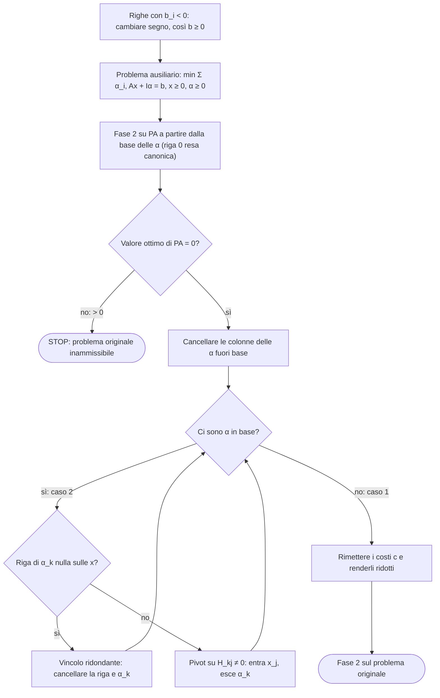

# Lezione 10 — Fase 1 e problema ausiliario

> [!info] Fonti di questa nota
> Trascrizione della lezione (un'unica parte; le conversazioni di sottofondo e un annuncio dei rappresentanti degli studenti durante la pausa sono esclusi), appunti manuali (scansione della lezione 10, due pagine) e dispense [@roma2023, §6.5.1–6.5.3]: i tre esempi della lezione sono gli Esempi 6.5.2, 6.5.3 e 6.5.4 delle dispense, con gli stessi dati. Le note di Di Summa [@disumma2015, §3.6] presentano lo stesso metodo. Le parti prese solo da queste fonti, e i calcoli aggiunti per verifica, sono indicati esplicitamente.

> [!warning] Discrepanza tra fonti — data della lezione
> La trascrizione riporta come data di registrazione il **28/10/2026**, gli appunti scansionati il **27/10/2026** (un martedì). Come per le lezioni 9 e 11, la data di registrazione segue la lezione; nel front-matter è indicato il 27/10.

La lezione sviluppa la **fase 1** del metodo del simplesso, avviata alla fine della [[Lezione 09 - Forma tableau, convergenza e ciclaggio|lezione 9]]. Il problema ausiliario con le **variabili artificiali** permette di decidere se il problema originale è **ammissibile**; quando lo è, dal tableau finale si eliminano i **vincoli ridondanti** e si costruisce la **prima SBA** per la fase 2. Si vedono un esempio inammissibile, uno ammissibile in cui l'uscita è immediata, e l'impostazione del caso più laborioso, con variabili artificiali rimaste in base.

## Ripasso: il problema ausiliario

Il problema è in forma standard, $\min c^T x$, $Ax = b$, $x \ge 0$, con $A \in \mathbb{R}^{m \times n}$. La fase 1 deve: (1) stabilire se il poliedro è non vuoto; (2) in caso affermativo, fare in modo che il rango di $A$ sia massimo, uguale al numero delle righe; (3) costruire la prima soluzione di base ammissibile.

Si introducono le **variabili artificiali** $\alpha_1, \dots, \alpha_m$, una per riga, e si considera il **problema ausiliario**

$$
\text{(PA)}\qquad
\begin{cases}
\min\ \alpha_1 + \alpha_2 + \dots + \alpha_m \\
Ax + I_m \alpha = b \\
x \ge 0,\ \alpha \ge 0 .
\end{cases}
$$

È un problema nuovo, che cambia la funzione obiettivo e "non ha niente a che vedere" con il problema originale (PO): serve solo a stabilire la condizione (1) e a ottenere, se il poliedro è non vuoto, anche (2) e (3).

> [!warning] Correzione della docente — il vettore dei costi di (PA)
> La volta precedente il vettore dei costi era stato scritto come $(1, \dots, 1)$. Le variabili di (PA) sono però $n + m$: le $x$ e le $\alpha$. Il vettore corretto è
> $$ c = (\underbrace{0, \dots, 0}_{x}, \underbrace{1, \dots, 1}_{\alpha}) \in \mathbb{R}^{n+m} . $$
> Allo stesso modo, nel punto ammissibile vengono **prima le $x$ e poi le $\alpha$**: $(0, \dots, 0 \mid b)$.

Le proprietà viste nella lezione 9 restano: la matrice $\begin{pmatrix} A & I_m \end{pmatrix}$ ha rango $m$ grazie all'identità; il punto $(0 \mid b)$ è ammissibile **se $b \ge 0$**, ipotesi che si assume e che non è restrittiva, perché basta moltiplicare per $-1$ all'inizio le righe con termine noto negativo; ed è una SBA, con le $\alpha$ in base e le $x$ fuori base. Si è quindi nelle ipotesi della fase 2.

## Il teorema che collega (PA) e (PO)

> [!important] Teorema — ammissibilità del problema originale
> Il problema originale (PO) è **ammissibile**, cioè il suo poliedro è non vuoto, **se e solo se** il problema ausiliario (PA) ha una soluzione ottima $(x^*, \alpha^*)$ con
> $$ \sum_{i=1}^m \alpha_i^* = 0 . $$

Si è creato un problema con più variabili del precedente, ma con una forma particolarmente vantaggiosa per partire col simplesso, la cui soluzione dice se il problema originale è ammissibile. In pratica:

1. si costruisce (PA), introducendo le variabili artificiali;
2. lo si risolve con la fase 2, partendo dalla base delle $\alpha$;
3. se il valore ottimo è $0$, il poliedro di (PO) è **non vuoto** (e si vedrà come costruire la sua prima SBA); se è **strettamente positivo**, il poliedro di (PO) è **vuoto**.

**Perché (PA) non può essere illimitato.** Nel ragionamento si è dato per scontato che (PA) abbia soluzione; manca il caso in cui sia illimitato. Non può esserlo: le $\alpha_i$ sono tutte non negative, quindi $\sum_i \alpha_i \ge 0$ per ogni punto ammissibile. "Male che mi vada farò $0$": sotto $0$ non si può andare, il problema è limitato inferiormente e, per il teorema fondamentale (il poliedro di (PA) è non vuoto e in forma standard), ha soluzione ottima. Il valore ottimo è comunque $\ge 0$.

*Dimostrazione del teorema.*

**(PO ammissibile $\Rightarrow$ ottimo di PA nullo).** Sia $P \neq \varnothing$ e sia $\bar x = (\bar x_1, \dots, \bar x_n) \in P$: $A\bar x = b$ e $\bar x \ge 0$. Il punto $(\bar x_1, \dots, \bar x_n, 0, \dots, 0)$, con le $x$ prese da $\bar x$ e tutte le $\alpha$ nulle, è ammissibile per (PA): $A\bar x + I_m \cdot 0 = A\bar x = b$, $\bar x \ge 0$, $\alpha = 0 \ge 0$. In questo punto la funzione obiettivo di (PA) vale $0 + \dots + 0 = 0$, e sotto $0$ non si può andare: è una soluzione ottima, con $\sum \alpha_i^* = 0$.

**(Ottimo di PA nullo $\Rightarrow$ PO ammissibile).** Sia $(x^*, \alpha^*)$ una soluzione ottima di (PA) con $\sum_i \alpha_i^* = 0$. Una somma di numeri non negativi è nulla solo se lo sono tutti: $\alpha_1^* = \dots = \alpha_m^* = 0$. Il punto è ammissibile per (PA), quindi verifica le equazioni:

$$
A x^* + I_m \alpha^* = b \quad\text{con } \alpha^* = 0 \quad\Longrightarrow\quad A x^* = b ,
$$

e inoltre $x^* \ge 0$. Quindi $x^* \in P$: il problema originale è ammissibile. $\square$

La prima freccia "non ci interessa molto": se si sa già che il poliedro è non vuoto, non si fa la fase 1 (a meno di non saper trovare una SBA). La freccia interessante è la seconda: risolvere il problema ausiliario permette di **trovare** un punto ammissibile per il problema originale, se c'è. E poiché vale il "se e solo se", se invece il valore ottimo di (PA) è strettamente positivo, il problema originale è **inammissibile**. Il teorema e la sua dimostrazione sono nelle dispense [@roma2023, Teorema 6.5.1 e Corollario 6.5.1].

## Esempio 1: un problema inammissibile

> [!example] Testo
> $$
> \begin{cases}
> \max\ -x_1 - x_2 \\
> -x_1 + 2x_2 \le -1 \\
> -x_1 + x_2 \ge 1 \\
> x_1 \ge 0,\ x_2 \ge 0
> \end{cases}
> $$

**Forma standard.** Il problema "è scritto male". C'è un massimo e si lavora col minimo: cambiando segno, $\max(-x_1 - x_2) = -\min(x_1 + x_2)$. Il primo vincolo è un "$\le$" e richiede una slack $x_3$; il secondo è un "$\ge$" e richiede una surplus $x_4$:

$$
\begin{cases}
\min\ x_1 + x_2 \\
-x_1 + 2x_2 + x_3 = -1 \\
-x_1 + x_2 - x_4 = 1 \\
x_1, x_2, x_3, x_4 \ge 0
\end{cases}
\qquad
A = \begin{pmatrix} -1 & 2 & 1 & 0 \\ -1 & 1 & 0 & -1 \end{pmatrix}, \quad
b = \begin{pmatrix} -1 \\ 1 \end{pmatrix}, \quad m = 2,\ n = 4 .
$$

Le variabili sono solo due, quindi una base si potrebbe trovare a mano. Ma si noti la differenza con il caso delle sole slack: "a noi piace aggiungere le slack perché così viene l'identità". Qui la surplus dà un $-1$, e cambiare il segno della riga non aiuta, perché il termine noto diventa negativo e la base non è ammissibile. A priori non si sa se il problema è ammissibile, né come trovare una SBA: si applica la fase 1.

> [!warning] Discrepanza tra fonti — testo e dati negli appunti
> Negli appunti la funzione obiettivo è scritta "$\max -x_1\, x_2$", senza il segno davanti a $x_2$; la trasformazione nello stesso foglio ($\min x_1 + x_2$) e le dispense [@roma2023, Esempio 6.5.4] confermano $\max -x_1 - x_2$. Il vettore dei termini noti è scritto $b = (1, 1)$, mentre la prima equazione ha termine noto $-1$: $(1, 1)$ è il vettore **dopo** il cambio di segno della prima riga. Infine la prima riga della matrice $\tilde A$ di (PA) è scritta $(1, 2, -1, 0, 1, 0)$: il coefficiente di $x_2$ dopo il cambio di segno è $-2$, come nel tableau dello stesso foglio.

**$b \ge 0$.** Prima di partire si cambia segno alla prima equazione, che ha termine noto $-1$: $x_1 - 2x_2 - x_3 = 1$. "Questo lo dovete fare tutte le volte che avete un termine noto negativo."

**Problema ausiliario.** Due equazioni, due variabili artificiali:

$$
\begin{cases}
\min\ \alpha_1 + \alpha_2 \\
x_1 - 2x_2 - x_3 + \alpha_1 = 1 \\
-x_1 + x_2 - x_4 + \alpha_2 = 1 \\
x \ge 0,\ \alpha \ge 0
\end{cases}
\qquad
\tilde A = \begin{pmatrix} 1 & -2 & -1 & 0 & 1 & 0 \\ -1 & 1 & 0 & -1 & 0 & 1 \end{pmatrix}.
$$

Si sa già che è ammissibile: $(0, 0, 0, 0, 1, 1)$ è una SBA, con quattro $x$ e due $\alpha$.

**Il tableau, e un'attenzione.** Scrivendo il tableau con la funzione obiettivo così com'è si ottiene:

| base | $x_1$ | $x_2$ | $x_3$ | $x_4$ | $\alpha_1$ | $\alpha_2$ | $\bar b$ |
| --- | --- | --- | --- | --- | --- | --- | --- |
| (riga 0) | $0$ | $0$ | $0$ | $0$ | $1$ | $1$ | $0$ |
| $\alpha_1$ | $1$ | $-2$ | $-1$ | $0$ | $1$ | $0$ | $1$ |
| $\alpha_2$ | $-1$ | $1$ | $0$ | $-1$ | $0$ | $1$ | $1$ |

"C'è qualcosa che non va rispetto a quello che vi ho spiegato l'altra volta": **non è il tableau di una forma canonica**. Le variabili in base sono $\alpha_1$ e $\alpha_2$, e nella riga 0 i loro coefficienti devono essere $0$; invece sono $1, 1$, perché si è partiti dalla funzione obiettivo com'era. Non è sbagliato partire così, anzi conviene: basta ricordare che quella riga non contiene ancora i costi ridotti, e fare subito la prima operazione sul tableau. Poiché sotto le $\alpha$ c'è l'identità, basta **sostituire la riga 0 con la riga 0 meno tutte le altre righe**. Per un problema ausiliario è sempre così.

| base | $x_1$ | $x_2$ | $x_3$ | $x_4$ | $\alpha_1$ | $\alpha_2$ | $\bar b$ |
| --- | --- | --- | --- | --- | --- | --- | --- |
| (riga 0) | $0$ | $1$ | $1$ | $1$ | $0$ | $0$ | $-2$ |
| $\alpha_1$ | $1$ | $-2$ | $-1$ | $0$ | $1$ | $0$ | $1$ |
| $\alpha_2$ | $-1$ | $1$ | $0$ | $-1$ | $0$ | $1$ | $1$ |

A lezione il primo calcolo della riga 0 è stato sbagliato (era uscito $(0, -3, -1, \dots)$) e corretto su segnalazione degli studenti: la riga corretta è quella in tabella, verificata.

**Conclusione.** Il vettore dei costi ridotti è $\gamma^T = (0, 1, 1, 1)$: nessun elemento negativo, quindi il criterio di ottimalità è soddisfatto e la SBA corrente è **ottima** per (PA). È $(0, 0, 0, 0, 1, 1)$: $\alpha_1^* = \alpha_2^* = 1$, e la funzione obiettivo vale $\alpha_1^* + \alpha_2^* = 2$, come si legge nell'angolo in alto a destra cambiato di segno. Poiché $2 \neq 0$, **il problema originale è inammissibile**.

> [!example] Verifica grafica
> Il problema è in $\mathbb{R}^2$. Bisogna stare sotto la retta $-x_1 + 2x_2 = -1$ (cioè $x_2 \le \tfrac{x_1 - 1}{2}$) e sopra la retta $-x_1 + x_2 = 1$ (cioè $x_2 \ge x_1 + 1$), nel primo quadrante. Le due condizioni insieme richiederebbero $x_1 + 1 \le \tfrac{x_1 - 1}{2}$, cioè $x_1 \le -3$, incompatibile con $x_1 \ge 0$ (passaggio algebrico aggiunto): l'insieme ammissibile è effettivamente vuoto.

## Uscire dalla fase 1 quando il problema è ammissibile

"La fatica più grande" della fase 1 arriva quando il problema originale è **ammissibile**: restano due passi, eliminare i vincoli ridondanti (per avere una matrice di rango $m$) e costruire la prima SBA. Ci si mette quindi nella situazione in cui (PA) ha soluzione ottima con $\alpha^* = 0$.

**Il tableau finale.** Al termine del simplesso applicato a (PA) la base contiene $m$ variabili:

- $q$ variabili **artificiali** in base, raccolte nel vettore $\alpha_B \in \mathbb{R}^q$;
- $p$ variabili **originali** in base, raccolte nel vettore $x_B \in \mathbb{R}^p$;

con $p + q = m$. Per semplificare (un'ipotesi "che avrei dovuto fare dall'inizio"), si suppone che le variabili in base siano le prime: $\alpha_B = (\alpha_1, \dots, \alpha_q)$ e $x_B = (x_1, \dots, x_p)$. Raggruppando prima le $\alpha$ e poi le $x$, la forma canonica finale si scrive

$$
\begin{pmatrix} I_q & 0 \\ 0 & I_p \end{pmatrix}
\begin{pmatrix} \alpha_B \\ x_B \end{pmatrix}
+
\begin{pmatrix} G & H \end{pmatrix}
\begin{pmatrix} \alpha_N \\ x_N \end{pmatrix}
=
\begin{pmatrix} 0 \\ \vdots \\ 0 \\ x_1^* \\ \vdots \\ x_p^* \end{pmatrix} .
$$

La matrice identità $m \times m$ è divisa in due blocchi solo per tenere separate le $\alpha$ dalle $x$; $\begin{pmatrix} G & H \end{pmatrix}$ è la matrice $B^{-1}N$ divisa allo stesso modo: $G$ moltiplica le artificiali fuori base $\alpha_N$, $H$ le originali fuori base $x_N$. A destra, le $\alpha$ in base valgono $0$ (all'ottimo tutte le $\alpha^*$ sono nulle) e le $x$ in base valgono $x_1^*, \dots, x_p^*$.

**Primo passo, sempre: cancellare le $\alpha$ fuori base.** Le variabili artificiali fuori base sono nulle e devono restarlo: la loro funzione era solo ausiliaria. Leggendo per esempio la prima riga, $\alpha_1 + (\text{riga 1 di } G)\,\alpha_N + (\text{riga 1 di } H)\,x_N = 0$, con $\alpha_N = 0$ il termine con $G$ sparisce e l'uguaglianza resta vera. Si cancellano quindi le colonne di $G$, ottenendo un sistema equivalente in cui, oltre a $\alpha_B$, compaiono solo le $x$.

Ci sono due casi, che "cambiano un po' il modo di procedere".

### Caso 1: nessuna variabile artificiale in base ($q = 0$)

Allora $p = m$: in base ci sono $m$ variabili originali, e la forma canonica, cancellate le colonne di $G$, diventa

$$
I_m \begin{pmatrix} x_1 \\ \vdots \\ x_m \end{pmatrix} + H x_N = \begin{pmatrix} x_1^* \\ \vdots \\ x_m^* \end{pmatrix} .
$$

È già la forma canonica del problema originale rispetto alla base $\{x_1, \dots, x_m\}$, con SBA $x^*$: si ha il tableau per la fase 2. L'unica cosa che non va è la **riga dei costi**, che è quella di (PA): va sostituita con i costi $c$ del problema originale, e poi resa canonica annullando i coefficienti delle variabili in base (sottraendo opportuni multipli delle righe), così da ottenere i costi ridotti.

### Caso 2: variabili artificiali in base ($q \ge 1$, $p < m$)

Se ci sono variabili artificiali in base, valgono $0$ (il problema originale è ammissibile, quindi $\alpha^* = 0$): la base finale è **degenere**. Il tableau non dà direttamente una SBA del problema originale, perché le variabili $x$ in base sono meno di $m$. Proprio perché la base è degenere, è permesso **eliminare una variabile artificiale dalla base e sostituirla con una $x$**. Per ogni $\alpha_k$ in base si guarda la sua riga, nella parte di $H$, cioè i coefficienti delle variabili originali fuori base:

- se **la riga $k$ di $H$ è tutta nulla**, l'equazione corrispondente, con $\alpha_k = 0$, si riduce a $0 = 0$: il vincolo è **ridondante** e si **cancella** (è "l'eliminazione dei vincoli ridondanti");
- se **esiste un elemento non nullo** $H_{kj}$, lo si usa come **pivot**: entra in base la variabile originale corrispondente ed esce $\alpha_k$. Questo si può fare **sia che il coefficiente sia positivo sia che sia negativo**: nella riga il termine noto è $0$, quindi dividere per un numero negativo non rende negativo nulla. È uno **scambio degenere**: cambia la base, non il punto.

Si procede finché non ci sono più variabili artificiali in base. Gli esempi del caso 2 sono svolti nella [[Lezione 11 - Uscita dalla fase 1 e introduzione alla dualità|lezione 11]].

> [!tip] Approfondimento — Perché una riga nulla significa vincolo ridondante #approfondimento
> Il tableau finale si ottiene dalla matrice iniziale $\begin{pmatrix} A & I_m \end{pmatrix}$ con operazioni elementari sulle righe, che non cambiano il rango della parte relativa alle $x$, cioè della matrice $A$. Se nella riga di una $\alpha_k$ in base tutti i coefficienti delle $x$ sono nulli (quelli delle $x$ in base lo sono comunque, per la struttura dell'identità), la parte $x$ del tableau ha una riga nulla, quindi rango minore di $m$: le righe di $A$ erano dipendenti. Le note di Di Summa usano lo stesso argomento al contrario. Lì si assume già $\operatorname{rk}(A) = m$, verificata a parte con l'eliminazione di Gauss; ne segue che la riga di una variabile ausiliaria in base ha sempre un elemento non nullo sulle $x$, e il pivot degenere è sempre possibile [@disumma2015, §3.6, caso (1b)]. Il corso, come le dispense [@roma2023, §6.5.2], affida invece alla fase 1 anche la scoperta dei vincoli ridondanti.

Lo schema completo della fase 1 è il seguente.

## Esempio 2: un problema ammissibile (caso 1)

> [!example] Testo
> $$
> \begin{cases}
> \min\ -4x_1 - x_2 - x_3 \\
> 2x_1 + x_2 + 2x_3 = 4 \\
> 3x_1 + 3x_2 + x_3 = 3 \\
> x \ge 0
> \end{cases}
> $$

Il problema è già in forma standard, con $b = (4, 3) \ge 0$: si possono introdurre direttamente le variabili artificiali.

$$
\text{(PA)}\qquad
\begin{cases}
\min\ \alpha_1 + \alpha_2 \\
2x_1 + x_2 + 2x_3 + \alpha_1 = 4 \\
3x_1 + 3x_2 + x_3 + \alpha_2 = 3 \\
x \ge 0,\ \alpha \ge 0 .
\end{cases}
$$

**I costi ridotti senza tableau.** "Per quelli che non hanno gradito il tableau", in questi casi è molto semplice calcolare i costi ridotti direttamente. Si ricavano le variabili in base in funzione delle altre,

$$
\alpha_1 = 4 - 2x_1 - x_2 - 2x_3, \qquad \alpha_2 = 3 - 3x_1 - 3x_2 - x_3,
\qquad\Longrightarrow\qquad
\alpha_1 + \alpha_2 = 7 - 5x_1 - 4x_2 - 3x_3 .
$$

Le operazioni sono le stesse che si farebbero sul tableau: i costi ridotti sono $(-5, -4, -3)$ e il valore iniziale è $7$.

| base | $x_1$ | $x_2$ | $x_3$ | $\alpha_1$ | $\alpha_2$ | $\bar b$ |
| --- | --- | --- | --- | --- | --- | --- |
| (riga 0) | $-5$ | $-4$ | $-3$ | $0$ | $0$ | $-7$ |
| $\alpha_1$ | $2$ | $1$ | $2$ | $1$ | $0$ | $4$ |
| $\alpha_2$ | $3$ | $3$ | $1$ | $0$ | $1$ | $3$ |

**Prima iterazione.** Il costo ridotto più piccolo è quello di $x_1$: $h = 1$, perché $x_1$ è la prima variabile fuori base. Rapporti: $4/2 = 2$ e $3/3 = 1$; il minimo è $1$: **entra $x_1$, esce $\alpha_2$**. Si divide la seconda riga per $3$, ottenendo $(1, 1, \tfrac13, 0, \tfrac13 \mid 1)$; alla riga di $\alpha_1$ si sottrae due volte la nuova riga; alla riga 0 si aggiungono cinque volte la nuova riga.

| base | $x_1$ | $x_2$ | $x_3$ | $\alpha_1$ | $\alpha_2$ | $\bar b$ |
| --- | --- | --- | --- | --- | --- | --- |
| (riga 0) | $0$ | $1$ | $-\tfrac43$ | $0$ | $\tfrac53$ | $-2$ |
| $\alpha_1$ | $0$ | $-1$ | $\tfrac43$ | $1$ | $-\tfrac23$ | $2$ |
| $x_1$ | $1$ | $1$ | $\tfrac13$ | $0$ | $\tfrac13$ | $1$ |

**Seconda iterazione.** La soluzione non è ottima: il costo ridotto di $x_3$ è ancora negativo, $-\tfrac43$. Rapporti sulla colonna di $x_3$: $2 / \tfrac43 = \tfrac32$ e $1 / \tfrac13 = 3$; il minimo è $\tfrac32$: **entra $x_3$, esce $\alpha_1$**. Si moltiplica la riga di $\alpha_1$ per $\tfrac34$; alla riga 0 si aggiungono $\tfrac43$ volte la nuova riga; alla riga di $x_1$ si sottrae $\tfrac13$ della nuova riga ($R_2 \leftarrow R_2 - \tfrac13 R_1$, negli appunti).

| base | $x_1$ | $x_2$ | $x_3$ | $\alpha_1$ | $\alpha_2$ | $\bar b$ |
| --- | --- | --- | --- | --- | --- | --- |
| (riga 0) | $0$ | $0$ | $0$ | $1$ | $1$ | $0$ |
| $x_3$ | $0$ | $-\tfrac34$ | $1$ | $\tfrac34$ | $-\tfrac12$ | $\tfrac32$ |
| $x_1$ | $1$ | $\tfrac54$ | $0$ | $-\tfrac14$ | $\tfrac12$ | $\tfrac12$ |

**Fine della fase 1.** I costi ridotti, relativi a $x_2, \alpha_1, \alpha_2$, sono tutti non negativi: la soluzione è ottima. Mettendo prima le $x$, è $\left(\tfrac12, 0, \tfrac32 \mid 0, 0\right)$: le $\alpha$ sono nulle e il valore di (PA) è $0$, quindi **il problema originale è ammissibile**.

**La prima SBA.** Non ci sono variabili artificiali in base (in base ci sono $x_3$ e $x_1$, "avevamo già due variabili $x$ in base, e ce ne servono due"): è il caso 1. Si cancellano le colonne di $\alpha_1$ e $\alpha_2$; ciò che resta è il tableau del problema originale, insieme alla SBA di partenza $\bar x = \left(\tfrac12, 0, \tfrac32\right)$. Resta da scrivere la riga dei costi: si dimentica quella di (PA) e si rimette quella originale, $(-4, -1, -1 \mid 0)$, che però così "non vale": va scritta usando solo le variabili fuori base, annullando i coefficienti di $x_1$ e $x_3$. Da qui si prosegue con la fase 2.

| base | $x_1$ | $x_2$ | $x_3$ | $\bar b$ |
| --- | --- | --- | --- | --- |
| (riga 0, non ancora canonica) | $-4$ | $-1$ | $-1$ | $0$ |
| $x_3$ | $0$ | $-\tfrac34$ | $1$ | $\tfrac32$ |
| $x_1$ | $1$ | $\tfrac54$ | $0$ | $\tfrac12$ |

> [!example] Completamento: la fase 2 (calcolo non svolto a lezione)
> Per annullare i coefficienti delle variabili in base si aggiungono alla riga 0 quattro volte la riga di $x_1$ e una volta la riga di $x_3$:
> $$ (-4, -1, -1 \mid 0) + 4\left(1, \tfrac54, 0 \mid \tfrac12\right) + \left(0, -\tfrac34, 1 \mid \tfrac32\right) = \left(0, \tfrac{13}{4}, 0 \;\middle|\; \tfrac72\right). $$
> L'unico costo ridotto, quello di $x_2$, vale $\tfrac{13}{4} > 0$: la SBA di partenza è già ottima, ed è l'unica soluzione ottima. $x^* = \left(\tfrac12, 0, \tfrac32\right)$, con valore $-\tfrac72$ (controllo: $-4 \cdot \tfrac12 - \tfrac32 = -\tfrac72$; vincoli: $1 + 3 = 4$ e $\tfrac32 + \tfrac32 = 3$).

## Esempio 3: impostazione del caso 2

Negli ultimi minuti la docente ha iniziato un esercizio in cui alla fine della fase 1 resta una variabile artificiale in base, lasciando da finire a casa ("provate a farlo, ad arrivare in fondo e a eliminare le variabili $\alpha$ in base").

> [!example] Testo
> $$
> \begin{cases}
> \min\ 2x_1 + 3x_2 + x_3 \\
> x_1 + x_2 + x_3 = 2 \\
> -x_1 + 2x_2 = 1 \\
> 3x_2 + x_3 = 3 \\
> x \ge 0
> \end{cases}
> $$

Il problema è in forma standard con $b = (2, 1, 3) \ge 0$. Il problema ausiliario ha tre equazioni e tre variabili artificiali, $\min\ \alpha_1 + \alpha_2 + \alpha_3$. Per rendere canonica la riga 0 la si sostituisce con $R_0 - R_1 - R_2 - R_3$:

| base | $x_1$ | $x_2$ | $x_3$ | $\alpha_1$ | $\alpha_2$ | $\alpha_3$ | $\bar b$ |
| --- | --- | --- | --- | --- | --- | --- | --- |
| (riga 0) | $0$ | $-6$ | $-2$ | $0$ | $0$ | $0$ | $-6$ |
| $\alpha_1$ | $1$ | $1$ | $1$ | $1$ | $0$ | $0$ | $2$ |
| $\alpha_2$ | $-1$ | $2$ | $0$ | $0$ | $1$ | $0$ | $1$ |
| $\alpha_3$ | $0$ | $3$ | $1$ | $0$ | $0$ | $1$ | $3$ |

La soluzione attuale non è ottima: $\gamma_2 = -6$ e $\gamma_3 = -2$ sono negativi. Si prende il più negativo: **entra $x_2$**. Rapporti: $2/1 = 2$, $1/2 = \tfrac12$, $3/3 = 1$; il minimo è $\tfrac12$: **esce $\alpha_2$**. A lezione ci si è fermati qui; l'esercizio è completato nella lezione 11.

> [!warning] Discrepanza nella trascrizione — i rapporti
> Nella trascrizione i rapporti sono letti come "3 fratto 3, 3 fratto 2, 2 fratto 1", in un ordine e con valori non coerenti con la colonna di $x_2$. La conclusione detta a lezione ("entra $x_2$, esce $\alpha_2$") è quella corretta: i rapporti sono $2$, $\tfrac12$ e $1$, come confermano la ripresa dell'esercizio nella lezione 11 e le dispense [@roma2023, Esempio 6.5.2].

## Riepilogo

- Problema ausiliario: $\min \sum_i \alpha_i$, $Ax + I\alpha = b$, $x, \alpha \ge 0$, con costi $(0 \mid 1)$ e $b \ge 0$ (righe col termine noto negativo moltiplicate per $-1$). Ha rango $m$, il punto $(0 \mid b)$ e la base delle $\alpha$. Non può essere illimitato, perché $\sum \alpha_i \ge 0$.
- **Teorema**: (PO) è ammissibile $\iff$ (PA) ha ottimo con $\sum \alpha_i^* = 0$ (cioè tutte le $\alpha_i^* = 0$). Se il valore ottimo di (PA) è positivo, (PO) è inammissibile.
- Il primo tableau di (PA) non è in forma canonica: la riga 0 va sostituita con la riga 0 meno la somma delle altre righe (in alternativa, si esprimono le $\alpha$ in funzione delle $x$).
- Esempio inammissibile: $\max -x_1 - x_2$, $-x_1 + 2x_2 \le -1$, $-x_1 + x_2 \ge 1$; ottimo di (PA) $= 2 > 0$.
- Uscita dalla fase 1 con valore $0$: si cancellano le colonne delle $\alpha$ fuori base. **Caso 1** (nessuna $\alpha$ in base): si ha già il tableau del problema originale; si rimettono i costi $c$ e si azzerano sotto le variabili in base. **Caso 2** ($\alpha$ in base, base degenere): riga della $\alpha$ nulla sulle $x$ $\Rightarrow$ vincolo ridondante, si cancella; altrimenti pivot su un elemento non nullo (di qualunque segno) per scambiare $\alpha$ con una $x$.
- Esempio ammissibile: $\min -4x_1 - x_2 - x_3$; la fase 1 termina con base $\{x_3, x_1\}$ e SBA $\left(\tfrac12, 0, \tfrac32\right)$, che è anche ottima per il problema originale (valore $-\tfrac72$).
